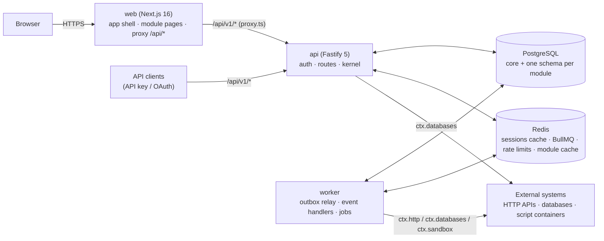
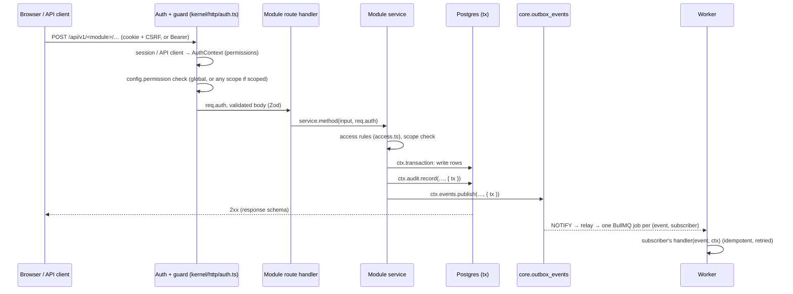

# System map

The platform as it runs today. Read this before changing anything that crosses a module boundary.

## Processes

- **api** (`apps/api/src/main.ts`) and **worker** (`apps/api/src/worker.ts`) are the same image. Both build the
  **kernel** (`createKernel`). Only the worker runs consumers: the outbox relay, event handlers, module jobs and
  scheduled jobs.
- **web** (`apps/web`) renders the shell and every page. `src/proxy.ts` forwards `/api/*` to `API_INTERNAL_URL` and
  sets the CSP nonce. Server components call the API with the session cookie.
- **migrate** (`dist/migrate.js`) and **seed** (`dist/seed.js`) are one-shot entrypoints of the api image.

## A request, end to end

- **Errors:** handlers throw `HttpError(status, code, message, details)`. The kernel renders
  `{ error: { code, message, details, requestId } }`. Zod failures become `400 VALIDATION_FAILED`, with
  `details.issues`.
- **Context:** `ctx.principal()` (from async context) is the user, API client, AI agent or `system:module:<id>`.
  Audit rows are attributed automatically.
- **Rate limiting** is global per IP/principal (`RATE_LIMIT_MAX`) plus per route (`config.rateLimit`).

## Data ownership

| Owner                                  | Schema                        | Who writes            | Who may read                                       |
| -------------------------------------- | ----------------------------- | --------------------- | -------------------------------------------------- |
| Core (identity, RBAC, audit, platform) | `core`                        | core services, kernel | every module (`@isbp/db/schema`)                   |
| Module `<id>`                          | `<id>` (dashes → underscores) | that module only      | that module, and modules listing it in `dependsOn` |
| Cross-module links                     | `core.record_links`           | `ctx.records`         | via `ctx.records` (resolved per viewer)            |
| Attachments                            | `core.files` + blob storage   | `ctx.files`           | via `ctx.files` / core routes                      |
| Shared semantic index                  | `core.ai_chunks`              | `ctx.ai.index`        | `ctx.ai.index.search` (ACL-filtered)               |
| External database connections          | `core.db_connections`         | core admin routes     | via `ctx.databases`                                |

The audit log (`core.audit_logs`) is append-only and hash-chained. Postgres triggers refuse UPDATE and DELETE.

## How modules are loaded

1. `pnpm modules:sync` discovers workspace packages under `modules/` with `"isbp": { "module": true }` and writes:
   - `apps/api/src/generated/modules.ts` (server entries, core first);
   - `apps/web/src/generated/modules.ts` (web entries);
   - both `generated/module-messages.ts` (catalog loaders).
2. At start-up the kernel validates every manifest (`defineManifest`) and server definition
   (`defineServerModule`), runs migrations in dependency order, and syncs permissions, roles, workflow triggers
   and settings into core tables (`registry.sync`).
3. Routes mount at `/api/v1/<id>`. Events subscribe through the outbox. Jobs with `schedule` get BullMQ
   schedulers in the worker. AI tools register in the gateway's tool registry. Record and task types register in
   their registries.
4. Admins can disable a module (Administration → Modules). Its routes then return `404 MODULE_DISABLED`, its
   handlers are skipped, its slots and nav entries disappear, and its record and task types resolve as
   `unavailable`. Modules that `dependsOn` it must be disabled first.

## The web side

- `/<moduleId>/<path…>` is served by one Next.js route (`app/(app)/[module]/[[...slug]]`). `ModuleHost` matches
  the path against the module's `defineWebModule({ routes })` patterns and lazy-loads the page component.
  Static core routes (`/admin/*`, `/settings`, `/requests`, `/approvals`) take precedence.
- The shell (sidebar, command palette, notifications) is core. The sidebar renders `manifest.navigation` filtered
  by permission. Entries with the same `group` sit together, ordered by `order`.
- **Platform context** (`usePlatform()`): the user, their grants, the CSRF token and the enabled modules.
  `useCan(permission)` gates UI only.
- **Messages:** core namespaces live in `packages/i18n/messages/<locale>/*.json`; module catalogs in
  `modules/<id>/messages/<locale>.json`, under the namespace `<id>`. All of them load for every page.
- **Slots:** `<Slot name props />` renders the contributions of enabled modules the viewer may see
  (`useSlot(name)` lists them).

## Kernel services (what `ModuleContext` gives you)

| Service                       | Phase | One-line purpose                                                          |
| ----------------------------- | ----- | ------------------------------------------------------------------------- |
| `db`, `transaction`           | 0     | Drizzle on the platform Postgres; atomic work                             |
| `audit`, `events`, `jobs`     | 0     | Audit rows, transactional outbox, background jobs                         |
| `settings`, `rbac`, `logger`  | 0     | Module settings (admin-editable), permissions of others, pino logger      |
| `workflows`, `notifications`  | 1     | Approval workflows; in-app/email/Teams/Slack notifications                |
| `fields`, `forms`, `portal`   | 1     | Custom fields; form submissions; "My requests" items                      |
| `ai`                          | 2     | Chat/stream/embed via the governed gateway, semantic index, tool registry |
| `records`, `files`, `secrets` | 3     | Cross-module links, attachments, sealed secrets                           |
| `databases`, `taskTypes`      | 4     | External databases; work Scheduled Jobs can run                           |
| `http`, `cache`, `sandbox`    | 4     | Outbound HTTP (SSRF-guarded); Redis cache/rate limits; script containers  |
| `sync`, `connectors`          | 5     | Sync adapters of data modules; connectors to outside systems (the hub)    |

Signatures and semantics are in [api-reference.md](api-reference.md).

## Background work

| Kind                        | Declared in                                                       | Runs                                                      |
| --------------------------- | ----------------------------------------------------------------- | --------------------------------------------------------- |
| Event handler               | `defineServerModule({ events })`                                  | Worker, after commit, at least once, retried with backoff |
| Module job (fixed schedule) | `defineServerModule({ jobs: { x: { schedule } } })`               | Worker, BullMQ scheduler (cron in `tz`, or `everyMs`)     |
| Module job (on demand)      | `jobs` + `ctx.jobs.enqueue(name, data)`                           | Worker queue `isbp-m-<id>`                                |
| Workflow completion         | `defineServerModule({ workflows: { trigger: { onCompleted } } })` | Worker, via the outbox                                    |
| Task type (admin-scheduled) | `manifest.taskTypes` + `taskTypes` handlers                       | Scheduled Jobs' worker, with retries, logs, alerts        |

## Security model in one screen

- **Authentication:** session cookie (`isbp_session`, HttpOnly) + CSRF header for browsers. API keys or OAuth
  client-credentials tokens for API clients (service principals). AI agents act as declared identities.
- **Authorization:** permissions `module.resource.action`, granted through roles to users and groups, at global,
  department or record scope, optionally time-bound. Route guards check first; services check scope.
- **Data protection:**
  - Secrets are sealed with AES-256-GCM (master key, rotation-aware).
  - The audit log is immutable.
  - Personal data is masked before external AI calls.
  - Uploads are sniffed, checked against the blocklist and scanned.
  - Outbound HTTP is SSRF-guarded at connect time.
  - External SQL only ever uses bound parameters.
- **Headers:** CSP with a nonce, HSTS, frame-ancestors none, nosniff. Rate limits apply per IP or principal and
  per route.
