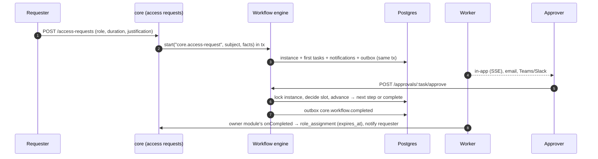
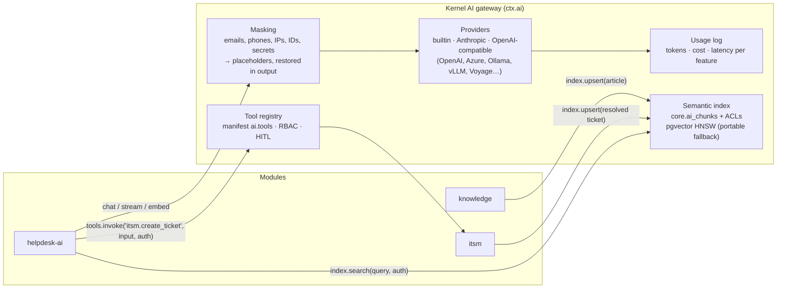

# IS Big Platform — Architecture

> Status: Phase 2 (ITSM, CMDB, Knowledge Base, Helpdesk AI and the AI gateway) on top of Phase 1 (workflows,
> forms, notifications, access requests, Role Query API) and the Phase 0 foundation. This document is the
> design baseline that later phases extend.

## 1. Shape of the system

IS Big Platform (ISBP) is a **modular monolith**: one deployable API process (plus a worker process from the
same image) that hosts a small, stable **kernel** and any number of **modules**. Every feature — including
the ones we ship — is a module built on the same SDK. A Next.js web app renders the shell and module pages.


### Request path (authenticated API call)

```mermaid
sequenceDiagram
  autonumber
  participant U as Browser
  participant N as Next.js (proxy.ts)
  participant F as Fastify kernel
  participant R as Redis
  participant D as Postgres
  U->>N: PATCH /api/v1/users/:id (cookie isbp_session, x-csrf-token)
  N->>F: proxied unchanged
  F->>F: requestId + OTel span + rate limit
  F->>D: session lookup by sha256(token)
  F->>F: CSRF check (cookie auth + unsafe method)
  F->>R: permission snapshot (user, rbacVersion)
  alt cache miss
    F->>D: assignments ∪ group assignments → grants
    F->>R: cache snapshot
  end
  F->>F: route guard: can("core.users.update", scope)
  F->>D: BEGIN; UPDATE users; INSERT audit_logs; INSERT outbox_events; NOTIFY; COMMIT
  F-->>U: 200 JSON (Zod-serialized)
  Note over D,R: worker relay moves outbox → BullMQ → module event handlers
```

## 2. Repository layout

```text
isbp/
├─ apps/
│  ├─ api/                     Fastify API + worker (one image, three entrypoints)
│  │  └─ src/
│  │     ├─ main.ts            HTTP server entry
│  │     ├─ worker.ts          outbox relay + BullMQ workers + schedulers
│  │     ├─ migrate.ts / seed.ts
│  │     ├─ telemetry.ts       OpenTelemetry bootstrap (loaded first)
│  │     ├─ kernel/            auth, sessions, rbac, audit, events, jobs, modules, search, http plumbing
│  │     ├─ core/              the "core" system module (identity, RBAC, audit, admin routes)
│  │     └─ generated/         installed-module registry (written by `pnpm modules:sync`)
│  └─ web/                     Next.js App Router shell
│     └─ src/
│        ├─ app/               (auth)/login, (app)/… core pages, [module]/[[...slug]] module host
│        ├─ components/        shell (sidebar, topbar, command palette), admin feature components
│        ├─ i18n/              next-intl request config (en, zh-TW, ja-JP)
│        ├─ lib/               api client, query hooks, session helpers
│        └─ generated/         installed-module web registry
├─ packages/
│  ├─ sdk/                     @isbp/sdk — manifest spec, defineServerModule, defineWebModule, permission matching
│  ├─ db/                      @isbp/db — Drizzle client, core schema, migration runner, migrations
│  ├─ contracts/               @isbp/contracts — Zod DTOs shared by API and web
│  ├─ i18n/                    @isbp/i18n — locale list + core message catalogs
│  ├─ ui/                      @isbp/ui — shadcn/ui components, motion primitives, DataTable
│  └─ create-module/           @isbp/create-module — `create-module <name>` scaffolder + registry sync
├─ modules/
│  └─ announcements/           sample module generated by the CLI (server + web + migrations + messages)
├─ tooling/                    shared tsconfig / eslint presets, dev-services (embedded Postgres + Redis)
├─ infra/
│  ├─ docker/                  api.Dockerfile, web.Dockerfile
│  ├─ compose/                 docker-compose.yml (full stack), observability extras
│  └─ helm/isbp/               Helm chart (api, worker, web, migrations Job, HPA, PDB, ingress)
├─ e2e/                        Playwright tests
├─ docs/                       architecture, module guide, API, operations
└─ .github/workflows/ci.yml
```

## 3. Core data model (Phase 0 tables solid, later phases dashed)

All core tables live in the Postgres schema `core`; each module owns its own schema (e.g. `announcements`).
Primary keys are UUIDv7 (time-ordered → index friendly). Every mutable table has `created_at/updated_at`.


**Later phases plug into the same keys** (not built in Phase 0): `api_clients` (Role Query API credentials,
Phase 1), `role_requests` → `workflow_instances`/`approval_tasks` (Phase 1), `custom_field_definitions` +
`form_definitions` writing into each entity's `attributes` JSONB (Phase 1), `notifications` (Phase 1),
`ai_usage` + `ai_tool_calls` (Phase 5).

## 4. Module manifest spec

A module is a workspace package with three entry points:

| Entry                        | Runs in      | Purpose                                                                  |
| ---------------------------- | ------------ | ------------------------------------------------------------------------ |
| `@isbp/module-<id>/manifest` | API + web    | Declarative, serializable description (validated with Zod at boot)       |
| `@isbp/module-<id>/server`   | API + worker | Routes, event handlers, jobs, AI tool handlers, search, migrations, seed |
| `@isbp/module-<id>/web`      | web          | Page components keyed by path, i18n messages                             |

```ts
export interface ModuleManifest {
  id: string; // kebab-case, unique, also Postgres schema + URL segment
  version: string; // semver
  name: string; // i18n key, e.g. "announcements.meta.name"
  description?: string; // i18n key
  icon?: string; // lucide icon name
  system?: boolean; // cannot be disabled (core)
  dependsOn?: string[]; // other module ids (enable order + checks)
  navigation?: NavEntry[]; // sidebar entries, each gated by a permission
  permissions?: PermissionDef[]; // "<id>.<resource>.<action>", synced into core.permissions
  roles?: RoleTemplate[]; // system roles synced from the manifest (read-only in the UI)
  events?: {
    emits?: EventDef[]; // name "<id>.<entity>.<verb-past>" + Zod payload schema
    consumes?: string[]; // event names this module subscribes to
  };
  settings?: SettingDef[]; // typed settings, rendered as an admin form
  ai?: { tools: AiToolDef[] }; // exposed through AI gateway / MCP with RBAC + HITL flags
  search?: { entities: string[] };
}

interface NavEntry {
  id: string;
  label: string;
  href: string;
  icon?: string;
  permission?: string;
  section?: 'main' | 'admin';
  order?: number;
  children?: NavEntry[];
}
interface PermissionDef {
  key: string;
  description: string;
  scopes?: ('global' | 'department' | 'record')[];
}
interface RoleTemplate {
  key: string;
  name: string;
  description?: string;
  permissions: string[]; // patterns, e.g. 'announcements.posts.*'
  grantByDefault?: boolean; // granted to the implicit "Everyone" group when first created
}
interface EventDef {
  name: string;
  description?: string;
  schema?: ZodType; // payloads are validated on publish
}
interface SettingDef {
  key: string;
  label: string; // i18n key
  type: 'string' | 'text' | 'number' | 'boolean' | 'select' | 'secret'; // secrets encrypted at rest
  default?: string | number | boolean | null;
  options?: { value: string; label: string }[];
  advanced?: boolean; // hidden behind "Advanced" in the generated settings form
}
interface AiToolDef {
  name: string;
  description: string;
  input: ZodType;
  permission: string;
  destructive?: boolean; /* requires human confirmation */
}
```

Server side (`defineServerModule(manifest, { … })`):

```ts
export default defineServerModule(manifest, {
  migrations,                                   // embedded SQL (generated by `pnpm db:generate`)
  routes: (app, ctx) => {                       // Fastify plugin, mounted at /api/v1/<id>
    app.get('/posts', { config: { permission: 'announcements.posts.read' }, schema: {…} }, handler);
  },
  events: { 'core.user.offboarded': async (evt, ctx) => { … } },
  jobs: { 'expire-old': { schedule: { cron: '0 * * * *' }, handler: async (job, ctx) => { … } } },
  ai: { 'announcements.list_current': async (input, ctx, auth) => { … } },
  search: async (query, ctx) => [{ type: 'announcement', id, title, href }],
  seed: async (ctx) => { … },                   // demo data
});
```

Rules the kernel enforces: routes are **authenticated and permission-gated by default** (`config.public`
opts out); a disabled module returns `404 MODULE_DISABLED` and its handlers/jobs/search are skipped; module
tables must live in the module's own schema; cross-module calls go through events or public HTTP APIs.
Module UI strings live in the module's own catalogs (namespace = module id, en/zh-TW/ja-JP), including
labels for its audit actions. See [module-development.md](module-development.md) for the full guide.

## 5. Key technical decisions

| #   | Decision                                                                                                                                                                  | Why                                                                                                                                                                                                                                                           | Alternatives considered                                                                                                                                        |
| --- | ------------------------------------------------------------------------------------------------------------------------------------------------------------------------- | ------------------------------------------------------------------------------------------------------------------------------------------------------------------------------------------------------------------------------------------------------------- | -------------------------------------------------------------------------------------------------------------------------------------------------------------- |
| 1   | **pnpm workspaces + Turborepo**                                                                                                                                           | Convention-based, fast cached pipelines, `turbo prune` for lean Docker builds                                                                                                                                                                                 | Nx (more powerful, more config)                                                                                                                                |
| 2   | **Fastify 5** for the API                                                                                                                                                 | Encapsulated plugins map 1:1 to runtime-pluggable modules, so built-in and custom modules use the same SDK with no special cases. Zod type provider gives one schema for validation, TS types and OpenAPI 3.1. Low overhead, native pino logging.             | NestJS: DI modules are a compile-time graph (awkward to enable/disable at runtime), decorator-heavy, and it duplicates validation (class-validator) beside Zod |
| 3   | **Drizzle ORM + custom migration runner**                                                                                                                                 | Schema in TS split per module, Postgres schema per module, native JSONB/pgvector types, SQL-transparent for perf tuning. Our runner embeds migrations in the bundle, takes a Postgres advisory lock (safe with many replicas), and tracks per-module history. | Prisma: single schema/client, no per-module ownership, pgvector via `Unsupported`                                                                              |
| 4   | **Zod 4 everywhere** (`@isbp/contracts`)                                                                                                                                  | One contract shared by API validation, OpenAPI, React Hook Form and manifest validation                                                                                                                                                                       | Separate DTO/JSON-schema layers                                                                                                                                |
| 5   | **Server-side sessions** (opaque token, HttpOnly cookie, SHA-256 at rest) + double-submit CSRF token                                                                      | Instant revocation on offboarding / suspension, no token leakage in JS                                                                                                                                                                                        | JWT (hard to revoke)                                                                                                                                           |
| 6   | **SSO**: openid-client (OIDC, Entra ID preset), node-saml (SAML 2.0), ldapts (LDAP/AD bind + directory sync); argon2id for local                                          | Standards-based, provider configs stored in DB with AES-256-GCM-encrypted secrets                                                                                                                                                                             | Auth SaaS (not suitable for on-prem IT)                                                                                                                        |
| 7   | **RBAC**: permission keys `module.resource.action` with wildcards; role assignments to users or groups, scoped global / department-subtree / record, with optional expiry | Covers least-privilege, time-bound access and Phase 1 Role Query API (`applications` already modelled)                                                                                                                                                        | Pure ABAC engine (overkill for day one; scopes leave room for it)                                                                                              |
| 8   | **Permission snapshots cached in Redis**, invalidated by a global `rbacVersion` counter                                                                                   | O(1) checks per request, correct invalidation across replicas                                                                                                                                                                                                 | Per-request DB joins                                                                                                                                           |
| 9   | **Transactional outbox → BullMQ** for domain events                                                                                                                       | Events commit atomically with data; BullMQ gives per-subscriber retries, backoff, concurrency and visibility                                                                                                                                                  | In-memory emitter (lossy), Kafka (heavy for a monolith)                                                                                                        |
| 10  | **Append-only audit log** enforced by DB trigger + per-row SHA-256                                                                                                        | Tamper-evident and immutable even against application bugs; partition by month later                                                                                                                                                                          | App-level only                                                                                                                                                 |
| 11  | **Installed vs enabled modules**: installed = compiled in via generated registries; enabled = runtime flag in DB with Redis pub/sub fan-out                               | Next.js and bundlers need modules at build time; admins still toggle at runtime without redeploys                                                                                                                                                             | Fully dynamic runtime loading (fragile, insecure)                                                                                                              |
| 12  | **Next.js 16 App Router**, `proxy.ts` forwards `/api/*` at runtime (env-configurable), module pages served by one catch-all host route                                    | Same-origin cookies, no CORS, one image for every environment                                                                                                                                                                                                 | Build-time rewrites (URL baked into image)                                                                                                                     |
| 13  | **next-intl**, locale from user profile → cookie → `Accept-Language`; `en`, `zh-TW`, `ja-JP`; each module ships its own catalogs                                          | No locale URL prefix needed for an internal app; CI test keeps catalogs key-identical                                                                                                                                                                         | i18next                                                                                                                                                        |
| 14  | **shadcn/ui + Tailwind 4 + Motion** (`motion/react`, the Framer Motion successor)                                                                                         | Owned, accessible Radix components; `MotionConfig reducedMotion="user"` honours `prefers-reduced-motion` globally                                                                                                                                             | Component library lock-in                                                                                                                                      |
| 15  | **OpenTelemetry + pino + prom-client**; metrics on a separate internal port                                                                                               | Standard signals; metrics never exposed via ingress                                                                                                                                                                                                           | Vendor agents                                                                                                                                                  |
| 16  | **UUIDv7 keys**                                                                                                                                                           | Time-ordered (B-tree friendly), safe to expose, generated app-side                                                                                                                                                                                            | bigserial (enumerable), UUIDv4 (index churn)                                                                                                                   |
| 17  | **Embedded dev services** (`pnpm dev:services`: embedded Postgres + Redis) besides docker-compose                                                                         | Contributors without Docker can run the whole stack                                                                                                                                                                                                           | Docker-only                                                                                                                                                    |

## 6. Security model (Phase 0)

- Secure by default: every route requires a session or API credential and a declared permission unless marked `public`.
- Sessions: 256-bit random token, only its SHA-256 stored; `HttpOnly; SameSite=Lax; Secure` (prod); idle and absolute timeouts; revoked on logout, suspension and offboarding.
- CSRF: per-session token required in `x-csrf-token` for unsafe methods when authenticated by cookie.
- Brute force: per-IP + per-account rate limits on login; temporary account lock after repeated failures.
- Secrets at rest: AES-256-GCM with a versioned master key (`ISBP_MASTER_KEY`), never returned by the API.
- Headers: helmet on the API; strict CSP with per-request nonce, HSTS, frame-ancestors none on the web app.
- Least privilege: system roles are narrow (`platform-admin` is the only `*`), assignments can expire, and expiry is enforced by a scheduled job **and** at check time.
- Audit: logins (success/failure), permission denials, every admin mutation, module toggles and IdP changes.

## 7. Delivery phases

| Phase                     | Scope                                                                                                                                                                                                                                     |
| ------------------------- | ----------------------------------------------------------------------------------------------------------------------------------------------------------------------------------------------------------------------------------------- |
| **0 – Foundation** (done) | Monorepo, app shell (animated nav, light/dark, command palette, en/zh-TW/ja-JP), auth (local, OIDC, SAML, LDAP), users/groups/departments, RBAC, module system + `create-module`, audit log, event bus, docker-compose, Helm skeleton, CI |
| **1** (done)              | Workflow/approvals engine, custom fields, form builder, notifications, role request portal, Role Query API                                                                                                                                |
| **2** (done)              | ITSM core, Knowledge Base, Helpdesk AI (pgvector RAG)                                                                                                                                                                                     |
| 3                         | Asset Management, Project Management, Application Lifecycle                                                                                                                                                                               |
| 4                         | ETL/API Builder, Scheduled Jobs, Database Account Management                                                                                                                                                                              |
| 5                         | Integrations Hub, MCP server, AI assistant everywhere                                                                                                                                                                                     |

## 8. Phase 1 design: workflows, forms, notifications, access requests, Role Query API

Phase 1 adds **platform services** that every module consumes through `ModuleContext`, exactly like audit and
events: `ctx.workflows`, `ctx.notifications` and `ctx.fields`. Their admin APIs and screens belong to the core
module. Modules opt in from their manifest with three new optional keys:

```ts
workflows?: WorkflowTriggerDef[];          // attach points, e.g. "announcements.publish"
notifications?: NotificationTypeDef[];     // types users can tune in their preferences
customFields?: { entities: CustomFieldEntityDef[] }; // entities whose `attributes` admins can extend
```

### 8.1 Data model additions (schema `core`)


`roles` gains `requestable`, `risk_level`, `owner_id`, `max_duration_days` and an optional
`request_workflow_id` override. `groups` and `departments` gain an `attributes` JSONB column like `users`,
each with a GIN index for custom-field filters.

### 8.2 Workflow model

A workflow is a **structured tree of steps**, not a free-form graph, so every definition is valid by
construction and the visual builder never produces dangling edges:

| Step        | Meaning                                                                                                                                                                                                                                                                                                                                                                                                              |
| ----------- | -------------------------------------------------------------------------------------------------------------------------------------------------------------------------------------------------------------------------------------------------------------------------------------------------------------------------------------------------------------------------------------------------------------------- |
| `approval`  | One or more **approver slots** (user, group, platform role, requester's manager chain, department head, or a user id taken from the facts), each with an optional **fallback**. Modes: `any` (first answer wins), `all`, or `quorum` (N of M). Options: SLA (due/remind hours, then notify, escalate, auto-approve or auto-reject), delegation, self-approval (off by default), and what to do when nobody resolves. |
| `parallel`  | Branches that run at the same time, each a sequence of steps; it completes when every branch is approved                                                                                                                                                                                                                                                                                                             |
| `condition` | The first branch whose condition matches runs, otherwise the default branch (`role.riskLevel = high`, `form.amount > 1500`, …)                                                                                                                                                                                                                                                                                       |
| `notify`    | An FYI notification to people (no decision)                                                                                                                                                                                                                                                                                                                                                                          |

Every step may also carry a `when` condition (skipped unless it holds). Any rejection ends the instance.
The interpreter (`@isbp/sdk` → `advanceWorkflow`) is a **pure function** of graph, state and facts. The API
uses it to drive instances, and the builder uses the same code to simulate a path in the browser. The
engine locks the instance row (`SELECT … FOR UPDATE`) while it applies a decision, so concurrent approvers
on parallel steps are safe.



SLA timers are rows (`due_at`, `remind_at`) scanned by a once-a-minute job on partial indexes, rather than
one delayed job per task. They survive a Redis flush and are idempotent.

### 8.3 Forms and custom fields share one field model

`FieldDef` (in `@isbp/sdk`) describes a field: type (text, textarea, number, boolean, date, select,
multiselect, email, url, user), a label in en/zh-TW/ja-JP, validation and a `visibleWhen` condition.
Custom fields are FieldDefs attached to an entity type and stored in that entity's `attributes` JSONB.
Forms are versioned lists of FieldDefs plus display elements (heading, paragraph, divider). The same
`validateFields()` function runs in the browser (React Hook Form resolver) and in the API. Hidden fields
are stripped before validation, so conditional logic can never be bypassed by posting hidden values.

### 8.4 Notifications

`ctx.notifications.notify({ type, recipients, params, href }, { tx })` writes in-app rows in the caller's
transaction. Each row is rendered in its **recipient's locale** from the module's catalog
(`<module>.notifications.<name>.title|body`, ICU). The outbox then hands it to the worker, which delivers
email (SMTP), Microsoft Teams (Workflows webhook, Adaptive Card), Slack (incoming webhook, Block Kit) and
signed generic webhooks. Delivery honours each user's preferences per type and channel; `mandatory` types
cannot be switched off. A `notification_deliveries` row per channel makes retries idempotent. Browsers get
live updates over Server-Sent Events, fanned out from Redis pub/sub. Webhook URLs are secrets, encrypted
at rest, and private-network targets are refused unless explicitly allowed (SSRF guard).

### 8.5 Role Query API and API clients

External applications live in `core.applications` with their own permission catalog and roles, so access
to them is granted, requested, approved, expired and audited like platform roles. **API clients** are
service principals:

- **API keys:** `Authorization: Bearer isbp_sk_…`. Only the SHA-256 is stored, and a client can hold
  several secrets at once for rotation without downtime.
- **OAuth 2.0 client credentials:** `POST /api/v1/oauth/token` returns opaque one-hour bearer tokens,
  held in Redis.

A client's reach is expressed as ordinary grants: `core.role-query.read` scoped to each allowed application
(record scope `application:<id>`), plus optional platform API permissions. These are checked by the same
`PermissionSet` code as users, and bearer requests skip CSRF because they carry no ambient cookies. Routes
without a declared permission (such as `/me/*`) are closed to service principals.

| Endpoint                                              | Answers                                                                                                     |
| ----------------------------------------------------- | ----------------------------------------------------------------------------------------------------------- |
| `GET /api/v1/role-query/users/{user}?application=app` | Roles (with scope, expiry and source) and effective permissions of a user (id, email or username) in an app |
| `POST /api/v1/role-query/check`                       | `{ allowed }` for one permission, optionally for a department or record                                     |
| `GET /api/v1/role-query/applications/{app}/members`   | Everyone holding a role in the app, for provisioning sync                                                   |

### 8.6 Phase 1 decisions

| #   | Decision                                                                             | Why                                                                                                                                 | Alternatives considered                                              |
| --- | ------------------------------------------------------------------------------------ | ----------------------------------------------------------------------------------------------------------------------------------- | -------------------------------------------------------------------- |
| 18  | Structured step tree (sequence / approval / parallel / condition / notify)           | Valid by construction, easy to build visually and to explain; covers sequential, parallel, conditional, delegation, escalation, SLA | BPMN engine (heavy, hard for admins); free-form DAG (invalid graphs) |
| 19  | Pure interpreter shared by API and browser; persisted step state; pinned versions    | Deterministic, unit-testable; the builder's simulator runs the server's code; running instances never change under the admin        | Engine-only logic (no simulation), live definitions                  |
| 20  | Completion callbacks through the outbox (`core.workflow.completed` → owner module)   | Same at-least-once, retrying path as every other event; module work never blocks an approver's click                                | Synchronous in-transaction hooks                                     |
| 21  | SLA timers as indexed rows plus a one-minute scan                                    | Survives Redis loss, idempotent, observable in SQL                                                                                  | One delayed BullMQ job per task                                      |
| 22  | One field model and validator for custom fields and forms                            | Admins learn one builder; identical validation in browser and API; conditional logic enforced server-side                           | JSON Schema + separate form library                                  |
| 23  | Notifications rendered at creation in the recipient's locale                         | Email and in-app show the same text; the web app doesn't need every module's notification catalog                                   | Store keys and render on read (stale-locale-safe but complex)        |
| 24  | SSE + Redis pub/sub for live notifications                                           | One-way, HTTP-friendly through the Next.js proxy and ingress; no WebSocket infra                                                    | WebSockets, polling only                                             |
| 25  | API clients as service principals with ordinary grants; opaque OAuth tokens in Redis | Role Query and API-first automation use the same RBAC checks and audit as people; instant revocation                                | JWT access tokens (hard to revoke), separate ACL model               |

## 9. Phase 2 design: ITSM, CMDB, Knowledge Base, Helpdesk AI

Phase 2 ships four modules on the SDK, plus the **AI gateway** in the kernel, because Helpdesk AI needs
one. The MCP server and the assistant on every page are still Phase 5. They will reuse the same gateway
and tool registry.

| Module        | Depends on          | Owns                                                                                                                                                    |
| ------------- | ------------------- | ------------------------------------------------------------------------------------------------------------------------------------------------------- |
| `cmdb`        | —                   | Configuration items (CIs): classes, typed directional relationships, impact analysis (upstream/downstream traversal)                                    |
| `knowledge`   | —                   | Knowledge articles: categories, versions, review and publish workflow, feedback, review dates. They are indexed for semantic search.                    |
| `itsm`        | `cmdb`              | Incidents, service requests, problems, changes with CAB approval, categories, SLA policies on business calendars, service-catalog fulfilment, dashboard |
| `helpdesk-ai` | `itsm`, `knowledge` | AI triage, similar tickets, KB-grounded reply drafts, summaries, KB drafts from resolved tickets, the self-service virtual agent, and accuracy metrics  |

A module may **read** (never write) the tables of a module it `dependsOn`. For example, ITSM joins
`cmdb.cis` to show CI names. Writes and everything cross-cutting go through events, HTTP APIs or the
**AI tool registry**.

### 9.1 AI gateway (kernel, `ctx.ai`)



- **Providers.** These are configured in **Administration → AI**, and secrets are encrypted at rest.
  - _Chat_ has three options: `none`, `anthropic` (official SDK, default model `claude-opus-5-5`), or
    `openai-compatible` (base URL plus model; covers OpenAI, Azure OpenAI, Ollama, vLLM, LM Studio and
    LiteLLM).
  - _Embeddings_ have two options: `builtin`, or `openai-compatible` (OpenAI, Voyage AI, Ollama, …).
  - The `builtin` embedder runs offline and deterministically. It uses feature hashing of words and
    character n-grams (CJK uni/bigrams), so retrieval works in every language with no key. This is what
    the demo data and the tests use.
  - Without a chat model, every AI feature degrades to a retrieval-based or extractive mode. The UI labels
    that mode honestly.
- **Calls.** `ctx.ai.chat({ feature, system, messages, tools?, schema?, effort? }, { auth })`,
  `ctx.ai.stream(…)` and `ctx.ai.embed(texts)`.
  - Structured output (`schema`, a Zod schema) is used for triage.
  - Tool calls come back to the caller, which decides whether to run them.
  - Every call writes a `core.ai_usage` row: module, feature, principal, provider, model, tokens, cost
    (from per-model prices in settings), latency and status.
  - An optional monthly budget refuses calls once it is spent (`AI_BUDGET_EXCEEDED`).
- **Masking** runs before any external provider call. The categories (email, phone, IP, national-ID and
  credit-card patterns, API keys/secrets, plus custom regexes) are configurable. Values become stable
  placeholders (`[EMAIL_1]`) and are restored in the response, so the provider never sees them.
- **Semantic index.**
  - `ctx.ai.index.upsert({ type, id, title, text, locale, href, acl, metadata })` chunks the text by
    heading and paragraph (about 800 characters, with overlap), embeds the chunks and stores them in
    `core.ai_chunks`.
  - `ctx.ai.index.search(query, { types, auth, limit, filter })` is **hybrid**: vector kNN plus keyword
    matching (`pg_trgm`/ILIKE, which also works for CJK), fused with Reciprocal Rank Fusion.
  - Every chunk carries an **ACL**: a permission and an optional scope, or a list of user ids. Results are
    filtered with the caller's `AuthContext`, so retrieval can never leak what the UI would hide.
  - The embedding column is `vector` with an HNSW index when the `pgvector` extension is available at
    migration time. Production images (`pgvector/pgvector:pg17`) always have it. The Docker-free embedded
    dev Postgres has no pgvector, so there the column is `real[]` with a SQL cosine function. The schema
    and API are the same, it is slower, and Admin → AI shows which mode is active. Changing the embedding
    model re-embeds everything in a background job.
- **Tool registry.** It holds every enabled module's `manifest.ai.tools` with their handlers.
  - `ctx.ai.tools.invoke(name, input, { auth, confirmed })` validates the input, requires the tool's
    permission for that principal, and refuses `destructive` tools unless `confirmed` is set
    (`CONFIRMATION_REQUIRED` + preview). It also audits `core.ai.tool_invoked`.
  - Helpdesk AI reaches ITSM and the knowledge base **only** through these tools. It acts either as the signed-in user
    (interactive features) or as its **agent identity**: an `ai_agent` principal whose permissions the
    manifest declares up front (`ai.agent.permissions`) and which Admin → Modules shows. Phase 5 exposes
    the same registry over MCP.

### 9.2 Platform additions for modules

| Addition                | Shape                                                                                                                                                                                                                                                                                                                                 |
| ----------------------- | ------------------------------------------------------------------------------------------------------------------------------------------------------------------------------------------------------------------------------------------------------------------------------------------------------------------------------------- |
| Web **slots**           | `defineWebModule(m, { routes, slots: [{ slot: 'itsm.ticket.aside', load, permission?, order? }] })`. A host renders `<Slot name="itsm.ticket.aside" props={…} />`, and the contributions of enabled modules appear there. Helpdesk AI fills ITSM's ticket side panel and the request portal this way, without ITSM knowing it exists. |
| Portal entries          | `manifest.portal.entries` adds cards to "What do you need?" (e.g. ITSM "Report an issue", KB "Browse knowledge")                                                                                                                                                                                                                      |
| Request registry        | `ctx.portal.track({ kind, id, reference, title, state, statusLabel, href, people }, { tx })` writes `core.portal_items`, so "My requests" lists module records (e.g. incidents) next to access requests and form submissions                                                                                                          |
| Form fulfilment         | `ctx.forms.submission(id)` reads a submission (form, schema version, answers). `ctx.forms.setFulfilment(id, { reference, href, state, statusLabel }, { tx })` shows a module's fulfilment progress on the request                                                                                                                     |
| `ai.agent` in manifests | `{ name, permissions[] }`: the least-privilege identity a module's background AI work runs as                                                                                                                                                                                                                                         |

### 9.3 ITSM model (schema `itsm`)


- **Lifecycles.** Each ticket type has an explicit state machine, and the API refuses illegal transitions
  (`INVALID_TRANSITION`).
  - Incident: `new → in_progress ⇄ on_hold → resolved → closed`, or `cancelled`. A resolved ticket closes
    automatically after N days unless the requester reopens it.
  - Service request: `new → pending_approval → in_progress → fulfilled → closed`.
  - Problem: `new → investigating → known_error → resolved → closed`.
  - Change: `draft → assessment → authorization → scheduled → implementing → review → closed`, with
    `rejected`/`cancelled`.
- **Priority** comes from the ITIL impact × urgency matrix (P1–P4). Agents can override it, and the
  activity log records the override.
- **SLA.** A policy matches tickets with a condition from the shared condition builder (type, priority,
  category, service, …). It sets response and resolution targets per priority on a **business calendar**
  (time zone, working hours, holidays).
  - Targets pause in the statuses the policy names (e.g. `on_hold`).
  - Instances are rows. A one-minute job warns at the configured percentage and marks breaches, the same
    pattern as Phase 1 approval SLAs.
  - Business-time arithmetic is a pure, unit-tested function.
- **Change and CAB.** Submitting a change for authorization starts the `itsm.change` trigger. It is
  `required` and its default graph is a condition on the change facts:
  - **standard** changes are pre-approved (no step);
  - **emergency** changes go to the ECAB group (any one approver);
  - **normal** changes go to the change manager, then to the CAB group when the risk is high or a
    critical CI is involved.

  Approval schedules the change. The change calendar flags overlapping changes on the same CI.

- **Service catalog.** The questions are Phase 1 forms; ITSM adds the fulfilment. A catalog item maps a
  published form to a category, a fulfilment group, a priority and a moment (on submit, or once approved).
  ITSM handles `core.form-submission.created/completed`. It opens an SR ticket that carries the answers
  and reports progress back with `ctx.forms.setFulfilment`. The requester follows one reference
  (`REQ-…`) from approval to fulfilment.
- **Portal.** "Report an issue" (`/itsm/report`) suggests KB articles while the user types, which deflects
  tickets. The user's own tickets show in "My requests" through the request registry.
  - Requesters see a reduced ticket page: public conversation, status, "this is fixed / still broken" and
    a CSAT rating.
  - Agents see the full workspace: work notes, assignment, SLA timers, links, CIs, approvals and the AI
    side panel.

### 9.4 Knowledge Base (module `knowledge`, schema `knowledge`)

- **Articles.** Each article has a title, a Markdown body, a summary, a category, tags, a locale (with
  translation groups), an audience (everyone, or agents only) and an owner. Status runs
  `draft → in_review → published → retired`, and every publish snapshots a version.
- **Publishing** can require approval through the `knowledge.publish` trigger, which is opt-in like
  announcements.
- **Review dates** produce reminders to owners.
- **Feedback.** Readers mark an article helpful or not, with an optional comment. Negative feedback
  notifies the owner.
- **Search** uses the hybrid index, so a query in one language finds articles in any language. Markdown is
  rendered with `react-markdown` with no raw HTML (XSS-safe).
- **AI tools:** `knowledge.search_articles`, `knowledge.get_article` and `knowledge.create_draft`.

### 9.5 Helpdesk AI

| Feature              | With a chat model                                                                                                                             | Without (builtin)                                                   |
| -------------------- | --------------------------------------------------------------------------------------------------------------------------------------------- | ------------------------------------------------------------------- |
| Triage on create     | kNN over similar resolved tickets, refined by the model with structured output: category, priority, group, assignee, confidence and rationale | Weighted kNN vote with confidence = agreement of neighbours         |
| Similar tickets / KB | Hybrid retrieval                                                                                                                              | Same                                                                |
| Reply draft          | Grounded in the top KB chunks, with numbered citations, in the requester's language                                                           | Templated reply that quotes the best article's steps and links it   |
| Summary              | Abstractive summary of the description and timeline                                                                                           | Extractive (issue, latest updates, current state)                   |
| KB draft from ticket | Problem / cause / resolution article, created as a **draft** via `knowledge.create_draft`                                                     | Same structure, filled from the ticket fields                       |
| Virtual agent        | Streams a grounded answer with citations. It can **propose** a ticket, which the user confirms before `itsm.create_ticket` runs               | Shows the best matching articles, plus a "create a ticket" proposal |

Auto-triage is off by default. When it is enabled and confidence ≥ threshold, the agent identity fills
only the fields that are still empty (`itsm.triage_ticket`), and the ticket timeline credits "Helpdesk AI".
Every suggestion stores what the agent did with it, so the admin page reports triage acceptance, virtual
agent deflection and AI cost.

### 9.6 Phase 2 decisions

| #   | Decision                                                                                   | Why                                                                                                                                                         | Alternatives considered                                  |
| --- | ------------------------------------------------------------------------------------------ | ----------------------------------------------------------------------------------------------------------------------------------------------------------- | -------------------------------------------------------- |
| 26  | AI gateway in the kernel; `builtin` offline embedder and graceful no-LLM modes             | Every module gets AI through one governed, metered, masked path. Demo and tests run with no key or network, and the UI is honest about which mode it is in. | Per-module SDK calls; requiring an LLM to run            |
| 27  | One shared semantic index with per-chunk ACLs; hybrid vector + keyword search (RRF)        | Retrieval respects RBAC by construction. CJK works without language-specific tokenizers. Phase 5 assistant/MCP reuse it.                                    | Per-module vector tables; pure vector search             |
| 28  | pgvector when available, `real[]` fallback chosen at migration time                        | Production gets HNSW. The Docker-free dev setup still works.                                                                                                | Requiring Docker for development; an external vector DB  |
| 29  | Cross-module AI goes through the tool registry, as the user or a declared agent identity   | The same permission checks, audit and HITL as the UI. Least privilege is visible to admins. MCP in Phase 5 is a transport, not a redesign.                  | Direct table access; a service account with broad rights |
| 30  | Single `tickets` table with a type discriminator plus 1:1 detail tables for change/problem | Shared queue, SLA, timeline and search across ITIL processes, with type-specific fields kept typed and indexed                                              | One table per process (duplicated plumbing); JSON blobs  |
| 31  | Catalog = Phase 1 forms + ITSM fulfilment                                                  | Admins build questions and approvals in one builder. Requesters follow one reference. Fulfilment is ordinary ticket work.                                   | A second catalog/form engine inside ITSM                 |
| 32  | Web slots for cross-module UI                                                              | Helpdesk AI decorates ITSM pages while both stay independently installable                                                                                  | Hard imports between modules                             |
