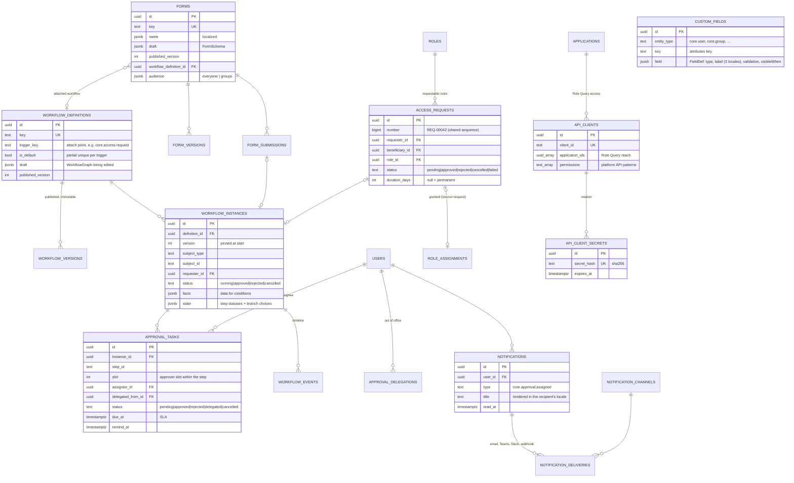
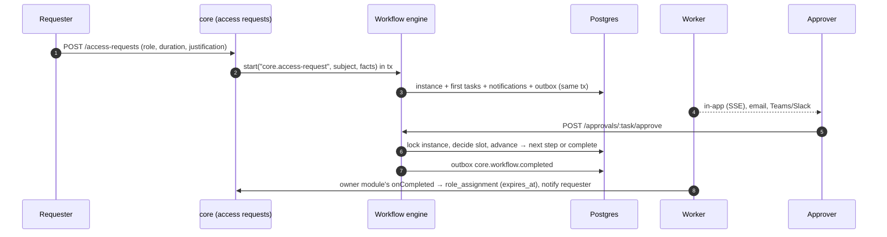
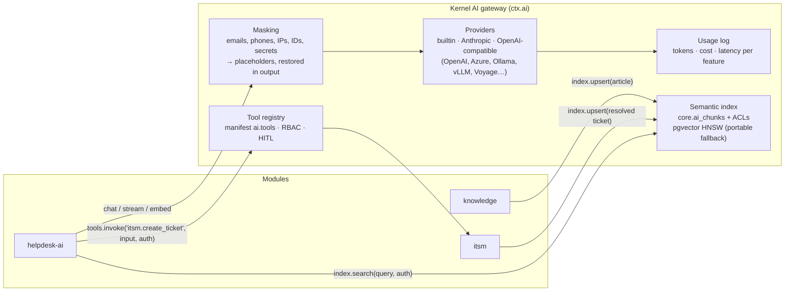
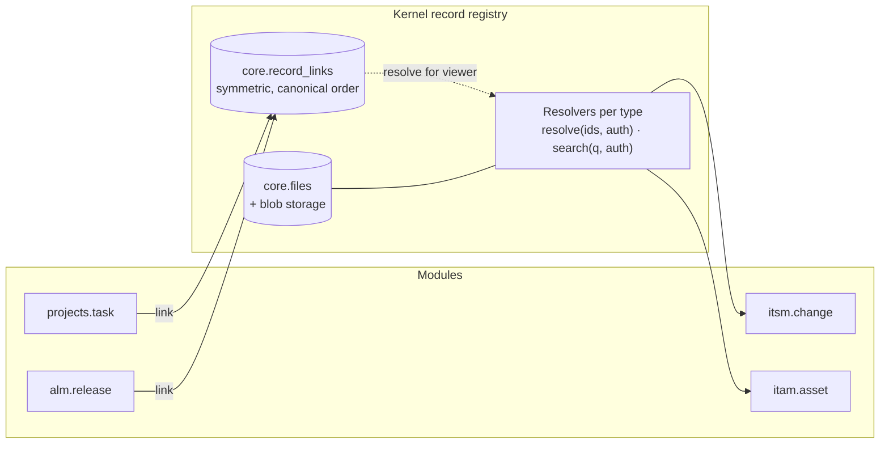
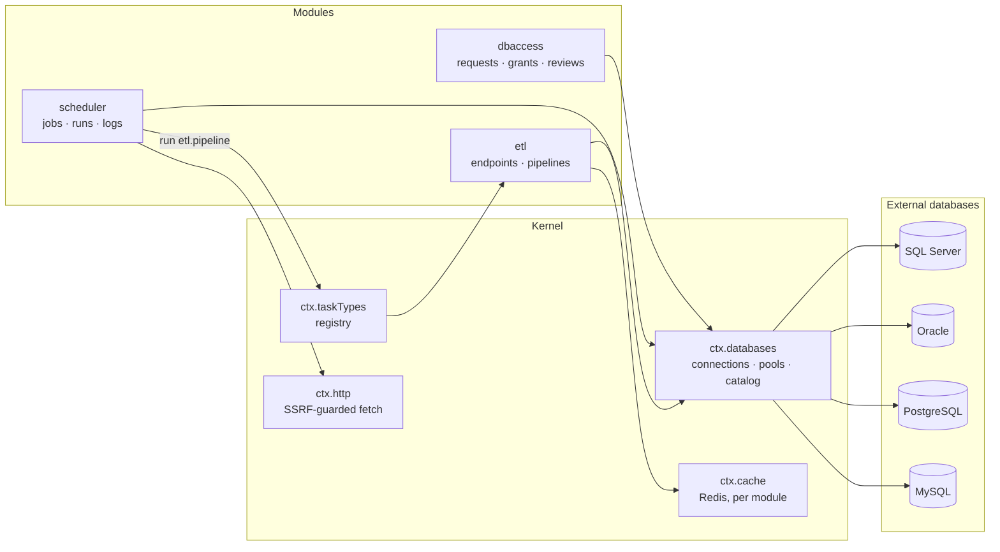

# IS Big Platform — Architecture

> Status: Phase 3 (Asset Management, Project Management, Application Lifecycle, plus record links and
> attachments) on top of Phase 2 (ITSM, CMDB, Knowledge Base, Helpdesk AI and the AI gateway), Phase 1
> (workflows, forms, notifications, access requests, Role Query API) and the Phase 0 foundation. This document
> is the design baseline that later phases extend.

## 1. Shape of the system

IS Big Platform (ISBP) is a **modular monolith**: one deployable API process (plus a worker process from the
same image) that hosts a small, stable **kernel** and any number of **modules**. Every feature — including
the ones we ship — is a module built on the same SDK. A Next.js web app renders the shell and module pages.


### Request path (authenticated API call)

```mermaid
sequenceDiagram
  autonumber
  participant U as Browser
  participant N as Next.js (proxy.ts)
  participant F as Fastify kernel
  participant R as Redis
  participant D as Postgres
  U->>N: PATCH /api/v1/users/:id (cookie isbp_session, x-csrf-token)
  N->>F: proxied unchanged
  F->>F: requestId + OTel span + rate limit
  F->>D: session lookup by sha256(token)
  F->>F: CSRF check (cookie auth + unsafe method)
  F->>R: permission snapshot (user, rbacVersion)
  alt cache miss
    F->>D: assignments ∪ group assignments → grants
    F->>R: cache snapshot
  end
  F->>F: route guard: can("core.users.update", scope)
  F->>D: BEGIN; UPDATE users; INSERT audit_logs; INSERT outbox_events; NOTIFY; COMMIT
  F-->>U: 200 JSON (Zod-serialized)
  Note over D,R: worker relay moves outbox → BullMQ → module event handlers
```

## 2. Repository layout

```text
isbp/
├─ apps/
│  ├─ api/                     Fastify API + worker (one image, three entrypoints)
│  │  └─ src/
│  │     ├─ main.ts            HTTP server entry
│  │     ├─ worker.ts          outbox relay + BullMQ workers + schedulers
│  │     ├─ migrate.ts / seed.ts
│  │     ├─ telemetry.ts       OpenTelemetry bootstrap (loaded first)
│  │     ├─ kernel/            auth, sessions, rbac, audit, events, jobs, modules, search, http plumbing
│  │     ├─ core/              the "core" system module (identity, RBAC, audit, admin routes)
│  │     └─ generated/         installed-module registry (written by `pnpm modules:sync`)
│  └─ web/                     Next.js App Router shell
│     └─ src/
│        ├─ app/               (auth)/login, (app)/… core pages, [module]/[[...slug]] module host
│        ├─ components/        shell (sidebar, topbar, command palette), admin feature components
│        ├─ i18n/              next-intl request config (en, zh-TW, ja-JP)
│        ├─ lib/               api client, query hooks, session helpers
│        └─ generated/         installed-module web registry
├─ packages/
│  ├─ sdk/                     @isbp/sdk — manifest spec, defineServerModule, defineWebModule, permission matching
│  ├─ db/                      @isbp/db — Drizzle client, core schema, migration runner, migrations
│  ├─ contracts/               @isbp/contracts — Zod DTOs shared by API and web
│  ├─ i18n/                    @isbp/i18n — locale list + core message catalogs
│  ├─ ui/                      @isbp/ui — shadcn/ui components, motion primitives, DataTable
│  └─ create-module/           @isbp/create-module — `create-module <name>` scaffolder + registry sync
├─ modules/
│  └─ announcements/           sample module generated by the CLI (server + web + migrations + messages)
├─ tooling/                    shared tsconfig / eslint presets, dev-services (embedded Postgres + Redis)
├─ infra/
│  ├─ docker/                  api.Dockerfile, web.Dockerfile
│  ├─ compose/                 docker-compose.yml (full stack), observability extras
│  └─ helm/isbp/               Helm chart (api, worker, web, migrations Job, HPA, PDB, ingress)
├─ e2e/                        Playwright tests
├─ docs/                       architecture, module guide, API, operations
└─ .github/workflows/ci.yml
```

## 3. Core data model (Phase 0 tables solid, later phases dashed)

All core tables live in the Postgres schema `core`; each module owns its own schema (e.g. `announcements`).
Primary keys are UUIDv7 (time-ordered → index friendly). Every mutable table has `created_at/updated_at`.


**Later phases plug into the same keys** (not built in Phase 0): `api_clients` (Role Query API credentials,
Phase 1), `role_requests` → `workflow_instances`/`approval_tasks` (Phase 1), `custom_field_definitions` +
`form_definitions` writing into each entity's `attributes` JSONB (Phase 1), `notifications` (Phase 1),
`ai_usage` + `ai_tool_calls` (Phase 5).

## 4. Module manifest spec

A module is a workspace package with three entry points:

| Entry                        | Runs in      | Purpose                                                                  |
| ---------------------------- | ------------ | ------------------------------------------------------------------------ |
| `@isbp/module-<id>/manifest` | API + web    | Declarative, serializable description (validated with Zod at boot)       |
| `@isbp/module-<id>/server`   | API + worker | Routes, event handlers, jobs, AI tool handlers, search, migrations, seed |
| `@isbp/module-<id>/web`      | web          | Page components keyed by path, i18n messages                             |

```ts
export interface ModuleManifest {
  id: string; // kebab-case, unique, also Postgres schema + URL segment
  version: string; // semver
  name: string; // i18n key, e.g. "announcements.meta.name"
  description?: string; // i18n key
  icon?: string; // lucide icon name
  system?: boolean; // cannot be disabled (core)
  dependsOn?: string[]; // other module ids (enable order + checks)
  navigation?: NavEntry[]; // sidebar entries, each gated by a permission
  permissions?: PermissionDef[]; // "<id>.<resource>.<action>", synced into core.permissions
  roles?: RoleTemplate[]; // system roles synced from the manifest (read-only in the UI)
  events?: {
    emits?: EventDef[]; // name "<id>.<entity>.<verb-past>" + Zod payload schema
    consumes?: string[]; // event names this module subscribes to
  };
  settings?: SettingDef[]; // typed settings, rendered as an admin form
  ai?: { tools: AiToolDef[] }; // exposed through AI gateway / MCP with RBAC + HITL flags
  search?: { entities: string[] };
}

interface NavEntry {
  id: string;
  label: string;
  href: string;
  icon?: string;
  permission?: string;
  section?: 'main' | 'admin';
  order?: number;
  children?: NavEntry[];
}
interface PermissionDef {
  key: string;
  description: string;
  scopes?: ('global' | 'department' | 'record')[];
}
interface RoleTemplate {
  key: string;
  name: string;
  description?: string;
  permissions: string[]; // patterns, e.g. 'announcements.posts.*'
  grantByDefault?: boolean; // granted to the implicit "Everyone" group when first created
}
interface EventDef {
  name: string;
  description?: string;
  schema?: ZodType; // payloads are validated on publish
}
interface SettingDef {
  key: string;
  label: string; // i18n key
  type: 'string' | 'text' | 'number' | 'boolean' | 'select' | 'secret'; // secrets encrypted at rest
  default?: string | number | boolean | null;
  options?: { value: string; label: string }[];
  advanced?: boolean; // hidden behind "Advanced" in the generated settings form
}
interface AiToolDef {
  name: string;
  description: string;
  input: ZodType;
  permission: string;
  destructive?: boolean; /* requires human confirmation */
}
```

Server side (`defineServerModule(manifest, { … })`):

```ts
export default defineServerModule(manifest, {
  migrations,                                   // embedded SQL (generated by `pnpm db:generate`)
  routes: (app, ctx) => {                       // Fastify plugin, mounted at /api/v1/<id>
    app.get('/posts', { config: { permission: 'announcements.posts.read' }, schema: {…} }, handler);
  },
  events: { 'core.user.offboarded': async (evt, ctx) => { … } },
  jobs: { 'expire-old': { schedule: { cron: '0 * * * *' }, handler: async (job, ctx) => { … } } },
  ai: { 'announcements.list_current': async (input, ctx, auth) => { … } },
  search: async (query, ctx) => [{ type: 'announcement', id, title, href }],
  seed: async (ctx) => { … },                   // demo data
});
```

Rules the kernel enforces: routes are **authenticated and permission-gated by default** (`config.public`
opts out); a disabled module returns `404 MODULE_DISABLED` and its handlers/jobs/search are skipped; module
tables must live in the module's own schema; cross-module calls go through events or public HTTP APIs.
Module UI strings live in the module's own catalogs (namespace = module id, en/zh-TW/ja-JP), including
labels for its audit actions. See [module-development.md](module-development.md) for the full guide.

## 5. Key technical decisions

| #            | Decision                                                                                                                                                                  | Why                                                                                                                                                                                                                                               | Alternatives considered                                                                                                                                        |
| ------------ | ------------------------------------------------------------------------------------------------------------------------------------------------------------------------- | ------------------------------------------------------------------------------------------------------------------------------------------------------------------------------------------------------------------------------------------------- | -------------------------------------------------------------------------------------------------------------------------------------------------------------- |
| 1            | **pnpm workspaces + Turborepo**                                                                                                                                           | Convention-based, fast cached pipelines, `turbo prune` for lean Docker builds                                                                                                                                                                     | Nx (more powerful, more config)                                                                                                                                |
| 2            | **Fastify 5** for the API                                                                                                                                                 | Encapsulated plugins map 1:1 to runtime-pluggable modules, so built-in and custom modules use the same SDK with no special cases. Zod type provider gives one schema for validation, TS types and OpenAPI 3.1. Low overhead, native pino logging. | NestJS: DI modules are a compile-time graph (awkward to enable/disable at runtime), decorator-heavy, and it duplicates validation (class-validator) beside Zod |
| **3** (done) | Asset Management, Project Management, Application Lifecycle; record links and attachments for every module                                                                |
| 4            | **Zod 4 everywhere** (`@isbp/contracts`)                                                                                                                                  | One contract shared by API validation, OpenAPI, React Hook Form and manifest validation                                                                                                                                                           | Separate DTO/JSON-schema layers                                                                                                                                |
| 5            | Integrations Hub (incl. two-way ManageEngine ServiceDesk Plus Cloud and Azure DevOps Server sync), MCP server, AI assistant everywhere                                    |
| 6            | **SSO**: openid-client (OIDC, Entra ID preset), node-saml (SAML 2.0), ldapts (LDAP/AD bind + directory sync); argon2id for local                                          | Standards-based, provider configs stored in DB with AES-256-GCM-encrypted secrets                                                                                                                                                                 | Auth SaaS (not suitable for on-prem IT)                                                                                                                        |
| 7            | **RBAC**: permission keys `module.resource.action` with wildcards; role assignments to users or groups, scoped global / department-subtree / record, with optional expiry | Covers least-privilege, time-bound access and Phase 1 Role Query API (`applications` already modelled)                                                                                                                                            | Pure ABAC engine (overkill for day one; scopes leave room for it)                                                                                              |
| 8            | **Permission snapshots cached in Redis**, invalidated by a global `rbacVersion` counter                                                                                   | O(1) checks per request, correct invalidation across replicas                                                                                                                                                                                     | Per-request DB joins                                                                                                                                           |
| 9            | **Transactional outbox → BullMQ** for domain events                                                                                                                       | Events commit atomically with data; BullMQ gives per-subscriber retries, backoff, concurrency and visibility                                                                                                                                      | In-memory emitter (lossy), Kafka (heavy for a monolith)                                                                                                        |
| 10           | **Append-only audit log** enforced by DB trigger + per-row SHA-256                                                                                                        | Tamper-evident and immutable even against application bugs; partition by month later                                                                                                                                                              | App-level only                                                                                                                                                 |
| 11           | **Installed vs enabled modules**: installed = compiled in via generated registries; enabled = runtime flag in DB with Redis pub/sub fan-out                               | Next.js and bundlers need modules at build time; admins still toggle at runtime without redeploys                                                                                                                                                 | Fully dynamic runtime loading (fragile, insecure)                                                                                                              |
| 12           | **Next.js 16 App Router**, `proxy.ts` forwards `/api/*` at runtime (env-configurable), module pages served by one catch-all host route                                    | Same-origin cookies, no CORS, one image for every environment                                                                                                                                                                                     | Build-time rewrites (URL baked into image)                                                                                                                     |
| 13           | **next-intl**, locale from user profile → cookie → `Accept-Language`; `en`, `zh-TW`, `ja-JP`; each module ships its own catalogs                                          | No locale URL prefix needed for an internal app; CI test keeps catalogs key-identical                                                                                                                                                             | i18next                                                                                                                                                        |
| 14           | **shadcn/ui + Tailwind 4 + Motion** (`motion/react`, the Framer Motion successor)                                                                                         | Owned, accessible Radix components; `MotionConfig reducedMotion="user"` honours `prefers-reduced-motion` globally                                                                                                                                 | Component library lock-in                                                                                                                                      |
| 15           | **OpenTelemetry + pino + prom-client**; metrics on a separate internal port                                                                                               | Standard signals; metrics never exposed via ingress                                                                                                                                                                                               | Vendor agents                                                                                                                                                  |
| 16           | **UUIDv7 keys**                                                                                                                                                           | Time-ordered (B-tree friendly), safe to expose, generated app-side                                                                                                                                                                                | bigserial (enumerable), UUIDv4 (index churn)                                                                                                                   |
| 17           | **Embedded dev services** (`pnpm dev:services`: embedded Postgres + Redis) besides docker-compose                                                                         | Contributors without Docker can run the whole stack                                                                                                                                                                                               | Docker-only                                                                                                                                                    |

## 6. Security model (Phase 0)

- Secure by default: every route requires a session or API credential and a declared permission unless marked `public`.
- Sessions: 256-bit random token, only its SHA-256 stored; `HttpOnly; SameSite=Lax; Secure` (prod); idle and absolute timeouts; revoked on logout, suspension and offboarding.
- CSRF: per-session token required in `x-csrf-token` for unsafe methods when authenticated by cookie.
- Brute force: per-IP + per-account rate limits on login; temporary account lock after repeated failures.
- Secrets at rest: AES-256-GCM with a versioned master key (`ISBP_MASTER_KEY`), never returned by the API.
- Headers: helmet on the API; strict CSP with per-request nonce, HSTS, frame-ancestors none on the web app.
- Least privilege: system roles are narrow (`platform-admin` is the only `*`), assignments can expire, and expiry is enforced by a scheduled job **and** at check time.
- Audit: logins (success/failure), permission denials, every admin mutation, module toggles and IdP changes.

## 7. Delivery phases

| Phase                     | Scope                                                                                                                                                                                                                                     |
| ------------------------- | ----------------------------------------------------------------------------------------------------------------------------------------------------------------------------------------------------------------------------------------- |
| **0 – Foundation** (done) | Monorepo, app shell (animated nav, light/dark, command palette, en/zh-TW/ja-JP), auth (local, OIDC, SAML, LDAP), users/groups/departments, RBAC, module system + `create-module`, audit log, event bus, docker-compose, Helm skeleton, CI |
| **1** (done)              | Workflow/approvals engine, custom fields, form builder, notifications, role request portal, Role Query API                                                                                                                                |
| **2** (done)              | ITSM core, Knowledge Base, Helpdesk AI (pgvector RAG)                                                                                                                                                                                     |
| **3** (done)              | Asset Management, Project Management, Application Lifecycle; record links and attachments for every module                                                                                                                                |
| **4** (done)              | ETL/API Builder, Scheduled Jobs, Database Account Management                                                                                                                                                                              |
| 5                         | Integrations Hub (incl. two-way ManageEngine ServiceDesk Plus Cloud and Azure DevOps Server sync), MCP server, AI assistant everywhere                                                                                                    |

## 8. Phase 1 design: workflows, forms, notifications, access requests, Role Query API

Phase 1 adds **platform services** that every module consumes through `ModuleContext`, exactly like audit and
events: `ctx.workflows`, `ctx.notifications` and `ctx.fields`. Their admin APIs and screens belong to the core
module. Modules opt in from their manifest with three new optional keys:

```ts
workflows?: WorkflowTriggerDef[];          // attach points, e.g. "announcements.publish"
notifications?: NotificationTypeDef[];     // types users can tune in their preferences
customFields?: { entities: CustomFieldEntityDef[] }; // entities whose `attributes` admins can extend
```

### 8.1 Data model additions (schema `core`)



`roles` gains `requestable`, `risk_level`, `owner_id`, `max_duration_days` and an optional
`request_workflow_id` override. `groups` and `departments` gain an `attributes` JSONB column like `users`,
each with a GIN index for custom-field filters.

### 8.2 Workflow model

A workflow is a **structured tree of steps**, not a free-form graph, so every definition is valid by
construction and the visual builder never produces dangling edges:

| Step        | Meaning                                                                                                                                                                                                                                                                                                                                                                                                              |
| ----------- | -------------------------------------------------------------------------------------------------------------------------------------------------------------------------------------------------------------------------------------------------------------------------------------------------------------------------------------------------------------------------------------------------------------------- |
| `approval`  | One or more **approver slots** (user, group, platform role, requester's manager chain, department head, or a user id taken from the facts), each with an optional **fallback**. Modes: `any` (first answer wins), `all`, or `quorum` (N of M). Options: SLA (due/remind hours, then notify, escalate, auto-approve or auto-reject), delegation, self-approval (off by default), and what to do when nobody resolves. |
| `parallel`  | Branches that run at the same time, each a sequence of steps; it completes when every branch is approved                                                                                                                                                                                                                                                                                                             |
| `condition` | The first branch whose condition matches runs, otherwise the default branch (`role.riskLevel = high`, `form.amount > 1500`, …)                                                                                                                                                                                                                                                                                       |
| `notify`    | An FYI notification to people (no decision)                                                                                                                                                                                                                                                                                                                                                                          |

Every step may also carry a `when` condition (skipped unless it holds). Any rejection ends the instance.
The interpreter (`@isbp/sdk` → `advanceWorkflow`) is a **pure function** of graph, state and facts. The API
uses it to drive instances, and the builder uses the same code to simulate a path in the browser. The
engine locks the instance row (`SELECT … FOR UPDATE`) while it applies a decision, so concurrent approvers
on parallel steps are safe.



SLA timers are rows (`due_at`, `remind_at`) scanned by a once-a-minute job on partial indexes, rather than
one delayed job per task. They survive a Redis flush and are idempotent.

### 8.3 Forms and custom fields share one field model

`FieldDef` (in `@isbp/sdk`) describes a field: type (text, textarea, number, boolean, date, select,
multiselect, email, url, user), a label in en/zh-TW/ja-JP, validation and a `visibleWhen` condition.
Custom fields are FieldDefs attached to an entity type and stored in that entity's `attributes` JSONB.
Forms are versioned lists of FieldDefs plus display elements (heading, paragraph, divider). The same
`validateFields()` function runs in the browser (React Hook Form resolver) and in the API. Hidden fields
are stripped before validation, so conditional logic can never be bypassed by posting hidden values.

### 8.4 Notifications

`ctx.notifications.notify({ type, recipients, params, href }, { tx })` writes in-app rows in the caller's
transaction. Each row is rendered in its **recipient's locale** from the module's catalog
(`<module>.notifications.<name>.title|body`, ICU). The outbox then hands it to the worker, which delivers
email (SMTP), Microsoft Teams (Workflows webhook, Adaptive Card), Slack (incoming webhook, Block Kit) and
signed generic webhooks. Delivery honours each user's preferences per type and channel; `mandatory` types
cannot be switched off. A `notification_deliveries` row per channel makes retries idempotent. Browsers get
live updates over Server-Sent Events, fanned out from Redis pub/sub. Webhook URLs are secrets, encrypted
at rest, and private-network targets are refused unless explicitly allowed (SSRF guard).

### 8.5 Role Query API and API clients

External applications live in `core.applications` with their own permission catalog and roles, so access
to them is granted, requested, approved, expired and audited like platform roles. **API clients** are
service principals:

- **API keys:** `Authorization: Bearer isbp_sk_…`. Only the SHA-256 is stored, and a client can hold
  several secrets at once for rotation without downtime.
- **OAuth 2.0 client credentials:** `POST /api/v1/oauth/token` returns opaque one-hour bearer tokens,
  held in Redis.

A client's reach is expressed as ordinary grants: `core.role-query.read` scoped to each allowed application
(record scope `application:<id>`), plus optional platform API permissions. These are checked by the same
`PermissionSet` code as users, and bearer requests skip CSRF because they carry no ambient cookies. Routes
without a declared permission (such as `/me/*`) are closed to service principals.

| Endpoint                                              | Answers                                                                                                     |
| ----------------------------------------------------- | ----------------------------------------------------------------------------------------------------------- |
| `GET /api/v1/role-query/users/{user}?application=app` | Roles (with scope, expiry and source) and effective permissions of a user (id, email or username) in an app |
| `POST /api/v1/role-query/check`                       | `{ allowed }` for one permission, optionally for a department or record                                     |
| `GET /api/v1/role-query/applications/{app}/members`   | Everyone holding a role in the app, for provisioning sync                                                   |

### 8.6 Phase 1 decisions

| #   | Decision                                                                             | Why                                                                                                                                 | Alternatives considered                                              |
| --- | ------------------------------------------------------------------------------------ | ----------------------------------------------------------------------------------------------------------------------------------- | -------------------------------------------------------------------- |
| 18  | Structured step tree (sequence / approval / parallel / condition / notify)           | Valid by construction, easy to build visually and to explain; covers sequential, parallel, conditional, delegation, escalation, SLA | BPMN engine (heavy, hard for admins); free-form DAG (invalid graphs) |
| 19  | Pure interpreter shared by API and browser; persisted step state; pinned versions    | Deterministic, unit-testable; the builder's simulator runs the server's code; running instances never change under the admin        | Engine-only logic (no simulation), live definitions                  |
| 20  | Completion callbacks through the outbox (`core.workflow.completed` → owner module)   | Same at-least-once, retrying path as every other event; module work never blocks an approver's click                                | Synchronous in-transaction hooks                                     |
| 21  | SLA timers as indexed rows plus a one-minute scan                                    | Survives Redis loss, idempotent, observable in SQL                                                                                  | One delayed BullMQ job per task                                      |
| 22  | One field model and validator for custom fields and forms                            | Admins learn one builder; identical validation in browser and API; conditional logic enforced server-side                           | JSON Schema + separate form library                                  |
| 23  | Notifications rendered at creation in the recipient's locale                         | Email and in-app show the same text; the web app doesn't need every module's notification catalog                                   | Store keys and render on read (stale-locale-safe but complex)        |
| 24  | SSE + Redis pub/sub for live notifications                                           | One-way, HTTP-friendly through the Next.js proxy and ingress; no WebSocket infra                                                    | WebSockets, polling only                                             |
| 25  | API clients as service principals with ordinary grants; opaque OAuth tokens in Redis | Role Query and API-first automation use the same RBAC checks and audit as people; instant revocation                                | JWT access tokens (hard to revoke), separate ACL model               |

## 9. Phase 2 design: ITSM, CMDB, Knowledge Base, Helpdesk AI

Phase 2 ships four modules on the SDK, plus the **AI gateway** in the kernel, because Helpdesk AI needs
one. The MCP server and the assistant on every page are still Phase 5. They will reuse the same gateway
and tool registry.

| Module        | Depends on          | Owns                                                                                                                                                    |
| ------------- | ------------------- | ------------------------------------------------------------------------------------------------------------------------------------------------------- |
| `cmdb`        | —                   | Configuration items (CIs): classes, typed directional relationships, impact analysis (upstream/downstream traversal)                                    |
| `knowledge`   | —                   | Knowledge articles: categories, versions, review and publish workflow, feedback, review dates. They are indexed for semantic search.                    |
| `itsm`        | `cmdb`              | Incidents, service requests, problems, changes with CAB approval, categories, SLA policies on business calendars, service-catalog fulfilment, dashboard |
| `helpdesk-ai` | `itsm`, `knowledge` | AI triage, similar tickets, KB-grounded reply drafts, summaries, KB drafts from resolved tickets, the self-service virtual agent, and accuracy metrics  |

A module may **read** (never write) the tables of a module it `dependsOn`. For example, ITSM joins
`cmdb.cis` to show CI names. Writes and everything cross-cutting go through events, HTTP APIs or the
**AI tool registry**.

### 9.1 AI gateway (kernel, `ctx.ai`)



- **Providers.** These are configured in **Administration → AI**, and secrets are encrypted at rest.
  - _Chat_ has three options: `none`, `anthropic` (official SDK, default model `claude-opus-5-5`), or
    `openai-compatible` (base URL plus model; covers OpenAI, Azure OpenAI, Ollama, vLLM, LM Studio and
    LiteLLM).
  - _Embeddings_ have two options: `builtin`, or `openai-compatible` (OpenAI, Voyage AI, Ollama, …).
  - The `builtin` embedder runs offline and deterministically. It uses feature hashing of words and
    character n-grams (CJK uni/bigrams), so retrieval works in every language with no key. This is what
    the demo data and the tests use.
  - Without a chat model, every AI feature degrades to a retrieval-based or extractive mode. The UI labels
    that mode honestly.
- **Calls.** `ctx.ai.chat({ feature, system, messages, tools?, schema?, effort? }, { auth })`,
  `ctx.ai.stream(…)` and `ctx.ai.embed(texts)`.
  - Structured output (`schema`, a Zod schema) is used for triage.
  - Tool calls come back to the caller, which decides whether to run them.
  - Every call writes a `core.ai_usage` row: module, feature, principal, provider, model, tokens, cost
    (from per-model prices in settings), latency and status.
  - An optional monthly budget refuses calls once it is spent (`AI_BUDGET_EXCEEDED`).
- **Masking** runs before any external provider call. The categories (email, phone, IP, national-ID and
  credit-card patterns, API keys/secrets, plus custom regexes) are configurable. Values become stable
  placeholders (`[EMAIL_1]`) and are restored in the response, so the provider never sees them.
- **Semantic index.**
  - `ctx.ai.index.upsert({ type, id, title, text, locale, href, acl, metadata })` chunks the text by
    heading and paragraph (about 800 characters, with overlap), embeds the chunks and stores them in
    `core.ai_chunks`.
  - `ctx.ai.index.search(query, { types, auth, limit, filter })` is **hybrid**: vector kNN plus keyword
    matching (`pg_trgm`/ILIKE, which also works for CJK), fused with Reciprocal Rank Fusion.
  - Every chunk carries an **ACL**: a permission and an optional scope, or a list of user ids. Results are
    filtered with the caller's `AuthContext`, so retrieval can never leak what the UI would hide.
  - The embedding column is `vector` with an HNSW index when the `pgvector` extension is available at
    migration time. Production images (`pgvector/pgvector:pg17`) always have it. The Docker-free embedded
    dev Postgres has no pgvector, so there the column is `real[]` with a SQL cosine function. The schema
    and API are the same, it is slower, and Admin → AI shows which mode is active. Changing the embedding
    model re-embeds everything in a background job.
- **Tool registry.** It holds every enabled module's `manifest.ai.tools` with their handlers.
  - `ctx.ai.tools.invoke(name, input, { auth, confirmed })` validates the input, requires the tool's
    permission for that principal, and refuses `destructive` tools unless `confirmed` is set
    (`CONFIRMATION_REQUIRED` + preview). It also audits `core.ai.tool_invoked`.
  - Helpdesk AI reaches ITSM and the knowledge base **only** through these tools. It acts either as the signed-in user
    (interactive features) or as its **agent identity**: an `ai_agent` principal whose permissions the
    manifest declares up front (`ai.agent.permissions`) and which Admin → Modules shows. Phase 5 exposes
    the same registry over MCP.

### 9.2 Platform additions for modules

| Addition                | Shape                                                                                                                                                                                                                                                                                                                                 |
| ----------------------- | ------------------------------------------------------------------------------------------------------------------------------------------------------------------------------------------------------------------------------------------------------------------------------------------------------------------------------------- |
| Web **slots**           | `defineWebModule(m, { routes, slots: [{ slot: 'itsm.ticket.aside', load, permission?, order? }] })`. A host renders `<Slot name="itsm.ticket.aside" props={…} />`, and the contributions of enabled modules appear there. Helpdesk AI fills ITSM's ticket side panel and the request portal this way, without ITSM knowing it exists. |
| Portal entries          | `manifest.portal.entries` adds cards to "What do you need?" (e.g. ITSM "Report an issue", KB "Browse knowledge")                                                                                                                                                                                                                      |
| Request registry        | `ctx.portal.track({ kind, id, reference, title, state, statusLabel, href, people }, { tx })` writes `core.portal_items`, so "My requests" lists module records (e.g. incidents) next to access requests and form submissions                                                                                                          |
| Form fulfilment         | `ctx.forms.submission(id)` reads a submission (form, schema version, answers). `ctx.forms.setFulfilment(id, { reference, href, state, statusLabel }, { tx })` shows a module's fulfilment progress on the request                                                                                                                     |
| `ai.agent` in manifests | `{ name, permissions[] }`: the least-privilege identity a module's background AI work runs as                                                                                                                                                                                                                                         |

### 9.3 ITSM model (schema `itsm`)


- **Lifecycles.** Each ticket type has an explicit state machine, and the API refuses illegal transitions
  (`INVALID_TRANSITION`).
  - Incident: `new → in_progress ⇄ on_hold → resolved → closed`, or `cancelled`. A resolved ticket closes
    automatically after N days unless the requester reopens it.
  - Service request: `new → pending_approval → in_progress → fulfilled → closed`.
  - Problem: `new → investigating → known_error → resolved → closed`.
  - Change: `draft → assessment → authorization → scheduled → implementing → review → closed`, with
    `rejected`/`cancelled`.
- **Priority** comes from the ITIL impact × urgency matrix (P1–P4). Agents can override it, and the
  activity log records the override.
- **SLA.** A policy matches tickets with a condition from the shared condition builder (type, priority,
  category, service, …). It sets response and resolution targets per priority on a **business calendar**
  (time zone, working hours, holidays).
  - Targets pause in the statuses the policy names (e.g. `on_hold`).
  - Instances are rows. A one-minute job warns at the configured percentage and marks breaches, the same
    pattern as Phase 1 approval SLAs.
  - Business-time arithmetic is a pure, unit-tested function.
- **Change and CAB.** Submitting a change for authorization starts the `itsm.change` trigger. It is
  `required` and its default graph is a condition on the change facts:
  - **standard** changes are pre-approved (no step);
  - **emergency** changes go to the ECAB group (any one approver);
  - **normal** changes go to the change manager, then to the CAB group when the risk is high or a
    critical CI is involved.

  Approval schedules the change. The change calendar flags overlapping changes on the same CI.

- **Service catalog.** The questions are Phase 1 forms; ITSM adds the fulfilment. A catalog item maps a
  published form to a category, a fulfilment group, a priority and a moment (on submit, or once approved).
  ITSM handles `core.form-submission.created/completed`. It opens an SR ticket that carries the answers
  and reports progress back with `ctx.forms.setFulfilment`. The requester follows one reference
  (`REQ-…`) from approval to fulfilment.
- **Portal.** "Report an issue" (`/itsm/report`) suggests KB articles while the user types, which deflects
  tickets. The user's own tickets show in "My requests" through the request registry.
  - Requesters see a reduced ticket page: public conversation, status, "this is fixed / still broken" and
    a CSAT rating.
  - Agents see the full workspace: work notes, assignment, SLA timers, links, CIs, approvals and the AI
    side panel.

### 9.4 Knowledge Base (module `knowledge`, schema `knowledge`)

- **Articles.** Each article has a title, a Markdown body, a summary, a category, tags, a locale (with
  translation groups), an audience (everyone, or agents only) and an owner. Status runs
  `draft → in_review → published → retired`, and every publish snapshots a version.
- **Publishing** can require approval through the `knowledge.publish` trigger, which is opt-in like
  announcements.
- **Review dates** produce reminders to owners.
- **Feedback.** Readers mark an article helpful or not, with an optional comment. Negative feedback
  notifies the owner.
- **Search** uses the hybrid index, so a query in one language finds articles in any language. Markdown is
  rendered with `react-markdown` with no raw HTML (XSS-safe).
- **AI tools:** `knowledge.search_articles`, `knowledge.get_article` and `knowledge.create_draft`.

### 9.5 Helpdesk AI

| Feature              | With a chat model                                                                                                                             | Without (builtin)                                                   |
| -------------------- | --------------------------------------------------------------------------------------------------------------------------------------------- | ------------------------------------------------------------------- |
| Triage on create     | kNN over similar resolved tickets, refined by the model with structured output: category, priority, group, assignee, confidence and rationale | Weighted kNN vote with confidence = agreement of neighbours         |
| Similar tickets / KB | Hybrid retrieval                                                                                                                              | Same                                                                |
| Reply draft          | Grounded in the top KB chunks, with numbered citations, in the requester's language                                                           | Templated reply that quotes the best article's steps and links it   |
| Summary              | Abstractive summary of the description and timeline                                                                                           | Extractive (issue, latest updates, current state)                   |
| KB draft from ticket | Problem / cause / resolution article, created as a **draft** via `knowledge.create_draft`                                                     | Same structure, filled from the ticket fields                       |
| Virtual agent        | Streams a grounded answer with citations. It can **propose** a ticket, which the user confirms before `itsm.create_ticket` runs               | Shows the best matching articles, plus a "create a ticket" proposal |

Auto-triage is off by default. When it is enabled and confidence ≥ threshold, the agent identity fills
only the fields that are still empty (`itsm.triage_ticket`), and the ticket timeline credits "Helpdesk AI".
Every suggestion stores what the agent did with it, so the admin page reports triage acceptance, virtual
agent deflection and AI cost.

### 9.6 Phase 2 decisions

| #   | Decision                                                                                   | Why                                                                                                                                                         | Alternatives considered                                  |
| --- | ------------------------------------------------------------------------------------------ | ----------------------------------------------------------------------------------------------------------------------------------------------------------- | -------------------------------------------------------- |
| 26  | AI gateway in the kernel; `builtin` offline embedder and graceful no-LLM modes             | Every module gets AI through one governed, metered, masked path. Demo and tests run with no key or network, and the UI is honest about which mode it is in. | Per-module SDK calls; requiring an LLM to run            |
| 27  | One shared semantic index with per-chunk ACLs; hybrid vector + keyword search (RRF)        | Retrieval respects RBAC by construction. CJK works without language-specific tokenizers. Phase 5 assistant/MCP reuse it.                                    | Per-module vector tables; pure vector search             |
| 28  | pgvector when available, `real[]` fallback chosen at migration time                        | Production gets HNSW. The Docker-free dev setup still works.                                                                                                | Requiring Docker for development; an external vector DB  |
| 29  | Cross-module AI goes through the tool registry, as the user or a declared agent identity   | The same permission checks, audit and HITL as the UI. Least privilege is visible to admins. MCP in Phase 5 is a transport, not a redesign.                  | Direct table access; a service account with broad rights |
| 30  | Single `tickets` table with a type discriminator plus 1:1 detail tables for change/problem | Shared queue, SLA, timeline and search across ITIL processes, with type-specific fields kept typed and indexed                                              | One table per process (duplicated plumbing); JSON blobs  |
| 31  | Catalog = Phase 1 forms + ITSM fulfilment                                                  | Admins build questions and approvals in one builder. Requesters follow one reference. Fulfilment is ordinary ticket work.                                   | A second catalog/form engine inside ITSM                 |
| 32  | Web slots for cross-module UI                                                              | Helpdesk AI decorates ITSM pages while both stay independently installable                                                                                  | Hard imports between modules                             |

## 10. Phase 3 design: Asset Management, Project Management, Application Lifecycle

Phase 3 ships three modules. Two platform services come first, because all three need them and so do the
Phase 2 modules: **record links** (relate any record to any other across modules) and **attachments**.

| Module     | Depends on     | Owns                                                                                                                                                                         |
| ---------- | -------------- | ---------------------------------------------------------------------------------------------------------------------------------------------------------------------------- |
| `itam`     | `cmdb`         | Hardware assets through their lifecycle, software licences (entitlement vs usage, compliance), contracts (renewals, costs), vendors. The UI calls it "Assets".               |
| `projects` | —              | Projects, members and allocation, milestones, tasks with dependencies, Kanban board, Gantt timeline, workload. Links to tickets, changes, CIs and releases via record links. |
| `alm`      | `cmdb`, `itsm` | Application inventory, environments, repositories, releases, deployment records (UI and CI/CD API), DORA metrics, and the production change policy.                          |

The module id is `itam` because `/assets` is reserved for static files. Projects has no hard dependency: its
links to ITSM, CMDB and ALM records go through the record registry, so it installs on its own.

### 10.1 Record registry and links (kernel, `ctx.records`)



- **Declare.** A module lists its linkable types in `manifest.records.types`
  (`{ type, name, icon, permission }`) and provides a resolver per type in
  `defineServerModule({ records })`. Phase 3 declares `itsm.ticket`, `itsm.change`, `cmdb.ci`,
  `knowledge.article`, `itam.asset`, `itam.license`, `itam.contract`, `projects.project`, `projects.task`,
  `alm.application` and `alm.release`.
- **Resolve.** A resolver returns a `RecordSummary` for each id the caller may read: reference, title,
  subtitle, status (an i18n key + tone), href, and `editable` (whether the caller may change the record's links
  and attachments). It applies the module's own visibility rules. The registry never decides access itself.
- **Link.** `core.record_links` stores each link once with its two ends in canonical (byte) order, enforced
  by a check constraint, so a link is symmetric and unique. Ends are not foreign keys: modules own their
  tables. `ctx.records.forget(ref, { tx })` removes a deleted record's links and attachments. Linking and
  unlinking are audited and publish `core.record.linked` / `core.record.unlinked`, so modules can react;
  ALM can move a release forward when a change gets linked.
- **Show.** A link to a record the viewer can't see is returned as hidden: `forbidden` (no access) or
  `unavailable` (module disabled). The UI shows a count ("2 linked records you don't have access to") and no
  titles.
- **API** (people only; API clients use module APIs):
  - `GET /records/types`, `GET /records/search?q&types`, `GET /records/:type/:id`;
  - `GET|POST /records/:type/:id/links`, `DELETE /records/:type/:id/links/:linkId`.
  - Linking needs `editable` on the source and visibility of the target. Unknown or invisible records are 404,
    so ids can't be probed.
- **UI.** Two core panels any record page hosts through slots:
  `<Slot name="core.record.links" props={{ record }} />` (grouped list, link picker with type filter and
  search, unlink) and `<Slot name="core.record.files" props={{ record }} />`.
- **Creating with links.** ITSM's create API accepts `links: RecordRef[]`, and its report page and new-change
  dialog read `?link=<type>:<id>`. "Report a problem" on a device (Assets) and "Raise a change" on a release
  (ALM) therefore land in ITSM's own forms, already linked, without ITSM knowing either module.

### 10.2 Attachments (kernel, `ctx.files`)

- **Storage.** Bytes live in a `BlobStorage` driver: `local` (a directory: `.dev-data/files` in development, a
  ReadWriteMany volume at `/var/lib/isbp/files` in containers) or `s3` (any S3-compatible bucket, optional
  SSE; credentials or the default AWS chain). Plain request bodies keep MinIO/Ceph compatible.
- **Storage keys.** They are generated (`yyyy/mm/<uuid>`), never derived from the file name. Rows in
  `core.files` keep the name, sniffed content type, size, SHA-256 and uploader.
- **Upload pipeline.** It streams through a temp file, so memory use doesn't grow with file size:
  1. Sanitize the name: no paths, control characters, or trailing dots/spaces.
  2. Check the extension blocklist (an admin setting): executables, scripts, HTML/SVG.
  3. Enforce the size limit (admin setting, default 25 MB, max 50 MB) and hash while streaming.
  4. Sniff the content (`file-type`): disguised executables and HTML/SVG are refused whatever the name.
  5. Scan with ClamAV `clamd` (INSTREAM) when configured. **Fail closed**: an unreachable scanner refuses the
     upload, and malware is audited as a security event.
  6. Store, insert the row, audit and publish an event.
- **Download** (`GET /files/:id`).
  - It re-resolves the record for the caller each time.
  - Responses always carry `Content-Disposition: attachment` with RFC 6266/5987 names,
    `X-Content-Type-Options: nosniff`, `Content-Security-Policy: default-src 'none'; sandbox` and an ETag.
  - Only sniffed raster images (`png/jpeg/gif/webp`) may be shown inline (`?inline=1`) for previews.
- **Delete.** Deleting soft-deletes the row (the audit trail keeps the name) and removes the bytes. Files of
  deleted records are purged by the hourly `purge-files` job.
- **Proxy limit.** The web proxy buffers request bodies, so `experimental.proxyClientMaxBodySize` is raised
  to 52 MB. The API enforces the real limit.

### 10.3 Secrets for modules (`ctx.secrets`)

`seal(plain)` / `open(sealed)` use the platform master key (AES-256-GCM, rotation via
`ISBP_MASTER_KEY_PREVIOUS`). Assets stores licence keys this way, and reveals them only to
`itam.licenses.reveal` holders, with audit. Phase 4 (database connections) and Phase 5 (connector credentials)
reuse it.

### 10.4 Asset Management (module `itam`, schema `itam`)

- **Hardware lifecycle** `ordered → in_stock ⇄ deployed ⇄ in_repair → retired → disposed` (plus `lost`)
  is a shared transition map. Assigning a person deploys the asset, and every step lands in
  `asset_events` (the asset's timeline). An asset links to its **CMDB CI** (`ci_id`), and the CI page shows
  the asset through the `cmdb.ci.related` slot.
- **Disposal** is a required approval (`itam.disposal`): the asset manager, plus information security for
  data-bearing devices.
- **Book value** is straight-line depreciation over the model's lifespan, computed and never stored.
- **Licences.** Entitlement (`quantity`) is compared with usage (assignments to people or devices). Software
  installs reported by discovery tools (`POST /discovery/software`) reveal unlicensed installs. A stored
  `compliance_state` (`compliant | over_deployed | under_used | expiring | expired`) is recomputed in the same
  transaction as any change and nightly, and notifies on a transition to non-compliance.
- **Contracts.**
  - They cover assets and licences. The renewal reminder goes out at `end − notice_days` and again 7 days
    before the end (idempotent via `last_reminder_for`).
  - Status moves to expiring and expired automatically. "Renew" starts a new term, and contract PDFs are
    attachments.
- **People.**
  - "My devices" is a portal entry for everyone (`itam.self.read`), with "Report a problem" linking the new
    incident to the device.
  - The person page (`core.user.overview` slot) shows assigned assets and software.
  - Offboarding reclaims licence seats and asks asset managers to collect the hardware.

### 10.5 Project Management (module `projects`, schema `projects`)

- **Access.** Membership roles (`manager | member | viewer`) decide what someone may change. Projects are
  `internal` (readable by everyone with `projects.projects.use`) or `private`. `projects.portfolio.read` sees
  everything (PMO).
- **Proposal.** A project starts `proposed`. The required workflow `projects.proposal` approves
  it: the default graph auto-approves small projects and routes those over the budget-hours threshold to the
  owner's manager.
- **Tasks.**
  - References are per project (`NET-12`), allocated atomically. A task has a type (task, bug, story,
    feature, epic), a parent, and finish-to-start dependencies.
  - A dependency cycle is refused, and so is starting a blocked task. Fractional ranks order the board.
- **Views.**
  - The **board** uses `@dnd-kit` with a keyboard sensor and screen-reader announcements, plus a "Move to…"
    menu.
  - The **timeline** is a Gantt chart with dependency arrows, milestones and keyboard date shifting, plus a
    table view.
  - **Workload** spreads remaining or estimated hours over working days and compares them with
    `allocation × hours per week`.
- **Phase 5 mapping (Azure DevOps Server, two-way).**
  - Team project ↔ project, work item ↔ task, work item type ↔ `type`, `System.Parent` ↔ `parent_id`.
  - States ↔ `status`, Remaining Work ↔ `remaining_hours`, iteration ↔ milestone.

### 10.6 Application Lifecycle (module `alm`, schema `alm`)

- **Inventory.** An application has owners, a delivery team (group), support group, stage, criticality,
  TIME disposition, hosting, data classification and a CMDB application CI. Its environments carry the
  current version, and its repositories are Azure DevOps Git repos (Phase 5 sync fills in branches and
  commits).
- **Deployments** are recorded from the UI or by CI/CD through `POST /alm/deployments` (an API client with
  the `alm-pipeline` role).
- **Change policy.**
  - A production deployment needs an **authorized change**: one named in the request, or one linked to the
    release, in status `scheduled` or `implementing`. With `enforceWindow`, it must also fall inside the
    planned window.
  - Otherwise the API refuses with `409 CHANGE_REQUIRED` (`no_change | change_not_approved | outside_window`).
  - Holders of `alm.deployments.override` can record it anyway, with a reason. That is audited as a security
    event, and change managers are notified.
  - ALM reads `itsm.tickets` and `itsm.changes` and never writes them.
- **Release readiness** checks four things: an authorized change is linked, the release succeeded in test or
  staging, release notes exist, and no failed production deployment.
- **DORA metrics** per application, computed in SQL from deployments: deployment frequency, change failure
  rate, lead time, time to restore.

### 10.7 Phase 3 decisions

| #   | Decision                                                                                        | Why                                                                                                                                                                                   | Alternatives considered                                        |
| --- | ----------------------------------------------------------------------------------------------- | ------------------------------------------------------------------------------------------------------------------------------------------------------------------------------------- | -------------------------------------------------------------- |
| 33  | A platform record registry with resolver-checked, symmetric links                               | Modules relate records without depending on each other; every page gets the same "Linked records" panel; visibility stays with the owning module; Phase 5 assistant and sync reuse it | `dependsOn` + per-module link tables; a generic polymorphic FK |
| 34  | Attachments in the kernel with pluggable storage (local volume or S3) and a fail-closed scanner | Contracts and tickets need documents; one hardened upload path (sniffing, blocklist, AV, safe download headers) instead of one per module                                             | Per-module uploads; storing blobs in Postgres                  |
| 35  | Cross-module creation by navigation with `?link=` instead of calling another module's API       | The record is created in its owning module's own form, by the person, with its own validation and audit; nothing is attributed to an AI agent                                         | Tool registry calls from the UI (attributed to an agent)       |
| 36  | ALM depends on ITSM and enforces the production change policy at write time                     | ITIL change control is only real if deployments can't bypass it; overrides are possible but audited and visible                                                                       | Advisory warnings only; a webhook from ITSM to ALM             |
| 37  | Projects without hard dependencies                                                              | Teams can run projects without ITSM or ALM installed; links light up when those modules are on                                                                                        | `dependsOn: ['itsm']`                                          |
| 38  | Data models mapped to Phase 5 sources up front (work item types and hierarchy, repositories)    | Two-way sync with Azure DevOps Server and ManageEngine ServiceDesk Plus Cloud won't need schema rework                                                                                | Retrofit in Phase 5                                            |

## 11. Phase 4 design: ETL/API Builder, Scheduled Jobs, Database Account Management

Phase 4 ships three modules. Four platform services come first, because all three need them and so does
Phase 5's Integrations Hub: **database connections**, **task types**, **outbound HTTP** and a **module cache**.

| Module      | Depends on | Owns                                                                                                                                                                                                                                 |
| ----------- | ---------- | ------------------------------------------------------------------------------------------------------------------------------------------------------------------------------------------------------------------------------------ |
| `etl`       | —          | Data APIs (REST endpoints from parameterized SQL or stored procedures: versions, auth, rate limits, caching, OpenAPI, test console, execution logs) and ETL pipelines between connections                                            |
| `scheduler` | —          | Scheduled jobs (HTTP calls, SQL tasks, sandboxed scripts, and task types other modules contribute, such as ETL pipelines): cron/interval/after-job triggers, retries, timeouts, run history, live logs, alerts, monitoring dashboard |
| `dbaccess`  | —          | Database accounts and roles on SQL Server, Oracle and PostgreSQL: self-service requests → approval → automated provisioning → audit, time-bound access, revocation, access reviews, drift                                            |

The UI calls them "Data APIs & ETL", "Scheduled jobs" and "Database access". None depends on another:
`scheduler` runs ETL pipelines through the task-type registry, and all three reach databases through the kernel.



### 11.1 Database connections (kernel, `ctx.databases`, package `@isbp/sql`)

- **Engines.** SQL Server (`mssql`/tedious) first; PostgreSQL (`pg`), MySQL (`mysql2`) and Oracle (`oracledb` thin
  mode: no Instant Client). All four drivers are pure JavaScript, so the images stay slim.
- **Administration → Database connections** (`core.databases.manage`). A connection has host, port, database
  (Oracle: service name), username, password (sealed with `ctx.secrets`, never returned), TLS options, pool
  size, statement timeout, max rows, a **read-only** flag and its **purposes**:
  - `data`: ETL, Data APIs and SQL jobs;
  - `admin`: account administration (`dbaccess`). Admin credentials are never usable for Data APIs.
    "Test connection" reports latency and server version; every change and test is audited.
- **Host guard.** Link-local and cloud metadata ranges are refused. Private networks are allowed, because
  databases live there.
- **`@isbp/sql`** is a driver-neutral package (unit-tested without a database):
  - **Parameters.** SQL text uses `:name` placeholders. A tokenizer skips strings (`'…'`, `N'…'`, `E'…'`,
    dollar quotes), quoted identifiers, comments, Postgres `::` casts and PL/SQL `:=`, then rewrites them to the
    driver's binding (`$1`, `@name`, `?`, `:name`). List parameters expand to one bound placeholder per item
    (`IN (:ids)`). **SQL text is never concatenated with values**; there is no API to do so.
  - **Identifiers** (tables, columns, procedures) come only from the connection's catalog (introspection),
    and are quoted by the dialect.
  - **Catalog**: schemas, tables/views with columns and keys, procedures/functions with parameters.
  - **Writers** for ETL loads: `insert`, `upsert` (Postgres `ON CONFLICT`, MySQL `ON DUPLICATE KEY`, SQL Server and
    Oracle `MERGE`) and `replace` (delete + insert), batched to each engine's parameter limit, in one transaction.
  - **Streams** read large results in batches (cursors), so pipelines don't hold whole tables in memory.
- **`ctx.databases`**: `list`, `get`, `query(id, sql, { purpose, params, types, readOnly, maxRows, timeoutMs, signal })`,
  `call(id, procedure, …)`, `stream(…)`, `writer(id, table, …)`, `catalog(id)`, `test(id)`.
  - `purpose` must be one of the connection's purposes (403 `CONNECTION_PURPOSE`).
  - `readOnly` runs in a read-only transaction where the engine has one (PostgreSQL, MySQL, Oracle). SQL Server
    relies on the login's permissions, so the UI asks for a least-privilege login.
  - Writes through a read-only connection are refused.
  - Timeouts cancel the statement on the server. Results are capped at `maxRows` and say so (`truncated`).
  - Values are normalised for JSON: dates become ISO strings, `bigint` and decimals become strings, binary becomes base64.
  - Pools are per connection and process. They are rebuilt when the connection changes and closed when idle.

### 11.2 Task types (kernel registry, `ctx.taskTypes`)

A module declares **task types** that Scheduled Jobs can run, just as it declares record types:
`manifest.taskTypes: [{ type, name, icon, permission, config: z.ZodType }]` plus a handler per type in
`defineServerModule({ taskTypes: { [type]: { run, validate?, describe? } } })`.

- `run(config, task, ctx)`. `task` has `runId`, `attempt`, `scheduledFor`, `lastSuccessAt`, an `AbortSignal`
  (timeout or cancel) and `log(message, level)`. It returns `{ summary, metrics, href }`, for example rows
  read and written, and a link to the pipeline run.
- `validate(config, ctx, auth)` runs when a job is saved, as its editor. Saving a job of a type needs the type's
  `permission` (for example `etl.pipelines.run`), plus whatever the handler checks.
- Built-in types live in `scheduler` (`scheduler.http`, `scheduler.sql`, `scheduler.script`). `etl.pipeline` and
  `dbaccess.sync` come from their modules. A custom module adds a job type the same way.
- **Config editors** are slots, one per type. The job form hosts
  `<Slot name={`scheduler.task-config.${type}`} props={{ type, value, onChange }} />` (props type
  `TaskConfigSlotProps` in `@isbp/contracts`), for example `scheduler.task-config.etl.pipeline`. The module
  that owns a type contributes its editor; types without one get a JSON editor validated against the schema.

### 11.3 Outbound HTTP and cache (kernel)

- **`ctx.http.request(url, { method, headers, body, timeoutMs, maxBytes, allowHosts })`** is the only way a
  module calls out over HTTP.
  - The SSRF guard checks **every resolved address at connect time** (an undici dispatcher with a checking
    `lookup`), so DNS rebinding can't slip past it.
  - Private, loopback and link-local targets are refused unless the host matches the caller's allow-list (an
    admin setting) or the installation allows private targets (dev/test).
  - Redirects are not followed. Bodies are capped, and timeouts abort the request.
- **`ctx.cache`** is Redis, namespaced per module: `get`, `set(ttl)`, `delete`, `increment`, and
  `rateLimit(key, limit, windowSeconds)`, which returns `{ allowed, remaining, resetSeconds }`.

### 11.4 Data APIs and ETL (module `etl`, schema `etl`)

- **Endpoints.** An endpoint has a name, a slug, a method (GET or POST), a connection (`data` purpose), and
  either a SQL query with `:params` or a stored procedure from the catalog. It also has typed parameters,
  access rules, a rate limit, a cache TTL, max rows and a timeout.
  - **Parameters** have a type (`string | integer | decimal | boolean | date | datetime | uuid`, optionally a
    list), required/default, min/max, length, pattern, enum, a description, an example, and a `sensitive` flag
    that masks them in logs. A Zod schema is built from them per version. Invalid input is
    `400 VALIDATION_FAILED` with per-field details.
  - **Safety lint.** A "query" endpoint whose SQL contains write or DDL keywords (outside strings and comments)
    needs an explicit "allows writes" switch, and a read-only connection refuses it anyway.
- **Versions.** Editing changes a draft.
  - **Publish** needs a successful test of the current draft, which captures the result columns for the docs.
    It freezes an immutable version `vN` with a change note.
  - Older versions can be deprecated (they answer with a `Deprecation` header) or retired (`410`).
  - Callers use `/api/v1/etl/data/<slug>` (the latest published version) or pin one with `/api/v1/etl/data/<slug>/v<N>`.
- **Access.**
  - An API client needs the `etl.endpoints.invoke` permission **and** must be on the endpoint's client
    allow-list.
  - People need `etl.endpoints.invoke` at global scope or on that endpoint (record scope `etl.endpoint`).
  - API clients authenticate with API keys or OAuth client-credentials tokens (Phase 1).
- **Rate limits** are per endpoint and caller, in a fixed window. A caller over the limit gets
  `429 RATE_LIMITED`, with `Retry-After` and `RateLimit-*` headers.
- **Caching.** Results are cached in Redis per version and canonical parameters, for the endpoint's TTL. The
  response says `X-Cache: HIT|MISS`, and entries over 1 MB are not cached. Publishing a new version starts a
  fresh namespace.
- **Responses.** JSON is `{ data, meta: { rows, truncated, version, durationMs, cached } }`; CSV is returned
  with `Accept: text/csv`.
- **OpenAPI.** `/api/v1/etl/openapi.json` is generated from the published versions: parameters from their
  definitions, and responses from the captured columns. Each endpoint page shows docs and `curl` examples.
- **Test console.** It runs the draft (or any version) with a parameter form. It shows rows, columns, time,
  the bound SQL with placeholders, and errors from the database (codes and messages, never the credentials).
- **Execution logs.** Each call records the caller, version, parameters (sensitive ones masked), status, error
  code, duration, rows and cache hit. Logs are kept for 30 days (a setting) and filterable per endpoint, with
  calls, error rate and p95 latency over time.
- **Pipelines.**
  - A pipeline runs from a source (connection + SQL with `:params`, optionally incremental through a
    `:watermark` parameter fed from the last successful run) to a target (connection + catalog table, mode
    `insert | upsert | replace`, key columns).
  - **Column mapping** sets source → target per column, with a transform: `none | trim | upper | lower | cast | default | constant`.
    There are no user-written functions or code.
  - Rows stream in batches and are written in one transaction.
  - A run records rows read, written and rejected, the duration, the new watermark and a log. "Run now"
    queues a run.
  - Scheduling is done in Scheduled Jobs (task type `etl.pipeline`; the pipeline page has a "Schedule" link).
- **Records:** `etl.endpoint` and `etl.pipeline` are linkable, for example to the `alm.application` that
  consumes the API.

### 11.5 Scheduled jobs (module `scheduler`, schema `scheduler`)

- **Job.** A job has a name, an owner, an owner group, a task type and config, and a **trigger**:
  - `cron` (5 fields, evaluated in the job's time zone);
  - `interval` (≥ 1 minute);
  - `after` (when other jobs succeed: `all` or `any`; cycles are refused);
  - `manual`.
    It also has a timeout, retries (max attempts, `fixed | exponential` backoff, base delay), a concurrency
    policy (`skip` or `queue` when the previous run is still going) and alert settings.
- **Engine.**
  - Schedules are stored in Postgres (`next_run_at`), not in Redis.
  - A tick every 30 s claims due jobs (`FOR UPDATE SKIP LOCKED`). It creates the run row (unique on job +
    `scheduled_for`, so replicas and retried ticks can't double-fire), enqueues it with a precise delay, and
    advances `next_run_at`.
  - Runs missed while the platform was down run once if they're within the misfire grace (an hour by
    default); otherwise they are logged as missed.
- **Runs.**
  - Statuses: `queued → running → succeeded | failed | timed_out | cancelled | skipped`, with `retrying`
    between attempts.
  - Each attempt runs the task type's handler with an `AbortSignal` that fires on timeout or cancel.
  - A running worker heartbeats every 10 s. The tick fails runs whose heartbeat is lost, and retries them per
    policy.
  - A successful run starts the jobs that run `after` it.
- **Logs.**
  - `task.log()` lines are buffered and written in batches, capped at 5,000 lines and 4 KB a line.
  - The run page streams them live over Server-Sent Events (it polls the log table, so it works across
    replicas). The stream ends when the run does.
- **Built-in task types.**
  - **HTTP**: method, URL, headers, body, and auth (none, basic, bearer or header; secrets sealed). It uses
    `ctx.http`, so the SSRF guard and host allow-list apply. It checks the expected status codes and logs the
    status and a truncated body.
  - **SQL**: a `data` connection and one statement with `:params`. Values are static, or built in:
    `:scheduled_for`, `:last_success_at`, `:run_id`. It logs affected rows, or row count plus a preview.
  - **Script**: Python, Node.js, PowerShell or shell, in a container from an admin allow-list of images. It
    has env vars (secret values sealed), CPU/memory limits and a network mode (`none` or `egress`). Runners:
    - **Kubernetes** (production): a Job in a dedicated namespace. It runs non-root with a read-only root
      filesystem, all capabilities dropped, seccomp `RuntimeDefault`, no service-account token,
      `activeDeadlineSeconds`, a TTL after finishing, and a NetworkPolicy denying egress unless allowed. The
      worker streams pod logs.
    - **Docker** (compose): the same constraints through the Engine API (`--network none`, `--read-only`,
      `--cap-drop ALL`, `no-new-privileges`, memory/CPU/PID limits).
    - **Local** (development only, refused when `NODE_ENV=production`): it runs Node.js scripts in a temp
      directory without isolation, and the UI labels it "not sandboxed".
    - **None** (the default without configuration): script jobs can't be enabled.
- **Alerts.**
  - A failure notifies the owner and owner group (`scheduler.run.failed`). After a failure streak a recovery
    notice follows, and failures can also go to the organisation's Teams/Slack channels.
  - Optionally, a job auto-disables after N consecutive failures.
- **Monitoring dashboard.** KPIs (runs and success rate over 24 h/7 d, failing jobs, running now, average
  duration), runs per hour by status (chart with a table twin), upcoming runs over the next 24 h, failing jobs
  and slowest jobs.
- **Retention.** Runs and logs are kept for 90 days (a setting). The latest run of each job is always kept.

### 11.6 Database access (module `dbaccess`, schema `dbaccess`)

- **Servers** are `admin`-purpose connections. DBAs mark which **roles are requestable**: a database and role
  (SQL Server database or server roles, PostgreSQL roles, Oracle roles), a display name and description, an
  owner (person or group, who approves), risk (`low | medium | high`), and default and maximum duration (time-bound
  by default; permanent only when the maximum allows it).
- **Request flow.**
  1. A person picks roles in the portal ("Request database access"), gives a justification and a duration,
     and submits. The request shows under "My requests".
  2. The required workflow `dbaccess.request` runs. Its default graph: the manager, then the role owner
     (approver from a fact), then information security for high-risk roles.
  3. On approval a **provisioning task** runs in the worker:
     - It ensures the account exists, named from the server's pattern (default `{username}`). Authentication
       is a generated password, Windows/AD (SQL Server `FROM WINDOWS`) or external.
     - It grants the role and verifies the membership.
     - Each step is audited. Failures retry with backoff and then alert the DBAs, who can retry by hand.
  4. A generated password is delivered as a **one-time reveal**: sealed, shown once to the requester, expiring
     after 7 days, audited, never emailed.
- **DDL safety.**
  - Account and role names are validated against a strict pattern and must exist in the synced catalog where
    applicable.
  - Statements are built by the **target server's own quoting** from bound parameters:
    - SQL Server: `QUOTENAME` + `sp_executesql`;
    - PostgreSQL: `format('%I', '%L')`;
    - Oracle: `DBMS_ASSERT.ENQUOTE_NAME` in PL/SQL.
  - The platform never concatenates a name or password into SQL text.
- **Time-bound access.**
  - Grants carry `expires_at`. A job every 5 minutes revokes expired grants.
  - Grantees are reminded 3 days before expiry, with "Request extension", which starts a prefilled request.
  - Owners and DBAs can revoke early, with a reason.
  - `core.user.offboarded` revokes everything and disables the person's accounts.
- **Access reviews.**
  - A campaign has a scope (servers, risk), reviewers (role owner or the grantee's manager) and a due date. It
    snapshots active grants.
  - Reviewers keep or revoke each grant, with a comment and bulk actions. They get reminders.
  - At the due date, undecided items follow the campaign's policy (`revoke` or `keep`).
  - The report exports as CSV. Campaigns can recur (quarterly by default).
- **Inventory and drift.**
  - Syncing a server (a `dbaccess.sync` task type, nightly by default) reads accounts, roles and memberships.
  - Memberships of requestable roles that no grant explains are **unmanaged access**. A DBA can adopt them
    (create a grant with an owner and expiry) or revoke them.
- **People.**
  - "My database access" lists grants with their expiry, the credential reveal and "Request extension".
  - The person page (`core.user.overview`) shows the person's database access to DBAs and the person's
    manager.

### 11.7 Demo data and test targets

- **Demo database.** The seed creates a demo database `isbp_demo` on the platform's Postgres when it may
  (development and CI). It holds:
  - a small ERP (`erp`: customers, products, orders, invoices, a function and a procedure);
  - a warehouse (`dw`);
  - least-privilege login roles for each purpose (reader, ETL writer, account admin with `CREATEROLE` and
    admin option on `demo_*` roles).
- **Connections.** Data APIs, pipelines, SQL jobs and account provisioning all run for real against it. The
  SQL Server, Oracle and MySQL connections in the demo point at unreachable hosts, with seeded inventory, so
  the UI shows every engine and failure handling.
- **Tests.**
  - `@isbp/sql` dialects are unit-tested per engine.
  - Integration tests use the local Postgres.
  - CI adds SQL Server 2022, MySQL 8 and Oracle Free service containers and runs the same driver suite against
    them. It is skipped locally when `ISBP_TEST_MSSQL_URL` / `ISBP_TEST_MYSQL_URL` / `ISBP_TEST_ORACLE_URL`
    are unset.

### 11.8 Implementation notes

**Data APIs (`etl`).**

- Endpoint pages are at `/etl/endpoints/<slug>`. The slug is fixed after the first publish.
- Callers get `/api/v1/etl/openapi.json`, which lists the versions they may call. People with
  `etl.endpoints.read` get `/api/v1/etl/endpoints/openapi.json`, which lists every published endpoint.
- "Latest" is the newest published version, falling back to the newest deprecated one.
- Execution-log rows are written after the response (`onResponse`).
- API clients see a generic `DATABASE_ERROR` with the request id. The database's own message goes only to the
  log.
- A pipeline has at most one active run (409 `JOB_RUNNING`). A heartbeat lets crashed runs go stale.
  Cancellation is a flag the runner checks every 2 s, and any failure rolls the whole load back.

**Scheduled jobs (`scheduler`).**

- Retries stay on the same run (status `retrying`, `attempt` increments). The `retry` trigger means "Run
  again" on a finished run.
- Skipped runs record why (`missed` or `overlap`). After downtime only the latest missed slot matters: it runs
  once if it is within the grace period, otherwise one skipped run is logged with the number of missed slots.
- Secrets in a job's config are stored as `{ sealed }` and returned as `{ secret: true, set }`. A client that
  sends `{ sealed }` gets a 400. The engine opens secrets just before `ctx.taskTypes.run` and masks their values in
  the run log.
- "Run now" on a `skip` job whose previous run is still going returns 409 `JOB_RUNNING`. Deleting a job that
  others run after returns 409 `IN_USE`. Editing a job needs its task type's permission.
- Extra routes:
  - `GET /scheduler/attention` (dashboard card);
  - `GET /scheduler/runs/:id/logs/stream` (SSE);
  - `POST /scheduler/runs/:id/retry`.

**Database access (`dbaccess`).**

- One request and one workflow per role (owners differ), so a multi-role request becomes several requests.
- The owner step approves from the fact `role.approverIds`: the owner person, or the active members of the
  owner group.
- The generated password is sealed before the role is granted, so a later failure can't lose it.
- Re-granting an account the platform created resets its password and issues a new one-time reveal.
- Expiry is the end of the chosen day in the requester's time zone. It is at least one day after approval and
  never past the role's maximum. On PostgreSQL the account's `VALID UNTIL` follows its latest grant.
- The logins of the platform's own connections are service accounts. They never count as unmanaged access or
  orphans.
- **PostgreSQL 16+:** only the grantor (or a superuser) can revoke a membership. Revoking unmanaged access that
  another role granted therefore fails with an error naming the grantor.
- Provisioning retries (3 tries, backoff ×1, ×4, ×16) are tracked on the grant, then the server's DBA group is
  alerted.

### 11.9 Phase 4 decisions

| #   | Decision                                                                                                    | Why                                                                                                                                                               | Alternatives considered                                      |
| --- | ----------------------------------------------------------------------------------------------------------- | ----------------------------------------------------------------------------------------------------------------------------------------------------------------- | ------------------------------------------------------------ |
| 39  | Database connections in the kernel with purposes (`data`/`admin`)                                           | Three modules (and Phase 5) share them; one place for sealed credentials, pools, host guard and audit; admin credentials can never back a Data API                | A connections module the others depend on; per-module copies |
| 40  | `:name` parameters rewritten by a tokenizer; identifiers only from the catalog; server-side quoting for DDL | Values are always bound by the driver, names are never user text, and DDL needs no client-side escaping, so string-concatenated SQL is impossible by construction | Per-driver syntax in the UI; client-side escaping            |
| 41  | Task-type registry for Scheduled Jobs                                                                       | Modules contribute runnable work (pipelines, inventory sync) without the scheduler knowing them; custom modules use the same SDK                                  | Hard-coded job kinds; cross-module API calls                 |
| 42  | DB-driven schedule (`next_run_at`, tick + `SKIP LOCKED`) with BullMQ for execution                          | Survives Redis loss, no double-fire across replicas, upcoming runs are a query, misfires are explicit                                                             | BullMQ repeatable jobs as the source of truth                |
| 43  | Scripts only in container sandboxes (Kubernetes Jobs or Docker), never in the API/worker process            | Untrusted code is isolated from secrets and the network by default; dev has an explicit, labelled unsandboxed runner                                              | `vm`/isolates in-process; a shell on the worker              |
| 44  | Generated database passwords delivered as a one-time reveal                                                 | Credentials never travel by email or chat and are readable once                                                                                                   | Emailing passwords; DBA hand-over                            |
