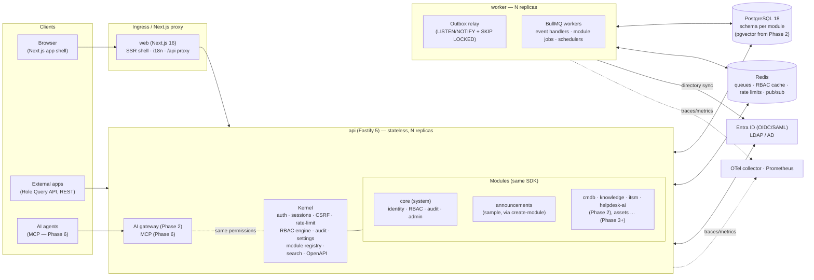
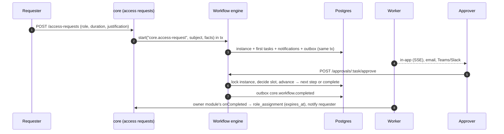
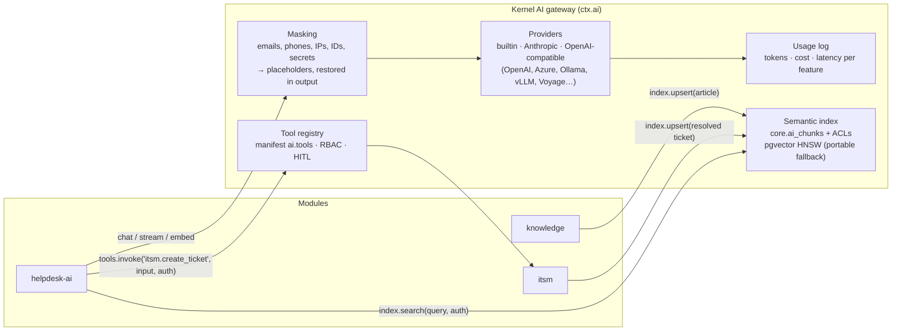
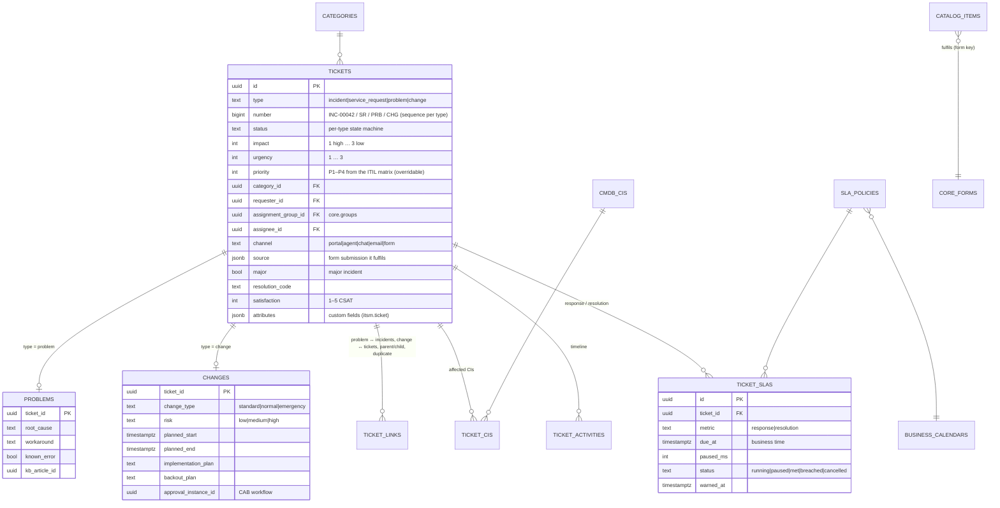
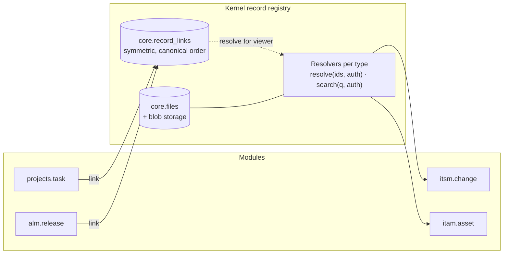
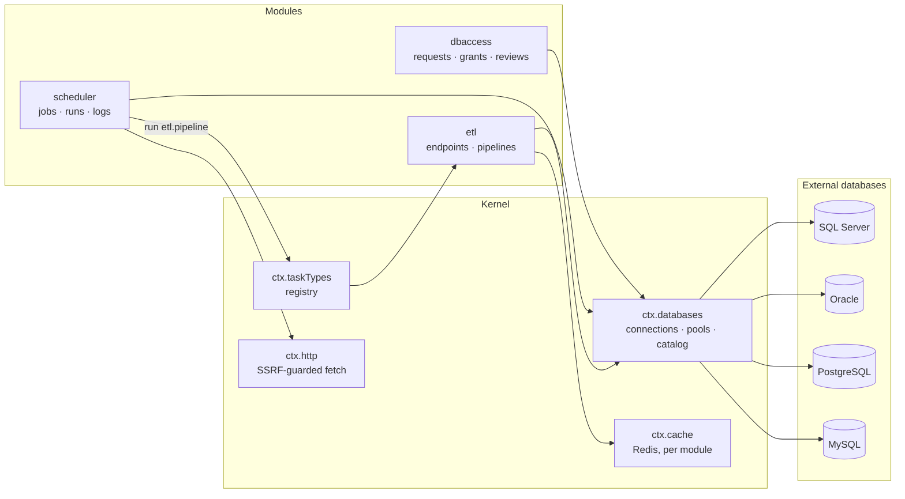
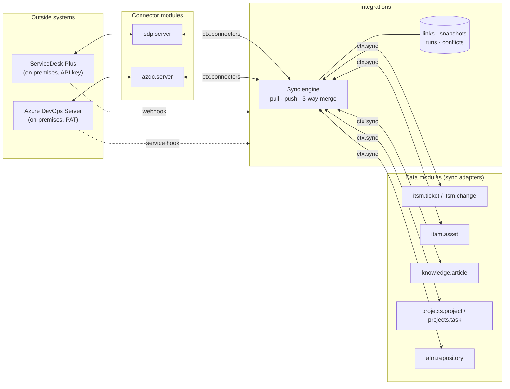
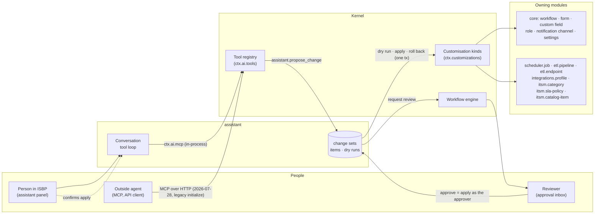
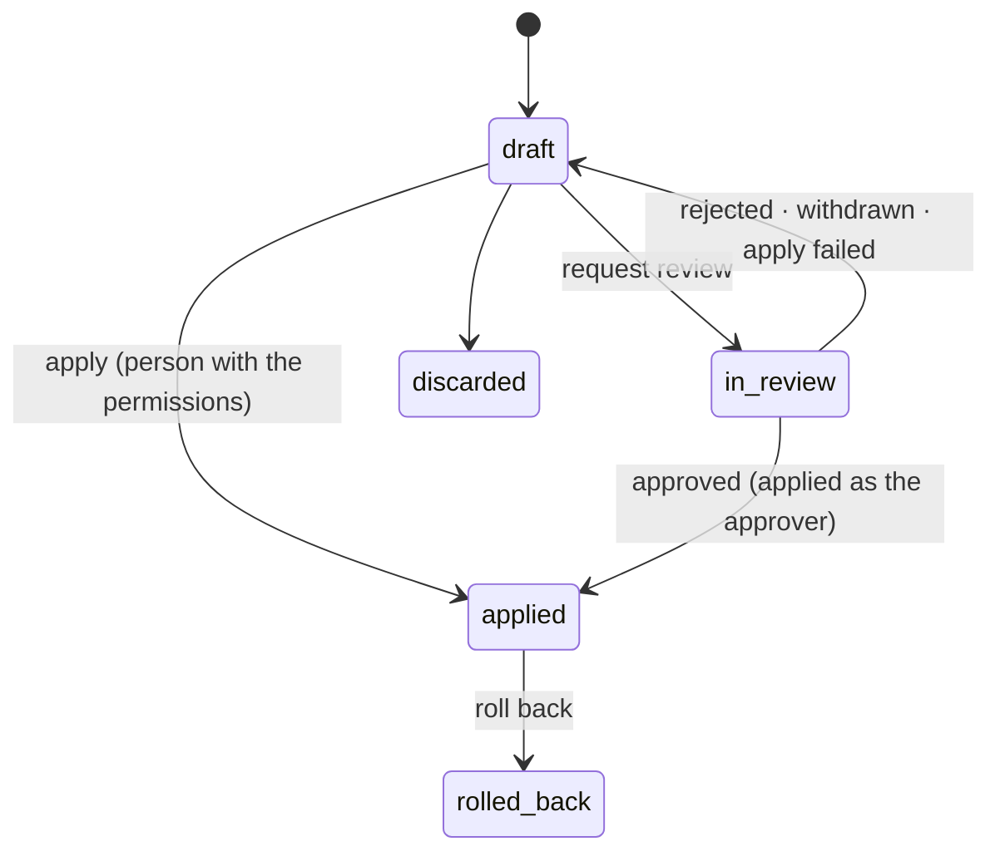

# IS Big Platform — Architecture

> Status: Phase 8 (Process builder) done, on top of Phase 7 (Documentation), Phase 6 (AI Agent), Phase 5
> (Integrations Hub), Phase 4 (Data APIs and ETL, Scheduled Jobs, Database access), Phase 3 (Asset Management, Project
> Management, Application Lifecycle, record links and attachments), Phase 2 (ITSM, CMDB, Knowledge Base, Helpdesk AI
> and the AI gateway), Phase 1 (workflows, forms, notifications, access requests, Role Query API) and the Phase 0
> foundation. This document is the design baseline that later phases extend.

## 1. Shape of the system

IS Big Platform (ISBP) is a **modular monolith**: one deployable API process (plus a worker process from the
same image) that hosts a small, stable **kernel** and any number of **modules**. Every feature — including
the ones we ship — is a module built on the same SDK. A Next.js web app renders the shell and module pages.



### Request path (authenticated API call)

```mermaid
sequenceDiagram
  autonumber
  participant U as Browser
  participant N as Next.js (proxy.ts)
  participant F as Fastify kernel
  participant R as Redis
  participant D as Postgres
  U->>N: PATCH /api/v1/users/:id (cookie isbp_session, x-csrf-token)
  N->>F: proxied unchanged
  F->>F: requestId + OTel span + rate limit
  F->>D: session lookup by sha256(token)
  F->>F: CSRF check (cookie auth + unsafe method)
  F->>R: permission snapshot (user, rbacVersion)
  alt cache miss
    F->>D: assignments ∪ group assignments → grants
    F->>R: cache snapshot
  end
  F->>F: route guard: can("core.users.update", scope)
  F->>D: BEGIN; UPDATE users; INSERT audit_logs; INSERT outbox_events; NOTIFY; COMMIT
  F-->>U: 200 JSON (Zod-serialized)
  Note over D,R: worker relay moves outbox → BullMQ → module event handlers
```

### Configuration and code: processes, building blocks, record types, connectors

What an organisation does with ISBP is **configuration**; what ISBP can do is **code**. These terms keep that line
clear in the design, the reviews and the user guides (where the glossary gives them in all three languages):

| Term                | What it is                                                                                                                           | Made of                                                                                                                                                                      | Examples                                            |
| ------------------- | ------------------------------------------------------------------------------------------------------------------------------------ | ---------------------------------------------------------------------------------------------------------------------------------------------------------------------------- | --------------------------------------------------- |
| **Process**         | A request form, its approval workflow and its process actions; recurring work adds a scheduled form assignment                       | Configuration: versioned rows, each part a customisation kind, so admins and the assistant build it and change sets move it                                                  | Configuration change request, firewall rule request |
| **Process pack**    | Processes and what they need (groups, ITSM categories, custom fields, schedules) as one change-set package, installed all or nothing | Configuration, shipped by a module (`manifest.customizationPackages`, R55) or as a package file                                                                              | The ISMS process pack                               |
| **Building block**  | A capability any process can use                                                                                                     | Code: the kernel, core and SDK (field types, form rules, step fields, reminders, form assignments) or a module (process actions, record types for record fields, task types) | `rows` field, `core.remind`, `itam.assign-asset`    |
| **Record type**     | A kind of thing the organisation keeps and looks after over time, with its own data, states, pages and rules                         | Code: a module (`manifest.records.types`)                                                                                                                                    | Ticket, asset, information asset, account review    |
| **Connector**       | How ISBP reads from or acts in another system                                                                                        | Code: a connector module (`manifest.connectors`)                                                                                                                             | ServiceDesk Plus, Azure DevOps Server               |
| **Outside control** | A control another system enforces; ISBP keeps the evidence (the request that asked for it, the checklist that confirms it)           | Neither: it is set up in that system                                                                                                                                         | Firewall rules, disk encryption, antivirus          |

**The rule (decision 91).** A new IT process is configuration. When one can't be built, the gap is a building block, a
record type or a connector, and it is built in a form any process could use: named after what it does (a table field,
an assign-asset action), never after the process or the organisation that asked for it. No code exists for one
process; a built-in process pack only combines existing building blocks. §15.8a is the worked example: an
organisation's ISMS procedures and forms became a 59-item pack, and what was missing became building blocks (table
fields, approver step fields, conditional actions, reminders, recurring checklists, printable requests) and record
types (the `isms` module's information assets, stocktakes, shared accounts and account reviews).

## 2. Repository layout

```text
isbp/
├─ apps/
│  ├─ api/                     Fastify API + worker (one image, three entrypoints)
│  │  └─ src/
│  │     ├─ main.ts            HTTP server entry
│  │     ├─ worker.ts          outbox relay + BullMQ workers + schedulers
│  │     ├─ migrate.ts / seed.ts
│  │     ├─ telemetry.ts       OpenTelemetry bootstrap (loaded first)
│  │     ├─ kernel/            auth, sessions, rbac, audit, events, jobs, modules, search, http plumbing
│  │     ├─ core/              the "core" system module (identity, RBAC, audit, admin routes)
│  │     └─ generated/         installed-module registry (written by `pnpm modules:sync`)
│  └─ web/                     Next.js App Router shell
│     └─ src/
│        ├─ app/               (auth)/login, (app)/… core pages, [module]/[[...slug]] module host
│        ├─ components/        shell (sidebar, topbar, command palette), admin feature components
│        ├─ i18n/              next-intl request config (en, zh-TW, ja-JP)
│        ├─ lib/               api client, query hooks, session helpers
│        └─ generated/         installed-module web registry
├─ packages/
│  ├─ sdk/                     @isbp/sdk — manifest spec, defineServerModule, defineWebModule, permission matching
│  ├─ db/                      @isbp/db — Drizzle client, core schema, migration runner, migrations
│  ├─ contracts/               @isbp/contracts — Zod DTOs shared by API and web
│  ├─ i18n/                    @isbp/i18n — locale list + core message catalogs
│  ├─ ui/                      @isbp/ui — Astryx TEL theme + app composites (DataTable, Sheet…), motion
│  └─ create-module/           @isbp/create-module — `create-module <name>` scaffolder + registry sync
├─ modules/
│  └─ announcements/           sample module generated by the CLI (server + web + migrations + messages)
├─ tooling/                    shared tsconfig / eslint presets, dev-services (embedded Postgres + Redis)
├─ infra/
│  ├─ docker/                  api.Dockerfile, web.Dockerfile
│  ├─ compose/                 docker-compose.yml (full stack), observability extras
│  └─ helm/isbp/               Helm chart (api, worker, web, migrations Job, HPA, PDB, ingress)
├─ e2e/                        Playwright tests
├─ docs/                       architecture, module guide, API, operations
└─ .github/workflows/ci.yml
```

## 3. Core data model (Phase 0 tables solid, later phases dashed)

All core tables live in the Postgres schema `core`; each module owns its own schema (e.g. `announcements`).
Primary keys are UUIDv7 (time-ordered → index friendly). Every mutable table has `created_at/updated_at`.

```mermaid
erDiagram
  DEPARTMENTS ||--o{ DEPARTMENTS : "parent_id"
  DEPARTMENTS ||--o{ USERS : "department_id"
  USERS ||--o{ USERS : "manager_id"
  USERS ||--o{ GROUP_MEMBERS : ""
  GROUPS ||--o{ GROUP_MEMBERS : ""
  IDENTITY_PROVIDERS ||--o{ USER_IDENTITIES : ""
  USERS ||--o{ USER_IDENTITIES : ""
  USERS ||--o{ SESSIONS : ""
  APPLICATIONS ||--o{ ROLES : ""
  APPLICATIONS ||--o{ PERMISSIONS : ""
  ROLES ||--o{ ROLE_PERMISSIONS : "patterns, wildcards ok"
  ROLES ||--o{ ROLE_ASSIGNMENTS : ""
  USERS |o--o{ ROLE_ASSIGNMENTS : "principal (user)"
  GROUPS |o--o{ ROLE_ASSIGNMENTS : "principal (group)"
  DEPARTMENTS |o--o{ ROLE_ASSIGNMENTS : "scope"
  MODULES ||--o{ MODULE_SETTINGS : ""

  USERS {
    uuid id PK
    text email UK "lower() unique"
    text username UK
    text display_name
    enum status "pending|active|suspended|offboarded"
    enum auth_source "local|oidc|saml|ldap"
    text password_hash "argon2id, local only"
    uuid department_id FK
    uuid manager_id FK
    text locale "en|zh-TW|ja-JP"
    jsonb attributes "custom fields (Phase 1)"
    timestamptz onboarded_at
    timestamptz offboarded_at
  }
  DEPARTMENTS {
    uuid id PK
    text code UK
    text name
    uuid parent_id FK
    text path "materialized /id/id/ for subtree scopes"
    uuid manager_id FK
  }
  GROUPS {
    uuid id PK
    text key UK
    text name
    enum source "local|oidc|saml|ldap|system"
    text external_id
  }
  GROUP_MEMBERS {
    uuid group_id PK
    uuid user_id PK
    text source "manual|sync"
  }
  IDENTITY_PROVIDERS {
    uuid id PK
    text key UK "used in callback URLs"
    enum type "oidc|saml|ldap"
    jsonb config "non-secret"
    text secrets "AES-256-GCM envelope"
    bool jit_provisioning
    jsonb group_mappings
  }
  USER_IDENTITIES {
    uuid id PK
    uuid idp_id FK
    text subject "unique per idp"
    uuid user_id FK
  }
  SESSIONS {
    uuid id PK
    text token_hash UK "sha256 of opaque cookie token"
    uuid user_id FK
    text csrf_token
    timestamptz expires_at
    timestamptz revoked_at
  }
  APPLICATIONS {
    uuid id PK
    text key UK "isbp = this platform"
    text name
  }
  PERMISSIONS {
    uuid id PK
    uuid application_id FK
    text key "module.resource.action"
    text module_id
  }
  ROLES {
    uuid id PK
    uuid application_id FK
    text key
    bool is_system
  }
  ROLE_PERMISSIONS {
    uuid role_id PK
    text permission PK "e.g. core.users.* or *"
  }
  ROLE_ASSIGNMENTS {
    uuid id PK
    uuid role_id FK
    uuid user_id FK "exactly one of user_id/group_id"
    uuid group_id FK
    enum scope_type "global|department|record"
    uuid scope_department_id FK
    text scope_record_type
    text scope_record_id
    timestamptz expires_at "time-bound access"
    text source "manual|request|sync|system"
  }
  MODULES {
    text id PK
    text version
    bool enabled
    bool system
    jsonb manifest "last synced snapshot"
  }
  MODULE_SETTINGS {
    text module_id PK
    text key PK
    jsonb value
  }
  AUDIT_LOGS {
    bigint seq PK "identity; append-only (trigger)"
    uuid event_id
    timestamptz occurred_at
    text actor_type "user|service|system|ai_agent"
    uuid actor_id
    text action "core.user.updated"
    text entity_type
    text entity_id
    jsonb changes "field: [before, after]"
    text outcome "success|failure|denied"
    text hash "sha256(canonical row)"
  }
  OUTBOX_EVENTS {
    bigint seq PK
    uuid event_id UK
    text name
    jsonb payload
    timestamptz dispatched_at
  }
```



**Later phases plug into the same keys** (not built in Phase 0): `api_clients` (Role Query API credentials,
Phase 1), `role_requests` → `workflow_instances`/`approval_tasks` (Phase 1), `custom_field_definitions` +
`form_definitions` writing into each entity's `attributes` JSONB (Phase 1), `notifications` (Phase 1),
`ai_usage` + `ai_tool_calls` (Phase 5).

## 4. Module manifest spec

A module is a workspace package with three entry points:

| Entry                        | Runs in      | Purpose                                                                  |
| ---------------------------- | ------------ | ------------------------------------------------------------------------ |
| `@isbp/module-<id>/manifest` | API + web    | Declarative, serializable description (validated with Zod at boot)       |
| `@isbp/module-<id>/server`   | API + worker | Routes, event handlers, jobs, AI tool handlers, search, migrations, seed |
| `@isbp/module-<id>/web`      | web          | Page components keyed by path, i18n messages                             |

```ts
export interface ModuleManifest {
  id: string; // kebab-case, unique, also Postgres schema + URL segment
  version: string; // semver
  name: string; // i18n key, e.g. "announcements.meta.name"
  description?: string; // i18n key
  icon?: string; // lucide icon name
  system?: boolean; // cannot be disabled (core)
  dependsOn?: string[]; // other module ids (enable order + checks)
  navigation?: NavEntry[]; // sidebar entries, each gated by a permission
  work?: WorkSourceDef[]; // what waits for people: shown on My work, Home and the sidebar badge
  permissions?: PermissionDef[]; // "<id>.<resource>.<action>", synced into core.permissions
  roles?: RoleTemplate[]; // system roles synced from the manifest (read-only in the UI)
  events?: {
    emits?: EventDef[]; // name "<id>.<entity>.<verb-past>" + Zod payload schema
    consumes?: string[]; // event names this module subscribes to
  };
  settings?: SettingDef[]; // typed settings, rendered as an admin form
  ai?: { tools: AiToolDef[] }; // exposed through AI gateway / MCP with RBAC + HITL flags
  search?: { entities: string[] };
}

interface NavEntry {
  id: string;
  label: string;
  href: string;
  icon?: string;
  permission?: string | string[]; // the people who work in the page (any of them, any scope)
  section?: 'main' | 'admin'; // 'admin' entries are cards on the /admin hub, grouped by `area`
  order?: number;
  children?: NavEntry[]; // the area's pages: a collapsible sidebar group
  tabs?: NavEntry[]; // sub-pages behind section tabs: highlight the page, listed by the palette
  parent?: string; // `<module>.<entry>`: join another module's group (CMDB in the service desk)
  check?: boolean; // ask the module whether to show it (e.g. "member of a project")
}
interface PermissionDef {
  key: string;
  description: string;
  scopes?: ('global' | 'department' | 'record')[];
}
interface RoleTemplate {
  key: string;
  name: string;
  description?: string;
  permissions: string[]; // patterns, e.g. 'announcements.posts.*'
  grantByDefault?: boolean; // granted to the implicit "Everyone" group when first created
}
interface EventDef {
  name: string;
  description?: string;
  schema?: ZodType; // payloads are validated on publish
}
interface SettingDef {
  key: string;
  label: string; // i18n key
  type: 'string' | 'text' | 'number' | 'boolean' | 'select' | 'secret'; // secrets encrypted at rest
  default?: string | number | boolean | null;
  options?: { value: string; label: string }[];
  advanced?: boolean; // hidden behind "Advanced" in the generated settings form
}
interface AiToolDef {
  name: string;
  description: string;
  input: ZodType;
  permission: string;
  destructive?: boolean; /* requires human confirmation */
}
```

Server side (`defineServerModule(manifest, { … })`):

```ts
export default defineServerModule(manifest, {
  migrations,                                   // embedded SQL (generated by `pnpm db:generate`)
  routes: (app, ctx) => {                       // Fastify plugin, mounted at /api/v1/<id>
    app.get('/posts', { config: { permission: 'announcements.posts.read' }, schema: {…} }, handler);
  },
  events: { 'core.user.offboarded': async (evt, ctx) => { … } },
  jobs: { 'expire-old': { schedule: { cron: '0 * * * *' }, handler: async (job, ctx) => { … } } },
  ai: { 'announcements.list_current': async (input, ctx, auth) => { … } },
  search: async (query, ctx) => [{ type: 'announcement', id, title, href }],
  seed: async (ctx) => { … },                   // demo data
});
```

Rules the kernel enforces: routes are **authenticated and permission-gated by default** (`config.public`
opts out); a disabled module returns `404 MODULE_DISABLED` and its handlers/jobs/search are skipped; module
tables must live in the module's own schema; cross-module calls go through events or public HTTP APIs.
Module UI strings live in the module's own catalogs (namespace = module id, en/zh-TW/ja-JP), including
labels for its audit actions. See [module-development.md](module-development.md) for the full guide.

## 5. Key technical decisions

| #   | Decision                                                                                                                                                                  | Why                                                                                                                                                                                                                                                                                                                                                                                            | Alternatives considered                                                                                                                                        |
| --- | ------------------------------------------------------------------------------------------------------------------------------------------------------------------------- | ---------------------------------------------------------------------------------------------------------------------------------------------------------------------------------------------------------------------------------------------------------------------------------------------------------------------------------------------------------------------------------------------- | -------------------------------------------------------------------------------------------------------------------------------------------------------------- |
| 1   | **pnpm workspaces + Turborepo**                                                                                                                                           | Convention-based, fast cached pipelines, `turbo prune` for lean Docker builds                                                                                                                                                                                                                                                                                                                  | Nx (more powerful, more config)                                                                                                                                |
| 2   | **Fastify 5** for the API                                                                                                                                                 | Encapsulated plugins map 1:1 to runtime-pluggable modules, so built-in and custom modules use the same SDK with no special cases. Zod type provider gives one schema for validation, TS types and OpenAPI 3.1. Low overhead, native pino logging.                                                                                                                                              | NestJS: DI modules are a compile-time graph (awkward to enable/disable at runtime), decorator-heavy, and it duplicates validation (class-validator) beside Zod |
| 3   | **Drizzle ORM + custom migration runner**                                                                                                                                 | Schema in TS split per module, Postgres schema per module, native JSONB/pgvector types, SQL-transparent for perf tuning. Our runner embeds migrations in the bundle, takes a Postgres advisory lock (safe with many replicas), and tracks per-module history.                                                                                                                                  | Prisma: single schema/client, no per-module ownership, pgvector via `Unsupported`                                                                              |
| 4   | **Zod 4 everywhere** (`@isbp/contracts`)                                                                                                                                  | One contract shared by API validation, OpenAPI, React Hook Form and manifest validation                                                                                                                                                                                                                                                                                                        | Separate DTO/JSON-schema layers                                                                                                                                |
| 5   | **Server-side sessions** (opaque token, HttpOnly cookie, SHA-256 at rest) + double-submit CSRF token                                                                      | Instant revocation on offboarding / suspension, no token leakage in JS                                                                                                                                                                                                                                                                                                                         | JWT (hard to revoke)                                                                                                                                           |
| 6   | **SSO**: openid-client (OIDC, Entra ID preset), node-saml (SAML 2.0), ldapts (LDAP/AD bind + directory sync); argon2id for local                                          | Standards-based, provider configs stored in DB with AES-256-GCM-encrypted secrets                                                                                                                                                                                                                                                                                                              | Auth SaaS (not suitable for on-prem IT)                                                                                                                        |
| 7   | **RBAC**: permission keys `module.resource.action` with wildcards; role assignments to users or groups, scoped global / department-subtree / record, with optional expiry | Covers least-privilege, time-bound access and Phase 1 Role Query API (`applications` already modelled)                                                                                                                                                                                                                                                                                         | Pure ABAC engine (overkill for day one; scopes leave room for it)                                                                                              |
| 8   | **Permission snapshots cached in Redis**, invalidated by a global `rbacVersion` counter                                                                                   | O(1) checks per request, correct invalidation across replicas                                                                                                                                                                                                                                                                                                                                  | Per-request DB joins                                                                                                                                           |
| 9   | **Transactional outbox → BullMQ** for domain events                                                                                                                       | Events commit atomically with data; BullMQ gives per-subscriber retries, backoff, concurrency and visibility                                                                                                                                                                                                                                                                                   | In-memory emitter (lossy), Kafka (heavy for a monolith)                                                                                                        |
| 10  | **Append-only audit log** enforced by DB trigger + per-row SHA-256                                                                                                        | Tamper-evident and immutable even against application bugs; partition by month later                                                                                                                                                                                                                                                                                                           | App-level only                                                                                                                                                 |
| 11  | **Installed vs enabled modules**: installed = compiled in via generated registries; enabled = runtime flag in DB with Redis pub/sub fan-out                               | Next.js and bundlers need modules at build time; admins still toggle at runtime without redeploys                                                                                                                                                                                                                                                                                              | Fully dynamic runtime loading (fragile, insecure)                                                                                                              |
| 12  | **Next.js 16 App Router**, `proxy.ts` forwards `/api/*` at runtime (env-configurable), module pages served by one catch-all host route                                    | Same-origin cookies, no CORS, one image for every environment                                                                                                                                                                                                                                                                                                                                  | Build-time rewrites (URL baked into image)                                                                                                                     |
| 13  | **next-intl**, locale from user profile → cookie → `Accept-Language`; `en`, `zh-TW`, `ja-JP`; each module ships its own catalogs                                          | No locale URL prefix needed for an internal app; CI test keeps catalogs key-identical                                                                                                                                                                                                                                                                                                          | i18next                                                                                                                                                        |
| 14  | **Astryx (Meta's React design system) in a TEL theme + Tailwind 4 for layout glue + Motion** (`motion/react`)                                                             | 150+ accessible, themeable components maintained upstream (dark mode, Astryx locale catalogs incl. zh-TW/ja-JP, templates, an AI-friendly CLI); one theme file (`packages/ui/src/theme/tel.ts`, built for SSR) carries the brand; `MotionConfig reducedMotion="user"` honours `prefers-reduced-motion` globally. Replaced shadcn/ui + Radix in the UI migration (see docs/ai/ui-components.md) | Astryx is a 0.x beta: props change between releases (rebuild the theme, rerun typecheck/e2e on upgrade); StyleX is a peer dependency                           |
| 15  | **OpenTelemetry + pino + prom-client**; metrics on a separate internal port                                                                                               | Standard signals; metrics never exposed via ingress                                                                                                                                                                                                                                                                                                                                            | Vendor agents                                                                                                                                                  |
| 16  | **UUIDv7 keys**                                                                                                                                                           | Time-ordered (B-tree friendly), safe to expose, generated app-side                                                                                                                                                                                                                                                                                                                             | bigserial (enumerable), UUIDv4 (index churn)                                                                                                                   |
| 17  | **Embedded dev services** (`pnpm dev:services`: embedded Postgres + Redis) besides docker-compose                                                                         | Contributors without Docker can run the whole stack                                                                                                                                                                                                                                                                                                                                            | Docker-only                                                                                                                                                    |

## 6. Security model (Phase 0)

- Secure by default: every route requires a session or API credential and a declared permission unless marked `public`.
- Sessions: 256-bit random token, only its SHA-256 stored; `HttpOnly; SameSite=Lax; Secure` (prod); idle and absolute timeouts; revoked on logout, suspension and offboarding.
- CSRF: per-session token required in `x-csrf-token` for unsafe methods when authenticated by cookie.
- Brute force: per-IP + per-account rate limits on login; temporary account lock after repeated failures.
- Secrets at rest: AES-256-GCM with a versioned master key (`ISBP_MASTER_KEY`), never returned by the API.
- Headers: helmet on the API; strict CSP with per-request nonce, HSTS, frame-ancestors none on the web app.
- Least privilege: system roles are narrow (`platform-admin` is the only `*`), assignments can expire, and expiry is enforced by a scheduled job **and** at check time.
  Three days before a time-bound assignment ends, "Access ending soon" (`core.access.expiring`, once per assignment)
  reminds the person it was granted to or, for a grant to a group, the group's active members who lose the role with
  it (not those who keep it through another assignment, their own or another group's, that is permanent or ends
  later). Groups have no owners, so nobody else is reminded.
- Audit: logins (success/failure), permission denials, every admin mutation, module toggles and IdP changes.

## 7. Delivery phases

| Phase                              | Scope                                                                                                                                                                                                                                                                                                                                   |
| ---------------------------------- | --------------------------------------------------------------------------------------------------------------------------------------------------------------------------------------------------------------------------------------------------------------------------------------------------------------------------------------- |
| **0 – Foundation** (done)          | Monorepo, app shell (animated nav, light/dark, command palette, en/zh-TW/ja-JP), auth (local, OIDC, SAML, LDAP), users/groups/departments, RBAC, module system + `create-module`, audit log, event bus, docker-compose, Helm skeleton, CI                                                                                               |
| **1** (done)                       | Workflow/approvals engine, custom fields, form builder, notifications, role request portal, Role Query API                                                                                                                                                                                                                              |
| **2** (done)                       | ITSM core, Knowledge Base, Helpdesk AI (pgvector RAG)                                                                                                                                                                                                                                                                                   |
| **3** (done)                       | Asset Management, Project Management, Application Lifecycle; record links and attachments for every module                                                                                                                                                                                                                              |
| **4** (done)                       | ETL/API Builder, Scheduled Jobs, Database Account Management                                                                                                                                                                                                                                                                            |
| **5** (done)                       | Integrations Hub: two-way sync with on-premises ManageEngine ServiceDesk Plus and Azure DevOps Server (§12)                                                                                                                                                                                                                             |
| **6** (done)                       | AI Agent: a built-in agent on every page that works through the platform's own MCP tools as the person, customisation kinds in 13 surfaces, change sets (dry run, apply on confirmation or review, rollback), and the MCP server for outside agents (§13)                                                                               |
| **7** (done)                       | User guides for every role in en, zh-TW and ja-JP: how to use the main features and how they map to our IT work, with screenshots, a glossary and FAQ; published in the platform's knowledge base, where Ask IT and the assistant can cite them (§14)                                                                                   |
| **8** (done)                       | Any IT process as a form + approval + follow-up actions, described to the assistant: record and table fields, approval rules on linked records' data, cross-field rules, approvers' step fields, actions after approval, recurring checklists, custom fields in built-in approvals, change-set packages and the ISMS process pack (§15) |
| 9 – Hardening and UX (in progress) | Every flow simulated 500 times with random data against a running stack (`tooling/flow-sim`) and the issues fixed; the UI reviewed as a normal user per role and simplified: fewer steps and choices, consistent patterns, supporting motion; guides and screenshots updated                                                            |
| 10 – AI documents (in progress)    | AI connections for any OpenAI-compatible server (Chat Completions or Responses, custom headers, an audited TLS switch); retrieval that works for CJK with a reranker; attachments and images searchable with their record's access; optional CPU/GPU model services; Ask IT published as a chat link and an embeddable widget (§16)     |

## 8. Phase 1 design: workflows, forms, notifications, access requests, Role Query API

Phase 1 adds **platform services** that every module consumes through `ModuleContext`, exactly like audit and
events: `ctx.workflows`, `ctx.notifications` and `ctx.fields`. Their admin APIs and screens belong to the core
module. Modules opt in from their manifest with three new optional keys:

```ts
workflows?: WorkflowTriggerDef[];          // attach points, e.g. "announcements.publish"
notifications?: NotificationTypeDef[];     // types users can tune in their preferences
customFields?: { entities: CustomFieldEntityDef[] }; // entities whose `attributes` admins can extend
```

### 8.1 Data model additions (schema `core`)


`roles` gains `requestable`, `risk_level`, `owner_id`, `max_duration_days` and an optional
`request_workflow_id` override. `groups` and `departments` gain an `attributes` JSONB column like `users`,
each with a GIN index for custom-field filters.

### 8.2 Workflow model

A workflow is a **structured tree of steps**, not a free-form graph, so every definition is valid by
construction and the visual builder never produces dangling edges:

| Step        | Meaning                                                                                                                                                                                                                                                                                                                                                                                                              |
| ----------- | -------------------------------------------------------------------------------------------------------------------------------------------------------------------------------------------------------------------------------------------------------------------------------------------------------------------------------------------------------------------------------------------------------------------- |
| `approval`  | One or more **approver slots** (user, group, platform role, requester's manager chain, department head, or a user id taken from the facts), each with an optional **fallback**. Modes: `any` (first answer wins), `all`, or `quorum` (N of M). Options: SLA (due/remind hours, then notify, escalate, auto-approve or auto-reject), delegation, self-approval (off by default), and what to do when nobody resolves. |
| `parallel`  | Branches that run at the same time, each a sequence of steps; it completes when every branch is approved                                                                                                                                                                                                                                                                                                             |
| `condition` | The first branch whose condition matches runs, otherwise the default branch (`role.riskLevel = high`, `form.amount > 1500`, …)                                                                                                                                                                                                                                                                                       |
| `notify`    | An FYI notification to people (no decision)                                                                                                                                                                                                                                                                                                                                                                          |

Every step may also carry a `when` condition (skipped unless it holds). Any rejection ends the instance. A workflow
can set `repeatApprovers: 'skip'` (decision 92): a person whose approval of an earlier step of the same request counts
is then not asked again, and a step whose approvers have all counted completes without anyone being asked.
The interpreter (`@isbp/sdk` → `advanceWorkflow`) is a **pure function** of graph, state and facts. The API
uses it to drive instances, and the builder uses the same code to simulate a path in the browser. The
engine locks the instance row (`SELECT … FOR UPDATE`) while it applies a decision, so concurrent approvers
on parallel steps are safe.



SLA timers are rows (`due_at`, `remind_at`) scanned by a once-a-minute job on partial indexes, rather than
one delayed job per task. They survive a Redis flush and are idempotent.

### 8.3 Forms and custom fields share one field model

`FieldDef` (in `@isbp/sdk`) describes a field: type (text, textarea, number, boolean, date, select,
multiselect, email, url, user), a label in en/zh-TW/ja-JP, validation and a `visibleWhen` condition.
Custom fields are FieldDefs attached to an entity type and stored in that entity's `attributes` JSONB.
Forms are versioned lists of FieldDefs plus display elements (heading, paragraph, divider). The same
`validateFields()` function runs in the browser (React Hook Form resolver) and in the API. Hidden fields
are stripped before validation, so conditional logic can never be bypassed by posting hidden values.

### 8.4 Notifications

`ctx.notifications.notify({ type, recipients, params, href }, { tx })` writes in-app rows in the caller's
transaction. Each row is rendered in its **recipient's locale** from the module's catalog
(`<module>.notifications.<name>.title|body`, ICU). The outbox then hands it to the worker, which delivers
email (SMTP), Microsoft Teams (Workflows webhook, Adaptive Card), Slack (incoming webhook, Block Kit) and
signed generic webhooks. Delivery honours each user's preferences per type and channel; `mandatory` types
cannot be switched off. A `notification_deliveries` row per channel makes retries idempotent. Browsers get
live updates over Server-Sent Events, fanned out from Redis pub/sub. Webhook URLs are secrets, encrypted
at rest, and private-network targets are refused unless explicitly allowed (SSRF guard).

### 8.5 Role Query API and API clients

External applications live in `core.applications` with their own permission catalog and roles, so access
to them is granted, requested, approved, expired and audited like platform roles. **API clients** are
service principals:

- **API keys:** `Authorization: Bearer isbp_sk_…`. Only the SHA-256 is stored, and a client can hold
  several secrets at once for rotation without downtime.
- **OAuth 2.0 client credentials:** `POST /api/v1/oauth/token` returns opaque one-hour bearer tokens,
  held in Redis.

A client's reach is expressed as ordinary grants: `core.role-query.read` scoped to each allowed application
(record scope `application:<id>`), plus optional platform API permissions. These are checked by the same
`PermissionSet` code as users, and bearer requests skip CSRF because they carry no ambient cookies. Routes
without a declared permission (such as `/me/*`) are closed to service principals.

| Endpoint                                              | Answers                                                                                                     |
| ----------------------------------------------------- | ----------------------------------------------------------------------------------------------------------- |
| `GET /api/v1/role-query/users/{user}?application=app` | Roles (with scope, expiry and source) and effective permissions of a user (id, email or username) in an app |
| `POST /api/v1/role-query/check`                       | `{ allowed }` for one permission, optionally for a department or record                                     |
| `GET /api/v1/role-query/applications/{app}/members`   | Everyone holding a role in the app, for provisioning sync                                                   |

### 8.6 Phase 1 decisions

| #   | Decision                                                                             | Why                                                                                                                                 | Alternatives considered                                              |
| --- | ------------------------------------------------------------------------------------ | ----------------------------------------------------------------------------------------------------------------------------------- | -------------------------------------------------------------------- |
| 18  | Structured step tree (sequence / approval / parallel / condition / notify)           | Valid by construction, easy to build visually and to explain; covers sequential, parallel, conditional, delegation, escalation, SLA | BPMN engine (heavy, hard for admins); free-form DAG (invalid graphs) |
| 19  | Pure interpreter shared by API and browser; persisted step state; pinned versions    | Deterministic, unit-testable; the builder's simulator runs the server's code; running instances never change under the admin        | Engine-only logic (no simulation), live definitions                  |
| 20  | Completion callbacks through the outbox (`core.workflow.completed` → owner module)   | Same at-least-once, retrying path as every other event; module work never blocks an approver's click                                | Synchronous in-transaction hooks                                     |
| 21  | SLA timers as indexed rows plus a one-minute scan                                    | Survives Redis loss, idempotent, observable in SQL                                                                                  | One delayed BullMQ job per task                                      |
| 22  | One field model and validator for custom fields and forms                            | Admins learn one builder; identical validation in browser and API; conditional logic enforced server-side                           | JSON Schema + separate form library                                  |
| 23  | Notifications rendered at creation in the recipient's locale                         | Email and in-app show the same text; the web app doesn't need every module's notification catalog                                   | Store keys and render on read (stale-locale-safe but complex)        |
| 24  | SSE + Redis pub/sub for live notifications                                           | One-way, HTTP-friendly through the Next.js proxy and ingress; no WebSocket infra                                                    | WebSockets, polling only                                             |
| 25  | API clients as service principals with ordinary grants; opaque OAuth tokens in Redis | Role Query and API-first automation use the same RBAC checks and audit as people; instant revocation                                | JWT access tokens (hard to revoke), separate ACL model               |

## 9. Phase 2 design: ITSM, CMDB, Knowledge Base, Helpdesk AI

Phase 2 ships four modules on the SDK, plus the **AI gateway** in the kernel, because Helpdesk AI needs
one. The MCP server and the assistant on every page are still Phase 5. They will reuse the same gateway
and tool registry.

| Module        | Depends on          | Owns                                                                                                                                                    |
| ------------- | ------------------- | ------------------------------------------------------------------------------------------------------------------------------------------------------- |
| `cmdb`        | —                   | Configuration items (CIs): classes, typed directional relationships, impact analysis (upstream/downstream traversal)                                    |
| `knowledge`   | —                   | Knowledge articles: categories, versions, review and publish workflow, feedback, review dates. They are indexed for semantic search.                    |
| `itsm`        | `cmdb`              | Incidents, service requests, problems, changes with CAB approval, categories, SLA policies on business calendars, service-catalog fulfilment, dashboard |
| `helpdesk-ai` | `itsm`, `knowledge` | AI triage, similar tickets, KB-grounded reply drafts, summaries, KB drafts from resolved tickets, the self-service virtual agent, and accuracy metrics  |

A module may **read** (never write) the tables of a module it `dependsOn`. For example, ITSM joins
`cmdb.cis` to show CI names. Writes and everything cross-cutting go through events, HTTP APIs or the
**AI tool registry**.

### 9.1 AI gateway (kernel, `ctx.ai`)



- **Providers.** These are configured in **Administration → AI**, and secrets are encrypted at rest.
  - _Chat_ has three options: `none`, `anthropic` (official SDK, default model `claude-opus-5-5`), or
    `openai-compatible` (base URL plus model; covers OpenAI, Azure OpenAI, Ollama, vLLM, LM Studio and
    LiteLLM), over Chat Completions or the Responses API (§16.1).
  - Every endpoint also takes custom headers and an audited switch that skips TLS certificate checks (§16.1).
  - _Embeddings_ have two options: `builtin`, or `openai-compatible` (OpenAI, Voyage AI, Ollama, …).
  - The `builtin` embedder runs offline and deterministically. It uses feature hashing of words and
    character n-grams (CJK uni/bigrams), so retrieval works in every language with no key. This is what
    the demo data and the tests use.
  - Without a chat model, every AI feature degrades to a retrieval-based or extractive mode. The UI labels
    that mode honestly.
- **Calls.** `ctx.ai.chat({ feature, system, messages, tools?, schema?, effort? }, { auth })`,
  `ctx.ai.stream(…)` and `ctx.ai.embed(texts)`.
  - Structured output (`schema`, a Zod schema) is used for triage.
  - Tool calls come back to the caller, which decides whether to run them.
  - Every call writes a `core.ai_usage` row: module, feature, principal, provider, model, tokens, cost
    (from per-model prices in settings), latency and status.
  - An optional monthly budget refuses calls once it is spent (`AI_BUDGET_EXCEEDED`).
- **Masking** runs before any external provider call. The categories (email, phone, IP, national-ID and
  credit-card patterns, API keys/secrets, plus custom regexes) are configurable. Values become stable
  placeholders (`[EMAIL_1]`) and are restored in the response, so the provider never sees them.
- **Semantic index.**
  - `ctx.ai.index.upsert({ type, id, title, text, locale, href, acl, metadata })` chunks the text by
    heading and paragraph (about 800 characters, with overlap), embeds the chunks and stores them in
    `core.ai_chunks`.
  - `ctx.ai.index.search(query, { types, auth, limit, filter })` is **hybrid**: vector kNN plus keyword
    matching (application-made terms with rare words weighted highest, which also works for CJK; §16.2), fused
    with Reciprocal Rank Fusion, then optionally reordered by a reranker.
  - Every chunk carries an **ACL**: a permission and an optional scope, or a list of user ids. Results are
    filtered with the caller's `AuthContext`, so retrieval can never leak what the UI would hide.
  - The embedding column is `vector` with an HNSW index when the `pgvector` extension is available at
    migration time. Production images (`pgvector/pgvector:0.8.7-pg18-trixie`) always have it. The Docker-free
    embedded
    dev Postgres has no pgvector, so there the column is `real[]` with a SQL cosine function. The schema
    and API are the same, it is slower, and Admin → AI shows which mode is active. Changing the embedding
    model re-embeds everything in a background job.
- **Tool registry.** It holds every enabled module's `manifest.ai.tools` with their handlers.
  - `ctx.ai.tools.invoke(name, input, { auth, confirmed })` validates the input, requires the tool's
    permission for that principal, and refuses `destructive` tools unless `confirmed` is set
    (`CONFIRMATION_REQUIRED` + preview). It also audits `core.ai.tool_invoked`.
    - Helpdesk AI reaches ITSM and the knowledge base **only** through these tools. It acts either as the signed-in
      user
      (interactive features) or as its **agent identity**: an `ai_agent` principal whose permissions the
      manifest declares up front (`ai.agent.permissions`) and which Admin → Modules shows. Phase 5 exposes
      the same registry over MCP.

### 9.2 Platform additions for modules

| Addition                | Shape                                                                                                                                                                                                                                                                                                                                 |
| ----------------------- | ------------------------------------------------------------------------------------------------------------------------------------------------------------------------------------------------------------------------------------------------------------------------------------------------------------------------------------- |
| Web **slots**           | `defineWebModule(m, { routes, slots: [{ slot: 'itsm.ticket.aside', load, permission?, order? }] })`. A host renders `<Slot name="itsm.ticket.aside" props={…} />`, and the contributions of enabled modules appear there. Helpdesk AI fills ITSM's ticket side panel and the request portal this way, without ITSM knowing it exists. |
| Portal entries          | `manifest.portal.entries` adds cards to "What do you need?" (e.g. ITSM "Report an issue", KB "Browse knowledge")                                                                                                                                                                                                                      |
| Request registry        | `ctx.portal.track({ kind, id, reference, title, state, statusLabel, href, people }, { tx })` writes `core.portal_items`, so "My requests" lists module records (e.g. incidents) next to access requests and form submissions                                                                                                          |
| Form fulfilment         | `ctx.forms.submission(id)` reads a submission (form, schema version, answers). `ctx.forms.setFulfilment(id, { reference, href, state, statusLabel }, { tx })` shows a module's fulfilment progress on the request                                                                                                                     |
| `ai.agent` in manifests | `{ name, permissions[] }`: the least-privilege identity a module's background AI work runs as                                                                                                                                                                                                                                         |

### 9.3 ITSM model (schema `itsm`)



- **Lifecycles.** Each ticket type has an explicit state machine, and the API refuses illegal transitions
  (`INVALID_TRANSITION`).
  - Incident: `new → in_progress ⇄ on_hold → resolved → closed`, or `cancelled`. A resolved ticket closes
    automatically after N days unless the requester reopens it.
  - Service request: `new → pending_approval → in_progress → fulfilled → closed`.
  - Problem: `new → investigating → known_error → resolved → closed`.
  - Change: `draft → assessment → authorization → scheduled → implementing → review → closed`, with
    `rejected`/`cancelled`.
- **Priority** comes from the ITIL impact × urgency matrix (P1–P4). Agents can override it, and the
  activity log records the override.
- **SLA.** A policy matches tickets with a condition from the shared condition builder (type, priority,
  category, service, …). It sets response and resolution targets per priority on a **business calendar**
  (time zone, working hours, holidays).
  - Targets pause in the statuses the policy names (e.g. `on_hold`).
  - Instances are rows. A one-minute job warns at the configured percentage and marks breaches, the same
    pattern as Phase 1 approval SLAs.
  - Business-time arithmetic is a pure, unit-tested function.
- **Change and CAB.** Submitting a change for authorization starts the `itsm.change` trigger. It is
  `required` and its default graph is a condition on the change facts:
  - **standard** changes are pre-approved (no step);
  - **emergency** changes go to the ECAB group (any one approver);
  - **normal** changes go to the change manager, then to the CAB group when the risk is high or a
    critical CI is involved.

  Approval schedules the change. The change calendar flags overlapping changes on the same CI.

- **Service catalog.** The questions are Phase 1 forms; ITSM adds the fulfilment. A catalog item maps a
  published form to a category, a fulfilment group, a priority and a moment (on submit, or once approved).
  ITSM handles `core.form-submission.created/completed`. It opens an SR ticket that carries the answers
  and reports progress back with `ctx.forms.setFulfilment`. The requester follows one reference
  (`REQ-…`) from approval to fulfilment.
- **Portal.** "Report an issue" (`/itsm/report`) suggests KB articles while the user types, which deflects
  tickets. The user's own tickets show in "My requests" through the request registry.
  - Requesters see a reduced ticket page: public conversation, status, "this is fixed / still broken" and
    a CSAT rating.
  - Agents see the full workspace: work notes, assignment, SLA timers, links, CIs, approvals and the AI
    side panel.

### 9.4 Knowledge Base (module `knowledge`, schema `knowledge`)

- **Articles.** Each article has a title, a Markdown body, a summary, a category, tags, a locale (with
  translation groups), an audience (everyone, or agents only) and an owner. Status runs
  `draft → in_review → published → retired`, and every publish snapshots a version.
- **Publishing** can require approval through the `knowledge.publish` trigger, which is opt-in like
  announcements.
- **Review dates** produce reminders to owners.
- **Feedback.** Readers mark an article helpful or not, with an optional comment. Negative feedback
  notifies the owner.
- **Search** uses the hybrid index, so a query in one language finds articles in any language. Markdown is
  rendered with `react-markdown` with no raw HTML (XSS-safe).
- **AI tools:** `knowledge.search_articles`, `knowledge.get_article` and `knowledge.create_draft`.

### 9.5 Helpdesk AI

| Feature              | With a chat model                                                                                                                             | Without (builtin)                                                   |
| -------------------- | --------------------------------------------------------------------------------------------------------------------------------------------- | ------------------------------------------------------------------- |
| Triage on create     | kNN over similar resolved tickets, refined by the model with structured output: category, priority, group, assignee, confidence and rationale | Weighted kNN vote with confidence = agreement of neighbours         |
| Similar tickets / KB | Hybrid retrieval                                                                                                                              | Same                                                                |
| Reply draft          | Grounded in the top KB chunks, with numbered citations, in the requester's language                                                           | Templated reply that quotes the best article's steps and links it   |
| Summary              | Abstractive summary of the description and timeline                                                                                           | Extractive (issue, latest updates, current state)                   |
| KB draft from ticket | Problem / cause / resolution article, created as a **draft** via `knowledge.create_draft`                                                     | Same structure, filled from the ticket fields                       |
| Virtual agent        | Streams a grounded answer with citations. It can **propose** a ticket, which the user confirms before `itsm.create_ticket` runs               | Shows the best matching articles, plus a "create a ticket" proposal |

Auto-triage is off by default. When it is enabled and confidence ≥ threshold, the agent identity fills
only the fields that are still empty (`itsm.triage_ticket`), and the ticket timeline credits "Helpdesk AI".
Every suggestion stores what the agent did with it, so the admin page reports triage acceptance, virtual
agent deflection and AI cost.

### 9.6 Phase 2 decisions

| #   | Decision                                                                                   | Why                                                                                                                                                         | Alternatives considered                                  |
| --- | ------------------------------------------------------------------------------------------ | ----------------------------------------------------------------------------------------------------------------------------------------------------------- | -------------------------------------------------------- |
| 26  | AI gateway in the kernel; `builtin` offline embedder and graceful no-LLM modes             | Every module gets AI through one governed, metered, masked path. Demo and tests run with no key or network, and the UI is honest about which mode it is in. | Per-module SDK calls; requiring an LLM to run            |
| 27  | One shared semantic index with per-chunk ACLs; hybrid vector + keyword search (RRF)        | Retrieval respects RBAC by construction. CJK works without language-specific tokenizers. Phase 5 assistant/MCP reuse it.                                    | Per-module vector tables; pure vector search             |
| 28  | pgvector when available, `real[]` fallback chosen at migration time                        | Production gets HNSW. The Docker-free dev setup still works.                                                                                                | Requiring Docker for development; an external vector DB  |
| 29  | Cross-module AI goes through the tool registry, as the user or a declared agent identity   | The same permission checks, audit and HITL as the UI. Least privilege is visible to admins. MCP in Phase 5 is a transport, not a redesign.                  | Direct table access; a service account with broad rights |
| 30  | Single `tickets` table with a type discriminator plus 1:1 detail tables for change/problem | Shared queue, SLA, timeline and search across ITIL processes, with type-specific fields kept typed and indexed                                              | One table per process (duplicated plumbing); JSON blobs  |
| 31  | Catalog = Phase 1 forms + ITSM fulfilment                                                  | Admins build questions and approvals in one builder. Requesters follow one reference. Fulfilment is ordinary ticket work.                                   | A second catalog/form engine inside ITSM                 |
| 32  | Web slots for cross-module UI                                                              | Helpdesk AI decorates ITSM pages while both stay independently installable                                                                                  | Hard imports between modules                             |

## 10. Phase 3 design: Asset Management, Project Management, Application Lifecycle

Phase 3 ships three modules. Two platform services come first, because all three need them and so do the
Phase 2 modules: **record links** (relate any record to any other across modules) and **attachments**.

| Module     | Depends on     | Owns                                                                                                                                                                         |
| ---------- | -------------- | ---------------------------------------------------------------------------------------------------------------------------------------------------------------------------- |
| `itam`     | `cmdb`         | Hardware assets through their lifecycle, software licences (entitlement vs usage, compliance), contracts (renewals, costs), vendors. The UI calls it "Assets".               |
| `projects` | —              | Projects, members and allocation, milestones, tasks with dependencies, Kanban board, Gantt timeline, workload. Links to tickets, changes, CIs and releases via record links. |
| `alm`      | `cmdb`, `itsm` | Application inventory, environments, repositories, releases, deployment records (UI and CI/CD API), DORA metrics, and the production change policy.                          |

The module id is `itam` because `/assets` is reserved for static files. Projects has no hard dependency: its
links to ITSM, CMDB and ALM records go through the record registry, so it installs on its own.

### 10.1 Record registry and links (kernel, `ctx.records`)



- **Declare.** A module lists its linkable types in `manifest.records.types`
  (`{ type, name, icon, permission }`) and provides a resolver per type in
  `defineServerModule({ records })`. Phase 3 declares `itsm.ticket`, `itsm.change`, `cmdb.ci`,
  `knowledge.article`, `itam.asset`, `itam.license`, `itam.contract`, `projects.project`, `projects.task`,
  `alm.application` and `alm.release`.
- **Resolve.** A resolver returns a `RecordSummary` for each id the caller may read: reference, title,
  subtitle, status (an i18n key + tone), href, and `editable` (whether the caller may change the record's links
  and attachments). It applies the module's own visibility rules. The registry never decides access itself.
- **Link.** `core.record_links` stores each link once with its two ends in canonical (byte) order, enforced
  by a check constraint, so a link is symmetric and unique. Ends are not foreign keys: modules own their
  tables. `ctx.records.forget(ref, { tx })` removes a deleted record's links and attachments. Linking and
  unlinking are audited and publish `core.record.linked` / `core.record.unlinked`, so modules can react;
  ALM can move a release forward when a change gets linked.
- **Show.** A link to a record the viewer can't see is returned as hidden: `forbidden` (no access) or
  `unavailable` (module disabled). The UI shows a count ("2 linked records you don't have access to") and no
  titles.
- **API** (people only; API clients use module APIs):
  - `GET /records/types`, `GET /records/search?q&types`, `GET /records/:type/:id`;
  - `GET|POST /records/:type/:id/links`, `DELETE /records/:type/:id/links/:linkId`.
  - Linking needs `editable` on the source and visibility of the target. Unknown or invisible records are 404,
    so ids can't be probed.
- **UI.** Two core panels any record page hosts through slots:
  `<Slot name="core.record.links" props={{ record }} />` (grouped list, link picker with type filter and
  search, unlink) and `<Slot name="core.record.files" props={{ record }} />`.
- **Creating with links.** ITSM's create API accepts `links: RecordRef[]`, and its report page and new-change
  dialog read `?link=<type>:<id>`. "Report a problem" on a device (Assets) and "Raise a change" on a release
  (ALM) therefore land in ITSM's own forms, already linked, without ITSM knowing either module. They are offered
  only to people ITSM gives that form to (`itsm.tickets.create`; `NEW_CHANGE_PERMISSION` for changes).

### 10.2 Attachments (kernel, `ctx.files`)

- **Storage.** Bytes live in a `BlobStorage` driver: `local` (a directory: `.dev-data/files` in development, a
  ReadWriteMany volume at `/var/lib/isbp/files` in containers) or `s3` (any S3-compatible bucket, optional
  SSE; credentials or the default AWS chain). Plain request bodies keep MinIO/Ceph compatible.
- **Storage keys.** They are generated (`yyyy/mm/<uuid>`), never derived from the file name. Rows in
  `core.files` keep the name, sniffed content type, size, SHA-256 and uploader.
- **Upload pipeline.** It streams through a temp file, so memory use doesn't grow with file size:
  1. Sanitize the name: no paths, control characters, or trailing dots/spaces.
  2. Check the extension blocklist (an admin setting): executables, scripts, HTML/SVG.
  3. Enforce the size limit (admin setting, default 25 MB, max 50 MB) and hash while streaming.
  4. Sniff the content (`file-type`): disguised executables and HTML/SVG are refused whatever the name.
  5. Scan with ClamAV `clamd` (INSTREAM) when configured. **Fail closed**: an unreachable scanner refuses the
     upload, and malware is audited as a security event.
  6. Store, insert the row, audit and publish an event.
- **Download** (`GET /files/:id`).
  - It re-resolves the record for the caller each time.
  - Responses always carry `Content-Disposition: attachment` with RFC 6266/5987 names,
    `X-Content-Type-Options: nosniff`, `Content-Security-Policy: default-src 'none'; sandbox` and an ETag.
  - Only sniffed raster images (`png/jpeg/gif/webp`) may be shown inline (`?inline=1`) for previews.
- **Delete.** Deleting soft-deletes the row (the audit trail keeps the name) and removes the bytes. Files of
  deleted records are purged by the hourly `purge-files` job.
- **Proxy limit.** The web proxy buffers request bodies, so `experimental.proxyClientMaxBodySize` is raised
  to 52 MB. The API enforces the real limit.

### 10.3 Secrets for modules (`ctx.secrets`)

`seal(plain)` / `open(sealed)` use the platform master key (AES-256-GCM, rotation via
`ISBP_MASTER_KEY_PREVIOUS`). Assets stores licence keys this way, and reveals them only to
`itam.licenses.reveal` holders, with audit. Phase 4 (database connections) and Phase 5 (connector credentials)
reuse it.

### 10.4 Asset Management (module `itam`, schema `itam`)

- **Hardware lifecycle** `ordered → in_stock ⇄ deployed ⇄ in_repair → retired → disposed` (plus `lost`)
  is a shared transition map. Assigning a person deploys the asset, and every step lands in
  `asset_events` (the asset's timeline). An asset links to its **CMDB CI** (`ci_id`), and the CI page shows
  the asset through the `cmdb.ci.related` slot.
- **Disposal** is a required approval (`itam.disposal`): the asset manager, plus information security for
  data-bearing devices that still have book value or are under five years old (the default graph's condition). The
  disposal dialog asks `GET /assets/:ref/disposal-preview` — `ctx.workflows.preview` of the bound workflow with the
  facts "Request disposal" starts it with, custom fields included — so its approver list and security notice (a step
  with the default's `security` id that would ask someone) follow whatever workflow the admin configured.
- **Book value** is straight-line depreciation over the model's lifespan, computed and never stored.
- **Licences.** Entitlement (`quantity`) is compared with usage (assignments to people or devices). Software
  installs reported by discovery tools (`POST /discovery/software`) reveal unlicensed installs. A stored
  `compliance_state` (`compliant | over_deployed | under_used | expiring | expired`) is recomputed in the same
  transaction as any change and nightly, and notifies on a transition to non-compliance.
- **Discovery** (Assets → Discovery, `itam.hardware.manage` like the API). Every report is a row in
  `discovery_reports`. An asset manager imports an inventory tool's CSV export: the browser parses it
  (`parseDiscoveryCsv`: `serial_number` or `asset_tag`, `product`, `publisher`, `version`) and sends whole devices
  in
  batches to `POST /discovery/import`, which runs each through the same `discover` service; files are never
  uploaded. Discovered titles that match no licence's product are reviewed: a **title rule**
  (`software_title_rules`, `itam.software.manage`) maps a title to a licence, so its installs are stored as that
  licence's product with `reported_as` keeping the title (now and in later reports), or ignores it. Removing a
  rule restores the reported titles; compliance follows in the same transaction.
- **Contracts.**
  - They cover assets and licences. The renewal reminder goes out at `end − notice_days` and again 7 days
    before the end (idempotent via `last_reminder_for`).
  - Status moves to expiring and expired automatically. "Renew" starts a new term, and contract PDFs are
    attachments.
- **People.**
  - "My devices" is a portal entry for everyone (`itam.self.read`), with "Report a problem" linking the new
    incident to the device.
  - The person page (`core.user.overview` slot) shows assigned assets and software.
  - Offboarding reclaims licence seats and asks asset managers to collect the hardware.

### 10.5 Project Management (module `projects`, schema `projects`)

- **Access.** Membership roles (`manager | member | viewer`) decide what someone may change. Projects are
  `internal` (readable by everyone with `projects.projects.use`) or `private`. `projects.portfolio.read` sees
  everything (PMO).
- **Proposal.** A project starts `proposed`. The required workflow `projects.proposal` approves
  it: the default graph auto-approves small projects and routes those over the budget-hours threshold to the
  owner's manager.
- **Tasks.**
  - References are per project (`NET-12`), allocated atomically. A task has a type (task, bug, story,
    feature, epic), a parent, and finish-to-start dependencies.
  - A dependency cycle is refused, and so is starting a blocked task. Fractional ranks order the board.
- **Views.**
  - The **board** uses `@dnd-kit` with a keyboard sensor and screen-reader announcements, plus a "Move to…"
    menu.
  - The **timeline** is a Gantt chart with dependency arrows, milestones and keyboard date shifting, plus a
    table view.
  - **Workload** spreads remaining or estimated hours over working days and compares them with
    `allocation × hours per week`.
- **Phase 5 mapping (Azure DevOps Server, two-way).**
  - Team project ↔ project, work item ↔ task, work item type ↔ `type`, `System.Parent` ↔ `parent_id`.
  - States ↔ `status`, Remaining Work ↔ `remaining_hours`, iteration ↔ milestone.

### 10.6 Application Lifecycle (module `alm`, schema `alm`)

- **Inventory.** An application has owners, a delivery team (group), support group, stage, criticality,
  TIME disposition, hosting, data classification and a CMDB application CI. Its environments carry the
  current version, and its repositories are Azure DevOps Git repos (Phase 5 sync fills in branches and
  commits).
- **Deployments** are recorded from the UI or by CI/CD through `POST /alm/deployments` (an API client with
  the `alm-pipeline` role).
- **Change policy.**
  - A production deployment needs an **authorized change**: one named in the request, or one linked to the
    release, in status `scheduled` or `implementing`. With `enforceWindow`, it must also fall inside the
    planned window.
  - Otherwise the API refuses with `409 CHANGE_REQUIRED` (`no_change | change_not_approved | outside_window`).
  - Holders of `alm.deployments.override` can record it anyway, with a reason. That is audited as a security
    event, and change managers are notified.
  - ALM reads `itsm.tickets` and `itsm.changes` and never writes them.
- **Release readiness** checks four things: an authorized change is linked, the release succeeded in test or
  staging, release notes exist, and no failed production deployment.
- **DORA metrics** per application, computed in SQL from deployments: deployment frequency, change failure
  rate, lead time, time to restore.

### 10.7 Phase 3 decisions

| #   | Decision                                                                                        | Why                                                                                                                                                                                   | Alternatives considered                                        |
| --- | ----------------------------------------------------------------------------------------------- | ------------------------------------------------------------------------------------------------------------------------------------------------------------------------------------- | -------------------------------------------------------------- |
| 33  | A platform record registry with resolver-checked, symmetric links                               | Modules relate records without depending on each other; every page gets the same "Linked records" panel; visibility stays with the owning module; Phase 5 assistant and sync reuse it | `dependsOn` + per-module link tables; a generic polymorphic FK |
| 34  | Attachments in the kernel with pluggable storage (local volume or S3) and a fail-closed scanner | Contracts and tickets need documents; one hardened upload path (sniffing, blocklist, AV, safe download headers) instead of one per module                                             | Per-module uploads; storing blobs in Postgres                  |
| 35  | Cross-module creation by navigation with `?link=` instead of calling another module's API       | The record is created in its owning module's own form, by the person, with its own validation and audit; nothing is attributed to an AI agent                                         | Tool registry calls from the UI (attributed to an agent)       |
| 36  | ALM depends on ITSM and enforces the production change policy at write time                     | ITIL change control is only real if deployments can't bypass it; overrides are possible but audited and visible                                                                       | Advisory warnings only; a webhook from ITSM to ALM             |
| 37  | Projects without hard dependencies                                                              | Teams can run projects without ITSM or ALM installed; links light up when those modules are on                                                                                        | `dependsOn: ['itsm']`                                          |
| 38  | Data models mapped to Phase 5 sources up front (work item types and hierarchy, repositories)    | Two-way sync with Azure DevOps Server and ManageEngine ServiceDesk Plus (on-premises) won't need schema rework                                                                        | Retrofit in Phase 5                                            |

## 11. Phase 4 design: ETL/API Builder, Scheduled Jobs, Database Account Management

Phase 4 ships three modules. Four platform services come first, because all three need them and so does
Phase 5's Integrations Hub: **database connections**, **task types**, **outbound HTTP** and a **module cache**.

| Module      | Depends on | Owns                                                                                                                                                                                                                                 |
| ----------- | ---------- | ------------------------------------------------------------------------------------------------------------------------------------------------------------------------------------------------------------------------------------ |
| `etl`       | —          | Data APIs (REST endpoints from parameterized SQL or stored procedures: versions, auth, rate limits, caching, OpenAPI, test console, execution logs) and ETL pipelines between connections                                            |
| `scheduler` | —          | Scheduled jobs (HTTP calls, SQL tasks, sandboxed scripts, and task types other modules contribute, such as ETL pipelines): cron/interval/after-job triggers, retries, timeouts, run history, live logs, alerts, monitoring dashboard |
| `dbaccess`  | —          | Database accounts and roles on SQL Server, Oracle and PostgreSQL: self-service requests → approval → automated provisioning → audit, time-bound access, revocation, access reviews, drift                                            |

The UI calls them "Data APIs & ETL", "Scheduled jobs" and "Database access". None depends on another:
`scheduler` runs ETL pipelines through the task-type registry, and all three reach databases through the kernel.



### 11.1 Database connections (kernel, `ctx.databases`, package `@isbp/sql`)

- **Engines.** SQL Server (`mssql`/tedious) first; PostgreSQL (`pg`), MySQL (`mysql2`) and Oracle (`oracledb` thin
  mode: no Instant Client). All four drivers are pure JavaScript, so the images stay slim.
- **Administration → Database connections** (`core.databases.manage`). A connection has host, port, database
  (Oracle: service name), username, password (sealed with `ctx.secrets`, never returned), TLS options, pool
  size, statement timeout, max rows, a **read-only** flag and its **purposes**:
  - `data`: ETL, Data APIs and SQL jobs;
  - `admin`: account administration (`dbaccess`). Admin credentials are never usable for Data APIs.
    "Test connection" reports latency and server version; every change and test is audited.
- **Host guard.** Link-local and cloud metadata ranges are refused. Private networks are allowed, because
  databases live there.
- **`@isbp/sql`** is a driver-neutral package (unit-tested without a database):
  - **Parameters.** SQL text uses `:name` placeholders. A tokenizer skips strings (`'…'`, `N'…'`, `E'…'`,
    dollar quotes), quoted identifiers, comments, Postgres `::` casts and PL/SQL `:=`, then rewrites them to the
    driver's binding (`$1`, `@name`, `?`, `:name`). List parameters expand to one bound placeholder per item
    (`IN (:ids)`). **SQL text is never concatenated with values**; there is no API to do so.
  - **Identifiers** (tables, columns, procedures) come only from the connection's catalog (introspection),
    and are quoted by the dialect.
  - **Catalog**: schemas, tables/views with columns and keys, procedures/functions with parameters.
  - **Writers** for ETL loads: `insert`, `upsert` (Postgres `ON CONFLICT`, MySQL `ON DUPLICATE KEY`, SQL Server and
    Oracle `MERGE`) and `replace` (delete + insert), batched to each engine's parameter limit, in one transaction.
  - **Streams** read large results in batches (cursors), so pipelines don't hold whole tables in memory.
- **`ctx.databases`**: `list`, `get`, `query(id, sql, { purpose, params, types, readOnly, maxRows, timeoutMs, signal })`,
  `call(id, procedure, …)`, `stream(…)`, `writer(id, table, …)`, `catalog(id)`, `test(id)`.
  - `purpose` must be one of the connection's purposes (403 `CONNECTION_PURPOSE`).
  - `readOnly` runs in a read-only transaction where the engine has one (PostgreSQL, MySQL, Oracle). SQL Server
    relies on the login's permissions, so the UI asks for a least-privilege login.
  - Writes through a read-only connection are refused.
  - Timeouts cancel the statement on the server. Results are capped at `maxRows` and say so (`truncated`).
    - Values are normalised for JSON: dates become ISO strings, `bigint` and decimals become strings, binary becomes
      base64.
  - Pools are per connection and process. They are rebuilt when the connection changes and closed when idle.

### 11.2 Task types (kernel registry, `ctx.taskTypes`)

A module declares **task types** that Scheduled Jobs can run, just as it declares record types:
`manifest.taskTypes: [{ type, name, icon, permission, config: z.ZodType }]` plus a handler per type in
`defineServerModule({ taskTypes: { [type]: { run, validate?, describe? } } })`.

- `run(config, task, ctx)`. `task` has `runId`, `attempt`, `scheduledFor`, `lastSuccessAt`, an `AbortSignal`
  (timeout or cancel) and `log(message, level)`. It returns `{ summary, metrics, href }`, for example rows
  read and written, and a link to the pipeline run.
- `validate(config, ctx, auth)` runs when a job is saved, as its editor. Saving a job of a type needs the type's
  `permission` (for example `etl.pipelines.run`), plus whatever the handler checks.
- Built-in types live in `scheduler` (`scheduler.http`, `scheduler.sql`, `scheduler.script`). `etl.pipeline` and
  `dbaccess.sync` come from their modules. A custom module adds a job type the same way.
- **Config editors** are slots, one per type. The job form hosts
  `<Slot name={`scheduler.task-config.${type}`} props={{ type, value, onChange }} />` (props type
  `TaskConfigSlotProps` in `@isbp/contracts`), for example `scheduler.task-config.etl.pipeline`. The module
  that owns a type contributes its editor; types without one get a JSON editor validated against the schema.

### 11.3 Outbound HTTP and cache (kernel)

- **`ctx.http.request(url, { method, headers, body, timeoutMs, maxBytes, allowHosts })`** is the only way a
  module calls out over HTTP.
  - The SSRF guard checks **every resolved address at connect time** (an undici dispatcher with a checking
    `lookup`), so DNS rebinding can't slip past it.
  - Private, loopback and link-local targets are refused unless the host matches the caller's allow-list (an
    admin setting) or the installation allows private targets (dev/test).
  - Redirects are not followed. Bodies are capped, and timeouts abort the request.
- **`ctx.cache`** is Redis, namespaced per module: `get`, `set(ttl)`, `delete`, `increment`, and
  `rateLimit(key, limit, windowSeconds)`, which returns `{ allowed, remaining, resetSeconds }`.

### 11.4 Data APIs and ETL (module `etl`, schema `etl`)

- **Endpoints.** An endpoint has a name, a slug, a method (GET or POST), a connection (`data` purpose), and
  either a SQL query with `:params` or a stored procedure from the catalog. It also has typed parameters,
  access rules, a rate limit, a cache TTL, max rows and a timeout.
  - **Parameters** have a type (`string | integer | decimal | boolean | date | datetime | uuid`, optionally a
    list), required/default, min/max, length, pattern, enum, a description, an example, and a `sensitive` flag
    that masks them in logs. A Zod schema is built from them per version. Invalid input is
    `400 VALIDATION_FAILED` with per-field details.
  - **Safety lint.** A "query" endpoint whose SQL contains write or DDL keywords (outside strings and comments)
    needs an explicit "allows writes" switch, and a read-only connection refuses it anyway.
- **Versions.** Editing changes a draft.
  - **Publish** needs a successful test of the current draft, which captures the result columns for the docs.
    It freezes an immutable version `vN` with a change note.
  - Older versions can be deprecated (they answer with a `Deprecation` header) or retired (`410`).
    - Callers use `/api/v1/etl/data/<slug>` (the latest published version) or pin one with
      `/api/v1/etl/data/<slug>/v<N>`.
- **Access.**
  - An API client needs the `etl.endpoints.invoke` permission **and** must be on the endpoint's client
    allow-list.
  - People need `etl.endpoints.invoke` at global scope or on that endpoint (record scope `etl.endpoint`).
  - API clients authenticate with API keys or OAuth client-credentials tokens (Phase 1).
- **Rate limits** are per endpoint and caller, in a fixed window. A caller over the limit gets
  `429 RATE_LIMITED`, with `Retry-After` and `RateLimit-*` headers.
- **Caching.** Results are cached in Redis per version and canonical parameters, for the endpoint's TTL. The
  response says `X-Cache: HIT|MISS`, and entries over 1 MB are not cached. Publishing a new version starts a
  fresh namespace.
- **Responses.** JSON is `{ data, meta: { rows, truncated, version, durationMs, cached } }`; CSV is returned
  with `Accept: text/csv`.
- **OpenAPI.** `/api/v1/etl/openapi.json` is generated from the published versions: parameters from their
  definitions, and responses from the captured columns. Each endpoint page shows docs and `curl` examples.
- **Test console.** It runs the draft (or any version) with a parameter form. It shows rows, columns, time,
  the bound SQL with placeholders, and errors from the database (codes and messages, never the credentials).
- **Execution logs.** Each call records the caller, version, parameters (sensitive ones masked), status, error
  code, duration, rows and cache hit. Logs are kept for 30 days (a setting) and filterable per endpoint, with
  calls, error rate and p95 latency over time.
- **Pipelines.**
  - A pipeline runs from a source (connection + SQL with `:params`, optionally incremental through a
    `:watermark` parameter fed from the last successful run) to a target (connection + catalog table, mode
    `insert | upsert | replace`, key columns).
    - **Column mapping** sets source → target per column, with a transform: `none | trim | upper | lower | cast |
default | constant`.
      There are no user-written functions or code.
  - Rows stream in batches and are written in one transaction.
  - A run records rows read, written and rejected, the duration, the new watermark and a log. "Run now"
    queues a run.
  - Scheduling is done in Scheduled Jobs (task type `etl.pipeline`; the pipeline page has a "Schedule" link).
- **Records:** `etl.endpoint` and `etl.pipeline` are linkable, for example to the `alm.application` that
  consumes the API.

### 11.5 Scheduled jobs (module `scheduler`, schema `scheduler`)

- **Job.** A job has a name, an owner, an owner group, a task type and config, and a **trigger**:
  - `cron` (5 fields, evaluated in the job's time zone);
  - `interval` (≥ 1 minute);
  - `after` (when other jobs succeed: `all` or `any`; cycles are refused);
  - `manual`.
    It also has a timeout, retries (max attempts, `fixed | exponential` backoff, base delay), a concurrency
    policy (`skip` or `queue` when the previous run is still going) and alert settings.
- **Engine.**
  - Schedules are stored in Postgres (`next_run_at`), not in Redis.
  - A tick every 30 s claims due jobs (`FOR UPDATE SKIP LOCKED`). It creates the run row (unique on job +
    `scheduled_for`, so replicas and retried ticks can't double-fire), enqueues it with a precise delay, and
    advances `next_run_at`.
  - Runs missed while the platform was down run once if they're within the misfire grace (an hour by
    default); otherwise they are logged as missed.
- **Runs.**
  - Statuses: `queued → running → succeeded | failed | timed_out | cancelled | skipped`, with `retrying`
    between attempts.
  - Each attempt runs the task type's handler with an `AbortSignal` that fires on timeout or cancel.
  - A running worker heartbeats every 10 s. The tick fails runs whose heartbeat is lost, and retries them per
    policy.
  - A successful run starts the jobs that run `after` it.
- **Logs.**
  - `task.log()` lines are buffered and written in batches, capped at 5,000 lines and 4 KB a line.
  - The run page streams them live over Server-Sent Events (it polls the log table, so it works across
    replicas). The stream ends when the run does.
- **Built-in task types.**
  - **HTTP**: method, URL, headers, body, and auth (none, basic, bearer or header; secrets sealed). It uses
    `ctx.http`, so the SSRF guard and host allow-list apply. It checks the expected status codes and logs the
    status and a truncated body.
  - **SQL**: a `data` connection and one statement with `:params`. Values are static, or built in:
    `:scheduled_for`, `:last_success_at`, `:run_id`. It logs affected rows, or row count plus a preview.
  - **Script**: Python, Node.js, PowerShell or shell, in a container from an admin allow-list of images. It
    has env vars (secret values sealed), CPU/memory limits and a network mode (`none` or `egress`). Runners:
    - **Kubernetes** (production): a Job in a dedicated namespace. It runs non-root with a read-only root
      filesystem, all capabilities dropped, seccomp `RuntimeDefault`, no service-account token,
      `activeDeadlineSeconds`, a TTL after finishing, and a NetworkPolicy denying egress unless allowed. The
      worker streams pod logs.
    - **Docker** (compose): the same constraints through the Engine API (`--network none`, `--read-only`,
      `--cap-drop ALL`, `no-new-privileges`, memory/CPU/PID limits).
    - **Local** (development only, refused when `NODE_ENV=production`): it runs Node.js scripts in a temp
      directory without isolation, and the UI labels it "not sandboxed".
    - **None** (the default without configuration): script jobs can't be enabled.
- **Alerts.**
  - A failure notifies the owner and owner group (`scheduler.run.failed`). After a failure streak a recovery
    notice follows, and failures can also go to the organisation's Teams/Slack channels.
  - Optionally, a job auto-disables after N consecutive failures.
- **Monitoring dashboard.** KPIs (runs and success rate over 24 h/7 d, failing jobs, running now, average
  duration), runs per hour by status (chart with a table twin), upcoming runs over the next 24 h, failing jobs
  and slowest jobs.
- **Retention.** Runs and logs are kept for 90 days (a setting). The latest run of each job is always kept.

### 11.6 Database access (module `dbaccess`, schema `dbaccess`)

- **Servers** are `admin`-purpose connections. DBAs mark which **roles are requestable**: a database and role
  (SQL Server database or server roles, PostgreSQL roles, Oracle roles), a display name and description, an
  owner (person or group, who approves), risk (`low | medium | high`), and default and maximum duration (time-bound
  by default; permanent only when the maximum allows it).
- **Request flow.**
  1. A person picks roles in the portal ("Request database access"), gives a justification and a duration,
     and submits. The request shows under "My requests".
  2. The required workflow `dbaccess.request` runs. Its default graph: the manager, then the role owner
     (approver from a fact), then information security for high-risk roles.
  3. On approval a **provisioning task** runs in the worker:
     - It ensures the account exists, named from the server's pattern (default `{username}`). Authentication
       is a generated password, Windows/AD (SQL Server `FROM WINDOWS`) or external.
     - It grants the role and verifies the membership.
     - Each step is audited. Failures retry with backoff and then alert the DBAs, who can retry by hand.
  4. A generated password is delivered as a **one-time reveal**: sealed, shown once to the requester, expiring
     after 7 days, audited, never emailed.
- **DDL safety.**
  - Account and role names are validated against a strict pattern and must exist in the synced catalog where
    applicable.
  - Statements are built by the **target server's own quoting** from bound parameters:
    - SQL Server: `QUOTENAME` + `sp_executesql`;
    - PostgreSQL: `format('%I', '%L')`;
    - Oracle: `DBMS_ASSERT.ENQUOTE_NAME` in PL/SQL.
  - The platform never concatenates a name or password into SQL text.
- **Time-bound access.**
  - Grants carry `expires_at`. A job every 5 minutes revokes expired grants.
  - Grantees are reminded 3 days before expiry, with "Request extension", which starts a prefilled request.
  - Owners and DBAs can revoke early, with a reason. Role owners find the grants of their roles under "Access to
    roles you own" on My database access (`GET /grants` is scoped to the roles they own).
  - `core.user.offboarded` revokes everything and disables the person's accounts.
- **Access reviews.**
  - A campaign has a scope (servers, risk), reviewers (role owner or the grantee's manager) and a due date. It
    snapshots active grants.
  - Reviewers keep or revoke each grant, with a comment and bulk actions. They get reminders.
  - At the due date, undecided items follow the campaign's policy (`revoke` or `keep`).
  - The report exports as CSV. Campaigns can recur (quarterly by default).
- **Inventory and drift.**
  - Syncing a server (a `dbaccess.sync` task type, nightly by default) reads accounts, roles and memberships.
  - Memberships of requestable roles that no grant explains are **unmanaged access**. A DBA can adopt them
    (create a grant with an owner and expiry) or revoke them.
- **People.**
  - "My database access" lists grants with their expiry, the credential reveal and "Request extension".
  - The person page (`core.user.overview`) shows the person's database access to DBAs and the person's
    manager.

### 11.7 Demo data and test targets

- **Demo database.** The seed creates a demo database `isbp_demo` on the platform's Postgres when it may
  (development and CI). It holds:
  - a small ERP (`erp`: customers, products, orders, invoices, a function and a procedure);
  - a warehouse (`dw`);
  - least-privilege login roles for each purpose (reader, ETL writer, account admin with `CREATEROLE` and
    admin option on `demo_*` roles).
- **Connections.** Data APIs, pipelines, SQL jobs and account provisioning all run for real against it. The
  SQL Server, Oracle and MySQL connections in the demo point at unreachable hosts, with seeded inventory, so
  the UI shows every engine and failure handling.
- **Tests.**
  - `@isbp/sql` dialects are unit-tested per engine.
  - Integration tests use the local Postgres.
  - CI adds SQL Server 2022, MySQL 8 and Oracle Free service containers and runs the same driver suite against
    them. It is skipped locally when `ISBP_TEST_MSSQL_URL` / `ISBP_TEST_MYSQL_URL` / `ISBP_TEST_ORACLE_URL`
    are unset.

### 11.8 Implementation notes

**Data APIs (`etl`).**

- Endpoint pages are at `/etl/endpoints/<slug>`. The slug is fixed after the first publish.
- Callers get `/api/v1/etl/openapi.json`, which lists the versions they may call. People with
  `etl.endpoints.read` get `/api/v1/etl/endpoints/openapi.json`, which lists every published endpoint.
- "Latest" is the newest published version, falling back to the newest deprecated one.
- Execution-log rows are written after the response (`onResponse`).
- API clients see a generic `DATABASE_ERROR` with the request id. The database's own message goes only to the
  log.
- A pipeline has at most one active run (409 `JOB_RUNNING`). A heartbeat lets crashed runs go stale.
  Cancellation is a flag the runner checks every 2 s, and any failure rolls the whole load back.

**Scheduled jobs (`scheduler`).**

- Retries stay on the same run (status `retrying`, `attempt` increments). The `retry` trigger means "Run
  again" on a finished run.
- Skipped runs record why (`missed` or `overlap`). After downtime only the latest missed slot matters: it runs
  once if it is within the grace period, otherwise one skipped run is logged with the number of missed slots.
- Secrets in a job's config are stored as `{ sealed }` and returned as `{ secret: true, set }`. A client that
  sends `{ sealed }` gets a 400. The engine opens secrets just before `ctx.taskTypes.run` and masks their values in
  the run log.
- "Run now" on a `skip` job whose previous run is still going returns 409 `JOB_RUNNING`. Deleting a job that
  others run after returns 409 `IN_USE`. Editing a job needs its task type's permission.
- Extra routes:
  - `GET /scheduler/attention` (dashboard card);
  - `GET /scheduler/runs/:id/logs/stream` (SSE);
  - `POST /scheduler/runs/:id/retry`.

**Database access (`dbaccess`).**

- One request and one workflow per role (owners differ), so a multi-role request becomes several requests.
- The owner step approves from the fact `role.approverIds`: the owner person, or the active members of the
  owner group.
- The generated password is sealed before the role is granted, so a later failure can't lose it.
- Re-granting an account the platform created resets its password and issues a new one-time reveal.
- Expiry is the end of the chosen day in the requester's time zone. It is at least one day after approval and
  never past the role's maximum. On PostgreSQL the account's `VALID UNTIL` follows its latest grant.
- The logins of the platform's own connections are service accounts. They never count as unmanaged access or
  orphans.
- **PostgreSQL 16+:** only the grantor (or a superuser) can revoke a membership. Revoking unmanaged access that
  another role granted therefore fails with an error naming the grantor.
- Provisioning retries (3 tries, backoff ×1, ×4, ×16) are tracked on the grant, then the server's DBA group is
  alerted.

### 11.9 Phase 4 decisions

| #   | Decision                                                                                                    | Why                                                                                                                                                               | Alternatives considered                                      |
| --- | ----------------------------------------------------------------------------------------------------------- | ----------------------------------------------------------------------------------------------------------------------------------------------------------------- | ------------------------------------------------------------ |
| 39  | Database connections in the kernel with purposes (`data`/`admin`)                                           | Three modules (and Phase 5) share them; one place for sealed credentials, pools, host guard and audit; admin credentials can never back a Data API                | A connections module the others depend on; per-module copies |
| 40  | `:name` parameters rewritten by a tokenizer; identifiers only from the catalog; server-side quoting for DDL | Values are always bound by the driver, names are never user text, and DDL needs no client-side escaping, so string-concatenated SQL is impossible by construction | Per-driver syntax in the UI; client-side escaping            |
| 41  | Task-type registry for Scheduled Jobs                                                                       | Modules contribute runnable work (pipelines, inventory sync) without the scheduler knowing them; custom modules use the same SDK                                  | Hard-coded job kinds; cross-module API calls                 |
| 42  | DB-driven schedule (`next_run_at`, tick + `SKIP LOCKED`) with BullMQ for execution                          | Survives Redis loss, no double-fire across replicas, upcoming runs are a query, misfires are explicit                                                             | BullMQ repeatable jobs as the source of truth                |
| 43  | Scripts only in container sandboxes (Kubernetes Jobs or Docker), never in the API/worker process            | Untrusted code is isolated from secrets and the network by default; dev has an explicit, labelled unsandboxed runner                                              | `vm`/isolates in-process; a shell on the worker              |
| 44  | Generated database passwords delivered as a one-time reveal                                                 | Credentials never travel by email or chat and are readable once                                                                                                   | Emailing passwords; DBA hand-over                            |

## 12. Phase 5 design: Integrations Hub (ServiceDesk Plus, Azure DevOps Server)

Phase 5 connects ISBP to the systems it has to live beside: **ManageEngine ServiceDesk Plus** on premises (requests,
problems, changes, assets, solutions) and **Azure DevOps Server** on premises (team projects, work items, Git
repositories). Sync is **two-way** where the remote API allows it. The work splits along ownership:

| Piece                                        | Owner                                       | What it does                                                                                                  |
| -------------------------------------------- | ------------------------------------------- | ------------------------------------------------------------------------------------------------------------- |
| **Sync adapters** (`ctx.sync`)               | the module that owns the data               | Describe an entity's fields, read records, write them with the module's own rules (state machines, approvals) |
| **Connectors** (`ctx.connectors`)            | a module per outside system (`sdp`, `azdo`) | Read and write remote objects: auth, paging, change feeds, optimistic concurrency, comments, webhooks         |
| **Integrations Hub** (module `integrations`) | the hub                                     | Connections, sync profiles, field mappings, links, the sync engine, runs, conflicts, the admin UI             |

Neither side knows the other. A connector never imports ITSM, an adapter never knows ServiceDesk Plus exists, and the
hub maps fields between them with mappings admins can edit. A custom module adds a sync entity or a connector with
the same SDK.



### 12.1 Extension points (kernel)

- **Sync entities.** A module declares `manifest.syncEntities: [{ entity, name, permission, events,
commentEvents?, container? }]` and implements `defineServerModule({ sync: { [entity]: SyncAdapter } })`:
  - `fields(ctx, { containerId })` returns the field catalogue: key, label, type (`string`, `text`, `markdown`,
    `html`, `number`, `boolean`, `date`, `datetime`, `choice`, `tags`, `user`, `parent`, `json`), choices,
    `required`, `readOnly`, `createOnly`.
  - `read`, `readMany`, `list` (update order, paged), optional `findBy(field, value)` with `matchKeys` (natural
    keys used to link records both sides already have).
  - `write({ id?, containerId?, values }, { auth, tx, source })` writes in the hub's transaction, audits and
    publishes the module's usual events. `source` names the connection and remote record, for history and audit.
  - `idFromEvent(event)`, and `comments.list/add` when comments sync.
  - The kernel checks the entity's `permission` (a dedicated `<module>.<resource>.sync` permission) and
    validates values against the catalogue before the adapter runs: unknown, read-only, invalid-choice and (on
    update) create-only fields are refused (422), never silently dropped.
  - **A sync write is held to the module's rules, never to fewer.** A status that needs an approval (a change
    moving to `scheduled`, an asset to `disposed`, a project to `active`) is refused with 409
    `INVALID_TRANSITION`. Remote systems can't open a path round ISBP's approvals or ALM's change policy.
- **Connectors.** A module declares `manifest.connectors: [{ type, name, config, secrets, objects }]` (Zod schemas
  for settings and secrets; remote object types with their capabilities: create, update, comments, webhooks,
  hierarchy, scoped) and implements `defineServerModule({ connectors: { [type]: ConnectorHandler } })`:
  `hosts`, `test`, `scopes`, `fields`, `changes` (a change feed with an opaque cursor), `get`, `create`,
  `update` (with `expectedVersion`), `comments`, `webhook`, `defaultMapping`.
  - Every call gets a `ConnectorContext`: settings, opened secrets, a Redis cache scoped to the connection (OAuth
    tokens), and `http`: `ctx.http` limited to the hosts `hosts(config)` returns. Those hosts may resolve to
    private addresses (on-premises servers live there); link-local and metadata addresses never.
  - Remote failures are typed: 502 `REMOTE_AUTH_FAILED`, 429 `REMOTE_RATE_LIMITED`, 409 `REMOTE_CONFLICT`,
    422 `REMOTE_REJECTED`, 502 `UPSTREAM_FAILED`.
- **Change routing.** Every event a sync entity lists in `events` or `commentEvents` is also delivered to modules
  with `defineServerModule({ onSyncChange })`, with the entity and record id resolved by the adapter. The hub
  pushes local changes from there, without listing other modules' events in its manifest.

### 12.2 Hub data model (schema `integrations`)

| Table           | Holds                                                                                                                                                                                                                                                   |
| --------------- | ------------------------------------------------------------------------------------------------------------------------------------------------------------------------------------------------------------------------------------------------------- |
| `connections`   | Name, connector type, settings (JSON), secrets (sealed JSON; the API only says which keys are stored), webhook secret (SHA-256 only; shown once), enabled, health (`unknown`/`ok`/`failing` with message and the account the test reported), last check |
| `profiles`      | One remote object type ↔ one sync entity: remote scope, local container, direction (`pull`/`push`/`both`), create locally / create remotely, push filter, match rule, field mappings, conflict policy, comments on/off, interval, cursor, enabled       |
| `links`         | Local record ↔ remote record per profile: remote id, reference and URL, remote version, **snapshot** (the last agreed value of every mapped field, in both local and remote form), state (`ok`/`conflict`/`error`/`orphaned`), last error, last synced  |
| `comment_links` | Local comment ↔ remote comment per link (idempotent comment sync, no echoes)                                                                                                                                                                            |
| `runs`          | Each sync run: trigger (`schedule`/`manual`/`webhook`/`event`), status, counts (read, created, updated, pushed, conflicts, skipped, errors), a capped log with item references                                                                          |
| `conflicts`     | Fields both sides changed: base, local and remote values, status (`open`/`resolved`/`dismissed`), the choice per field, who resolved it                                                                                                                 |

External ids live only in the hub. Data modules keep no remote ids, so a record can be linked to several systems
and unlinking never touches module tables.

### 12.3 Sync engine

- **Pull.** A minute tick enqueues profiles that are due; a run takes the profile's lock (one run at a time,
  409 `SYNC_RUNNING`), reads `changes()` page by page from the stored cursor, and handles each remote record:
  - unchanged version → skip;
  - no link → `findBy` on the match rule (link, then merge from an empty snapshot: empty sides are filled,
    differing values follow the conflict policy), else create locally when the profile allows it;
  - linked → **three-way merge per field** against the snapshot: fields only the remote changed are written
    locally, fields only ISBP changed are pushed (direction `both`), fields both changed with different values
    follow the conflict policy (`remote` wins, `local` wins, `newest` wins, or `manual`: a conflict row, both
    sides keep their value, everything else still merges).
  - The adapter write, the link and its new snapshot commit in **one transaction**, and the cursor advances only
    past fully handled records, so a crash replays at most one page.
  - In a one-way profile the source side always wins. A field the remote record doesn't report at all (some
    systems return certain fields only from another endpoint) is unknown, not empty: neither side is filled
    from it.
- **Push.** `onSyncChange` enqueues a push for the record. The push reads the local record, diffs it against the
  snapshot, and updates the remote record with `expectedVersion`. `REMOTE_CONFLICT` re-reads the remote record and
  runs the same merge. An unlinked record matching the push filter is created remotely when the profile allows it.
- **No echoes.** Writes made by a sync update the snapshot in the same transaction, so the event they cause (and
  the webhook the remote sends back) finds nothing new. `ctx.sync.write` returns the record as the module stored
  it (read in the same transaction), and the snapshot keeps that: a module's normalization (a default resolution
  note, "resolved" becoming "fulfilled" on a service request) isn't mistaken for a change made in ISBP.
  Local changes queue in `pending_pushes` and are pushed in batches; a batch that only found echoes leaves no
  run behind. Comparing against the snapshot also makes replays and
  duplicate webhooks harmless.
- **Webhooks.** `POST /api/v1/integrations/hooks/:connectionId` is public, needs the connection's secret
  (`X-ISBP-Webhook-Secret` header or Basic password, compared in constant time; 401 `WEBHOOK_INVALID`), is rate
  limited, and only says _which_ records changed: the hub re-reads them through the connector. The body is never
  trusted for data. Polling stays on as the safety net.
- **Hierarchy and references.** `parent` fields map through the link table (the parent is synced first, or the
  child is retried after it). Users match by email (`core.users`); an unmatched person leaves the field empty
  and logs a warning. Choices map through value maps; identical values pass through.
- **Deletes are never propagated.** A record deleted on one side marks the link `orphaned` and shows in the hub.
  Deleting data in another system is a decision for a person.
- **Comments** sync as append-only, both ways, each one once (`comment_links`), with the author's name; internal
  notes stay internal on both sides.
- **Failures.** Item errors are recorded on the link and the run (`partial`) and retried on the next run.
  `REMOTE_RATE_LIMITED` pauses the run until `retryAfterSeconds`. `REMOTE_AUTH_FAILED` fails the run, marks the
  connection `failing` and notifies integration admins.

### 12.4 Field mappings and conversions

A mapping row is `{ local, remote, direction, values? }`; connectors suggest defaults per object and entity
(`defaultMapping`) and the profile form validates them against both catalogues. Value-map rows have their own
direction (`both`, `pull`, `push`), so many-to-one maps work: ServiceDesk Plus "Resolved" pulls as `resolved`,
and ISBP's `fulfilled` pushes as "Resolved". Each remote value has at most one row that pulls and each ISBP
value at most one that pushes. An integration test validates every connector's default mapping against the live
catalogues of the stand-ins and the adapters, for every remote scope. The hub converts between types:
HTML → Markdown or plain text on pull and Markdown → HTML on push (remote HTML is converted, never rendered),
`user` ↔ email, `choice` ↔ `choice` through the value map, `tags` ↔ `;`-separated strings, `date` ↔ `datetime`.
The snapshot keeps both forms, so a lossy conversion (HTML → Markdown) can't cause endless updates.

### 12.5 Security

- Connection secrets are sealed with `ctx.secrets` and never returned; editing keeps a stored secret unless a new
  value is typed.
- **HTTPS by default, plain HTTP only by an explicit choice.** `conn.http` refuses `http://` (422 `INSECURE_HTTP`)
  unless the connection's **Allow insecure HTTP** switch is on (loopback hosts excepted, for the stand-ins). The
  check is in the kernel, so no connector can skip it. Turning the switch on needs a confirmation, is audited as a
  security event, and the connection shows a "Not encrypted" warning while it is on. It exists for on-premises
  servers that still listen on plain HTTP (ServiceDesk Plus defaults to port 8080).
- The hub writes as its agent identity, **Integrations Hub**, which holds `*.*.sync` and nothing else. Creating or
  changing a profile that writes an entity needs that entity's `.sync` permission too (no privilege escalation
  through the hub).
- Who sees what: link lists and the record panel resolve local titles through `ctx.records` with the caller's
  permissions; the panel on a record page is visible to whoever can read the record.
- Every admin action is audited (`integrations.*`); every sync write is audited by the owning module with the
  connection and remote reference in its metadata.

### 12.6 ServiceDesk Plus on premises (module `sdp`, connector `sdp.server`)

Targets the current release (build 16000, September 2026); the minimum is build 15100, which introduced the
asset API it uses.

- **Auth.** A technician API key (`authtoken` header) of a dedicated technician whose role covers the synced
  objects, stored as a secret. Settings hold the server URL (`https://sdp.contoso.local:8443`; the API is
  `/api/v3/`) and, for multi-instance (ESM) installations, the instance's `PORTALID`.
- **Network.** The server is on the internal network: the kernel allows private addresses for a connection's own
  host, internal CAs are trusted with `NODE_EXTRA_CA_CERTS`, and webhooks call ISBP from inside the network.
- **API.** REST v3 (`Accept: application/vnd.manageengine.sdp.v3+json`, `input_data` with `list_info` and
  `search_criteria`; `search_fields` is deprecated since build 16000, and HTML fields can't be sorted).
  - Requests feed on `last_updated_time` (`greater than` the cursor). Objects without a documented update time
    (changes, and any module that refuses that sort) fall back to a paged scan by id with a content-hash version;
    the hub skips unchanged versions, so a scan costs reads, not writes.
  - Assets use the asset API of build 15100+: `/api/v3/asset_assets` to read and update every type, and the
    product-type endpoint (`asset_computers`, `asset_servers`, …, configurable per local category) to create. The
    older `/api/v3/assets` and `/workstations` endpoints are no longer supported.
  - Throttling: the server limits calls per URL and locks it for a while ("URL configured to access N requests
    within M minutes was violated"). That maps to `REMOTE_RATE_LIMITED`, and the run resumes after the lock.
    Administrators can lift the limit on build 14500+.
- **Webhooks.** Admin › Developer Space › Webhooks (with the `X-ISBP-Webhook-Secret` header), executed by custom
  triggers (Admin › Automation › Custom Triggers) on requests, problems and changes. Assets and solutions sync by
  polling only.
- **Objects.** `request` → `itsm.ticket` (incidents and service requests by request type; notes ↔ comments),
  `problem` → `itsm.ticket` (type problem), `change` → `itsm.change`, `asset` → `itam.asset` (match on serial
  number), `solution` → `knowledge.article` (HTML ↔ Markdown).

### 12.7 Azure DevOps Server (module `azdo`, connector `azdo.server`)

- **Auth.** Personal access token (Basic) against the on-premises collection URL
  (`https://ado.contoso.local/tfs/DefaultCollection`), API version 7.1/7.0 (Server 2022), 6.0 (Server 2020) or 5.0
  (Server 2019, where the comments API differs). Windows (NTLM/Kerberos) authentication is not supported. Azure
  DevOps Services (the cloud edition) is out of scope.
- **Objects.**
  - `project` (team projects) → `projects.project`, pull only, matched by name.
  - `work-item` (scoped to a team project) → `projects.task`: WIQL on `System.ChangedDate` for the feed, batched
    reads with relations, JSON Patch writes with a `test` on `/rev`, `System.Parent` ↔ `parent`, work item types and
    states mapped to task types and statuses, comments.
  - `repository` (scoped) → `alm.repository`, pull only: default branch, last commit, branches and active pull
    requests ("Git status" on the application page). Matched by URL.
- **Service hooks** (`workitem.*`, `git.push`, `git.pullrequest.*`) call the hub's webhook with the secret in a
  custom header.

### 12.8 Sync adapters in the data modules

| Entity              | Fields (keys)                                                                                                                                                                                                                             | Notes                                                                                           |
| ------------------- | ----------------------------------------------------------------------------------------------------------------------------------------------------------------------------------------------------------------------------------------- | ----------------------------------------------------------------------------------------------- |
| `itsm.ticket`       | `type` (create-only: incident, service_request, problem), `title`, `description`, `status`, `impact`, `urgency`, `priority`, `category`, `assignmentGroup`, `assignee`, `requester`, `resolutionCode`, `resolutionNotes`, `major`, `ref`* | Comments (public and internal). Status moves the module's state machine allows.                 |
| `itsm.change`       | `title`, `description`, `status`, `changeType`, `risk`, `reason`, `plannedStart`, `plannedEnd`, `implementationPlan`, `backoutPlan`, `testPlan`, `assignmentGroup`, `assignee`, `ref`*                                                    | Statuses past CAB authorization are refused: approval happens in ISBP                           |
| `itam.asset`        | `name`, `category`, `serialNumber`, `status`, `assignedTo`, `location`, `vendor`, `purchaseDate`, `purchaseCost`, `currency`, `invoiceNumber`, `warrantyEnd`, `notes`, `ref`*                                                             | Matched on `serialNumber`. `disposed` only through the disposal approval                        |
| `knowledge.article` | `title`, `summary`, `body` (markdown), `category`, `tags`, `locale`, `audience`, `status`, `ref`*                                                                                                                                         | Matched on `title`. Publishing needs the agent's publish permission and makes a version         |
| `projects.project`  | `name`, `description`, `startDate`, `targetDate`, `status`_, `ref`_                                                                                                                                                                       | Matched on `name`. A created project starts as `proposed` (the proposal approval still applies) |
| `projects.task`     | `type`, `title`, `description`, `status`, `priority`, `assignee`, `parent`, `milestone`, `startDate`, `dueDate`, `estimateHours`, `remainingHours`, `labels`, `ref`*                                                                      | Container `projects.project`. Comments                                                          |
| `alm.repository`    | `name`, `url`, `provider`, `defaultBranch`, `lastCommitSha`, `lastCommitAt`, `lastCommitMessage`, `lastCommitAuthor`, `branches` (json), `pullRequests` (json)                                                                            | Container `alm.application`. Matched on `url`. Shown as Git status on the application page      |

\* read-only.

Adapters write in a savepoint of the hub's transaction (a refused record leaves nothing behind), walk the module's
state machine one allowed step at a time, and record history as "via {connection} {remote ref}". Where the remote
system is authoritative for its own records, sync writes fill what it can't provide: a resolved ticket without a
resolution code gets `solved`, and a task assigned to someone outside the project adds them as a member (both
recorded). Approvals are never filled in. ALM's `branches` and `pullRequests` follow `gitStatusSchema` in
`modules/alm/src/contracts.ts`.

### 12.9 Hub UI (Administration → Integrations)

- **Overview:** one card per connection (system, health with icon and text, last sync, linked records, open
  conflicts, errors) and "Add connection" (pick a connector; its settings form comes from the connector's slot
  `integrations.connector-config.<module>.<type>`, with a generated form as fallback).
- **Connection page** (tabs): overview (test, webhook URL and secret rotation, health), sync profiles, runs (live
  log), linked records (filter by state, open either side), conflicts.
- **Profile editor:** what ↔ what, direction explained in words, schedule, conflict policy, match rule, push filter,
  and the **mapping table** (local field ↔ remote field, direction per row, value maps with both catalogues'
  choices). "Preview" is a dry run on the next remote changes showing what would be created, updated, pushed or
  flagged per field. "Run now" follows the run live.
- **Conflicts:** side by side per field (base, ISBP, remote), pick a side per field or keep both as they are.
- **Record pages:** the hub contributes to `core.record.links` a "Synced with" card (system, remote reference and
  link, last sync, state, "Sync now" for integration admins).

### 12.10 Mocks, demo data and tests

- `tooling/integration-mocks` stands in for on-premises ServiceDesk Plus and Azure DevOps Server:
  same paths and shapes, seeded Contoso data, a change feed, optimistic concurrency, webhooks, and `/_mock/*`
  controls for tests ("someone edits #1234 in ServiceDesk Plus"). `pnpm dev:services` runs it on port 4100 and
  persists its state in `.dev-data/`; integration tests start it in-process; CI starts it for e2e.
- The seed creates the two demo connections against the mocks with their profiles and runs a first sync, so the
  demo opens with linked tickets, assets, articles, work items and repositories, one open conflict and a run
  history. Production deployments seed no connections.

### 12.11 Phase 5 decisions

| #   | Decision                                                                                        | Why                                                                                                                                                             | Alternatives considered                                                      |
| --- | ----------------------------------------------------------------------------------------------- | --------------------------------------------------------------------------------------------------------------------------------------------------------------- | ---------------------------------------------------------------------------- |
| 48  | Sync adapters owned by data modules, connectors by connector modules, mapping in the hub        | Adding a system or a syncable entity is one module; module rules and approvals apply to sync writes; nothing knows both sides                                   | A hub that writes module tables; one connector per pair of systems           |
| 49  | Remote ids only in the hub's link table                                                         | Module schemas stay clean, a record can link to several systems, unlinking touches nothing else                                                                 | `external_id` columns per module                                             |
| 50  | Per-field three-way merge against a snapshot kept in both forms                                 | Two-way sync without lost updates; independent edits merge; echoes, replays and duplicate webhooks are no-ops; lossy conversions don't loop                     | Last-writer-wins per record; timestamps only                                 |
| 51  | Webhooks only trigger a re-read                                                                 | A forged or replayed webhook can't inject data; polling still converges if hooks are lost                                                                       | Trusting webhook payloads                                                    |
| 52  | Deletes are never propagated                                                                    | Deleting in another system is a human decision; orphaned links are visible                                                                                      | Mirrored deletes                                                             |
| 53  | A dedicated `.sync` permission per entity, held by the hub's agent and required to configure it | Least privilege that admins can see; the hub can't be used to write what its configurer couldn't                                                                | A broad service account; checking the UI permissions of the agent            |
| 54  | Stand-in servers for both systems, in the repo                                                  | Development, CI and the demo don't need a ServiceDesk Plus or Azure DevOps Server installation; tests cover conflicts and webhooks deterministically            | Recorded fixtures only; a shared test tenant                                 |
| 55  | HTTPS enforced in the kernel, with a per-connection, audited "Allow insecure HTTP" switch       | On-premises servers sometimes only speak HTTP; the exception is a visible, deliberate, audited choice per connection instead of a schema loophole per connector | HTTPS only (blocks real installations); leaving the scheme to each connector |
| 56  | Directions on value-map rows                                                                    | Real systems map several values to one in one direction ("Resolved" for incidents and service requests); ambiguity is still refused per direction               | One value map per direction; free-form scripts                               |
| 57  | The snapshot keeps what the module stored, read back in the sync's transaction                  | Module normalizations don't bounce back to the other system as fake changes                                                                                     | Snapshotting what was sent; module-specific echo filters                     |

## 13. Phase 6 design: AI Agent (customise the platform from a conversation)

People describe what they want ("laptop requests over 60 000 TWD go to the department head, then IT asset
management"), and an agent builds it with the same configuration surfaces an administrator uses. The platform has its
**own built-in agent** — nobody needs an outside tool — and it works through the platform's own MCP plumbing, the
same tools outside agents get. Configuration changes are **change sets**: the built-in agent can apply one itself, but
only with the permissions of the person it works for and after that person confirms it; a person without the
permissions requests a review instead. Every applied change can be rolled back. The work splits along ownership again:

| Piece                                             | Owner                            | What it does                                                                                                          |
| ------------------------------------------------- | -------------------------------- | --------------------------------------------------------------------------------------------------------------------- |
| **Customisation kinds** (`ctx.customizations`)    | the module that owns the surface | Describe a configurable surface (schema, guide, live reference data), list and read objects, check and apply changes  |
| **Change sets and the assistant** (`assistant`)   | module `assistant`               | The built-in agent (chat panel, guided templates), change sets: dry runs, diffs, previews, apply / review / roll back |
| **MCP server** (`ctx.ai.mcp`, `POST /api/v1/mcp`) | core                             | One tool surface: in-process sessions for the built-in agent, Streamable HTTP for outside agents (Claude Code, IDEs)  |



### 13.1 Customisation kinds (kernel, `ctx.customizations`)

- **Declaration.** `manifest.customizations: [{ kind, label, description, icon?, readPermission, applyPermission,
operations? }]`; the full kind is `<module>.<kind>` (`core.workflow`). `operations` is a subset of `create`,
  `update`, `archive`, `delete` (default `update`). A kind that can create must also archive or delete, so a
  rollback
  can always undo a create. `archive` means whatever the surface calls disabling (archived, inactive, disabled); the
  flag is never part of the value.
- **Handler.** `defineServerModule({ customizations: { [kind]: CustomizationHandler } })`:
  - `schema`: the full value of an object — what `create` takes and `update` replaces. Built from the admin API's
    Zod schemas, with `.describe()` texts for models. `get(id).value` round-trips: applying it as an update changes
    nothing.
  - `guide(ctx, auth)`: instructions for models, live reference data (triggers and their facts, task types and their
    config schemas, groups, permissions) and worked examples. The agent reads the platform through this, never from
    training data.
  - `list`, `get` (as the caller), `check` (references, uniqueness, immutable fields; never writes).
  - `apply({ op, id, value }, ctx, auth)`: writes with the module's own services. Its `ctx` is **bound to the
    change set's transaction** (`ctx.db`, `ctx.transaction` → savepoints, audit entries default to that `tx`, carry
    the change set in their metadata and the applying person as principal). `apply` must stay transactional: no
    outside calls, follow-up work through events.
  - `templates`: guided templates for builtin mode (questions as `FieldDef`s with live options → a value).
- **Service.** `ctx.customizations.kinds(auth)`, `describe`, `list`, `get` (with `version`, a hash of value and
  archived flag), `validate`, `apply(kind, change & { baseVersion? }, { auth, tx, source?, dryRun? })`,
  `templateFields`, `buildTemplate`. Reading needs the kind's `readPermission` at any scope; applying needs its
  `applyPermission` globally. With `baseVersion`, an object that changed since the proposal fails with
  `409 CHANGE_SET_STALE`. A **dry run** assumes the kind's `applyPermission` (the services' own checks, such as the
  privilege-escalation guard, still run against the proposer) inside a transaction the caller rolls back.

| Kind                        | Value (summary)                                                         | Operations                      | Apply                                                                  |
| --------------------------- | ----------------------------------------------------------------------- | ------------------------------- | ---------------------------------------------------------------------- |
| `core.workflow`             | name, description, trigger, graph, isDefault                            | create, update, archive         | save the draft, publish a new version, bind to the trigger             |
| `core.form`                 | key, name, description, icon, category, form schema, workflow, audience | create, update, archive         | save the draft and publish                                             |
| `core.custom-field`         | entity type, field definition                                           | create, update, archive         | live on save (key and type are fixed after creation)                   |
| `core.role`                 | key, name, description, permission patterns                             | create, update, delete          | live; escalation guard: only permissions the applying person holds     |
| `core.group`                | key, name, description, custom fields (never members)                   | create, update, delete          | live; system groups can't be deleted (Phase 8)                         |
| `core.notification-channel` | name, notification type patterns, locale (never the webhook URL)        | update                          | live                                                                   |
| `core.module-settings`      | a module's setting values (no secrets, no AI provider settings)         | update                          | live                                                                   |
| `scheduler.job`             | the job form: type, config, trigger, retries, alerts                    | create, update, archive, delete | live; archive disables                                                 |
| `etl.pipeline`              | source, incremental column, target, mappings                            | create, update, archive, delete | live; archive disables                                                 |
| `etl.endpoint`              | name, slug, description, definition, allowed callers, rate limit        | create, update, delete          | **saves the draft only**: a person tests and publishes it in Data APIs |
| `integrations.profile`      | object, scope, entity, direction, match rule, mappings, conflict policy | create, update, archive, delete | live; archive disables                                                 |
| `itsm.category`             | key, name, ticket types, default group                                  | create, update, archive         | live; archive deactivates                                              |
| `itsm.sla-policy`           | ticket types, condition, targets per priority, calendar                 | create, update, archive         | live; archive deactivates                                              |
| `itsm.catalog-item`         | form key, category, group, priority, fulfil on                          | create, update, delete          | live                                                                   |

Portal cards come from module manifests (published forms are the admin-editable part, covered by `core.form`), and
there are no admin notification rules, dashboards or saved views to customise yet: the kinds cover what exists.

### 13.2 Change sets (module `assistant`, schema `assistant`)



- **Data.** `change_sets` (number `CS-n`, title, summary, status, creator — a user or an API client —, conversation,
  workflow instance, applied/rolled-back by and when, last error) and `change_set_items` (position, `ref`, kind, op,
  target id, label, value, base version, dry-run result, applied id, before/after snapshots and the after version).
- **Proposing.** People add items from the panel or a template; agents through `assistant.propose_change`. An item
  with the same `ref` replaces the earlier one. Proposing needs `assistant.agent.use` and the kind's
  `readPermission`. The
  base version of the target is captured when it is proposed.
- **References.** An item may name a `ref`, and later items may use the string `"$ref:<ref>"` wherever an id goes (a
  form's workflow, a catalog item's form key). At dry run and apply time it becomes the referenced item's id.
- **Dry run.** After every edit the whole set runs in one transaction that is rolled back: each item in a savepoint,
  as the proposer with each kind's apply permission assumed. Each item records `ok`, or the error code, message and
  issues; an item that fails only for the proposer's own permissions (`PRIVILEGE_ESCALATION`, a service's `403`) is
  marked as needing a reviewer who holds them. The UI and the agent see the same results.
- **Applying** is one transaction by a person who holds every kind's `applyPermission` (from the change set page, or
  by confirming the built-in agent's request in the panel): items in order, base versions
  checked, `archive`/`delete` items only with an explicit confirmation. It records each item's before and after
  snapshot, audits `assistant.change-set.applied` (every module entry carries the change set as its source) and
  publishes `assistant.change-set.applied`.
- **Review.** Someone who may not (or would rather not) apply alone requests a review: the required workflow trigger
  `assistant.change-set` (facts: kinds, modules, item count, destructive) starts, by default one approval by a
  platform administrator. Admins can bind their own workflow, e.g. role changes to identity administrators. When the
  instance is approved, the change set is applied **as the approver** (`ctx.rbac.authFor`, their own permissions,
  checked at that moment); if that fails, or the decision was automatic, it goes back to draft with the error and
  the
  requester is notified. Approvers can open the change set from their inbox (`ctx.workflows.isApprover`).
- **Rollback** is one transaction too, in reverse order: an update goes back to its before value, an archive is
  restored, a create is deleted (or archived when the kind cannot delete). Every object must still be at the version
  the change set left it in; otherwise it is refused with `CHANGE_SET_STALE`, naming the objects.
- **Visibility.** The creator, anyone with `assistant.change-sets.read`, and the approvers of its review.

### 13.3 The assistant (the built-in agent)

- **Panel on every page.** The shell hosts the header slot `core.shell.header`; the assistant contributes a button
  and a side panel. The panel knows the page: path, title, and the record on it — record pages already host
  `core.record.links`, which reports its record to the shell's page context (`usePageRecord`, `usePageContext` in
  `@isbp/sdk/web`), so no module had to change.
- **Its own MCP plumbing.** The agent is an in-process client of the platform's MCP server: `ctx.ai.mcp(auth, {
includeDestructive: true })` lists and calls exactly the tools an outside agent gets (same names, schemas,
  annotations, checks and audit — `via: assistant`), as the signed-in person. So it edits directly: tickets,
  comments, tasks, knowledge drafts, triage — whatever the person may do — and builds change sets for configuration.
- **Turns.** `POST /assistant/conversations/:id/messages` streams Server-Sent Events (`delta`, `tool`, `change_set`,
  `confirm`, `done`, `error`) from a bounded tool loop. The conversation's change set is injected into the
  change-set tools, so a conversation builds one change set at a time.
- **Confirmations.** Destructive tools — `assistant.apply_change_set`, `assistant.rollback_change_set` and any
  module tool marked `destructive` — never run on the model's word. The call becomes a confirmation card (`confirm`
  event: what will happen, in the person's language). `POST /assistant/conversations/:id/confirmations/:toolCallId`
  with `{ approve }` runs it as the person (or not) and records the outcome in the conversation. A confirmation
  expires when the person sends another message. Applying still needs every kind's apply permission; someone who
  lacks one asks the agent to `assistant.request_review` instead.
- **Builtin mode.** Without a chat model, the panel offers the kinds' guided templates instead of free text, and says
  which mode it is in. A template's answers become an item in a change set, which then follows the same path.
- **Usage.** Calls go through `ctx.ai` (masking, usage per feature `assistant.chat`, budget).

### 13.4 MCP server (core, `POST /api/v1/mcp`)

- **Protocol.** Streamable HTTP, JSON responses, no sessions. **Dual-era**: requests carrying
  `_meta["io.modelcontextprotocol/protocolVersion"]` are served statelessly per revision `2026-07-28`
  (`server/discover`; `MCP-Protocol-Version`, `Mcp-Method` and `Mcp-Name` headers validated against the body,
  `-32020`
  on mismatch, `-32022` with the supported versions, `resultType`, `ttlMs`/`cacheScope`); an `initialize` request
  selects legacy semantics (`2025-11-25`, `2025-06-18`, `2025-03-26`) without minting a session id. `GET` and
  `DELETE`
  answer `405`. A present `Origin` other than the web app's is refused with `403`.
- **Authentication.** API clients only (API key or OAuth client-credentials token), holding `core.mcp.use`. Every
  call runs with the client's own grants and is audited as `core.ai.tool_invoked` with `via: mcp`.
- **Tools.** Every non-destructive registry tool the client may use, named `<module>__<tool>`, in a deterministic
  order, with `readOnlyHint`/`destructiveHint` annotations. Destructive tools (applying a change set among them)
  need
  a person's confirmation in ISBP and are not offered: an outside agent proposes and requests reviews. Tool errors
  come back as results with `isError` and the platform error code.
- **One implementation.** The HTTP endpoint and `ctx.ai.mcp` sessions share the same code (`McpServer.session`), so
  the built-in agent and outside agents can't drift apart.
- **Resources.** `isbp://customizations` (the kinds the client may read) and the templates
  `isbp://customizations/{kind}` (schema and guide) and `isbp://customizations/{kind}/{id}` (an object with its
  version). Change sets are built with the assistant's tools, which return the change set's link for a person.

### 13.5 Web

- Change sets: a list (`/assistant/change-sets`) and a page per set with its items, a readable diff of each item
  (current → proposed), dry-run results, the kind's **preview** where its module contributes one (slot
  `assistant.preview.<module>.<kind>`; core contributes the workflow diagram with the builder's simulator for
  `core.workflow` and the form preview for `core.form`; other kinds, such as sync profiles and scheduled jobs, show
  the diff and the dry run only), and the actions the viewer may take (apply, request review, withdraw, roll back,
  discard).
- Administration → AI gains **Outside agents (MCP)**: the endpoint, which API clients may use it, and how to connect
  Claude Code (`claude mcp add --transport http …`).

### 13.6 Demo data and tests

- The seed grants `assistant-user` to the IT groups, `assistant-admin` to IT administrators and the core
  `configuration-viewer` role to the service desk (who can then propose changes they can't apply). It leaves three
  change sets: one applied (the laptop-request workflow, form and catalog item), one in review (a custom field on
  tickets, waiting in the admin's approval inbox) and one draft (an approval workflow for knowledge articles). A
  demo
  API client may use MCP; its key is printed once by the seed.
- Tests: kernel kinds and MCP protocol (unit); every kind applied, rolled back and refused when stale, change sets
  with references, reviews applied as the approver, MCP over HTTP with an API key (integration); the panel in
  builtin
  mode and with a scripted model from `tooling/integration-mocks` (e2e).

### 13.7 Phase 6 decisions

| #   | Decision                                                                                               | Why                                                                                                                                                                                                | Alternatives considered                                                                                                         |
| --- | ------------------------------------------------------------------------------------------------------ | -------------------------------------------------------------------------------------------------------------------------------------------------------------------------------------------------- | ------------------------------------------------------------------------------------------------------------------------------- |
| 58  | Customisation kinds owned by the module that owns the surface, built on its admin schemas and services | An agent can't produce what the admin UI would refuse; a new module makes itself customisable with one handler                                                                                     | One generic tool per admin endpoint; letting the model call the REST API                                                        |
| 59  | Change sets: drafts applied in one transaction by a person, with snapshots for rollback                | Nothing an agent makes is live without a person; partial application is impossible; mistakes are one click to undo                                                                                 | Applying each tool call directly with a confirmation; per-object undo                                                           |
| 60  | Dry runs in a rolled-back transaction, with each kind's apply permission assumed                       | The proposer and the agent see exactly what applying would do, including cross-item references, before anyone with the permissions looks                                                           | Schema validation only; dry runs only for people who may apply                                                                  |
| 61  | Reviews through the workflow engine; approval applies as the approver                                  | Routing, SLAs, delegation and the inbox come for free; the change is made with the permissions of a person who approved it                                                                         | A separate review queue; applying as a service account                                                                          |
| 62  | Object versions are hashes of the value                                                                | Concurrent edits are detected for every kind without a version column in each module                                                                                                               | `updated_at` comparisons; locking objects while a change set is open                                                            |
| 63  | MCP for API clients only, dual-era (2026-07-28 and initialize-based revisions)                         | Outside agents get the same tools and checks as the platform's own; current clients and older ones both work; no session state to scale                                                            | A separate MCP gateway; per-user tokens; supporting only one protocol era                                                       |
| 64  | Destructive tools are not offered over MCP                                                             | They need a person's confirmation in ISBP, which an outside agent can't give on the person's behalf                                                                                                | Trusting the client's own confirmation prompt                                                                                   |
| 65  | A built-in agent on the platform's own MCP plumbing, applying only after the person confirms           | Nobody needs an outside tool; the built-in and outside agents share one surface and one set of checks; "edit directly" stays a person's decision with their permissions, and rollback is one click | Propose-only in-app agent (needs a second step elsewhere); auto-apply (an injected instruction could change live configuration) |

## 14. Phase 7 design: Documentation (how to use ISBP for our work)

Earlier phases documented the platform for the people who build and run it (this document, `deployment.md`,
`api.md`, `module-development.md`, `docs/ai/`). Phase 7 documents it for the people who **use** it: what each
feature is for in our IT work, how to do the everyday tasks, and how the pieces connect.

### 14.1 Audiences and guides (`docs/guide/<locale>/`)

| Guide                     | For                                      | Covers                                                                                                           |
| ------------------------- | ---------------------------------------- | ---------------------------------------------------------------------------------------------------------------- |
| `README.md` (Start here)  | everyone                                 | Signing in, the screen (navigation, search, notifications, language, the assistant), which guide to read         |
| `how-it-fits-our-work.md` | everyone, team leads                     | Our IT practices ↔ ISBP areas, the shared building blocks, end-to-end scenarios across modules                   |
| `employees.md`            | every employee, managers, approvers      | Requests and forms, access requests, Ask IT, reporting issues, my requests and devices, approvals, notifications |
| `service-desk.md`         | service desk agents and leads            | Tickets, SLAs, Helpdesk AI, knowledge, CMDB, major incidents, reports                                            |
| `changes-and-releases.md` | change managers, CAB, application owners | Changes and CAB approval, applications, releases, deployments from CI/CD, delivery metrics                       |
| `assets.md`               | asset managers                           | Hardware lifecycle, licences and compliance, contracts, vendors, disposal                                        |
| `projects.md`             | project managers and teams               | Projects, proposals, board, timeline, workload                                                                   |
| `data-and-automation.md`  | data and platform engineers, DBAs        | Database connections, Data APIs and pipelines, scheduled jobs, database access                                   |
| `integrations.md`         | integration admins, agents               | Connections to ServiceDesk Plus and Azure DevOps Server, sync profiles, conflicts, what syncs where              |
| `assistant-and-ai.md`     | everyone, administrators                 | AI modes and privacy, Ask IT, Helpdesk AI, the built-in agent and change sets, outside agents over MCP           |
| `administrators.md`       | IT and platform administrators           | People and access, SSO, approval workflows, forms and fields, notifications, modules, AI, audit, API clients     |
| `glossary.md`, `faq.md`   | everyone                                 | Terms in English, 繁體中文 and 日本語; troubleshooting                                                           |

- **Task-oriented**: every task is "when you need to … → steps → what happens next", with the exact UI labels of
  each language, and a "How it connects" section per guide. The demo data (laptop requests, VPN incidents, Finance
  ERP) gives every example a concrete record to look at.
- **Three languages.** English is written first; zh-TW and ja-JP follow the platform's vocabulary rules and use the
  UI's own translated labels, so a guide always matches the screen in the reader's language.
- **Screenshots** are captured from the demo stack for each language by a script (`pnpm docs:screenshots`, shot
  lists in `docs/guide/shots/*.json`), so they can be refreshed after UI changes instead of going stale. Images live
  in `apps/web/public/help/<locale>/` (served by the web app, shipped with it).

### 14.2 In-app help

- The guides are embedded into a workspace package (`@isbp/guide`, generated by `pnpm docs:guide`, checked by
  `pnpm docs:check`). The generator turns links between guides into in-app links
  (`/knowledge/guide/<slug>#section`),
  screenshot paths into web paths (`/help/<locale>/…`), and other repository links into plain text. Translations may
  keep the English anchors in their links; the generator rewrites them to the translated heading at the same
  position (every translation keeps the English section structure, which the guide test enforces).
- The **knowledge base** publishes them in a "Using IS Big Platform" category (`importGuide`): one article per guide,
  its zh-TW and ja-JP versions as translations of the English one, audience everyone (staff guides serve roles
  such as
  asset managers and engineers that don't read the service desk's internal articles), tag `isbp-guide`, source
  `{ type: 'guide' }`. `knowledge.guide_articles` maps each guide and
  language to its article with a content hash; only guides whose hash changed are republished (as a new version,
  without the review workflow), so upgrades bring their documentation while unchanged articles keep local edits.
  The `guide-sync` job runs every 15 minutes (one query when nothing changed; a short Redis lock keeps the seed and
  the job from importing at once); the demo seed imports the guide after its own articles so demo article numbers
  stay stable. The knowledge setting **Publish the user guide** (`guide.publish`, on by default) turns it off; the
  integration-test harness turns it off so suites don't race the worker's import.
- Because they are knowledge articles, Ask IT and the assistant find and cite them, and search covers them. They
  rank at half weight, so for an IT problem the organisation's own troubleshooting articles come first (the guide's
  scenarios mention VPN drops, laptops…). The article page notes that a guide article is maintained with the
  platform.
- `GET /api/v1/knowledge/guide/:slug?locale=` resolves a guide to the article in the reader's language (English when
  untranslated) if they may read it; the web page `/knowledge/guide/<slug>` redirects there, keeping `#section`.
- Article Markdown renders images only from the platform itself (`/help/…`); other images stay links. Headings get
  GitHub-style anchors (`@isbp/ui/lib/slug`, shared with the generator and the guide test) so section links work.
- The user menu has **Help**, opening "Start here" in the reader's language.

### 14.3 Phase 7 decisions

| #   | Decision                                                          | Why                                                                                                 | Alternatives considered                            |
| --- | ----------------------------------------------------------------- | --------------------------------------------------------------------------------------------------- | -------------------------------------------------- |
| 66  | Guides in the repo as Markdown, published into the knowledge base | One source reviewed like code; people read them where they work; Ask IT and the assistant cite them | A separate docs site; hand-written KB articles     |
| 67  | Guides in all three UI languages, with each language's UI labels  | Readers follow steps on a screen in their own language                                              | English only; machine translation at read time     |
| 68  | Screenshots captured by a script from the demo                    | Images stay current with the UI and exist for every language                                        | Manual screenshots (stale quickly); no screenshots |

## 15. Phase 8 design: Process builder (any IT process, described to the assistant)

Asked for during Phase 7: _"I want a process to approve configuration changes: define the data I want (built-in or
custom), constraints and approval rules, just ask the built-in assistant to create it, then get a URL for that
form."_ Phases 1 and 6 already gave forms with typed and conditional fields, approval workflows (sequences, parallel
branches, any/all/quorum, people/group/role/manager/department head/a person named in the form, conditions on
answers, SLAs with escalation), the assistant creating both as one change set, and the form at
`/requests/forms/<key>`. Phase 8 closes the gaps that stopped it from fitting **any** IT process.

### 15.1 Record fields (built-in data in forms and custom fields)

- `FieldDef.type = 'record'` with `record: { types: ['cmdb.ci', …], multiple?, where? }` (`@isbp/sdk` fields). Values
  are record refs `<type>:<id>` (a list when `multiple`, at most 20). `validateFields` checks the shape and the
  allowed types; the API then checks every picked record exists **and is readable by the person** through the
  record resolvers (`ctx.records.resolve` with their `auth`), and that it matches `where` (evaluated on the record's
  facts) — a hand-made request can't pick a record the picker wouldn't offer.
- Works for form fields and custom fields alike (one model). The renderer shows a record picker (the record search
  behind "Link record", filtered to the field's types) and, read-only, the resolved records as links.

### 15.2 Record facts: approval rules on what was picked

- `RecordTypeDef.facts` (a Zod object) declares a record type's approval-relevant attributes, served by the resolver's
  `facts(ids, ctx)` without permission filtering (facts route approvals and are never shown to the requester), so
  they hold only what the record's own readers may see (decision 74).
  People are user ids, groups are group keys. First types: `cmdb.ci` (class, environment, criticality, status,
  ownerGroup, ownerId), `alm.application` (criticality, ownerId, businessOwnerId, …), `itam.asset` (category,
  status,
  assigneeId, …), `itam.license`, `projects.project`, `knowledge.article` (audience, categoryKey), `itsm.ticket`
  (type,
  priority, category, groupKey).
- Form workflows get `records.<fieldKey>.<fact>` next to `data.<fieldKey>` (`recordFieldFacts` in the kernel; for a
  multi-pick field each fact is a list, and `eq`/`in` match any element). The workflow builder lists them as facts
  when a form is chosen ("Use the fields of"). Facts are captured when the workflow starts.
- Approver rules: `{ type: 'fact', fact, kind?: 'user' | 'group' }` — a fact holding a user id (or list), or with
  `kind: 'group'` a group key (or list) whose members approve: "the CI's owner group approves"; `each: true` asks
  every value
  separately (one slot per group or person), so with mode `all` the owner group of **each** picked CI must approve.

### 15.3 Custom fields in built-in approvals

`WorkflowTriggerDef.customFieldEntity` names the entity whose custom fields a module passes as facts
(`ctx.fields.facts(entityType, attributes)` → `{ attributes, records }`, spread into `start({ facts })`). The builder
lists `attributes.<key>` (and `records.<key>.<fact>` for record custom fields). Wired for the triggers whose subject
has custom fields: ITSM changes (`itsm.ticket`), asset disposals (`itam.asset`), project proposals
(`projects.project`), and the ALM deployment approval if it has one.

### 15.4 Form rules

`FormSchema.rules: [{ id, when?, require, message, fields? }]`: when `when` holds (always without it), `require` must
hold, else `message` (three languages) shows on `fields` or above the form. Conditions read answers by key and can
compare two answers (`valueFact`: "end `gte` start"). `validateForm` runs field validation then rules — the same code
in the browser and the API (decision 70). The form builder gets a Rules tab using the condition editor.

### 15.5 Process actions (what happens after)

- `manifest.processActions: [{ action, name, description, icon, permission }]` + `defineServerModule({
processActions: { [action]: { fields(ctx, { form, locale }), run(input, ctx) } } })`. `fields` describe the
  configuration with the shared FieldDef model (options may depend on live data and on the form's own fields); `run`
  does the work and returns `{ reference, href, summary, record }`.
- A form lists actions in its schema (`FormSchema.actions: [{ id, on: 'submitted' | 'approved' | 'rejected', type,
name, config }]`), so they are versioned with the form: a submission runs the actions of the version it was made
  with. Saving checks each config against the action's fields and the editor's permission for the action.
- Templates: text config values may use `{{data.<key>}}`, `{{records.<key>.<fact>}}`, `{{requester.displayName}}`,
  `{{request.reference}}`, `{{request.href}}`, `{{decidedBy.displayName}}` (rendered by a small, non-evaluating
  `renderTemplate`; unknown paths render empty).
- Execution: on the outcome, rows in `core.process_action_runs` (submission, action id, type, status, attempts,
  result, error) are created in the same transaction and an outbox event queues them; the worker runs each with
  retries (3 attempts, exponential backoff; `HttpError` = permanent failure). A request's actions for one outcome
  run
  one after another in the form's order (each starts when the previous one ended; a failure doesn't stop the
  rest). An action runs as a system principal
  holding only **its module's** permissions, named after the form, with the request and decider in audit metadata
  (decision 71) — a module writes only its own data, as everywhere else. Failures notify the form's editors
  (`core.process-action.failed`) and can be retried from the request page by an admin.
- The request page shows each action with status and its result (link to the change it created); the first result
  with a link becomes the request's fulfilment in "My requests" unless a module already set one.
- First actions: `itsm.create-change` (from answers, linked to the picked CIs and to the request; optionally submits
  it to its own CAB authorization — never bypassed, decision 72), `itsm.create-ticket`, `scheduler.run-job`,
  `core.grant-role` (role, person from a user field, duration), `core.notify` (people, groups or the requester, with
  a templated message), `core.webhook` (POST JSON through `ctx.http`, allow-listed hosts, sealed secret header),
  `cmdb.update-ci` (set fields of the picked CIs).
- Implementation notes: the registry and runner are `apps/api/src/kernel/process-actions.ts`; runs execute on their
  own BullMQ queue (`isbp-process-actions`) so a long core job never delays them, each job claims its run atomically
  (`queued` → `running`, so a duplicate job does nothing), and the `process-actions-sweep` job re-queues runs whose
  worker died. A form without an approval workflow runs its `approved` actions on submission. Changed or new actions
  need their type's permission on save; on publish, actions new since the live version are checked again. Secret
  config keys (`ProcessActionHandler.secrets`) are stored as `{ sealed }`, sent as `{ set: true }` (which keeps
  them on
  save) and opened only for `run`; requesters never see a form's actions. Webhooks are HTTPS only, to hosts in the
  core
  setting `processActions.webhookHosts` (which may be internal). The ITSM actions put the run in the ticket's unique
  `source` (`type: 'process-action'`), which makes them idempotent; `core.grant-role` grants through
  `AccessService.grantForRequest` (requestable roles, or roles the configuring admin could assign; an existing grant
  is kept or extended, never shortened).

### 15.6 Approval preview for requesters

`ctx.workflows.preview(trigger, input)` (the engine's dry run, already used by database access) is available to every
module. Forms use it for "Who will approve this?" on the request form (`POST /requests/forms/:key/preview` with the
current answers, debounced) and asset disposal uses it so its security notice follows the bound workflow, not a
copy of the default rule.

### 15.7 The assistant and documentation

- **`core.form` kind.** The guide describes record fields (`record: { types, multiple?, where? }`), rules (with
  `valueFact`) and actions, with live reference data: `recordTypes` the person may offer, with their facts (type,
  label, values; facts holding group keys or user ids are marked for approver rules), and `processActions` the person
  may add with their configuration fields, described against a probe form that has one field of each type, so
  fields that only exist when the form has such a field (`ciField`, the planned window) are listed with `formField:
{ types, recordTypes?, value }` ("the key of one of this form's fields"). A worked example is the demo's
  configuration change form. `check` refuses what the form builder refuses beyond the shared schema: conditions on
  unknown fields or a field's own answer, headings without text, invalid defaults, unknown record types, rules that
  require nothing or read `data.<key>` instead of a field key. Permission problems are left to `apply` as a 403 with
  the permission (record types the person can't offer, actions they may not add), so a dry run marks the item for a
  reviewer who holds it instead of failing it.
- **`core.workflow` kind.** The instructions explain `records.<field>.<fact>`, `attributes.<key>` (triggers with
  `customFieldEntity`) and `{ type: 'fact', fact, kind: 'group' }` approvers with a fallback; the reference adds
  every enabled record type with its facts, the published forms with their field keys and record types, and per
  trigger the custom fields that come along as facts (`customFieldFacts`). A worked example is the demo's approval.
- **Links.** A kind's `get` may return `links` (`{ href, label }`, per locale, not part of the version): `core.form`
  returns "Open the form" (`/requests/forms/<key>`) while the form is published, active and not archived. Snapshots
  of applied items keep them. The change set page shows a **Ready to use** banner with them and each item its own
  link; the panel's change set card too. The assistant's tool results for an applied set carry `links` (English
  labels) and a note to pass them on. After the person confirms `assistant.apply_change_set`, the reply adds
  "Ready to use:" with a Markdown link per object, and the stored tool result becomes the real result (links
  included), so the model sees them on its next turn. When a review applies a change set that came from a
  conversation, the conversation gets "CS-… was approved and applied by …" with the same links.
- **Template "Request process"** (`approval-process`, `core.form`, builtin mode): form name, a category (the portal's,
  those in use, or a new one), who may use it (everyone or groups), an optional record field (type, question,
  several), up to three questions, then who approves — the requester's manager (skipped without one), the person a
  user fact of the picked records names (skipped when the manager approved, else the manager instead), the group from
  a group fact of the picked records (per type), a chosen group — and what happens when approved: with ITSM, "raise a
  change" (linked to the picked CIs, its planned window from the first two date questions, submitted
  when there is one) or "raise a ticket" (category, group), or "notify a group". It builds two changes: the workflow (`ref: approval`) and the form with `workflowId:
"$ref:approval"`. Templates may now return `before` changes of other kinds and a `ref`
  (`buildTemplate(…).items`); the assistant proposes them in order into one change set, renaming refs the set
  already uses, after checking every kind can be proposed.
- **`itsm.create-change` window and type.** Date-only answers are days in the requester's time zone (their profile's,
  else UTC): the start of the start day to the start of the day after the end day. A window that already began
  starts at the next quarter hour (a change for today can still be submitted); one that has ended is raised but not
  submitted (`windowPassed`). The change type is normal or emergency, from the configuration or an answer
  (`changeTypeField`); a form never raises a pre-approved standard change (decision 72).
- **Demo** (`apps/api/src/seed-phase8.ts`, after every other seed so numbered records keep their numbers): the
  **Configuration change request** (`config-change`, category `changes`, offered to the IT groups that can read the
  CMDB: IT administrators, service desk, network, security and DBA teams) — CIs from the CMDB (several, not retired),
  summary, change type, risk, planned start and end, what will change, rollback plan; rules "The end date can't be
  before the start date" and "A high-risk change needs a rollback plan"; **Configuration change approval**: the
  manager (skipped without one), the CIs' support groups (`records.cis.ownerGroup`, IT administrators when a CI has
  none), and when a CI is critical or the risk is high the Change Advisory Board; on approval **Raise the change**
  (`itsm.create-change`, submitted to its CAB authorization). Built as the applied change set **Configuration change
  requests** (CS-00004 on a fresh demo) through the kinds, so the admin pages' checks apply; the same values are the
  kinds' worked examples (`core/customizations/examples.ts`). Two requests by `helpdesk`: "Patch erp-db-01 to
  PostgreSQL 16.6" waits for the admin (manager), then the DBA team and the CAB; "Raise the department share quota
  on fs-01" was approved by the manager and IT administrators, and its action ran in the seed (synchronously, so the
  demo is the same on every reset), raising a change linked to fs-01 and waiting for its CAB authorization.
- The user guide gets "Build your own process" in all three languages, with screenshots.

### 15.8a Process plumbing for ISMS-style processes

Mapping a real ISMS process set (network security, IT operations, information assets, mobile devices, access control;
about 20 record forms) onto the platform showed what a "process builder" still lacked. Phase 8 adds:

- **Table fields** (`type: 'rows'`, sub-fields of the simple types, min/max rows): firewall rule lines, user lists,
  backup items, account lists. Templates render a table as one line per row.
- **Step fields**: an approval step can ask its approver to fill in fields (the "filled in by IT" part of a paper
  form: evaluation result, handling notes, completion date, wipe time, review checklist). Values are validated like
  form answers, stored with the decision (`approval_tasks.data`), shown on the request, and become facts
  `steps.<stepId>.<key>` for later conditions and action templates.
- **Conditional actions** (`FormAction.when`, evaluated on `data`, `records`, `steps`, `requester`).
- **Reminders** (`core.remind`): a notification on a date taken from an answer or step field, plus/minus days
  (`core.scheduled_reminders`, delivered by a job) — rule expiries, short-term use ending, planned account deletion,
  data wipe due.
- **Assigned and recurring forms** (`core.form_assignments`): a form someone must fill in by a date — opened by a
  scheduled job (`core.assign-form` task type: monthly inspections, yearly reviews) or by hand; "To do" in the
  request portal and on the dashboard; overdue reminders; per-form compliance (done / overdue / missed periods).
- **Requests as records** (`core.request`): attachments (evidence) and record links on the request page.
- **Print view** of a request (answers, every decision with its step fields, actions and attachments) as audit
  evidence.
- **Application roles** in `core.grant-role` (VPN, AD, server access registered as applications), and a
  `core.user.transferred` event with an access check sent to the old and new manager on a department change.

Implementation notes (step fields, requests as records, transfers):

- **Step fields.** `ApprovalStep.fields` (the shared `FieldDef` model, any type, ≤ 20, unique keys) and
  `fieldsRequiredOn` (`approve` by default; `both` makes required fields required to reject too). The inbox, the
  instance sheet and the API use the same `validateStepFields`; the engine then checks people (exist) and records
  (readable by the approver, matching `where`) as for form answers, stores the values on the task, puts them in the
  audit entry and the timeline event (`fields`), and merges them into the instance's facts under
  `steps.<stepId>` (several approvers on a step: the latest decision's value). Only steps after it can read them
  (`stepsBefore`: earlier in the sequence or an enclosing one, never a parallel branch beside it);
  `validateWorkflowGraph` reports `stepFact` otherwise and `stepFields` for fields the form builder would refuse, and
  publishing reports `unknownRecordType`. Process actions get `request.steps` and `{{steps.<id>.<key>}}`. The builder
  edits them with the form builder's field editor ("Fields the approver fills in"); a step's condition editors offer
  the fields of the steps before it, the simulator all of them. The request lists every decision with its values
  (`FormSubmission.decisions`, rendered in the reader's language).
- **Requests as records.** `core.request` (form submissions; the access-request page is unchanged). One rule
  (`core/services/request-access.ts`) serves the request page, `/requests/:reference` and the resolver: the requester,
  everyone asked to approve it (also through delegation) and form administrators may add evidence and links until the
  request is withdrawn (form administrators always); workflow readers only see it. Pickers list the type for form
  readers (`core.forms.read`); everyone else reaches their requests from the request page. A process action's result
  `record` is linked to the request.
- **Transfers.** `UserService.update` publishes `core.user.transferred` in the update's transaction when the
  department changes and notifies the person's previous manager (else the old department's head) and the new one (a
  manager set in the same change, else the new department's head) with the person's direct role assignments; those
  scoped to the old department (or one below it) are listed as to review. Nothing is revoked (decision 80).

Implementation notes (assigned and recurring forms):

- **Assignments.** A row of `core.form_assignments` is a form (published, not archived), a person **or** a group
  (any member may fill it in; group members are resolved when they act, so joiners see it and leavers don't), a title,
  a due instant, an optional period key and note, and its source (`manual`, or `job` with the job id). States shown:
  open, overdue (open past `dueAt`), done (completed by `dueAt`), late, cancelled — only `open`/`done`/`cancelled`
  are stored. Form administrators (`core.forms.manage`) assign by hand (`POST /forms/:id/assignments`), list and
  cancel them (`FormAssignmentService`, `core/services/form-assignments.ts`); `GET /forms/:id/assignments/compliance`
  counts per period (the latest 12).
- **Completing one.** The submission route takes `?assignment=<id>` (and `POST /me/form-assignments/:id/submissions`
  does the same): the assignment must be the person's or their group's (403), still open (409 `ASSIGNMENT_CLOSED`)
  and for this form; it opens the form to them whatever its audience (decision 81), and is marked done in the
  submission's transaction with a conditional update, so there is one submission per assignment. The form's own
  workflow and actions run as for any submission.
- **Recurrence.** `core.assign-form` is a core task type (`manifest.taskTypes`, editor in the slot
  `scheduler.task-config.core.assign-form`). A run computes the period of its **slot** (`task.scheduledFor`, not the
  clock) in the job's time zone (`TaskContext.timeZone`, new in the SDK) — day `2026-10-08`, ISO week `2026-W41`,
  month `2026-10`, quarter `2026-Q4`, year `2026` — and the due date (the end of the period's last day, or of the day
  N days after the run, 23:59:59 local), renders `{{period}}` in the title and inserts with
  `dedupeKey = form:<id>:<user|group>:<id>:<period>` (`ON CONFLICT DO NOTHING`): retries, "Run now" and a second job
  for the same form, assignee and period open nothing new. The helpers are pure (`@isbp/contracts`), shared with the
  job editor's example. The `scheduler.job` kind's guide lists the type with its schema and a worked example.
- **Reminders.** The hourly core job `remind-form-assignments` reminds the assignee (or the group's members) of open
  assignments due within two days and of overdue ones, at most once every 23 hours and never on the day they were
  assigned (`coalesce(lastRemindedAt, createdAt)`), weekly after a week overdue; the first reminder after the due
  date (`lastRemindedAt` before `dueAt`) also notifies the form's editors (author, last editor, publisher of the live
  version and whoever assigned it; else platform administrators), audits and publishes `core.form-assignment.overdue`
  — no extra column needed. Each reminder claims the row by moving `lastRemindedAt` conditionally, so concurrent runs
  send it once. Assignments of paused or archived forms wait.
- **Web.** "To do" on the Requests page (open to-dos, overdue first, count) and core's card in `core.dashboard.work`;
  the form page shows the to-do ("Monthly server room inspection — due 31 Oct", the note) and whether sending
  completes it; the form's admin page has an **Assignments** tab (compliance table, the list with filters in the URL,
  "Assign", "Schedule recurring" into Scheduled Jobs, cancel).

Domain support that the same processes needed:

- **Information security** module (`isms`): the information asset register (classes and sub-classes configurable,
  default people / hardware / software / information / services; numbering `<site><class><seq>`; C/I/A 1–4 with the
  value = max; classification label; manager, users, location; links to CMDB CIs, ITAM assets, licences,
  contracts, knowledge articles); yearly **stocktakes**; **shared accounts** (custodian, members, target; a member
  leaving or moving asks the custodian to change the password that day); **account reviews** of any system from an
  imported account list (keep / disable / delete, sign-off). Record type `isms.asset` with facts (class, C/I/A,
  value, classification) so processes can route on asset value.

  As built: the taxonomy (classes with C/I/A guidance per score and language, sub-classes, sites, labels) is created
  on first use from the module catalogs and edited in Administration → Information security, and is also the
  customisation kind `isms.asset-class`. Numbers come from a counter per `<site><class>` (decision 86); value =
  max(C, I, A) is stored and checked by a constraint. The register exports CSV in the paper register's column order
  (UTF-8 with BOM, headers in the reader's language) and imports the same columns in any of the three languages
  (dry run with a line-by-line report; known numbers update). "Create from…" registers CMDB CIs, ITAM assets,
  licences, contracts, applications or articles the person can read, through the record registry, linked to them
  (decision 88). Stocktakes snapshot in-scope assets as items for their manager or managing group (confirmed /
  changed — applied to the asset at once — / missing / disposed); sign-off by `isms.stocktakes.signoff` applies the
  statuses; quarterly or yearly campaigns schedule their successor. Shared accounts react to `core.user.offboarded`
  (member taken off) and `core.user.transferred` (member kept), and to removals by hand or in the yearly review: the
  password is due and the custodian notified (mandatory), until they record the change (decision 87). Account reviews
  take items from a CSV, from the role holders of a core application (for people who may read them), or by hand;
  complete when every item is decided (disable and delete with the date done), sign-off by `isms.reviews.signoff`,
  optional recurrence, ITSM tickets for disable/delete through `itsm.create_ticket` as the person. The process action
  `isms.register-shared-account` registers the approved account from a request (members from person fields or a
  person column of a table field), idempotent on the run.

- **ITAM**: an approved-software list (allow / block, licence type free / open source / shareware / paid /
  subscription, scope company or departments, until a date; CSV export in the whitelist layout) checked against
  discovered installs on devices in use ("Not on the approved list", "Blocked"; Discovery → Not approved, the asset's
  Software tab, an attention count, a reminder for entries ending). Entries match the title the tool reported and
  the licence product a title rule counts it as. Process actions `itam.approve-software` (add or extend an entry from a
  software install request), `itam.assign-asset` and `itam.return-asset` (the device from an asset field of the form
  or a step field IT fills in; the request on the asset's history, attributed to the approver; data retention date
  from an answer or step field, wipe due = retention + `wipe.months`, default 2), "Record data wipe" (who, when,
  method), the `wipe-reminders` job, the hardware filter `wipe=due` and the fact `itam.asset.wipeDue`. `lost` reads
  "Lost or stolen".
- **Knowledge**: attachments on articles through the core files panel (editors change them, readers download them
  as far as they may read the article) and a classification label from the module setting `classification.levels`
  (default Strictly Confidential, Customer Confidential, Confidential, Internal Use Only; custom labels allowed): badge
  and banner, in lists, search results and the editor, a list filter and the fact `knowledge.article.classification`.
- **ITSM**: requester acceptance in a change's post-implementation review ("Accept the change" / "Report a problem",
  recorded, notified, required before closing with `changes.requireAcceptance`); an optional `itsm.resolution`
  workflow for a manager's sign-off before a ticket is resolved (scoped by conditions; the ticket waits in
  `pending_approval`, "Waiting for sign-off"; a rejection sends it back to in progress with the reason).

### 15.8b Change-set packages (a whole process as one change set)

A process set such as the ISMS one is ~20 forms with their approval workflows, groups, scheduled jobs and service desk
categories. Building it item by item is slow, and moving it from a test environment to production meant doing it
twice. A **change-set package** is a change set as a file (decision 89):

```json
{
  "format": "isbp.change-set-package",
  "version": 1,
  "key": "it-processes",
  "title": { "en": "IT processes", "zh-TW": "IT 流程", "ja-JP": "IT プロセス" },
  "requires": { "modules": ["itsm"] },
  "items": [
    {
      "ref": "cab",
      "kind": "core.group",
      "op": "create",
      "value": { "key": "cab", "name": "Change Advisory Board" }
    },
    {
      "ref": "approval",
      "kind": "core.workflow",
      "op": "create",
      "value": { "…": "groupKey cab in a step" }
    },
    {
      "ref": "form",
      "kind": "core.form",
      "op": "create",
      "value": { "…": "…", "workflowId": "$ref:approval" }
    }
  ]
}
```

- **Format.** `ChangeSetPackage` (`@isbp/sdk`) and its zod schema (`modules/assistant/src/contracts.ts`): `title` and
  `summary` in en / zh-TW / ja-JP (the change set takes the installer's language, then English, then any), `requires`
  for modules beyond the items' kinds, at most 300 items (`MAX_PACKAGE_ITEMS`, also the change set limit now). Items
  are proposals, as `POST /change-sets/:id/items` takes them; unknown fields are refused, so typos in hand-written
  packages fail loudly. `"$ref:<ref>"` names an earlier item wherever an id goes; keys (a workflow's `groupKey`) are
  written as keys, after the item that creates them.
- **Export** (`GET /assistant/change-sets/:id/export`, anyone who may see the set, "More actions → Export") writes the
  items in order with their refs as proposed, the title and summary in every locale, `<reference>.json`. Targets of
  updates, archives and deletes stay ids of that environment: a file of creates moves anywhere, updates only between
  environments that share ids (an import reports a missing target).
- **Import** (`POST /assistant/change-sets/import`, body ≤ 4 MB) and **install** (`POST
/assistant/packages/:module/:key/install`) share `ChangeSetService.importPackage`: `ctx.customizations.requirements`
  (modules not enabled or kinds unknown → 400 `PACKAGE_UNSUPPORTED`; kinds the person can't read → 403), the proposal
  checks of every item (`proposalProblems` — the same function `propose` uses — and `packageIssues`: operations,
  targets, values, references to earlier items, names used twice, two changes to one object; targets must exist and
  their versions become the base) → 422 with `items.<index>.<field>` issues. Nothing is created unless every item
  passes; then the draft and its items are written in one transaction, audited as `assistant.change-set.created` with
  `metadata.from` (`file`, or the package), and dry-run once. From there it is an ordinary change set: items a person
  can't apply need an approver, review, apply and rollback are unchanged.
- **Built-in packages.** `manifest.customizationPackages: [{ key, name, description, icon? }]` + `defineServerModule({
customizationPackages: { [key]: ({ locale }) => ChangeSetPackage } })` (validated both ways at start-up). The kernel loads
  each once per locale (`ctx.customizations.packages(auth)` with item count, kinds, requirements and whether the person
  may propose / apply all of it; `loadPackage(moduleId, key, { locale })`), only for enabled modules. The content is
  built for the installer's language (`auth.user?.locale ?? 'en'`, as the title): values a kind keeps as plain text
  (group and job names, reminder and ticket texts, workflow descriptions, item labels) come in it; files carry
  whatever text they have. `apps/api/test/unit/packages.test.ts` checks
  every installed module's packages; `docs/ai/reference.md` lists them.
- **`core.group` kind** (decision 90): key, name, description and custom-field values of a group; create, update,
  delete (rollback deletes what a set created; system groups can't be deleted). Members are never part of it: people
  are added on the group's page or by directory sync. A package creates the groups its workflows name by key.
- **Web.** **Process packs** (`/assistant/packs`; **Install a process pack** on Change sets and, through the slot
  `core.forms.header`, on Forms): the built-in packages with what each creates by process, read before installing
  (`GET /packages/{module}/{key}`: each form with its audience, approvers and what happens after, the groups to fill,
  the rest), why the person can't install one (as the roles that would grant it), and **Import a file** (read in the
  browser, sent as is; the API's problems are listed). Either opens the new draft, grouped by process.

### 15.8 Phase 8 decisions

| #   | Decision                                                                                                                                                                                                                       | Why                                                                                                                                                                                                                                                                                                         | Alternatives considered                                                                 |
| --- | ------------------------------------------------------------------------------------------------------------------------------------------------------------------------------------------------------------------------------ | ----------------------------------------------------------------------------------------------------------------------------------------------------------------------------------------------------------------------------------------------------------------------------------------------------------- | --------------------------------------------------------------------------------------- |
| 69  | Record fields store refs and are checked against the person's read access                                                                                                                                                      | Built-in data in any form without leaking records; one model for forms and custom fields                                                                                                                                                                                                                    | Free-text names; per-module pickers                                                     |
| 70  | Form rules use the condition model, in the browser and the API                                                                                                                                                                 | One declarative language (visibility, rules, approvals); no code from admins or the AI                                                                                                                                                                                                                      | Scripted validation; server-only checks                                                 |
| 71  | Process actions run as a system principal with only their module's rights                                                                                                                                                      | A form can't make a module do what it wouldn't; every write stays in its module, audited                                                                                                                                                                                                                    | Running as the requester (often lacks rights); as the approver                          |
| 72  | Actions never skip another approval (a change still goes through the CAB)                                                                                                                                                      | A form designer can't bypass required governance by composing processes                                                                                                                                                                                                                                     | "Pre-approved" changes created by forms                                                 |
| 73  | Actions are versioned with the form                                                                                                                                                                                            | A request runs what it was submitted under, even after the form changes                                                                                                                                                                                                                                     | Live actions on the form (changes affect pending requests)                              |
| 74  | Record facts hold only what the record's readers may see                                                                                                                                                                       | The picker's `where` filter must not let anyone probe values a record's own users can't read                                                                                                                                                                                                                | Separate "routing-only" facts (leak through filtering)                                  |
| 75  | Record custom fields are checked as the caller of the current request                                                                                                                                                          | Modules keep calling `ctx.fields.validate` unchanged; system work (sync, jobs) checks existence                                                                                                                                                                                                             | Passing `auth` through every module's call site                                         |
| 76  | Kinds return `links` to where people use an object; change sets keep them                                                                                                                                                      | The person asked for "a URL for that form": the agent and the change set give it without knowing any kind                                                                                                                                                                                                   | A form-specific case in the assistant; the admin link only                              |
| 77  | Kind checks mirror the admin page; permissions are left to `apply` (403)                                                                                                                                                       | An agent can't publish what the builder wouldn't, and a proposer can still send it to a reviewer who holds the permission                                                                                                                                                                                   | Only the API's checks; permission problems as value issues                              |
| 78  | Step field values are facts of the instance, readable only by later steps                                                                                                                                                      | One condition model for answers and approvers' input; a step can't depend on its own or a parallel branch's decision                                                                                                                                                                                        | A separate "decision data" model; letting any step read any step                        |
| 79  | Approvers may add evidence to the requests they were asked to approve                                                                                                                                                          | The "filled in by IT" part of a process often comes with a file; one access rule for the page, API and record resolver                                                                                                                                                                                      | Requester and admins only (approvers mail files around)                                 |
| 80  | A department change asks managers to review access; nothing is revoked                                                                                                                                                         | Roles often stay valid after a move; managers know the job, an automatic revoke would break work and hide the review                                                                                                                                                                                        | Revoking department-scoped roles automatically                                          |
| 81  | An assignment opens its form to the assignee                                                                                                                                                                                   | Recurring checklists are for a few people; a form admin asked them, so the audience need not list them                                                                                                                                                                                                      | Adding assignees to the audience; failing                                               |
| 82  | Recurring assignments key off the run's slot, per period                                                                                                                                                                       | A retry or "Run now" never opens a second one; the period follows the job's time zone, not UTC                                                                                                                                                                                                              | Counting runs; one per run; the clock time                                              |
| 83  | The allow list is in use from its first allowed entry                                                                                                                                                                          | A site without a whitelist isn't flooded with "not approved" installs; blocked titles are flagged either way                                                                                                                                                                                                | An on/off setting; flagging every install                                               |
| 84  | Resolution sign-off waits in `pending_approval` with the instance on it                                                                                                                                                        | No new status for sync mappings, SLA pause rules and reports; the UI says "Waiting for sign-off"                                                                                                                                                                                                            | A new `pending_sign_off` status                                                         |
| 85  | A classification label informs handling; the audience decides who reads                                                                                                                                                        | One rule for visibility; labels are a site's own vocabulary (a settings list), custom ones shown as written                                                                                                                                                                                                 | Access rules per label; a label table with its own admin page                           |
| 86  | Information asset numbers come from a counter per site and class, never change                                                                                                                                                 | The number is on labels and paper records; moving an asset keeps it, imports keep given numbers and move the counter                                                                                                                                                                                        | Renumbering on a class or site change; one global sequence                              |
| 87  | Shared-account passwords are never stored; the platform tracks when they must change                                                                                                                                           | The custodian keeps the secret; the register is the evidence (who, when, why due), not a vault                                                                                                                                                                                                              | A sealed password field revealed to members                                             |
| 88  | "Create from…" goes through the record registry with the person's access, no `dependsOn`                                                                                                                                       | ISMS works without CMDB or ITAM; the owning module's permissions decide what can be registered                                                                                                                                                                                                              | Reading the CMDB and ITAM tables (both required)                                        |
| 89  | A package is a change set as a file; installing one makes a draft through the proposal checks, all or nothing                                                                                                                  | One review, dry run, apply and rollback path for hand-made, exported and built-in configuration; nothing is left half-imported                                                                                                                                                                              | An installer writing configuration directly; importing what fits and skipping the rest  |
| 90  | Groups are configuration (`core.group`), their members are not                                                                                                                                                                 | Workflows name groups by key, so a process must be able to create them; who is in a group is each site's people data                                                                                                                                                                                        | Members in the value; requiring the groups before installing a package                  |
| 91  | A process is configuration; code is only ever a building block, a record type or a connector (§1)                                                                                                                              | Every organisation's processes differ and change; code per process would fork the product, skip the change-set review and need a release for each change. Gaps found by one process benefit all                                                                                                             | Modules or routes per customer process; scripts in forms                                |
| 92  | A person whose approval of an earlier step of the same request counts is not asked again, when the workflow says so (`repeatApprovers: 'skip'`, default `ask`); a step all of whose approvers counted completes without anyone | Four-eyes per step is wanted by some organisations and not by others, so it is a per-workflow choice that keeps today's behaviour by default; a counted approval is recorded on the timeline and in the audit log, and nobody is notified about it                                                          | Always asking again; a separate list of exempt people; counting silently with no record |
| 93  | A group or record can't be deleted while open work or live settings still use it: deletes are refused with `IN_USE`, listing what uses it (`references` finders; `ctx.records.forget` checks records)                          | Deleting it would let a request, approval, to-do or action fail later ("no longer valid"), after the person who deleted it moved on, with nobody to fix it; listing the uses lets the administrator resolve them first. Closed work and history never block, and owners cleared by foreign keys don't count | Failing gracefully later; deleting anyway and cleaning up references                    |

## 16. Phase 10 design: AI documents (connections, retrieval, attachments, images, published chat)

Phase 2 gave every module one governed path to models (§9.1) and a shared, permission-aware index. Phase 10 widens
both ends of it: the gateway reaches more kinds of model servers, and the index learns to read what people attach
(scans, slides, screenshots) and to rank Chinese and Japanese as well as English. Ask IT can then be published
outside the platform. Every step keeps the Phase 2 rules: modules call `ctx.ai` only, masking and usage logging
apply to every call, and with no model configured each feature still has a builtin mode.

| Part | What                                                                                                   |
| ---- | ------------------------------------------------------------------------------------------------------ |
| 16.1 | AI connections: Chat Completions or Responses, custom headers, the TLS switch, for every AI endpoint   |
| 16.2 | Retrieval quality: CJK-aware keyword search, a reranker connection, a labelled evaluation set          |
| 16.3 | Documents: text from attachments (builtin for born-digital files, model services for scans and layout) |
| 16.4 | Images: image input in the gateway, a vision connection, the image policy, figure descriptions         |
| 16.5 | Model services: optional CPU and GPU containers; no weights are downloaded unless a service is enabled |
| 16.6 | Published chat: Ask IT as a chat link and an embeddable widget, for signed-in people or anyone         |

### 16.1 AI connections (kernel, `apps/api/src/kernel/ai/connection.ts`)

- **One connection shape for every endpoint.** Chat, embeddings and the endpoints later parts add (reranker,
  vision, document extraction) share `AiConnection { baseUrl, apiKey, headers, insecureTls }` and one sender,
  `aiPost`. Settings are per section: `ai.<section>.{baseUrl,apiKey,headers,insecureTls}`.
- **Two OpenAI wire formats.** `ai.chat.apiStyle` is `chat-completions` (`/chat/completions`, the default; nearly
  every server) or `responses` (`/responses`; OpenAI, Azure OpenAI's `/openai/v1`, vLLM, Ollama, LM Studio,
  LiteLLM).
  - Responses requests are **stateless** (`store: false`): the whole conversation is sent each time, so nothing is
    kept by the provider and any compatible server works.
  - An assistant turn keeps the provider's output items (`native`, keyed by the wire format, not the provider), and
    they are replayed unchanged to the same model. Reasoning items go back only to OpenAI/Azure, with their
    encrypted content (`include: ["reasoning.encrypted_content"]`); vLLM rejects replayed reasoning, so other
    servers get the function calls and text only.
  - Structured output uses `text.format` (`json_schema`); tools are flat `function` tools; streaming reads
    `response.output_text.delta` for text and the final `response.completed` (or the `output_item.done` items) for
    function calls and usage.
- **Custom headers.** A gateway in front of a model often needs a tenant, routing or proxy header.
  - Values may carry credentials, so the list is one sealed setting (`type: 'secret'`, a JSON list of
    `{ name, value }`). The admin API returns only the names; an update replaces the list, and a header sent without
    a value keeps its stored value. Like the API key, stored values are dropped when the provider changes.
  - Names are RFC 9110 tokens; `Host`, `Content-Length`, `Content-Type` and the hop-by-hop headers are reserved;
    values can't contain line breaks (no header injection). Custom headers are applied last and compare
    case-insensitively, so a gateway that wants its own `Authorization` can replace the bearer token.
  - The audit entry names the headers (`metadata.chatHeaders`), never their values.
- **Skip TLS certificate checks.** For model servers on the customer's network with self-signed certificates.
  - `insecureTls` gives the connection an undici dispatcher with `rejectUnauthorized: false` (Node's global `fetch`
    can't take another undici copy's dispatcher reliably, so the gateway uses undici's own `fetch`; the Anthropic
    SDK gets it as its `fetch`). Nothing else changes: the same timeouts, the same errors.
  - Off by default; turning it on is a **Security** audit event and the admin page shows a warning. A failed
    handshake without it reports `reason: 'tls'`, so the admin knows which switch (or which certificate) is missing.
- **Why not `ctx.http`.** Model endpoints are configured by administrators and usually sit on private networks
  (Ollama, vLLM), which the module SSRF guard refuses by design. The gateway is kernel code and talks only to the
  addresses an administrator saved; modules still can't reach a provider except through `ctx.ai`.

### 16.2 Retrieval quality (kernel, `terms.ts`, `index-store.ts`, `rerank.ts`, `evaluation.ts`)

- **Keyword arm.** Phase 2 matched query words with `ILIKE` on trigram indexes and counted matches. Two problems
  at scale: a CJK bigram has no trigram, so every Chinese or Japanese query scanned the whole index, and a common
  word counted as much as a rare one.
  - The application makes the **terms** (`terms.ts`), so they are the same on every Postgres (managed or not; no
    text-search dictionary or extension): NFKC, lower case, light English stemming without stop words;
    identifiers kept whole as well as split (`inc-1234`, `0x80070005`, `kb5034441`, `10.1.2.3`); for Chinese and
    Japanese, the words ICU's dictionaries find (`Intl.Segmenter`) plus every character bigram of the run, so a
    phrase the segmenter splits differently still matches.
  - Chunks store `terms text[]` (GIN) and `title_terms`; a query selects chunks sharing a term (`&&`) and scores
    them by the summed **inverse document frequency** (BM25's) of the terms they contain, a title match counting
    double. Document frequencies come from the GIN index (one round trip); a term in more than a fifth of the
    index adds to the score but doesn't select candidates by itself.
  - `terms_version` lets a tokenizer change re-derive the terms of older chunks (the `ai-reindex` job, a minute of
    work per run); text and vectors are untouched.
  - Real BM25 extensions (`pg_textsearch`, ParadeDB) are faster on very large indexes but aren't available on most
    managed Postgres services the customers use; the terms columns are the portable baseline.
- **Reranker** (`ai.rerank.*`, Administration → AI → Models). A cross-encoder reads the query with each candidate
  and is the largest single gain in published retrieval benchmarks.
  - Three API shapes cover the servers in use: `cohere` (Cohere `/v2/rerank`, Jina, vLLM, Infinity, LiteLLM:
    `documents` → `results[].relevance_score`), `tei` (Hugging Face Text Embeddings Inference: `texts` →
    `[{ index, score }]`) and `voyage`. Same connection options as every endpoint (§16.1).
  - It reorders the fused top 30 documents by their best chunk; hits it ordered carry `reranked: true` and `score`
    becomes its relevance. `similarity` (the cosine) is unchanged, so thresholds keep meaning. A failing reranker
    is logged (`rerank` usage, `error`) and search keeps the fused order: search never fails because of it.
  - The knowledge module ranks articles with a third signal, the index's own order, which counts double when a
    reranker produced it (`rank.ts`), so a reranker reaches Ask IT.
- **Evaluation.** `test/fixtures/retrieval-eval.json` holds paraphrased questions in en, zh-TW and ja-JP over the
  demo knowledge base, each labelled with the article that answers it.
  - `retrieval-eval.test.ts` holds the builtin setup to a floor (recall@5, MRR, per language); raise it when search
    improves.
  - `pnpm ai:eval` runs the same questions through the knowledge search of a seeded stack with the configured
    embedder and reranker, so a site compares models on its own languages before switching. With the builtin
    embedder the demo finds every same-language question in the top 5 (84% first); questions asked in a language the
    article isn't written in need a multilingual embedding model.

### 16.3 Searchable attachments (kernel, `files/text.ts`, `files/extract/*`)

- **Opt in per document.** A module that indexes a record passes `attachments: true` (or another record) to
  `ctx.ai.index.upsert`. Knowledge articles and resolved tickets do. Nothing else is read: an attachment of a record
  that isn't indexed is never extracted, so files people attach to work in progress don't reach a model.
- **Document registry** (`core.ai_documents`): one row per indexed document with its title, href, ACL, metadata and
  the record whose files it indexes. Attachment chunks (`source_type = 'core.file'`) carry the document's ACL and
  metadata and name it in `parent_type`/`parent_id`; re-indexing the document refreshes them in one update, removing
  it removes them. Search treats them as the document's chunks: the hit is the document, and `hit.file` says which
  file and page the best passage came from. A file is found by exactly the people who can read its record.
- **Extraction** (`extract-file` job, two at a time, retried): triggered by `core.file.attached` (when the record's
  document indexes attachments) and by indexing such a document (its files never read). Text is kept per page in
  `core.file_texts` (status `done`, `empty` for scans without a service, `unsupported`, `failed`), so a model change
  re-embeds without reading files again.
  - **Builtin readers, no model:** PDF text layer (`unpdf`, pdf.js), Word (headings, lists, tables, pages from Word's
    last layout), PowerPoint (slides with titles and speaker notes), Excel (sheets as Markdown tables, capped) and
    plain text (UTF-8, or Big5/Shift_JIS/GB18030 when that decodes better). A PDF whose pages are mostly empty or
    garbled (a scan, or CJK fonts without a Unicode map) is flagged for OCR.
  - **Document-extraction service** (`ai.documents.*`, optional): `docling` (docling-serve async API, BCP 47 OCR
    languages, a page-break placeholder), `paddleocr` (PaddleOCR serving `/layout-parsing`: PaddleOCR-VL or
    PP-StructureV3), `azure` (Document Intelligence `prebuilt-layout`, Markdown, pages cut by UTF-16 spans) or
    `mistral` (Mistral OCR). `fallback` mode sends only what the builtin readers can't read; `always` sends every
    file the service supports, for better layout and tables. Same connection options as every endpoint (§16.1);
    long calls get a 20-minute undici timeout. Calls are logged as `extract` usage with a per-page price.
  - Files are sent to the service as they are: masking applies to text sent to models, not to files. The admin page
    says so; a service on the customer's network is the default recommendation.
  - Limits: pages per file (`ai.documents.maxPages`, default 300) and 400 000 indexed characters per file.
- **Backlog** (`extract-files-backlog`, every 15 minutes, and when a service is configured): files never read, and
  scans waiting for OCR once a service exists. **Read again** (Administration → AI → Index) retries what isn't
  searchable.
- **Stand-in:** `tooling/integration-mocks` has a docling-serve stand-in that "reads" PDF text operators, so the
  pipeline, the connection test and the e2e run without Docling.

### 16.7 Phase 10 decisions

| #   | Decision                                                                                  | Why                                                                                                                                                      | Alternatives considered                                               |
| --- | ----------------------------------------------------------------------------------------- | -------------------------------------------------------------------------------------------------------------------------------------------------------- | --------------------------------------------------------------------- |
| 94  | One connection shape (URL, key, headers, TLS switch) for every AI endpoint                | Gateways, proxies and self-signed on-premises servers are the norm at our sites; every new endpoint (reranker, vision, extraction) gets them for free    | Options per provider; a global proxy setting                          |
| 95  | The Responses API is stateless (`store: false`), replaying output items to the same model | Nothing is retained by the provider (privacy: masking stays meaningful) and any compatible server works, with or without stored responses                | `previous_response_id` (the provider keeps the conversation)          |
| 96  | Custom header values are sealed like keys and never returned; only names are audited      | Gateways put tokens in headers; treating every value as a secret is the only safe default                                                                | Plain-text headers; a "secret" flag per header                        |
| 97  | Skipping TLS checks is an explicit, audited, per-endpoint switch                          | Self-signed model servers exist on-premises; making it visible and per endpoint keeps it rare and reviewable                                             | A global `NODE_TLS_REJECT_UNAUTHORIZED`; refusing such servers        |
| 98  | Search terms are made by the application and stored as `text[]` with IDF scoring          | Works on every Postgres our customers run (managed services lack BM25 extensions and CJK dictionaries); CJK queries use the index instead of scanning it | `pg_textsearch`/ParadeDB (not on RDS/Azure); `zhparser`/MeCab configs |
| 99  | A reranker reorders the fused results; failures fall back to the fused order              | The biggest measured quality gain, optional and swappable (hosted or on our network); search must keep working when it is down                           | Reranking in each module; failing the search                          |
| 101 | A module opts its records' attachments into search; nothing else is read                  | Files attached to work in progress may be sensitive and many; reading only what an indexed document asks for keeps cost and exposure where value is      | Reading every attachment; a per-file switch                           |
| 102 | Attachment chunks belong to their record's indexed document (ACL, metadata, hit)          | One access rule (the record's), no second ACL to keep in sync, and consumers get attachment matches without changes                                      | Files as separate search results with their own ACL                   |
| 103 | Builtin readers for born-digital files; OCR and layout only through an optional service   | Most attachments have a text layer: no model, no GPU, no download; scans wait for a service and are read as soon as one is configured                    | Bundling an OCR engine in the platform image; requiring a service     |
| 104 | Extracted text is kept per page in `core.file_texts`                                      | Model changes re-embed without re-reading (or paying for) OCR, and hits can cite the page                                                                | Re-extracting on every re-index                                       |
| 100 | Retrieval is measured on our own labelled questions in three languages                    | Public benchmarks have no zh-TW/ja and none of our content; a site can compare models before switching and CI catches regressions                        | Choosing models by leaderboard; manual spot checks                    |
