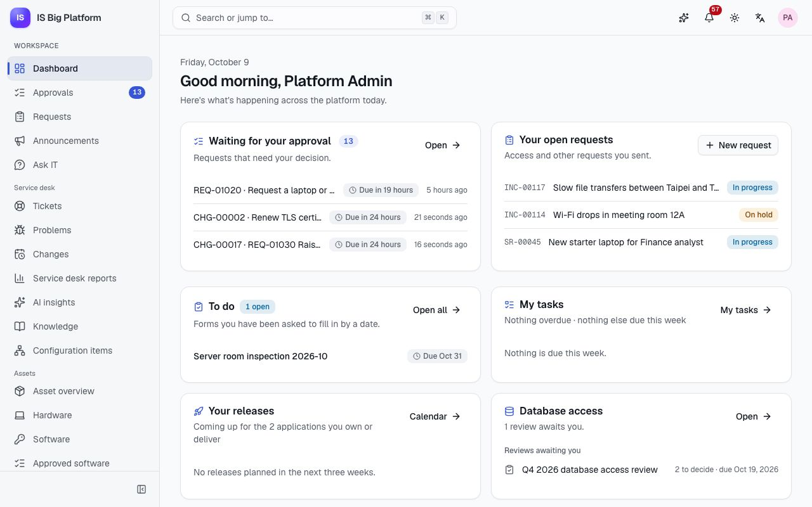
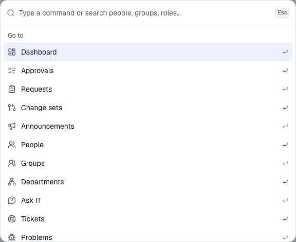
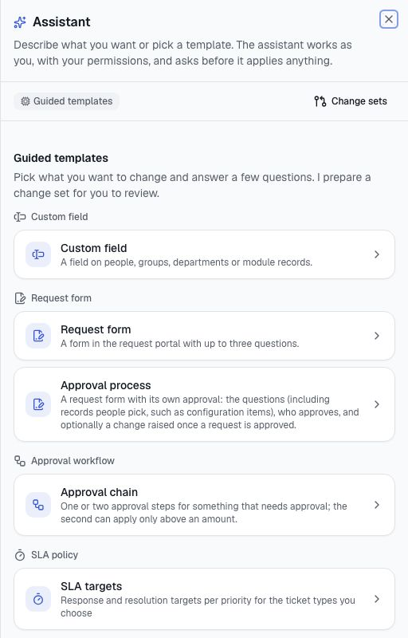

# Start here

IS Big Platform (ISBP) is where our IT work happens: you ask IT for things, report problems, approve requests, and
IT runs the service desk, changes, assets, projects, data feeds and automation in the same place. This page shows
you how to sign in, find your way around the screen, and which guide to read for your role.

## What you can do here

- [Sign in](#sign-in) with your company account or a local account
- [Find your way around](#find-your-way-around): the sidebar, search, notifications, language and theme
- [Get help from the assistant](#get-help-from-the-assistant) on any page
- [Choose the guide for your role](#choose-the-guide-for-your-role)
- [Find help when you're stuck](#find-help-when-youre-stuck)

## What ISBP is for in our IT work

Every request, ticket, approval and configuration change in ISBP follows the same rules:

- **One front door.** Employees go to **Requests** to ask for access, equipment or software, report an issue, see
  their devices and follow everything they asked for.
- **One permission model.** What you see depends on your roles. Pages and buttons you don't have access to are
  hidden, and every role you hold is listed under **Profile & preferences → My access**.
- **Approvals built in.** Access requests, purchase forms, changes, asset disposals and project proposals go
  through approval workflows, and approvers decide in one inbox. Administrators can turn any IT process into a form
  with its own approvals and follow-up actions.
- **Everything is recorded.** Changes are written to the audit log, so IT can always show who did what and when.
- **Three languages.** The whole platform, its emails and this guide are available in English, 繁體中文 and 日本語.

[How ISBP fits our work](how-it-fits-our-work.md) maps our IT practices to the areas of the platform.

## Sign in

You sign in when you open ISBP in a browser for the first time on a device, or after you signed out.

1. Open the ISBP address your IT department gave you.
2. If you see a **Sign in with …** button (for example **Sign in with Microsoft Entra ID**), select it and sign in
   with your company account (single sign-on).
3. Otherwise, enter your **Email or username** and **Password**. If you see **Account type**, choose your company
   directory, or **Local account** if IT created an account for you in ISBP itself.
4. Select **Keep me signed in on this device** only on a device that only you use.
5. Select **Sign in**.

**What happens next:** you land on the **Dashboard**, or on the page you were opening (for example a link from an
email). Your language, theme and time zone follow you to every device.

If IT gave you a password (a new local account, or a password they set for you), ISBP first opens **Profile &
preferences** with **Choose a new password**. Enter the password you were given as the **Current password**, then
your **New password** twice, and select **Change password**. You then go on to the page you were opening.

> **Tip:** If you see **Your account has not been set up in this platform yet.**, your company account works but ISBP
> doesn't know you yet. Ask the service desk to add you.

> **Important:** **Too many failed attempts. Try again in a few minutes.** means your account is locked for a short
> time. If you use a local account and forgot your password, ask the service desk; with single sign-on, change your
> password with your company account as usual.

## Find your way around

**The sidebar** on the left lists the pages you can use. It has two parts:

| Part               | What's in it                                                                                                                                                                                                                                                                                                                                                                                                                                                 |
| ------------------ | ------------------------------------------------------------------------------------------------------------------------------------------------------------------------------------------------------------------------------------------------------------------------------------------------------------------------------------------------------------------------------------------------------------------------------------------------------------ |
| **Workspace**      | For everyone: **Dashboard**, **Approvals**, **Requests**, **Announcements**, **Ask IT**, **Knowledge**, **Projects** and **Database access**. Depending on your roles, also **Service desk**, **Configuration items**, **Assets**, **Applications**, **Data APIs & ETL** and **Scheduled jobs**                                                                                                                                                              |
| **Administration** | **Change sets** for everyone who uses the assistant. For administrators: **Identity** (**People**, **Groups**, **Departments**), **Access** (**Roles & access**, **Applications**, **API clients**), **Automation** (**Workflows**, **Forms**, **Custom fields**, **Notifications**, **AI**), **Platform** (**Audit log**, **Modules**, **Database connections**, **Sign-in providers**), the **Service desk** and **Assets** settings, and **Integrations** |

The number next to **Approvals** is how many decisions are waiting for you. On a small screen, open the sidebar
with **Open navigation** (the menu button at the top left); on a large screen, **Toggle sidebar** at the bottom of
the sidebar makes it narrow.

**The header** at the top has, from left to right:

- **Search or jump to…** — opens the command palette (or press **⌘ K** on a Mac, **Ctrl K** on Windows). Type a
  page name to go there, or at least two letters to search people, requests, tickets, knowledge articles, assets,
  projects and other records you're allowed to see. **Actions** switch the theme or language and sign you out.
- **Assistant** (the sparkles button) — opens the [assistant](#get-help-from-the-assistant).
- **Notifications** (the bell) — the latest notifications for you, with **Mark all as read** and **View all
  notifications**. A notification opens the record it's about.
- **Theme** — **Light**, **Dark** or **System** (follows your device).
- **Language** — **English**, **繁體中文（台灣）** or **日本語**. Notifications and emails also use your language.
- **Your avatar** (the user menu) — your name and email, **Profile & preferences**, **Help** (this guide),
  **API documentation** and **Sign out**.

**Profile & preferences** is where you set your time zone and notifications, schedule out-of-office, sign out other
devices and see your roles: see [Personal settings](employees.md#set-your-language-time-zone-and-sessions).

## Get help from the assistant

The assistant is a built-in AI agent in a panel on every page. It knows which page and record you're on, works with
your permissions, and asks before it changes anything. Agents use it for everyday work, such as updating a ticket;
administrators use it to change configuration, such as adding an approval step, through change sets that someone
reviews and can roll back.

1. Select **Assistant** in the header.
2. Describe what you want, or pick one of the **Guided templates** if your organisation hasn't configured an AI
   chat model.

If you don't see the **Assistant** button, you don't have the **Assistant user** role. For questions about using
IT services, use **Ask IT** instead: it's available to everyone. See [Assistant and AI](assistant-and-ai.md).

## Choose the guide for your role

| If you…                                                                 | Read                                              |
| ----------------------------------------------------------------------- | ------------------------------------------------- |
| Want the big picture: which area handles which IT practice              | [How ISBP fits our work](how-it-fits-our-work.md) |
| Are an employee, a manager or an approver                               | [Employees, managers and approvers](employees.md) |
| Work on the service desk (tickets, SLAs, knowledge, CMDB)               | [Service desk](service-desk.md)                   |
| Manage changes, sit on the CAB or own an application                    | [Changes and releases](changes-and-releases.md)   |
| Manage hardware, licences, contracts and vendors                        | [Assets](assets.md)                               |
| Keep the ISMS asset register, stocktakes, shared accounts and reviews   | [Information security](information-security.md)   |
| Run or work on projects                                                 | [Projects](projects.md)                           |
| Build data feeds, scheduled jobs or look after databases                | [Data and automation](data-and-automation.md)     |
| Connect ISBP to ServiceDesk Plus or Azure DevOps Server                 | [Integrations](integrations.md)                   |
| Want to know what the AI does, or customise the platform with the agent | [Assistant and AI](assistant-and-ai.md)           |
| Administer people, access, sign-in, workflows, forms or modules         | [Administrators](administrators.md)               |
| Turn an IT process into a request form with approvals and actions       | [Build your own process](processes.md)            |
| Need a term in English, 繁體中文 or 日本語                              | [Glossary](glossary.md)                           |
| Have a problem or a quick question                                      | [FAQ and troubleshooting](faq.md)                 |

## Find help when you're stuck

- **Help in the user menu.** Choose your picture at the top right, then **Help**, to open this guide in your
  language. Links between guides open the other guide at the right section.
- **This guide is in the knowledge base.** Every guide is also an article in the knowledge base category **Using IS
  Big Platform**, in your language. Open **Knowledge** in the sidebar and search, or search from the header.
- **Ask IT.** Open **Ask IT** in the sidebar (or **Ask a question** on the **Requests** page) and describe your
  problem in your own words. It answers from the knowledge base, including this guide, and prepares a ticket for you
  to confirm if it can't help. See [Ask IT](employees.md#ask-it-before-you-raise-a-ticket).
- **Can't see a page?** You probably don't have the role for it. **Profile & preferences → My access** shows the roles
  you have; see [FAQ](faq.md#i-cant-see-a-page-or-a-button).
- **A person.** Choose **Report an issue** on the **Requests** page, and the service desk takes it from there.

## How it connects

- Next: [How ISBP fits our work](how-it-fits-our-work.md), then the guide for your role.
- Terms used in these guides: [Glossary](glossary.md).
