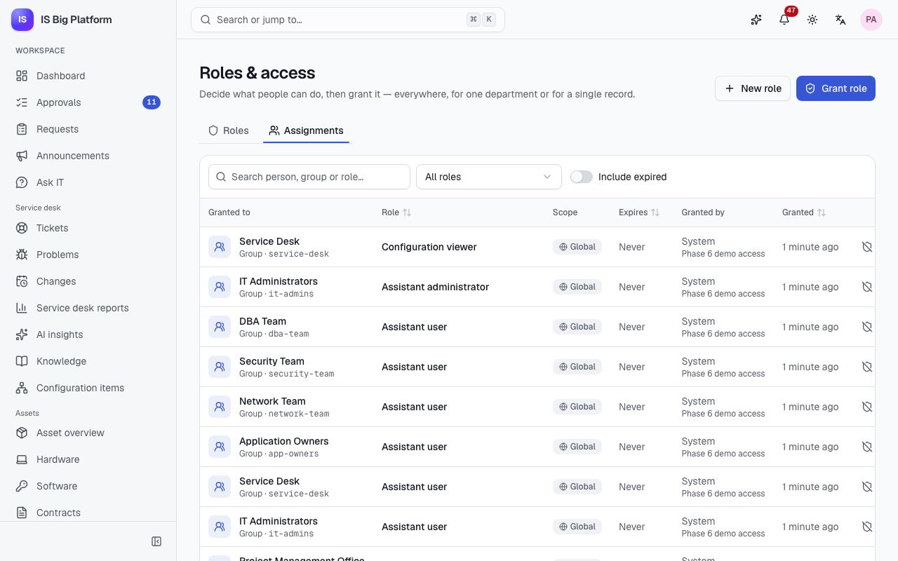
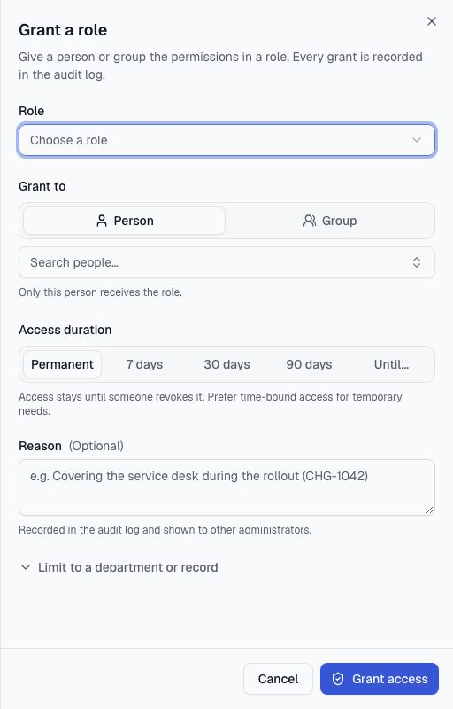
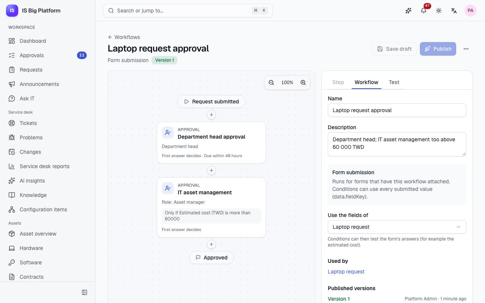

# Administrators guide

This guide is for IT and platform administrators. It covers who can do what (people, groups, departments, roles and
access requests), how people sign in, the approval workflows and forms behind every request, notifications, modules,
AI settings and the audit log. Many of these changes can also be prepared by the assistant as a change set; the
[common admin tasks](#common-admin-tasks) at the end show both ways.

## What you can do here

- Manage [people and their lifecycle](#add-and-onboard-a-person), [groups](#organise-people-in-groups) and
  [departments](#build-the-department-tree)
- [Create roles](#create-a-role), [grant them with a scope and an end date](#grant-a-role-with-a-scope-and-an-end-date)
  and [let people request access](#let-people-request-a-role)
- Register [applications and their roles](#manage-business-applications-and-their-roles) and give other systems
  access through [API clients and the Role Query API](#give-another-system-access-with-an-api-client)
- [Connect a sign-in provider](#connect-a-sign-in-provider) (OIDC, SAML or LDAP)
- [Design](#design-an-approval-workflow) and [publish](#test-and-publish-a-workflow) approval workflows, and
  [build request forms](#build-a-request-form) and [custom fields](#add-custom-fields)
- [Send notifications to email, Teams, Slack or webhooks](#set-up-notification-channels-and-email)
- [Turn modules on or off](#manage-modules-and-their-settings), [configure AI](#configure-ai) and
  [check the audit log](#check-the-audit-log)
- [Administer the assistant](#administer-the-assistant) and its change sets

## Find your way around Administration

The **Administration** part of the sidebar only shows the pages you have permission for. The system roles below are
the usual way to hand out administration; **Platform administrator** can do everything.

| Page (Administration → …)                                      | What it's for                                            | Role that manages it                                                          |
| -------------------------------------------------------------- | -------------------------------------------------------- | ----------------------------------------------------------------------------- |
| **People**, **Groups**, **Departments**                        | Accounts, membership and the organisation tree           | **Identity administrator**                                                    |
| **Roles & access**                                             | Roles, permissions and who holds them                    | **Platform administrator** (create roles); **Identity administrator** (grant) |
| **Applications**, **API clients**                              | Business applications, their roles, and service accounts | **Application manager**; **Platform administrator**                           |
| **Workflows**, **Forms**, **Custom fields**, **Notifications** | Approvals, request forms, extra fields and delivery      | **Workflow administrator**                                                    |
| **AI**                                                         | Models, privacy, budget, the index and outside agents    | **Platform administrator**                                                    |
| **Audit log**                                                  | Every change and sign-in                                 | **Security auditor** (read-only everywhere)                                   |
| **Modules**                                                    | Turn modules on or off and change their settings         | **Module administrator**                                                      |
| **Database connections**                                       | External databases                                       | **Database connection administrator**                                         |
| **Sign-in providers**                                          | SSO and directory sync                                   | **Platform administrator**                                                    |
| **Integrations**, **Sync conflicts**                           | ServiceDesk Plus and Azure DevOps Server                 | **Integrations administrator**                                                |
| **Change sets**                                                | Configuration changes prepared with the assistant        | **Assistant administrator**                                                   |

Modules add their own administration pages, such as **Service desk** (ticket categories, SLA policies, calendars and
the service catalog). Those are described in the guides for each area.

## Add and onboard a person

People who sign in with SSO are created automatically at their first sign-in (when the provider allows it). Add a
person by hand for a local account, or to pre-board a new hire before their first day.

1. Go to **Administration → People** and select **Add person**.
2. Fill in **Identity** (work email, username, display name), **Organisation** (department, manager, job title) and
   **Account** (language, time zone).
3. Under **Start as**, choose **Active now** (can sign in immediately) or **Pre-boarded** (the account exists but
   can't sign in until onboarded).
4. For a local account, set an **Initial password** (right after their first sign-in, ISBP asks them to choose a new
   one). Leave it empty for SSO-only accounts.
5. Add **Groups**: membership grants the roles assigned to those groups. Select **Create**.

**What happens next:** On the start date, open the person and select **Onboard**. The person's **Access** tab shows
their effective permissions and why they have each one: directly, through a group, or as everyone.

## Suspend, reactivate or offboard a person

Suspend someone during an investigation or long leave; offboard them when they leave.

1. Open the person in **Administration → People** and select **More actions**.
2. Select **Suspend** and give a **Reason**. They're signed out at once and keep their access for later. To undo it,
   select **Reactivate**.
3. To offboard, select **Offboard**. Choose whether to **Remove all group memberships**, **Remove all directly
   assigned roles** and **Transfer direct reports to** someone, then select **Offboard**.

**What happens next:** Offboarding disables sign-in and ends every session. Modules are told so they can remove access
of their own, such as database accounts, and asset managers are reminded to collect the person's devices. Everything
is in the audit log. **Sign out everywhere** and **Set password** are also under **More actions**. With **Require a
new password at next sign-in**, the person is taken to **Choose a new password** in **Profile & preferences** right
after they sign in, and can't skip it on a page load until they've changed it.

## Organise people in groups

Grant roles to groups rather than to people one by one: everyone who joins the group gets the role, and everyone who
leaves loses it.

1. Go to **Administration → Groups** and select **New group**. Enter a **Name** and a **Key** (used by integrations and
   directory sync; it can't change later) and select **Create**.
2. Open the group. On **Members**, select **Add members**, find people and confirm.
3. On **Roles**, select **Grant a role** to give every member a role.

Groups filled by directory sync say so; manual changes there may be overwritten by the next sync. The **Everyone**
group holds every active person and gives baseline access.

## Build the department tree

Departments group people and can limit what an administrator may manage. In the demo, the HR partner (`hr.partner`)
manages people only in the Sales department and its sub-departments.

1. Go to **Administration → Departments** and select **New department**, or open a department and select **Add
   sub-department**.
2. Enter the **Name**, a short **Code**, the **Parent department** and the **Manager** (the department head that
   workflows can ask for approval). Select **Create**.

Moving a department moves everything under it. Deleting one is refused while it has sub-departments, and revokes roles
scoped to it.

## Create a role

A role bundles permissions. Permissions are named `module.resource.action` (for example `core.users.read`), and `*`
covers a whole module or resource.

1. Go to **Administration → Roles & access** and select **New role**.
2. Enter a **Name**, a **Key** and a **Description**.
3. Under **Permissions**, tick individual permissions, or select a whole module or resource to grant it with a
   wildcard (which also covers permissions added later). Select **Create role**.

System roles come from the modules and can't be edited: open one and select **Duplicate** to make an editable copy.
Their names and descriptions are shown in each person's language; roles you create keep the name you give them.
You can only put permissions you hold yourself into a role; ISBP refuses the rest. In the demo, **HR partner**,
**Directory lookup** (reads people and groups) and **Group manager** are custom roles.

## Grant a role with a scope and an end date

Grant a role to a person or a group for everywhere, for one department, or for one record, and optionally only until
a date. Prefer time-bound access for temporary needs.

1. Go to **Administration → Roles & access** and select **Grant role** (or **Manage access** on a person's page).
2. Choose the **Role**, then under **Grant to** a **Person** or a **Group**.
3. Under **Access duration**, choose **Permanent**, **7 days**, **30 days**, **90 days** or **Until…** a date.
4. To narrow it, turn on **Limit to a department or record** and choose the **Scope**: a department (and its
   sub-departments) or a single record such as one group.
5. Enter a **Reason** and select **Grant access**.

**What happens next:** The grant works at once. Time-bound grants end by themselves; a person (not a group) gets an "Access ending soon" reminder first.
The **Assignments** tab lists every grant with its scope, end date and who granted it; select **Revoke** to end one.

In the demo, `helpdesk` manages the members of the VPN Users group only (a record scope), and a contractor holds
**Module administrator** for three days for a module rollout.

## Let people request a role

Instead of granting every role yourself, let people ask for it in the request portal. The request goes through an
approval workflow, and the role is granted automatically, for the time approved, when it's approved.

1. Open the role in **Administration → Roles & access**.
2. In **Self-service requests**, turn on **People can request this role**.
3. Choose the **Risk level** (workflows can send riskier requests to more approvers), the **Role owner** (who
   approves when the workflow has a role-owner step), the **Longest grant** and, if needed, a specific **Approval
   workflow**. Select **Save changes**.

**What happens next:** The role appears under **Request access** in the portal (see [Employees](employees.md)).
Requests use the default **Access request** workflow unless you chose another. In the demo, **Module administrator**
is requestable for at most 30 days and goes through the **Privileged access** workflow.

## Manage business applications and their roles

Register a business application (such as Finance ERP in the demo) so its access is granted, requested, approved,
expired and audited like platform access. The application asks the Role Query API who may do what.

1. Go to **Administration → Applications** and select **Register application**. Enter a **Name**, a **Key** (the
   application uses it when it calls the API; it can't change later), the **Owner** and select **Register**.
2. On **Permissions**, add the actions the application checks, such as `invoices.approve`.
3. On **Roles**, select **New role**, pick its permissions and, under **Self-service requests**, decide whether people
   can request it.
4. On **People with access**, select **Grant access** to give a person or group a role.
5. On **Role Query**, pick a person to see exactly what the application gets back, or check one permission.

Roles of the platform itself are managed on **Roles & access**, not here.

## Give another system access with an API client

An API client is a service account for another system: an application asking the Role Query API, a script calling
the platform API, or an outside AI agent. In the demo, **Finance ERP role sync** may query Finance ERP.

1. Go to **Administration → API clients** and select **Create client**.
2. Enter a **Name** and **Description**, then choose the **Applications it may query** (or **All applications**).
3. If it needs other platform APIs, open **Advanced: platform permissions, IP ranges** and add **Platform API
   permissions** (for example `core.users.read`) and, optionally, **Allowed IP ranges**.
4. Choose when the **First secret expires** and select **Create client**.
5. Copy the **Client secret (API key)**, tick **I’ve stored the secret somewhere safe** and select **Done**.

**What happens next:** The system sends the key as a bearer token, or exchanges the client ID and secret for a
one-hour OAuth token. To rotate without downtime, open the client, select **Add secret**, deploy the new one, then
**Revoke** the old one. **Revoke client** disables it completely. API clients never reach personal features such as
"my requests". For the endpoints, see the [API guide](../../api.md).

## Connect a sign-in provider

Let people sign in with our identity provider or directory. Local accounts keep working alongside it.

1. Go to **Administration → Sign-in providers** and select **Add provider**.
2. Choose **Microsoft Entra ID**, **Generic OpenID Connect**, **SAML 2.0** or **LDAP / Active Directory**, and fill in
   the form (for Entra ID: the tenant ID, the application (client) ID and the client secret).
3. Under **Provisioning**, decide whether to **Create people at first sign-in**, a **Default department**, and
   **Group mappings** (a group in the provider → a platform group). For LDAP, turn on **Sync on a schedule** to create,
   update and suspend people from the directory.
4. Select **Add provider**. Register the values shown (such as the **Redirect URI** or the **Assertion consumer service
   (ACS) URL**) in the identity provider.
5. Select **Test connection**, then switch the provider on with the switch on its card.

**What happens next:** The provider appears on the sign-in page. New providers start disabled, so nobody sees them
until you switch them on. In the demo, **Microsoft Entra ID** and **Corporate Active Directory** are examples that
stay disabled.

## Design an approval workflow

Approval workflows decide who approves access requests, form requests and module work such as changes (**Change
authorization**), asset disposal, project proposals, database access, publishing and change set reviews.

1. Go to **Administration → Workflows**. Workflows are grouped by what they're **Used for**; **Always runs** marks
   approvals that can never be turned off.
2. Select **New workflow** (or **New** next to a trigger), choose what it's **Used for**, a **Name** and whether to
   **Start from** a copy, then select **Create and open**.
3. On the canvas, select **Add a step here** and choose a step:
   - **Approval**: ask people to approve or reject.
   - **Decision**: take a different path depending on the request (for example the amount on a form).
   - **In parallel**: several approvals at the same time.
   - **Notification**: let people know, no decision needed.
4. Select a step and set it on the **Step** tab:
   - **Approvers**: **A person**, **A group**, **Holders of a role**, **Manager**, **Department head**, **Person in a
     field** or **The requester**, each with an optional fallback (**If nobody is found, ask**).
   - **How many must approve**: **The first answer decides**, **Every approver** or **A number of approvers**.
   - **Only run this step in some cases**: a condition, such as the amount being above a limit.
   - **Deadline**: **Due within**, **Remind after**, and **When the deadline passes** (notify, escalate, approve or
     reject automatically).
   - **Options**: delegation, self-approval (off by default), and **If no approver is found**.
   - **Instructions for approvers**.
5. On the **Workflow** tab, choose **Use the fields of** a form so conditions can test its answers.
6. Select **Save draft**.

In the demo, **Laptop request approval** asks the department head, then holders of the **Asset manager** role when
the estimated cost is above 60 000 TWD.

## Test and publish a workflow

Test a workflow before people depend on it, then publish it.

1. In the builder, open the **Test** tab. Enter example **Request values** and **Decisions**, then select **Run
   test**. The canvas shows which steps run, are skipped or wait. Nothing is saved or sent.
2. Select **Publish**. "Published version … — new requests use it now" confirms it.
3. To make it the one used for its trigger, open **More actions** and select **Use for new requests**. For a form,
   attach it on the form's **Settings** tab instead: each form chooses its own workflow.

**What happens next:** Requests already running keep the version they started with. Follow every running approval on
the **Running & history** tab. **Stop using (no approval)** turns approval off for an optional trigger, and **Archive**
retires a workflow.

## Build a request form

Request forms are what people fill in from the portal: equipment, software, anything IT provides.

1. Go to **Administration → Forms** and select **New form**. Enter a **Name**, a **Key**, an **Icon** and a
   **Category**, then select **Create and open builder**.
2. On **Build**, drag fields from **Add elements** onto the form, or click one to add it. Select a field to set its
   **Label** (in English, 繁體中文 and 日本語), **Key**, **Help text**, **Required**, its options, and **Show this field
   only when…** for conditional fields.
3. On **Preview**, try the form in each language and submit it to check the answers.
4. On **Settings**, choose who sees it under **Audience** (**Everyone** or **Specific groups**), whether it's
   **Accepting requests**, and its **Approval** workflow.
5. Select **Save**, then **Publish**.

**What happens next:** The form appears in the portal. Requests made with it are on its **Requests** tab. Publishing
again creates a new version; requests already submitted keep theirs. To have the service desk fulfil approved
requests, add the form to the service catalog (see [Service desk guide](service-desk.md)).

## Add custom fields

Add fields your organisation needs, such as a cost centre or an office, to people, groups, departments and module
records (tickets, hardware assets, contracts, configuration items, projects, tasks and applications).

1. Go to **Administration → Custom fields** and choose the record type.
2. Select **Add field**. Choose the **Field type**, enter the **Label** and **Key**, and set **Required**, options and
   conditions as for forms.
3. Select **Add**.

**What happens next:** The field appears in the **Additional information** section of the record's form and page,
and in filters. The key and type can't change once the field exists. **Archive** hides a field and keeps its
values.

## Set up notification channels and email

People get notifications in the app, and by email if they want. Channels also post selected notifications to a team
channel or another system, such as escalations to the IT on-call channel.

1. Go to **Administration → Notifications**.
2. On **Email**, turn on **Send notification emails**, enter the **SMTP server**, **Port**, **Encryption**, sign-in and
   **Sender**, and select **Save changes**. Select **Send test email** to check it.
3. On **Channels**, select **Add channel**. Choose the **Type** (**Microsoft Teams**, **Slack** or **Webhook**), a
   **Name**, the **Webhook URL** (the form explains where to get it), the **Message language**, and under
   **Notifications** the types it receives (whole modules or single types). Select **Add channel**.
4. Select **Send test** on the channel to post a test message.

**What happens next:** Webhook URLs are stored encrypted and never shown again. A generic webhook gets a signing
secret, shown once, so the receiving system can check each request. The **Delivery log** shows every email and channel
message with its status; failed deliveries are retried a few times. Webhook URLs must be public `https://` addresses.
In the demo, **IT Operations (Microsoft Teams)** and **#it-approvals (Slack)** are example channels, switched off.

## Manage modules and their settings

Every capability is a module, and modules can be turned off at runtime without losing data.

1. Go to **Administration → Modules**. Each card shows whether the module is on.
2. Use the switch on a card to turn a module on or off. Modules that others depend on must stay on until those are
   off; ISBP tells you which.
3. Open a module to see its permissions, events, AI tools and the identity its background AI work runs as. On
   **Settings**, change its settings and select **Save changes**.

For example, Helpdesk AI's settings turn on **Apply confident suggestions automatically** for triage, and the core
platform's settings include the largest attachment size and blocked file types.

## Configure AI

AI features work without a model (builtin mode). Add a model to turn on generative answers and free-text requests to
the assistant. See [Assistant and AI](assistant-and-ai.md) for what changes for people.

1. Go to **Administration → AI**. The top shows the mode, the embedding model, the vector store and this month's
   spend.
2. On **Models**, under **Chat model**, choose the **Provider**: **None**, **Anthropic (Claude)** or
   **OpenAI-compatible** (OpenAI, Azure OpenAI, Ollama, vLLM and others). Enter the API key and model, and the
   prices if you want cost estimates. Select **Save changes**, then **Test connection**.
3. Under **Embeddings**, keep **Builtin** (offline, no key) or choose an OpenAI-compatible model. Changing it
   re-embeds the index in the background.
4. On **Privacy & budget**, keep **Mask data before it leaves the platform** on, choose **What to mask**, add
   **Custom patterns** if needed, and set a monthly **Budget** (0 means no limit). Select **Save changes**.
5. On **Usage**, see calls, tokens, cost and masked values by feature and model. On **Index**, see what semantic
   search can draw on and select **Re-embed now** after a model change.
6. On **Outside agents (MCP)**, see the MCP endpoint, the API clients that may use it and the command to connect
   Claude Code (see [Connect an outside agent](assistant-and-ai.md#connect-an-outside-agent-over-mcp)).

Keys are stored encrypted and never shown again.

## Check the audit log

The audit log records every change, sign-in and access decision. It can't be edited, and each record is chained to
the previous one with a hash, so tampering shows.

1. Go to **Administration → Audit log**.
2. Search by actor, target or action, and filter by **Category** (**Data**, **Security**, **System**), **Outcome**,
   **Module** and dates.
3. Open a record to see the changed fields, the details and the context. Select **Verify hash** to check on the
   server that the record is intact.
4. Select **Export CSV** to download the rows on the page.

Changes applied from a change set name the change set; changes made by a sync name the connection and the remote
record; turning on **Allow insecure HTTP** for an integration is a **Security** event.

## Database connections and integrations

- **Administration → Database connections** registers SQL Server, PostgreSQL, MySQL and Oracle databases for Data
  APIs, pipelines, SQL jobs and database access. See [Data and automation](data-and-automation.md).
- **Administration → Integrations** connects ServiceDesk Plus and Azure DevOps Server. See
  [Integrations](integrations.md).

## Administer the assistant

The assistant is only available to people you give it to.

- **Assistant user** lets someone use the assistant and prepare change sets for the configuration they can read.
- **Assistant administrator** sees every change set, and can edit, discard or withdraw anyone's.
- **Configuration viewer** (a system role) lets someone read workflows, forms, custom fields, roles and module
  settings, so they can propose changes to them that someone else applies.

In the demo, the IT groups are assistant users, IT administrators are assistant administrators, and the service desk
holds **Configuration viewer**, so it prepares changes and requests reviews.

**Reviews.** A change set sent for review runs the **Change set review** workflow. By default one platform
administrator approves it. To route it differently, for example role changes to identity administrators, create a
workflow for **Change set review** in **Administration → Workflows**, use a **Decision** step on the change set's
contents (the kinds of configuration, the modules, the number of changes, and whether it archives or deletes
something), publish it and select **Use for new requests**. Approving applies the change set with the approver's
permissions.

**Change sets.** **Administration → Change sets** shows your own change sets; the **All** tab, for assistant
administrators, shows everyone's, including those prepared by outside agents. **Tool calls per answer** in the
Assistant module's settings limits how much work the assistant does per answer.

## Common admin tasks

Most configuration can be changed on the admin pages or prepared by the assistant as a change set (free text needs a
chat model; the guided templates work without one). Some tasks are admin pages only.

| Task                                                     | On the admin pages                                                                                                    | Ask the assistant                                                                                                                                  |
| -------------------------------------------------------- | --------------------------------------------------------------------------------------------------------------------- | -------------------------------------------------------------------------------------------------------------------------------------------------- |
| Add an approval step for laptops over 60 000 TWD         | **Workflows** → the laptop workflow → **Add a step here** → **Approval** with a condition on the amount → **Publish** | "Laptop requests over 60,000 TWD also need approval from IT asset management", or the **Approval chain** template                                  |
| Add a cost centre field to assets                        | **Custom fields** → **Hardware asset** → **Add field**                                                                | "Add a cost centre field to hardware assets", or the **Custom field** template                                                                     |
| Route major incidents to a Teams channel                 | **Notifications** → **Channels** → **Add channel** (**Microsoft Teams**) with **Major incidents (channels)**          | Only for an existing channel: "Send major incidents to IT Operations (Microsoft Teams) too". A new channel and its URL are added on the admin page |
| Create a request form for a second monitor               | **Forms** → **New form** → **Publish**                                                                                | "Create a request form for a second monitor", or the **Request form** template                                                                     |
| Require a review before knowledge articles are published | **Workflows** → new workflow for **Publishing a knowledge article** → **Use for new requests**                        | "Knowledge articles need a service desk review before publishing" (the demo's draft change set does this)                                          |
| Create a role for read-only asset auditors               | **Roles & access** → **New role**                                                                                     | "Create a role that can read assets and licences" (you can only grant what you hold)                                                               |
| Change SLA targets for incidents                         | **Service desk** → **SLA policies**                                                                                   | The **SLA targets** template, or describe the targets                                                                                              |
| Check an internal website every 5 minutes                | **Scheduled jobs** (see [Data and automation](data-and-automation.md))                                                | The **HTTP health check** template                                                                                                                 |
| Turn on automatic triage                                 | **Modules** → **Helpdesk AI** → **Settings**                                                                          | "Turn on automatic triage for new tickets"                                                                                                         |
| Give a contractor module access for 30 days              | **Roles & access** → **Grant role** → **30 days**                                                                     | Admin pages only (or the person requests it in the portal)                                                                                         |
| Offboard a person                                        | **People** → the person → **More actions** → **Offboard**                                                             | "Offboard …" with a chat model; you confirm on the card before it runs                                                                             |

## How it connects

- [Employees](employees.md): what people see when they request access, fill in forms and approve.
- [Assistant and AI](assistant-and-ai.md): change sets, reviews and outside agents.
- [Service desk guide](service-desk.md): categories, SLA policies and the service catalog.
- [Integrations](integrations.md) and [Data and automation](data-and-automation.md): connections to other systems.
- [Glossary](glossary.md) and [FAQ](faq.md).
