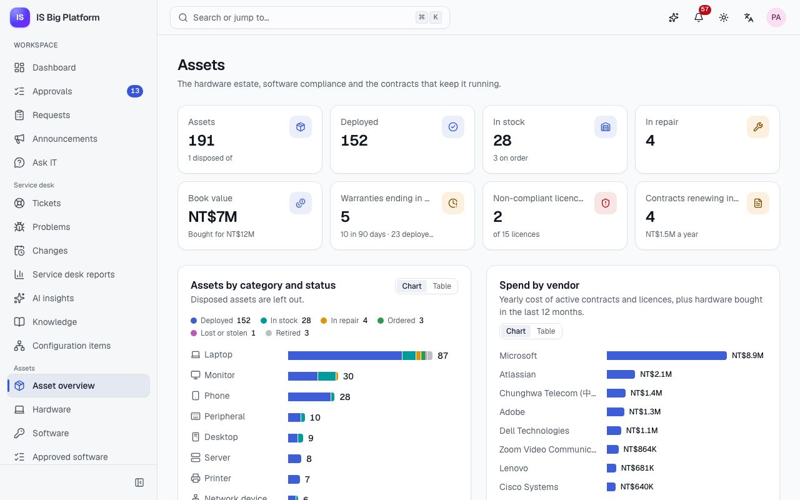
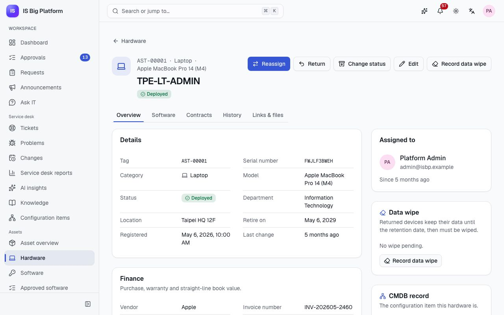
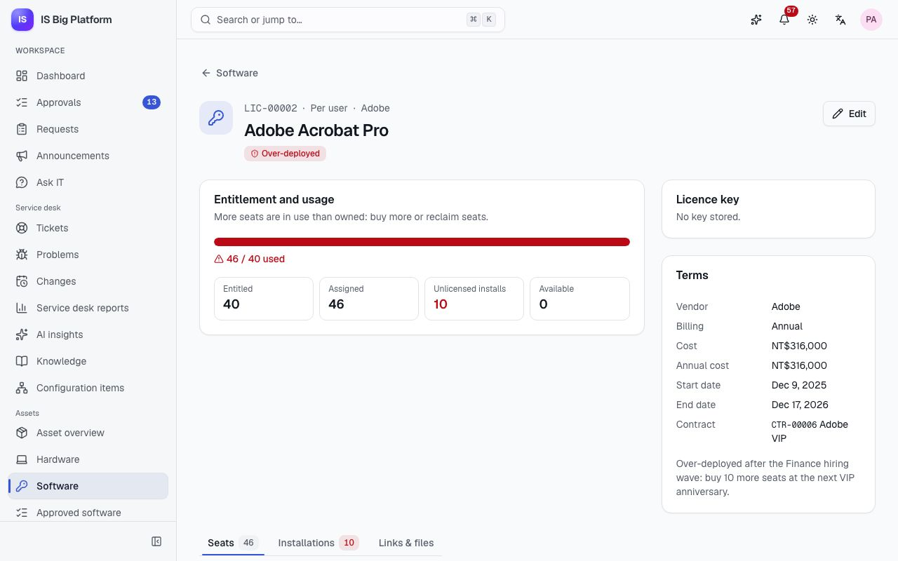
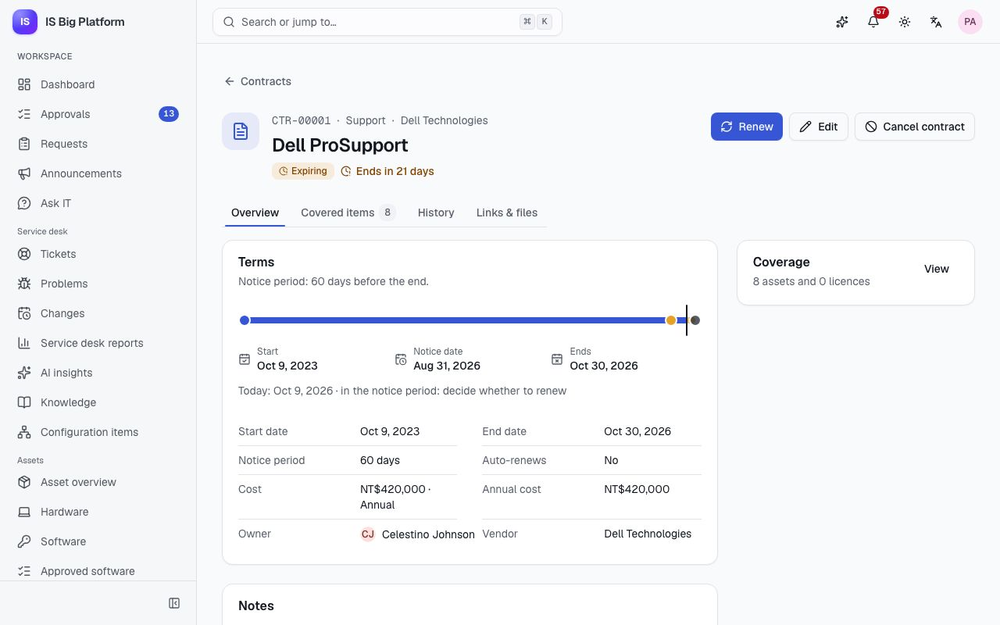

# Assets guide

This guide is for asset managers and contract managers, and it explains what employees see of their own devices.
**Assets** keeps the company's hardware, software licences, contracts and vendors in one place: who has which
laptop, what a device is still worth, whether we use more licences than we own, and which contracts need a renewal
decision soon.

## What you can do here

- [See the state of the estate](#see-the-state-of-the-estate) on the asset overview
- [Register a device](#register-a-device), [assign it to someone](#assign-a-device-and-take-it-back) and
  [move it through its lifecycle](#move-a-device-through-its-lifecycle)
- [Read a device's book value](#read-a-devices-book-value)
- [Dispose of a retired device](#dispose-of-a-retired-device) with the required approval
- [Collect devices from leavers](#collect-devices-from-leavers)
- [Manage software licences](#manage-software-licences) and
  [keep them compliant](#check-licence-compliance), including installs found by inventory tools, and
  [review discovered software](#review-discovered-software) or import an inventory CSV
- [Keep contracts and renewals on track](#keep-contracts-and-renewals-on-track), with the signed documents attached
- [Track vendors and spend](#track-vendors-and-spend) and
  [maintain the model catalogue](#maintain-the-model-catalogue)
- Understand [what employees see](#what-employees-see-my-devices) under **My devices**
- [Link assets to tickets and CIs](#link-assets-to-tickets-cis-and-other-records), and know how
  [assets synced with ServiceDesk Plus](#assets-synced-with-servicedesk-plus) behave

## Who can do what

The roles below are granted in **Administration → Roles & access**. If you don't see **Assets** in the sidebar,
ask an administrator for one of them.

| Role                    | What it allows                                                                                     |
| ----------------------- | -------------------------------------------------------------------------------------------------- |
| **My devices**          | Everyone has it: see the devices and software assigned to you                                      |
| **Asset viewer**        | Browse hardware, software licences and contracts                                                   |
| **Asset manager**       | Manage hardware and licences, reveal licence keys, maintain models and vendors; approves disposals |
| **Contract manager**    | Manage contracts, their renewals and vendors; see the hardware and software they cover             |
| **Asset administrator** | Everything in asset management                                                                     |

Seeing hardware can be limited to a department and its people, so a local IT contact can see only their site's
devices.

## See the state of the estate

Start here each morning, or before a budget or audit meeting, to see what needs attention.

1. Go to **Assets → Asset overview**.
2. Read the figures at the top: **Assets**, **Deployed**, **In stock** (with how many are on order), **In repair**,
   **Book value**, **Warranties ending in 30 days**, **Non-compliant licences** and **Contracts renewing in 90
   days**. Each figure opens the matching filtered list.
3. Look at the charts: **Assets by category and status**, **Assets by status** and **Spend by vendor** (the yearly
   cost of active contracts and licences, plus hardware bought in the last 12 months). Use **View as** → **Table**
   to read the numbers as a table, for example to copy them into a report.
4. Work through **Needs attention**: **Warranties ending**, **Contracts renewing** and **Licences out of
   compliance**, each with **View all**.

In the demo, **Adobe Acrobat Pro** is listed under **Licences out of compliance** and **Dell Technologies** leads
**Spend by vendor**.

> **Tip:** Asset managers also get an **Asset attention** card on the **Dashboard**, with non-compliant licences,
> contracts renewing in 30 days and warranties ending in 30 days.

## Register a device

Register a device when it is ordered or when it arrives, so it can be tracked from the first day.

1. Go to **Assets → Hardware** and select **New asset**.
2. Under **Identity**, enter the **Name** (for example `TPE-LT-0042`), the **Category**, the **Model** and the
   **Serial number** as printed on the device. Each serial number can be registered only once.
3. Choose the **Status**: **In stock** or **Ordered**. Ordered devices move to stock when they arrive.
4. Optionally choose **Deploy to (optional)** to hand it to someone straight away.
5. Under **Location**, enter the location and department. For servers and network gear, pick the **CMDB
   configuration item** this device is.
6. Under **Purchase and warranty**, enter the vendor, purchase date, purchase cost, currency, invoice number and
   **Warranty ends**.
7. Save.

**What happens next:** the device gets an asset tag such as `AST-00042` and its history starts with "Registered".
Status changes and assignment have their own actions on the asset page. To plan a replacement date, select
**Edit** later and set **Retire on**; left empty, it is the purchase date plus the model's lifespan.

## Assign a device and take it back

Use this when you hand a laptop to a new hire, swap a broken phone, or take a loaner back.

1. Open the device from **Assets → Hardware** (the **In stock** tab lists what you can hand out).
2. Select **Assign** (or **Reassign** if someone already has it).
3. Choose the **Person**, add a **Note (optional)** and select **Assign**.

**What happens next:** the device becomes **Deployed**, the person is notified ("Devices assigned to me") and finds
it under **My devices**. The **History** tab records "Assigned to …".

To take it back, select **Return**, choose **Return to** (**In stock** or **In repair**), note the condition (for
example missing accessories) and select **Return**. History records "Returned by …".

Devices that store data (laptops, desktops, phones, tablets, servers, storage) get a data wipe when they come back:
leave **Schedule a data wipe** on and, if the data must be kept for a while, set **Keep the data until**. The wipe is
due 2 months after that date (or after today; an administrator sets the months under **Administration → Modules**).
The device shows **Wipe by …**, then **Wipe due …** a week before and **Wipe overdue since …** after it, the asset
managers are reminded, and **Assets → Hardware** filters by **Data wipe**. When the storage is wiped, select
**Record data wipe**, choose the **Method** (for example **Factory reset** for a phone), and optionally **Wiped at**,
**Wiped by** and a **Note**; the **Data wipe** card and the history show who wiped it, when and how.

Request forms can do both for you: the **Assign a device** and **Take back a device** actions hand over or take back
the device picked in the form (or by IT at an approval step), with the request (for example the signed
confidentiality agreement) linked from the device's history.

## Move a device through its lifecycle

Every device follows the same lifecycle, so the counts on the overview stay trustworthy.

1. Open the device and select **Change status**.
2. Choose the **New status**, add a note and select **Change status**.

| Current status | Can move to                                                |
| -------------- | ---------------------------------------------------------- |
| Ordered        | In stock, Lost                                             |
| In stock       | Deployed, In repair, Retired, Lost                         |
| Deployed       | In stock, In repair, Lost                                  |
| In repair      | In stock, Deployed, Retired                                |
| Retired        | In stock, or Disposed (only through the disposal approval) |
| Lost           | In stock                                                   |
| Disposed       | Nothing: this is final                                     |

A device keeps its assignee only while it is **Deployed**, **In repair** or **Lost**. If you move it to another
status, the dialog tells you that the person will no longer be its assignee.

The asset page has five tabs: **Overview**, **Software** (installed software and licence seats), **Contracts**
(support and maintenance contracts that cover it), **History** (every step, who made it and when) and **Links &
files**.

## Read a device's book value

Finance and auditors ask what the hardware is still worth. Assets computes it for you; nobody types it in.

1. Open the device. The **Finance** card shows **Purchase cost**, **Warranty ends** and **Book value**.
2. The **Straight-line depreciation** bar shows how far through its lifespan the device is and the date it is
   **Fully depreciated**.

The book value falls in a straight line from the purchase cost to zero over the model's lifespan. When a model
doesn't set one, the category default applies: 36 months for laptops, tablets and peripherals, 48 for desktops, 24
for phones and 60 for monitors, servers, network gear, storage and printers. The overview's **Book value** adds up
every device in the default currency (TWD unless an administrator changed it).

## Dispose of a retired device

A device that leaves the company for good must be approved first, and devices that can hold company data and still
have a book value or are under five years old need information security's sign-off that the storage was wiped or destroyed.

1. Make sure the device is **Retired** (use **Change status**).
2. Select **Request disposal**.
3. Fill in **How will it be disposed of?**, for example "wipe the SSD and send it to the certified recycler". Under
   **Who will approve it**, the dialog lists the approval steps and people of the disposal workflow in use. When
   information security signs off too (by default for a laptop, desktop, server, storage device, phone or tablet that
   still has a book value or is under five years old), the dialog reminds you.
4. Select **Request disposal**.

**What happens next:**

- The asset page shows "Disposal is waiting for approval." and the request goes to the **Asset disposal** approval.
- An asset manager approves first (the request is due within 72 hours, with a reminder after 48).
- For data-bearing devices that still have a book value or are under five years old, the security team then signs
  off. Their instructions ask them to confirm the storage was securely wiped (NIST 800-88) or physically destroyed.
- Once approved, the device is **Disposed**. If someone rejects it, it stays **Retired** and the history says
  "Disposal rejected".

Approvers decide in their **Approvals** inbox, see [Approve or reject a request](employees.md#approve-or-reject-a-request). In the demo,
a retired ThinkPad with a cracked screen is waiting for disposal: it is a laptop under five years old, so the
security team signs off too. Find it under **Assets → Hardware** on the **Retired & disposed** tab.

> **Important:** You can't set **Disposed** with **Change status**, and nor can another system: disposal only
> happens through this approval.

## Collect devices from leavers

When someone is offboarded in **Administration → People**, Assets reacts on its own:

- their licence seats are reclaimed (each one is recorded in the audit log);
- every device they still hold gets a history entry "Return requested: … has left the company";
- asset managers are notified ("Devices to collect from leavers") with the asset tags.

The devices stay **Deployed** until you collect them. Then open each one and select **Return**.

## Manage software licences

Record what the company owns so you can compare it with what is used.

1. Go to **Assets → Software** and select **New licence**.
2. Enter the **Product** (installs reported by inventory tools are matched by this name), the publisher and
   vendor, the **Licence type** (**Per user**, **Per device**, **Concurrent**, **Site** or **Subscription**), and
   **Entitlements** (leave it empty for unlimited or site licences).
3. Enter the cost, **Billing**, start and end dates (leave **End date** empty for a perpetual licence) and the
   **Contract** it was bought under.
4. Optionally store the **Licence key**. It is stored encrypted.
5. Save. Then open the licence and, on the **Seats** tab, use **Assign to a person** or **Assign to a device**
   (depending on the licence type) and select **Assign**.

To see a stored key, open the licence and select **Reveal**. Only people allowed to reveal keys (the **Asset
manager** and **Asset administrator** roles) see the button, and every reveal is recorded in the audit log.

## Check licence compliance

Before a true-up, a renewal or an audit by a publisher, check whether usage matches the entitlement.

1. Go to **Assets → Software**. The tabs **All**, **Needs attention**, **Expiring** and **Under-used** filter the
   list; the **Usage** column shows seats in use against entitlements.
2. Open a licence. **Entitlement and usage** shows **Entitled**, **Assigned**, **Unlicensed installs** and
   **Available**, and a sentence explaining the compliance state.
3. Open the **Installations** tab and turn on **Only unlicensed** to see devices running the product without a
   seat. Select **Assign licence** on a row to give that device (per-device licences) or its user a seat.

| Compliance        | Meaning                                                                                         |
| ----------------- | ----------------------------------------------------------------------------------------------- |
| **Compliant**     | Usage is within the entitlement                                                                 |
| **Over-deployed** | More seats are in use than owned: buy more or reclaim seats                                     |
| **Under-used**    | Licences with 10 or more entitlements where less than 60 % is used (the threshold is a setting) |
| **Expiring**      | The licence ends within 60 days                                                                 |
| **Expired**       | The licence has ended                                                                           |

For per-device licences, devices running the product without a seat count as in use.

**What happens next:** compliance is recomputed with every change and again every night. When a licence becomes
**Over-deployed** or **Expired**, asset managers are notified ("Licences out of compliance").

In the demo, **Adobe Acrobat Pro** (`LIC-00002`) has 40 entitlements but more seats in use after the Finance hiring
wave, so it is **Over-deployed**.

**Discovered installs.** Software inventory tools report each device's complete software list through the API
(`POST /api/v1/itam/discovery/software`, see the [API guide](../../api.md)). Products that disappear from a later
report are treated as uninstalled; installs you recorded by hand are kept. On a device's **Software** tab, each
installed product is marked **Licensed**, **Unlicensed** or **Not managed** (no licence record exists for that
product).

## Review discovered software

Inventory tools name products their own way: a laptop may report "Microsoft Office 365 ProPlus" for the **Microsoft
365 E3** licence we own. Review those names regularly so compliance counts every install, and import a CSV export
when a tool can't call the API.

1. Go to **Assets → Discovery**. You need the **Asset manager** or **Asset administrator** role.
2. On **To review**, check the discovered titles that match no licence's product, most widespread first, with their
   **Devices** and **Last seen**.
3. Open a title's actions (the ⋯ button at the end of its row) and choose:
   - **Map to licence**: choose the **Licence** and select **Map**. Installs reported under this title now count as
     that licence's product on every device, now and in later reports; the device's **Software** tab shows
     "Reported as …".
   - **Ignore**: for software that needs no licence. The installs stay on the devices; the title leaves the list.
4. **Mapped & ignored** lists the decisions. Select the bin next to one to remove it: a mapped title goes back to
   the name the tool reported.
5. **Recent reports** lists every device report with its **Source** (**Inventory tool** or **CSV import**), the
   changes and who reported it.

To import an inventory tool's export, select **Import CSV**, choose the **CSV file**, check the summary (rows,
devices and skipped lines) and select **Import … devices**. The dialog lists the columns:

| Column          | Required       | What it holds                                |
| --------------- | -------------- | -------------------------------------------- |
| `serial_number` | One of the two | The device's serial number (case is ignored) |
| `asset_tag`     | One of the two | The asset tag, e.g. AST-00042                |
| `product`       | Yes            | The software title as the tool reports it    |
| `publisher`     | No             | Publisher or vendor                          |
| `version`       | No             | Installed version                            |

One row per installed product, after a header row; commas, semicolons or tabs separate the columns.

**What happens next:** each device in the file is a complete report, exactly like an inventory tool's: products it no
longer lists are removed from that device (installs recorded by hand are kept), and licence compliance is
recomputed. Devices that aren't registered in Assets are listed, so you can register them and import again. Every
report and every decision is recorded in the audit log.

In the demo, **7-Zip** is already ignored, and a few laptops still report **Microsoft Office 365 ProPlus**: map it to
**Microsoft 365 E3**.

**Keep the approved software list.** **Assets → Approved software** is the software whitelist: each entry allows (or
blocks) a title, optionally one **Version** (empty for any), for the **Whole company** or some **Departments**,
optionally **Valid until** a date for short-term use, with its **Licence type**, the licence or contract it is used
under and the request it was approved with. Asset managers select **Add software** (or, on **To review**, **Add to
approved list** or **Block** in a title's actions); everyone with access to software sees the list, and **Export CSV**
downloads it in the whitelist layout. Once the list has an allowed entry, **Discovery → Not approved** lists the
installs on devices in use that no entry covers for the device's department (**Not on the approved list**) and the
blocked ones (**Blocked**); the device's **Software** tab shows the same labels, and the home dashboard counts them.
A software install request form can add the title for you with the **Approve software** action. In the demo, two
laptops run **WinRAR** (not on the list) and one runs **uTorrent** (blocked).

## Keep contracts and renewals on track

Support, maintenance, lease and subscription contracts renew or lapse on fixed dates. Assets reminds you in time
and keeps the signed document with the contract.

1. Go to **Assets → Contracts** and select **New contract**.
2. Enter the title, vendor, **Kind**, start and end dates, the **Notice period** (days before the end when the
   reminder goes out), whether it **Auto-renews**, the cost and billing, and the **Owner**, who receives the
   renewal reminders. Choose **Save as a draft (no reminders until it is activated)** if it isn't signed yet; later
   select **Activate**.
3. Open the contract's **Covered items** tab, select **Edit items**, and use **Add an asset** and **Add a licence**.
4. Open **Links & files** and upload the signed PDF under **Attachments** (drag the file in, or select **Upload**).

**What happens next:**

- The **Renewal timeline** on the contract shows the start, the **Notice date**, the end and where today is.
- When the notice period starts, the contract becomes **Expiring** and the owner and contract managers get a
  "Renewal due" reminder. A final reminder follows a week before the end.
- After the end date it becomes **Expired**. Contracts that auto-renew roll over to the next term on their own.
- To renew by hand, select **Renew**, enter **New term starts**, **New term ends** and the cost, and select
  **Renew**. The history keeps the old term.
- **Cancel contract** stops reminders and automatic renewals; the contract and its history are kept.

The **Contracts** list has the tabs **Active**, **Renewing soon** (ending within 90 days), **Expired** and **All**.
In the demo, **Dell ProSupport** (`CTR-00001`) covers the PowerEdge servers in the Taipei data center, is in its
notice period, and has `Dell-ProSupport-Plus-signed.pdf` attached.

## Track vendors and spend

1. Go to **Assets → Vendors** to see each vendor's contact, how many contracts, licences and assets you have with
   them, and the **Annual spend**.
2. Select a vendor to see its contracts, licences and the hardware bought from it in the last 12 months.
3. Asset managers and contract managers can add one with **New vendor**. Contacts appear on contracts and in
   renewal reminders.

## Maintain the model catalogue

Models set the depreciation lifespan of the devices bought as them, so keep them right.

1. Go to **Administration → Assets**. On the **Models** tab select **New model**.
2. Enter the **Manufacturer**, **Model name**, **Category**, **Part number** and **Lifespan (months)** (leave it
   empty for the category default). Turn off **Available for new assets** for models you no longer buy.
3. The **General** tab shows the **Default currency**, the **Warranty reminder window** (default 30 days) and the
   **Under-used threshold**. A platform administrator changes these in **Administration → Modules**.

You need the **Asset manager**, **Contract manager** or **Asset administrator** role to see this page.

## What employees see: My devices

Every employee can see the devices and personal software licences IT has given them, and report a problem with one
in a few clicks. Point people here when they ask "which laptop do I have?".

1. Go to **Requests** and, under **What do you need?**, select **My devices**.
2. Each device shows its **Asset tag**, **Serial number**, **Yours since** and **Warranty**. Personal software
   licences are listed below.
3. To report a problem with a device, select **Report a problem** on it.

**What happens next:** the **Report an issue** page opens with the device already linked. The person describes the
problem and selects **Send to the service desk**. The new ticket carries a link to the asset, so the agent sees
the model, warranty and history without asking. If someone has no devices listed, **Tell the service desk** opens a
report so IT can register the device. For the employee's side of reporting, see the
[Employees guide](employees.md#see-your-devices-and-report-a-problem-with-one).

## Link assets to tickets, CIs and other records

Links show the whole story: the incident about a draining battery next to the laptop it happened on, or the server
next to its CMDB record.

- **CMDB.** For servers and network gear, set the **CMDB configuration item** when you register or edit the
  device. The asset page shows it under **CMDB record**, and the CI page in the CMDB shows an **Asset record** card
  with the serial number, warranty, assignee and book value.
- **Any other record.** Open the asset, licence or contract, go to **Links & files**, select **Link record**,
  search for a ticket, change, task or other record by reference or title, and select **Link**.
- **People.** In **Administration → People**, a person's page shows **Assets & software**: the devices and licences
  assigned to them.
- **Request forms.** A form can let people pick hardware assets or licences with a **Record** field, for example the
  device to replace. Only people who can see assets (such as **Asset viewer**) can pick them. The form's approval can
  route on the asset's **Category**, **Status**, **Stores data**, **Assigned to**, **Location** or **Warranty end**,
  or a licence's **Product**, **Compliance** or **End date**: see
  [Build your own process](processes.md#let-people-pick-records).

In the demo, the incident "Laptop battery drains in two hours" is linked to the reporter's own laptop. You only see
linked records you are allowed to see; others are counted, not named.

## Assets synced with ServiceDesk Plus

If your organisation still keeps its asset register in ManageEngine ServiceDesk Plus (on premises), an integration
administrator can keep hardware in step with it through the Integrations Hub.

- Assets are matched on serial number. Assigning, returning and status changes made on either side are synced.
- On the asset's **Links & files** tab, a **Synced with** card shows the connection, when it **Last synced**, and
  **Sync now**. History entries made by a sync say where they came from, for example "via Contoso ServiceDesk Plus
  …".
- The lifecycle still applies. A device marked disposed in ServiceDesk Plus is **not** disposed in ISBP: the sync
  refuses it and reports an error. Use **Request disposal** here so the approval happens (see [Approvals can't be skipped from outside](integrations.md#approvals-cant-be-skipped-from-outside)).

In the demo, the **Assets ↔ assets** sync profile links hardware with the stand-in **Contoso ServiceDesk Plus** in
both directions; where both sides changed the same field, the ServiceDesk Plus value wins. Setting up connections,
mappings and conflict rules is covered in the [Integrations guide](integrations.md).

## How it connects

- **Employees** see their devices under **My devices** and report problems from there:
  [Employees guide](employees.md).
- **Service desk** agents see the linked device on the ticket and the CMDB record behind servers:
  [Service desk guide](service-desk.md).
- **Approvals** for disposals go through the same inbox as every other approval; administrators can adjust the
  **Asset disposal** workflow (but not remove it), including conditions on the assets' custom fields:
  [Administrators guide](administrators.md) and
  [Build your own process](processes.md#use-custom-fields-in-built-in-approvals).
- **ServiceDesk Plus** sync: [Integrations guide](integrations.md).
- **The assistant** can answer "which laptop do I have?", find assets, check licence compliance and list
  contracts ending soon, with your permissions: [Assistant and AI](assistant-and-ai.md).
- Terms such as book value and entitlement: [Glossary](glossary.md).
