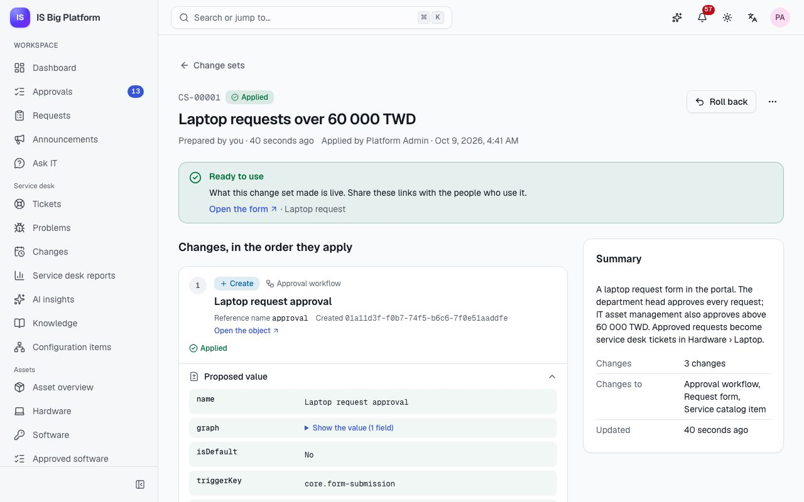
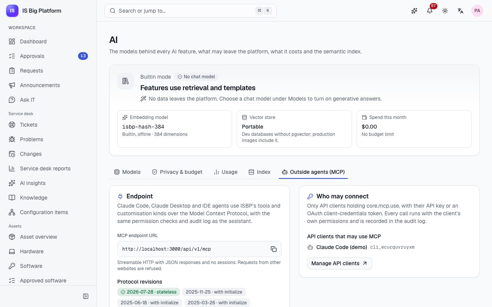

# Assistant and AI guide

This guide is for everyone who uses the AI features in ISBP and for the administrators who set them up. It explains
what the AI does with and without a language model, how your data is protected, how to get help from Ask IT, and how
to use the assistant: the built-in agent that does everyday work for you and prepares configuration changes as change
sets you review before anything goes live.

## What you can do here

- Know [which AI mode you're in](#builtin-mode-and-model-mode) and [what leaves the platform](#your-data-and-privacy)
- Get answers from [Ask IT](#ask-it-for-help), and use [Helpdesk AI on tickets](#helpdesk-ai-for-agents)
- [Open the assistant](#open-the-assistant) on any page and [do everyday work with it](#do-everyday-work-with-the-assistant)
- [Change the platform's configuration with a change set](#change-configuration-with-a-change-set), including a
  whole process (a form, its approval and its actions), or [use a guided template](#use-a-guided-template) when no
  model is configured
- [Review](#review-a-change-set), [apply](#apply-a-change-set), [request a review](#request-a-review) and
  [roll back](#roll-back-a-change-set) change sets
- [Install a ready-made process from a package](#install-a-built-in-package), or
  [move configuration to another environment](#move-configuration-to-another-environment) as a file
- [Connect an outside agent such as Claude Code](#connect-an-outside-agent-over-mcp) over MCP

## How AI works in ISBP

Every AI feature in ISBP goes through one gateway that the administrators control in **Administration → AI**. No
module talks to an AI provider on its own, so the same privacy rules, usage log and budget apply everywhere.

### Builtin mode and model mode

ISBP works without a language model. An administrator can add one (Anthropic Claude, or any OpenAI-compatible model,
including one we host ourselves) to turn on generative answers. Each feature says which mode it's in.

| Feature               | Builtin mode (no chat model)                                       | With a chat model                                                    |
| --------------------- | ------------------------------------------------------------------ | -------------------------------------------------------------------- |
| Ask IT                | Shows the best matching knowledge articles and offers a ticket     | Writes an answer from the knowledge base, with sources               |
| Triage on new tickets | Suggests from similar resolved tickets                             | The model refines the suggestion and explains it                     |
| Reply drafts          | A template that quotes the best article's steps                    | A reply in the requester's language, with numbered sources           |
| Ticket summaries      | The issue, latest updates and current state, taken from the ticket | A written summary                                                    |
| The assistant         | **Guided templates** instead of free text                          | Free-text requests; the assistant works through the platform's tools |

In builtin mode, no data leaves the platform. **Administration → AI** shows **Builtin mode** or **Generative AI** at
the top, and the assistant panel shows **Guided templates** or **AI model:** followed by the model's name. The demo
runs in builtin mode.

### Your data and privacy

- **Masking.** Before a prompt goes to an external model, ISBP replaces personal and secret data with placeholders
  and puts the real values back in the reply, so the provider never sees them. By default this covers email
  addresses, phone numbers, IP addresses, card numbers, national IDs (TW ID, JP My Number, US SSN) and secrets such
  as API keys. Administrators can add their own patterns, such as an employee number format.
- **Permissions.** The AI only finds what you could open yourself. Search results and answers are filtered with your
  permissions, and the assistant acts with your permissions, never more.
- **Self-hosted models.** With a model we host ourselves, prompts stay inside our network.

### Usage and budget

Every AI call is logged with the feature that made it, who it was for, the tokens it used and its estimated cost.
Administrators see this under **Administration → AI → Usage**. An optional monthly budget stops AI calls once it's
spent: until the next month, AI calls are refused with "This month's AI budget has been used up."

## Ask IT for help

Ask IT is the virtual agent for everyone. Use it when something isn't working or you need something from IT, before
you raise a ticket.

1. Go to **Workspace → Ask IT**, or select **Ask a question** on the **Ask IT** card in the request portal.
2. Describe the problem in your own words, in any language.
3. Read the answer and its linked articles. Select **That solved it**, or **I still need help**.
4. If it can't help, Ask IT prepares a ticket. Select **Review ticket**, check the details, then **Create ticket**.

**What happens next:** Nothing is created until you confirm. The ticket goes to the service desk, and you follow it
under **My requests**. See the [Employees guide](employees.md) for requests and tickets.

## Helpdesk AI for agents

Service desk agents with the **AI-assisted agent** role see an **AI assist** panel on each ticket: a triage
suggestion (category, group, priority) you can apply field by field, similar tickets and suggested articles, **Draft
a reply** with sources, a **Summary**, and **Draft KB article** to turn a resolved ticket into a draft article for
review. Automatic triage is off by default; when an administrator turns it on, Helpdesk AI fills only fields that are
still empty. See the [Service desk guide](service-desk.md) for how to use these on the queue.

## Open the assistant

The assistant is the platform's own AI agent. It's in the header of every page, so you don't need any outside tool.

1. Select the sparkles button, **Assistant**, at the top right of any page.
2. The panel opens on the right (full width on a phone). It shows the mode it's in and a **Change sets** link.
3. Close it with **Close the assistant**. A request that is running keeps going, and the panel picks up where it was
   when you open it again.

The assistant knows the page you're on and the record on it (for example the ticket you have open). Above the
message box it shows **Page:** followed by what it sees.

If you don't see the button, ask an administrator for the **Assistant user** role. With an AI model configured, you
can chat with the assistant about everyday work as soon as your roles let you do any of it (for example look up or
update tickets); preparing configuration changes also needs read access to that configuration. Without a model, the
assistant offers guided templates for configuration you can read, so the panel says "There is nothing you can
customise yet" if you can't read any.

## What the assistant can do

The assistant works through the same tools the platform offers to every AI agent, **as you**: it can only do what you
could do on the screens, and everything it does is recorded in the audit log.

- **Everyday work, directly.** Look up tickets, people, groups, assets, configuration items and applications; raise a
  ticket; add a public reply or an internal note to a ticket; triage a ticket; create a task in a project you're a
  member of or move a task to another status; write a draft knowledge article; check a release's readiness.
- **Actions that need your confirmation.** Some actions are never run on the assistant's word: resolving a ticket,
  offboarding a person, publishing an announcement, requesting database access, running a scheduled job or an ETL
  pipeline, and applying or rolling back a change set. The assistant shows a confirmation card and waits for you.
- **Configuration, as a change set.** Workflows, forms, fields, roles and the other surfaces below are never changed
  directly. The assistant collects the changes in a change set, which you or a reviewer apply in one step and which
  can be rolled back.

## Do everyday work with the assistant

You need a chat model for free-text requests. Use the assistant when a task takes several lookups, or when you want
to do something without leaving the page you're on.

1. Open a record, for example a VPN incident in the demo, then open the assistant.
2. Type what you want in **Describe the change you want…** (**Describe what you need…** if you can't change any
   configuration), for example "Add an internal note to this ticket: the user's VPN client is two versions behind."
   Press Enter to send (Shift+Enter for a new line).
3. Watch **What the assistant did**: each lookup and action is listed as it runs.
4. If the assistant asks to do something that needs confirmation, read the card and select **Confirm** or
   **Decline**.

**What happens next:** Changes appear on the record right away, made in your name. Earlier conversations are under
**Recent conversations** (the history button); **New conversation** starts a fresh one.

## Confirm or decline an action

When the assistant wants to run an action that needs a person, it shows a card titled **Confirm before it runs**
with what it will do, in your language.

1. Read the card. Select **Show what it will send** to see the exact input.
2. For a change set, select **Review the changes before you confirm** to open it first.
3. Select **Confirm** to run it with your permissions, or **Decline**.

**What happens next:** The card shows **Confirmed**, **Declined** or **Failed** with the reason, and the assistant
continues. A card expires when you send another message ("Expired: the conversation moved on"); ask again if you
still want it. Applying a change set still needs every permission it touches; if you lack one, ask the assistant to
request a review instead.

## Change configuration with a change set

People can describe what they want, such as "laptop requests over 60 000 TWD go to the department head, then IT asset
management", and the assistant builds it with the same configuration screens an administrator uses. Nothing is live
until someone applies the change set.

1. Open the assistant and describe the change (with a chat model), or pick a
   [guided template](#use-a-guided-template).
2. The assistant reads the current configuration, proposes the changes and runs a dry run of the whole set. The
   panel shows a **Change set** card with the number of changes and whether it's **Ready**.
3. Select **Review and apply** to open the change set page.
4. [Review it](#review-a-change-set), then [apply it](#apply-a-change-set) if you have the permissions, or
   [request a review](#request-a-review). You can also ask the assistant to apply it; you then confirm on the card.

In the demo, **CS-00001 Laptop requests over 60 000 TWD** is an applied change set: an approval workflow (the
department head approves every request; IT asset management also approves above 60 000 TWD), the laptop request form
that uses it, and its service catalog item.

A whole process fits in one change set: describe the form people fill in (including records they pick, such as
CIs), the rules its answers must meet, who approves, and what happens once a request is approved. The assistant
proposes the workflow and the form with its rules and actions together. Once the change set is applied, its page
shows **Ready to use** with **Open the form**, the form's own link (`/requests/forms/<key>`), and the assistant posts
the link in the conversation when the change set was applied from its card or by a reviewer. Step by step:
[Build it with the assistant](processes.md#build-it-with-the-assistant).

### What the assistant can change

These configuration surfaces can be changed through change sets. You can propose a change to anything you can read;
applying it needs the permission shown.

| Surface              | What a change can do                                                                                                                              | Applying needs, for example                                      |
| -------------------- | ------------------------------------------------------------------------------------------------------------------------------------------------- | ---------------------------------------------------------------- |
| Approval workflow    | Create, update or archive, with conditions and approvers on a form's answers and picked records; applying publishes a new version for its trigger | **Workflow administrator**                                       |
| Request form         | Create, update or archive, with record fields, rules and actions; applying saves and publishes it                                                 | **Workflow administrator**, plus the role of each action it adds |
| Custom field         | Add a field to people, groups, departments or module records; key and type are fixed once created                                                 | **Workflow administrator** or **Identity administrator**         |
| Role                 | Create, update or delete; you can only grant permissions you hold yourself                                                                        | **Platform administrator**                                       |
| Group                | Create, update or delete a group: its key, name, description and custom fields. People are added on the group's page, never in a change set       | **Identity administrator**                                       |
| Notification channel | Change an existing channel's name, notifications and language (never its webhook URL)                                                             | **Workflow administrator**                                       |
| Module settings      | Change a module's settings (not secrets or AI provider settings)                                                                                  | **Module administrator**                                         |
| Scheduled job        | Create, update, disable or delete                                                                                                                 | **Scheduled jobs administrator**                                 |
| ETL pipeline         | Create, update, disable or delete                                                                                                                 | **Data APIs developer**                                          |
| Data API             | Create or update a **draft** only; a person tests and publishes it in Data APIs                                                                   | **Data APIs developer**                                          |
| Sync profile         | Create, update, disable or delete an Integrations Hub profile                                                                                     | **Integrations administrator**                                   |
| Ticket category      | Create, update or deactivate                                                                                                                      | **Service desk administrator**                                   |
| SLA policy           | Create, update or deactivate                                                                                                                      | **Service desk administrator**                                   |
| Service catalog item | Create, update or delete                                                                                                                          | **Service desk administrator**                                   |

## Use a guided template

Without a chat model, the assistant offers guided templates instead of free text: a few questions that become a
change in a change set. Use them in builtin mode, as in the demo.

1. Open the assistant. The panel shows **Guided templates**.
2. Pick a template:
   - **Approval chain**: one or two approval steps, the second only above an amount (for example `data.amount` above
     60 000).
   - **Request form**: a form in the request portal with up to three questions and an approval workflow.
   - **Approval process**: a form and its own approval workflow together: the records people pick (for example
     configuration items), up to three questions, the requester's manager, the group responsible for the picked
     records and another group as approvers, and optionally a change raised once a request is approved.
   - **Custom field**: a field on people, groups, departments or module records.
   - **HTTP health check**: call a URL every few minutes and alert the owner when it fails.
   - **SLA targets**: response and resolution targets per priority for the ticket types you choose.
3. Answer the questions and select **Prepare the change**.

**What happens next:** The panel shows "Added to CS-…" and the change set card. Further templates add to the same
change set until you select **Start a new change set**. Select **Review and apply** to open it. You only see templates
for what you can read; if you can prepare a change but not apply it, the template says so, and you request a review.


## Review a change set

Every change set has its own page. Review it before you apply it or approve its review.

1. Go to **Administration → Change sets** (or **Change sets** in the assistant panel) and open the change set.
2. Read the header: the reference (`CS-…`), the status (**Draft**, **In review**, **Applied**, **Rolled back** or
   **Discarded**), who prepared it and the **Summary** for the reviewer.
3. Read each change under **Changes, in the order they apply**. Each shows what it does (**Create**, **Update**,
   **Archive** or **Delete**), its dry run result (**Dry run passed**, or why it failed), and either the
   **Differences: current → proposed** or, for a new object, the **Proposed value**.
4. For approval workflows and request forms, open **Preview**: the workflow diagram (select **Try it** to run the
   simulator) or the form as people will see it.
5. Select **Check again** to run the dry run again after something changed.

The dry run applies the whole set in a transaction that is then rolled back, so you see exactly what applying would
do. A change marked "Needs someone with more permissions to apply it" passed every other check: someone who holds the
permission can apply it.

To change the title and summary, select **Rename the change set**. You can edit a change set while it's a draft and
you prepared it (or you're an **Assistant administrator**).



## Apply a change set

Apply a change set when you hold every permission it needs. Everything is applied in one transaction: if one change
fails, nothing is applied.

1. Open the change set and select **Apply**.
2. If it archives or deletes something, tick the confirmation that objects will be archived or deleted.
3. Select **Apply** in the dialog.

**What happens next:** The status becomes **Applied** and the page shows **Applied by** you. The changes are live:
a published workflow is used by new requests, a form appears in the portal. **Ready to use** lists links to share,
such as **Open the form** for a form people can now fill in. The person who prepared it gets a notification. If you
can't apply it, the page says "You can't apply this change set yourself" and which permissions are missing.

## Request a review

When you can't apply a change set yourself, or want a second pair of eyes, send it for review. In the demo, the
service desk prepared **Record the affected site on tickets**, which is waiting in the administrator's approvals.

1. Open the change set and select **Request review**.
2. Add a **Note for the reviewer (optional)** and select **Request review**.

**What happens next:** The status becomes **In review** and the **Change set review** approval workflow starts. By
default a platform administrator approves it within 72 hours, with a reminder after 24 hours; administrators can bind
their own workflow. The reviewer finds it in **Workspace → Approvals**, opens the change set to review it, and
selects **Approve** or **Reject** in Approvals. **Approving applies the change set with the approver's permissions.** If it's rejected, or applying
fails, it goes back to **Draft** with the reason and you get a notification.

To change your mind, open **More actions** and select **Withdraw review**: the change set goes back to draft.

## Roll back a change set

If an applied change set causes a problem, roll it back. Everything is undone in one transaction, in reverse order:
updates go back to their earlier values, archived objects are restored and created ones are removed.

1. Open the applied change set and select **Roll back**.
2. Optionally fill in **Reason (optional, kept in the audit log)**, then select **Roll back**.

**What happens next:** The status becomes **Rolled back**. A change set that deleted something can't be rolled back
automatically. Roll back is refused if someone changed one of the objects after the change set was applied; the page
names the objects, and you fix them by hand or prepare a new change set.

To drop a draft you no longer need, open **More actions** and select **Discard**. Nothing in the configuration changes.

## When a change set is stale

A change set remembers the version of each object it changes. If someone edits that object before the change set is
applied, applying is refused: "Someone changed this configuration after the change set was prepared."

1. Open the change set. The changed objects are marked, with the differences against their current version.
2. Review the differences, then select **Refresh**. The change set now uses the current versions as its base.
3. Check the dry run and apply again.

## Start from a package

A package is a change set as a file. Use one to set up a whole process at once (the forms, approval workflows, groups
and scheduled jobs a module ships), or to move configuration you built and tested in one environment to another. A
package always becomes a new draft change set: you review its dry run, then apply it or request a review as usual,
and you can roll it back like any other.

### Install a built-in package

1. Go to **Administration → Change sets** and select **From a package**.
2. On **Built-in packages**, read what each package holds: its description, the module it comes from, the number of
   changes and what they change.
3. Select **Install** next to the package you want.

**What happens next:** A new draft change set opens, named after the package, with the dry run of every change.
The names and texts it creates in one language only, such as group names, scheduled jobs and reminders, are in your
language. [Review it](#review-a-change-set), then [apply it](#apply-a-change-set) or [request a review](#request-a-review).
Nothing is live until then. Installing a package twice gives a second change set whose changes fail their dry run
(the keys are taken): discard it.

If a package says "Needs modules that aren’t enabled", ask an administrator to enable them in **Administration →
Modules**. If it says "Preparing it needs permissions you don’t hold", you can't prepare it; ask someone who can. "You
can prepare it, but applying it needs someone with more permissions (or a review)" means you install it, then request
a review.

### Move configuration to another environment

1. In the environment where you built and tested the configuration, open its change set, open **More actions** and
   select **Export**. Your browser downloads the change set as a file named after its reference, such as
   `CS-00012.json`.
2. In the other environment, go to **Administration → Change sets**, select **From a package**, then **Import a
   file**.
3. Choose the file under **Package file**. The dialog shows its title and the number of changes.
4. Select **Import**.

**What happens next:** A new draft change set opens with its dry run, as when you install a package. If the file
doesn't fit this environment, nothing is created and the dialog lists why, under "The package has problems. Nothing
was created:" (for example a change that refers to a later one) or "This package doesn’t fit this platform" (modules
that aren't enabled here).

> **Tip:** Build what you want to move as new objects (a new form, a new workflow). Changes to existing objects refer
> to them by their ID in the environment they were made in, so the import reports them as not found elsewhere.

## Write good requests

The assistant works best when you say what should happen, to what, and when. Some examples:

- "Laptop requests over 60,000 TWD also need approval from IT asset management."
- "Add a cost centre field to people."
- "Create a request form for a second monitor, approved by the requester's manager."
- "A configuration change request: people pick the CIs, the requester's manager and the CIs' support group approve,
  the CAB too when a CI is critical, and an approved request raises a change for the CIs."
- "On tickets, add a select field for the affected site: Taipei HQ, Hsinchu, Tokyo."
- "Route SLA breaches to the IT Operations Teams channel too." (The channel must already exist.)
- "Check https://intranet.example.com every 5 minutes and alert me when it fails."
- "Summarise this ticket and add an internal note with the next steps." (on a ticket page)
- "Create a task in Network refresh 2026 to replace the Hsinchu core switch, due next Friday."

> **Tip:** Name the people, groups and amounts you mean. The assistant looks up real groups and roles before it
> proposes anything, and tells you when something doesn't exist.

## Connect an outside agent over MCP

Outside AI agents such as Claude Code use the same tools as the assistant through ISBP's MCP endpoint. An
administrator sets this up once per agent.

### Set it up (administrators)

1. Go to **Administration → API clients** and select **Create client**.
2. Enter a **Name** (for example "Claude Code (Ryan)") and a **Description**.
3. Open **Advanced: platform permissions, IP ranges**. Under **Platform API permissions**, add `core.mcp.use`, plus
   what the agent should reach: usually `assistant.agent.use` and the read permissions of the surfaces it may propose
   changes to (for example `core.workflows.read`, `core.forms.read`, `core.custom-fields.read`). You can only give
   permissions you hold yourself. Optionally limit **Allowed IP ranges**.
4. Choose when the **First secret expires** and select **Create client**.
5. Copy the **Client secret (API key)**, tick **I’ve stored the secret somewhere safe** and select **Done**. The key is
   shown only once.

**Administration → AI → Outside agents (MCP)** shows the endpoint, the API clients that may use it, and the command
to connect Claude Code. In the demo, the API client **Claude Code (demo)** may use MCP; its key is printed once at the
end of the seed.

### Connect Claude Code

Run this in a terminal, with your server's address and the API key in place of the placeholders:

```bash
claude mcp add --transport http isbp https://isbp.example.com/api/v1/mcp --header "Authorization: Bearer <API key>"
```

**Outside agents (MCP)** shows the command with our address filled in; select **Copy the command**. Other MCP
clients use the same endpoint URL and `Authorization` header; how you enter them depends on the client. Never paste a
real key into shared notes or chats.

### What outside agents can and can't do

- They get every non-destructive tool the API client may use, with the same permission checks and audit log as
  inside ISBP, and they can read the configuration surfaces the client may read.
- They can propose changes: the result is a change set, a draft that a person reviews and applies in ISBP. They can
  also request a review, so an approver applies it.
- They can't apply or roll back change sets, and they aren't offered any action that needs a person's confirmation
  (such as resolving a ticket or offboarding someone).
- They can't use personal features such as "my requests" or "my notifications": an API client isn't a person.

A change set prepared by an outside agent is listed under **All** on **Administration → Change sets**, marked as
coming from an API client. People with the **Assistant administrator** role see it there; the approvers of its review
see it in their approvals.



## Fix common problems

| What you see                                                           | What to do                                                                                                                                                            |
| ---------------------------------------------------------------------- | --------------------------------------------------------------------------------------------------------------------------------------------------------------------- |
| The panel shows **Guided templates** and no message box                | No chat model is configured. Use a template, or ask an administrator to add a model                                                                                   |
| "There is nothing you can customise yet"                               | No model is configured, and you can't read any configuration the guided templates work with. Ask an administrator for read access to what you need, or to add a model |
| "There is nothing the assistant can do for you yet"                    | Your roles don't include anything the assistant works with. Ask an administrator for the access you need                                                              |
| "You can't apply this change set yourself"                             | Select **Request review**                                                                                                                                             |
| A change shows "Dry run failed"                                        | Read the reason on the change; ask the assistant to fix it, or remove the change                                                                                      |
| "Someone changed this configuration after the change set was prepared" | See [When a change set is stale](#when-a-change-set-is-stale)                                                                                                         |
| "This month's AI budget has been used up."                             | An administrator can raise the budget under **Administration → AI → Privacy & budget**                                                                                |

## How it connects

- [Administrators](administrators.md#configure-ai): models, masking, budget and the index; who gets the assistant
  roles; the **Change set review** workflow.
- [Build your own process](processes.md): forms with record fields, rules and actions, and their approvals, by hand
  or with the assistant.
- [Employees](employees.md): Ask IT, requests and approvals.
- [Service desk guide](service-desk.md): Helpdesk AI on tickets, ticket categories, SLA policies and the service
  catalog.
- [Integrations](integrations.md): sync profiles the assistant can prepare.
- [Data and automation](data-and-automation.md): scheduled jobs, ETL pipelines and Data APIs.
