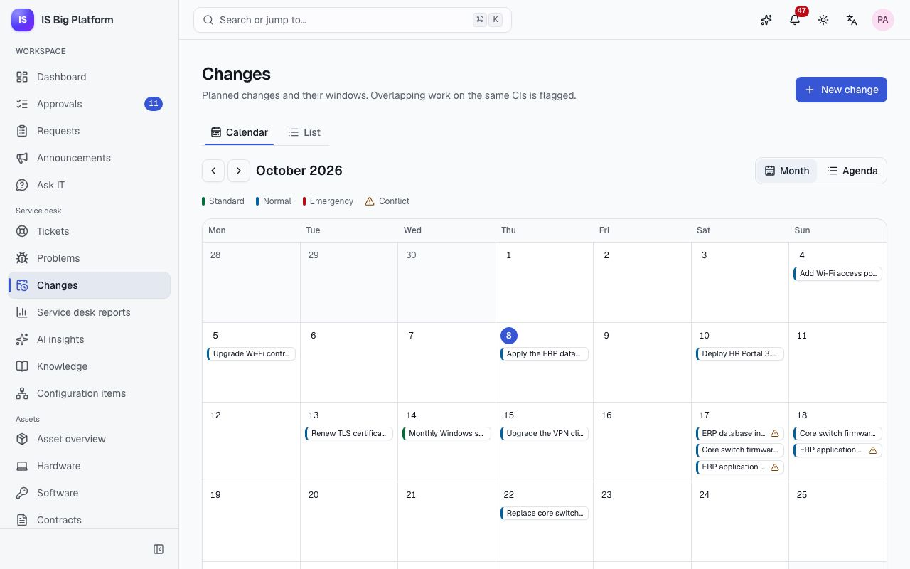
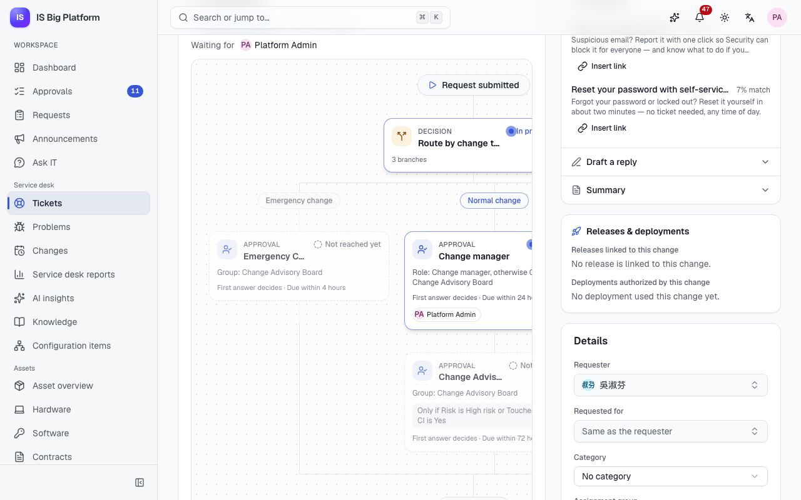
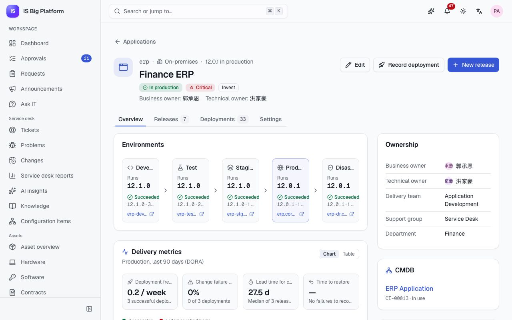
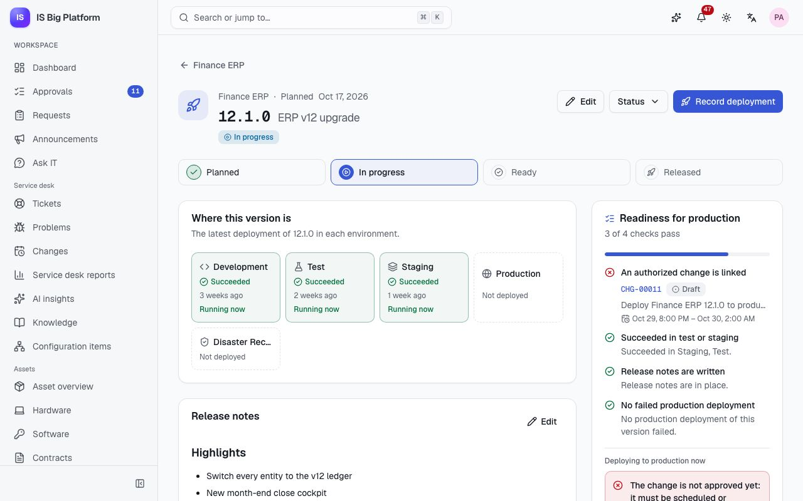

# Changes and releases guide

This guide is for change managers, members of the Change Advisory Board (CAB) and application owners. It explains
how a change is raised, planned, approved and implemented, and how the Applications area tracks what runs where,
which releases are ready, and every deployment — with the rule that nothing reaches production without an
approved change.

## What you can do here

- [Choose the change type](#choose-the-change-type) and see who approves each kind
- [Raise a change](#raise-a-change) and [plan its window around other changes](#plan-the-window-around-other-changes)
- [Get CAB approval](#get-cab-approval), or [decide on a change as an approver](#decide-on-a-change-as-an-approver)
- [Implement and review a change](#implement-and-review-a-change)
- [Handle changes that come from ServiceDesk Plus](#handle-changes-that-come-from-servicedesk-plus)
- [Keep your application's record up to date](#keep-your-applications-record-up-to-date), including its Git status
- [Plan a release and check its readiness](#plan-a-release-and-check-its-readiness)
- [Record a deployment](#record-a-deployment), by hand or [from a CI/CD pipeline](#record-deployments-from-a-cicd-pipeline)
- [Override the change policy in an emergency](#override-the-change-policy-in-an-emergency)
- [Read the delivery metrics](#read-the-delivery-metrics)

## Choose the change type

Every change has a type and a risk. Together with the configuration items (CIs) it touches, they decide the
approval path. The path is the **Change authorization** approval workflow, which can't be switched off; an
administrator can adjust its steps in **Administration → Workflows**.

| Type          | Use it for                                                 | Who approves (default workflow)                                                                                   |
| ------------- | ---------------------------------------------------------- | ----------------------------------------------------------------------------------------------------------------- |
| **Standard**  | Pre-approved, low-risk, repeatable work (monthly patching) | Nobody: it is scheduled as soon as you submit it                                                                  |
| **Normal**    | Planned changes                                            | The change manager (within 24 h); then the CAB (within 72 h) when the risk is high or a critical CI is involved   |
| **Emergency** | An urgent fix that can't wait for the next CAB             | The emergency CAB: any one member of the Change Advisory Board, within 4 h, escalated to the change manager after |

The approver lists come from the **Change manager** role and the **Change Advisory Board** group.

## Raise a change

Raise a change for anything that alters production: an upgrade, a configuration change, a deployment. You need
the **Change manager** role; in the demo, `admin` has it.

1. Go to **Service desk → Changes** and select **New change**.
2. Fill in **What will change?** and **Details**.
3. Pick the **Configuration items** the change touches. They are used to find other changes on the same CIs and to
   route the approval.
4. Choose the **Change type** and the **Risk**, and write the **Reason for the change**.
5. Set the **Planned window** (**Start** and **End**).
6. Write the **Implementation plan**, the **Backout plan** and the **Test plan**.
7. Check the conflict message under the plan, then select **Create change**.

**What happens next:** the change is created as a **Draft** ("CHG-… created as a draft") and opens. Until you
submit it, you can change the plan with **Edit** on the **Change plan** card.

> **Tip:** From a release in Applications, **Raise a change** opens this form for change managers, with the title
> "Deploy (application) (version) to production" filled in and the release already linked.

## Plan the window around other changes

Two changes on the same CI at the same time make failures hard to trace. ISBP flags them as you plan.

1. While you create or edit a change, the form says either "No other changes touch these CIs in this window" or
   how many other changes do, with the CIs they share.
2. On the change page, the **Change plan** card lists the overlapping changes with their status.
3. To see the whole picture, go to **Service desk → Changes**. The **Calendar** tab shows the month (or an
   **Agenda**), marks overlapping changes as **Conflict**, and has **Previous month**, **Next month** and
   **Today**. The **List** tab shows every change with its **Planned window**.

Only changes in **Assessment**, **Waiting for CAB**, **Scheduled** or **Implementing** count as conflicts; drafts
don't.

In the demo, the ERP database index rebuild and the ERP application server patching share Finance ERP on the same
Saturday evening, so both are flagged.

## Get CAB approval

When the plan is ready, send the change through the approval workflow.

1. Open the change. With **Status**, move it from **Draft** to **Assessment**.
2. Select **Submit for approval**.

A change can't be submitted without a planned window, and the window may not start in the past (except for
emergency changes).

**What happens next:**

- The status becomes **Waiting for CAB**. The **CAB approval** section of the **Change plan** card shows the
  workflow's progress: the current step, who it is **Waiting for**, and the path as a diagram. **Open my
  approvals** goes to your own inbox.
- The approvers are notified and decide in **Approvals**.
- **Approved:** the change moves to **Scheduled**, and the requester, the assignee and whoever raised it are
  notified with the planned start.
- **Rejected:** the change moves to **Rejected** with the approver's comment. Move it back to **Draft**, improve
  the plan and submit it again.
- To stop a change that is waiting, choose **Cancelled** in **Status** (with a reason); the approval is withdrawn.

> **Important:** Nobody can move a change past **Waiting for CAB** by hand — not in the **Status** menu, not
> through the API and not through an integration. Only the approval does it. Once submitted, the plan can't be
> edited.

In the demo, CHG-00002 "Renew TLS certificate on mail-relay-01" waits for the change manager and then the CAB,
because it touches Email & Calendar, a critical CI. CHG-00001, a standard patching change, was scheduled as soon
as it was submitted.

## Decide on a change as an approver

As the change manager or a CAB member, you get a notification for every change waiting for you.

1. Go to **Approvals** in the sidebar (**Waiting for me**), or open the notification.
2. Open the change's approval. It shows **What is requested**, the **Approval path** and the **History**; **Open
   the request** takes you to the change itself, with its plans, CIs and conflicts.
3. Select **Approve** (with an optional comment) or **Reject** (a reason is required; the requester sees it). To
   pass it to a colleague, select **Hand over**.

For a group step, the first answer decides. Reminders and escalations follow the deadlines in
[Choose the change type](#choose-the-change-type). More on the approvals inbox: [Employees](employees.md).

## Implement and review a change

1. When the window opens, choose **Implementing** in **Status**.
2. Keep a record of the work as **Work note**s on the change, and record the deployment in Applications if the
   change deploys an application version (see [Record a deployment](#record-a-deployment)).
3. When the work is done, choose **Post-implementation review**. Note what went as planned and what didn't.
4. Choose **Closed**.

A scheduled change can still be cancelled (with a code and a reason). Once it is **Implementing**, it can only go
on to review.

On a change, the **Releases & deployments** card on the right lists the releases linked to it and the deployments
it authorized. In the demo, CHG-00007 "Upgrade Wi-Fi controller wlc-01 to 8.10" is in post-implementation
review.

## Handle changes that come from ServiceDesk Plus

If your organisation also plans changes in on-premises ManageEngine ServiceDesk Plus, the Integrations Hub can
bring them into ISBP (in the demo, the **Changes → changes** profile of Contoso ServiceDesk Plus). They show the
**Synced with** card and follow the same lifecycle.

The sync can fill in a change and submit it, but it can't approve it: a change from outside stops at **Waiting
for CAB** until the CAB approves it in ISBP, exactly like one raised here. See
[Integrations](integrations.md).

## Keep your application's record up to date

**Applications** is the inventory of every application the company runs: who owns it, where it is in its
lifecycle, what version runs in each environment and how delivery is going.

- **Applications viewer** (the service desk, network, security, DBA, CAB and application owners groups in the
  demo) can browse everything.
- The **business owner**, the **technical owner** and members of the **Delivery team** edit their own
  application and its releases with that role alone.
- **Applications manager** edits any application; **Release manager** plans releases of any application.

1. Go to **Applications → Applications**. Use the tabs (**All**, **In production**, **In development**,
   **Sunsetting & retired**, **Owned by me**), the search box (code or name) and the filters.
2. Open an application. The header shows its stage, criticality, the version **in production** and its owners.
   **Overview** shows the **Environments** with the version each one **Runs**, the **Delivery metrics**, the
   **Description**, the **Repositories**, **Ownership**, the **CMDB** configuration item and **Details**.
3. Select **Edit** to change the name, stage, criticality, **Disposition (TIME)**, hosting, owners, **Delivery
   team**, **Support group**, configuration item and other details. The **Code** can't change: CI/CD pipelines
   use it.
4. Use the **Settings** tab to maintain **Environments** (in pipeline order; production environments are
   protected by the change policy), **Repositories** and the **Lifecycle** (stage, TIME disposition and dates).

**Git status.** Repositories on our on-premises Azure DevOps Server are kept up to date by the Integrations Hub:
each one shows its default branch, last commit, branches (**Show branches**), active pull requests and when it was
**Synced**. In the demo, Finance ERP has the `erp-core` and `erp-reports` repositories.

## Plan a release and check its readiness

A release is a version of an application on its way to production. Its readiness checklist tells you, and the
CAB, whether it can go.

1. On the application, select **New release**. Enter the **Version** (unique within the application, for example
   `12.1.0`), a **Name**, the **Planned date** and the **Release notes** (Markdown), and save.
2. On the release page, follow its lifecycle (**Planned**, **In progress**, **Ready**, **Released**); move it with
   **Status → Move to**.
3. Link the change that will deploy it: select **Raise a change** in the readiness card (change managers), or
   link an existing change under **Linked records** with **Link record**.
4. Check **Readiness for production**. It passes when:
   - **An authorized change is linked** (approved by the CAB: scheduled or implementing);
   - the version **Succeeded in test or staging**;
   - **Release notes are written**;
   - there was **No failed production deployment** of this version.

**What happens next:** linking a change moves a planned release to **In progress**. When every check passes, the
owners are notified that the release is ready for production. A successful production deployment of the version
marks the release **Released**.

**Applications → Release calendar** shows the releases of every application in the coming weeks (**By week** or
**Month**), with their change status and readiness; **Only my applications** narrows it to yours.

In the demo, Finance ERP 12.1.0 "ERP v12 upgrade" has reached Staging, but its change (CHG-00011) is still a
draft, so one check fails. HR Portal 3.4.0 is ready: its change CHG-00009 is scheduled.

## Record a deployment

Record every deployment, so everyone can see what runs where and the delivery metrics stay true. You need
permission to record deployments (the **Release manager** or **Applications manager** role).

1. On the application or the release, select **Record deployment**.
2. Choose the **Environment**, check the **Version**, and choose the **Outcome** (**Succeeded**, **Failed**, **In
   progress** or **Rolled back**).
3. For production, name the CAB-approved change in **Change (optional)**, unless one is linked to the release.
4. Read **Change policy**: it says whether the deployment is allowed now, and why not if it isn't.
5. Optionally add **Notes**, and under **Commit and pipeline** the **Commit** and the **Pipeline run** link.
6. Select **Record deployment**.

**The change policy.** A deployment to a production environment needs a change that is **Scheduled** or
**Implementing**, named in the form or linked to the release. Other environments need no change. Outside the
change's planned window the deployment is recorded with a warning (**Outside change window**), or refused if an
administrator has turned on **Enforce the change window**. Both settings are in **Administration → Modules**
(Applications).

**What happens next:** the environment shows the new version. A failure or rollback notifies the technical owner
and the delivery team. The **Deployments** tab keeps the full history.

## Record deployments from a CI/CD pipeline

Pipelines report deployments themselves through the API, so the record is complete without anyone typing it in.

- An administrator creates an API client with the **CI/CD pipeline** role in **Administration → API clients**
  and gives its key to the pipeline.
- The pipeline sends the application **Code**, the environment, the version, the outcome and, for production, the
  change number.
- The same change policy applies. Without an approved change, the API refuses the deployment, so the pipeline step
  fails and says why. A pipeline can't override the policy.

The request format: [API guide](../../api.md#recording-deployments-from-cicd-application-lifecycle).

## Override the change policy in an emergency

Sometimes production must be fixed before a change can be approved. Only people with the **Applications
administrator** role can record such a deployment.

1. In **Record deployment**, when the policy refuses the deployment, select **Override with reason**.
2. Explain **Why must this deploy without an authorized change?** (at least 10 characters).
3. Select **Record with override**.

**What happens next:** the override is audited as a security event, the change managers are notified ("Change
policy overridden: …"), and the deployment is marked **Policy overridden** in the history. Raise the emergency
change afterwards so the CAB can review it.

> **Important:** Use an emergency change first whenever the emergency CAB can be reached; it decides within
> hours.

## Read the delivery metrics

The **Delivery metrics** card on an application's **Overview** shows the four DORA measures for production over
the last 90 days, computed from the recorded deployments:

| Measure                   | What it means                                                                           |
| ------------------------- | --------------------------------------------------------------------------------------- |
| **Deployment frequency**  | Successful production deployments per week                                              |
| **Change failure rate**   | The share of finished production deployments that failed or were rolled back            |
| **Lead time for changes** | Median time from a release being created to its first successful production deployment  |
| **Time to restore**       | Median time from a failed production deployment to the next success on that environment |

Switch between **Chart** and **Table** to see the weekly figures. Use them in CAB reviews and retrospectives; they
are only as good as the deployment records, which is one more reason to record deployments from the pipeline.

## How it connects

- **Incidents and problems** that a change fixes are linked with **Implements fix for**:
  [Service desk](service-desk.md).
- **Configuration items** decide conflicts and the CAB step: [Service desk](service-desk.md#check-what-a-configuration-item-affects).
- **Projects** link their tasks to changes and releases: [Projects](projects.md).
- **ServiceDesk Plus** changes and **Azure DevOps Server** repositories sync through the hub:
  [Integrations](integrations.md).
- **Approval workflows**, module settings and API clients are set up by administrators:
  [Administrators](administrators.md).
- Terms such as CAB, standard change and DORA: [Glossary](glossary.md).
