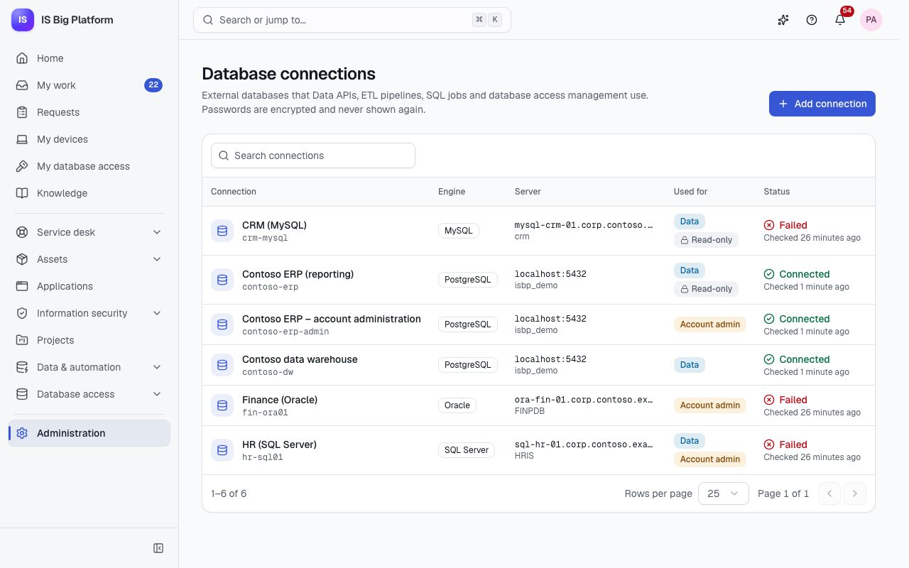
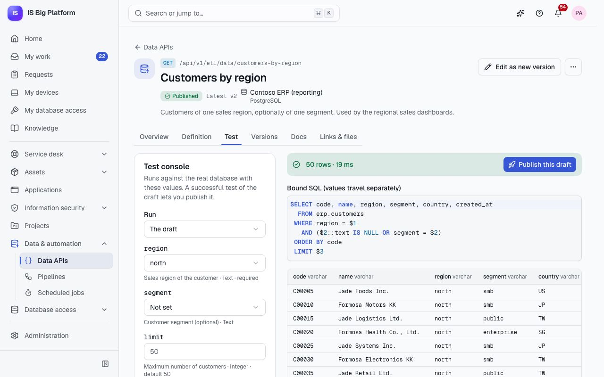
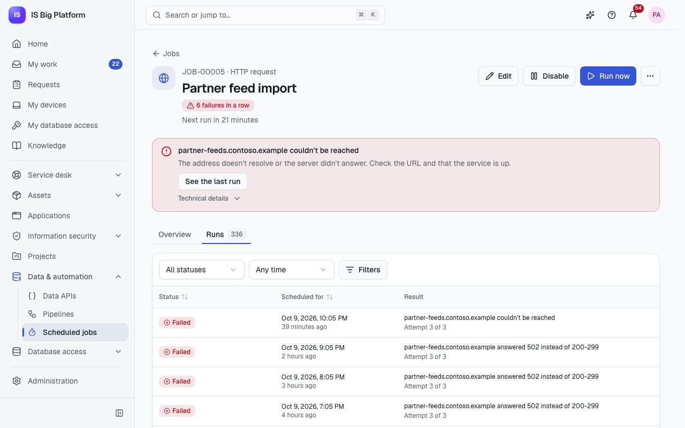
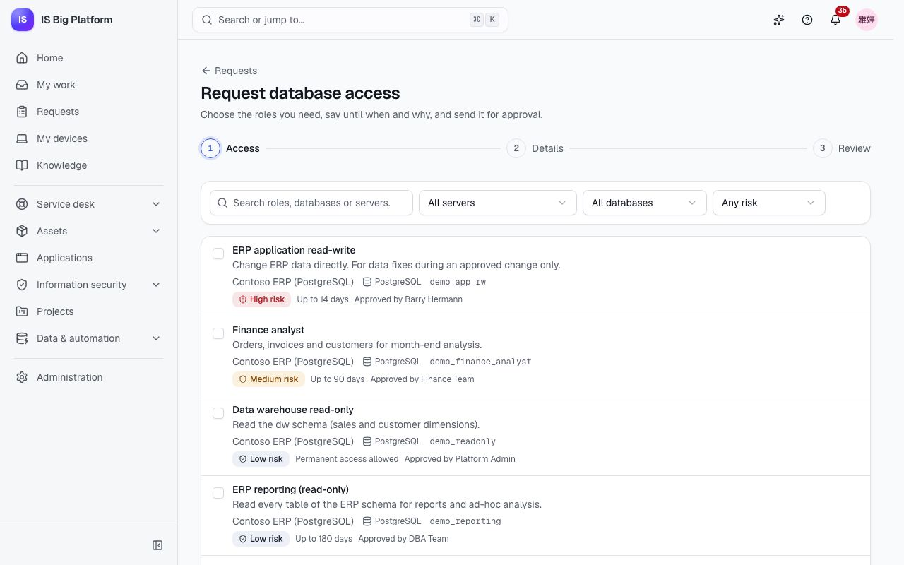

# Data and automation guide

This guide is for data engineers, platform engineers and DBAs. It covers the four places where ISBP works with
company databases and recurring work: **database connections** (registered once by an administrator), **Data
APIs** and **Pipelines** (REST endpoints over SQL, and pipelines that copy rows between databases), **Scheduled
jobs** (HTTP calls, SQL, scripts and module tasks on a schedule) and **Database access** (people request database roles, which
are approved, provisioned, reviewed and removed on time).

## What you can do here

- [Register a database connection](#register-a-database-connection) and
  [browse its catalog](#test-a-connection-and-browse-its-catalog)
- [Build a Data API from SQL or a stored procedure](#build-a-data-api), [test it](#test-a-data-api),
  [publish a version](#publish-and-manage-versions) and [control who may call it](#control-who-may-call-a-data-api)
- [Give callers the docs](#give-callers-the-docs-and-follow-the-calls) and follow every call in the call log
- [Copy rows between databases with a pipeline](#copy-rows-between-databases-with-a-pipeline)
- [Create a scheduled job](#create-a-scheduled-job), [follow its runs](#follow-runs-and-live-logs) and
  [monitor all jobs](#monitor-scheduled-jobs)
- [Request a database role](#request-a-database-role) as anyone, and
  [use your access and one-time password](#use-your-access-and-your-one-time-password)
- [Make roles requestable](#make-database-roles-requestable) as a DBA,
  [handle access without a request](#handle-access-without-a-request-and-accounts-with-no-matching-person) and
  [run access reviews](#run-an-access-review)

## Who can do what

Roles are granted in **Administration → Roles & access**.

| Area                 | Role                                  | What it allows                                                                                |
| -------------------- | ------------------------------------- | --------------------------------------------------------------------------------------------- |
| Database connections | **Database connection administrator** | Register external databases, their credentials and purposes                                   |
| Data APIs, pipelines | **Data APIs viewer**                  | See Data APIs, versions, docs, call logs, pipelines and runs                                  |
|                      | **Data APIs developer**               | Build, test, publish and call Data APIs; build, run and schedule pipelines                    |
|                      | **Data APIs consumer**                | Call published Data APIs that allow signed-in people (grant it on one endpoint to limit it)   |
| Scheduled jobs       | **Scheduled jobs viewer**             | See jobs, runs, logs and the dashboard                                                        |
|                      | **Scheduled jobs operator**           | Create HTTP jobs and jobs of module task types; edit own and team jobs; run or cancel any job |
|                      | **Scheduled jobs administrator**      | Everything, including SQL and script jobs                                                     |
| Database access      | **Database access requester**         | Everyone has it: request roles and manage your own access                                     |
|                      | **Database access administrator**     | Servers, requestable roles, inventory syncs, all access, revoke, assign to a person, retry    |
|                      | **Database access auditor**           | See all access, accounts, drift and reviews                                                   |
|                      | **Database access review manager**    | Run access reviews                                                                            |

## Register a database connection

Every module reaches an outside database only through a connection registered here, so credentials live in one
place, encrypted, and every change is audited.

1. Go to **Administration → Database connections** and select **Add connection**.
2. Enter the **Name** (for example "Finance data warehouse"). The **Key** is filled in from it; modules refer to
   the connection by the key, and it can't be changed later.
3. Under **Server**, choose the **Engine** (**SQL Server**, **PostgreSQL**, **MySQL** or **Oracle**) and enter the
   **Host**, **Port** and **Database** (for Oracle, the **Service name**; for a named SQL Server instance, the
   **Instance name**). Choose the **Encryption**: **Off**, **Encrypt without verifying the certificate** or
   **Encrypt and verify the certificate** (optionally with a **CA certificate (PEM)**).
4. Under **Sign-in**, enter the **User name** and **Password**. For SQL Server Windows authentication with a
   service account, add the **Windows domain**.
5. Under **Use**, tick what it is **Used for**:
   - **Data**: Data APIs, ETL pipelines and SQL jobs;
   - **Account admin**: creates accounts and grants roles (Database access). It is never usable by Data APIs.
6. Turn on **Read-only** for reporting connections. Writes are then refused, and queries run in read-only
   transactions where the engine has them.
7. Under **Limits**, set **Connections per process**, **Statement timeout (seconds)** and **Maximum rows per
   result**.
8. Select **Test connection**, then **Add connection**.

> **Important:** Use a dedicated login with only the privileges it needs: read-only for Data APIs, role
> administration only for account management. SQL Server has no read-only transactions, so there the login's own
> permissions are what keeps a read-only connection read-only.

**What happens next:** the password is encrypted and never shown again (leave it empty when editing to keep it).
Addresses in link-local and cloud metadata ranges are refused; private networks are allowed. Deleting a connection
makes the Data APIs, pipelines and jobs that use it fail until they point at another one.

If you don't see the page, ask an administrator for the **Database connection administrator** role.

## Test a connection and browse its catalog

1. In **Administration → Database connections**, open a connection's menu (**More actions for …**).
2. Select **Test**. The **Status** column shows **Connected** or **Failed**, with the time it was checked; a test in
   the form reports the latency and server version, or the server's error code.
3. Select **Browse catalog** to see the **Tables and views** and **Procedures and functions** that the login can
   see, with their columns and parameters. Use **Refresh** after schema changes.

The table names, columns and procedures that Data APIs, pipelines and Database access offer you all come from this
catalog. In the demo, **Contoso ERP (reporting)** (PostgreSQL, read-only) and **Contoso data warehouse** are
reachable; **HR (SQL Server)**, **Finance (Oracle)** and **CRM (MySQL)** point at hosts that don't exist, so you
can see what failures look like.

## Build a Data API

A Data API turns a SQL query or a stored procedure into a documented REST endpoint, so a report, a dashboard or
another system can read company data without a database login.

1. Go to **Data & automation → Data APIs** and select **New Data API**.
2. Enter the **Name**, check the **URL slug** (callers use `/api/v1/etl/data/<slug>`; it can't change once a version
   is published), choose the **Method** (GET or POST), the **Kind** (**SQL query** or **Stored procedure or
   function**) and a **Connection**. Only connections allowed for data use are listed. Select **Create**.
3. On the **Definition** tab, write the **SQL**. Use `:name` for every value, for example
   `WHERE category = :category`. Values are bound by the database driver and never pasted into the SQL.
   For a procedure, pick it from the catalog; its input arguments become parameters.
4. Under **Parameters in the SQL:**, select **Add … missing parameter** and set each parameter's **Type** (**Text**,
   **Integer**, **Decimal**, **Yes/no**, **Date**, **Date and time**, **UUID**), **Required**, **Default**, and under
   **More** the limits, **Pattern**, **Allowed values**, **Description** and **Example**. Mark personal data as
   **Sensitive (masked in logs)**.
5. Under **Response and limits**, choose the **Response** (**All rows (array)** or **First row (404 when none)**),
   **Max rows**, **Timeout (seconds)** and **Cache for (seconds)** (0 turns caching off).
6. Select **Save draft**.

Invalid input is answered with an error that names each wrong parameter, before the database is called. If the
connection's tables can't be read, the editor says **Couldn’t read the tables of …: autocomplete is off**; you can
still write and test the SQL.

> **Important:** SQL that changes data or schema (INSERT, UPDATE, DROP …) can't be saved until you turn on **Allows
> writes**, and a read-only connection refuses it anyway.

## Test a Data API

Testing runs the draft against the real database, and a successful test is what lets you publish.

1. Open the Data API and select **Test the draft** at the top, or the **Test** tab (Data API developers only).
2. Under **Run**, choose **The draft** or a published version.
3. Fill in the parameters and select **Run test**.
4. Read the result: the rows and columns, the time, and the **Bound SQL (values travel separately)**. If the database
   refuses the statement, the console says in plain words what went wrong (for example that a table is missing or
   that the login isn't allowed to do this) and what to check, with the database's own message under it (never the
   credentials).

In the demo, open **Customers by region**, choose `north` for **region** and run the test.

## Publish and manage versions

Callers need an endpoint that doesn't change under them, so every publish freezes a version.

1. After a successful test, select **Publish this draft** (or **Publish** at the top). Until the draft has been
   tested, the top button is **Test the draft**; when nothing is left to publish, it is **Edit as new version**.
2. Write a **Change note** (what changed and why) and select **Publish v…**.

**What happens next:** the version is immutable. Callers of the plain URL get the latest version; callers can pin
one with `/api/v1/etl/data/<slug>/v<N>`. Editing the definition again only changes the draft (the page shows
**Unpublished changes**). On the **Versions** tab you can:

- **Compare** two versions or a version with the draft;
- **Deprecate** a version: it keeps answering, with a `Deprecation` header and a link to the latest;
- **Retire** a version: calls get `410 Gone`. **Restore** brings it back;
- **Load into draft** to start from an older version.

In the demo, **Customers by region** has v2 published and v1 deprecated.

## Control who may call a Data API

Access settings apply at once; no new version is needed.

1. Open the Data API's **Definition** tab and go to **Access**.
2. Turn on **Signed-in people may call it** if people should call it. They also need the **Data APIs consumer** role,
   for all Data APIs or only for this one.
3. Under **API clients allowed**, tick the API clients (systems) that may call it. API clients are created by
   administrators in **Administration → API clients**; a client needs the permission to call Data APIs **and** must
   be on this list.
4. Set the **Rate limit per minute** per caller (leave it empty for the default of 120). A caller over the limit
   gets `429` with a `Retry-After` header.
5. Select **Save draft**.

In the demo, every published Data API allows the **Contoso BI gateway** API client.

## Give callers the docs and follow the calls

1. The **Docs** tab of a published Data API shows the request, each parameter, an **Example request** (`curl`), the
   response and an **Example response**. Callers can send `Accept: text/csv` to get CSV.
2. **Download OpenAPI** (or **OpenAPI** on the Data APIs list) gives an OpenAPI document of the published Data APIs
   for the developers who call them.
3. The **Overview** tab shows **Calls**, **Error rate**, **Response time (95% of calls)** and **Cache hits** over
   **24 hours** or **7 days**, and **Calls over time**. Select **View calls** (or the error rate) for this Data API's
   calls.
4. The **Call log** tab of **Data & automation → Data APIs** lists every call: who called which version, the outcome,
   the time and the rows.
   Filter by Data API, outcome, caller and period; select a call to see its parameters (sensitive ones masked) and
   **Request id**. Calls are kept for 30 days (a module setting).

API clients that hit a database error get a generic error with the request id; the database's own message is in
the call log. How to call a Data API from code is in the [API guide](../../api.md#calling-a-data-api-data-apis--etl).

## Copy rows between databases with a pipeline

A pipeline loads the result of one query into a table of another database, for example ERP customers into the data
warehouse, in one transaction per run.

1. Go to **Data & automation → Pipelines** and select **New pipeline**.
2. Under **General**, enter the **Name**, **Description** and **Owner** (told when a run fails, however it was
   started; for a scheduled job, after its last attempt, and only once if the job's own alert already reaches them).
3. Under **Source**, choose the **Connection** and write one SQL statement. It runs read-only and is streamed in
   batches. Give values for any `:parameters` under **Parameter values**.
4. To load only what changed, turn on **Incremental**: use `:watermark` in the SQL, choose the **Watermark column**
   and the value the **First run starts after**. Each run then reads rows after the highest value of the last
   successful run.
5. Select **Preview source** to see the columns and **Sample rows**.
6. Under **Target**, choose a connection that may write, a **Table** from its catalog, the **Write mode**, the **Key
   columns** and the **Batch size**:
   - **Insert** adds every row;
   - **Upsert** inserts new rows and updates rows with the same key;
   - **Replace** deletes all rows of the table, then inserts (in the same transaction).
7. Under **Column mapping**, select **Auto-map same names** or **Add column**, and choose a **Transform** for each:
   **As is**, **Trim spaces**, **Upper case**, **Lower case**, **Convert**, **Default if empty** or **Constant**.
   There is no custom code.
8. Select **Create pipeline**, then **Run now** to try it.

**What happens next:** the run page (**Run of …**) shows **Rows read**, **Rows written**, **Rows rejected**,
**Duration**, the watermark and a live **Log** (under **Show lines**, choose **Warnings and errors** or **Errors
only** to find a problem in a long log). Everything a run writes is committed together; if it fails or you select
**Cancel run** (under **More actions**), the whole load is rolled back. A pipeline runs one at a time: a second **Run
now** while it runs is refused.

When a run fails, the run page and the pipeline page say in plain words what went wrong, for example that the
server of a connection couldn't be reached or that a value didn't fit the target table, and what to check. Select
**Open connection** (shown to connection administrators) to fix the connection, then **Run again**. On the pipeline
page, **See the last run** opens the failed run.

To run it regularly, select **Schedule**: the new job form opens with the pipeline filled in. Once a job runs it, the
pipeline page says **Runs on a schedule:** with **Open the scheduled job** and the time of the last scheduled run,
and runs it starts say **Started by a scheduled job**.

In the demo, **Customer dimension** upserts 400 ERP customers into `dw.customer_dim`, and **Daily sales to
warehouse** loads `dw.sales_daily` incrementally.

## Create a scheduled job

Use a scheduled job for anything that must run without someone remembering it: a health check on an internal site,
a nightly clean-up statement, a script, an ETL pipeline or an integration sync.

1. Go to **Data & automation → Scheduled jobs**, open the **Jobs** tab and select **New job**.
2. Under **Basics**, enter the **Name**, the **Owner** (you, by default), the **Owner group** and a **Description**.
3. Under **Task**, choose the **Task type**. The list shows only the types you may create:
   - **HTTP request**: the URL, **Method**, **Expected status** (for example `200-299` or `2xx`), headers,
     **Authentication** (**Basic**, **Bearer token** or **API key header**) and body. Private and internal hosts must
     be on the administrator's allow-list (**Private hosts HTTP jobs may call**).
   - **SQL statement**: a **Database connection** for data, the **Mode** (**Query** logs the row count and a preview;
     **Execute** logs the rows affected) and one **Statement** with `:name` values. Each value is a **Fixed value**,
     the **Scheduled time of the run**, the **End of the last successful run** or the **Run id**.
   - **Script**: **Python**, **Node.js**, **PowerShell** or **Shell**, a **Container image** from the administrator's
     list, the script, environment variables, CPU, memory and **Network** (**No network** or **Outbound allowed**).
   - Module tasks: **ETL pipeline**, **Database access: inventory sync** and **Integration sync**, each with its own
     picker.
4. Under **Trigger**, choose when it runs:
   - **On a schedule**: choose how often it **Repeats** (**Every hour**, **Every day**, **Every weekday**, **Every
     week**, **Every month**, **Every quarter** or **Every year**), the day where it applies and the time (**At**),
     in a **Time zone**, with a preview of the **Next runs**. **Custom (cron)** takes five cron fields, with
     **Presets**;
   - **Interval**: **Minutes between runs**;
   - **After other jobs**: **Run after** chosen jobs when **All of them succeeded** or **Any one succeeded** (loops
     are refused);
   - **Manual**: only when someone selects **Run now**.
5. Under **Alerts**, keep **Notify the owner and owner group when a run fails** and optionally **Also post failures
   to the organisation's channels** (Teams, Slack or webhooks).
6. The defaults suit most jobs. To change them, open **Advanced settings**: the **Timeout (seconds)**, **Attempts** (1
   means no retries), **Backoff** (**Fixed** or **Exponential**), **Retry delay (seconds)**, **Overlapping runs**
   (**Skip when still running** or **Wait for the previous run**) and **Disable after consecutive failures**.
7. Select **Create job**.

For work done once per period, such as **Assign a form** every month, the schedule follows the period you choose in
the task, and **Also run it once now** (on by default) opens this period's work right away instead of waiting for
the first scheduled run.

Secrets (passwords, tokens, secret headers and variables) are stored encrypted and show as **Stored (hidden)**; they
are masked in run logs.

> **Important:** SQL jobs need the **Scheduled jobs administrator** role, and so do script jobs. Scripts run only in
> an isolated container (Kubernetes or Docker) with no credentials and a read-only file system. If no script runner
> is configured, script jobs can't be enabled; a development runner is labelled as not sandboxed.

**What happens next:** the job runs on its trigger. You can edit, run, cancel and delete jobs that you or your
group own; **Run now** and **Disable** / **Enable** are on the job page. Runs missed while the platform was down run
once if they are less than an hour late; older ones are logged as skipped.

## Follow runs and live logs

1. Open a job from the **Jobs** tab of **Data & automation → Scheduled jobs** (views **All**, **Failing**,
   **Running**, **Disabled**, **Mine**); each row shows the last run's result in plain words. The job's **Overview**
   shows the schedule, **Next run**, **Last success**, the last 7 days, the task, the jobs it runs after and the
   jobs it starts, and the failure streak. **See the last run** opens the latest run.
2. Select the job's **Runs** tab, then a run.
3. The run page starts with what went wrong when a run failed, in plain words (for example that a web service
   answered with an error status, or that a table is missing in a connection) and what to check, with **Open
   connection** when a database connection is the cause. Then come the **Details**, the **Timeline** of attempts,
   **Metrics** (such as HTTP status or rows affected) and the **Log**, which streams live while the run is going. Use
   **Show lines** to see only **Warnings and errors** or **Errors only**, and **Follow**, **Copy** or **Download**.
4. Select **Run again** on a finished run, or **Cancel run** under **More actions** to stop a running one (no retry
   follows).

Run statuses are **Queued**, **Running**, **Retrying**, **Succeeded**, **Failed**, **Timed out**, **Cancelled** and
**Skipped**. The **Runs** tab of **Scheduled jobs** lists every run of every job, with filters and each run's
**Result**.

In the demo, **Partner feed import** (an HTTP job every hour at :05, Asia/Taipei) has been failing several times in
a row; its secret API key header is never shown.

**What happens next after a failure:** after the last attempt, the owner and owner group are notified in the app and
by email ("Runs of my jobs that fail"); a recovery notice follows when it runs again. A job set to disable after
consecutive failures switches itself off and says so. Runs and logs are kept for 90 days (the latest run of each job
is always kept).

## Monitor scheduled jobs

1. Go to **Data & automation → Scheduled jobs** (the **Overview** tab).
2. **Failing jobs** comes first: every job whose last run failed, why, how many failures in a row, with **See the
   run** and **Run now**.
3. Read the three **Key figures**: **Runs (24 h)** (with how many jobs are enabled), **Success rate (24 h)** (with
   the rate over 7 days) and **Running now** (with the average run).
4. Check **Runs per hour** (switch to **Table** for the numbers), **Upcoming runs** (each job's next time and how
   many runs in 24 hours) and **Slowest jobs**.

**Home** also shows a **Failing jobs** card. In the demo, **CRM accounts to warehouse** runs after
**Customer dimension refresh** and fails because the CRM server can't be reached.

## Request a database role

Anyone who needs to read or change data directly, for a report, an analysis or an approved data fix, requests the
role here instead of asking a DBA by email.

1. Go to **Requests** and, under **What do you need?**, select **Direct database access**.
2. On **Access**, search or filter by **Server**, **Risk** and **Database**, tick the roles you need and
   select **Continue**. Each role shows its maximum duration and who approves it.
3. On **Details**, set **Access until** for each role (within its maximum) and answer **Why do you need
   it?** (mention the project, ticket or change). Select **Review**.
4. On **Review**, check **Who will approve it**: each approval step of each role, with the people who will be asked (a step the role doesn't need says **Not needed**). Select **Send request**.

**What happens next:**

- Each role becomes its own request (`DBR-00042`), shown under **My requests** and on its own page with the
  **Approval path**. You can **Withdraw request** while it waits.
- The **Database access request** approval goes to your manager, then the role owner (a person, or any member of
  the owning group), then information security for high-risk roles.
- Once approved, your account is created or updated on the server automatically, the role is granted and checked,
  and you are notified that your access is ready.

In the demo, **ERP reporting (read-only)** on **Contoso ERP (PostgreSQL)** is a low-risk role for up to 180 days,
owned by the DBA team.

## Use your access and your one-time password

1. Go to **Database access → My database access**. Each role shows the **Account**, the **Database role** and
   **Until**.
2. If a password was generated for you, select **Show password**, then **Show the password**, and copy it into your
   password manager.
3. Before your access ends, select **Request extension** to send a request with a new end date; select **Give back**
   when you no longer need it.

> **Tip:** If you own a role (yourself or through the owning group), **My database access** also shows **Access to
> roles you own**: who holds your roles. Select a row, then **Revoke**, and give a reason to end that access early.

> **Important:** The password is shown only once, within 7 days of the account being created, and is never sent by
> email. If you lose it, a DBA can reset it. Servers that use Windows or directory sign-in generate no password.

**What happens next:** access ends at the end of the chosen day in your time zone and is then revoked
automatically; you are reminded 3 days before. When someone leaves the company, all their database access is
revoked and their accounts are disabled.

## Make database roles requestable

DBAs decide which roles people may request, who approves them and for how long.

1. Make sure an administrator registered the server as a connection for **Account admin**.
2. Go to **Database access → Servers**. Under **Admin connections not managed yet**, select **Manage accounts**.
   Set the **Display name**, **Environment**, **Account name pattern** (for example `{username}`), how **New accounts
   sign in with** (**Generated password**, **Windows / Active Directory** or **External directory**), the **DBA
   group** (alerted when provisioning fails) and **Sync every night**. Select **Manage accounts**.
3. Select **Sync now** to read the server's accounts, roles and memberships.
4. Open the server and select **Make a role requestable**. Choose the **Role on the server** from the synced
   inventory, give it a **Display name** and say **What it gives access to**, choose the **Owner (approver)** (a group
   or a person), the **Risk**, the **Default (days)** and **Maximum (days)**, and whether to **Allow permanent
   access** and require a justification. Select **Make requestable**.

SQL Server, Oracle and PostgreSQL accounts are managed; MySQL accounts are not. Account and role names are checked
against the synced inventory, and statements are built by the database server itself from bound values, never by
pasting text into SQL.

**What happens next:** if provisioning fails, it is tried up to three times in all; then the grant shows **Failed** and the DBA
group is alerted. Open it in **Database access → Who has access** and select **Retry provisioning**, or **Revoke** to remove
any access early (with a reason).

## Handle access without a request and accounts with no matching person

Access granted outside the platform is drift. The inventory sync finds it.

1. Go to **Database access → Who has access** and open the **Without a request** tab. It lists memberships of
   requestable roles that no request explains and, when the account name matches someone, who it looks like.
2. Select **Assign to a person** to record it as a grant for the right **Person** with **Access until**, so it
   expires and is reviewed like any other access, or **Revoke** to remove the role from the account (the account
   itself stays).
3. On the **Accounts** tab, filter by **Only accounts with no matching person** to find accounts that match no
   person.

On **Database access → Servers**, a server with access without a request, accounts with no matching person or failed
grants shows how many under **Needs attention**; select **Review** to open the server.

Syncs run every night for servers with **Sync every night** turned on. You can also schedule them in Scheduled jobs
(**Database access: inventory sync**) to get run history and alerts; the demo has a **Database inventory** job per
server. In the demo, `demo_u_legacy_report` is access without a request and `TMPLOAD` is an account with no matching
person.

## Run an access review

Auditors expect someone to confirm, periodically, that people still need their database access.

1. Go to **Database access → Access reviews** and select **New access review** (review managers only).
2. Enter the **Name**, the **Servers** (none means every server), **Grants to include** (by risk), the
   **Reviewers** (**Role owners** or **The person's manager**), the **Start** and **Due** dates, what happens **At
   the due date** (**Revoke undecided access** or **Keep undecided access**) and **Repeat** (**Once** or **Every
   quarter**). Select **Start access review**.
3. Reviewers are notified and find the review on **My work** and under **Reviews awaiting you**. It opens on **To
   do**: the access still to decide. Each row shows the person, the role, the reason given in the request, when the
   access ends and the last sign-in (**Never signed in** when the server reports none).
4. Select **Keep** or **Revoke** on each row (revoking needs a reason), or tick several and select **Keep …** or
   **Revoke …**. Decided access moves to **Done**; **All** shows everything.
5. Review managers follow the progress, select **Export CSV** under **More** (⋯) for the auditors, and **Close
   review** when done.

**What happens next:** reviewers get reminders before the due date. When the review closes (by hand, or
automatically after the due date), the decisions and the rule for undecided access are applied, revocations start,
and the review becomes read-only. A recurring review schedules the next one. In the demo, **Q4 2026 database access
review** is in progress.

## How it connects

- **Integrations**: integration syncs can run as scheduled jobs (**Integration sync**):
  [Integrations guide](integrations.md).
- **Approvals**: database access requests are decided in the **Approvals** inbox; administrators can adjust the
  **Database access request** workflow: [Approve or reject a request](employees.md#approve-or-reject-a-request) and
  [Administrators guide](administrators.md).
- **People**: a person's page in **Administration → People** shows their database access to DBAs and their
  manager.
- **Linked records**: Data APIs and pipelines have a **Links & files** tab, and a job shows **Linked records** and
  **Attachments** on its **Overview**, for example to link a Data API to the application that uses it:
  [Changes and releases guide](changes-and-releases.md).
- **The assistant** can run a job or a pipeline when you ask and confirm, list Data APIs, show your database access
  and request a role for you. It can also propose scheduled jobs, pipelines and Data API drafts as change sets; a
  Data API draft is still tested and published by a person: [Assistant and AI](assistant-and-ai.md).
- Terms such as watermark, upsert and access without a request: [Glossary](glossary.md).
