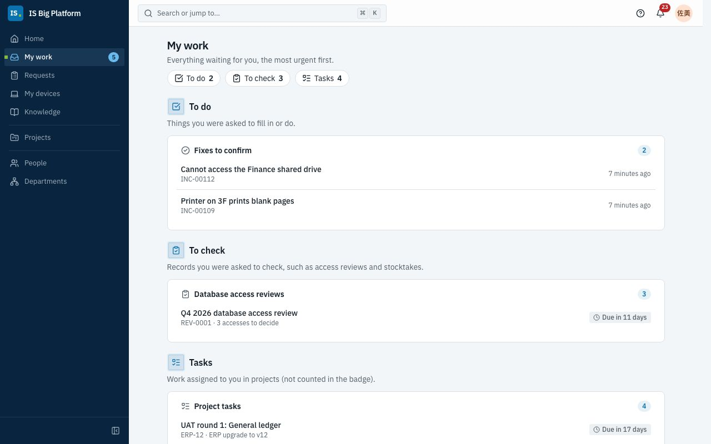

# Employees, managers and approvers guide

This guide is for everyone who works with IS: asking for access, equipment or software, getting help when something
breaks, following what you asked for, and deciding on your team's requests when you're an approver. Everything here
starts from **Requests** and **My work** in the sidebar.

## What you can do here

- [See what's waiting for you](#see-whats-waiting-for-you) on **My work**
- [Find what you need in Requests](#find-what-you-need-in-requests)
- [Request equipment or software with a form](#request-equipment-or-software-with-a-form)
- [Request access to an application or a role](#request-access-to-an-application-or-a-role)
- [Ask IS before you raise a ticket](#ask-is-before-you-raise-a-ticket)
- [Report an issue](#report-an-issue)
- [Follow your requests](#follow-your-requests), [confirm a fix](#confirm-a-fix-and-rate-the-service) or
  [withdraw a request](#withdraw-a-request)
- [See your devices and report a problem with one](#see-your-devices-and-report-a-problem-with-one)
- [Request database access](#request-database-access)
- For approvers: [approve or reject a request](#approve-or-reject-a-request),
  [hand an approval to someone else](#hand-an-approval-to-someone-else) and
  [set up out-of-office](#set-up-out-of-office-before-you-go-on-leave)
- [Choose which notifications you get](#choose-which-notifications-you-get) and
  [set your language, time zone and sessions](#set-your-language-time-zone-and-sessions)

## See what's waiting for you

**My work** is the one place for everything someone asked you to do: approve a request, fill in a form, check your
part of a review, accept a change, confirm a fix, change a shared account's password or work on a project task.

1. Select **My work** in the sidebar. The number next to it is how many things are waiting for you (project tasks
   aren't counted). On **Home**, **Needs you** shows the most urgent ones.
2. Items are grouped into **To decide**, **To do**, **To check** and **Tasks**, the most urgent first. Each shows what
   it is, its reference or who asked, and a deadline badge such as **Due in 2 days** or **Overdue by 3 days**.
3. Select an item to open it: the decision, the form, or your part of the review.

**What happens next:** once you've done it, the item leaves **My work** and the number goes down. When nothing is
waiting, **My work** says **Nothing is waiting for you**. Notifications about the same things open the same item, so
you can start from either.

## Find what you need in Requests

**Requests** is the front door to IS. Go there whenever you need something from IS or want to know where a request
stands.

1. Select **Requests** in the sidebar.
2. **My requests** is at the top, so what you've already sent is the first thing you see. Below it, **What do you
   need?** groups the cards:

| Group                      | Cards                                                                                                                                                                                                                            |
| -------------------------- | -------------------------------------------------------------------------------------------------------------------------------------------------------------------------------------------------------------------------------- |
| **Get help**               | **Report an issue** ([details](#report-an-issue)), **Browse knowledge** and **Ask IS**, which answers your question first ([details](#ask-is-before-you-raise-a-ticket))                                                         |
| **Equipment and software** | **My devices** ([details](#see-your-devices-and-report-a-problem-with-one)) and the request forms for equipment and software, for example **Laptop request** in the demo ([details](#request-equipment-or-software-with-a-form)) |
| **Access**                 | **Access to an application** ([details](#request-access-to-an-application-or-a-role)) and **Direct database access** ([details](#request-database-access))                                                                       |
| **Other**                  | Anything else IS offers                                                                                                                                                                                                          |

When there are more than eight cards, a search box appears above them: type part of a name, such as **Laptop**, to
narrow the list.

> **Tip:** You only see the forms meant for you. If a colleague mentions a form you can't find, it may be offered only
> to some groups: see [A form isn't in the portal](faq.md#a-form-isnt-in-the-portal).

## Request equipment or software with a form

Use a request form when you need a new laptop, a monitor, a software licence or another item IS provides. The form
asks exactly what IS needs to know, and the approvals it needs are attached to it.

1. Go to **Requests** and select the form under **What do you need?**, or open the link to the form you were given.
2. Fill in the fields. Some questions appear only when they apply: for example, in **Request a laptop or equipment**,
   **Laptop model** appears only after you choose **Laptop** as the **Item**.
3. Some forms ask you to pick something ISBP already knows, such as the configuration items a change touches. Select
   **Choose a record** (or **Add records** when you can pick several), type part of its reference or title under
   **Search by reference or title…** and pick it. You only see records you're allowed to see, and a form may offer
   only some of them, for example production systems only.
4. If the form needs approval, check **Who will approve this?** below the questions: each approval step with the
   people it would ask, based on your answers so far. It updates as you fill in the form, for example when the
   system you picked needs an extra approval. Steps that don't apply to your answers are marked **Skipped for this
   request** or left out.
   If a step’s approver comes from an answer you haven’t given yet, the step says **Depends on the answer to “…”** and names the question. Its approver appears once you fill that question in.
5. Select **Submit**. If a required field is empty, the form shows **This field is required** next to it. Forms can
   also check answers together, for example that the end date isn't before the start date: the form's own message
   then appears on the field to fix, or above the form under **Please check the form**.

**What happens next:** the request gets a reference such as `REQ-01042` and opens on its own page with its
**Approval path**. If the form needs approval (the page says **This request goes through an approval. You'll be
notified at each step.**), it goes to the first approver. When everyone has approved, IS fulfils it: many forms
become a service desk ticket, and the request page shows the ticket's progress (**Being fulfilled**, then
**Fulfilled**) and a link to it (**Open SR-…**). Some forms also start the work themselves once the request is sent
or approved, such as raising a change or granting a role: the request page lists each step under **What happens
next**, with its status (**Waiting**, **Running**, **Done**) and a link to what it created. You're notified when the
request is approved or rejected.

> **Important:** If **Who will approve this?** says **Nobody can approve this step — the request would be
> rejected**, nobody is set up to approve that step for your answers. Don't send it: ask the service desk first.

> **Tip:** In the demo, the **Laptop request** form asks for the **Estimated cost (TWD)**. The department head
> approves every laptop request, and IS asset management approves too when the cost is above 60 000 TWD. Approved
> requests become service desk tickets in the **Hardware › Laptop** category.

## Request access to an application or a role

Use **Access to an application** when you need a role in IS Big Platform (for example **Announcement editor**) or in a
business application registered in ISBP (in the demo, **Finance ERP**, **HR Portal** and **Expense Claims**). You say
how long you need it and why, and you see who will approve it before you send it.

1. Go to **Requests** and select **Access to an application**.
2. Choose the access you need. Roles are grouped by application: the business applications first, and the platform's
   own roles under **Platform roles** at the bottom, folded away until you open them. Type an application's name in
   **Search roles and applications…** (or pick its button) and its roles come first. Each role shows its risk
   (**Low risk**, **Medium risk**, **High risk**), its owner and the longest period it can be granted for (**Up to 90
   days**, for example). A role that has no description yet says **No description yet**, with its owner to ask. Roles
   you already have say **You have it**; roles you already asked for show **Requested (REQ-…)**.
3. Select **Continue**.
4. Under **Who needs it?**, choose **Me** or **Someone else**. Managers can request for their direct reports;
   access administrators can request for anyone. New joiners who haven't started yet are marked **Pre-boarded**:
   access you request for them is ready on their first day.
5. Under **For how long?**, choose **7 days**, **30 days**, **90 days**, **Custom** (enter the **Number of days**) or
   **No end date** if the role allows it.
6. Under **Why do you need it?**, write at least 10 characters. Approvers read this, so be specific: "I approve the
   service desk team's expense claims while the lead is away."
7. Select **Review**. Check **Your request** and **Who will approve it**: each step in order, with the people it would
   ask, based on the approval workflow and the org chart right now.
8. Select **Send request**.

**What happens next:** the request opens with the status **Waiting for approval**, and its status line names who it
waits for. By default it goes to your **Manager approval**, then to a **Security review** for high-risk roles, then to
the **Access owner approval**. Some roles use their own workflow; the review step always shows the real path. When the
last approver agrees, the role is granted automatically and the request says **Access granted — it ends on …** (or **it
does not expire**). Time-bound access is removed automatically when it ends; you're reminded a few days before
(**Access ending soon**).

> **Important:** If the review step says **Nobody can approve this step — the request would be rejected**, nobody is
> set up to approve that step for you. Don't send it: ask the service desk or the role owner first.

## Ask IS before you raise a ticket

**Ask IS** is a virtual agent that answers IS questions from the knowledge base, any time, in your language. Most
questions (VPN, passwords, MFA, printers) are answered in seconds, without a ticket. If it can't help, it prepares a
ticket for you, and nothing is sent until you confirm.

1. Select **Ask IS** on **Home**, or **Ask a question** on the **Requests** page. Or type your question in **Search or jump
   to…** at the top of the page and choose **Ask IS about "…"**: Ask IS opens with your question in the box.
2. Describe the problem in your own words, in any language, or pick one of the **Suggested questions** (for example
   **My VPN won't connect**). Press Enter or select **Send**.
3. Read the answer. The articles it used are shown as cards under **Sources**; open them for the full steps.
4. Under **Did this solve it?**, select **Yes, thanks** or **No, raise a ticket**.
5. With **No, raise a ticket**, the ticket opens right under the answer, already filled in. Check the **Title**, the
   **Description**, **How much does it affect you?** (**I can't work**, **It slows me down** or **It's minor**) and
   the **Type** (**Something is broken** or **I need something**), then select **Create ticket**. Select **Not now**
   to keep chatting instead.

**What happens next:** Ask IS shows **Ticket INC-… was raised. The service desk will follow up there.** with **View
ticket**. The ticket appears under **My requests**, like any ticket you report. Your earlier conversations are
listed under **Conversations**; start a fresh one with **New conversation**.

> **Tip:** Reading a knowledge article that didn't solve it? Answer **No** under **Was this article helpful?**:
> **Still stuck?** offers **Ask IS** and **Report an issue**.

> **Tip:** The label at the top of the chat says how answers are made. **Answers from our knowledge base** means no AI
> language model is configured: answers come from knowledge-base search and templates. **AI answers based on our
> knowledge base** means an AI model writes the answers from the knowledge base, after personal data is masked.
> Either way, answers can be wrong: check the linked articles. See [Assistant and AI](assistant-and-ai.md).

## Report an issue

Report an issue when something is broken and you want a person from the service desk to fix it: the VPN keeps
dropping, Outlook won't sync, a printer is jammed.

1. Go to **Requests** and select **Report an issue**.
2. Under **What's wrong?**, describe it in a few words, for example "I can't connect to the VPN from home".
3. Under **Tell us more**, say what happened, when it started, what you already tried and any error message.
4. Under **How much does it affect you?**, choose **I can't work**, **It slows me down** or **It's minor**.
5. Optionally, choose the system it's about under **Which service?**.
6. While you type, **These articles might help** suggests knowledge articles. If one fixes it, you don't need to send
   the report.
7. Select **Send to the service desk**.

**What happens next:** you see **INC-… sent. We're on it.** and the ticket opens. You get a notification that the
service desk has it, and the ticket appears under **My requests** as **Received**. The ticket page shows its progress
(**Received**, **In progress**, **Resolved**, **Closed**), who handles it (**Handled by**) and the **Conversation**
with the service desk. Add details or answer questions under **Message the service desk** and select **Send**; add
screenshots under **Attachments**. You're notified when an agent replies and when the ticket is resolved. The service desk's response and
resolution times are tracked against SLAs; see [Service desk](service-desk.md).

## Follow your requests

**My requests** is at the top of the **Requests** page. It lists everything you asked for: access requests, form
requests, tickets you reported and database access requests.

1. Go to **Requests**. **My requests** is the first section.
2. Choose **Open**, **Closed** or **All**.
3. Each row shows the reference, when it last changed and its status. While a request waits for approval, the row
   says **Waiting for …** with the people it waits for and the step, for example **Waiting for Mei Lin (Manager
   approval)**.
4. Select a row to open the request.

| Status you see                                               | Meaning                                                                              |
| ------------------------------------------------------------ | ------------------------------------------------------------------------------------ |
| **Received**                                                 | Sent, and no approval is needed                                                      |
| **Waiting for approval**                                     | An approver hasn't decided yet; the request page shows who it waits for              |
| **In progress**                                              | Approved, and IS (or a form's own steps) is working on it                            |
| **Approved** / **Done**                                      | Decided, or fulfilled. Access requests say **Access granted** when the role is given |
| **Rejected**                                                 | An approver said no; their reason is shown on the request                            |
| **Withdrawn**                                                | You (or the person who asked for you) withdrew it                                    |
| **Not completed**                                            | Approved, but the role no longer exists or the person is no longer active            |
| **On hold**, **Resolved — please confirm**, **Closed**       | A ticket you reported (see [Confirm a fix](#confirm-a-fix-and-rate-the-service))     |
| **Being set up**, **Access granted**, **Ended**, **Removed** | Database access ([details](#request-database-access))                                |

The request page starts with a status line: what is happening, who it waits for, when it is due, and what comes next
(**Next: Finance approval**). Under it, **Who will approve it** lists each approval step in order. A finished step says
**Approved** or **Rejected** with who decided and when, and the approver's comment appears under it. The step that is
waiting says **Waiting for approval** with who is asked and since when. A step that hasn't started says **Up next**
with the people who would be asked, and a step that doesn't apply to your answers says **Not needed**.

For access requests the page also shows the role, **For** (only when someone else gets the access), **Duration** and
**Justification**. For forms it shows your **Answers** (questions you left empty are not listed) and, once the form has
started work on its own, **What happens next**: each step, its status (**Waiting**, **Running**, **Done**, **Failed** or
**Skipped**) and a link to what it created, such as **Open CHG-…**. **History** lists everything that happened. If a step
failed, the people who maintain the form are told and can run it again.

> **Tip:** **Home** also shows **Your open requests**, and **My work** lists the approvals waiting for you.

### Confirm a fix and rate the service

When the service desk resolves your ticket, it asks you to confirm.

1. Open the ticket from the notification or from **My requests**. The ticket page shows **Is it fixed?**.
2. If it works, select **Yes, close it**, optionally rate the service under **How did we do? (optional)** and add a
   comment, then select **Close the ticket**.
3. If it's still broken, select **No, it's still broken**, say **What's still wrong?** and select **Reopen the
   ticket**.

**What happens next:** a closed ticket moves to **Closed** in **My requests**. A reopened ticket goes back to the
service desk, and the agent is notified with your reason.

### Withdraw a request

Withdraw an access or form request you no longer need, as long as it's still waiting for approval.

1. Open the request from **My requests**.
2. Select **Withdraw**, then **Withdraw** again in **Withdraw this request?** (or **Keep it** to change your mind).

**What happens next:** the request shows **Withdrawn** and approvers don't see it any more. You can send a new
request later.

## Fill in forms you've been asked to

Some checks are due by a date, often every month or quarter: the server room inspection, a backup check, a firewall
rule review. When someone asks you (or a group you're in) to fill in such a form, it appears on **My work** under
**To do** (and in **Needs you** on **Home**), and you get a notification **To do: …**. The **Requests** page tells you
how many to-dos are waiting and links to **My work**.

1. Open **My work**. **To do** lists your open to-dos, the soonest due first, each with its form and a deadline badge
   (**Overdue by …** when it's late). Anyone in the group can do a to-do assigned to a group.
2. Select a to-do. The form opens with the to-do above it: its title, when it is due, any note from the person who
   asked, who may fill it in, and **Sending the form completes this to-do.**
3. Fill in the form and select **Submit**.

**What happens next:** the request page says **Done. This completed your to-do “…”** and **It is recorded for October 2026.** Select **Back to My work** to go back. The to-do leaves your list (for a group, it leaves everyone's list). The
request appears under **My requests** like any other; if the form needs approval, it goes through it as usual. Until you
do it, you're reminded once a day from two days before the due date and after it, and once it's overdue the people who
maintain the form are told. In the demo, **Server room inspection** for this month is waiting for the IS Administrators
group.

## See your devices and report a problem with one

**My devices** lists the laptop, phone and other hardware IS has assigned to you, with the software licences assigned
to you personally. Use it to check an asset tag or warranty, or to report a problem with a specific device.

1. Select **My devices** in the sidebar (or on **Home**).
2. Each device shows its **Asset tag**, **Serial number**, **Yours since** and **Warranty**.
3. To report a problem with one, select **Report a problem** on it.

**What happens next:** **Report an issue** opens with the device already linked, so the service desk knows which one
it is. If the list says **No devices are assigned to you** but you have a company device, select **Tell the service
desk** so they can register it. In the demo, the service desk lead (`helpdesk`) has a laptop and a phone.

## Request database access

Developers, analysts and support staff sometimes need a role on a database for a limited time. ISBP handles the whole
process: approval, creating the account, giving you the password once, and removing the access when it ends.

1. Go to **Requests** and select **Direct database access**.
2. Choose the roles on **Access**, set how long and why on **Details**, then check **Who will approve it** on **Review** and select **Send request**.
3. When the access is ready (**Your access is ready** notification), select the notification (or **My database access** in the sidebar) to open it, and select **Show the password**. It's shown only once, for 7 days after the account was created: store it in your
   password manager.

The approval goes to your **Manager approval**, then the **Role owner approval**, and to **Information security
approval** for high-risk roles. Details: [Data and automation](data-and-automation.md).

## Approve or reject a request

If you're a manager, a role or application owner, a CAB member or in an approving group, requests come to you for a
decision. Decide promptly: approval steps have deadlines, with reminders before them, and some workflows escalate the
request to someone else when a deadline passes.

1. Open **My work**: **To decide** lists the requests waiting for you, the most urgent first. Select one, or the
   approval notification, to open it. **View all** opens the **Approvals** inbox, where **Waiting for me** lists them.
   Each card says the step (**Manager approval**), what is requested, who asked (**Requested by …**) and a deadline
   badge such as **Due in 5 hours** or **Overdue by 2 days**.
2. To see the details first, select the card. The panel shows **What is requested**, **Who will approve it** (every step,
   with the step you're at marked **Waiting for you**), a **History** you can open, and a link to **Open the request**.
   Records the requester picked on a form, such as configuration items, are links you can open (those you aren't allowed
   to see are only counted).
3. Select **Approve** or **Reject**. On a phone, both buttons are on the card, so you can decide from the list.
4. In the dialog, add a comment: optional when you approve (**Comment (optional)**), required when you reject (**Why
   are you rejecting it?**). The requester sees it.
5. Some steps ask you to fill in fields with your decision, under **To fill in**: for example an evaluation result,
   handling notes or the date a device was wiped. Fields marked \* are needed to approve; when you reject they are
   optional unless the step says otherwise. What you enter is kept with your decision and shown on the request.
6. Select **Approve** or **Reject** in the dialog.

To add evidence, such as a screenshot or a signed form, open the request (**Open the request**) and add it under
**Attachments**; you can also link related records there. Requesters and approvers can add them until the request is
withdrawn.

**What happens next:** the card leaves the list, and the toast names the request you decided on. The
request moves on to the next step, or completes. The requester is notified and sees your comment. **Decided by me**
lists what you decided. If someone else already decided, the panel says **Already decided by …** with the time.

> **Tip:** You can search the inbox by reference (**Search requests…**). New approvals reach you in the app and, if
> email is set up, by email (**Approvals waiting for me**).

The same inbox handles every kind of approval in ISBP: access requests, form requests, changes (CAB), asset disposals,
project proposals, database access, knowledge articles and change sets prepared with the assistant. A badge shows
**Escalated to you** when a step was escalated, or **From …** when a colleague handed it to you.

## Hand an approval to someone else

Hand over an approval when a colleague is better placed to decide, for example because they know the system better.

1. In **Approvals**, select the request to open its panel.
2. Select **Hand over**.
3. Choose the **Colleague**, optionally add a **Note for them (optional)**, and select **Hand over**.

**What happens next:** the approval moves to their inbox and they're notified. The requester can't decide on their
own request. If **Hand over** isn't there, that workflow step doesn't allow it.

## Set up out-of-office before you go on leave

Schedule out-of-office so approvals don't wait for you while you're away. The setting only appears for people who
approve things, because it hands approvals to a colleague.

1. Open the user menu (your avatar, top right) and select **Profile & preferences**.
2. Go to **Out of office** and select **Schedule**.
3. Under **Send my approvals to**, choose a colleague. Set **From** and **Until** (or a quick **Duration**), and
   optionally a **Reason** such as "Annual leave".
4. Select **Schedule out of office**.

**What happens next:** during that period, new approval tasks go to your delegate instead of you; tasks already waiting
for you stay with you. The period is listed as **Scheduled**, then **Active now**. Select **End now** to come back
early, or **Remove** to cancel a planned period. In the demo, the HR business partner (`hr.partner`) has annual leave
scheduled, with approvals going to the service desk lead.

## Choose which notifications you get

ISBP notifies you about approvals, your requests, tickets and more: in the app (the bell in the header) and by email.

1. Open the user menu and select **Profile & preferences**, then **Notifications**.
2. The types are grouped into **Approvals**, **My requests**, **Assigned to me**, **Announcements**, **Security notices**
   and **Other**. Each group has **All on** and **All off**. To pick individual types, open **Customise** and switch
   **In-app** and **Email** for each one. Changes are saved automatically.
3. The page shows the types that apply to you: the ones you set before, the ones you have received, and the ones that
   can't be switched off. Select **Show all** to see the rest.
4. **Reset to defaults** restores the original settings.

**What happens next:** new notifications follow your choices. Types marked **Required for security** can't be turned
off. If the page says email notifications aren't set up on this platform yet, the **Email** column is hidden and you
only get notifications in the app until an administrator turns email on.

To read notifications, select the bell: select one to open what it's about, or **Mark all as read**. **View all
notifications** opens the full list with **All** and **Unread** tabs.

## Set your language, time zone and sessions

Your preferences follow you to every device you sign in on.

1. Open the user menu and select **Profile & preferences**.
2. Under **Preferences**, choose the **Language** (also used for notifications and emails), the theme, and your **Time
   zone** (dates and times are shown in it). **Use this device's time zone** sets it from your computer.
3. Under **Profile**, change your **Display name**. Email, username and department are managed by your organisation.
4. Under **Password**, change your password if you sign in with a local account. If you sign in through your
   organisation, change it there.
5. Under **Sessions**, check the devices signed in to your account. Select **Sign out** next to one you don't
   recognise, or **Sign out other sessions**.

### See which roles you have

**My access** at the bottom of **Profile & preferences** lists your roles and how you got them (**Assigned to you**,
**Via** a group, or **Everyone**), with end dates for time-bound ones. If something you need is missing,
[request access](#request-access-to-an-application-or-a-role).

## How it connects

- Tickets you report are worked by the service desk: [Service desk](service-desk.md).
- Laptops and other devices are managed by asset managers: [Assets](assets.md).
- Database roles, accounts and access reviews: [Data and automation](data-and-automation.md).
- How Ask IS and the assistant use AI, and what they do with your data: [Assistant and AI](assistant-and-ai.md).
- Administrators design the forms and approval workflows you see here: [Administrators](administrators.md) and
  [Build your own process](processes.md).
- End-to-end examples, such as a new joiner's first week: [How ISBP fits our work](how-it-fits-our-work.md).
- Something not working as described? [FAQ and troubleshooting](faq.md).
