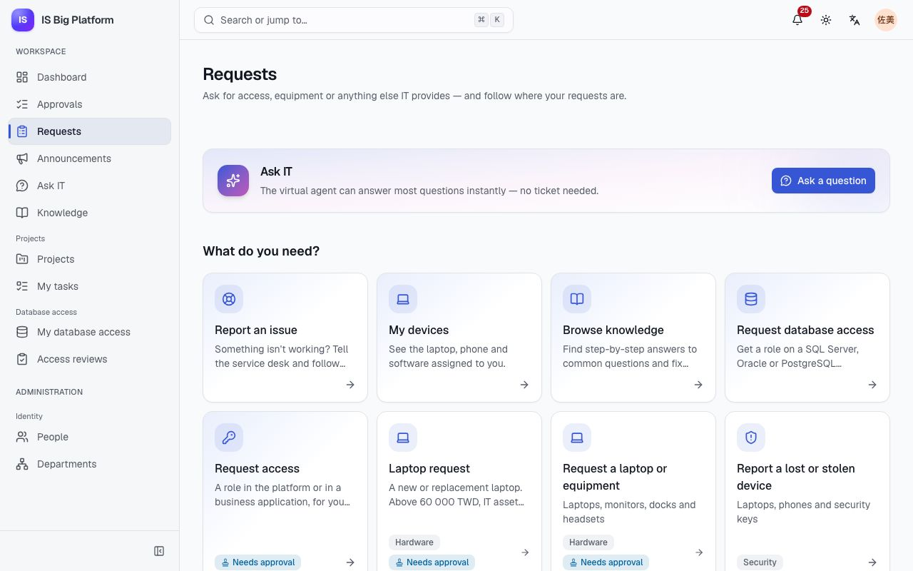
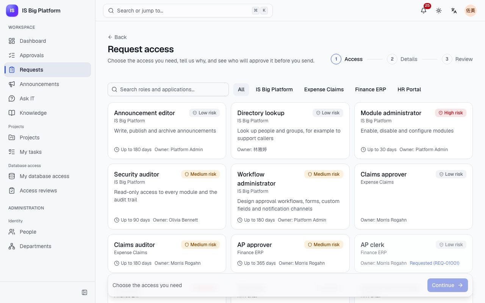
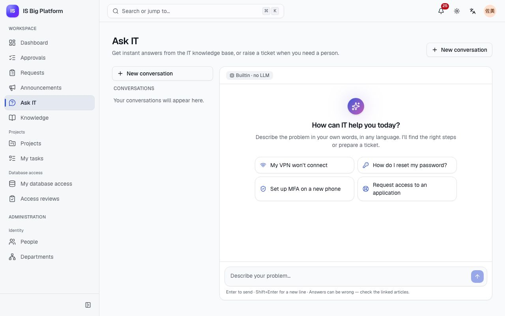
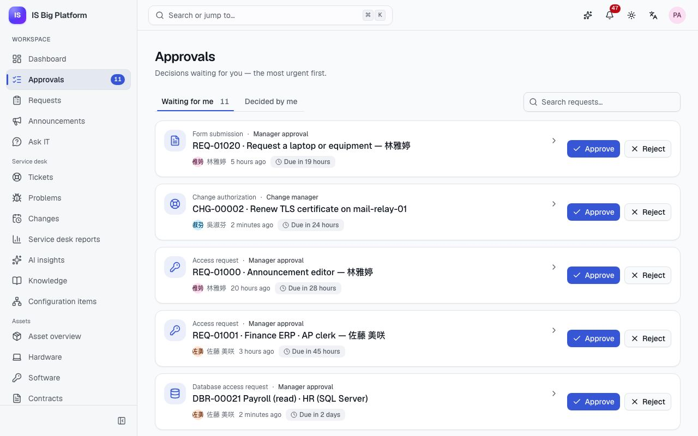

# Employees, managers and approvers guide

This guide is for everyone who works with IT: asking for access, equipment or software, getting help when something
breaks, following what you asked for, and deciding on your team's requests when you're an approver. Everything here
starts from the **Requests** page and the **Approvals** inbox in the sidebar.

## What you can do here

- [Find what you need in Requests](#find-what-you-need-in-requests)
- [Request equipment or software with a form](#request-equipment-or-software-with-a-form)
- [Request access to an application or a role](#request-access-to-an-application-or-a-role)
- [Ask IT before you raise a ticket](#ask-it-before-you-raise-a-ticket)
- [Report an issue](#report-an-issue)
- [Follow your requests](#follow-your-requests), [confirm a fix](#confirm-a-fix-and-rate-the-service) or
  [withdraw a request](#withdraw-a-request)
- [See your devices and report a problem with one](#see-your-devices-and-report-a-problem-with-one)
- [Request database access](#request-database-access)
- For approvers: [approve or reject a request](#approve-or-reject-a-request),
  [hand an approval to someone else](#hand-an-approval-to-someone-else) and
  [set up out-of-office](#set-up-out-of-office-before-you-go-on-leave)
- [Choose which notifications you get](#choose-which-notifications-you-get) and
  [set your language, time zone and sessions](#set-your-language-time-zone-and-sessions)

## Find what you need in Requests

**Requests** is the front door to IT. Go there whenever you need something from IT or want to know where a request
stands.

1. Select **Requests** in the sidebar.
2. Under **What do you need?**, pick a card:

| Card                        | Use it when                                                                                                                                                    |
| --------------------------- | -------------------------------------------------------------------------------------------------------------------------------------------------------------- |
| **Report an issue**         | Something isn't working and you want the service desk to fix it ([details](#report-an-issue))                                                                  |
| **My devices**              | You want to see the laptop, phone and software IT gave you, or report a problem with one ([details](#see-your-devices-and-report-a-problem-with-one))          |
| **Browse knowledge**        | You'd like to fix it yourself with a step-by-step article                                                                                                      |
| **Request database access** | You need a role on a SQL Server, Oracle or PostgreSQL database for a while ([details](#request-database-access))                                               |
| **Request access**          | You need a role in the platform or in a business application ([details](#request-access-to-an-application-or-a-role))                                          |
| A request form              | You need equipment, software or something else IT provides, for example **Laptop request** in the demo ([details](#request-equipment-or-software-with-a-form)) |

Cards marked **Needs approval** go to an approver before IT acts on them. Request forms are grouped by category
(**Hardware**, **Software**, **Security**, **Access**, **Other**). Above the cards, **Ask IT** offers to answer your
question straight away ([details](#ask-it-before-you-raise-a-ticket)).

> **Tip:** You only see the forms meant for you. If a colleague mentions a form you can't find, it may be offered only
> to some groups: see [A form isn't in the portal](faq.md#a-form-isnt-in-the-portal).

## Request equipment or software with a form

Use a request form when you need a new laptop, a monitor, a software licence or another item IT provides. The form
asks exactly what IT needs to know, and the approvals it needs are attached to it.

1. Go to **Requests** and select the form under **What do you need?**.
2. Fill in the fields. Some questions appear only when they apply: for example, in **Request a laptop or equipment**,
   **Laptop model** appears only after you choose **Laptop** as the **Item**.
3. Select **Submit**. If a required field is empty, the form shows **This field is required** next to it.

**What happens next:** the request gets a reference such as `REQ-01042` and opens on its own page with its
**Approval path**. If the form needs approval (the page says **This request goes through an approval. You'll be
notified at each step.**), it goes to the first approver. When everyone has approved, IT fulfils it: many forms
become a service desk ticket, and the request page shows the ticket's progress (**Being fulfilled**, then
**Fulfilled**) and a link to it (**Open SR-…**). You're notified when the request is approved or rejected.

> **Tip:** In the demo, the **Laptop request** form asks for the **Estimated cost (TWD)**. The department head
> approves every laptop request, and IT asset management approves too when the cost is above 60 000 TWD. Approved
> requests become service desk tickets in the **Hardware › Laptop** category.

## Request access to an application or a role

Use **Request access** when you need a role in IS Big Platform (for example **Announcement editor**) or in a
business application registered in ISBP (in the demo, **Finance ERP**, **HR Portal** and **Expense Claims**). You
say how long you need it and why, and you see who will approve it before you send it.

1. Go to **Requests** and select **Request access**.
2. Choose the access you need. Use **Search roles and applications…** or the application buttons to narrow the
   list. Each role shows its risk (**Low risk**, **Medium risk**, **High risk**), its owner and the longest period it
   can be granted for (**Up to 90 days**, for example). Roles you already have say **You have it**; roles you already
   asked for show **Requested (REQ-…)**.
3. Select **Continue**.
4. Under **Who needs it?**, choose **Me** or **Someone else**. Managers can request for their direct reports;
   access administrators can request for anyone. New joiners who haven't started yet are marked **Pre-boarded**:
   access you request for them is ready on their first day.
5. Under **For how long?**, choose **7 days**, **30 days**, **90 days**, **Custom** (enter the **Number of days**) or
   **No end date** if the role allows it.
6. Under **Why do you need it?**, write at least 10 characters. Approvers read this, so be specific: "I approve the
   service desk team's expense claims while the lead is away."
7. Select **Review**. Check **Your request** and **Who will approve it**: the people for each step, based on the
   approval workflow and the org chart right now.
8. Select **Send request**.

**What happens next:** the request opens with the status **Waiting for approval**. By default it goes to your
**Manager approval**, then to a **Security review** for high-risk roles, then to the **Access owner approval**. Some
roles use their own workflow; the review step always shows the real path. When the last approver agrees, the role is
granted automatically and the request says **Access granted — it ends on …** (or **it does not expire**). Time-bound
access is removed automatically when it ends; you're reminded a few days before (**Access ending soon**).

> **Important:** If the review step says **Nobody can approve this step — the request would be rejected**, nobody is
> set up to approve that step for you. Don't send it: ask the service desk or the role owner first.

## Ask IT before you raise a ticket

**Ask IT** is a virtual agent that answers IT questions from the knowledge base, any time, in your language. Most
questions (VPN, passwords, MFA, printers) are answered in seconds, without a ticket. If it can't help, it prepares a
ticket for you, and nothing is sent until you confirm.

1. Select **Ask IT** in the sidebar, or **Ask a question** on the **Requests** page.
2. Describe the problem in your own words, in any language, or pick one of the **Suggested questions** (for example
   **My VPN won't connect**). Press Enter or select **Send**.
3. Read the answer. The articles it used are listed under **Sources**; open them for the full steps.
4. Under **Did this solve it?**, select **That solved it** or **I still need help**.
5. If you still need help, Ask IT says **Still stuck? I've prepared a ticket for the service desk.** Select **Review
   ticket**, check the **Title**, **Description**, **Urgency** and **Type** (**Something is broken** or **I need
   something**), then select **Create ticket**. Select **Not now** to keep chatting instead.

**What happens next:** Ask IT shows **Ticket INC-… was raised. The service desk will follow up there.** with **View
ticket**. The ticket appears under **My requests**, like any ticket you report. Your earlier conversations are
listed under **Conversations**; start a fresh one with **New conversation**.

> **Tip:** The label at the top of the chat says how answers are made. **Builtin · no LLM** means no AI language model
> is configured: answers come from knowledge-base search and templates. **Language model** means an AI model writes
> the answers from the knowledge base, after personal data is masked. Either way, answers can be wrong: check the
> linked articles. See [Assistant and AI](assistant-and-ai.md).

## Report an issue

Report an issue when something is broken and you want a person from the service desk to fix it: the VPN keeps
dropping, Outlook won't sync, a printer is jammed.

1. Go to **Requests** and select **Report an issue**.
2. Under **What's wrong?**, describe it in a few words, for example "I can't connect to the VPN from home".
3. Under **Tell us more**, say what happened, when it started, what you already tried and any error message.
4. Under **How much does it affect you?**, choose **I can't work**, **It slows me down** or **It's minor**.
5. Optionally, choose the system it's about under **Which service?**.
6. While you type, **These articles might help** suggests knowledge articles. If one fixes it, you don't need to send
   the report.
7. Select **Send to the service desk**.

**What happens next:** you see **INC-… sent. We're on it.** and the ticket opens. You get a notification that the
service desk has it, and the ticket appears under **My requests**. The ticket page shows its progress (**Reported**,
**In progress**, **Resolved**, **Closed**), who handles it (**Handled by**) and the **Conversation** with the service
desk. Add details or answer questions in the reply box and select **Send reply**; add screenshots under
**Attachments**. You're notified when an agent replies and when the ticket is resolved. The service desk's response and
resolution times are tracked against SLAs; see [Service desk](service-desk.md).

## Follow your requests

**My requests** at the bottom of the **Requests** page lists everything you asked for: access requests, form
requests, tickets you reported and database access requests.

1. Go to **Requests** and scroll to **My requests**.
2. Choose **Open**, **Closed** or **All**.
3. Each row shows the reference, when it last changed and its status. While a request waits for approval, the row
   says **Waiting for …** with the step name and the approvers' pictures.
4. Select a row to open the request.

| Status you see                                                                 | Meaning                                                                      |
| ------------------------------------------------------------------------------ | ---------------------------------------------------------------------------- |
| **Waiting for approval**                                                       | An approver hasn't decided yet; the request page shows who (**Waiting for**) |
| **Approved** / **Rejected**                                                    | Decided. A rejection shows the approver's reason under **Rejected:**         |
| **Withdrawn**                                                                  | You (or the person who asked for you) withdrew it                            |
| **Couldn't be granted**                                                        | Approved, but the role no longer exists or the person is no longer active    |
| **New**, **In progress**, **On hold**, **Resolved**, **Fulfilled**, **Closed** | A ticket, or a form request being fulfilled through a ticket                 |
| **Being set up**, **Access granted**, **Ended**, **Removed**                   | Database access ([details](#request-database-access))                        |

The request page shows the **Approval path** (each step, who decided and when) and the **History**. For access
requests it also shows the role, **For**, **Duration** and **Justification**; for forms, your **Answers**.

> **Tip:** The **Dashboard** also shows **Your open requests** and, for approvers, **Waiting for your approval**.

### Confirm a fix and rate the service

When the service desk resolves your ticket, it asks you to confirm.

1. Open the ticket from the notification or from **My requests**. The ticket page shows **Is it fixed?**.
2. If it works, select **Yes, close it**, optionally rate the service under **How did we do? (optional)** and add a
   comment, then select **Close the ticket**.
3. If it's still broken, select **No, it's still broken**, say **What's still wrong?** and select **Reopen the
   ticket**.

**What happens next:** a closed ticket moves to **Closed** in **My requests**. A reopened ticket goes back to the
service desk, and the agent is notified with your reason.

### Withdraw a request

Withdraw an access or form request you no longer need, as long as it's still waiting for approval.

1. Open the request from **My requests**.
2. Select **Withdraw**, then **Withdraw** again in **Withdraw this request?** (or **Keep it** to change your mind).

**What happens next:** the request shows **Withdrawn** and approvers don't see it any more. You can send a new
request later.

## See your devices and report a problem with one

**My devices** lists the laptop, phone and other hardware IT has assigned to you, with the software licences assigned
to you personally. Use it to check an asset tag or warranty, or to report a problem with a specific device.

1. Go to **Requests** and select **My devices**.
2. Each device shows its **Asset tag**, **Serial number**, **Yours since** and **Warranty**.
3. To report a problem with one, select **Report a problem** on it.

**What happens next:** **Report an issue** opens with the device already linked, so the service desk knows which one
it is. If the list says **No devices are assigned to you** but you have a company device, select **Tell the service
desk** so they can register it. In the demo, the service desk lead (`helpdesk`) has a laptop and a phone.

## Request database access

Developers, analysts and support staff sometimes need a role on a database for a limited time. ISBP handles the whole
process: approval, creating the account, giving you the password once, and removing the access when it ends.

1. Go to **Requests** and select **Request database access**.
2. **Choose roles**, then set **Duration and reason**, then **Review and send**.
3. When the access is ready (**Your access is ready** notification), open **Database access → My database access**
   and select **Show the password**. It's shown only once, for 7 days after the account was created: store it in your
   password manager.

The approval goes to your **Manager approval**, then the **Role owner approval**, and to **Information security
approval** for high-risk roles. Details: [Data and automation](data-and-automation.md).

## Approve or reject a request

If you're a manager, a role or application owner, a CAB member or in an approving group, requests come to you for a
decision. Decide promptly: approval steps have deadlines, with reminders before them, and some workflows escalate the request to someone else when a deadline passes.

1. Select **Approvals** in the sidebar. The number next to it is how many decisions are waiting. **Waiting for me**
   lists them, the most urgent first; each shows the workflow, the step, the requester and a deadline badge such as
   **Due in 5 hours** or **Overdue by 2 days**.
2. To see the details first, select the request. The panel shows **What is requested**, the **Approval path**, the
   **History** and a link to **Open the request**.
3. Select **Approve** or **Reject**.
4. In the dialog, add a comment: optional when you approve (**Comment (optional)**), required when you reject (**Why
   are you rejecting it?**). The requester sees it.
5. Select **Approve** or **Reject** in the dialog.

**What happens next:** the request moves on to the next step, or completes. The requester is notified and sees your
comment. **Decided by me** lists what you decided. If someone else already decided (with "first answer decides"), you
see **This approval has already been handled.**

> **Tip:** You can search the inbox by reference (**Search requests…**). New approvals reach you in the app and, if
> email is set up, by email (**Approvals waiting for me**).

The same inbox handles every kind of approval in ISBP: access requests, form requests, changes (CAB), asset disposals,
project proposals, database access, knowledge articles and change sets prepared with the assistant. A badge shows
**Escalated to you** when a step was escalated, or **From …** when a colleague handed it to you.

## Hand an approval to someone else

Hand over an approval when a colleague is better placed to decide, for example because they know the system better.

1. In **Approvals**, select the request to open its panel.
2. Select **Hand over**.
3. Choose the **Colleague**, optionally add a **Note for them (optional)**, and select **Hand over**.

**What happens next:** the approval moves to their inbox and they're notified. The requester can't decide on their
own request. If **Hand over** isn't there, that workflow step doesn't allow it.

## Set up out-of-office before you go on leave

Schedule out-of-office so approvals don't wait for you while you're away.

1. Open the user menu (your avatar, top right) and select **Profile & preferences**.
2. Go to **Out of office** and select **Schedule**.
3. Under **Send my approvals to**, choose a colleague. Set **From** and **Until** (or a quick **Duration**), and
   optionally a **Reason** such as "Annual leave".
4. Select **Schedule out of office**.

**What happens next:** during that period, new approval tasks go to your delegate instead of you; tasks already waiting
for you stay with you. The period is listed as **Scheduled**, then **Active now**. Select **End now** to come back
early, or **Remove** to cancel a planned period. In the demo, the HR business partner (`hr.partner`) has annual leave
scheduled, with approvals going to the service desk lead.

## Choose which notifications you get

ISBP notifies you about approvals, your requests, tickets and more: in the app (the bell in the header) and by email.

1. Open the user menu and select **Profile & preferences**, then **Notifications**.
2. For each **Notification** type, switch **In-app** and **Email** on or off. Changes are saved automatically.
3. **Reset to defaults** restores the original settings.

**What happens next:** new notifications follow your choices. Types marked **Required for security** can't be turned
off. If the page says email notifications aren't set up on this platform yet, you only get notifications in the app
until an administrator turns email on.

To read notifications, select the bell: select one to open what it's about, or **Mark all as read**. **View all
notifications** opens the full list with **All** and **Unread** tabs.

## Set your language, time zone and sessions

Your preferences follow you to every device you sign in on.

1. Open the user menu and select **Profile & preferences**.
2. Under **Preferences**, choose the **Language** (also used for notifications and emails), the theme, and your **Time
   zone** (dates and times are shown in it). **Use this device's time zone** sets it from your computer.
3. Under **Profile**, change your **Display name**. Email, username and department are managed by your organisation.
4. Under **Password**, change your password if you sign in with a local account. If you sign in through your
   organisation, change it there.
5. Under **Sessions**, check the devices signed in to your account. Select **Sign out** next to one you don't
   recognise, or **Sign out other sessions**.

### See which roles you have

**My access** at the bottom of **Profile & preferences** lists your roles and how you got them (**Assigned to you**,
**Via** a group, or **Everyone**), with end dates for time-bound ones. If something you need is missing,
[request access](#request-access-to-an-application-or-a-role).

## How it connects

- Tickets you report are worked by the service desk: [Service desk](service-desk.md).
- Laptops and other devices are managed by asset managers: [Assets](assets.md).
- Database roles, accounts and access reviews: [Data and automation](data-and-automation.md).
- How Ask IT and the assistant use AI, and what they do with your data: [Assistant and AI](assistant-and-ai.md).
- Administrators design the forms and approval workflows you see here: [Administrators](administrators.md).
- End-to-end examples, such as a new joiner's first week: [How ISBP fits our work](how-it-fits-our-work.md).
- Something not working as described? [FAQ and troubleshooting](faq.md).
