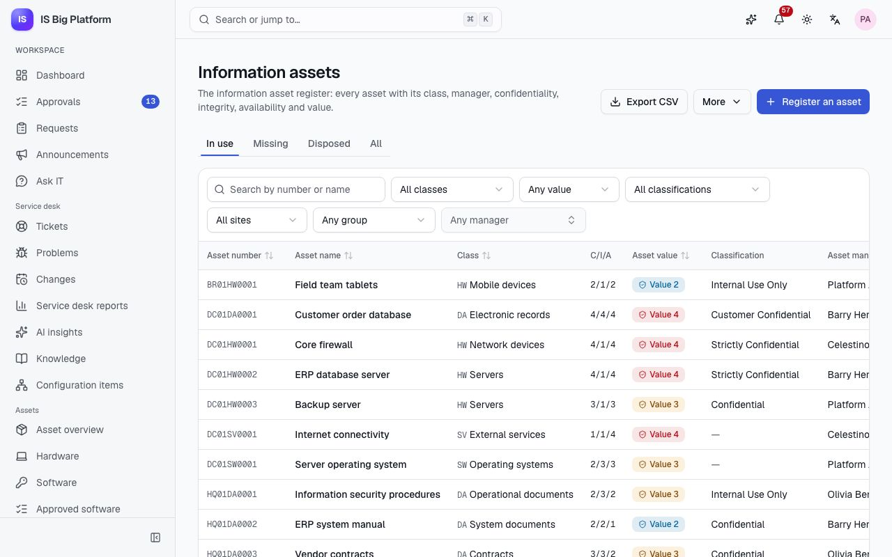
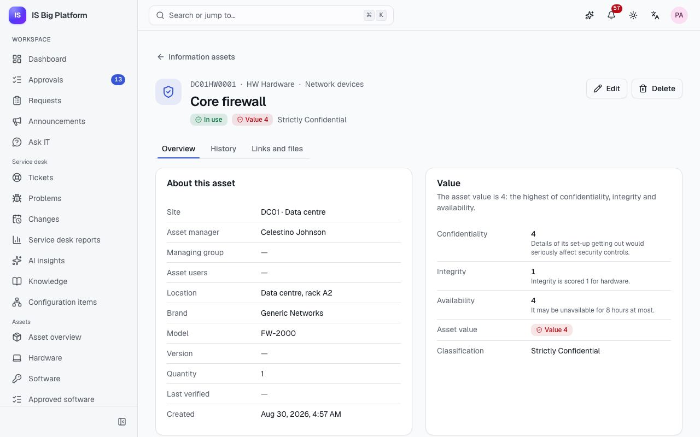
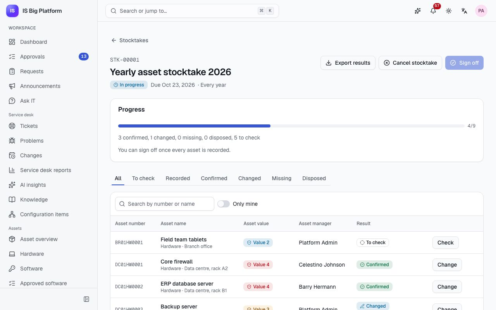
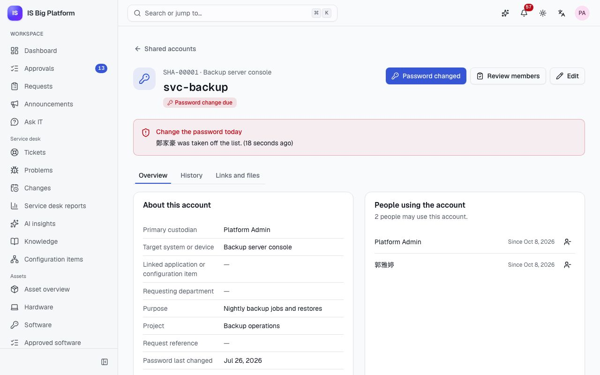
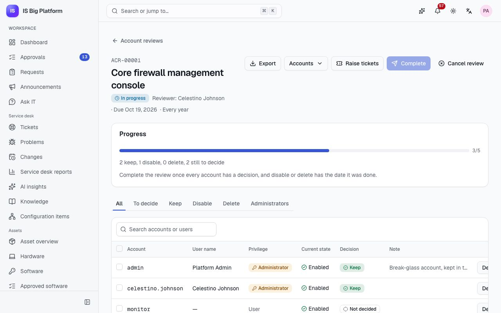

# Information security (ISMS) guide

This guide is for everyone who takes part in our information security management system (ISMS): information asset
managers, security officers, the custodians of shared accounts and the people who review a system's accounts.
**Information security** keeps the records an ISO 27001 audit asks for in one place: the information asset register
with each asset's confidentiality, integrity and availability, the stocktakes that keep it right, the shared accounts
and who may use them, and the account reviews of our systems.

## What you can do here

- Know [who can do what](#who-can-do-what) and how to
  [score confidentiality, integrity and availability](#score-confidentiality-integrity-and-availability)
- [Register an information asset](#register-an-information-asset), [find it in the register](#find-assets-in-the-register)
  and [read its page, history, links and files](#read-an-assets-page)
- [Export and import the register](#export-and-import-the-register) as CSV, or
  [create assets from other records](#create-assets-from-other-records)
- [Run a stocktake](#run-a-stocktake): [start it](#start-or-schedule-a-stocktake),
  [check the assets you manage](#check-the-assets-you-manage) and [sign it off](#sign-off-a-stocktake)
- [Register a shared account](#register-a-shared-account),
  [change its password when someone leaves the list](#change-the-password-when-someone-leaves-the-list) and
  [review who uses it](#review-who-uses-a-shared-account), or
  [register it from a request form](#register-shared-accounts-from-a-request-form)
- [Run an account review](#run-an-account-review) of a system, from
  [starting it](#start-an-account-review) to [signing it off](#complete-and-sign-off-an-account-review)
- [Set up classes, sites and classification labels](#set-up-classes-sites-and-classification-labels) (administrators)
- [Install the ISMS process pack](#isms-process-pack) with the forms and scheduled checks of our ISMS processes
- [Fix common problems](#fix-common-problems)

## Who can do what

The roles below are granted in **Administration → Roles & access**. Everyone sees **Information security →
Stocktakes**, **Shared accounts** and **Account reviews**, with only their own work in them. If you don't see
**Information security → Information assets**, ask an administrator for one of the other roles.

| Role                                   | What it allows                                                                                                                                         |
| -------------------------------------- | ------------------------------------------------------------------------------------------------------------------------------------------------------ |
| **Information security participant**   | Everyone has it: check the assets you manage in stocktakes, decide the account reviews given to you, and see the shared accounts you look after or use |
| **Information security viewer**        | Read and export the register, every stocktake, shared account and account review                                                                       |
| **Information asset manager**          | Maintain the register (register, edit, delete, import, create from other records), and start, schedule and cancel stocktakes                           |
| **Information security officer**       | Sign off stocktakes and account reviews, register and change shared accounts, start and cancel account reviews, and read the register                  |
| **Information security administrator** | Everything in information security, including the classes, sites and classification labels                                                             |

In the demo, the IT Administrators group holds **Information asset manager**, the Security Team **Information security
officer**, the Network Team, DBA Team, Service Desk and the `auditor` user **Information security viewer**, and
`admin` is the **Information security administrator**.

> **Tip:** The **Information security** card on the **Dashboard** shows what needs you: the assets you manage that
> need checking, the shared account passwords you must change, the stocktakes and account reviews in progress and,
> if you can read the register, the assets by value.

## Score confidentiality, integrity and availability

Every asset gets a score from 1 to 4 for **Confidentiality** (the impact if it is disclosed to people who shouldn't
see it), **Integrity** (the impact if it is wrong, incomplete or changed without permission) and **Availability**
(the impact if it can't be used). The **Asset value** is the highest of the three: an asset with scores 4, 1 and 2 has
value 4. Nobody types the value in, so it can't be underestimated by mistake.

What each score means depends on the asset's class. While you score an asset, the form shows the class's guidance
next to each score; choose the highest score whose description fits. The default classes are:

| Class           | Code | Sub-classes                                                                                       | How it is scored                                                                                                                                  |
| --------------- | ---- | ------------------------------------------------------------------------------------------------- | ------------------------------------------------------------------------------------------------------------------------------------------------- |
| **People**      | `PE` | **Internal people**, **External people**                                                          | Confidentiality by the most sensitive information they handle; integrity is always 1; availability by how widely their absence is felt            |
| **Hardware**    | `HW` | **Servers**, **Network devices**, **Portable storage media**, **Mobile devices**, **IoT devices** | Confidentiality by the harm if details of its set-up got out; integrity is always 1; availability by how long it may be down (4: 8 hours at most) |
| **Software**    | `SW` | **Operating systems**, **Packaged software**                                                      | Confidentiality by the harm if its logic got out; integrity by the harm of wrong results; availability by how long it may be down                 |
| **Information** | `DA` | **Operational documents**, **System documents**, **Electronic records**, **Contracts**            | Confidentiality from internal (1) to strictly confidential (4); integrity and availability by who is affected if it's wrong or lost               |
| **Services**    | `SV` | **Internal services**, **External services**                                                      | Confidentiality by the harm if details of how it works got out; integrity is always 1; availability by how long it may be down                    |

Each asset can also carry a **Classification** label that says how its information must be handled: **Strictly
Confidential**, **Customer Confidential**, **Confidential** or **Internal Use Only** by default. Administrators can
change the classes, their guidance and the labels: see
[Set up classes, sites and classification labels](#set-up-classes-sites-and-classification-labels).

## Register an information asset

Register an asset when the organisation starts to depend on it: a new server, a new system's database, a contract, an
outside service or a team. You need the **Information asset manager** role.

1. Go to **Information security → Information assets** and select **Register an asset**.
2. Under **Asset**, enter the **Asset name** (describe what it does, simply and clearly), and choose the **Class**,
   **Sub-class**, **Site** and **Classification**.
3. Under **Responsibility and location**, choose the **Asset manager** (a person) or the **Managing group**, the
   **Asset users** (people), or describe them under **Users (departments or people, as text)** (for example "Finance
   department"), and enter the **Location**.
4. Under **Details**, enter the **Brand**, **Model**, **Version** and **Quantity** where they apply.
5. Under **Confidentiality, integrity and availability**, choose a score for each, reading the guidance shown next
   to it. **Asset value** shows the result as you choose.
6. Add **Notes** and any additional fields your administrators added, then select **Register**.

**What happens next:** the asset gets its number (for example `HQ01HW0003`), its page opens and its history starts
with "Registered". The asset manager, or the members of the managing group, check it in every stocktake that
includes it.

To change an asset, open it and select **Edit**, then **Save changes**. **Delete** removes it from the register with
its links and attachments; its history stays in the audit log.

### How asset numbers are made

An asset number is the site code, the class code and the next number of that site and class: `HQ01HW0001` is the
first hardware asset of the head office (`HQ01`). Each site and class has its own sequence. The number never changes,
even if you later move the asset to another site or class, so labels and documents that carry it stay right.

An asset's **Status** (**In use**, **Missing** or **Disposed**) isn't edited in the form: it changes when a
stocktake is signed off, or through the **Status** column of a CSV import.

## Find assets in the register

1. Go to **Information security → Information assets**. The tabs **In use**, **Missing**, **Disposed** and **All**
   filter by status.
2. Search by number or name, and narrow the list with the filters: **All classes**, **Any value** (for example
   **Value 3 or more**), **All classifications**, **All sites**, **Any group** and **Any manager**. **Clear filters**
   removes them.
3. Sort by a column heading, and select an asset to open it.

The list shows each asset's **Class**, its **C/I/A** scores, **Asset value**, **Classification**, **Asset manager**,
**Site** and **Status**. The filters are in the page's address, so you can share a filtered list as a link.

In the demo, **Value 4 or more** lists the core firewall, the ERP database server, the customer order database and
the internet connectivity.

> **Tip:** The search in the header finds information assets and shared accounts too, and the assistant can find
> assets for you ("which hardware has value 4?") with your permissions.

## Read an asset's page

Open an asset to see everything about it on three tabs:

- **Overview**: **About this asset** (site, asset manager, managing group, users, location, brand, model, version,
  quantity, **Last verified** in a stocktake, and **Registered from** when it was created from another record), and
  **Value**, with each score, the class's guidance for that score, the **Asset value** and the **Classification**.
- **History**: every change, who made it and when: **Registered**, **Updated**, **Imported**, **Updated in a
  stocktake** and **Status changed**, with the fields that changed.
- **Links and files**: **Linked records** and **Attachments**. Select **Link record** to link the configuration
  item, hardware asset, application or ticket this asset relates to, and **Upload** to attach a document, such as a
  risk assessment or a signed handling agreement.

Request forms can let people pick information assets with a **Record** field (record type **Information asset**);
the approval can route on the asset's **Asset value**, **Confidentiality**, **Integrity**, **Availability**,
**Classification label**, **Asset manager**, **Managing group**, **Asset class code**, **Site code** or **Asset
status**, for example to add the security officer for assets of value 4. Picking needs a role that can read the
register. See [Let people pick records](processes.md#let-people-pick-records).

## Export and import the register

Auditors often want the register as a spreadsheet, and many organisations start from one. Export and import use the
same layout, so you can export, edit in Excel and import again.

**Export.** On **Information security → Information assets**, select **Export CSV**. You get the assets of the tab
and filters you're looking at, with the column headings in your language. The file is UTF-8 with a byte order mark,
so Excel shows Chinese and Japanese text correctly.

**Import.** You need the **Information asset manager** role.

1. Select **More**, then **Import from CSV**.
2. Under **CSV file**, choose the file and select **Check the file**. Nothing changes yet: the dialog says what would
   happen ("Checked: … to register, … to update, … unchanged. Nothing has been changed yet.") and lists every row
   that would be left out, with its line, column and the problem.
3. Fix the file and check it again if you need to, then select **Import**.

**What happens next:** valid rows are applied together and invalid rows are left out. Each imported asset's history
says "Imported", and the import is recorded in the audit log.

### The CSV layout

The columns follow the paper register: **Asset number**, **Asset name**, **Class**, **Sub-class**, **Asset
manager**, **Asset users**, **Location**, **Brand**, **Model**, **Version**, **Quantity**, **Confidentiality**,
**Integrity**, **Availability**, **Asset value**, then **Classification**, **Site**, **Status** and **Notes**.

- Columns can be in any order, with headings in English, Chinese or Japanese. A title line above the heading row is
  skipped. Commas, semicolons or tabs separate the columns; UTF-8, UTF-16 and Big5 files are read.
- A row whose **Asset number** exists updates that asset; empty cells keep the current value.
- Any other row registers a new asset and needs the **Asset name**, **Class**, **Site** (unless there is only one
  site) and the three scores. Leave **Asset number** empty to number it automatically, or give an unused number of
  the right site and class (to keep the numbers of a paper register).
- **Class**, **Sub-class**, **Site** and **Classification** take a code or a name in any language. **Asset manager**
  takes a person's email, username or display name, or a group's name. **Confidentiality**, **Integrity** and
  **Availability** are 1 to 4.
- **Asset value** is always worked out from the scores. A file can have up to 2,000 rows.

## Create assets from other records

Much of what the register lists is already in ISBP: servers in the CMDB, laptops and licences in Assets, contracts,
applications, procedures in the knowledge base. Register them from there instead of typing them again.

1. On **Information security → Information assets**, select **More**, then **Create from other records**.
2. Choose the **Record type**: **Configuration items**, **Hardware assets**, **Software licences**, **Contracts**,
   **Applications** or **Knowledge articles** (only the types you can see are offered).
3. Search and tick the records. Records already in the register say **Registered as …** and can't be ticked again.
4. Under **The new assets**, choose the **Class**, **Sub-class**, **Site**, **Classification**, **Asset manager**
   and the three scores they all get.
5. Select **Register … assets**.

**What happens next:** each record becomes an asset named after it, linked to it (**Registered from** on the asset
page, and **Linked records** on both). Adjust each asset's scores and manager afterwards if they differ.

## Run a stocktake

A stocktake (an asset inventory) checks that the register still matches reality: each asset's manager confirms it,
corrects it, or reports it missing or disposed, and a security officer signs off the result. Make it repeat every
quarter or every year, and the next one is scheduled on its own.

In the demo, the **Yearly asset stocktake** of hardware and software (`STK-00001`) is in progress: the core firewall,
the ERP database server and the endpoint protection are confirmed, and the backup server was corrected because it
moved to rack B4.

### Start or schedule a stocktake

You need the **Information asset manager** or **Information security officer** role.

1. Go to **Information security → Stocktakes** and select **New stocktake**.
2. Enter the **Name**, the **Start date** (today, or a later date to schedule it), the **Due date** and whether it
   **Repeats**: **Once**, **Every quarter** or **Every year**.
3. Choose the scope: tick classes under **Class** and sites under **Site**, add people under **Asset managers**
   with **Add a manager**, and tick groups under **Managing group**. Leave a list empty to include everything. Assets
   that are in use or missing are included.
4. Select **Start**, or **Schedule** if it starts later.

**What happens next:** every asset in scope becomes an item for its asset manager, or for the members of its managing
group, and they are notified ("Stocktake …: … assets to check") with the due date. A scheduled stocktake shows "This
stocktake starts on …" and starts on its own that morning. A week before the due date, the managers with items left
get a reminder; once it's overdue, they and the person who started it are told. When every item is recorded, the
person who started it hears that it's ready to sign off.

### Check the assets you manage

When a stocktake starts, you get a notification for the assets you manage. Check each one where it is: in the data
centre, on the shelf, in the document system.

1. Go to **Information security → Stocktakes**. **Waiting for you** lists your assets that need checking, with the
   stocktake and its due date. (Or open the stocktake, turn on **Only mine** and use the **To check** tab.)
2. Select **Check** next to an asset.
3. Choose the result:
   - **Confirmed**: the register is right.
   - **Changed**: correct the register now. Under **What is right now**, change the **Asset name**, **Location**,
     **Users (departments or people, as text)**, **Brand**, **Model**, **Version** or **Quantity**.
   - **Missing**: it can't be found. Add a **Note** saying what you did to find it.
   - **Disposed**: it was disposed of. Add a **Note**, for example the disposal certificate's number.
4. Select **Record**.

**What happens next:** corrections are applied to the register at once, and the asset's history says "Updated in a
stocktake". Missing and disposed assets change status only when the stocktake is signed off. Until then you can
change a result: select **Change** on its row.

### Sign off a stocktake

1. Open the stocktake from **Information security → Stocktakes**. **Progress** shows how many assets are confirmed,
   changed, missing, disposed and still to check; the tabs filter the items.
2. Chase what's left on the **To check** tab: it shows each asset's manager. Stocktake managers can record any item
   themselves.
3. When every asset is recorded, a security officer selects **Sign off**, adds a **Note (optional)** and selects
   **Sign off**.

**What happens next:** assets reported missing become **Missing**, disposed ones **Disposed**, and the others are
**In use** with **Last verified** set to today. The stocktake shows "Signed off by …". If it repeats, the next one is
scheduled with the same name and scope, three or twelve months later.

Select **Export results** for the audit evidence: a CSV with each asset, its result, the corrections, the notes, who
recorded it and when. **Cancel stocktake** stops a stocktake you no longer need; the results recorded so far are kept,
but it can't be signed off.

## Register a shared account

A shared account is used by several people: a service account, a device's administrator account, a mailbox login.
Our policy is that each one is approved, has a primary custodian who keeps the password, and lists the people
allowed to use it. When someone leaves the list, the password is changed that day.

You need the **Information security officer** role.

1. Go to **Information security → Shared accounts** and select **Register a shared account**.
2. Enter the **Account name** and the **Target system or device**. Optionally pick the **Linked application or
   configuration item**.
3. Choose the **Primary custodian**, and add the **People using the account** with **Add a person**.
4. Optionally fill in the **Requesting department**, **Project**, **Request reference**, **Password last changed**,
   **Next review**, **Purpose** and **Notes**.
5. Select **Register**.

**What happens next:** the account gets a reference such as `SHA-00003`. Its custodian and the people on the list see
it under **Shared accounts** (with **Only mine**). Unless you set it, the **Next review** is 12 months away.

> **Important:** ISBP never stores the password itself. The custodian keeps it, encrypted, and records here only
> when it was changed. Don't write a password in a note.

To change the custodian, the people or the details, open the account and select **Edit**. Taking someone off the list
makes the password change due.

## Change the password when someone leaves the list

The password of a shared account becomes due, and the account shows **Password change due**, when:

- someone on the list is offboarded in **Administration → People**: they are taken off every list ("… left the
  organisation");
- someone on the list moves to another department: they stay on the list, so take them off if they no longer need
  the account ("… moved to another department");
- someone is taken off the list, by hand or in the yearly review;
- the custodian leaves: the security officers are told to appoint a new custodian with **Edit**.

The custodian gets the notification "Change the password of … today" in ISBP and by email; it can't be turned off.

1. Open the account from the notification, from the **Dashboard** card, or from the **Password change due** tab of
   **Information security → Shared accounts**. The page says **Change the password today** and why.
2. Change the password on the system itself.
3. Select **Password changed**, check **Changed on**, add a **Note (optional)** and select **Record**.

**What happens next:** the warning goes away and **Password last changed** shows the date. The history says
"Password changed on …", and the change is in the audit log.

To take someone off the list yourself, open the account's **Overview**, select the button next to the person under
**People using the account** (**Take … off the list**) and confirm with **Remove**.

In the demo, someone was taken off the list of `svc-backup` (`SHA-00001`, the backup server console), so its password
change is due; `report_reader` (`SHA-00002`) is up to date.

## Review who uses a shared account

Once a year, the custodian confirms that everyone on the list still needs the account. On the **Next review** date
the custodian is notified ("Review who uses …"), the account says the yearly review is due, and it is listed on the
**Review due** tab.

1. Open the account and select **Review members**.
2. Keep ticked the people who still need the account; untick the others. The dialog says how many people will be taken
   off.
3. Add a **Note (optional)** and select **Confirm the review**.

**What happens next:** the people you unticked are taken off the list, and the password change becomes due if anyone
was. **Last reviewed** is today and the **Next review** moves 12 months on; the history says "Members confirmed; next
review …". The custodian or an **Information security officer** can do this, and an administrator can change the 12
months in the module's settings.

## Register shared accounts from a request form

When shared accounts are requested with a form (one row per user, with a custodian, as on the paper form), the request
can register the account once it's approved, so the register never misses one.

1. Open the form in **Administration → Forms**, go to its **Actions** tab and select **Add action**.
2. Choose **Register a shared account** and set **When it runs** to **After approval**. You need the **Information
   security officer** role to add it.
3. Fill in the settings: the **Account name** and **Target system or device** (text, or a template with an answer
   of the form), the **Application or CI field** if the form has one, the **Primary custodian** (**The requester** or
   a person field), the **People using the account** (person fields, or the person column of a table), and the
   **Purpose** and **Project**.
4. Select **Add action**, then **Save** and **Publish**.

**What happens next:** when a request is approved, the account is registered with the request's number as its
**Request reference**, and the request links to it. If an active account with the same name on the same system
already exists, the new people are added to it instead, and its history says "Updated from a request". People who
left before the approval aren't added. More about actions: [Add actions](processes.md#add-actions).

## Run an account review

An account review goes through all the accounts of one system (a firewall, a server, a database, an application) and
decides for each one whether to keep, disable or delete it. A security officer signs off the result. Make it repeat
every quarter or every year, and the next one is scheduled on its own.

In the demo, the review of the **Core firewall management console** (`ACR-00001`) is in progress: a network engineer
is the reviewer, `admin` is kept as the break-glass account, `temp-vendor` was disabled because the project ended, and
the other accounts are still to decide.

### Start an account review

You need the **Information security officer** role.

1. Go to **Information security → Account reviews** and select **New account review**.
2. Enter the **System, device or IP** (for example "Core firewall, 10.0.0.1"), and optionally pick the **Linked
   application or configuration item**.
3. Choose the **Reviewer**, the **Start date**, the **Due date** and whether it **Repeats** (**Once**, **Every
   quarter** or **Every year**).
4. Under **Accounts**, choose **Imported from the system's account list**, or **Role holders of …** for an
   application registered in ISBP: the review then starts with everyone holding one of its roles.
5. Select **Start**, or **Schedule** if it starts later.

**What happens next:** the reviewer is notified ("Review the accounts of …") with the due date and gets a reminder a
week before it. Once it's overdue, the reviewer and the person who started it are told.

### Fill in the accounts

The reviewer (or a security officer) brings in the system's accounts, from **Accounts** on the review page:

- **Import an account list**: export the account list from the system and choose the file under **CSV file**. The
  columns can be in any order, with headings in English, Chinese or Japanese: the account (required), the user name,
  the privilege (administrator or user), the current state (enabled or disabled) and, optionally, the decision, the
  date done and a note. Select **Check the file**, then **Import**. Accounts already listed are updated, others are
  added, and people are matched by user name, email or a unique display name.
- **Add an account**: for an account the list is missing. Enter the **Account**, **User name**, **Person**,
  **Privilege** and **Current state**, and select **Add**.

### Decide each account

1. Open the review. The tabs **All**, **To decide**, **Keep**, **Disable**, **Delete** and **Administrators** filter
   the accounts.
2. Select **Decide** next to an account, or tick several and select **Decide … selected**.
3. Choose **Keep**, **Disable** or **Delete**. For disable and delete, enter the **Date done** once it's done (you can
   add it later), and a **Note**. Select **Save**.

Accounts to disable or delete without a date show **Date done missing**.

### Raise tickets to disable or delete accounts

When the system's administrators work from service desk tickets, select **Raise tickets**: ISBP raises one service
request for each disable or delete decision that has no ticket yet, in your name, and shows its number next to the
decision. Enter the **Date done** once the ticket is fulfilled. The button appears when the review has disable or
delete decisions and you can raise tickets.

### Complete and sign off an account review

1. When every account has a decision, and every disable and delete its date done, the reviewer selects **Complete**.
   The review is **Waiting for sign-off**, and the person who started it is told.
2. A security officer checks the decisions and selects **Sign off**, adds a **Note (optional)** and selects **Sign
   off**. To ask for changes, select **Send back** instead: the review goes back to the reviewer.

**What happens next:** the review shows "Signed off by …". If it repeats, the next review is scheduled three or twelve
months later: it starts with the accounts this review didn't delete, or with the application's role holders at that
time.

Select **Export** for the audit evidence: a CSV with the reviewed system, the review date and reference, then each
account with its user name, privilege, current state, decision, date done and note. **Cancel review** stops a review
you no longer need; its decisions are kept.

## Set up classes, sites and classification labels

The defaults follow a common ISO 27001 register. Change them before you import or register many assets. You need the
**Information security administrator** role.

1. Go to **Administration → Information security**.
2. On **Classes**, select **New class**, or **Edit** on a class. Enter the **Code** (2–4 capital letters, such as
   `HW`, used in asset numbers: it can't change later), the **Name** and **Description** in each language, the
   **Order**, the **Sub-classes** (**Add a sub-class**, with a **Key** and a **Name**) and the **Scoring guidance**:
   what each score from 1 to 4 means for **Confidentiality**, **Integrity** and **Availability** (leave a score empty
   when it doesn't apply). Select **Save**.
3. On **Sites**, select **New site** and enter the **Code** (it starts every asset number, such as `HQ01`), the
   **Name** and **Description**.
4. On **Classification labels**, select **New label** and enter the **Key**, the **Rank** (a higher rank is more
   sensitive; lists show the highest first), the **Name** and **Description**.

Nothing here is deleted: **Archive** a class, site or label you no longer use, and turn off **In use** for a
sub-class. Archived items aren't offered for new assets; assets that have them keep them. **Restore** brings one back.

Two settings are in **Administration → Modules**, on the **Settings** of **Information security**: **Reminder days
before a due date** (7 by default) and **Months between shared account reviews** (12). To add fields of your own to
assets, add custom fields for **Information asset** in **Administration → Custom fields**.

> **Tip:** You can also ask the assistant to prepare a new asset class, with its sub-classes and scoring guidance, as
> a change set that someone reviews before it applies. See [Assistant and AI](assistant-and-ai.md).

## ISMS process pack

Besides the register, an ISMS runs on many small processes: requesting access, changing firewall rules, regular
inspections, lending and returning devices, requesting software, and approving exceptions to the policy. The
**ISMS process pack** is a built-in package from **Information security** that sets them up in one change set, so you
start from a working set and adapt it to your organisation.

### Install the ISMS process pack

1. Go to **Administration → Change sets** and select **From a package**.
2. On **Built-in packages**, find **ISMS process pack**. It shows the module it comes from, the number of changes and
   what they change.
3. Select **Install**.
4. Review the new draft change set and its dry run, then apply it or request a review.

**What happens next:** nothing is live until the change set is applied. Once it is, the groups, forms, scheduled jobs
and categories exist like ones you created yourself: check who is in each group, then adjust approvers, texts and
schedules as you would any other. You can roll the whole change set back. Installing the package twice gives a second
change set whose changes fail their dry run: discard it. The full flow, including the messages about modules and
permissions: [Start from a package](assistant-and-ai.md#start-from-a-package).

### What the package contains

- **Groups** for the people who approve and carry out the ISMS work.
- **Request forms**, each with its approval and follow-up actions: access requests, firewall rule changes,
  inspections, device checkout and return, software requests and policy exceptions.
- **Scheduled to-dos**: scheduled jobs that ask the responsible group to fill in the recurring checks, which then
  appear under **To do** (see [Ask people to fill in a form by a date](administrators.md#ask-people-to-fill-in-a-form-by-a-date)
  and [Fill in forms you've been asked to](employees.md#fill-in-forms-youve-been-asked-to)).
- **Service desk categories** for the requests the service desk fulfils.

The request forms in the package:

| Form                                            | What it does                                                                                  |
| ----------------------------------------------- | --------------------------------------------------------------------------------------------- |
| **Account and access request**                  | New, changed or removed accounts and access, with a security review for admin rights          |
| **Account disable and delayed deletion**        | Accounts kept disabled for an investigation or leave, with reminders before the deletion date |
| **Shared account request**                      | Registers the approved account under Shared accounts                                          |
| **Firewall rule change request**                | Rules as a table, valid for at most a year, reminder before they end                          |
| **Network access for visitors**                 | Visitors' devices on the network, with a reminder to close access                             |
| **Network device rule and backup check**        | Quarterly configuration backup and yearly firewall rule review (to-do)                        |
| **Server room inspection**                      | Monthly to-do; an abnormal check raises an incident                                           |
| **System and backup inspection**                | Monthly to-do; a failed backup raises an incident                                             |
| **Backup plan**                                 | Backup items as a table; reviewed every year (to-do)                                          |
| **Backup restore test**                         | Yearly to-do; a failed test raises an incident                                                |
| **Yearly equipment maintenance**                | Yearly to-do per device                                                                       |
| **Critical device password change**             | Half-yearly to-do per device                                                                  |
| **Patch exception**                             | Approved exceptions with a reminder before they end                                           |
| **Information asset change request**            | Raises a change linked to the CIs and sends it to the CAB                                     |
| **Device checkout and security agreement**      | Agreement, IT's baseline checks, assigns the device                                           |
| **Device return**                               | IT's receipt checks and data retention date; schedules the data wipe                          |
| **Software installation request**               | Security review; adds the software to the approved list                                       |
| **Portable media and sensitive data exception** | Sensitive data on portable media or unencrypted media off site                                |
| **Instant messaging exception**                 | Adds the app to the department's approved list until the end date                             |
| **Threat intelligence handling record**         | Raises an incident to track the response                                                      |
| **Security incident report**                    | Lost devices, suspicious mail, account anomalies: a high-priority incident                    |

## Fix common problems

| What you see                                                                  | What to do                                                                                                                                                             |
| ----------------------------------------------------------------------------- | ---------------------------------------------------------------------------------------------------------------------------------------------------------------------- |
| **Information assets** isn't in the sidebar                                   | Ask for the **Information security viewer** role (or a role above it). Without it, **Stocktakes**, **Shared accounts** and **Account reviews** show only your own work |
| The import says "The file has no column for: Asset name."                     | The heading row needs an **Asset name** column, in English, Chinese or Japanese. Export the register to get the right headings                                         |
| A row is left out: "… doesn't start with the site and class codes."           | The **Asset number** must belong to the row's site and class (`DC01HW…` for a hardware asset in `DC01`). Leave it empty to number the asset automatically              |
| A row is left out: "… matches no person or group."                            | Write the asset manager's email, username or exact display name, or a group's name                                                                                     |
| **Sign off** is unavailable: "You can sign off once every asset is recorded." | Open the **To check** tab and remind the managers listed there, or record the items yourself as a stocktake manager                                                    |
| An asset in a stocktake has no manager                                        | Nobody is asked to check it: a stocktake manager records it. Give it an **Asset manager** or **Managing group** in the register so the next stocktake reaches someone  |
| **Complete** isn't available on an account review                             | Every account needs a decision, and every disable and delete a **Date done**. Use the **To decide** tab and look for **Date done missing**                             |
| **Raise tickets** isn't shown                                                 | The review has no disable or delete decisions yet, or you can't raise service desk tickets                                                                             |
| **Role holders of …** doesn't offer an application                            | You can only fill a review from applications whose role holders you may read, for example as their **Application manager**. Import the account list instead            |
| The custodian of a shared account left                                        | The security officers are notified. Select **Edit**, choose the new **Primary custodian**, then change the password and record it with **Password changed**            |

## How it connects

- **Assets** keeps the hardware, licences and contracts that many information assets are registered from:
  [Assets guide](assets.md).
- Tickets raised from account reviews, and the CIs assets link to: [Service desk guide](service-desk.md).
- Record fields, approvals and actions such as **Register a shared account**:
  [Build your own process](processes.md).
- Change sets, packages and the assistant: [Assistant and AI](assistant-and-ai.md).
- Roles, offboarding, department moves, module settings and custom fields: [Administrators guide](administrators.md).
- Terms in English, 繁體中文 and 日本語: [Glossary](glossary.md).
