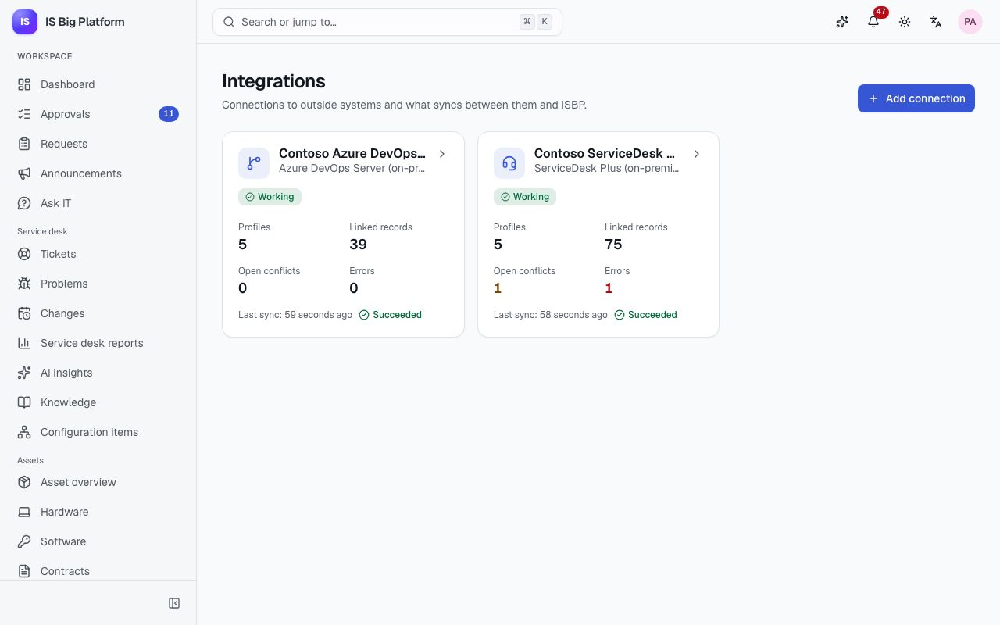
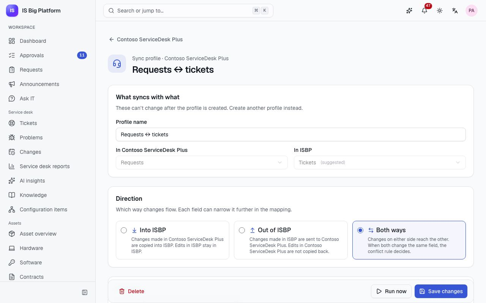
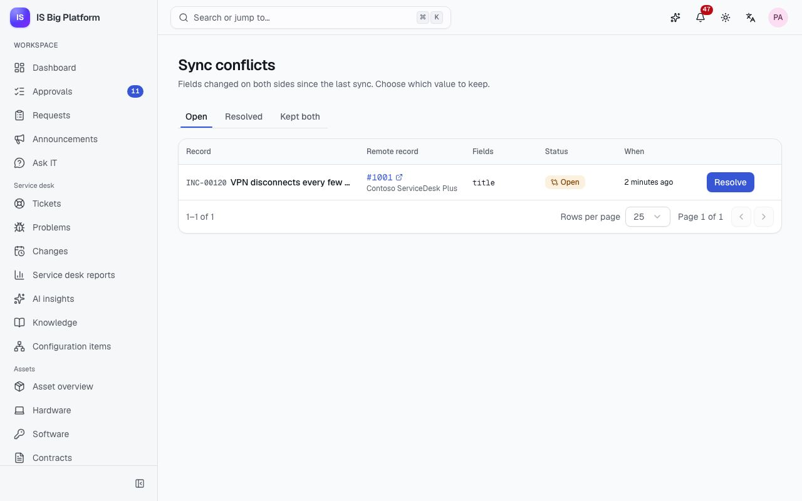

# Integrations guide

This guide is for integration administrators who connect ISBP to the systems we run beside it: ManageEngine
ServiceDesk Plus and Azure DevOps Server, both installed on premises. It also tells service desk agents and project
teams what they see on records that are synced, and where to make a change so it isn't overwritten.

## What you can do here

- Understand [what syncs with what](#what-syncs-with-what) and [where to edit a synced record](#where-to-edit-a-synced-record)
- [Add a connection](#add-a-connection) to a ServiceDesk Plus server or an Azure DevOps Server collection
- [Check a connection's health](#check-a-connections-health) and [set up webhooks](#set-up-webhooks-for-faster-sync)
- [Create a sync profile](#create-a-sync-profile), [map fields and values](#map-fields-and-values) and
  [preview it](#preview-a-profile-before-it-runs)
- [Run a sync and read its log](#run-a-sync-and-read-the-log) and [manage linked records](#manage-linked-records)
- [See what a record is synced with](#see-what-a-record-is-synced-with) on its own page
- [Resolve a sync conflict](#resolve-a-sync-conflict)
- Know [why approvals can't be skipped from outside](#approvals-cant-be-skipped-from-outside) and
  [why deletes are never copied](#deletes-are-never-copied)

## What syncs with what

The Integrations Hub links a kind of record in the other system with a kind of record in ISBP. Each link between two
kinds is a **sync profile**, and each profile has a direction: **Into ISBP**, **Out of ISBP** or **Both ways**.

| Outside system      | Their record                  | ISBP record                                      | Notes                                                                          |
| ------------------- | ----------------------------- | ------------------------------------------------ | ------------------------------------------------------------------------------ |
| ServiceDesk Plus    | Requests                      | Tickets (incidents and service requests)         | Notes sync with ticket comments; internal notes stay internal on both sides    |
| ServiceDesk Plus    | Problems                      | Tickets (type problem)                           |                                                                                |
| ServiceDesk Plus    | Changes                       | Changes                                          | The change status isn't mapped: CAB approval happens in ISBP                   |
| ServiceDesk Plus    | Assets                        | Hardware assets                                  | Matched by serial number; build 15100 or later is required                     |
| ServiceDesk Plus    | Solutions                     | Knowledge articles                               | HTML in ServiceDesk Plus becomes Markdown in ISBP, and back                    |
| Azure DevOps Server | Team projects                 | Projects                                         | Into ISBP only, matched by name                                                |
| Azure DevOps Server | Work items (per team project) | Tasks (in one ISBP project)                      | Parents, states, assignees and comments; Agile, Scrum and Basic processes      |
| Azure DevOps Server | Git repositories              | Repositories (Git status on an application page) | Into ISBP only: default branch, last commit, branches and active pull requests |

People are matched by email address. If someone in the other system has no ISBP account with that email, the field
is left empty and the run log shows a warning. In the demo, the ServiceDesk Plus technicians Kenji Mori and Dana
Whitfield have no ISBP account, so you can see these warnings.

## Where to edit a synced record

When a record is synced one way, the source system owns it. When it's synced both ways, either side can change it,
and the profile's **Conflict rule** decides what happens when both sides change the same field before the next sync.
Edit a record where the table below says, and your change won't be overwritten.

In the demo, the two connections are **Contoso ServiceDesk Plus** and **Contoso Azure DevOps Server**:

| Profile in the demo                       | Direction | When both sides change a field | Where to edit                                                                                         |
| ----------------------------------------- | --------- | ------------------------------ | ----------------------------------------------------------------------------------------------------- |
| Requests ↔ tickets                        | Both ways | Ask a person                   | Either system. Work each ticket in one place to avoid conflicts; conflicts wait in the conflicts list |
| Problems → tickets                        | Into ISBP | ServiceDesk Plus wins          | ServiceDesk Plus                                                                                      |
| Changes → changes                         | Into ISBP | ServiceDesk Plus wins          | The change details in ServiceDesk Plus; approval and status in ISBP                                   |
| Assets ↔ assets                           | Both ways | ServiceDesk Plus wins          | ServiceDesk Plus keeps the asset register; disposal only through ISBP's disposal approval             |
| Solutions → knowledge                     | Into ISBP | ServiceDesk Plus wins          | ServiceDesk Plus                                                                                      |
| Team projects → projects                  | Into ISBP | Azure DevOps wins              | Azure DevOps Server (the profile links existing projects by name; it doesn't create projects)         |
| ERP work items ↔ tasks                    | Both ways | Azure DevOps wins              | Either system; the team plans in Azure DevOps, so its values win when both changed                    |
| Network work items → tasks                | Into ISBP | Azure DevOps wins              | Azure DevOps Server                                                                                   |
| ERP / Network repositories → applications | Into ISBP | Azure DevOps wins              | Azure DevOps Server (the Git status on Finance ERP and Remote Access VPN is read-only in ISBP)        |

With a one-way **Into ISBP** profile, changes you make in ISBP stay in ISBP and are not sent back. They're
overwritten as soon as the other system changes the same field, so make lasting changes in the source system.

> **Tip:** The **Synced with** card on a record's page tells you which system a record is linked to. If you don't
> know which way a profile goes, ask an integration administrator or open the profile (you can read it if you have
> the **Integrations viewer** role).

## Who can do what

| Role                           | What it allows                                                                                                  |
| ------------------------------ | --------------------------------------------------------------------------------------------------------------- |
| **Integrations viewer**        | See connections, sync profiles, runs, linked records and conflicts (never credentials)                          |
| **Integrations administrator** | Add, edit and test connections, set up sync profiles for every syncable record, run syncs and resolve conflicts |

The pages are **Administration → Integrations** and **Administration → Sync conflicts**. If you don't see them, ask
an administrator for one of the roles above. In the demo, IT administrators are integration administrators, and the
service desk, the development team and the PMO are integration viewers.

Creating or changing a profile that writes a kind of record also needs that record's sync permission (for example
"write tickets through integrations"). The **Integrations administrator** role includes them all. This way nobody can
use the hub to write records they couldn't write themselves.

The hub writes synced records as its own identity, **Integrations Hub**, which can only use those sync permissions.
In the audit log and in a record's history, a synced change shows the connection and the remote record it came from.

## Add a connection

You need a connection before anything can sync. Do this once per ServiceDesk Plus server or Azure DevOps Server
collection.

Before you start, get the credentials from the other system's administrator:

- **ServiceDesk Plus:** a dedicated technician (for example `svc-isbp`) whose roles may view and edit only what you
  sync, and that technician's API key with an expiry date. Every change ISBP makes appears in ServiceDesk Plus under
  this technician. Build 15100 or later is required.
- **Azure DevOps Server:** a personal access token of a service account, with the scopes **Work Items: Read &
  write**, **Code: Read** and **Project and Team: Read**. Windows sign-in (NTLM or Kerberos) isn't supported.

1. Go to **Administration → Integrations** and select **Add connection**.
2. Choose **ServiceDesk Plus (on-premises)** or **Azure DevOps Server (on-premises)**.
3. Enter a **Connection name**. It's shown in lists, run logs and on synced records.
4. Fill in the connection settings:
   - ServiceDesk Plus: **Server URL** (the address technicians open, such as `https://sdp.contoso.local:8443`), the
     **Technician API key**, and the **Portal ID** only if the server runs several service desk instances.
   - Azure DevOps Server: the **Collection URL** (such as `https://ado.contoso.local/tfs/DefaultCollection`), the
     **REST API version** that matches your server, and the **Personal access token**.
5. Select **Test connection**. You see "The connection works" and the account it signed in as, or the reason it
   failed.
6. Leave **Enabled** on and select **Add connection**.

**What happens next:** ISBP shows the connection's **Webhook secret** once. Copy it if you plan to
[set up webhooks](#set-up-webhooks-for-faster-sync), then select **I’ve copied it**. The connection page opens.
Nothing syncs until you [create a sync profile](#create-a-sync-profile). Credentials are stored encrypted and are
never shown again; when you edit the connection, leave a credential empty to keep it.

> **Important:** Use `https://` addresses. A server that only answers on plain HTTP (ServiceDesk Plus listens on
> 8080 by default) is refused unless you turn on **Allow insecure HTTP** under **Security**. ISBP asks you to confirm,
> records the change in the audit log as a security event, and shows **Not encrypted** on the connection for as long
> as it's on. With it on, the API key or token and every synced record cross the network unencrypted, where others on
> the network can read or change them. Prefer turning on HTTPS on the server; both products support it.

If the server's certificate comes from our internal certificate authority and the test fails with a certificate
error, ask the ISBP operator to trust that authority (see `docs/deployment.md` §7e).

## Check a connection's health

ISBP tests every connection every 15 minutes and on every sync. Check here first when synced records stop updating.

1. Go to **Administration → Integrations**. Each card shows the connection's health (**Working**, **Failing** or
   **Not checked**), its profiles, linked records, open conflicts, errors and the last sync.
2. Open a connection. The **Overview** tab shows **Health**: status, the message from the last check, **Signed in
   as**, **Last checked** and **Last sync**.
3. Select **Test** to check it now.

**What happens next:** When the other system refuses the credentials (an expired API key or token), the connection
is marked **Failing** and integration administrators get a notification, "The connection … is failing". Renew the
key or token in the other system, select **Edit** on the connection, paste the new value and save.

## Set up webhooks for faster sync

Without webhooks, profiles sync on their schedule (every 15 minutes by default). With webhooks, the other system
tells ISBP which record changed and ISBP reads it within seconds. Polling keeps running as a safety net, so a missed
webhook is caught up on the next scheduled sync.

1. Open the connection. On the **Overview** tab, the **Webhook** card shows the **Webhook URL**. Select **Copy webhook
   URL**.
2. In the other system, create the webhook with the custom header `X-ISBP-Webhook-Secret` set to the connection's
   secret:
   - ServiceDesk Plus: **Admin › Developer Space › Webhooks**, one webhook per module (request, problem or change),
     run by **Admin › Automation › Custom Triggers** when records are created or edited. Assets and solutions have no
     custom triggers, so they sync on the schedule.
   - Azure DevOps Server: in each team project, **Project settings → Service hooks → Create subscription → Web
     Hooks**, one subscription per work item and Git event, with **Resource details to send** set to **Minimal**.
3. The connection's settings form shows the exact steps and payload for each system under its help section.

**What happens next:** ISBP checks the secret on every call and refuses calls without it. A webhook only says which
record changed; ISBP then reads the record through the other system's API, so a forged webhook can't put data into
ISBP. The other system calls ISBP from inside our network, so nothing needs to be published to the internet.

If you lose the secret, select **Rotate secret** on the **Webhook** card. A new secret is shown once, and the old one
stops working, so update the webhook in the other system straight away.

## Create a sync profile

A sync profile says what syncs with what, in which direction, and how fields map. Create one for each kind of record
you want to sync.

1. Open the connection and select the **Sync profiles** tab, then **New sync profile**.
2. Under **What syncs with what**, choose the record **In** the other system, **Where** it lives (for Azure DevOps
   work items and repositories, the team project), and the record **In ISBP** (for tasks, the ISBP project; for
   repositories, the application). The profile name is filled in for you; change it if you like. These choices can't
   change after the profile is created.
3. Under **Direction**, choose **Into ISBP**, **Out of ISBP** or **Both ways**. Each option explains in words which
   edits travel.
4. Under **Records**, decide what happens to records that exist on one side only:
   - **Create records in ISBP**: new records in the other system are created in ISBP.
   - **Create records in** the other system: new ISBP records that pass **Which records to create** are created
     there. Add conditions (for example "Status is not Closed"); with no conditions, every record is created.
   - **Match existing records**: pick a field in ISBP and a field in the other system (for example the serial number
     for assets). Records both sides already have are linked instead of duplicated.
5. Under **Schedule**, set **Minutes between syncs** (0 turns scheduled syncs off; webhooks, **Run now** and
   Scheduled Jobs still work). A profile that only goes **Out of ISBP** pushes changes as soon as they happen.
6. Under **Conflicts and comments**, choose the **Conflict rule**:
   - **Ask a person**: both values stay as they are and the conflict waits in the conflicts list. Other fields still sync.
   - **… wins** (the other system), **ISBP wins** or **Latest change wins**.

   With a one-way profile, the source always wins. Turn on **Sync comments** to copy new comments both ways, each
   once, with their author.

7. Check the **Field mapping** (see [Map fields and values](#map-fields-and-values)), then select
   [**Preview**](#preview-a-profile-before-it-runs).
8. Select **Create profile**.

**What happens next:** The profile syncs on its schedule. The first run reads every record of that kind, so it can
take a while. To start at once, select **Run now**.

> **Tip:** Start with **Into ISBP** and **Ask a person**, check the first runs, then switch to **Both ways** once the
> mappings are right.

## Map fields and values

The **Field mapping** decides which ISBP field matches which field in the other system. ISBP suggests a mapping for
each pair; most of the time you only add the fields that are specific to our installation.

1. In the profile, go to **Field mapping**. Select **Use suggested mapping** to start from the connector's defaults.
2. To add a field, select **Add field**, then pick the **ISBP field** and the **Remote field**. Each row has its own
   direction: **Both ways**, **Into ISBP only** or **Out of ISBP only**. Read-only fields can only flow one way.
3. For choice fields (status, priority, category, …), select **Values** to open the value map. Each row says which ISBP
   value a value from the other system becomes, and back. Values that are the same on both sides need no row. Select
   **Add … values of** the other system to list every value it has.
4. Fix any problem the editor shows under a row, then save.

ISBP converts values for you: HTML becomes Markdown in ISBP and Markdown becomes HTML in the other system, people
match by email, tags become `;`-separated text, and parent work items map through the links ISBP already has.

Several values in the other system can become one ISBP value with **Into ISBP only** rows, and one row says what the
ISBP value becomes when it goes out. In the demo, ServiceDesk Plus "Resolved" comes in as _Resolved_ for incidents,
and an ISBP service request that is _Fulfilled_ goes out as "Resolved".

> **Important:** Categories, groups, vendors and knowledge categories aren't mapped by default, because their ISBP
> values are our own records. Add those mappings yourself if you need them. For Azure DevOps projects that use the
> Scrum or Basic process, edit the value maps for work item types and states (for example _User story_ → Product Backlog
> Item, _Done_ → Done).

## Preview a profile before it runs

A preview is a dry run on the next changes: nothing is written and the sync position doesn't move. Use it after you
change a mapping or a conflict rule.

1. Open the profile and select **Preview** under **Preview**.
2. Read the list. Each record shows what would happen: **Create in ISBP**, **Link existing**, **Update in ISBP**,
   **Update in** the other system, **Create in** the other system, **Conflict**, **No change** or **Deleted on one
   side**, with the fields that would change and their new values.

**What happens next:** If the preview shows "No changes … since the last sync", nothing has changed since the last
run. Fields that can't be converted are listed, so you can fix the value map before the real run.

## Run a sync and read the log

Run a sync by hand after you change a profile, or when someone asks why a record hasn't arrived.

1. Open the connection and select the **Sync profiles** tab. Each profile shows its direction, linked records,
   conflicts, errors, its last run and its schedule.
2. Select **Run now** on the profile. The run opens and its log follows live.
3. To send existing ISBP records to a profile that creates records in the other system, open the profile and select
   **Push existing records to** that system.
4. The **Runs** tab of the connection lists every run with its trigger (**Scheduled**, **Manual**, **Webhook** or
   **Change in ISBP**), status and counts. Filter by status to find failures.

A run's page shows **Counts** (read, created and updated in ISBP, pushed, created remotely, linked, conflicts,
skipped, errors), **Details** and the **Log**.

| Run status                | What it means                                                                                  |
| ------------------------- | ---------------------------------------------------------------------------------------------- |
| **Succeeded**             | Every record was handled                                                                       |
| **Partly failed**         | Some records failed; each is marked **Error** in linked records and is retried on the next run |
| **Failed**                | The run stopped, for example because the credentials were refused                              |
| **Paused (rate limited)** | The other system asked ISBP to slow down; the run continues at the time shown                  |

Only one run of a profile happens at a time. Runs older than 30 days are removed.

> **Tip:** You can also run a profile from **Scheduled jobs** with the **Integration sync** task type, for example at
> a fixed time each night, with the job's retries and failure alerts. See [Data and automation](data-and-automation.md).

## Manage linked records

The **Linked records** tab of a connection lists every ISBP record and the remote record it's linked to, with the
profile and the last sync. Use it to find records in error or deleted on one side.

1. Open the connection and select **Linked records**.
2. Filter with the tabs **All**, **In sync**, **Conflict**, **Error** and **Deleted on one side**, or search by
   reference or title. Select a remote reference to open the record in the other system.
3. With the **Integrations administrator** role, open a row's actions menu:
   - **Sync now** reads and merges this record again.
   - **Link to another record** links the ISBP record to a different remote record (enter its id in the other system,
     not its display reference). It syncs right away.
   - **Unlink** removes the link. Both records are kept; the next sync may link them again (when matching is on) or
     create a new record.

You only see the titles of ISBP records you're allowed to read; others show as "A record you can't see".

## See what a record is synced with

Agents and project teams see a **Synced with** card on ticket, change, asset, project, task, application and knowledge article pages
when the record is linked to another system. Use it to know where the record also lives before you change it.

The card shows the system, the remote reference (select it to open the record there), when it was last synced and its
state: **In sync**, **Conflict**, **Error** or **Deleted on one side**. If the last sync of the record failed, the
card says why. Integration administrators also see **Sync now**.

Anyone who can read the record sees the card. Changes you make in ISBP reach the other system within moments when
the profile syncs both ways; changes there arrive with the next webhook or scheduled sync.

## Resolve a sync conflict

A conflict happens when a profile's rule is **Ask a person** and the same field was changed on both sides, to
different values, since the last sync. Both values stay as they are until someone decides; the record's other fields
keep syncing.

In the demo, one ticket was retitled both in ISBP and in ServiceDesk Plus ("Escalated: VPN drops for the whole
finance floor"), so there's one open conflict to try.

1. Go to **Administration → Sync conflicts** (all connections), or open the connection's **Conflicts** tab.
2. On the **Open** tab, select **Resolve** on the conflict.
3. For each field, compare the **Last synced value** with ISBP's value and the other system's value, and choose
   **Keep ISBP’s value** or **Keep the value from** the other system.
4. Select **Apply**. Or select **Keep both as they are** to leave each side with its own value.

**What happens next:** The chosen values are written to both sides and the link goes back to **In sync**. A resolved
conflict moves to the **Resolved** tab, and one closed with **Keep both as they are** to **Kept both**, with who
decided and when. Resolving needs the **Integrations administrator** role; integration administrators get a
notification for new conflicts (at most one per profile per hour).

## Approvals can't be skipped from outside

A sync writes records with the same rules as the ISBP screens, never with fewer. Nothing that needs an approval in
ISBP can be approved by editing the record in another system:

- A **change** can't move past CAB authorization through a sync. That's why the change status isn't mapped by
  default: the change is approved in ISBP (see [Changes and releases](changes-and-releases.md)).
- An **asset** becomes _Disposed_ only through ISBP's disposal approval. In the demo, an asset that is "Disposed" in
  ServiceDesk Plus shows on the **Error** tab of linked records with the message that assets are disposed of only
  through the disposal approval in ISBP. Start the disposal in ISBP (see [Assets](assets.md)); once it's approved,
  both sides agree.
- A **project** created by a sync starts as _Proposed_, so the project proposal approval still applies.
- **Tickets** and **tasks** only move between statuses the way ISBP allows.

A refused change is recorded on the link and the run, and is retried on the next run.

## Deletes are never copied

When a record is deleted in one system, ISBP never deletes its partner in the other. The link is marked **Deleted on
one side** and shows on the **Linked records** tab. Deleting data in another system is a decision for a person: look
at the remaining record and delete or close it yourself if it should go.

Deleting a sync profile or a connection removes its links, runs and conflicts, but no record in ISBP or in the other
system.

## Fix common problems

| What you see                                              | What to do                                                                                                       |
| --------------------------------------------------------- | ---------------------------------------------------------------------------------------------------------------- |
| The connected system refused the connection's credentials | The API key or token expired or was revoked. Create a new one and paste it into the connection's settings        |
| This connection uses plain HTTP                           | Use an `https://` URL, or turn on **Allow insecure HTTP** only for a server on a trusted network                 |
| The connected system is limiting requests                 | Nothing: the run pauses and continues. On ServiceDesk Plus 14500 or later, its administrator can raise the limit |
| The connected system refused the change                   | Open the run log or the link's error: usually a value the other system doesn't accept. Fix the value map         |
| A sync for this profile is already running                | Wait for the current run to finish                                                                               |
| A person field stays empty                                | The person has no ISBP account with the same email. Check the run log's warning                                  |

## How it connects

- [Service desk guide](service-desk.md): tickets, changes and the knowledge base that requests, problems, changes and
  solutions sync with.
- [Assets](assets.md): the asset register and the disposal approval.
- [Projects](projects.md) and [Changes and releases](changes-and-releases.md): tasks synced with Azure DevOps work
  items, and Git status on applications.
- [Data and automation](data-and-automation.md): running syncs from Scheduled jobs.
- [Assistant and AI](assistant-and-ai.md#what-the-assistant-can-change): the assistant can prepare sync profile
  changes as a change set.
- [Administrators](administrators.md): roles, the audit log and notification settings.
