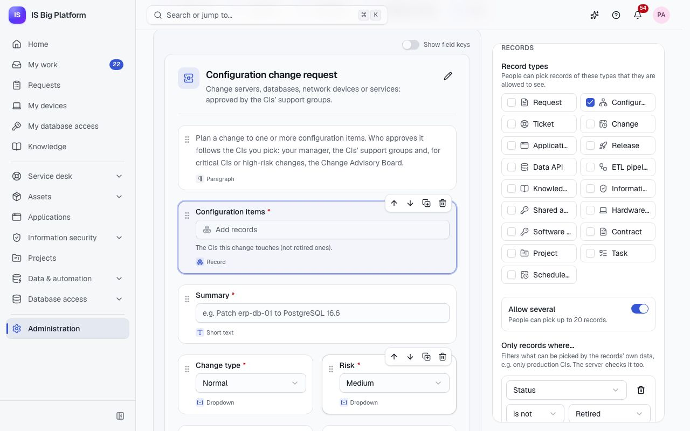
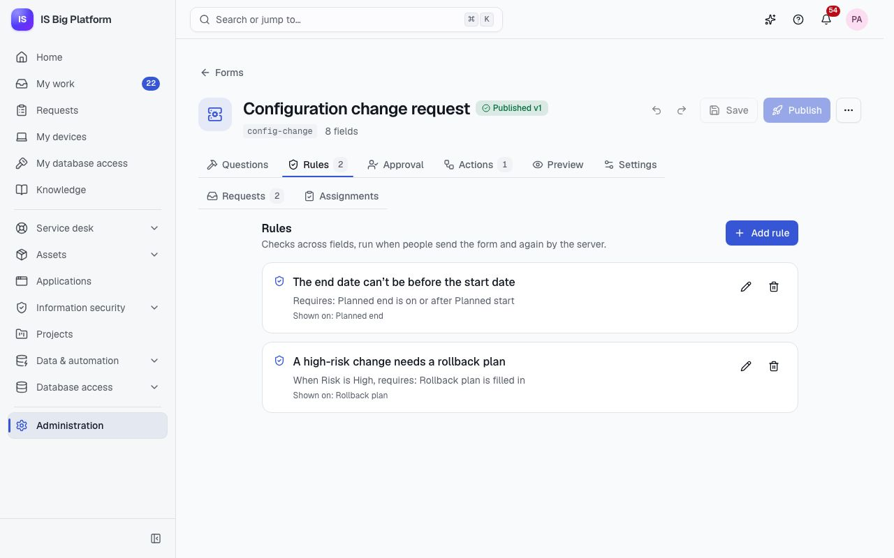
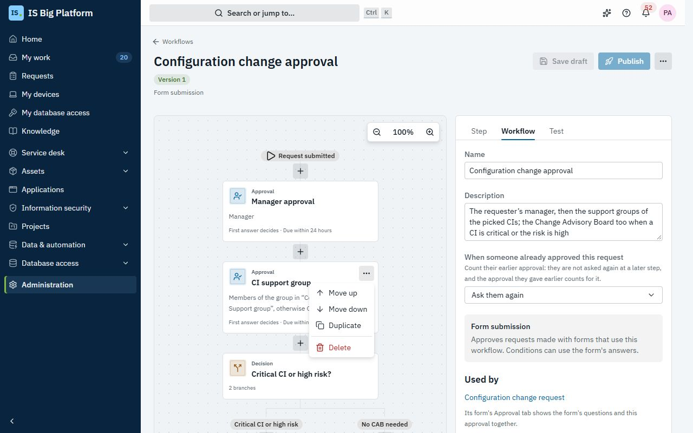
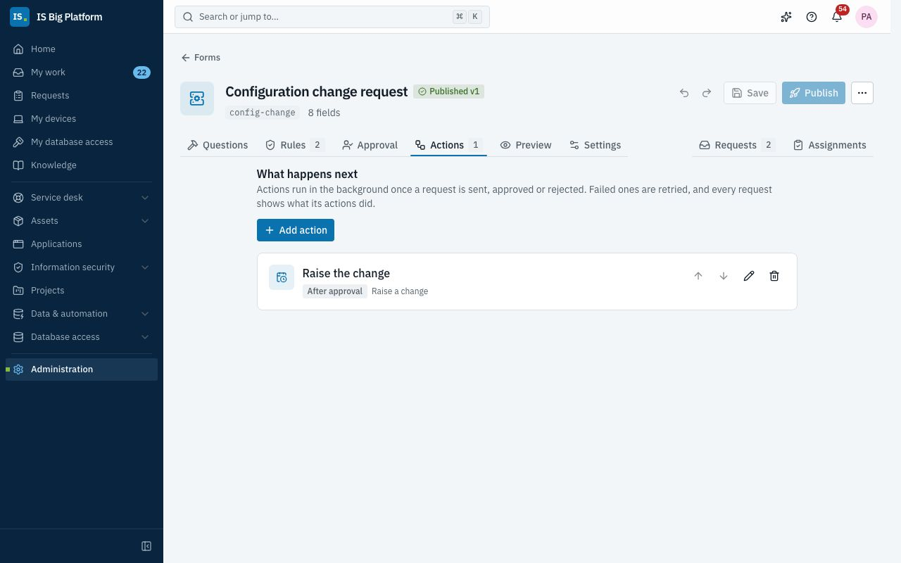
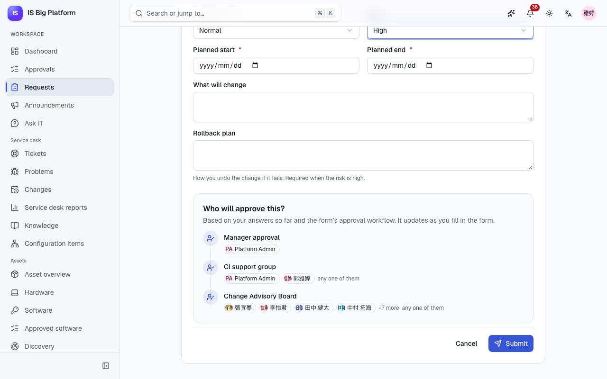
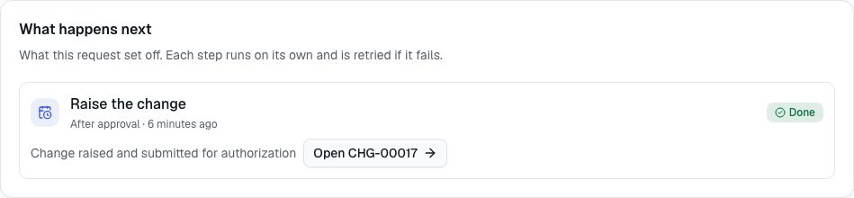

# Build your own process

This guide is for administrators and team leads who turn an IS practice into a self-service process: a
configuration change, a firewall rule, a new virtual server, a software purchase. In ISBP, any such process is a
request form, an approval workflow and the actions that run after the decision. You build all three in one place,
the form builder, or describe the process to the assistant, and then share the form's link.

## What you can do here

- See [how a process fits together](#how-a-process-fits-together) and [plan yours](#plan-the-process)
- Know [what you build yourself and what needs development](#what-you-build-yourself-and-what-needs-development)
- [Build the form](#build-the-form), with [fields that pick CIs, applications or assets](#let-people-pick-records)
  and [rules across fields](#add-rules-across-fields)
- [Choose who approves](#choose-who-approves), [routing on the picked records](#route-on-the-answers-and-the-picked-records)
  and [letting a group named in a record approve](#let-a-group-named-in-a-record-approve)
- [Use custom fields in the built-in approvals](#use-custom-fields-in-built-in-approvals) of changes, disposals and
  project proposals
- [Add actions](#add-actions) that raise a change, grant a role, notify people or call another system
- [Publish the form and share its link](#publish-the-form-and-share-its-link)
- [Build it with the assistant](#build-it-with-the-assistant) instead
- Know [what requesters see](#what-requesters-see) and [follow what the actions did](#follow-what-the-actions-did)
- [Walk through the demo's configuration change request](#walk-through-the-demo-configuration-change-request)
- [Fix common problems](#fix-common-problems)

## How a process fits together

Every process has the same three parts, and one link people use to start it.

| Part                  | What it does                                                                                                                    | Where you build it                            |
| --------------------- | ------------------------------------------------------------------------------------------------------------------------------- | --------------------------------------------- |
| The form              | Asks what you need to know: text, dates, choices, people, and records such as CIs or applications. Rules check answers together | **Administration → Forms**                    |
| The approval workflow | Decides who approves, in which order and by when, from the answers and from the data of the picked records                      | The form's **Approval** tab                   |
| The actions           | Do the work after the request is sent, approved or rejected: raise a change, grant a role, notify people, call another system   | The form's **Actions** tab                    |
| The link              | `/requests/forms/<key>` opens the form; the form is also a card under **Requests → What do you need?**                          | The form's **Key**, chosen when you create it |

Each request keeps the version of the form (with its actions) and of the workflow it started with, so you can
improve a process without disturbing requests already under way. And a process keeps the platform's rules: people
only pick records they may see, an action can only do what its own area allows, and an action never skips an
approval that another area requires, such as the CAB for changes.

To build forms and workflows you need the **Workflow administrator** role (a **Platform administrator** can do
everything). Some actions need another role as well: see [What each action does](#what-each-action-does).

### What you build yourself and what needs development

A process is **configuration**: you build it on the admin pages or with the assistant, and nobody writes code for it.
You build it from **building blocks** ISBP already has: the field types, rules, approval options, actions and
reminders in this guide, and forms assigned on a schedule (see
[Ask people to fill in a form by a date](administrators.md#ask-people-to-fill-in-a-form-by-a-date)). Most IS processes
need nothing else.

| Term            | What it is                                                                                                                                                        | Who makes it                                                                                                              |
| --------------- | ----------------------------------------------------------------------------------------------------------------------------------------------------------------- | ------------------------------------------------------------------------------------------------------------------------- |
| Process         | A form, its approval workflow and its actions. Recurring work also has a scheduled job that assigns the form                                                      | Workflow administrators, on the admin pages or with the assistant                                                         |
| Process pack    | Several processes and what they need (groups, categories, schedules), installed together as one change set                                                        | Comes with a module (such as the ISMS process pack) or as a package file; installed from **Administration → Change sets** |
| Building block  | Something every process can use: a field type, a rule, an approval option, an action                                                                              | The platform team, in code                                                                                                |
| Record type     | A kind of thing we keep and look after over time, with its own pages, states and rules: a ticket, an asset, an account review                                     | The platform team, as a module                                                                                            |
| Connector       | How ISBP reaches another system, such as ServiceDesk Plus or Azure DevOps Server                                                                                  | The platform team, as a module                                                                                            |
| Outside control | A control another system enforces, such as a firewall rule or disk encryption. ISBP keeps the request that asked for it and the checks that confirm it's in place | The team that runs that system                                                                                            |

When a process can't be built, the missing piece is a building block, a record type or a connector. Ask the platform
team for that piece rather than for the whole process: they add it so that any process can use it, and you still build
the process yourself, as configuration.

## Plan the process

Plan on paper first: each answer becomes one part of the process.

1. **What must the requester tell you?** List the questions and mark the required ones. These are the form's
   fields.
2. **Which of our records is it about?** Configuration items, applications, assets, tickets… These become record
   fields, so the answer is the real record, not a name someone types.
3. **Which answers must agree?** For example, the end date can't be before the start date. These are rules.
4. **Who approves, and when?** The requester's manager, the team that supports the system, the CAB when something
   critical is involved. This is the approval workflow.
5. **What happens after approval, and after rejection?** Which record should exist at the end, and who is told?
   These are the actions.
6. **Who may use the form?** Everyone, or some groups only. This is the form's **Audience**.

In the demo, the **Configuration change request** answers these questions for changes to our configuration items:
see [the walkthrough](#walk-through-the-demo-configuration-change-request).

## Build the form

Start with the questions; you add the approval and the actions to the same form afterwards.

1. Go to **Administration → Forms** and select **New form**. Enter a **Name** and a **Key**. Under **More details**,
   choose an **Icon** and pick a **Category** (or type a new one and select **Add “…” as a new category**). Select
   **Create and open builder**. The key is the end of the form's link (`/requests/forms/<key>`) and can't be changed later.
2. On **Questions**, drag fields from **Add elements** onto the form, or click one to add it: **Short text**, **Long
   text**, **Number**, **Checkbox**, **Date**, **Dropdown**, **Multiple choice**, **Email**, **Link**, **Person** and
   **Record**.
3. Select a field to set its **Label** (in English, 繁體中文 and 日本語), **Required** and its own options (choices,
   record types). The rest, such as help text, width, a **Format** for the answer and **Show this field only
   when…** for questions that only apply sometimes, is under **More options**. The field's **Key** is made from the
   English label; you only need it for webhooks and exports, under **Advanced**. **Show field keys** shows the keys on
   the canvas.
4. Add [record fields](#let-people-pick-records) and [rules](#add-rules-across-fields) as needed, and try the form on
   **Preview**.
5. Select **Save**.

**What happens next:** the draft is saved; nobody sees it until you [publish it](#publish-the-form-and-share-its-link).
The builder's other tabs are covered in [Build a request form](administrators.md#build-a-request-form).

### Let people pick records

Use a **Record** field when the request is about something ISBP already knows: the configuration items a change
touches, the application someone needs access to, the laptop to replace. The answer links to the real record, so
approvers can open it, the workflow can route on its data, and actions can use it, for example to link a change to
the picked CIs.

1. On **Questions**, add a **Record** field and give it a label, for example "Configuration items".
2. Select the field. Under **Records**, tick the **Record types** people can pick, for example **Configuration
   item**.
3. Turn on **Allow several** to let people pick up to 20 records.
4. Optionally, under **Only records where…**, narrow the choice by the records' own data, for example
   **Environment** **is** **Production**. The server checks it too.

**Who can pick what.**

- People can only pick records they are allowed to see. Picking configuration items needs the **CMDB viewer** role
  (in the demo, the service desk, network, security and DBA teams have it), applications need **Applications
  viewer**, hardware assets **Asset viewer** and tickets **Service desk agent**. Published self-service knowledge
  articles are readable by everyone. Offer a record field only to people who can see those records: set the
  form's **Audience** on its **Settings** tab.
- Each picked record is checked again when the request is sent. A record the person can't see, or one outside
  **Only records where…**, is refused with "Choose a record you can see that this field accepts".
- Approvers see the picked records they may see as links; the others are counted ("1 record you can't see"), never
  named.
- In the builder, you can only offer record types you can see yourself. Types already on a field stay when someone
  else edits the form.

The same **Record** type works for custom fields in **Administration → Custom fields**, for example an "Affected
application" field on tickets.

**The data you can filter and route on.** Each record type brings its own data. You use it in **Only records
where…**, in the workflow's conditions and approvers, and in the actions' text.

| Record type            | Data                                                                                                                                                                                                                                          |
| ---------------------- | --------------------------------------------------------------------------------------------------------------------------------------------------------------------------------------------------------------------------------------------- |
| **Configuration item** | **Class**, **Environment**, **Criticality**, **Status**, **Owner** (a person), **Support group** (a group), **Department code**, **Business services (CI numbers)**, **Tags**                                                                 |
| **Application**        | **Application code**, **Stage**, **Criticality**, **Hosting**, **Data classification**, **Disposition (TIME)**, **Technical owner** and **Business owner** (people), **Delivery team** and **Support group** (groups), **Department code**    |
| **Hardware asset**     | **Category**, **Status**, **Stores data**, **Assigned to** (a person), **Department code**, **Location**, **Warranty end**                                                                                                                    |
| **Software licence**   | **Product**, **Publisher**, **Licence type**, **Billing**, **Compliance**, **Entitlements**, **Cost**, **End date**                                                                                                                           |
| **Ticket**             | **Ticket type**, **Status**, **Priority (1 = highest)**, **Impact (1 = high)**, **Urgency (1 = high)**, **Major incident**, **Category key**, **Assignment group** (a group), **Assigned to** and **Requester** (people), **Department code** |
| **Change**             | Those of a ticket, plus **Change type**, **Risk**, **Planned start** and **Planned end**                                                                                                                                                      |
| **Project**            | **Project key**, **Status**, **Priority**, **Health**, **Visibility**, **Project manager** (a person), **Department code**, **Planned effort (hours)**, **Start date**, **Target date**                                                       |
| **Knowledge article**  | **Audience**, **Category key**, **Status**, **Language**, **Owner** (a person), **Tags**                                                                                                                                                      |

**Release**, **Contract**, **Task**, **Data API**, **ETL pipeline** and **Scheduled job** can be picked too, but have
no data to filter or route on.

> **Note:** A record's data never holds anything the record's own readers couldn't see on its page. The approval uses
> the data as it was when the request was sent: if a CI's support group changes later, a request already sent keeps
> the group it had.

### Add rules across fields

A field's own checks look at one answer. Rules look at several: the end can't be before the start, a high-risk
change needs a rollback plan. They're checked when people select **Submit**, again as they correct their answers,
and once more on the server, so a request that breaks a rule can't be sent.

1. Open the **Rules** tab and select **Add rule**.
2. Under **When (optional)**, select **Add condition** if the rule only applies sometimes; leave it empty to always
   check.
3. Under **Require**, select **Add condition** and add what must be true: choose the **Field**, the **Operator** and a
   **Value**. To compare two answers, select **Compare with another field** and choose the **Other field**; for a date,
   **Today** compares with the day the request is sent. A rule can't be saved without a complete **Require**.
4. Write the **Message** people see when the rule isn't met, in each language.
5. Under **Show the message on**, tick the fields to fix. With none ticked, the message shows above the form.
6. Select **Add rule**, then **Save**.

The demo's **Configuration change request** has two rules:

| Message                                     | When (optional)          | Require                                                                               | Show the message on |
| ------------------------------------------- | ------------------------ | ------------------------------------------------------------------------------------- | ------------------- |
| The end date can’t be before the start date | —                        | **Planned end** **is on or after**, **Compare with another field**: **Planned start** | **Planned end**     |
| A high-risk change needs a rollback plan    | **Risk** **is** **High** | **Rollback plan** **is filled in**                                                    | **Rollback plan**   |

**What happens next:** the rule is part of the draft and goes live when you publish. People see its message only
once the fields' own checks pass (required fields filled in, valid dates).

> **Tip:** Dates compare by day, so **is on or after** allows the same day. A comparison with an empty answer is never
> met: if one of the dates is optional, add **When** "**Planned start** **is filled in**" (and the same for the end)
> so the rule only checks when both are given.

> **Tip:** A date condition can add or take away days: type them in the **days** box next to the value, for example
> **Planned end** **is on or before** **Planned start** + `366` days ("at most a year"). With **Today** next to the
> value box, **Planned start** **is on or after** **Today** refuses a start in the past.

### Collect several rows in a table

Some forms need a list: firewall rule lines, the accounts to create, the items to back up. Add a **Table** field
instead of a fixed number of questions.

1. From the field palette, add **Table**.
2. Under **Table**, set the **Columns**: select **Add column**, then open a column to give it a label and a type
   (**Text**, **Number**, **Date**, **Dropdown**, **Person**, **Record**, and so on). Use the arrows to reorder them.
3. Optionally set **Fewest rows** and **Most rows** (at most 50). **Required** means at least one row.
4. Select **Save**.

People add rows with **Add row**, and move or remove them with the buttons at the end of each row; on a phone each
row is a card. A row left completely empty is ignored. Each cell is checked like a field of its own, and its message
shows under the cell. The request page and the print view show the answer as a table.

Conditions can read a column across all rows: **Firewall rules › Port** **is** `22` holds when any row has port 22 —
in **Show this field only when…**, in rules, in the approval workflow and in **Only when…** of an action.

## Choose who approves

The approval decides who approves each request. You build it on the form's own **Approval** tab, next to the
questions, so it can use the answers and the data of the picked records straight away.

1. In the form builder, open the **Approval** tab and select **Set up an approval**. A first step is ready: **Manager
   approval**, the requester's manager, or their department head when they have none.
2. Change it or add steps with **Add a step here** on the canvas: **Approval**, **Decision**, **In parallel** or
   **Notification**. Select a step to set it up on **Step**: who approves, and, under the collapsed sections, **Fields
   the approver fills in**, **Deadline**, **Options** and **Condition**. A new approval step is named after its
   approver ("Manager approval", "Application: Business owner approval"); rename it if you like. Each option is
   described in [Design an approval workflow](administrators.md#design-an-approval-workflow).
3. Try it on **Test**: under **Try as**, choose a person to fill in their department and job title, enter example
   answers, choose how each approval goes and select **Run test**.
4. Select **Save** to keep your work, and **Publish** when the whole process is ready: one **Publish** puts the
   approval and the form live together.

To use an approval you already have, choose it under **Approval used**; choose **No approval** to let requests go
ahead as soon as they're sent. **Open in the workflow designer** opens the same approval on its own page, with its
versions and the forms that use it. When another form uses the same approval, the tab says so: your changes apply to
it too.

**What happens next:** new requests of the form go through the approval once you publish. **Administration →
Workflows** lists it under **Approvals for forms**, with the forms that use it; the built-in approvals of access,
changes and other areas are listed there under **Built-in approvals**.

### Ask approvers to fill in fields

Paper forms often have a part "filled in by IS": an evaluation result, handling notes, a completion date, the date a
device was wiped. An approval step can ask its approver for the same.

1. Select the approval step and go to **Fields the approver fills in**.
2. Select **Add field**, choose its type and set it up as on a form (label, required, options, a condition on the
   step's other fields). Select **Save field**. A step can ask for up to 20 fields.
3. If some fields are required, choose when under **Required fields must be filled in**: **To approve**, or **To
   approve and to reject**.

**What happens next:** approvers see the fields under **To fill in** when they approve or reject, and can't approve
until the required ones are valid. The values are shown on the request under **Filled in by approvers** and in its
history. Later steps can use them: in a later step's condition, the fields appear as "Step: Field" (for example "IS
review: Result is Needs the CAB"), and **Test** lets you try them. In an action's text settings, type
`{{steps.<step id>.<field key>}}` to use a value (the step id and key are shown under each field).

### Route on the answers and the picked records

On the form's **Approval** tab, the **Field** lists in conditions (a **Decision** step, or **Only run this step in some
cases** under **Condition**) include the form's answers and the data of the picked records, named "field: data", for
example **Configuration items: Criticality** or **Configuration items: Environment**.

- For a field that picks several records, a condition such as **Configuration items: Criticality** **is**
  **Critical** is met when any of the picked records is critical.
- Combine conditions with **Match** **any condition** for "or": the CAB approves when a picked CI is critical, or when
  the **Risk** answer is **High**.
- On the **Test** tab, enter example **Request values**, including the picked records' data, and select **Run test**
  to see which steps run. The form's **Preview** tab shows the same with real people: answer the questions and read
  **Who will approve this?**.

### Let a group named in a record approve

Often the right approver is the team that looks after the system the request is about: the support group of a CI, the
delivery team of an application. **Group in a field** takes that group from the picked record, so one workflow
serves every CI.

1. On the form's **Approval** tab, select an approval step on the canvas, then **Add approver** on the **Step** tab.
2. Under **Approver type**, choose **Group in a field**, then the field that holds the group, for example
   **Configuration items: Support group**.
3. Decide what happens when a record has no group: add a fallback with **If nobody is found, ask** (in the demo,
   the **IS Administrators** group), or set **If no approver is found** to **Skip this step**. Otherwise the request
   is rejected at that step, and **Before you publish** reminds you.

**What happens next:** the canvas shows the approver as "Members of the group in “Configuration items: Support
group”". Any member of the group can approve. With several CIs, the members of all their support groups are asked,
and one answer from any of them counts for the step.

Groups you can take from a record: a CI's **Support group**, an application's **Delivery team** or **Support
group**, and a ticket's **Assignment group**. **Person in a field** works the same way for a person, such as a CI's
**Owner**, an application's **Technical owner** or **Business owner**, or a project's **Project manager**.

> **Tip:** If **Group in a field** says no field holds a group yet, add a record field to the form first (for example
> configuration items, whose support group is a group). In the workflow designer, choose the form under **Use the
> fields of** on the **Workflow** tab.

### Use custom fields in built-in approvals

Some approvals are started by an area of ISBP rather than by a form: **Change authorization** (the CAB),
**Asset disposal** and **Project proposal**. Their workflows can also use the custom fields of the record they
approve.

1. In **Administration → Custom fields**, add the field to **Tickets** (for changes), **Hardware assets** (for
   disposals) or **Projects** (for proposals), for example a **Record** field "Business application" that picks an
   **Application**.
2. Open the approval's workflow in **Administration → Workflows**. The **Field** lists now include the custom field
   and, for a record field, the picked record's data, for example **Business application: Criticality**.
3. Use it in a condition or an approver as above, then publish.

**What happens next:** changes, disposals and proposals submitted from then on route on the custom field too. These
approvals can be adjusted but never turned off.

## Add actions

Actions do the work once a request is sent or decided, so nobody has to copy answers into another screen: raise
the change, grant the role, tell the team. They run in the background, are retried if they fail, and each request shows
what they did.

1. Open the form's **Actions** tab and select **Add action**.
2. In **Add an action**, choose what the form should do. Only the actions you may add are listed; a note below says
   how many more need a permission you don't have.
3. Under **When it runs**, choose **When the request is sent**, **After approval** or **After rejection**.
4. Optionally enter a **Name (optional)**: it's shown on the request instead of the action's own name.
5. Fill in the **Settings**. In text fields, use **Insert value** to add answers and request details
   ([details](#fill-in-text-with-insert-value)).
6. Select **Add action**. Add more actions if needed, then select **Save** and **Publish**.

**What happens next:** the actions are part of the form version you publish. Requests sent before keep the actions
of their own version; requests sent from now on run the new ones. A form without an approval workflow runs its
**After approval** actions as soon as a request is sent, and never runs **After rejection** ones. A withdrawn request
runs nothing.

### What each action does

| Action                         | What it does                                                                                                                                                                                                                                                                                                                                                                                                                         | Who can add it                 |
| ------------------------------ | ------------------------------------------------------------------------------------------------------------------------------------------------------------------------------------------------------------------------------------------------------------------------------------------------------------------------------------------------------------------------------------------------------------------------------------ | ------------------------------ |
| **Raise a change**             | Raises a change with your **Title**, **Description**, **Change type** (or **Take the change type from this answer**), **Risk** (or **Take the risk from this answer**), **Category**, **Assignment group** and **Back-out plan**, linked to the CIs of a CI field (**Affected CIs from**), with the window from two date fields (**Planned start from**, **Planned end from**). **Submit for authorization** starts its CAB approval | **Change manager**             |
| **Raise a ticket**             | Raises an incident or a service request for the requester, with your **Type**, **Priority**, **Title**, **Description**, **Category** and **Assignment group**                                                                                                                                                                                                                                                                       | **Service desk administrator** |
| **Update configuration items** | Sets the **Status**, **Environment**, **Criticality**, **Support group** or custom fields of the CIs picked in a CI field (**CIs from**), for example **Maintenance** once a change is approved                                                                                                                                                                                                                                      | **CMDB manager**               |
| **Run a scheduled job**        | Runs one scheduled job now, as if someone selected **Run now**, with the job's own configuration, retries and alerts; the request links to the run                                                                                                                                                                                                                                                                                   | **Scheduled jobs operator**    |
| **Grant a role**               | Gives the requester, or the person picked in a **Person** field, a role of the platform or of a registered application (VPN, Active Directory, server access) for **For how many days** (empty: permanently)                                                                                                                                                                                                                         | **Identity administrator**     |
| **Send a reminder**            | Reminds the requester, people named in **Person** fields, members of groups or people with roles on a **Date** taken from an answer, from a field an approver fills in, or from the day of the outcome, a number of **Days after the date** (negative: before)                                                                                                                                                                       | **Workflow administrator**     |
| **Notify people**              | Sends your **Title** and **Message** to the requester, the people named in **Person** fields, one more person, or the members of groups                                                                                                                                                                                                                                                                                              | **Workflow administrator**     |
| **Call a webhook**             | Posts a **JSON body** about the request to another system over HTTPS, with an optional secret header                                                                                                                                                                                                                                                                                                                                 | **Workflow administrator**     |

Roles holding more, such as **Service desk administrator** for changes or **Platform administrator** for
everything, can add them too.

- **Raise a change** creates the change in the form's name, with the person who sent the request as its requester.
  The change shows **From request REQ-… · <form name>**, and the picked CIs list it.
- **Take the risk from this answer** and **Take the change type from this answer** use a **Dropdown** answer whose
  stored values are `low`, `medium` or `high`, and `normal` or `emergency`, as in the demo. Any other answer falls back
  to the **Risk** and **Change type** you set: a requester can never ask for a pre-approved standard change.
- To submit the change for authorization, the action needs **Planned start from** and **Planned end from**. Date
  answers have no time of day, so the window runs from midnight UTC (08:00 in Taipei) on the start day to midnight
  UTC on the end day.
- **Grant a role** offers only roles people may request, or roles you could assign yourself. For a requestable role
  you couldn't assign yourself, the number of days must be within the role's longest grant. If the person already has
  the role, the grant is kept or extended, never shortened.
- **Notify people** sends the notification type "Messages sent by forms", in the app and by email unless the
  recipient turned it off.
- **Grant a role** lists an application's roles as **Application · Role**. Besides requestable ones, it offers the
  roles of applications whose access you manage. The request links to the application.
- **Send a reminder** goes out at 9:00 in the requester's time zone on its day (for example 30 days before a rule's
  **Until** date: **Days after the date** `-30`). With **Only if that day is still to come**, a date already passed
  sets nothing. Groups and roles are looked up when the reminder goes out. Withdrawing the request cancels its
  reminders; the request page lists them under **Reminders**.

### Run an action only in some cases

Under **Only when…** in an action's settings, add conditions on the answers (table columns included), the records'
data, what approvers filled in, the requester's department or job title, or **Today**. Without conditions ("No
conditions: runs for every request.") the action
always runs. For example, "grant the VPN role **Only when** **Access** **is** **VPN**". When the conditions don't hold
for a request, the action shows as **Skipped** with "Not needed for this request: its condition didn't hold."; it
can't be retried.

### When actions run

| When it runs                 | The action runs                                                                     |
| ---------------------------- | ----------------------------------------------------------------------------------- |
| **When the request is sent** | Right after the request is sent, whether or not it needs approval                   |
| **After approval**           | When the workflow approves the request (or right away, if the form has no workflow) |
| **After rejection**          | When the workflow rejects the request                                               |

Actions run in the background a few moments after the request is sent or decided, one after another in the order
listed on the **Actions** tab: each starts when the one before it has finished (including its retries). One failing
doesn't stop the others; the next one still runs.

### Fill in text with "Insert value"

Text settings, such as a change's **Title** or a notification's **Message**, can include values from the request.
Select **Insert value** next to the field and choose one:

- **Answers**: each answer as people read it: the choice's label, the person's name, the picked records' names.
- **Picked records**: the name and the data of the records picked in record fields, such as **Application: Name** or
  **Configuration items: Criticality**.
- **Request**: **Request number**, **Link to the request**, **Form name**, **Requester's name**, **Requester's
  email** and **Approver's name**.

Inserted values show as chips with their label, and an example under the setting shows what the text will look like,
for example "e.g. REQ-01042 Buy Figma". The values are filled in when the action runs; a value the request doesn't
have stays empty. Values only fill text: choices, people, numbers and URLs are used exactly as you set them.

### Actions never skip another approval

An action can only do what its own area of ISBP allows, and it never approves anything on someone's behalf. A change
raised by **Raise a change** goes through **Change authorization** like any other: the change manager, and the CAB
when its risk is high or it touches a critical CI. The form's approval decides whether the change is raised; the CAB
still decides whether it goes ahead. (With the **Change type** setting **Standard**, the change is handled like any
standard change: the default workflow schedules it without approval. Keep **Normal** unless the work is pre-approved
anyway.) **Grant a role** keeps the role's limits, and **Update configuration items**
follows the CMDB's own rules.

Every action is recorded in the audit log as done by the form (`form:<key>`), with the request, the requester and
the approver.

### Keep webhook secrets safe

**Call a webhook** posts to another system, so its target is controlled:

- The **URL** must be HTTPS, to a host listed in the setting **Webhook hosts for forms** (**Administration →
  Modules → Core platform → Settings**, for a **Module administrator**). The list may include internal hosts. With an
  empty list, no form can call a webhook.
- Put a token in **Header value (secret)**, with its **Header name** (by default `Authorization`). The value is stored
  encrypted and never shown again; leave it empty when you edit the action to keep it.
- The **JSON body** must be valid JSON; values you insert are escaped for you.

## Publish the form and share its link

When the questions, rules, approval and actions are ready, publish the process.

1. On **Settings**, check the **Audience** (**Everyone** or **Specific groups**) and that **Accepting requests** is
   on.
2. Select **Publish**. If **Publish** is unavailable, its hint says why, for example that a question or an approval
   step still has a problem.
3. Read **Before you publish**. It warns about what would stop the process working for the people who use it, with a
   fix next to each warning:
   - a record field whose records part of the audience can't see, so they'd find nothing to pick (**Limit the
     audience** or **Choose another record type**);
   - an approver taken from a field with nothing to fall back on, so an empty field rejects every request (**Add a
     fallback** or **Skip the step instead**);
   - an approver group without active members, or a role nobody holds.
4. Select **Publish** (or **Publish anyway**). The approval is published first, then the form.
5. In the bar that appears, select **Copy link**, or **Open in the portal**. The link is `/requests/forms/<key>` on our
   ISBP address, for example `/requests/forms/config-change` in the demo. Share it in a knowledge article, an
   announcement, a team channel or an email.

**What happens next:** the form appears under **Requests → What do you need?** for its audience, grouped by its
category, and the link opens it directly. People outside the audience see "This form isn't available". Requests made
with the form are listed on its **Requests** tab. Publishing again creates a new version; requests already sent keep
theirs.

## Build it with the assistant

Instead of building each part by hand, describe the process to the assistant. It prepares the approval workflow and
the form, with its record fields, rules and actions, as one change set that you review and apply: nothing is live
before that. You need the **Assistant user** role and, to apply the change set, the roles that building it by hand
would need (including each action's own role).

1. Open the assistant (the sparkles button in the header).
2. Describe the process in a sentence or two, for example: "A configuration change request: people pick the CIs and
   give a summary, the risk and the planned window. The requester's manager approves, then the CIs' support group,
   and the CAB too when a CI is critical or the risk is high. When it's approved, raise a change for the CIs and
   submit it for authorization."
3. The assistant looks up the record types, groups and actions it may use, proposes the workflow and the form, and
   checks that they can be applied (**Ready to apply**). The panel shows a **Change set** card; select **Review and
   apply**.
4. Review the change set: each process is one group, with a sentence saying what it creates (the questions, who
   approves and what happens after). Previews show the workflow diagram (select **Try it** to run it) and the form as
   people will see it.
5. Select **Apply**, or ask the assistant to apply it and confirm on its card. If you can't apply it yourself,
   select **Request review**.

**What happens next:** applying publishes the workflow and the form. The change set page then shows **Ready to use**
with **Open the form**, the form's own link, so you can share it straight away. When you apply it from the
assistant's card, or a reviewer applies it, the assistant also posts the link in the conversation that prepared it
(**Ready to use:**). Change sets in detail:
[Assistant and AI](assistant-and-ai.md#change-configuration-with-a-change-set).

**Without a chat model**, use the **Request process** guided template. It asks for the **Form name**, a **Category**,
**Who can use the form**, the **Records people pick** (for example an application) and up to three more questions, and
who approves, in order: **The requester's manager approves first**, **Then the person named in the picked record
approves** (for example the application's business owner), **Then the group responsible for the picked records
approves** and **Then a group approves**. Under **When a request is approved**, choose **Raise a change**, **Raise a
ticket** or **Notify a group**. Select **Prepare for review**: the form and its workflow go into one change set; add
rules or more actions afterwards in the form builder. See [Use a guided template](assistant-and-ai.md#use-a-guided-template).

## What requesters see

People fill in the form from **Requests**, or from the link you shared. The process shows itself as they go:

- **Record pickers.** A record field opens a search (**Search by reference or title…**) that only lists records they
  may see and the form accepts.
- **Who will approve this?** Below the questions, a form with an approval shows each approval step and the people it
  would ask, based on the answers so far. It updates as they type: picking a critical CI adds the CAB, for example.
  Steps that don't apply to the answers are marked **Skipped for this request** or left out; **Nobody can approve
  this step — the request would be rejected** means they should stop and ask the service desk.
- **Rule messages.** When **Submit** is selected and a rule isn't met, its message shows on the fields to fix, or
  above the form under **Please check the form**.
- **The request page.** After sending, the request shows its **Answers**, its **Approval path** and, once actions run,
  **What happens next**.

People never see the form's actions before they send it, and they never see an action's error: only its status and
its result. More for requesters:
[Request equipment or software with a form](employees.md#request-equipment-or-software-with-a-form).

## Follow what the actions did

Each request page has a **What happens next** card once its actions have started. Use it to answer "did the change
get raised?" without asking anyone.

1. Open the request from **My requests**, from the form's **Requests** tab, or from the notification.
2. Under **What happens next**, read each action: its name, when it ran (**When sent**, **After approval** or **After
   rejection**) and its status: **Waiting**, **Running**, **Done**, **Failed** or **Skipped**. A status such as
   **Retrying (attempt 2)** means an earlier attempt failed and it will try again.
3. A finished action shows what it did, such as **Change raised and submitted for authorization**, and a button to
   open it (**Open CHG-…**).

**What happens next:** the first action that produced a record (a change, a ticket, a job run) becomes the request's
fulfilment: **My requests** shows its reference next to the request's, and the request page shows **Fulfilled** with
a link to it. A form that the service desk also fulfils through the service catalog shows the service desk ticket
instead.

**When an action fails.** An action that hits a temporary problem (a timeout, the other system unavailable) is tried
three times in all, a little longer apart each time. One that is refused (for example, the planned window starts in
the past, or the webhook host isn't allowed) fails at once. Either way, the people who maintain the form (who created
it, last edited it or published that version) get a notification "An action of REQ-… failed: …".

1. Open the request. With the **Workflow administrator** role, you see the **Error:** under the action.
2. Fix the cause, for example add the host to **Webhook hosts for forms**, or fix the job.
3. Select **Retry**. The action runs again with a fresh set of attempts.

An action whose area of ISBP is turned off in **Administration → Modules** is **Skipped**; retry it once the module
is back on.

## Print a request

For audit evidence, select **Print** on a request page. The print view lists the form and its version, the requester
and the dates, every answer (tables included), each approval decision with the approver, time, comment and what they
filled in, the actions and their results, the reminders and the attachments. It is always light, whatever your theme;
select **Print** to print it or save it as a PDF.

## Walk through the demo: configuration change request

The demo includes a complete process built from the parts in this guide: the **Configuration change request** form
(key `config-change`, category **Changes**), its **Configuration change approval** workflow and a **Raise a change**
action. Open them side by side to see how the parts fit.

**The form** (**Administration → Forms → Configuration change request**):

- **Configuration items** is a required **Record** field for configuration items, with **Allow several** on and
  **Only records where…** **Status** **is not** **Retired**.
- **Summary**, **Change type** (**Normal** or **Emergency**), **Risk** (**Low**, **Medium** or **High**), **Planned
  start**, **Planned end**, **What will change** and **Rollback plan** complete the questions.
- Two rules: "The end date can’t be before the start date" (on **Planned end**) and "A high-risk change needs a
  rollback plan" (when **Risk** is **High**, on **Rollback plan**).
- Its **Audience** is limited to the groups that can see CIs (**IS Administrators**, **Service Desk**, **Network
  Team**, **Security Team** and **DBA Team**), so everyone it is offered to can pick them.

**The approval** (the form's **Approval** tab, also listed in **Administration → Workflows**):

1. **Manager approval**: the requester's manager, skipped when they have none.
2. **CI support group**: **Group in a field** with **Configuration items: Support group**, and the **IS
   Administrators** group when a CI has none.
3. **Critical CI or high risk?**: a **Decision** step. When **Configuration items: Criticality** is **Critical** or
   **Risk** is **High**, the **Change Advisory Board** approves too; otherwise **No CAB needed**.

**The action** (the form's **Actions** tab): **Raise the change** (a **Raise a change** action) runs **After
approval**. Its title is `{{request.reference}} {{data.title}}` (the request number and the summary), its description
and back-out plan come from the answers, the change type and risk are taken from the answers, it is linked to the CIs
in **Configuration items**, and **Submit for authorization** is on. The change then goes through **Change
authorization** like any other: the form's approval never replaces the CAB.

**Two demo requests** from the service desk lead (`helpdesk`, whose manager is `admin`) show it at work:

- **Patch erp-db-01 to PostgreSQL 16.6** is waiting for **Manager approval** (`admin`). Then the **DBA Team**
  approves, as the support group of `erp-db-01`, and the **Change Advisory Board**, because `erp-db-01` is a critical
  CI.
- **Raise the department share quota on fs-01** was approved by the manager and by **IS Administrators**, the support
  group of `fs-01`; no CAB was needed for a medium-criticality CI at low risk. Its **What happens next** shows **Raise
  the change** as **Done**, with **Change raised and submitted for authorization** and a link to the change. The change
  shows **From request REQ-…** and is **Waiting for CAB**: its **Change authorization** asks the change manager.

The demo built this process the way the assistant does: the applied change set **Configuration change requests** in
**Administration → Change sets** holds the workflow and the form, and shows **Open the form** under **Ready to use**.

To try it, sign in as `helpdesk` and open `/requests/forms/config-change`:

1. Under **Configuration items**, pick `erp-db-01`. **Who will approve this?** lists the members of the **DBA Team**
   under **CI support group** and adds the **Change Advisory Board**.
2. Set **Risk** to **High** and leave **Rollback plan** empty, or set **Planned end** before **Planned start**, then
   select **Submit**: the rules' messages appear on the fields to fix.
3. Fix the answers and select **Submit** again. The request waits for its approvers in **Approvals**; once they all
   approve, **What happens next** shows the change.

## Fix common problems

| What you see                                                                                       | What to do                                                                                                                                                                                             |
| -------------------------------------------------------------------------------------------------- | ------------------------------------------------------------------------------------------------------------------------------------------------------------------------------------------------------ |
| A record picker finds nothing (**No matching records**)                                            | The person can't see records of that type, or none match **Only records where…**. Give the audience the viewer role (for CIs, **CMDB viewer**), or limit the form's **Audience** to people who have it |
| "Choose a record you can see that this field accepts"                                              | A picked record is no longer visible to the person, or no longer matches the filter (for example the CI was retired). Pick another one                                                                 |
| **Group in a field** says no field holds a group yet                                               | Add a record field to the form first; in the workflow designer, choose the form under **Use the fields of** on the **Workflow** tab                                                                    |
| **Who will approve this?** says "Nobody can approve this step — the request would be rejected"     | The picked record has no group (or person) for that step. Add a fallback with **If nobody is found, ask**, or set **If no approver is found** to **Skip this step**                                    |
| A rule's message doesn't appear                                                                    | Rules are checked after the fields' own checks. Fill in the required fields first; check the rule's **When** and that **Show the message on** names a visible field                                    |
| The action you need isn't in **Add an action** ("… more actions need a permission you don't have") | Ask for the role in [What each action does](#what-each-action-does), or ask someone who has it to add the action                                                                                       |
| **Publish** is unavailable                                                                         | Its hint says why: add a field, or fix the problems the builder lists on **Questions**, **Rules**, **Approval** or **Actions**                                                                         |
| **Raise a change** failed: "The planned window starts in the past"                                 | The change was raised but not submitted. Date answers have no time of day, so a start date that has begun is already in the past. Ask a change manager to plan the window and submit the change        |
| **Call a webhook** failed: "… is not an allowed webhook host"                                      | Add the host to **Webhook hosts for forms** in the Core platform's settings, then **Retry**                                                                                                            |
| An action is **Skipped**                                                                           | Its module is turned off, or the request or its form version no longer exists. Turn the module back on and **Retry**                                                                                   |

## How it connects

- The form builder, workflow builder and custom fields in detail: [Administrators](administrators.md).
- What people see when they fill in a form and follow a request: [Employees](employees.md).
- Changes raised by a form, and how the CAB decides on them: [Changes and releases](changes-and-releases.md).
- CIs, their support groups and what they affect: [Service desk](service-desk.md#check-what-a-configuration-item-affects).
- Change sets, reviews and guided templates: [Assistant and AI](assistant-and-ai.md).
- Terms such as record field, form rule and process action: [Glossary](glossary.md).
