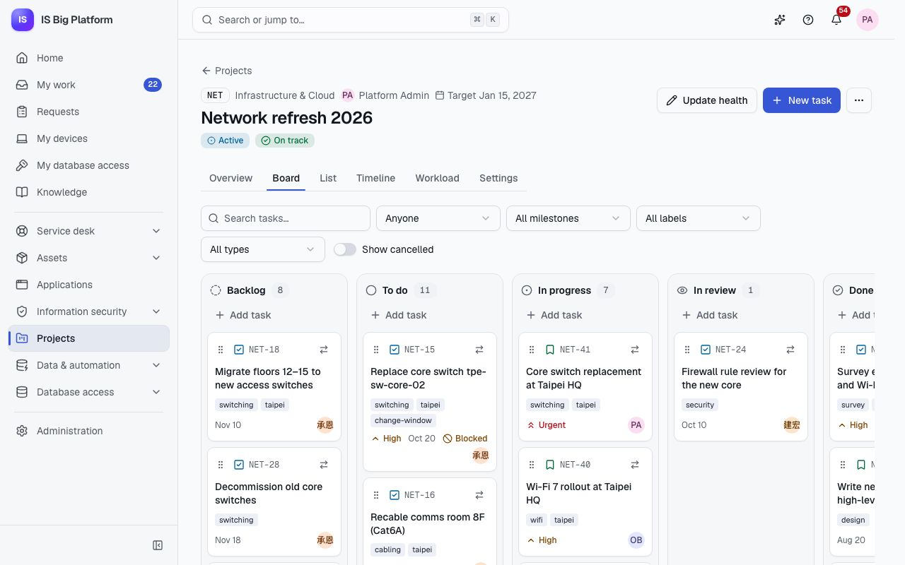
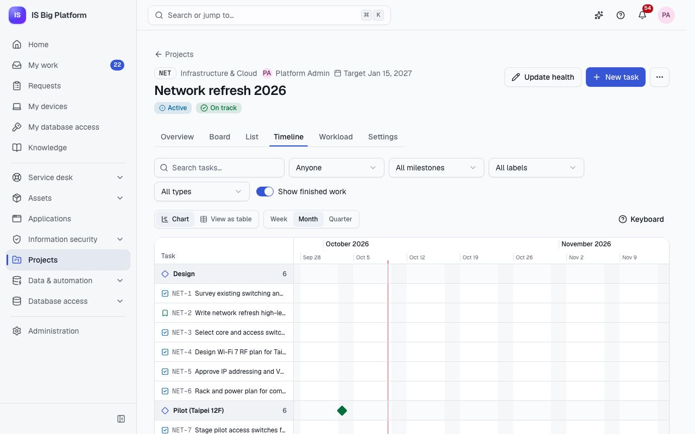
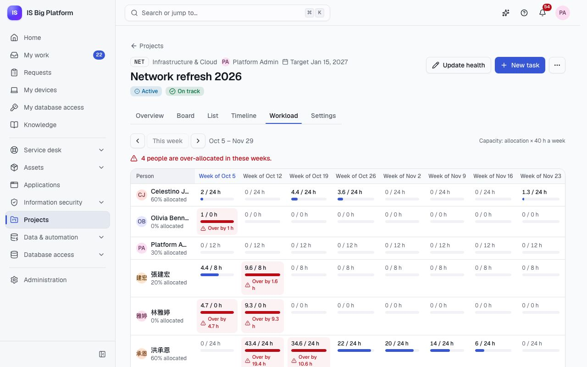

# Projects guide

This guide is for project managers, the PMO and the people who work on IT projects. **Projects** plans and tracks
work such as a network refresh, an ERP upgrade or a new office: who is on the project and for how much of their
week, the milestones, the tasks on a board and a timeline, and whether people are overloaded. Tasks link to the
tickets, changes, configuration items and releases they relate to.

## What you can do here

- [Propose a project](#propose-a-project) and [start it](#start-a-project-and-get-the-proposal-approved), with
  approval for large proposals, following the **Get started** checklist
- [Add members and milestones](#add-members-and-milestones)
- [Report the project's health](#report-health-and-status) and change its status
- [Plan and move work on the board](#work-on-the-board), with the mouse, the keyboard or **Move to…**
- [Plan dates and dependencies on the timeline](#plan-on-the-timeline), or read them as a table
- [Check the workload](#check-the-workload) per person per week against capacity
- [Follow your own tasks](#follow-your-own-tasks) across projects
- [Link tasks to tickets, changes, CIs and releases](#link-tasks-to-tickets-changes-cis-and-releases)
- Understand [tasks synced with Azure DevOps Server](#tasks-synced-with-azure-devops-server)

## Who can do what

What you can change depends on your role in the platform and your role in each project.

| Platform role                 | What it allows                                                                                                    |
| ----------------------------- | ----------------------------------------------------------------------------------------------------------------- |
| **Project member**            | Everyone has it: see internal projects and work on the projects you belong to                                     |
| **Project manager**           | Also create projects (you become their manager)                                                                   |
| **Project management office** | See every project, including private ones; create projects; approve large proposals when the owner has no manager |
| **Projects administrator**    | Manage any project                                                                                                |

Inside a project, **Managers** edit the project and any task, **Members** work on tasks, and **Viewers** read and
comment. An **Internal** project is visible to everyone who uses Projects; a **Private** one only to its members
(and the PMO). If you don't see **New project**, ask an administrator for the **Project manager** role in
**Administration → Roles & access**.

## Propose a project

New work starts as a proposal, so the plan can be checked before anyone books time on it.

1. Go to **Projects** and select **New project**.
2. Enter the **Name** (for example "Network refresh 2026") and a **Key** of 2–10 letters or digits. Task
   references start with the key, for example `NET-12`. The key can't change once the project has tasks.
3. Choose the **Project manager** (also a manager of the project), the **Department**, the **Start date** and
   **Target date**, the **Visibility** and the **Priority**.
4. Enter the **Planned effort (hours)**. It decides whether the proposal needs approval.
5. Describe the scope in **Description** (Markdown is supported) and select **Create project**.

**What happens next:** the project is **Proposed**. Its **Overview** opens with a **Get started** checklist: **Plan
the milestones** (**Add milestone**), **Add the first tasks** (**New task**), **Add the team** (**Add members**) and,
last, **Start the project** or **Submit the proposal for approval**. Each step has its button and is ticked off when
it's done; the checklist disappears once everything is done. Until someone assesses it, the project's health shows
**Not assessed yet**.

## Start a project and get the proposal approved

1. Open the project. The button at the top is **Start project** when the planned effort is within the threshold,
   and **Submit for approval** when it is over it.
2. The dialog says what happens (it starts at once, or the project manager's line manager approves it first); select
   **Start project** or **Submit for approval** again to confirm.

**What happens next:**

- Projects with up to 400 hours of planned effort become **Active** at once.
- Larger ones go to the **Project proposal** approval: the project manager's line manager decides (the PMO when the
  project manager has no manager), within 72 hours with a reminder after 48. The **Overview** shows a **Proposal
  approval** card with its status (**Waiting for approval**, **Approved** or **Not approved**), **Waiting for** and
  the approver, and when it was sent and is due. **Show approval path** lists every step the proposal goes through
  and where it is now. Approvers see **Decide in your approvals inbox**.
- The owner is notified of the decision. If it is not approved, the project stays **Proposed**: adjust it and
  start again.

In the demo, **Kaohsiung office opening** (`KHH`) plans 800 hours, so its proposal waits for the project manager's
line manager.
It shows on the **Proposed** tab of the portfolio.

> **Tip:** The 400-hour threshold is part of the approval workflow. An administrator can change it in
> **Administration → Workflows**, together with the module's **Proposal approval threshold (hours)** setting,
> which only drives the hint on screen.

## Add members and milestones

Members and their allocation drive the workload view; milestones group the timeline.

To add a milestone quickly, select **Add milestone** on the **Milestones** card of the **Overview**, enter the
**Milestone name** and **Due date**, and save. To manage both lists:

1. Open the project and go to the **Settings** tab (only managers see it), or select **Manage** on the **Overview**
   card.
2. Under **Members**, choose the **Person**, the **Role** (**Manager**, **Member** or **Viewer**) and the
   **Allocation %** (the share of the person's week planned for this project), then select **Add**.
3. Under **Milestones**, enter the **Milestone name** and **Due date** and select **Add milestone**. Use the arrows
   to order them, and **Complete** when one is reached.

**What happens next:** new members are notified ("Added to a project"). Removing a member leaves their open tasks
unassigned. Under **Archive or delete**, **Archive project** makes a finished project read-only and hides it from the
portfolio; only empty projects can be deleted (administrators can delete any).

## Report health and status

Managers keep stakeholders informed with a health update rather than a status email.

1. Open the project and select **Update health**.
2. Choose **On track**, **At risk** or **Off track**, write a **Note** (what changed, and what happens next) and
   save.

**What happens next:** members are notified, and the note shows on the project's **Overview** and in the
portfolio. Use **Status** to **Put on hold**, **Resume**, **Complete** or **Cancel project**. Completing a project
with open tasks asks you to confirm **Complete anyway** with a comment.

In the demo, **ERP upgrade to v12** is **At risk** and **Zero Trust rollout** is **Off track**, each with a note.

The **Overview** tab also shows **Open tasks**, **Overdue**, **Done this week** and **Blocked**, **Tasks by
status**, the milestones with their progress, the members with their allocation, and the project's history. A project
that no one has assessed yet shows **Not assessed yet** instead of a health.

## Work on the board

The board is where the team moves work day to day.

1. Open the project and select the **Board** tab. The columns are **Backlog**, **To do**, **In progress**, **In
   review** and **Done**; turn on **Show cancelled** to add a column for cancelled tasks.
2. To add a task quickly, select **Add task** in a column, type the title and select **Add**. For a full task,
   select **New task** at the top of the project: enter the **Title**, **Assignee**, **Due date** and **Milestone**,
   and open **More details** for the **Type**, **Priority**, **Start date**, **Estimate (hours)** and
   **Description**.
3. To move a card, drag it by its handle, or use the keyboard:
   1. Tab to the card's handle (**Move NET-12**) and press Space or Enter to pick it up.
   2. Use the arrow keys to move it within and between columns.
   3. Press Space or Enter to drop it, or Escape to cancel. A screen reader announces each position.
4. Or open the card's menu (**Move NET-12 to…**) and choose the column under **Move to**.
5. Select a card's title to open it in a side panel: edit the details (the estimate, remaining hours and labels are under
   **Planning**), add dependencies and a parent, and comment
   under **Comments and activity** (**Add a comment**, then **Comment**). **Open as page** gives it its own page.

Use the filters above the board to narrow it by text, **Assignee** (**Me**, **Unassigned**), **Milestone**, label
and **Type** (**Epic**, **Feature**, **User story**, **Task**, **Bug**).

**What happens next:** assignees are notified of new assignments and comments, and get a reminder the day before a
task is due. A card marked **Blocked** depends on work that isn't done yet: it can't move to **In progress** until
its dependencies are **Done** or cancelled.

> **Tip:** The **List** tab shows the same tasks as a sortable table, which is easier for bulk review.

## Plan on the timeline

Use the timeline to plan dates, see what depends on what, and spot tasks that start too early.

1. Open the project and select the **Timeline** tab. Tasks with a start or due date appear as bars, grouped by
   milestone, with arrows from each task to the tasks that wait for it.
2. Choose the zoom: **Week**, **Month** or **Quarter**.
3. To change dates with the mouse, drag a bar to move it, or drag its edges to change the start or due date.
4. With the keyboard: Tab moves between bars, Enter opens the task, Alt + ← / → moves the task one day, and Alt +
   Shift + ← / → moves only the due date. Select **Keyboard** for a reminder.
5. To add a dependency, open the task and, under **Blocked by**, select **Add dependency**.
6. Select **View as table** for the same plan as a table (**Tasks with dates and dependencies**, with **Depends
   on**) plus a **Milestones** table with their progress.

A task that starts before a task it depends on ends is flagged ("Starts before … ends."), and its arrow is shown in
red. A dependency that would create a loop is refused. Tasks without dates are listed as unscheduled below the
chart.

In the demo, the **Network refresh 2026** (`NET`) timeline has the core switch replacements and the milestones
**Rollout HQ** and **Rollout Hsinchu**.

## Check the workload

Check the workload before you commit to dates or add someone to another project.

1. Open the project and select the **Workload** tab. Each row is a member; each column is a week.
2. Each cell shows the planned hours against the capacity for that week. Over-allocated cells say **Over by … h**,
   and the summary counts how many people are over-allocated.
3. Select a cell to see the tasks behind it. Use **Previous weeks**, **This week** and **Next weeks** to move.

How the numbers are made:

- **Planned hours**: each open task's remaining hours (or its estimate) spread evenly over its working days, from
  its start (or today) to its due date. Tasks without a due date or hours aren't planned.
- **Capacity**: the member's allocation × the working hours per week (40 by default, a module setting).
- The **Unassigned** row shows planned work nobody owns yet.

Project managers, the PMO and administrators also have **Team workload** on **Projects** (the layout
switch next to **Cards** and **Table**). It shows the same grid across all the live projects you manage (every live
project for the PMO and administrators), with each person's allocations added up.

## Follow your own tasks

1. Go to **Projects** and open the **My tasks** tab to see the open tasks assigned to you across projects, grouped
   as **Overdue**, **Today**, **This week**, **Later** and **No date**.
2. Change a task's status right there, or open it. A task you mark done leaves the list; select **Undo** in the
   message if you changed the wrong one.

Your open tasks are also on **My work** under **Tasks**, the soonest due first.

## Link tasks to tickets, changes, CIs and releases

Links keep the context in one place: the change that authorizes the work, the CI it touches, the incident that
triggered it.

1. Open the task (in the side panel or as a page).
2. Under **Linked records**, select **Link record**.
3. Filter by **Record type** if you like, search by reference or title, and select **Link** next to the record.

Attachments go under **Attachments** on the same task. You only see linked records you may see; others are counted
("linked records you don't have access to"). The project's **Overview** has the same **Linked records** panel, for
example to link the project to the application it changes.

In the demo, the task "Replace core switch tpe-sw-core-01" in `NET` is linked to the change "Core switch firmware
upgrade tpe-sw-core-01" and to the CI `tpe-sw-core-01`, and "Cut over production to ERP v12" in `ERP` is linked to
the Finance ERP 12.1.0 release.

## Tasks synced with Azure DevOps Server

Development teams that plan in Azure DevOps Server (on premises) can keep their work items and the project's
tasks in step through the Integrations Hub. An integration administrator sets it up per project.

- Work items become tasks and back, with their type, parent, state, assignee, dates, hours and, if the sync rule
  includes them, comments.
- The project's rules still apply: a task can't start while its dependencies aren't done, an archived project
  stays read-only, and an assignee who isn't on the project joins it as a **Member** at 0 % allocation.
- A project created from a team project starts **Proposed**: its proposal approval [can't be skipped from outside](integrations.md#approvals-cant-be-skipped-from-outside).
- On the task's linked records, a **Synced with** card shows the connection, when it **Last synced**, and **Sync
  now**. Activity and comments made by a sync say where they came from ("via …").

In the demo, **ERP work items ↔ tasks** syncs the `ERP` project with the stand-in **Contoso Azure DevOps Server** in
both directions (where both sides changed, the Azure DevOps value wins), and **Network work items → tasks** brings
work items into `NET` one way. Setting up connections and sync rules is covered in the
[Integrations guide](integrations.md).

## How it connects

- **Changes and releases**: link tasks to the changes that authorize them and the releases they deliver:
  [Changes and releases guide](changes-and-releases.md).
- **Service desk and CMDB**: link tasks to incidents, problems and CIs: [Service desk guide](service-desk.md).
- **Approvals**: proposal decisions arrive in the **Approvals** inbox like every other approval:
  [Approve or reject a request](employees.md#approve-or-reject-a-request).
- **Azure DevOps Server** sync: [Integrations guide](integrations.md).
- **The assistant** can list your tasks, find tasks, create one, move a task's status and give a project's status
  report, with your permissions: [Assistant and AI](assistant-and-ai.md).
- How projects fit into our IT practices: [How it fits our work](how-it-fits-our-work.md).
