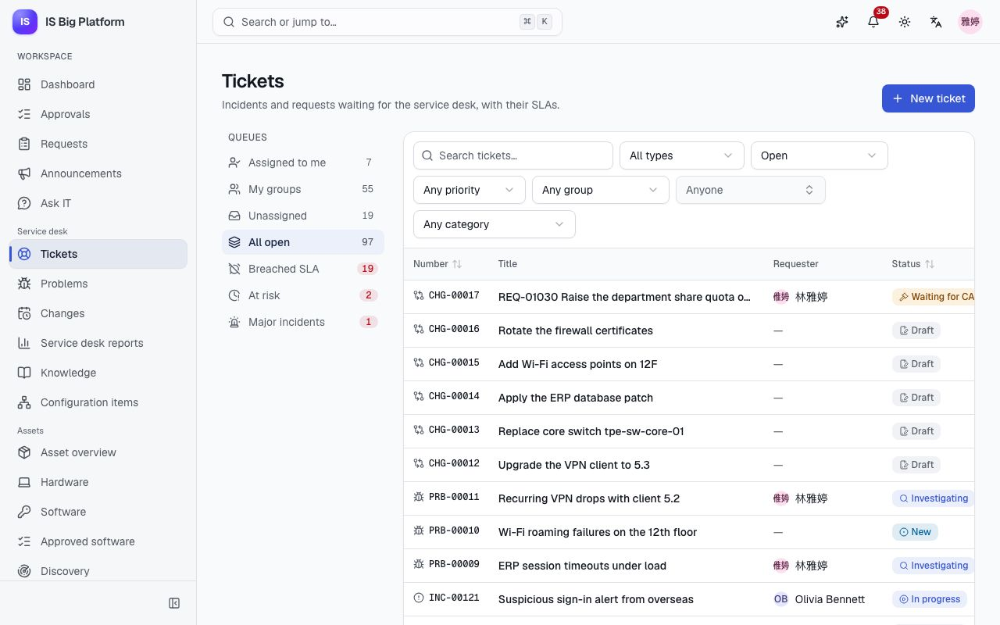
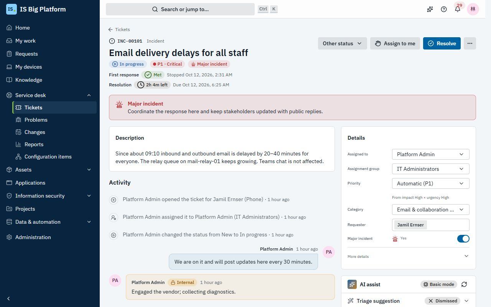
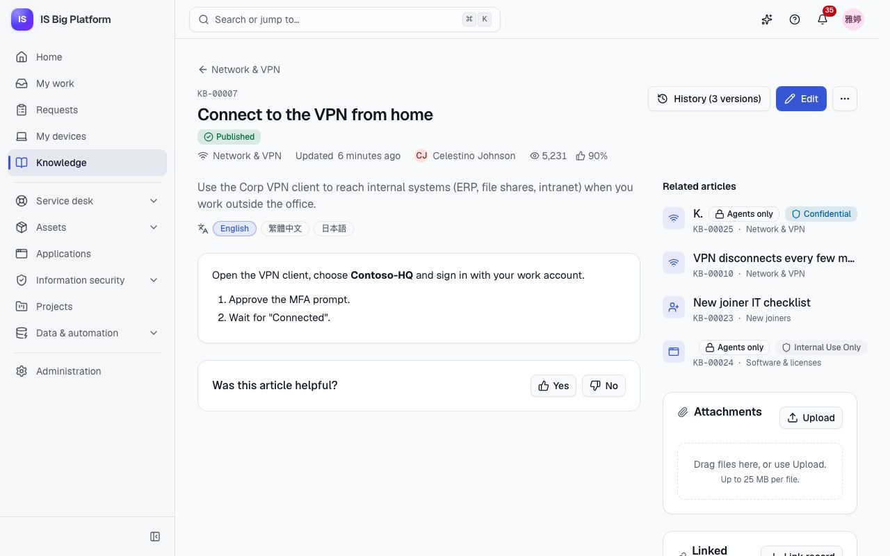
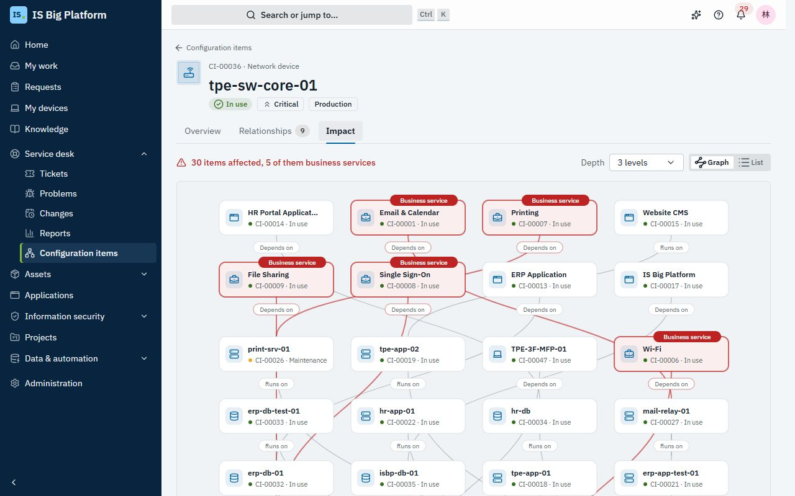

# Service desk guide

This guide is for service desk agents and leads. It covers the daily work on tickets: picking up your queue,
keeping to the SLA, replying to people, resolving and closing, and the tools around tickets — Helpdesk AI, the
knowledge base, the CMDB and the reports. Changes and the CAB have their own guide:
[Changes and releases](changes-and-releases.md).

## What you can do here

- [Work your queue](#work-your-queue) and see what needs attention for its SLA first
- [Know the ticket types and their statuses](#know-the-ticket-types-and-their-statuses)
- [Set the priority](#set-the-priority) from impact and urgency, and [meet the SLA](#meet-the-sla)
- [Set up categories and SLA targets](#set-up-categories-and-sla-targets) (service desk administrators)
- [Log a ticket for someone](#log-a-ticket-for-someone) who calls or walks up to the desk
- [Work a ticket](#work-a-ticket): take it, reply, add work notes, attach files, link related items
- [Resolve, reopen and close a ticket](#resolve-reopen-and-close-a-ticket), with a satisfaction rating
- [Fulfil a service request](#fulfil-a-service-request) that came in through a catalog form
- [Investigate a problem and record a known error](#investigate-a-problem-and-record-a-known-error)
- [Run a major incident](#run-a-major-incident)
- [Use Helpdesk AI on a ticket](#use-helpdesk-ai-on-a-ticket) for triage, similar tickets, reply drafts and summaries
- [Find and write knowledge articles](#find-and-write-knowledge-articles)
- [Check what a configuration item affects](#check-what-a-configuration-item-affects) in the CMDB
- [Read the service desk reports](#read-the-service-desk-reports)
- [Work a ticket synced with ServiceDesk Plus](#work-a-ticket-synced-with-servicedesk-plus)

> **Tip:** If you don't see **Service desk → Tickets** in the sidebar, ask an administrator for the **Service
> desk agent** role. The role can cover every department or only some; you see the tickets of the departments
> it covers. In the demo, the `helpdesk` user is a service desk agent.

## Work your queue

Start every shift here: the workspace shows the tickets waiting for you and your teams, with their SLA timers.

1. Go to **Service desk → Tickets**.
2. Pick a queue on the left. The number next to each one is its count of open incidents and service requests
   (problems and changes have their own pages, and drafts don't count).
   - **Assigned to me** — tickets you own, the most urgent SLA first.
   - **My groups** — open tickets assigned to any group you are a member of.
   - **Unassigned** — tickets in your groups that nobody has picked up yet, newest first.
   - **All open** — every open ticket you can see.
   - **SLA attention** — tickets that have breached their SLA or are about to, the most urgent first.
   - **Major incidents** — open major incidents.
     The counts of **SLA attention** and **Major incidents** turn red when they aren't zero.
3. Narrow the list with the search box (a title, or a number such as `INC-00042`), **Type** (**Incidents &
   requests** by default, **All types**, or one type) and **Priority**. **Filters** holds **Status** (**Open** by
   default, or **Done**, **Any status**, or one status), **Assignment group**, **Assigned to** and **Category**;
   the filters you set show as chips you can remove, and **Clear all** resets them. **Order** reads the queue
   **Newest first**, **Oldest first**, by **Most urgent SLA** or **Recently updated**.
4. Select a row to open the ticket. Each row shows the number, the title and the requester, then the status,
   priority, SLA and owner (the person, or the group while nobody has it).

**What happens next:** the queues and the list refresh every minute, and the counts tick to their new value. The
queue and filters are part of the page address, so you can bookmark a view or share it with a colleague; the back
link on a ticket returns to the list as you left it. The **Service desk** card on the home dashboard shows your
queues and your most urgent tickets when something waits for you.

> **Tip:** On a phone, the queues are in a drop-down above the list, the filters open from **Filters**, and each
> ticket shows as a card with its status, priority and SLA.

## Know the ticket types and their statuses

Every ticket has a type and a number. Each type has its own lifecycle. The ticket page shows the next step as
its main button (for example **Resolve**, **Start investigating** or **Submit for approval**); **Other status**
offers the other moves that type allows, such as **On hold** or **Cancelled**.

| Type            | Number  | Use it when                                         | Statuses                                                                                |
| --------------- | ------- | --------------------------------------------------- | --------------------------------------------------------------------------------------- |
| Incident        | `INC-…` | Something is broken or not working as it should     | New → In progress ⇄ On hold → Resolved → Closed, or Cancelled                           |
| Service request | `SR-…`  | Someone needs something (often from a catalog form) | (Waiting for approval →) New → In progress ⇄ On hold → Fulfilled → Closed, or Cancelled |
| Problem         | `PRB-…` | You are looking for the cause behind incidents      | New → Investigating → Known error → Resolved → Closed, or Cancelled                     |
| Change          | `CHG-…` | Something will be changed in production             | See [Changes and releases](changes-and-releases.md)                                     |

A resolved incident or fulfilled request can go back to **In progress** with **Reopen**, or on to **Closed**. A
finished ticket shows its details read-only; reopen it to change them.

## Set the priority

The priority (P1 to P4) decides which SLA targets apply and how the ticket sorts against others. It comes from
the ITIL matrix of impact and urgency:

| Impact ↓ / Urgency → | High | Medium | Low |
| -------------------- | ---- | ------ | --- |
| **High**             | P1   | P2     | P3  |
| **Medium**           | P2   | P3     | P4  |
| **Low**              | P3   | P4     | P4  |

1. Open the ticket and find the **Details** card at the top of the right-hand column.
2. Open **More details** and set **Impact** (**High — many people or a critical service**, **Medium — a team or
   department**, **Low — one person**) and **Urgency** (**High — work is blocked**, **Medium — work is slowed
   down**, **Low — it can wait**). Each change saves at once.
3. **Priority** follows the matrix (**Automatic (P3)**, with "From impact … × urgency …" under it). To override
   it, pick **P1 · Critical** to **P4 · Low**; to go back to the matrix, pick **Automatic** again.

**What happens next:** an override says **Overridden by hand; the change is in the timeline**, and the timeline
records who changed what. A field that changes while you look (your own edit, an AI suggestion you applied, a
colleague) flashes briefly. Running SLA timers move to the targets of the new priority.

## Meet the SLA

An SLA policy gives each ticket two targets: **First response** and **Resolution**. They are counted in business
time on a calendar with working hours and holidays, so the clock doesn't run at night, at weekends or on public
holidays unless the calendar is open 24×7.

- **Which policy applies.** The first active policy (in the order the service desk administrator set) whose
  conditions match the ticket when it is raised. A later priority change keeps that policy but uses the target
  for the new priority.
- **Where you see it.** Under the ticket's title (**First response** and **Resolution**, each with its state —
  time left, **Paused**, **Met** or how long ago it was breached — and **Due** or **Stopped** with a time; point at
  it to see the policy) and in the **SLA** column of the lists.
- **First response** is met by the first public reply from someone other than the requester, by moving the ticket
  to **In progress**, or by resolving it.
- **Pausing.** The clock stops in the statuses the policy names, typically **On hold**. Reopening a resolved ticket
  picks the resolution clock up where it stopped; the time it spent resolved doesn't count.
- **Warnings and breaches.** When a share of the target has passed (**Warn at**), the assignee — or every member
  of the group when nobody is assigned — gets **SLA at risk** and the ticket appears in **SLA attention**. At the
  deadline they get **SLA breached** (in-app and email) and the timeline records it; the ticket stays in **SLA
  attention**, at the top.

In the demo there are two business calendars, **Taipei office hours** (09:00–18:00 on weekdays, Taiwan holidays)
and **24×7**, and three policies:

| Policy                    | Applies to       | Targets                                                     | Pauses in                     |
| ------------------------- | ---------------- | ----------------------------------------------------------- | ----------------------------- |
| Critical incidents (24×7) | P1 incidents     | 15 min response, 4 h resolution, round the clock            | Never                         |
| Incidents                 | Other incidents  | P1 30 min / 4 h, P2 1 h / 8 h, P3 4 h / 24 h, P4 8 h / 40 h | On hold                       |
| Service requests          | Service requests | 4 business hours to respond, three business days to fulfil  | On hold, Waiting for approval |

> **Tip:** Put a ticket **On hold** while you wait for the requester or a supplier, and say why in a reply. It
> only pauses the clock when the policy names **On hold**.

Service desk administrators maintain the policies and calendars: see
[Set up categories and SLA targets](#set-up-categories-and-sla-targets).

## Set up categories and SLA targets

Service desk administrators (the **Service desk administrator** role) keep the ticket categories, SLA policies,
business calendars and the request catalog in **Administration → Service desk settings**, on the tabs
**Categories**, **SLA policies**, **Calendars** and **Service catalog**.

**Give a category its own SLA targets.**

1. On **Categories**, select **New category**, or select a category's name to edit it.
2. Fill in the **Name** in each language people use, the **Parent** and the **Ticket types**. Choose the **Default
   group**: new tickets in the category go to it, and **Service desk groups** are listed first. The **Key** that SLA
   rules and integrations use is under **Advanced**.
3. Under **SLA**, keep **Use the standard targets**, or choose **Set targets for this category** and type each
   target in business time, for example `4h`, `30m` or `1h 30m`. **Same for all priorities** sets one target for
   every priority.
4. Select **Save**.

**What happens next:** the targets apply to the category and its subcategories, from the next ticket on. They are
kept as an SLA policy that is checked before the general one (the form says so: "Checked before “Incidents” …"),
and the category's row shows **SLA: …** instead of **Standard SLA**.

**Keep the SLA policies in order.** On **SLA policies**, policies are checked from the top, and the first one that
matches a ticket sets its targets. Move a policy with its up and down arrows. A policy that a policy above it always
beats says **This policy will never apply: …**; select **Check it first** to move it up. A new policy is placed
before the policy that would otherwise take all its tickets. In a policy, **Only when** rules such as **Category
(with subcategories)** choose the tickets, and **More options** holds the description, **Warn at** and the statuses
that pause the clock.

## Log a ticket for someone

When someone phones, emails or walks up to the desk, log the ticket for them so they can follow it under **My
requests**.

1. Go to **Service desk → Tickets** and select **New ticket**.
2. Choose the **Ticket type**: incident or service request (problems too, if you have the **Problem manager**
   role).
3. In **Requester**, pick the person. Leave it empty to log it as yourself.
4. Write a **Title** and a **Description** (Markdown is supported).
5. Set **Impact** and **Urgency**; the priority follows the matrix.
6. Choose a **Category**. If you leave **Assignment group** empty, the ticket goes to the category's default
   group, or to the service desk's default group.
7. Optionally pick **Assigned to**, the **Affected configuration items**, and for an incident **Major incident**.
8. Select **Create ticket**.

**What happens next:** the requester gets "INC-… received" and sees the ticket under **My requests**. The assignee
is notified, the SLA timers start, and Helpdesk AI suggests a triage if it is turned on.

## Work a ticket

The ticket page shows the next step at the top right (**Resolve** for an incident, **Fulfil** for a request),
with **Assign to me**, **Other status** and **More actions** (**Edit**, and **Create problem** on an incident)
next to it. Anything that needs you — "Is it fixed?" on your own ticket, a change to accept, a CAB decision — sits
right under the title. The left column has the description and **Activity** (the timeline and the reply box); the
right column has **Details**, the **AI assist** panel, **Related** and **Attachments**.

**Take it.** Select **Assign to me**, or change **Assigned to** and **Assignment group** in **Details**. Moving a
ticket to another group drops an assignee who isn't a member of it. The new assignee gets "Assigned to you".

**Correct the requester.** If the ticket was logged for the wrong person, pick the right one in **Requester** in
**Details**. The ticket moves to their **My requests**, the previous requester no longer sees it (unless it is for
them), and its department and SLA targets stay the same. The timeline records the change.

**Reply or add a work note.** Below **Activity**:

1. Choose **Reply to requester** for a message the requester sees, or **Work note** for something only agents
   see.
2. Write it (Markdown is supported) and select **Send reply** or **Add note**, or press ⌘/Ctrl + Enter.

The requester is notified of replies. When the requester answers, the assignee is notified (or the group when
nobody is assigned). New entries slide into the timeline; runs of three or more updates nobody wrote by hand (a
sync, a rule, the AI) fold into one line such as "3 system updates" that you can open.

**Edit the title or description** with **More actions → Edit**.

**Attach files.** In **Attachments**, select **Upload** or drag files in. Files are checked for type, size and
malware before they are stored.

**Link related items.** The **Related** card holds everything related to the ticket: **Affected CIs** (with the
business services each one affects), **Tickets**, **Other records** and, for a ticket synced with another system,
**Synced with**. Select **Add** and choose:

- **Affected configuration item** — search for CIs and **Save**. Critical CIs are marked **Critical**.
- **Related ticket** — choose the relation, then find the tickets by number or title (you can pick several) and
  select **Link 2 tickets** (it counts what you picked). The relations read from this ticket's side: **Related to**, **Caused by**, **Causes**,
  **Duplicate of**, **Duplicated by**, **Parent of**, **Child of**, **Implements fix for** and **Fixed by
  change**. Only incidents and service requests can be caused by a problem; only a change implements the fix for
  an incident or a problem; parent and child tickets must be of the same type.
- **Other record (asset, article…)** — an asset, a release, a project task, a knowledge article or any other
  record. Links you can't open show only as a count.

Remove a link with the ✕ on its row.

## Resolve, reopen and close a ticket

When the work is done, resolve the ticket so the requester can confirm the fix. The quickest way is from the
reply box: write the answer, then select **Send and resolve** (**Send and fulfil** on a service request) instead of
**Send reply** — the requester gets one message, not a reply and a resolution.

1. Select **Send and resolve** under your reply, or **Resolve** (incidents) / **Fulfil** (service requests) at the
   top of the page.
2. Choose a **Resolution code**: **Solved** (preselected), **Workaround provided**, **User error / how-to**,
   **Duplicate**, **No fault found** or **Not reproducible**.
3. Check the **Resolution notes**: with **Send and resolve** they are your reply. The requester sees them.
4. If a knowledge article solved it, choose it in **Article used (optional)**. An article you inserted from the
   **AI assist** panel is filled in already.
5. Select **Resolve** or **Fulfil**.

**What happens next:**

- The SLA timers stop, and the requester is notified and asked **Is it fixed?**
- **Yes, close it** closes the ticket. The requester can rate the service from 1 to 5 stars and add a comment;
  you see **Rated … out of 5** on the **Resolution** card, and the rating counts in **Satisfaction** in the
  reports.
- **No, it's still broken** asks for the reason, puts the ticket back **In progress**, and notifies you.
- If the requester does neither, the ticket closes by itself after 5 days (an administrator can change this
  under **Administration → Modules**).
- Resolved tickets feed Helpdesk AI's similar-ticket search. The article used is linked to the ticket (it shows
  under **Related**, and in the timeline as **Article used:**), so the knowledge base knows which articles solve
  problems.

Some resolutions need a sign-off first: if an administrator bound a **Resolution sign-off** workflow (for example a
manager's approval for the "Equipment anomaly" category), resolving such a ticket sends it for approval instead. It
shows **Waiting for sign-off** and its resolution waits on the card; it is resolved when the approver signs off, and
it comes back **In progress** with the approver's reason if they don't. Until then you can **Withdraw the
resolution** from **Other status**.

A resolved ticket shows **Reopen** as its main button; **Other status** closes it. To cancel a ticket, choose
**Cancelled** in **Other status** and give a code (**Duplicate**, **Cancelled by requester**, **User error /
how-to** or **No fault found**) and a reason; the requester is told it was cancelled.

## Fulfil a service request

Most service requests come from request forms in the portal. The service desk administrator decides, per
published form, how it is fulfilled (**Administration → Service desk → Service catalog**): the category, the
**Fulfilment group**, the priority, and whether the ticket is created **When submitted** or **When approved**.

In the demo, the **Laptop request** form goes to the requester's department head, and to IS asset management too
above 60 000 TWD. Approved requests become service requests in Hardware › Laptop for the Service Desk group.

1. Open the service request from your queue. Its channel is **Request form**.
2. Read **Request details** (the answers on the form). The chip **From request REQ-…** with the form's name opens the
   original request.
3. Do the work, replying to the requester as needed.
4. Select **Fulfil**, choose a code, write the notes and select **Fulfil**.

**What happens next:** the requester follows a single reference (`REQ-…`) under **My requests**, from approval to
fulfilment; its status follows your ticket. A ticket created when the form was submitted waits in **Waiting for
approval** until the approval finishes, and is cancelled if the request is rejected. See
[Employees](employees.md) for what the requester sees.

Some forms raise their ticket or change themselves with a **Raise a ticket** or **Raise a change** action instead
of the service catalog. Those tickets also show **From request REQ-…** and the channel **Request form**, and the
request page lists them under **What happens next**. See [Build your own process](processes.md#add-actions).

## Investigate a problem and record a known error

When the same incident keeps coming back, open a problem to find and remove the cause. You need the **Problem
manager** role.

1. Start from one of the incidents: **More actions → Create problem**. The title, details, category and CIs are
   filled in from the incident, and it is already listed under **Incidents it causes**. Add the other incidents by
   number or title in the same field, then select **Create problem**. (You can also select **New problem** in
   **Service desk → Problems**, whose tabs show **Open**, **Known errors**, **Resolved** and **All**.)
2. On the problem, select **Start investigating**.
3. In the **Problem** card, select **Edit** and write the **Root cause** and the **Workaround**. Select **Save
   changes**.
4. Once the cause and workaround are documented, select **Mark as known error**. A new problem can be marked
   straight away.
5. Select **Write known-error article** in the **Problem** card: a draft for agents opens in the knowledge base,
   prefilled with the symptoms, the root cause and the workaround in your language, and it is already chosen as
   the problem's **Knowledge article**. Review it and select **Publish** (or **Submit for review**); the article
   says **Based on PRB-…**.
6. More incidents turn up later? Link them from the problem with **Related → Add → Related ticket**, relation
   **Causes**; the **Problem** card lists the linked incidents.
7. When the cause is removed (often by a change that **Implements fix for** the problem), resolve the problem
   with a code and notes, then close it.

In the demo, PRB-00001 "VPN client 5.2 crashes on macOS 15" is a known error with linked VPN incidents, and
the agents-only article "Known error: VPN client 5.2 crashes on macOS 15" carries the workaround.

> **Tip:** The known-error article is for **Agents only**, so Helpdesk AI suggests it on new incidents. An existing
> article can be chosen in **Knowledge article** on the **Problem** card instead.

## Run a major incident

Declare a major incident when an outage hits many people or a critical service and needs one coordinated
response.

1. Open the incident and turn on **Major incident** in **Details** (or when you log it).
2. Use the ticket as the single place for the response: the red **Major incident** banner reminds everyone to
   coordinate there and keep stakeholders updated with public replies.
3. Link the incidents other people raise about the same outage: on the major incident, select **Related → Add →
   Related ticket**, choose **Parent of** and pick the other incidents by number or title.
4. Post updates as replies at regular intervals, and resolve the major incident when service is restored.

**What happens next:** the ticket shows in the **Major incidents** queue, and **Service desk reports** count the
open major incidents. If **Announce major incidents in team channels** is on (it is by default), the platform
posts a "Major incident" message with the ticket's number and title to the organisation's subscribed Teams, Slack
and webhook channels.

> **Important:** A reply reaches the requester of the ticket you write it on. Tell the people on the linked
> incidents on their own tickets, or resolve those tickets when the major incident is fixed.

In the demo, INC-00101 "Email delivery delays for all staff" is an open major incident with three linked
incidents from people whose email is late.

## Use Helpdesk AI on a ticket

The **AI assist** panel, right under **Details**, helps you triage, answer and document a ticket. You need the
**AI-assisted agent** role. Its sections are folded so the panel stays short; a waiting triage suggestion is the
one that opens by itself.

The badge in the panel's header says which mode answered (point at it for details):

| Feature                   | **Basic mode** (no model configured)                               | **Language model**                                            |
| ------------------------- | ------------------------------------------------------------------ | ------------------------------------------------------------- |
| Triage suggestion         | A vote of the most similar resolved tickets, with its agreement    | The similar tickets, refined by the model, with a rationale   |
| Similar tickets, articles | Search of resolved tickets and the knowledge base                  | The same                                                      |
| Reply draft               | A template that quotes the best article's steps and links it       | A reply grounded in knowledge articles, with numbered sources |
| Summary                   | The issue, latest updates and current state, taken from the ticket | A written summary of the description and timeline             |
| KB draft                  | An article filled from the ticket's fields                         | A symptoms / cause / resolution article                       |

1. **Triage suggestion** shows the suggested category, group and priority (with impact and urgency), the
   **Confidence** and why, in your language. Select **Apply** for one field, **Apply all**, or **Dismiss**; the
   applied fields flash in **Details**. Below 40 % confidence, **Apply all** is a plain button and the panel says
   **Low confidence — check before applying**. If there is no suggestion yet, select **Suggest triage**. Finished
   tickets, problems and changes have no triage suggestion.
2. **Similar resolved tickets** lists up to three earlier tickets (25 % match or more) with how they were
   resolved; **Show more** lists the rest. On a problem, **Similar incidents** lists open incidents first, each with
   **Link to this problem** (or **Linked** once it is).
3. **Suggested articles** lists up to three knowledge articles; **Insert link** adds a link to the reply and makes
   it the **Article used** when you resolve with **Send and resolve**.
4. **Draft a reply** writes a reply in the requester's language. Read it, select **Insert into reply**, edit it in
   the reply box, and send it yourself.
5. **Summary** → **Summarize** gives the issue, the latest updates and the current state, which helps when you
   take over a ticket. On a change, it is the only section.
6. On a resolved, fulfilled or closed ticket, **Knowledge article** → **Draft KB article** creates a draft article
   (symptoms, cause, resolution, applies to) for an editor to review. You need permission to write articles.

**What happens next:** nothing is sent or published without you. Generated text is labelled **Basic template —
review before sending**, or with the model's name ("Written by … — review before sending"). With a language model,
personal data is masked before the text leaves the platform. If an administrator turns on **Apply confident
suggestions automatically**, Helpdesk AI fills only the fields that are still empty, and the timeline says so.

Leads see triage acceptance, **Solved without a ticket** (questions Ask IS answered) and AI cost under **Service
desk → Reports → AI insights** (read-only with the service desk reports; **Suggestions waiting for an agent** with
**Show tickets** lists open tickets whose suggestion nobody applied yet). More on AI modes and privacy:
[Assistant and AI](assistant-and-ai.md).

## Find and write knowledge articles

The knowledge base holds self-service answers for everyone and troubleshooting guides for agents. Ask IS,
Helpdesk AI and the **Report an issue** page all search it, so a good article saves tickets.

**Find an answer.** Go to **Knowledge** and type in **How can we help?** Search works across languages: a
question in English also finds Chinese and Japanese articles. You can also **Browse by topic**. With the
**Knowledge agent** role you also see articles whose audience is **Agents only**. An article shows its other
languages under **Other languages**, and **Related articles**. Knowledge agents and editors also see **Linked
records** and, for an article synced with ServiceDesk Plus, a **Synced with** card.

**Write an article and get it published.** Writing needs the **Knowledge agent** role; publishing needs the
**Knowledge editor** role.

1. Go to **Knowledge** and select **New article** (editors also find it on the **Manage** tab).
2. Fill in **Title**, **Summary** (shown in search results) and **Article** (Markdown: the buttons above it add a
   **Heading**, **Bold** text, lists and a **Link**, and **Preview** shows the result). Choose a **Category** and the
   **Audience** (**Everyone** or **Agents only**). **More settings** holds the **Language** (yours by default),
   **Translation of**, **Tags**, the **Classification** and the **Review by** date.
3. Select **Save draft** to continue later. When it is ready, the main button says what happens: **Publish** ("It
   goes live for its audience right away.") or **Submit for review** ("An editor reviews it before it goes live.").
4. An editor opens it (**Manage → In review**) and selects **Publish**. While it is in review, you can **Withdraw
   from review** to change it.

**What happens next:** every publish is kept as a version (**History**). If an administrator has turned on the
**Publishing a knowledge article** approval, submitting sends the article for approval instead, and it goes live
when approved; you are notified either way. An editor's own submission is published straight away when no
approval applies. To change a live article, an editor selects **Edit** and **Publish update**, which makes a new
version. **Retire** (in the article's **⋯** menu, next to **Delete**) takes an article out of search; **Restore as
draft** brings it back.

**Classify an article and attach documents.** In the editor, choose a **Classification** (by default **Strictly
Confidential**, **Customer Confidential**, **Confidential** or **Internal Use Only**; an administrator sets the list
under **Administration → Modules**). Readers see it as a label and a banner on the article and in lists and search
results, and the **Manage** tab filters by it. The classification doesn't change who can read the article: the
**Audience** does. Editors attach diagrams and controlled documents (a network diagram, a rack layout) in the
**Attachments** panel of the article once it is saved; everyone who can read the article can download them.
Once the article is published, the text inside its attachments (PDF, Word, PowerPoint, Excel and text files; scans
and images when an administrator has set up a document-extraction service) is searchable too: a search result
found that way says **In runbook.pdf, page 2**, and Ask IS can answer from it. Only people who can read the article
find it. The same goes for files attached to resolved tickets, when similar tickets are suggested.

**Translate an article.** On the article, select **Translate**. The new article is linked as a translation, so
readers can switch languages; each language has its own number and goes through review on its own.

**Act on feedback and review dates.** Readers answer **Was this article helpful?**; a "No" (with an optional
comment) notifies the owner. Each published article has a review date (by default 180 days after it is first
published). When it is due, the owner is reminded every week, the article shows a banner, and it is listed
under **Manage → Review due**. Check the content, then **Edit** it and set a new **Review by** date.

In the demo, try searching for "vpn keeps dropping". **Manage** shows an article in review (Microsoft
Teams) and one due for review ("Clear a stuck print queue").

## Check what a configuration item affects

The CMDB records the services, applications, servers, databases and network devices IS runs, and how they
depend on each other. Use it to see who supports a system and what breaks when it fails. Browsing needs the
**CMDB viewer** role; creating and editing CIs, relationships and classes needs the **CMDB manager** role.

1. Go to **Configuration items**. Use the tabs (**All**, **Business services**, **Applications**,
   **Infrastructure**), the search box (a name or a number such as `CI-00042`) and the status; class, criticality,
   environment, support group and owner are under **Filters**.
2. Open a CI. **If this fails** comes first and answers in one sentence, such as "8 items affected, 7 of them
   business services", with the business services it takes down. **Overview** also shows its details, owner and
   **Support group**, and **Related work**: the open tickets that affect it (with **View all**) and the application
   it belongs to.
3. **Relationships** lists how it relates to other CIs (**Depends on**, **Runs on**, **Connects to**,
   **Contains**, **Backs up** and their reverses). CMDB managers select **Add relationship**.
4. **Impact** shows, as a **Graph** or a **List**, what is **Affected if it fails** (above) and what it **Depends
   on** (below), up to the **Depth** you choose. Point at a CI in the graph to highlight its path to this one.

Impact analysis follows **Depends on**, **Runs on** and **Contains**; **Connects to** and **Backs up** are for
information only.

**Link CIs to tickets.** Record the affected CIs on each ticket (see [Work a ticket](#work-a-ticket)). They show
on the CI's page, help you spot related incidents during an outage, and on a change they drive the conflict check
and the CAB routing.

**Keep the support group and criticality right.** Request forms can let people pick CIs, and their approvals can
route on a CI's data: the demo's **Configuration change request** asks the picked CI's **Support group** to approve,
and the CAB when a CI is critical. A CI without a support group, or with the wrong one, sends approvals to the wrong
people. See [Build your own process](processes.md#let-a-group-named-in-a-record-approve).

In the demo, open `tpe-sw-core-01` (CI-00036): losing the core switch impacts most business services.

## Read the service desk reports

Leads use the reports for daily stand-ups and monthly service reviews.

1. Go to **Service desk → Reports**. With Helpdesk AI, the tabs **Service desk** and **AI insights** switch
   between this report and the AI figures.
2. Choose the period: **Last 7 days**, **Last 30 days** or **Last 90 days**.
3. Read the figures at the top: **Open tickets** (with open major incidents), **SLA breaches in period** (response
   and resolution), **Mean time to resolve**, **Satisfaction** and **SLA compliance**. **Open tickets** opens the
   open tickets, and **SLA breaches in period** the **SLA attention** queue.
4. Below them: **Created vs. resolved**, **Open by priority**, **Backlog age**, **Top categories** and **Time to
   resolve by priority**. A priority or category name opens the matching tickets. Each chart can be shown as a
   table with **Show as**.

You need the **Service desk agent** role (or another role with service desk reports).

## Work a ticket synced with ServiceDesk Plus

Some tickets are kept in step with requests in our on-premises ManageEngine ServiceDesk Plus by the Integrations
Hub. You work them in ISBP as usual; the hub copies the changes both ways.

- **Synced with**, at the bottom of the **Related** card, shows the connection (in the demo, **Contoso ServiceDesk Plus**), the
  request number (it opens the request in ServiceDesk Plus), the state (**In sync**, **Conflict**, **Error** or
  **Deleted on one side**) and **Last synced**. People with the **Integrations administrator** role also see
  **Sync now**.
- **Timeline entries** written by the sync say where they came from, for example "via Contoso ServiceDesk Plus
  #1234". Tickets created by the sync show the channel **Integration**.
- **Your work goes across.** Edits, status changes, and replies and work notes (when the sync rule syncs comments)
  are sent to ServiceDesk Plus; changes made there come back. Statuses still follow the ticket's lifecycle, and
  SLAs and notifications work as for any other ticket.
- **Conflicts.** If the same field was changed on both sides, **Synced with** shows **Conflict** and an
  integration administrator decides which value to keep.

How connections, sync rules and conflicts work: [Integrations](integrations.md).

## How it connects

- **Employees** report issues, follow them under **My requests**, confirm fixes and rate the service:
  [Employees](employees.md).
- **Changes** that fix problems go through CAB approval: [Changes and releases](changes-and-releases.md).
- **Request forms** that raise tickets and changes, and route approvals on CIs: [Build your own process](processes.md).
- **Assets**: "Report a problem" on a device opens a ticket already linked to it: [Assets](assets.md).
- **Ask IS and Helpdesk AI** answer from the knowledge base and raise tickets only when the person confirms:
  [Assistant and AI](assistant-and-ai.md).
- **ServiceDesk Plus** tickets and solutions sync through the hub: [Integrations](integrations.md).
- **Categories, SLA policies, calendars, the service catalog and approval workflows** are set up by
  administrators: [Administrators](administrators.md).
- Terms such as incident, problem, known error and SLA: [Glossary](glossary.md).
