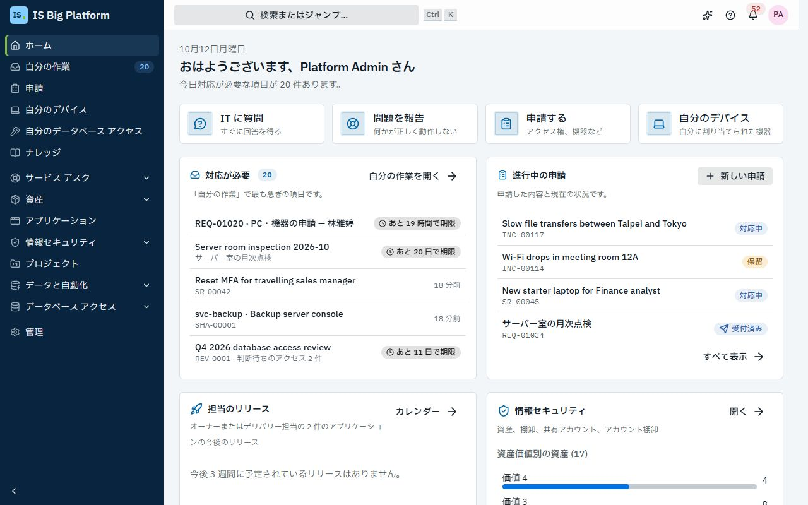
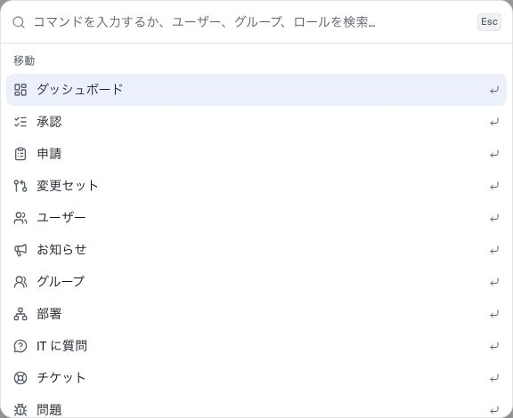

# はじめに

IS Big Platform (ISBP) は、IT 業務を行う場所です。IT への依頼、問題の報告、申請の承認はここで行い、IT 部門もサービス デスク、変更、資産、プロジェクト、データ フィード、自動化を同じ場所で運用します。このページでは、サインインの方法、画面の使い方、ロールごとに読むガイドを紹介します。

## このガイドでできること

- 会社のアカウントまたはローカル アカウントで[サインインする](#サインインする)
- [画面の使い方](#画面の使い方): サイドバー、ホーム、自分の作業、検索、通知
- どのページでも[アシスタントのサポートを受ける](#アシスタントのサポートを受ける)
- [自分のロールに合ったガイドを選ぶ](#自分のロールに合ったガイドを選ぶ)
- [困ったときにヘルプを探す](#困ったときにヘルプを探す)

## IT 業務における ISBP の役割

ISBP の申請、チケット、承認、構成の変更は、すべて同じルールに従います。

- **入口は 1 つ。** 従業員は**申請**に移動して、アクセス、機器、ソフトウェアの申請、問題の報告、自分のデバイスの確認を行い、依頼したすべての事柄の状況を確認します。
- **アクセス許可のモデルも 1 つ。** 表示される内容はロールによって決まります。アクセスできないページやボタンは表示されず、保持しているすべてのロールは**プロファイルと設定 → 自分のアクセス権**に一覧表示されます。
- **承認が組み込まれています。** アクセスの申請、購入フォーム、変更、資産の廃棄、プロジェクト提案は承認ワークフローを経由し、承認者は 1 つの承認一覧で判断します。管理者は、IT のあらゆるプロセスを、独自の承認とその後の処理を備えたフォームにすることができます。
- **すべてが記録されます。** 変更は監査ログに書き込まれるため、IT 部門はいつでも、誰がいつ何をしたかを示すことができます。
- **3 つの言語。** プラットフォーム全体、メール、このガイドは、英語、繁體中文、日本語で利用できます。

[ISBP と業務のつながり](how-it-fits-our-work.md)では、IT のプラクティスとプラットフォームの各領域の対応を説明しています。

## サインインする

デバイスで初めてブラウザーから ISBP を開くとき、またはサインアウトした後にサインインします。

1. IT 部門から案内された ISBP のアドレスを開きます。
2. **… でサインイン**ボタン (例: **Microsoft Entra ID でサインイン**) が表示されている場合は、それを選択し、会社のアカウントでサインインします (シングル サインオン)。
3. 表示されていない場合は、**メール アドレスまたはユーザー名**と**パスワード**を入力します。**アカウントの種類**が表示される場合は、会社のディレクトリを選択します。IT 部門が ISBP 自体にアカウントを作成した場合は、**ローカル アカウント**を選択します。
4. **このデバイスでサインインしたままにする**は、自分だけが使用するデバイスでのみ選択してください。
5. **サインイン**を選択します。

**この後の流れ:** **ホーム**、または開こうとしていたページ (メールのリンクなど) が表示されます。言語、テーマ、タイム ゾーンの設定は、どのデバイスにも引き継がれます。

IT 部門からパスワードを伝えられた場合 (新しいローカル アカウント、または IT 部門が設定したパスワード)、ISBP はまず**プロファイルと設定**を開き、**新しいパスワードを設定してください**と表示します。伝えられたパスワードを**現在のパスワード**に入力し、**新しいパスワード**を 2 回入力して、**パスワードを変更**を選択します。その後、開こうとしていたページに移動します。

> **ヒント:** **お使いのアカウントは、このプラットフォームでまだ設定されていません。** と表示される場合、会社のアカウントは有効ですが、ISBP にはまだ登録されていません。サービス デスクに追加を依頼してください。

> **重要:** **失敗した試行が多すぎます。数分後にもう一度お試しください。** は、アカウントが短時間ロックされていることを示します。ローカル アカウントを使用していてパスワードを忘れた場合は、サービス デスクに依頼してください。シングル サインオンの場合は、通常どおり会社のアカウントでパスワードを変更します。

## 画面の使い方

左側の**サイドバー**には、使用できるページが一覧表示されます。サイドバーは 3 つの部分に分かれています。

| 部分             | 内容                                                                                                                                                                                                                                                                                                                                                                                     |
| ---------------- | ---------------------------------------------------------------------------------------------------------------------------------------------------------------------------------------------------------------------------------------------------------------------------------------------------------------------------------------------------------------------------------------- |
| **自分のページ** | すべてのユーザー: **ホーム**、**自分の作業**、**申請**、**自分のデバイス**、**ナレッジ**。データベース アクセス権がある場合は**自分のデータベース アクセス**、プロジェクトのメンバーには**プロジェクト**も表示されます                                                                                                                                                                   |
| **各領域**       | ロールに応じて、領域ごとに 1 行: **サービス デスク**、**資産**、**アプリケーション**、**情報セキュリティ**、**プロジェクト**、**データと自動化**、**データベース アクセス**。領域を選択すると、そのページを展開または折りたたみます (例: **サービス デスク** › **チケット**、**問題**、**変更**、**レポート**)。現在の領域は自動的に展開され、展開したままにした領域は ISBP が記憶します |
| **管理**         | 何かを管理する場合: **管理**の行が 1 つあり、変更できるすべての設定が**ユーザーとアクセス**、**申請と自動化**、**モジュールの設定**、**統合**、**プラットフォーム**に分けて表示されます。管理ページが 1 つか 2 つだけの場合 (例: **ユーザー**と**部署**) は、サイドバーに直接表示されます                                                                                                |

**自分の作業**の横の数字は、対応を待っている件数 (承認、記入するフォーム、レビュー) です。小さい画面では、**ナビゲーションを開く** (左上のメニュー ボタン。ボタンの点は対応待ちの項目があることを示します) でサイドバーを開きます。大きい画面では、サイドバーの下部にある**サイドバーの切り替え**でサイドバーを細くできます。このとき各領域はアイコンになり、選択するとそのページのメニューが開きます。

**ホーム**は開始ページです。対応が必要な項目 (**対応が必要**)、**進行中の申請**、よく使うボタン (**IT に質問**、**問題を報告**、**申請する**、**自分のデバイス**)、IT からの最新の**お知らせ**が表示されます。領域を担当するユーザーには、サービス デスクのキューなど、その領域のカードも表示されます。対応待ちの項目がないときは、**すべて完了: 対応待ちの項目はありません。** と表示されます。

**自分の作業**には、対応を待っているすべての項目が 1 か所に、緊急度の高いものから表示されます: **判断待ち** (承認)、**ToDo** (記入するフォーム、受け入れ確認待ちの変更、解決の確認待ち、変更が必要なパスワード)、**確認待ち** (アクセス レビューと棚卸の確認)、**タスク** (自分のプロジェクトのタスク)。各行を選択すると、その項目自体が開きます。[対応待ちの項目](employees.md#対応待ちの項目を確認する)を参照してください。

上部の**ヘッダー**には、左から順に次の項目があります。

- **検索またはジャンプ…** — コマンド パレットを開きます (Mac では **⌘ K**、Windows では **Ctrl K** キー、スマートフォンでは虫眼鏡を選択)。ページ名を入力するとそのページに移動し、`REQ-01020` や `INC-00042` などの番号、または 2 文字以上を入力すると、表示が許可されている申請、チケット、ナレッジ記事、資産、ユーザーなどのレコードを検索します。結果は種類ごとにまとめて表示されます。該当するものがない場合は、**ナレッジ ベースで「…」を検索**または **IT に「…」について質問**を選択します (入力した内容を質問として IT に質問が開きます)。
- **アシスタント** (きらめきのアイコンのボタン) — [アシスタント](#アシスタントのサポートを受ける)を開きます (使用できる場合)。
- **このページのヘルプ** (疑問符のアイコン) — 現在の領域のガイドを開きます。
- **通知** (ベルのアイコン) — 自分宛ての最新の通知が表示され、**すべて既読にする**と**すべての通知を表示**を使用できます。通知を選択すると関連するレコードが開き、承認の通知ではその判断の画面が開きます。
- **自分のアバター** (ユーザー メニュー) — 自分の名前とメール アドレス、**プロファイルと設定**、**ヘルプ**、**テーマ** (**ライト**、**ダーク**、**システム設定に従う**)、**言語** (**English**、**繁體中文（台灣）**、**日本語**)、**サインアウト**。通知とメールも選択した言語で届きます。API クライアントを管理するユーザーには **API ドキュメント**も表示されます。

**プロファイルと設定**では、タイム ゾーンと通知の設定、不在設定のスケジュール、他のデバイスのサインアウト、自分のロールの確認ができます。[個人設定](employees.md#言語タイム-ゾーンセッションを設定する)を参照してください。

## アシスタントのサポートを受ける

アシスタントは、すべてのページのパネルで使用できる組み込みの AI エージェントです。表示中のページとレコードを把握し、自分のアクセス許可の範囲で動作し、何かを変更する前に確認を求めます。担当者はチケットの更新などの日常業務に、管理者は承認ステップの追加などの構成の変更に使用します。構成の変更は変更セットとして準備され、誰かがレビューし、ロールバックすることもできます。

1. ヘッダーの**アシスタント**を選択します。
2. やりたいことを入力します。組織で AI チャット モデルが構成されていない場合は、**ガイド付きテンプレート**のいずれかを選択します。

**アシスタント**ボタンが表示されない場合は、**アシスタント ユーザー** (Assistant user) ロールがありません。IT サービスの利用に関する質問には、代わりに **IT に質問**を使用してください。こちらは全員が利用できます。[アシスタントと AI](assistant-and-ai.md)を参照してください。

## 自分のロールに合ったガイドを選ぶ

| こんな場合                                                                           | 読むガイド                                       |
| ------------------------------------------------------------------------------------ | ------------------------------------------------ |
| 全体像を把握したい: どの領域がどの IT プラクティスを担当するか                       | [ISBP と業務のつながり](how-it-fits-our-work.md) |
| 従業員、マネージャー、または承認者である                                             | [従業員、マネージャー、承認者](employees.md)     |
| サービス デスクで働いている (チケット、SLA、ナレッジ、CMDB)                          | [サービス デスク](service-desk.md)               |
| 変更を管理している、CAB のメンバーである、またはアプリケーションのオーナーである     | [変更とリリース](changes-and-releases.md)        |
| ハードウェア、ライセンス、契約、ベンダーを管理している                               | [資産](assets.md)                                |
| 情報資産台帳、棚卸、共有アカウント、アカウント棚卸を管理している                     | [情報セキュリティ](information-security.md)      |
| プロジェクトを運営している、またはプロジェクトで作業している                         | [プロジェクト](projects.md)                      |
| 会議を主催または参加し、アクション アイテムをフォローする                            | [会議](meetings.md)                              |
| データ フィードやスケジュール ジョブを作成している、またはデータベースを管理している | [データと自動化](data-and-automation.md)         |
| ISBP を ServiceDesk Plus や Azure DevOps Server に接続する                           | [統合](integrations.md)                          |
| AI が何をするかを知りたい、またはエージェントでプラットフォームをカスタマイズしたい  | [アシスタントと AI](assistant-and-ai.md)         |
| ユーザー、アクセス、サインイン、ワークフロー、フォーム、モジュールを管理する         | [管理者](administrators.md)                      |
| IT のプロセスを、承認とアクションを備えた申請フォームにする                          | [独自のプロセスを作成する](processes.md)         |
| 英語、繁體中文、日本語の用語を調べたい                                               | [用語集](glossary.md)                            |
| 問題がある、またはちょっとした質問がある                                             | [よくある質問とトラブルシューティング](faq.md)   |

## 困ったときにヘルプを探す

- **このページのヘルプ。** ヘッダーの疑問符のアイコンを選択すると、現在の領域のガイドが開きます。右上の自分の写真を選択し、**ヘルプ**を選択しても開けます。ガイド間のリンクを選択すると、リンク先のガイドの該当するセクションが開きます。
- **このガイドはナレッジ ベースにもあります。** すべてのガイドは、ナレッジ ベースの **IS Big Platform の使い方**カテゴリにも、自分の言語の記事として収められています。サイドバーの**ナレッジ**を開いて検索するか、ヘッダーから検索します。
- **IT に質問。** **ホーム**の **IT に質問** (または**申請**ページの**質問する**) を選択し、問題を自分の言葉で説明します。このガイドを含むナレッジ ベースから回答し、解決できない場合は、確認用のチケットを準備します。[IT に質問](employees.md#チケットを登録する前に-it-に質問する)を参照してください。
- **ページが表示されませんか?** そのページのロールがない可能性があります。**プロファイルと設定 → 自分のアクセス権**で、保持しているロールを確認できます。[よくある質問](faq.md#ページやボタンが表示されない)を参照してください。
- **担当者に相談する。** **申請**ページで**問題を報告**を選択すると、サービス デスクが対応を引き継ぎます。

## 関連情報

- 次に読む: [ISBP と業務のつながり](how-it-fits-our-work.md)、続いて自分のロールのガイド。
- このガイドで使用している用語: [用語集](glossary.md)。
