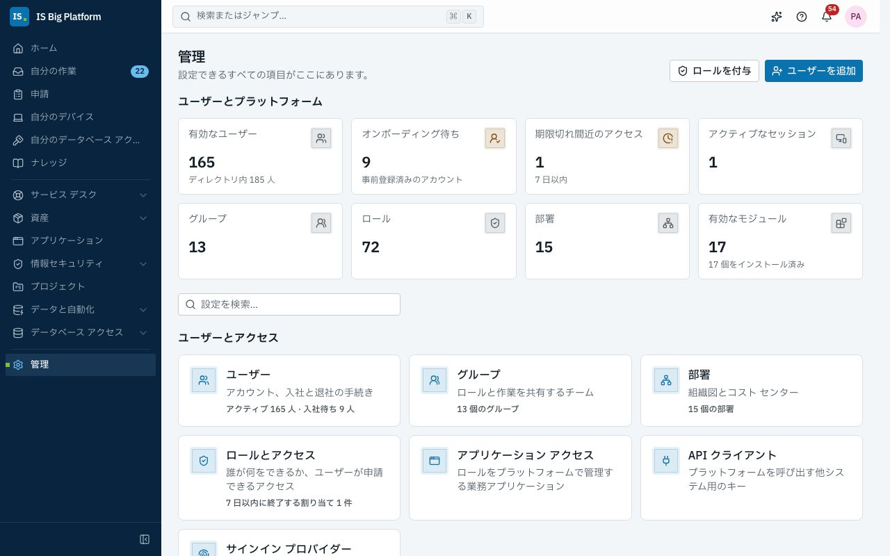
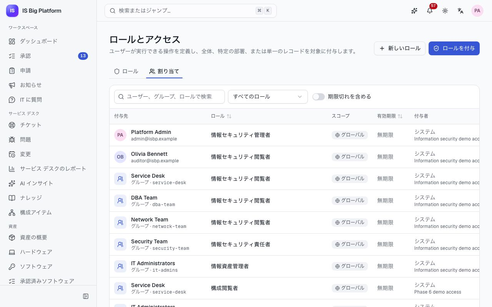
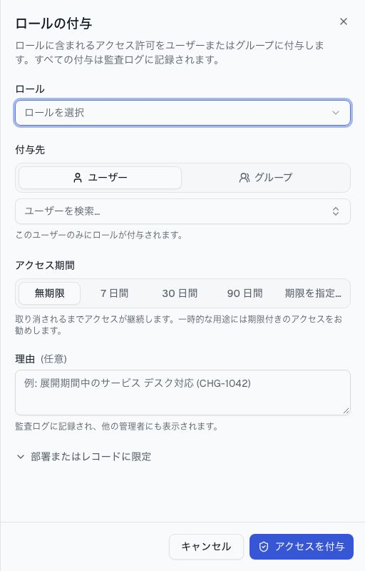
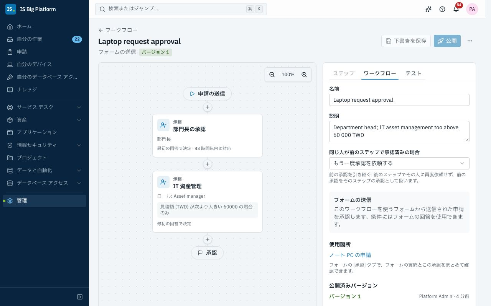

# 管理者ガイド

このガイドは、IT とプラットフォームの管理者向けです。誰が何を行えるか (ユーザー、グループ、部署、ロール、アクセスの申請)、ユーザーのサインイン方法、すべての申請の背後にある承認ワークフローとフォーム、通知、モジュール、AI の設定、監査ログについて説明します。これらの変更の多くは、アシスタントが変更セットとして準備することもできます。最後の[よくある管理作業](#よくある管理作業)で、両方の方法を紹介します。IT のプロセス全体を、承認とその後の処理を含むフォームにするには、[独自のプロセスを作成する](processes.md)を参照してください。

## このガイドでできること

- [ユーザーとそのライフサイクル](#ユーザーを追加してオンボーディングする)、[部署間の異動](#ユーザーを別の部署へ異動する)、[グループ](#ユーザーをグループにまとめる)、[部署](#部署のツリーを作成する)を管理する
- [ロールを作成し](#ロールを作成する)、[スコープと終了日を指定して付与し](#スコープと終了日を指定してロールを付与する)、[ユーザーがアクセスを申請できるようにする](#ユーザーがロールを申請できるようにする)
- [アプリケーションとそのロール](#業務アプリケーションとそのロールを管理する)を登録し、[API クライアントとロール クエリ API](#api-クライアントで他のシステムにアクセスを許可する) を通じて他のシステムにアクセスを許可する
- [サインイン プロバイダーを接続する](#サインイン-プロバイダーを接続する) (OIDC、SAML、LDAP)
- 承認ワークフローを[設計](#承認ワークフローを設計する)して[公開する](#ワークフローをテストして公開する)、[申請フォーム](#申請フォームを作成する) (レコード フィールド、ルール、アクションを含む) と[カスタム フィールド](#カスタム-フィールドを追加する)を作成する
- [メール、Teams、Slack、Webhook に通知を送信する](#通知チャネルとメールを設定する)
- [モジュールをオンまたはオフにする](#モジュールとその設定を管理する)、[AI を構成する](#ai-を構成する)、[監査ログを確認する](#監査ログを確認する)
- [アシスタントとその変更セットを管理する](#アシスタントを管理する)

## 管理の各ページを把握する

サイドバーの下部にある**管理**を選択します。管理ページには、アクセス許可のあるすべてのページがカードとして、**ユーザーとアクセス**、**申請と自動化**、**モジュールの設定**、**統合**、**プラットフォーム**に分けて表示されます。**設定を検索…** に入力すると絞り込めます。ユーザーを読み取る権限がある場合は上部に**ユーザーとプラットフォーム** (**有効なユーザー**、**オンボーディング待ち**、**期限切れ間近のアクセス**など)、監査ログを読み取れる場合は下部に**プラットフォームのアクティビティ**と**最近のアクティビティ**が表示されます。右上には**ユーザーを追加**と**ロールを付与**があります。管理ページが 1 つか 2 つだけの場合は、**管理**の代わりにサイドバーに直接表示されます。

管理作業を任せるには、通常は次のシステム ロールを付与します。**プラットフォーム管理者** (Platform administrator) はすべての操作を行えます。

| ページ (管理 → …)                                                 | 用途                                                       | 管理するロール                                                                               |
| ----------------------------------------------------------------- | ---------------------------------------------------------- | -------------------------------------------------------------------------------------------- |
| **ユーザー**、**グループ**、**部署**                              | アカウント、メンバーシップ、組織ツリー                     | **ID 管理者** (Identity administrator)                                                       |
| **ロールとアクセス**                                              | ロール、アクセス許可、ロールを保持しているユーザー         | **プラットフォーム管理者** (ロールの作成)、**ID 管理者** (付与)                              |
| **アプリケーション アクセス**、**API クライアント**               | 業務アプリケーションとそのロール、サービス アカウント      | **アプリケーション アクセス管理者** (Application access manager)、**プラットフォーム管理者** |
| **ワークフロー**、**フォーム**、**カスタム フィールド**、**通知** | 承認、申請フォーム、追加のフィールド、配信                 | **ワークフロー管理者** (Workflow administrator)                                              |
| **AI**                                                            | モデル、プライバシー、予算、インデックス、外部エージェント | **プラットフォーム管理者**                                                                   |
| **監査ログ**                                                      | すべての変更とサインイン                                   | **セキュリティ監査者** (Security auditor)。すべて読み取り専用                                |
| **モジュール**                                                    | モジュールのオンとオフ、設定の変更                         | **モジュール管理者** (Module administrator)                                                  |
| **データベース接続**                                              | 外部のデータベース                                         | **データベース接続管理者** (Database connection administrator)                               |
| **サインイン プロバイダー**                                       | SSO とディレクトリ同期                                     | **プラットフォーム管理者**                                                                   |
| **接続**、**同期の競合**                                          | ServiceDesk Plus と Azure DevOps Server                    | **統合管理者** (Integrations administrator)                                                  |
| **変更セット**                                                    | アシスタントで準備した構成の変更                           | **アシスタント管理者** (Assistant administrator)                                             |

モジュールは**モジュールの設定**に独自の設定を追加します。たとえば**サービス デスクの設定** (チケット カテゴリ、SLA ポリシー、カレンダー、サービス カタログ)、**資産の設定**、**情報セキュリティの設定**です。これらのページについては、各分野のガイドで説明しています。**プロセス パック** (**申請と自動化**) では、既製のプロセスを変更セットとしてインストールできます。

## ユーザーを追加してオンボーディングする

SSO でサインインするユーザーは、初回サインイン時に自動的に作成されます (プロバイダーで許可されている場合)。ローカル アカウントを作成する場合や、入社日より前に新入社員を事前登録する場合は、手動でユーザーを追加します。

1. **管理 → ユーザー**に移動し、**ユーザーを追加**を選択します。**必須**と表示された項目は必ず入力してください。
2. **基本情報**で**業務用メール アドレス**を入力し (**ユーザー名**は自動で入力されます)、**名**と**姓**を入力します。**表示名**は姓と名から自動で入力されます。別の名前で呼ばれている場合は変更してください。
3. **組織**で**役職**を入力し、**部署**を選択します。**上司**には部署の上司が自動で入力されます (「候補: … の上司です。」)。必要に応じて別のユーザーを選択します。
4. **グループ**で**グループに追加**を選択し、チームのグループを検索してチェックします。グループでアクセス権が決まります。グループに付与されたロールはメンバーに適用されます。
5. **開始時の状態**で、**すぐに有効化** (すぐにサインインできる) または**事前登録** (アカウントは作成されるが、オンボーディングされるまでサインインできない) を選択します。
6. ローカル アカウントの場合は、**言語、タイム ゾーン、パスワード**を開いて**初期パスワード**を設定します (初回サインインの直後に、ISBP が新しいパスワードの設定を求めます)。SSO 専用のアカウントの場合は空欄のままにします。**作成**を選択します。

**この後の流れ:** ユーザーのページが開き、「… を追加しました。次の作業」カードに通常の次の作業が表示されます。たとえば**ロールを付与** (グループで付与されないアクセス権が必要な場合) や、資産管理を使用している場合は在庫からの**デバイスを割り当てる**です。事前登録したユーザーの入社日には、**オンボーディング**を選択します。ユーザーの**アクセス**タブには、ロールとそれぞれを持っている理由 (直接付与、グループ経由、全員) が表示されます。**アクセス許可を表示**を選択すると、ロールに含まれるアクセス許可が表示されます。

![部署の上司が候補として入力され、グループが選択された [ユーザーの追加] パネル](../../../apps/web/public/help/ja-JP/administrators-add-person.jpg)

## ユーザーを別の部署へ異動する

異動では部署だけでなく、上司、多くの場合は役職、異動前と異動後のチームが使うグループも変わります。これらを一度に変更します。

1. **管理 → ユーザー**でユーザーを開き、**その他の操作**、**別の部署へ異動**の順に選択します。
2. **異動先の部署**を選択します。**上司**にはその部署の上司が設定されます。必要に応じて変更し、**役職**を更新します。
3. **外れるグループ**では、現在の部署の多くが所属し、異動先の部署では多くが所属していないグループがチェックされています。**参加するグループ**には、異動先の部署の多くが所属しているグループが追加されています。必要に応じて変更します。サインイン プロバイダーのディレクトリ同期で管理されているメンバーシップは、ここでは変更できません。
4. **確認が必要な部署単位のロール**で、異動前の仕事にだけ使っていたロール (**異動前の部署用**) をチェックすると、そのロールが削除されます。
5. **異動**を選択します。

**この後の流れ:** 変更はすぐに保存され、ユーザーの**アクティビティ**には、変更内容をすべて含む「別の部署へ異動」という 1 件のエントリが表示されます。異動前と異動後の上長に通知され (**自分の部署への異動・部署からの異動**)、そのユーザーが引き続き持つロールが一覧表示されます。異動元の部署にスコープされたロールは確認が必要なものとして示されます。

## ユーザーを一時停止、再有効化、オフボーディングする

調査中や長期休暇中はユーザーを一時停止し、退職時にはオフボーディングします。

1. **管理 → ユーザー**でユーザーを開き、**その他の操作**を選択します。
2. **一時停止**を選択し、**理由**を入力します。ユーザーはただちにサインアウトされ、アクセス権は後のために保持されます。元に戻すには、**再有効化**を選択します。
3. オフボーディングするには、**オフボーディング**を選択します。**すべてのグループ メンバーシップを削除**と**直接割り当てられたすべてのロールを削除**を行うかどうかと、**直属の部下の移管先**を選択してから、**オフボーディング**を選択します。

**この後の流れ:** オフボーディングすると、サインインが無効になり、すべてのセッションが終了します。各モジュールに通知が送られ、データベース アカウントなど、モジュール独自のアクセス権を削除できます。また、資産マネージャーには、ユーザーのデバイスを回収するようリマインダーが届きます。すべての操作は監査ログに記録されます。**その他の操作**には、**すべてのデバイスからサインアウト**と**パスワードを設定**もあります。**次回サインイン時にパスワードの変更を要求する**をオンにすると、ユーザーはサインイン直後に**プロファイルと設定**の**新しいパスワードを設定してください**に移動し、パスワードを変更するまでは、ページを読み込み直してもこの手順を省略できません。

## ユーザーをグループにまとめる

ロールはユーザーごとではなく、グループに付与します。グループに参加したユーザーにはロールが付与され、グループから外れたユーザーからはロールが外れます。

1. **管理 → グループ**に移動し、**新しいグループ**を選択します。**名前**と**キー** (連携機能とディレクトリ同期で使用され、後から変更できません) を入力し、**作成**を選択します。
2. グループを開きます。**メンバー**で**メンバーを追加**を選択し、ユーザーを検索して確定します。
3. **ロール**で**ロールを付与**を選択し、すべてのメンバーにロールを付与します。

ディレクトリ同期でメンバーが設定されるグループには、そのことが表示されます。こうしたグループを手動で変更すると、次回の同期で上書きされる可能性があります。**全員**グループには有効なすべてのユーザーが含まれ、基本的なアクセスを提供します。

グループをまだ必要とする項目がある間は、**グループを削除**できません。たとえば、アクションでグループに通知する承認中の申請、グループに承認を求める進行中の承認や承認プロセス、グループに割り当てられた未完了の ToDo、グループのキューにあるチケット、グループを指定している公開済みのフォームやスケジュール済みジョブです。メッセージにはこれらがリンク付きで表示されます (**使用中の項目**)。先に完了、再割り当て、またはアーカイブしてから、グループを削除してください。グループに付与されたロールはグループとともに削除されます。

ユーザーの側から操作することもできます。ユーザーのページの**グループ**タブに所属グループが一覧表示されます。**グループに追加**を選択すると複数のグループに一度に追加でき、行の**グループから削除**で削除できます (通知に**元に戻す**が表示されます)。ディレクトリ同期で管理されているメンバーシップには「LDAP で管理」(またはサインインの種類) と表示され、ディレクトリで変更します。

## 部署のツリーを作成する

部署はユーザーをまとめるもので、管理者が管理できる範囲を限定するのにも使用できます。デモでは、人事担当者 (`hr.partner`) は Sales 部署とその下位部署のユーザーだけを管理します。

1. **管理 → 部署**に移動して**新しい部署**を選択するか、部署を開いて**下位部署を追加**を選択します。
2. **名前**、短い**コード**、**親部署**、**責任者** (ワークフローで承認を依頼できる部門長) を入力し、**作成**を選択します。

部署を移動すると、その下にあるものもすべて移動します。下位部署がある部署は削除できません。部署を削除すると、その部署をスコープとするロールは取り消されます。

ユーザーを別の部署に異動するには、[別の部署へ異動](#ユーザーを別の部署へ異動する)を使用します。**プロファイルを編集**で部署を変更した場合も上長には同じように通知されますが、グループとロールの変更は提示されません。

## ロールを作成する

ロールはアクセス許可をまとめたものです。アクセス許可の名前は `module.resource.action` の形式で (例: `core.users.read`)、`*` はモジュールまたはリソース全体を表します。

1. **管理 → ロールとアクセス**に移動し、**新しいロール**を選択します。
2. **名前**、**キー**、**説明**を入力します。
3. **アクセス許可**で個々のアクセス許可をオンにするか、モジュールまたはリソース全体を選択してワイルドカードで付与します (後から追加されるアクセス許可も対象になります)。**ロールを作成**を選択します。

**ロール**タブでは、ロールが分野ごとにまとめられています。先頭が**カスタム ロール**で、その後に**プラットフォーム管理**と各モジュールが続きます。分野を選択して開くか、**すべて展開**を選択します。名前で検索し、**種類** (**システム**、**カスタム**) と**申請** (**申請を受け付ける**、**申請を受け付けない**) で絞り込めます。ロールのページでは、アクセス許可が許可する操作で表示されます。**アクセス許可のコードを表示**を選択すると、コード (`core.users.read` など) とロールのキーが表示されます。

システム ロールはモジュールによって定義され、編集できません。編集できるコピーを作成するには、ロールを開いて**複製**を選択します。システム ロールの名前と説明は各ユーザーの言語で表示されますが、作成したロールは付けた名前のままです。ロールに含められるのは、自分が保持しているアクセス許可だけです。それ以外は ISBP によって拒否されます。デモでは、**HR partner**、**Directory lookup** (ユーザーとグループを参照)、**Group manager** がカスタム ロールです。

## スコープと終了日を指定してロールを付与する

ロールは、ユーザーまたはグループに、全体、1 つの部署、または 1 つのレコードを対象に付与でき、必要に応じて期限を設定できます。一時的に必要な場合は、期限付きのアクセスを優先してください。

1. **管理 → ロールとアクセス**に移動し、**ロールを付与**を選択します (またはユーザーのページで**アクセスの管理**を選択します)。
2. **ロール**を選択し、**付与先**で**ユーザー**または**グループ**を選択します。
3. **アクセス期間**で、**無期限**、**7 日間**、**30 日間**、**90 日間**のいずれかを選択するか、**期限を指定…** で日付を選択します。
4. 対象を絞り込むには、**部署またはレコードに限定**をオンにして、**スコープ**を選択します。部署 (とその下位部署)、またはグループなどの 1 つのレコードを選択できます。
5. **理由**を入力し、**アクセスを付与**を選択します。

**この後の流れ:** 付与はすぐに有効になります。期限付きの付与は自動的に終了します。終了の 3 日前に、「まもなく終了するアクセス」のリマインダーが付与先のユーザーに届きます。グループへの付与の場合は、それによってロールを失うメンバーに届きます (より長く続く別の付与でロールを持ち続けるメンバーには届きません)。**割り当て**タブには、すべての付与がスコープ、終了日、付与したユーザーとともに一覧表示されます。付与を終了するには、**取り消し**を選択します。

デモでは、`helpdesk` は VPN Users グループのメンバーだけを管理し (レコードのスコープ)、契約社員はモジュールの展開のために 3 日間だけ**モジュール管理者**ロールを保持しています。

## ユーザーがロールを申請できるようにする

すべてのロールを自分で付与する代わりに、ユーザーが申請ポータルで申請できるようにします。申請は承認ワークフローを経て、承認されると、承認された期間だけロールが自動的に付与されます。

1. **管理 → ロールとアクセス**でロールを開きます。
2. **セルフサービス申請**で、**ユーザーがこのロールを申請できる**をオンにします。
3. **リスク レベル** (ワークフローで、リスクの高い申請をより多くの承認者に回せます)、**ロールの所有者** (ワークフローにロール所有者のステップがある場合に承認するユーザー)、**最長の付与期間**、必要に応じて特定の**承認ワークフロー**を選択します。**変更を保存**を選択します。

**この後の流れ:** ポータルの**アクセスの申請**にロールが表示されます ([従業員](employees.md)を参照)。別のワークフローを選択しない限り、申請には既定の**アクセス申請**ワークフローが使用されます。デモでは、**モジュール管理者**は最長 30 日間申請でき、**Privileged access** ワークフローを経ます。

## 業務アプリケーションとそのロールを管理する

業務アプリケーション (デモの Finance ERP など) を登録すると、そのアクセスをプラットフォームのアクセスと同じように付与、申請、承認、期限切れ、監査できます。アプリケーションは、ロール クエリ API に誰が何を行えるかを照会します。

1. **管理 → アプリケーション アクセス**に移動し、**アプリケーションの登録**を選択します。**名前**、**キー** (アプリケーションが API を呼び出すときに使用し、後から変更できません)、**所有者**を入力し、**登録**を選択します。
2. **アクセス許可**で、アプリケーションがチェックする操作 (`invoices.approve` など) を追加します。
3. **ロール**で**新しいロール**を選択してアクセス許可を選び、**セルフサービス申請**で、ユーザーがそのロールを申請できるかどうかを決めます。
4. **アクセス権を持つユーザー**で**アクセスの付与**を選択し、ユーザーまたはグループにロールを付与します。
5. **ロール クエリ**でユーザーを選択すると、アプリケーションが受け取る結果を正確に確認できます。1 つのアクセス許可だけを確認することもできます。

プラットフォーム自体のロールは、ここではなく**ロールとアクセス**で管理します。**アプリケーション アクセス**は、アプリケーションで誰が何を行えるかを管理します。アプリケーションの一覧とそのリリースやデプロイは、サイドバーの**アプリケーション**です ([変更とリリース](changes-and-releases.md)を参照)。

## API クライアントで他のシステムにアクセスを許可する

API クライアントは、他のシステム用のサービス アカウントです。ロール クエリ API に照会するアプリケーション、プラットフォーム API を呼び出すスクリプト、外部の AI エージェントなどに使用します。デモでは、**Finance ERP role sync** が Finance ERP を照会できます。

1. **管理 → API クライアント**に移動し、**クライアントの作成**を選択します。
2. **名前**と**説明**を入力し、**照会できるアプリケーション** (または**すべてのアプリケーション**) を選択します。
3. 他のプラットフォーム API が必要な場合は、**詳細設定: プラットフォームのアクセス許可、IP 範囲**を開き、**プラットフォーム API のアクセス許可** (例: `core.users.read`) と、必要に応じて**許可する IP 範囲**を追加します。
4. **最初のシークレットの有効期限**を選択し、**クライアントの作成**を選択します。
5. **クライアント シークレット (API キー)** をコピーし、**シークレットを安全な場所に保存しました**をオンにして、**完了**を選択します。

**この後の流れ:** システムはキーをベアラー トークンとして送信するか、クライアント ID とシークレットを 1 時間有効な OAuth トークンと交換します。ダウンタイムなしでローテーションするには、クライアントを開いて**シークレットの追加**を選択し、新しいシークレットを展開してから、古いシークレットの**取り消し**を選択します。**クライアントの取り消し**を選択すると、クライアントは完全に無効になります。API クライアントが「自分の申請」などの個人向けの機能にアクセスすることはありません。エンドポイントについては、[API ガイド](../../api.md)を参照してください。

## サインイン プロバイダーを接続する

ユーザーが社内の ID プロバイダーやディレクトリでサインインできるようにします。ローカル アカウントも引き続き併用できます。

1. **管理 → サインイン プロバイダー**に移動し、**プロバイダーを追加**を選択します。
2. **Microsoft Entra ID**、**汎用 OpenID Connect**、**SAML 2.0**、**LDAP / Active Directory** のいずれかを選択し、フォームに入力します (Entra ID の場合は、テナント ID、アプリケーション (クライアント) ID、クライアント シークレット)。
3. **プロビジョニング**で、**初回サインイン時にユーザーを作成する**かどうか、**既定の部署**、**グループ マッピング** (プロバイダーのグループ → プラットフォームのグループ) を決めます。LDAP の場合は、**スケジュールに従って同期する**をオンにすると、ディレクトリに基づいてユーザーを作成、更新、一時停止できます。
4. **プロバイダーを追加**を選択します。表示された値 (**リダイレクト URI** や **Assertion Consumer Service (ACS) URL** など) を ID プロバイダーに登録します。
5. **接続をテスト**を選択し、プロバイダーのカードにあるスイッチでプロバイダーをオンにします。

**この後の流れ:** プロバイダーがサインイン ページに表示されます。新しいプロバイダーは無効の状態で作成されるため、オンにするまで誰にも表示されません。デモでは、**Microsoft Entra ID** と **Corporate Active Directory** が無効のままの例です。

## 承認ワークフローを設計する

承認ワークフローは、アクセスの申請、フォームの申請、モジュールの作業を誰が承認するかを決めます。モジュールの作業には、変更 (**変更の承認**)、資産の廃棄、プロジェクト提案、データベース アクセス、公開、変更セットのレビューなどがあります。申請フォームの承認は、フォーム自体の**承認**タブで作成するのが簡単です ([申請フォームを作成する](#申請フォームを作成する)を参照)。同じキャンバスを使用します。

1. **管理 → ワークフロー**に移動します。**フォームの承認**には各フォームの承認と、それを使用しているフォームが表示されます。**組み込みの承認**には、その他の承認が領域ごとに表示されます。**必須**はオフにできない承認、**オフ**は設定すると実行される承認を示します。
2. **新しいワークフロー** (または、未設定の組み込みの承認の下にある**承認を設定**) を選択し、**用途**、**名前**、コピーから始めるかどうか (**開始点**) を選択して、**作成して開く**を選択します。
3. キャンバスで**ここにステップを追加**を選択し、ステップを選択します:
   - **承認**: ユーザーに承認または却下を求めます。
   - **分岐**: 申請の内容 (フォームの金額など) に応じて異なるルートに進みます。
   - **並列**: 複数の承認を同時に行います。
   - **通知**: 判断を求めずにユーザーに知らせます。
4. ステップを選択し、**ステップ**タブで設定します。新しい承認ステップには承認者に応じた名前 (「上長の承認」) が付きます。名前は変更できます。
   - **承認者**: **特定のユーザー**、**グループ**、**ロールの保持者**、**上長**、**部門長**、**フィールドのユーザー**、**フィールドのグループ**、**申請者**。それぞれに代わりの依頼先 (**見つからない場合の依頼先**) を指定できます。**フィールドのユーザー**と**フィールドのグループ**は、申請から承認者を取得します (フォームで選択された構成アイテムのサポート グループなど)。承認者が複数の場合は、**必要な承認** (**最初の回答で決定**、**全員**、**指定数**) を選択します。**承認者が見つからない場合**は、申請を却下するかステップをスキップするかを選びます。
   - その他の設定は、必要なときに開くセクションにまとめられており、各セクションには内容が 1 行で表示されます: **承認者の入力項目**、**期限** (**対応期限**、**リマインド**、**期限を過ぎたとき**: 通知、エスカレーション、自動承認、自動却下)、**オプション** (委任、自己承認 (既定ではオフ)、**承認者への指示**)、**条件** (**特定の場合のみこのステップを実行**。条件がない場合は「常に実行」)。
5. **ワークフロー**タブの**フォームのフィールドを使用**でフォームを選択すると、条件でそのフォームの回答と、フォームで選択されたレコードのデータを判定できます。データは「フィールド: データ」として一覧表示されます (例: **構成アイテム: 重要度**)。複数のレコードを選択できるフィールドでは、いずれかのレコードが一致すれば条件が成立します。フォームが既に使用しているワークフローでは、そのフォームのフィールドが自動的に使われます。同じタブの**同じ人が前のステップで承認済みの場合**で、**もう一度承認を依頼する** (既定) または **前の承認を引き継ぐ** を選びます。後者を選ぶと、前のステップで承認済みの人には後のステップで再度依頼せず、そのステップに前の承認が計上されたことを記録します。
6. **下書きを保存**を選択します。

デモの **Laptop request approval** は、まず部門長に承認を依頼し、概算費用が 60 000 TWD を超える場合は、次に**資産マネージャー** (Asset manager) ロールの保持者に依頼します。**Configuration change approval** は、申請者の上長、次に選択された構成アイテムのサポート グループ (**フィールドのグループ**) に依頼し、構成アイテムが重大な場合やリスクが高い場合は Change Advisory Board にも依頼します。

モジュール自体が開始する承認 (**変更の承認**、**資産の廃棄**、**プロジェクト提案**) でも、承認対象のチケット、ハードウェア資産、プロジェクトの[カスタム フィールド](#カスタム-フィールドを追加する)を使用できます。条件では、カスタム フィールドや、レコードのカスタム フィールドで選択されたレコードのデータを判定できます。[組み込みの承認でカスタム フィールドを使用する](processes.md#組み込みの承認でカスタム-フィールドを使用する)を参照してください。

## ワークフローをテストして公開する

ワークフローは、実際に使われる前にテストしてから公開します。

1. ビルダーで**テスト**タブを開きます。**このユーザーとして試す**でユーザーを選ぶと、その部署と役職が入力されます。**申請の値**と**判断**の例を入力し、**テストを実行**を選択します。キャンバスに、実行されるステップ、スキップされるステップ、待機するステップが表示されます。何も保存や送信はされません。
2. **公開**を選択します。「バージョン … を公開しました。新しい申請に適用されます」と表示されれば完了です。
3. 組み込みの承認では、**その他の操作**を開いて**新しい申請に使用**を選択すると、使用するワークフローになります。フォームは**承認**タブで独自の承認を指定し、フォームの**公開**で承認も一緒に公開されます。

**この後の流れ:** 既に進行中の申請は、開始時のバージョンを使い続けます。進行中のすべての承認は**実行中と履歴**タブで確認できます。**使用を停止 (承認不要)** を選択すると、承認が必須ではないトリガーの承認がオフになり、**アーカイブ**を選択して確認するとワークフローが廃止されます。**ワークフロー**タブには承認のバージョンが表示され、監査ログを表示できる場合は**アクティビティ**も表示されます。

## 申請フォームを作成する

申請フォームは、ユーザーがポータルから入力するフォームです。機器、ソフトウェアなど、IT が提供するあらゆるものに使用します。

1. **管理 → フォーム**に移動し、**新しいフォーム**を選択します。**名前**と**キー**を入力し、**その他の詳細**で**アイコン**と**カテゴリ**を選びます。**作成してビルダーを開く**を選択します。
2. **質問**で、**要素の追加**からフィールドをフォームにドラッグするか、クリックして追加します。フィールドを選択して、**ラベル** (English、繁體中文、日本語)、**キー**、**ヘルプ テキスト**、**必須**、選択肢、および条件付きフィールドの場合は**次の場合にのみこのフィールドを表示…** を設定します。**レコード** フィールドでは、構成アイテム、アプリケーション、資産、チケットなど、ユーザーが表示できるレコードを選択させることができます。**レコードの種類**、**複数選択を許可**、**次の条件に一致するレコードのみ…** を設定します。承認中 (または実行待ちのアクションがある) 申請がレコードを指定している間は、そのレコードを削除できません。メッセージに申請が表示されます。
3. **ルール**で、終了日が開始日より前でないことなど、フィールド間のチェックを追加します (**ルールを追加**)。
4. **承認**で**承認を設定**を選択し (申請者の上長から始まります)、キャンバスで変更します。または、**使用する承認**で既存の承認を選択します。[承認者を決める](processes.md#承認者を決める)を参照してください。
5. **アクション**で、申請の送信、承認、却下の後に行う処理 (**変更を作成**、**ロールを付与**、**ユーザーに通知**など) を追加します (**アクションを追加**)。アクションごとに、それぞれのアクセス許可が必要です。
6. **プレビュー**で各言語のフォームを試します。**誰が承認しますか?** にはサンプルの回答に対する承認者が表示され (**プレビューするユーザー**で別の申請者を選べます)、**この後の処理**にはアクションが表示されます。
7. **設定**で、**対象ユーザー** (**全員**または**特定のグループ**) と、**申請を受け付ける**かどうかを選択します。
8. **保存**を選択してから、**公開**を選択します。**公開する前に確認してください**には、対象ユーザーがフォームを使えなくなる原因が表示されます。承認はフォームと一緒に公開されます。

**この後の流れ:** フォームがポータルに表示されます。ヘッダーの下のバーにフォームのリンク (`/requests/forms/<key>`) が、**リンクをコピー**と**ポータルで開く**と一緒に表示されます。フォームで行われた申請は、フォームの**申請**タブに表示されます。各申請のページの**その後の処理**には、アクションが行った内容が表示されます。もう一度公開すると新しいバージョンが作成され、送信済みの申請は元のバージョンとそのアクションを保持します。承認された申請をサービス デスクに処理させるには、フォームをサービス カタログに追加します ([サービス デスク ガイド](service-desk.md)を参照)。レコード フィールド、ルール、アクションの手順: [独自のプロセスを作成する](processes.md)。

## 期限までのフォーム記入を依頼する

定期的なチェック (サーバー室の月次点検、ファイアウォール ルールの四半期レビュー、アクセス権の年次レビュー) は、期限までに誰かが記入する必要がある公開済みフォームです。手動で割り当てることも、スケジュール ジョブで期間ごとに割り当てることもできます。

1. **管理 → フォーム**に移動し、フォームを開いて**割り当て**タブを選択します。
2. 1 回だけ割り当てるには、**割り当て**を選択します。**このフォームを割り当て**で**割り当て先** (**ユーザー**または**グループ**: グループのどのメンバーでも完了できます) を選び、**タイトル**を確認し、**期限**を選択します。必要に応じて **期間 (省略可)** (例: `2026-10`) と**メモ (省略可)** を入力します。**割り当て**を選択します。
3. 期間ごとに割り当てるには、**定期的な割り当てをスケジュール**を選択します。スケジュール ジョブで**フォームの割り当て**が選択された**新しいジョブ**が開きます。**割り当て先**、**期間** (**毎日**、**毎週**、**毎月**、**四半期ごと**、**毎年**)、**期限** (**期間の終わり**または**実行の何日後**)、**タイトル** (`{{period}}` は `2026-10` や `2026-Q4` などの期間に置き換わります) を選択します。ジョブは各期間の初め (例: 毎月 1 日 09:00) にスケジュールし、**ジョブを作成**を選択します。

**この後の流れ:** ユーザー (またはグループの全メンバー) に通知が届き、**ToDo** にフォームが表示されます。ジョブは実行のたびにその期間の割り当てを 1 件だけ作成するため、同じ月にもう一度実行しても何も変わりません。**割り当て**タブには、各割り当ての状態 (**未完了**、**期限切れ**、**完了**、**期限後に完了**、**キャンセル済み**)、割り当て先、期限、完了した申請が表示され、状態と期間で絞り込めます。**期間ごとの遵守状況**には、期間ごとに**期限内**、**期限後**、**期限切れ**、**未完了**、**キャンセル済み**の件数が表示されます。未完了の割り当てをキャンセルするには、その**割り当てをキャンセル**ボタンを選択します。割り当てが期限切れになると、あなた (とフォームの他の編集者) に通知されます。割り当てには**ワークフロー管理者**ロール (`core.forms.manage`) が必要です。デモでは、**Monthly server room inspection** ジョブが**サーバー室の月次点検**を IT Administrators に割り当てます。

## カスタム フィールドを追加する

コスト センターやオフィスなど、組織に必要なフィールドを、ユーザー、グループ、部署、モジュールのレコード (チケット、ハードウェア資産、契約、構成アイテム、プロジェクト、タスク、アプリケーション) に追加します。

1. **管理 → カスタム フィールド**に移動し、レコードの種類を選択します。
2. **フィールドを追加**を選択します。**フィールドの種類**を選択し、**ラベル**と**キー**を入力して、フォームと同様に**必須**、選択肢、条件を設定します。**レコード** フィールドは、チケットの対象となる業務アプリケーションなど、別のレコードにリンクします。
3. **追加**を選択します。

**この後の流れ:** フィールドは、レコードのフォームとページの**追加情報**セクションと、フィルターに表示されます。フィールドの作成後は、キーと種類を変更できません。**アーカイブ**を選択すると、フィールドは非表示になりますが、値は保持されます。チケット、ハードウェア資産、プロジェクトのカスタム フィールドは、**変更の承認**、**資産の廃棄**、**プロジェクト提案**の承認のルートにも使用できます。

## 通知チャネルとメールを設定する

ユーザーはアプリ内で通知を受け取り、希望すればメールでも受け取ります。チャネルを使用すると、選択した通知をチームのチャネルや他のシステムに投稿することもできます (IT のオンコール チャネルへのエスカレーションなど)。

1. **管理 → 通知**に移動します。
2. **メール**で**通知メールを送信する**をオンにし、**SMTP サーバー**、**ポート**、**暗号化**、サインイン情報、**差出人**を入力して、**変更を保存**を選択します。確認するには、**テスト メールの送信**を選択します。
3. **チャネル**で**チャネルの追加**を選択します。**種類** (**Microsoft Teams**、**Slack**、**Webhook**)、**名前**、**Webhook URL** (取得方法はフォームで説明されています) を指定し、**通知**で受け取る種類 (モジュール全体または個別の種類) を選択します。**メッセージの言語**は**その他の詳細**にあります。**チャネルの追加**を選択します。
4. チャネルで**テスト送信**を選択すると、テスト メッセージが投稿されます。

**この後の流れ:** Webhook URL は暗号化して保存され、再表示されません。汎用の Webhook には署名シークレットが発行され (1 回だけ表示されます)、受信側のシステムで各要求を検証できます。**配信ログ**には、すべてのメールとチャネルのメッセージが状態とともに表示されます。失敗した配信は数回再試行されます。Webhook URL は、公開されている `https://` アドレスである必要があります。デモでは、**IT Operations (Microsoft Teams)** と **#it-approvals (Slack)** が、オフになっているサンプルのチャネルです。

## モジュールとその設定を管理する

すべての機能はモジュールであり、データを失うことなく実行中にオフにできます。

1. **管理 → モジュール**に移動します。各カードに、モジュールの役割、オンかどうか、設定の数が表示されます。
2. カードのスイッチでモジュールをオンまたはオフにします。他のモジュールが依存しているモジュールは、それらのモジュールがオフになるまでオンのままにする必要があります。どのモジュールかは ISBP に表示されます。
3. モジュールを開きます。**設定**で設定を変更し、**変更を保存**を選択します。**概要**には、そのモジュールが依存しているモジュールと、そのモジュールに依存しているモジュールが表示されます。**技術的な詳細**には、開発者とサポート担当者向けに、モジュールが宣言している内容 (バージョン、アクセス許可、イベント、AI ツール、バックグラウンド ジョブ、バックグラウンドの AI 処理を実行する ID) が表示されます。

たとえば、ヘルプデスク AI の設定では、トリアージの**確度の高い提案を自動的に適用する**をオンにできます。また、コア プラットフォームの設定には、添付ファイルの最大サイズとブロックするファイルの種類が含まれます。

## AI を構成する

AI 機能はモデルがなくても動作します (組み込みモード)。モデルを追加すると、生成された回答と、アシスタントへの自由入力の依頼が有効になります。ユーザーにとって何が変わるかについては、[アシスタントと AI](assistant-and-ai.md)を参照してください。

1. **管理 → AI** に移動します。上部に、モード (生成された回答がオンか、データがプラットフォーム外に出ない組み込みモードか) と今月のコストが表示されます。埋め込みモデルとベクター ストアは**技術的な詳細**に表示されます。
2. **モデル**の**チャット モデル**で、**プロバイダー**として**なし**、**Anthropic (Claude)**、**OpenAI 互換** (OpenAI、Azure OpenAI、Ollama、vLLM など) のいずれかを選択します。API キーとモデルを入力し、コストを見積もる場合は単価も入力します。OpenAI 互換のモデルでは、サーバーが対応する **API** として **Chat Completions** (ほぼすべてのサーバー) または **Responses** (OpenAI の新しい API) を選択します。**変更を保存**を選択してから、**接続のテスト**を選択します。
3. **埋め込み**では、**組み込み** (オフライン、キー不要) のままにするか、OpenAI 互換のモデルを選択します。変更すると、インデックスがバックグラウンドで再埋め込みされます。
   **リランカー**では、最適な検索結果を先頭に並べるモデルを追加できます。検索、Ask IT、根拠に基づく回答が改善されます (特に中国語と日本語)。**Cohere 互換** (Cohere、Jina AI、vLLM など)、**Text Embeddings Inference** (社内ネットワーク上のサーバー)、**Voyage AI** のいずれかを選択し、プリセットを選ぶか**ベース URL** と**モデル**を入力して、**変更を保存**、**接続のテスト**の順に選択します。リランカーが使用できない場合も、検索はそのまま動作します。
   **画像の理解**で**画像説明モデル**を選択すると、スクリーンショット、写真、Word と PowerPoint ファイル内の画像を、写っている内容や文字で検索できるようになり、IT に質問でスクリーンショットを添付できるようになります。**チャット モデル** (画像に対応している必要があります) または**別の OpenAI 互換モデル** (社内ネットワークの Ollama や vLLM 上のビジョン モデルなど。プリセットを選ぶか、**ベース URL** と**モデル**を入力します) を選択します。**変更を保存**、**接続のテスト**の順に選択します。テストでは小さな赤い画像を送信し、モデルが画像を認識できることを確認します。画像はそのまま送信されるため (マスキングで隠せるのはテキスト内の個人データで、画像の内容は隠せません)、機密レコードには社内ネットワークのモデルをお勧めします。**AI の回答で画像を参照する**をオンにすると、IT に質問で添付されたスクリーンショットもチャット モデルに送信されます。オフの場合は画像の説明だけを送信します。
   **検索可能な添付ファイル**では、**添付ファイルを検索可能にする**が既定でオンです。プラットフォームは、ナレッジ記事と解決済みチケットに添付された PDF、Word、PowerPoint、Excel、テキスト ファイルの内容を読み取り、レコードを読み取れるユーザーだけが見つけられます。スキャンと画像も読み取るには、**ドキュメント抽出サービス** (社内ネットワークの **Docling** または **PaddleOCR**、**Azure AI Document Intelligence**、**Mistral OCR**) を選択し、**ベース URL** とキーを入力して **OCR の言語**を選び、**変更を保存**、**接続のテスト**の順に選択します。ファイルはそのままサービスに送信されるため (マスクはファイルには適用されません)、機密レコードには社内ネットワークのサービスをお勧めします。**インデックス**には、**検索可能**、**OCR 待ちのスキャン**、**失敗**の添付ファイル数が表示されます。**もう一度読み取る**で、まだ検索できないファイルを再試行します。
4. モデルがゲートウェイの背後や社内ネットワーク上にある場合は、そのカードの**接続オプション** (Anthropic では**詳細設定**の下) を開きます。
   - ゲートウェイが必要とするヘッダー (テナント ヘッダーやルーティング ヘッダーなど) ごとに**ヘッダーを追加**を選択します。値は暗号化して保存され、**値は保存済み**とだけ表示されます。変更するには**置き換え**を選択します。
   - **TLS 証明書を検証しない**は、自己署名証明書を使う社内ネットワーク上のサーバーの場合にだけ選択します。接続を傍受できる人がプロンプトと応答を読み取れるようになるため、サーバーが信頼する証明書を使うことをお勧めします。この変更は**セキュリティ** イベントとして監査ログに記録されます。
5. **プライバシーと予算**で、**プラットフォーム外に送信する前にデータをマスクする**をオンのままにし、**マスクするデータ**を選択して、必要に応じて**カスタム パターン**を追加し、月間の**予算**を設定します (0 は上限なし)。**変更を保存**を選択します。
6. **使用状況**では、呼び出し、トークン、コスト、マスクされた値を機能別とモデル別に確認できます。**インデックス**では、セマンティック検索が参照できるコンテンツを確認できます。モデルを変更した後は、**今すぐ再埋め込み**を選択します。
7. **外部エージェント (MCP)** では、MCP エンドポイント、それを使用できる API クライアント、エージェントが利用できるもの、Claude Code を接続するコマンドを確認できます ([外部エージェントを接続する](assistant-and-ai.md#mcp-で外部エージェントを接続する)を参照)。プロトコルのリビジョンとトランスポートは**技術的な詳細**にあります。

キーは暗号化して保存され、再表示されません。

## IT に質問を他の Web サイトに公開する

IT に質問をイントラネットや他の Web サイトに配置したり、リンクとして共有したりします。Helpdesk AI 管理者ロールが必要です。

1. **管理 → 公開チャット**に移動し、**チャットを公開**を選択します。
2. **名前**を入力し、**使用できるユーザー**を選択します。
   - **サインインしたユーザー**は職場のアカウントでサインインします。回答はそのユーザーが閲覧できる内容に基づき、チケットを作成できます。他の Web サイトでは、チャットがサインイン用のウィンドウを開きます。
   - **誰でも**はサインイン不要です。回答には選択した**ナレッジ カテゴリ**の公開記事だけを使用し (未選択の場合はすべての公開記事)、訪問者はチケットを作成できません。
3. **埋め込みを許可する Web サイト**に、Web サイトを 1 行に 1 つずつ入力します (例: `https://intranet.example.com`)。他の Web サイトではチャットを表示できません。空の場合はリンクのみで共有します。
4. 必要に応じて**チャットのタイトル**、**あいさつ**、**セッションの長さ**を入力し、**公開**を選択します。
5. **共有**で必要なものをコピーします。**チャットのリンク**、**チャット バブル**のコード (追加したページの隅にボタンが表示されます)、または**フレーム**のコード (ページ内にチャットを表示) です。コードを Web サイトの担当者に渡します。

**この後の流れ:** チャットは公開するとすぐに使用できます。一時的に停止するには、**チャットはオン**をオフにします。リンクが広く共有されすぎた場合は、**新しいリンクを作成**を選択します。古いリンク、バブル、フレームは機能しなくなるため、新しいコードで Web サイトを更新してください。**削除**するとチャットは削除されますが、会話は **AI 分析**に残ります。

## 監査ログを確認する

監査ログには、すべての変更、サインイン、アクセスの判断が記録されます。監査ログは編集できず、各レコードはハッシュで前のレコードとつながっているため、改ざんがあれば検出できます。

1. **管理 → 監査ログ**に移動します。
2. ユーザー、レコード、操作で検索します。検索では、**操作**列に表示される操作名 (「ロールを更新」、「サインイン」など) も照合されます。**変更対象** (**ユーザー**、**ロール**、**ロールの付与**、**グループ**、**フォームとカスタム フィールド**、**ワークフロー**、**設定の変更**など) と**期間** (**今日**、**過去 7 日間**、**過去 30 日間**、**日付を選択…**) を選択します。**フィルター**では、**カテゴリ** (**データ**、**セキュリティ**、**システム**)、**結果**、**モジュール**で絞り込めます。
3. レコードを開くと、フィールド名ごとの変更 (「リスク: 低 → 中」、「所有者: — → Platform Admin」)、詳細、コンテキストが表示されます。**ハッシュを検証**を選択すると、レコードが改ざんされていないことをサーバーで確認できます。
4. **CSV をエクスポート**を選択すると、ページ上の行をダウンロードできます。

ユーザー、グループ、ロールそれぞれの履歴は、そのページの**アクティビティ**にあります。ロールの場合は、ロールの変更と、ロールが付与または削除されたユーザーが表示されます。**監査ログで開く**を選択すると、同じエントリをすべてのフィルターとともに確認できます。

変更セットから適用された変更には、その変更セットが表示されます。同期による変更には、接続とリモート レコードが表示されます。統合で**安全でない HTTP を許可する**をオンにすると、**セキュリティ**イベントとして記録されます。

## データベース接続と統合

- **管理 → データベース接続**では、データ API、パイプライン、SQL ジョブ、データベース アクセスで使用する SQL Server、PostgreSQL、MySQL、Oracle のデータベースを登録します。[データと自動化](data-and-automation.md)を参照してください。
- **管理 → 接続**では、ServiceDesk Plus と Azure DevOps Server を接続します。[統合](integrations.md)を参照してください。

## アシスタントを管理する

アシスタントは、付与したユーザーだけが使用できます。

- **アシスタント ユーザー** (Assistant user): アシスタントを使用し、読み取りできる構成の変更セットを準備できます。
- **アシスタント管理者**: すべての変更セットを表示し、誰の変更セットでも編集、破棄、取り下げができます。
- **構成閲覧者** (Configuration viewer、システム ロール): ワークフロー、フォーム、カスタム フィールド、ロール、モジュール設定を読み取り、他のユーザーが適用する変更を提案できます。

デモでは、IT のグループがアシスタント ユーザー、IT 管理者がアシスタント管理者で、サービス デスクは**構成閲覧者**ロールを持っているため、変更を準備してレビューを依頼します。

**レビュー:** レビューに回された変更セットでは、**変更セットのレビュー**ワークフローが実行されます。既定では、プラットフォーム管理者 1 人が承認します。ロールの変更は ID 管理者に回すなど、別のルートにするには、**管理 → ワークフロー**で**変更セットのレビュー**用のワークフローを作成し、変更セットの内容 (構成の種類、モジュール、変更の数、何かをアーカイブまたは削除するかどうか) を判定する**分岐**ステップを使用して、ワークフローを公開し、**新しい申請に使用**を選択します。承認すると、承認者のアクセス許可で変更セットが適用されます。

**変更セット:** **管理 → 変更セット**には、自分の変更セットが表示されます。アシスタント管理者には**すべて**タブが表示され、外部エージェントが準備したものを含む、全員の変更セットを確認できます。アシスタント モジュールの設定にある**回答あたりのツール呼び出し回数**で、アシスタントが 1 回の回答で行う作業量を制限できます。

## よくある管理作業

ほとんどの構成は、管理ページで変更することも、アシスタントに変更セットとして準備させることもできます (自由入力にはチャット モデルが必要ですが、ガイド付きテンプレートはモデルがなくても使用できます)。一部の作業は管理ページでのみ行えます。

| 作業                                                  | 管理ページ                                                                                                                               | アシスタントに依頼                                                                                                                         |
| ----------------------------------------------------- | ---------------------------------------------------------------------------------------------------------------------------------------- | ------------------------------------------------------------------------------------------------------------------------------------------ |
| 60 000 TWD を超えるノート PC に承認ステップを追加する | **ワークフロー** → ノート PC のワークフロー → **ここにステップを追加** → 金額の条件付きの**承認** → **公開**                             | 「60,000 TWD を超えるノート PC の申請には、IT 資産管理の承認も必要にする」、または**承認チェーン**テンプレート                             |
| 資産にコスト センターのフィールドを追加する           | **カスタム フィールド** → **ハードウェア資産** → **フィールドを追加**                                                                    | 「ハードウェア資産にコスト センターのフィールドを追加する」、または**カスタム フィールド**テンプレート                                     |
| 重大インシデントを Teams チャネルに送信する           | **通知** → **チャネル** → **チャネルの追加** (**Microsoft Teams**) で**重大インシデント (チャネル)** を選択                              | 既存のチャネルのみ: 「重大インシデントを IT Operations (Microsoft Teams) にも送信する」。新しいチャネルとその URL は管理ページで追加します |
| 2 台目のモニターの申請フォームを作成する              | **フォーム** → **新しいフォーム** → **公開**                                                                                             | 「2 台目のモニターの申請フォームを作成する」、または**申請フォーム**テンプレート                                                           |
| 構成変更のプロセスを作成する                          | **フォーム** (レコード フィールド、ルール、**変更を作成**アクション) と**ワークフロー** ([独自のプロセスを作成する](processes.md)を参照) | フォーム、承認者、アクションを 1 回の依頼で説明する、または**承認プロセス**テンプレート                                                    |
| ナレッジ記事の公開前にレビューを必須にする            | **ワークフロー** → **ナレッジ記事の公開**用の新しいワークフロー → **新しい申請に使用**                                                   | 「ナレッジ記事の公開前に、サービス デスクのレビューを必須にする」(デモの下書きの変更セットがこれを行います)                                |
| 資産の読み取り専用の監査担当者用のロールを作成する    | **ロールとアクセス** → **新しいロール**                                                                                                  | 「資産とライセンスを読み取れるロールを作成する」(付与できるのは自分が保持しているものだけです)                                             |
| インシデントの SLA 目標を変更する                     | **サービス デスク** → **SLA ポリシー**                                                                                                   | **SLA 目標**テンプレート、または目標を説明する                                                                                             |
| 社内の Web サイトを 5 分ごとにチェックする            | **スケジュール ジョブ** ([データと自動化](data-and-automation.md)を参照)                                                                 | **HTTP 正常性チェック**テンプレート                                                                                                        |
| 自動トリアージをオンにする                            | **モジュール** → **ヘルプデスク AI** → **設定**                                                                                          | 「新しいチケットの自動トリアージをオンにする」                                                                                             |
| 契約社員に 30 日間モジュールのアクセスを付与する      | **ロールとアクセス** → **ロールを付与** → **30 日間**                                                                                    | 管理ページのみ (またはユーザーがポータルで申請)                                                                                            |
| ユーザーをオフボーディングする                        | **ユーザー** → 対象のユーザー → **その他の操作** → **オフボーディング**                                                                  | チャット モデルがある場合は「… をオフボーディングする」。実行前にカードで確認します                                                        |

## 関連情報

- [独自のプロセスを作成する](processes.md): レコード フィールド、ルール、アクションを含むフォームと、その背後のワークフロー。
- [従業員](employees.md): アクセスの申請、フォームの入力、承認のときにユーザーに表示される内容。
- [アシスタントと AI](assistant-and-ai.md): 変更セット、レビュー、外部エージェント。
- [サービス デスク ガイド](service-desk.md): カテゴリ、SLA ポリシー、サービス カタログ。
- [統合](integrations.md)と[データと自動化](data-and-automation.md): 他のシステムとの接続。
- [用語集](glossary.md)と[よくある質問](faq.md)。
