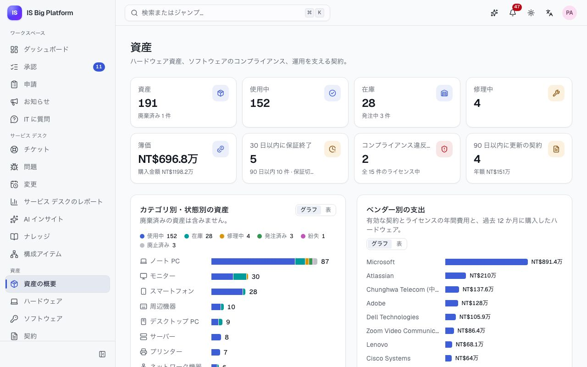
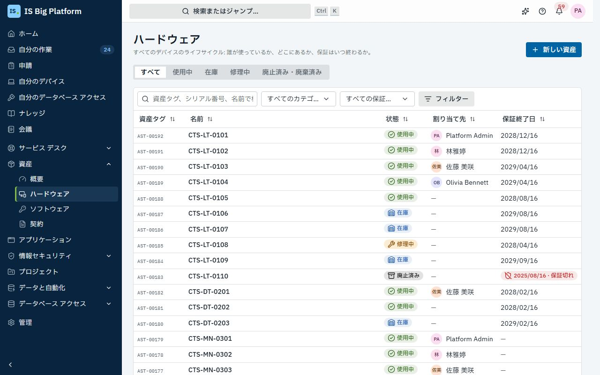
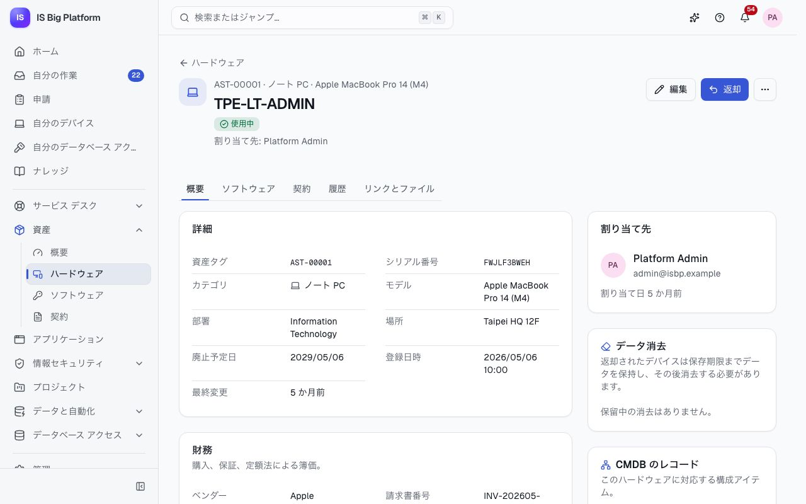
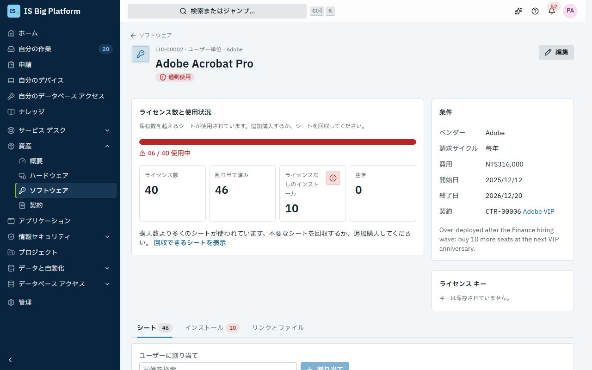
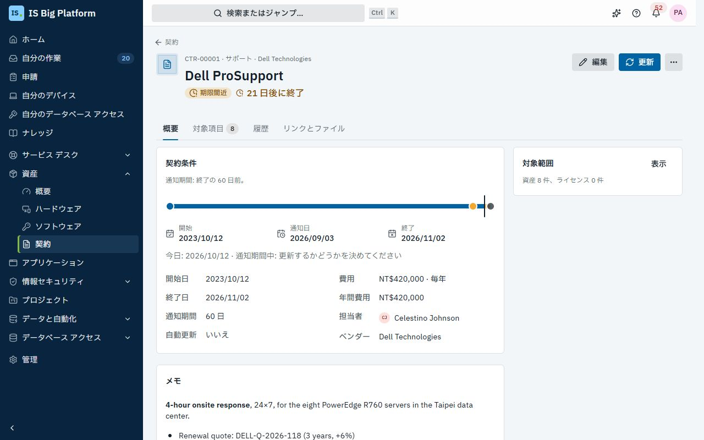

# 資産ガイド

このガイドは資産マネージャーと契約マネージャーを対象としており、従業員が自分のデバイスについて何を確認できるかも説明します。**資産**では、会社のハードウェア、ソフトウェア ライセンス、契約、ベンダーを 1 か所で管理します。誰がどのノート PC を使っているか、デバイスの現在の価値はいくらか、保有数を超えてライセンスを使用していないか、まもなく更新の判断が必要な契約はどれかを把握できます。

## このガイドでできること

- 資産の概要で[資産全体の状況を確認する](#資産全体の状況を確認する)
- [デバイスを登録し](#デバイスを登録する)、[ユーザーに割り当て](#デバイスを割り当てる回収する)、[ライフサイクルに沿って状態を進める](#ライフサイクルに沿ってデバイスの状態を進める)
- [デバイスの簿価を確認する](#デバイスの簿価を確認する)
- 必要な承認を得て[廃止したデバイスを廃棄する](#廃止したデバイスを廃棄する)
- [退職者からデバイスを回収する](#退職者からデバイスを回収する)
- [ソフトウェア ライセンスを管理し](#ソフトウェア-ライセンスを管理する)、インベントリ ツールで検出されたインストールも含めて[コンプライアンスを維持する](#ライセンスのコンプライアンスを確認する)。[検出されたソフトウェアを確認し](#検出されたソフトウェアを確認する)、インベントリ CSV をインポートする
- 署名済みの文書を添付して[契約と更新を管理する](#契約と更新を管理する)
- [ベンダーと支出を把握し](#ベンダーと支出を把握する)、[モデル カタログを管理する](#モデル-カタログを管理する)
- **自分のデバイス**で[従業員に表示される内容](#従業員に表示される内容-自分のデバイス)を理解する
- [資産をチケットや CI にリンクし](#資産をチケットciその他のレコードにリンクする)、[ServiceDesk Plus と同期される資産](#servicedesk-plus-と同期される資産)の動作を把握する

## ロールごとにできること

以下のロールは**管理 → ロールとアクセス**で付与されます。サイドバーに**資産**が表示されない場合は、いずれかのロールを管理者に依頼してください。

| ロール                                  | できること                                                                                                |
| --------------------------------------- | --------------------------------------------------------------------------------------------------------- |
| **自分のデバイス** (My devices)         | 全員に付与されています。自分に割り当てられたデバイスとソフトウェアを表示できます                          |
| **資産閲覧者** (Asset viewer)           | ハードウェア、ソフトウェア ライセンス、契約を閲覧できます                                                 |
| **資産マネージャー** (Asset manager)    | ハードウェアとライセンスの管理、ライセンス キーの表示、モデルとベンダーの管理ができます。廃棄を承認します |
| **契約マネージャー** (Contract manager) | 契約とその更新、ベンダーを管理できます。契約の対象となるハードウェアとソフトウェアも表示できます          |
| **資産管理者** (Asset administrator)    | 資産管理のすべての操作ができます                                                                          |

ハードウェアの表示範囲は、部署とその所属ユーザーに限定できます。これにより、拠点の IT 担当者には自拠点のデバイスだけを表示できます。

## 資産全体の状況を確認する

毎朝、または予算会議や監査の前にここから始めて、対応が必要な事項を確認します。

1. **資産 → 概要**に移動します。
2. 上部の数値 (**資産**、**使用中**、**在庫** (発注中の台数を含む)、**修理中**、**簿価**、**30 日以内に保証終了**、**コンプライアンス違反のライセンス**、**対応が必要なインストール** (ライセンスのない、または許可されていないソフトウェア。資産マネージャーに表示)、**90 日以内に更新の契約**) を確認します。各数値を選択すると、該当する条件で絞り込まれた一覧が開きます。
3. グラフ (**カテゴリ別・状態別の資産**、**状態別の資産**、**ベンダー別の支出**) を確認します。**ベンダー別の支出**は、有効な契約とライセンスの年間費用と、過去 12 か月に購入したハードウェアの合計です。数値を表で確認するには**表示形式** → **表**を使用します。レポートに数値をコピーするときなどに便利です。
4. **対応が必要**の各項目 (**保証の終了**、**更新が近い契約**、**コンプライアンス違反のライセンス**) を順に確認します。それぞれに**すべて表示**があります。

デモでは、**Adobe Acrobat Pro** が**コンプライアンス違反のライセンス**に表示され、**ベンダー別の支出**の 1 位は **Dell Technologies** です。

> **ヒント:** 資産マネージャーの**ホーム**には**資産の要対応事項**カードも表示され、コンプライアンス違反のライセンス、30 日以内に更新の契約、30 日以内に終了する保証を確認できます。

## デバイスを登録する

**資産 → ハードウェア**の**フィルター**で、データ消去、場所、モデル、ベンダー、割り当て先を絞り込めます。スマートフォンではカテゴリと保証の条件もここで選びます。適用中の条件は検索欄の下に表示され、× で個別に解除するか、**すべてクリア**でまとめて解除できます。選択中のクイックビューは変わりません。狭い画面では資産タグをデバイス名の下に、ステータスをその横に表示します。

デバイスを発注したとき、または到着したときに登録しておくと、初日から追跡できます。

1. **資産 → ハードウェア**に移動し、**新しい資産**を選択します。フォームが横に開きます。
2. 最初に**カテゴリ**、次に**モデル**を選びます。一覧にはそのカテゴリのモデルだけが表示され、モデルの耐用期間 (購入日を入力した後は廃止予定日) が示されます。
3. **名前** (例: `TPE-LT-0042`) と、デバイスに記載されているとおりの**シリアル番号**を入力します。同じシリアル番号は 1 回しか登録できません。
4. すぐにユーザーに渡す場合は**割り当て先 (省略可)** を選択します。フォームに「… に配備されます。」と表示されます。渡さない場合は**状態**として**在庫**または**発注済み**を選択します (発注済みのデバイスは、到着すると在庫になります)。
5. **場所**で、場所と部署を入力します。サーバー、ネットワーク機器、ストレージ、プリンターの場合は、このデバイスに対応する **CMDB 構成アイテム**を選択します (この項目はこれらのカテゴリでのみ表示されます)。
6. 必要に応じて**購入の詳細 (省略可)** を開き、ベンダー、請求書番号、購入日、金額、通貨、**保証終了日**を入力します。
7. **保存**を選択します。

**この後の流れ:** デバイスには `AST-00042` のような資産タグが付けられ、その資産ページが開き、履歴は「登録」から始まります。入れ替えの予定日を決めるには、後で**編集**を選択して**廃止予定日**を設定します。空欄の場合は、購入日にモデルの耐用年数を加えた日になります。

## デバイスを割り当てる・回収する

新入社員にノート PC を渡すとき、故障したスマートフォンを交換するとき、貸出機を回収するときに使用します。資産ページには次の手順を表すメインのボタンが 1 つだけ表示されます。在庫のデバイスは**割り当て**、使用中のデバイスは**返却**、データ消去が残っているときは**データ消去を記録**、廃止済みのデバイスは**廃棄を申請**です。その他の操作 (**割り当て直す**、**状態の変更**、**データ消去を記録**、**廃棄を申請…**) は**その他** (⋯) にあります。

1. **資産 → ハードウェア**からデバイスを開きます (**在庫**タブには渡せるデバイスが表示されます)。
2. **割り当て** (すでに誰かが使用している場合は**その他 → 割り当て直す**) を選択します。
3. **ユーザー**を選び、**メモ (省略可)** を追加して**割り当て**を選択します。

**この後の流れ:** デバイスは**使用中**になり、ユーザーに通知 (「自分に割り当てられたデバイス」) が届きます。ユーザーは**自分のデバイス**でそのデバイスを確認できます。**履歴**タブには「… に割り当て」と記録されます。

回収するには**返却**を選択し、**返却先** (**在庫**または**修理中**) を選び、状態 (付属品の不足など) をメモして**返却**を選択します。履歴には「… が返却」と記録されます。

データを保存するデバイス (ノート PC、デスクトップ PC、スマートフォン、タブレット、サーバー、ストレージ) は、返却時にデータを消去します。**データ消去を予定する**をオンのままにし、退職者の引き継ぎなどでまだファイルが必要な場合は**データの保存期限 (省略可)** を設定します。ダイアログには「2026/12/9 までに消去 (データが不要になってから 2 か月以内)」のように消去期限が表示されます (月数は管理者が**管理 → 資産の設定**で設定します)。デバイスには **… までに消去**と表示され、期限の 1 週間前からは **… に消去期限**、期限後は **… から消去期限切れ**と表示されます。資産マネージャーにはリマインダーが届き、**資産 → ハードウェア**では**データ消去**で絞り込めます。

ストレージがすでに消去済みの場合は、**返却**ダイアログで**すでに消去済みですか? 今すぐ記録する**をオンにすると、続けて**データ消去を記録**ダイアログが開きます。それ以外の場合は、消去したら**データ消去を記録**を選択し、**方法** (スマートフォンなら**工場出荷時の設定にリセット**など) を選び、必要に応じて**消去日時** (空欄の場合は現在の日時)、**実施者**、**メモ**を入力します。**データ消去**カードと履歴に、誰がいつどのように消去したかが表示されます。

申請フォームでこの両方を行うこともできます。**デバイスを貸与**アクションと**デバイスを返却**アクションは、フォームで (または承認ステップで IT が) 選択したデバイスを割り当てまたは返却し、デバイスの履歴から申請 (署名済みの秘密保持契約など) にリンクします。

## ライフサイクルに沿ってデバイスの状態を進める

すべてのデバイスが同じライフサイクルに従うため、概要の件数を信頼できます。

1. デバイスを開き、**その他 → 状態の変更**を選択します。
2. **新しい状態**を選び、メモを追加して**状態の変更**を選択します。**使用中**は選べません。使用中にするにはユーザーが必要なため、**割り当て**を使用します。

| 現在の状態 | 移行できる状態                                  |
| ---------- | ----------------------------------------------- |
| 発注済み   | 在庫、紛失                                      |
| 在庫       | 使用中、修理中、廃止済み、紛失                  |
| 使用中     | 在庫、修理中、紛失                              |
| 修理中     | 在庫、使用中、廃止済み                          |
| 廃止済み   | 在庫、または廃棄済み (廃棄の承認を経た場合のみ) |
| 紛失       | 在庫                                            |
| 廃棄済み   | なし (最終状態)                                 |

デバイスに割り当て先が保持されるのは、**使用中**、**修理中**、**紛失**の間だけです。それ以外の状態に移すと、そのユーザーが割り当て先ではなくなることがダイアログに表示されます。

資産ページには、**概要**、**ソフトウェア** (インストールされているソフトウェアとライセンス シート)、**契約** (デバイスを対象とするサポート契約や保守契約)、**履歴** (すべての操作と、その実行者と日時)、**リンクとファイル**の 5 つのタブがあります。開いたタブはアドレスに含まれるため、リンクから**履歴**タブを直接開くこともできます。

## デバイスの簿価を確認する

財務部門や監査担当者から、ハードウェアの現在の価値を尋ねられることがあります。簿価は自動的に計算されるため、手入力する必要はありません。

1. デバイスを開きます。**財務**カードに**購入金額**、**保証終了日**、**簿価**が表示されます。
2. **定額法による減価償却**バーには、耐用年数のうちどこまで経過したかと、償却が完了する日付 (**… に償却完了**) が表示されます。

簿価は、モデルの耐用年数にわたって購入金額から 0 まで直線的に減少します。モデルに耐用年数が設定されていない場合は、カテゴリの既定値が適用されます。ノート PC、タブレット、周辺機器は 36 か月、デスクトップは 48 か月、スマートフォンは 24 か月、モニター、サーバー、ネットワーク機器、ストレージ、プリンターは 60 か月です。概要の**簿価**は、すべてのデバイスの簿価を既定の通貨 (管理者が変更していなければ TWD) で合計したものです。

## 廃止したデバイスを廃棄する

会社から完全に手放すデバイスは、事前に承認を得る必要があります。会社のデータを保存でき、まだ帳簿価額があるか使用開始から 5 年未満のデバイスの場合は、ストレージが消去または破壊されたことについて、情報セキュリティの承認も必要です。

1. デバイスを開きます。**廃止済み**のデバイスは**廃棄を申請**を、**在庫**または**修理中**のデバイスは**その他 → 廃棄を申請…** を選択します。この申請により、デバイスは先に廃止されます (ダイアログにその旨が表示されます)。ユーザーが使用中のデバイスは、先に返却する必要があります。
2. **どのように廃棄しますか?** に、「SSD を消去して認定リサイクル業者に引き渡す」のように入力します。ダイアログの**承認者**には、使用中の廃棄ワークフローの承認ステップと承認者が表示されます。情報セキュリティの承認も必要な場合 (既定では、まだ帳簿価額があるか使用開始から 5 年未満のノート PC、デスクトップ、サーバー、ストレージ デバイス、スマートフォン、タブレット)、その旨がダイアログに表示されます。
3. **廃棄を申請**を選択します。

**この後の流れ:**

- 資産ページに「廃棄の承認待ちです。」と表示され、申請は**資産の廃棄**承認に送られます。
- まず資産マネージャーが承認します (期限は 72 時間で、48 時間後にリマインダーが送られます)。
- データを保存できるデバイスで、まだ簿価が残っているか購入から 5 年未満のものは、続いてセキュリティ チームが承認します。承認者への指示では、ストレージが安全に消去された (NIST 800-88) か、物理的に破壊されたことを確認するよう求められます。
- 承認されると、デバイスは**廃棄済み**になります。却下された場合は**廃止済み**のままで、履歴に「廃棄が却下されました」と記録されます。

承認者は**承認**の受信トレイで判断します。[申請を承認または却下する](employees.md#申請を承認または却下する) を参照してください。デモでは、画面が割れた廃止済みの ThinkPad が廃棄の承認待ちになっています。購入から 5 年未満のノート PC なので、セキュリティ チームの承認も必要です。**資産 → ハードウェア**の**廃止済み・廃棄済み**タブで確認できます。

> **重要:** **状態の変更**で**廃棄済み**に設定することはできず、ほかのシステムからも設定できません。廃棄はこの承認を経た場合にのみ行われます。

## 退職者からデバイスを回収する

**管理 → ユーザー**でユーザーをオフボーディングすると、資産では次の処理が自動的に行われます。

- そのユーザーのライセンス シートが回収されます (それぞれ監査ログに記録されます)。
- そのユーザーがまだ保有しているすべてのデバイスに、「返却を依頼: … が退職しました」という履歴が追加されます。
- 資産マネージャーに、資産タグを含む通知 (「退職者から回収するデバイス」) が届きます。

デバイスは回収されるまで**使用中**のままです。回収したら、各デバイスを開いて**返却**を選択します。

## ソフトウェア ライセンスを管理する

会社が保有しているライセンスを記録しておくと、使用状況と比較できます。

1. **資産 → ソフトウェア**に移動します。タブは**ライセンス**、**承認済みリスト**、**インストール済み**で、それぞれ所有しているもの、インストールしてよいもの、デバイスが報告したものです。**ライセンス**で**新しいライセンス**を選択します。
2. **製品** (インベントリ ツールから報告されたインストールはこの名前で照合されます)、ベンダー、**ライセンスの種類** (**ユーザー単位**、**デバイス単位**、**同時使用**、**サイト**、**サブスクリプション**)、**ライセンス数** (無制限またはサイト ライセンスの場合は空欄) を入力します。
3. 開始日と終了日 (永続ライセンスの場合は**終了日**を空欄) を入力します。
4. **その他の詳細**で、発行元、費用、**請求サイクル**、購入時の**契約**を入力し、必要に応じて**ライセンス キー**を保存します。キーは暗号化して保存されます。
5. 保存します。次にライセンスを開き、**シート**タブで (ライセンスの種類に応じて) **ユーザーに割り当て**または**デバイスに割り当て**を使用し、**割り当て**を選択します。

保存されたキーを確認するには、ライセンスを開いて**表示**を選択します。このボタンは、キーの表示を許可されたユーザー (**資産マネージャー**ロールと**資産管理者**ロール) にだけ表示され、表示するたびに監査ログに記録されます。

## ライセンスのコンプライアンスを確認する

トゥルーアップ、更新、発行元による監査の前に、使用状況がライセンス数と一致しているかを確認します。

1. **資産 → ソフトウェア**に移動します。**すべて**、**対応が必要**、**期限間近**、**低使用率**の各タブで一覧を絞り込めます。**使用状況**列には、ライセンス数に対する使用中のシート数が表示されます。
2. ライセンスを開きます。**ライセンス数と使用状況**には、**ライセンス数**、**割り当て済み**、**ライセンスなしのインストール**、**空き**と、コンプライアンスの状態を説明する文が表示されます。
3. **インストール**タブを開き、**ライセンスなしのみ**をオンにすると、シートなしで製品を実行しているデバイスが表示されます。行の**ライセンスを割り当て**を選択すると、そのデバイス (デバイス単位のライセンスの場合) またはそのユーザーにシートを割り当てられます。空きシートがない場合は、代わりに「空きシートなし: 先に回収または追加購入」と表示されます。
4. シートを空けるには、**シート**タブで**回収できるシートのみ**をオンにします。保有者が退職または停止中、デバイスが廃止または紛失、または (インベントリ ツールがその製品を報告している場合) 保有者のデバイスから 90 日間報告がないシートが、理由とともに表示されます。行の**回収**を選択するか、複数の行を選んで **… 件を回収**を選択します。使用超過のライセンスからは、この一覧へのリンク (「回収できるシートを表示」) があります。

| コンプライアンス | 意味                                                                                       |
| ---------------- | ------------------------------------------------------------------------------------------ |
| **準拠**         | 使用数がライセンス数の範囲内です                                                           |
| **過剰使用**     | 保有数を超えるシートが使用されています。追加購入するか、シートを回収してください           |
| **低使用率**     | ライセンス数が 10 以上で、使用率が 60% 未満のライセンスです (しきい値は設定で変更できます) |
| **期限間近**     | ライセンスが 60 日以内に終了します                                                         |
| **期限切れ**     | ライセンスが終了しています                                                                 |

デバイス単位のライセンスでは、シートなしで製品を実行しているデバイスも使用中として数えられます。

**この後の流れ:** コンプライアンスは変更のたびに再計算され、毎晩も再計算されます。ライセンスが**過剰使用**または**期限切れ**になると、資産マネージャーに通知 (「コンプライアンス違反のライセンス」) が届きます。

デモでは、**Adobe Acrobat Pro** (`LIC-00002`) のライセンス数は 40 ですが、財務部門の大量採用の後に使用中のシートがそれを上回ったため、**過剰使用**になっています。

**検出されたインストール:** ソフトウェア インベントリ ツールは、各デバイスのソフトウェアの完全な一覧を API で報告します (`POST /api/v1/itam/discovery/software`。[API ガイド](../../api.md) を参照)。後の報告から消えた製品はアンインストールされたものとして扱われますが、手動で記録したインストールは保持されます。デバイスの**ソフトウェア**タブでは、インストールされている各製品に**ライセンスあり**、**ライセンスなし**、**管理対象外** (その製品のライセンス レコードがない) のいずれかが表示されます。

## 検出されたソフトウェアを確認する

インベントリ ツールは製品に独自の名前を付けます。たとえば、ノート PC が報告する「Microsoft Office 365 ProPlus」は、当社が所有する **Microsoft 365 E3** ライセンスのことです。すべてのインストールがコンプライアンスに反映されるよう、これらの名前を定期的に確認し、許可されていないソフトウェアに対応します。ツールが API を呼び出せない場合は、その CSV エクスポートをインポートできます。

1. **資産 → ソフトウェア → インストール済み**に移動します。**資産マネージャー**または**資産管理者**のロールが必要です。
2. **ライセンスなし**で、どのライセンスの製品名にも一致しない検出されたタイトルを、インストール数の多い順に、**デバイス数**と**最終検出**とともに確認します。承認済みリストの無料・オープン ソース ソフトウェアはここに表示されません。
3. タイトルの行で、次のいずれかを選択します。
   - **ライセンスにマッピング**: **ライセンス**を選び、**マッピング**を選択します。このタイトルで報告されたインストールは、すべてのデバイスで (今後の報告でも) そのライセンスの製品として扱われます。デバイスの**ソフトウェア**タブには「報告された名前: …」と表示されます。タイトルとライセンスの製品の両方を報告するデバイスは両方のインストールを保持し、マッピングを削除するとすべてのインストールがすぐに元に戻ります。
   - **ライセンス不要**: ライセンスが不要なソフトウェアに使用します。インストールはデバイスに残り、タイトルは一覧から外れます。
   - **その他** (⋯) → **許可…** または**禁止…**: タイトルを承認済みリストに追加します。
4. **許可されていない**には、使用中のデバイスのインストールのうち、承認済みリストにそのデバイスの部署を対象とする項目がないもの (**承認済み一覧にない**) と、禁止されているもの (**禁止**) が表示されます。行で次を選択できます。
   - **許可…**: そのデバイスの部署を対象にした承認済みリストのフォームが開きます (全社で許可する場合は**会社全体**を選びます)。ライセンスの種類は選択されていないので、選んでください。
   - **削除を依頼**: そのデバイスからのアンインストールを依頼するサービス デスクの要求を、あなたの名前で作成します。要求はデバイスにリンクされ、説明にはデバイスの利用者が記載されます。
5. **マッピング済み・無視**には決定が一覧表示されます。元に戻すには、その横の**削除**を選択します。マッピングされたタイトルは、ツールが報告した名前に戻ります。
6. **報告**には、デバイスごとの報告が、**ソース** (**インベントリ ツール**または **CSV インポート**)、変更、報告元とともに一覧表示されます。

インベントリ ツールのエクスポートをインポートするには、**CSV をインポート**を選択し、**CSV ファイル**を選んで概要 (行数、デバイス数、スキップされた行) を確認してから、**… 台のデバイスをインポート**を選択します。ダイアログには列が表示されます。

| 列              | 必須         | 内容                                                  |
| --------------- | ------------ | ----------------------------------------------------- |
| `serial_number` | どちらか一方 | デバイスのシリアル番号 (大文字と小文字は区別しません) |
| `asset_tag`     | どちらか一方 | 資産タグ (例: AST-00042)                              |
| `product`       | はい         | ツールが報告したソフトウェアのタイトル                |
| `publisher`     | いいえ       | 発行元またはベンダー                                  |
| `version`       | いいえ       | インストールされているバージョン                      |

ヘッダー行の後に、インストールされている製品ごとに 1 行です。列はコンマ、セミコロン、タブのいずれかで区切ります。

**この後の流れ:** ファイル内の各デバイスは、インベントリ ツールの報告と同じく完全な報告として扱われます。一覧にない製品はそのデバイスから削除され (手動で記録したインストールは保持されます)、ライセンスのコンプライアンスが再計算されます。同じデバイスの 2 つの報告は順番に適用されます。資産に登録されていないデバイスは一覧表示されるので、登録してからもう一度インポートします。すべての報告と決定は監査ログに記録されます。

デモでは、**7-Zip** は既にライセンス不要に設定されており、いくつかのノート PC がまだ **Microsoft Office 365 ProPlus** を報告しています。これを **Microsoft 365 E3** にマッピングしてください。2 台のノート PC で **WinRAR** (承認済み一覧にない) が、1 台で **uTorrent** (禁止) が実行されています。削除を依頼してください。

**承認済みリストを管理する:** **資産 → ソフトウェア → 承認済みリスト**は、ソフトウェアの許可リストです。各項目では、ソフトウェアのタイトルを許可 (または禁止) します。必要に応じて 1 つの**バージョン** (空欄の場合はすべてのバージョン) を指定し、**会社全体**または一部の**部署**を対象とし、短期間の利用であれば**有効期限**を設定できます。また、**ライセンスの種類** (必ず選択し、既定値はありません)、使用するライセンスまたは契約、承認された申請も記録します (省略可能な項目は**その他の詳細**にあります)。資産マネージャーは**ソフトウェアを追加**を選択します。ソフトウェアにアクセスできるユーザーは全員がこの一覧を表示でき、**CSV をエクスポート**では許可リストの形式でダウンロードできます。デバイスの**ソフトウェア**タブにも**許可されていない**と同じラベルが表示され、ホームでも件数が集計されます。ソフトウェアのインストール申請フォームでは、**ソフトウェアを承認**アクションでタイトルを追加できます。

## 契約と更新を管理する

サポート、保守、リース、サブスクリプションの契約は、決まった日に更新または失効します。資産では期限に間に合うように通知が届き、署名済みの文書を契約と一緒に保管できます。

1. **資産 → 契約** (タブは**契約**と**ベンダー**) に移動し、**新しい契約**を選択します。
2. タイトル、ベンダー、**種類**、開始日と終了日を入力します。**その他の詳細**で、**通知期間** (終了の何日前に通知を送るか)、**自動更新**の有無、費用と請求サイクル、更新の通知を受け取る**担当者**を設定します。まだ署名されていない場合は、そこで**下書きとして保存する (有効にするまで通知は送られません)** を選び、後で**有効にする**を選択します。
3. 契約の**対象項目**タブを開いて**項目を編集**を選択し、**資産を追加**と**ライセンスを追加**を使用します。
4. **リンクとファイル**を開き、署名済みの PDF を**添付ファイル**にアップロードします (ファイルをドラッグするか、**アップロード**を選択します)。

**この後の流れ:**

- 契約の**更新のタイムライン**には、開始日、**通知日**、終了日、今日の位置が表示されます。
- 通知期間が始まると契約は**期限間近**になり、担当者と契約マネージャーに「更新のお知らせ」の通知が届きます。終了の 1 週間前には最終通知が届きます。
- 終了日を過ぎると**期限切れ**になります。自動更新の契約は、自動的に次の期間に更新されます。
- 手動で更新するには、**更新**を選択し、**新しい期間の開始日**、**新しい期間の終了日**、費用を入力して**更新**を選択します。以前の期間は履歴に残ります。
- **その他の操作**メニューの**契約をキャンセル**を選択すると、通知と自動更新が停止します。契約とその履歴は保持されます。

**契約**の一覧には、**有効**、**まもなく更新** (90 日以内に終了)、**期限切れ**、**すべて**のタブがあります。デモでは、**Dell ProSupport** (`CTR-00001`) は台北データ センターの PowerEdge サーバーを対象とする契約で、通知期間中であり、`Dell-ProSupport-Plus-signed.pdf` が添付されています。

## ベンダーと支出を把握する

1. **資産 → 契約 → ベンダー**に移動すると、各ベンダーの連絡先、そのベンダーとの契約・ライセンス・資産の件数、**年間支出**が表示されます。
2. ベンダーを選択すると、その契約、ライセンス、過去 12 か月にそのベンダーから購入したハードウェアが表示されます。
3. 資産マネージャーと契約マネージャーは、**新しいベンダー**でベンダーを追加できます。連絡先は契約と更新の通知に表示されます。

## モデル カタログを管理する

モデルによって、そのモデルとして購入したデバイスの減価償却の耐用年数が決まるため、正確に保ってください。

1. **管理 → 資産の設定**に移動します。**モデル**タブで**新しいモデル**を選択します。
2. **メーカー**、**モデル名**、**カテゴリ**を入力します。**その他の詳細**で**品番**と**耐用年数 (か月)** (カテゴリの既定値を使う場合は空欄) を入力します。購入しなくなったモデルは、**新しい資産に使用可能**をオフにします。
3. **全般**タブには、**既定の通貨**、**保証期限の通知期間** (既定は 30 日)、**低使用率のしきい値**、データ消去の月数と通知日数があります。プラットフォーム管理者はここで直接変更して**保存**を選択できます。それ以外のユーザーは値を確認できます。

このページを表示するには、**資産マネージャー**、**契約マネージャー**、または**資産管理者**ロールが必要です。

## 従業員に表示される内容: 自分のデバイス

すべての従業員は、IT 部門から割り当てられたデバイスと個人用のソフトウェア ライセンスを確認し、数回のクリックでデバイスの問題を報告できます。「自分のノート PC はどれ?」と聞かれたら、ここを案内してください。

1. サイドバーの**自分のデバイス**を選択します (**申請 → 何が必要ですか？** のカードからも開けます)。
2. 各デバイスには**資産タグ**、**シリアル番号**、**割り当て日**、**保証**が表示されます。個人用のソフトウェア ライセンスはその下に表示されます。
3. デバイスの問題を報告するには、そのデバイスの**問題を報告**を選択します。一覧の下の**サービス デスクに連絡**と**申請する**で、足りないデバイス、誤っているデバイス、自分のものではないデバイスや新しいデバイスに対応できます。

**この後の流れ:** デバイスがリンクされた状態で**問題を報告**ページが開きます。ユーザーは問題を説明し、**サービス デスクに送信**を選択します。新しいチケットには資産へのリンクが付くため、担当者はユーザーに尋ねなくてもモデル、保証、履歴を確認できます。デバイスが 1 台も表示されないユーザーが**サービス デスクに連絡**を選択すると報告が開き、IT 部門がデバイスを登録できます。従業員側の報告手順については、[従業員ガイド](employees.md#自分のデバイスを確認し問題を報告する) を参照してください。

## 資産をチケット、CI、その他のレコードにリンクする

リンクによって全体像がわかります。たとえば、バッテリーの消耗に関するインシデントを、その問題が起きたノート PC と並べて確認したり、サーバーを CMDB のレコードと並べて確認したりできます。

- **CMDB:** サーバーとネットワーク機器の場合は、デバイスの登録時または編集時に **CMDB 構成アイテム**を設定します。資産ページの **CMDB のレコード**にその CI が表示され、CMDB の CI ページには、シリアル番号、保証、割り当て先、簿価を含む**資産レコード**カードが表示されます。
- **その他のレコード:** 資産、ライセンス、または契約を開いて**リンクとファイル**に移動し、**レコードをリンク**を選択します。チケット、変更、タスクなどのレコードを番号またはタイトルで検索し、**リンク**を選択します。
- **ユーザー:** **管理 → ユーザー**のユーザー ページの**資産とソフトウェア**には、そのユーザーに割り当てられたデバイスとライセンスが表示されます。
- **申請フォーム:** フォームでは、**レコード** フィールドでハードウェア資産やライセンス (交換するデバイスなど) を選択させることができます。選択できるのは、資産を表示できるユーザー (**資産閲覧者**など) だけです。フォームの承認では、資産の**カテゴリ**、**状態**、**データを保存する**、**割り当て先**、**場所**、**保証終了日**、またはライセンスの**製品**、**コンプライアンス**、**終了日**に応じてルートを決めることができます。[独自のプロセスを作成する](processes.md#ユーザーがレコードを選択できるようにする)を参照してください。

デモでは、インシデント「Laptop battery drains in two hours」が報告者自身のノート PC にリンクされています。表示されるのは、閲覧を許可されている関連レコードだけです。それ以外は件数だけが表示され、名前は表示されません。

## ServiceDesk Plus と同期される資産

組織で資産台帳をまだ ManageEngine ServiceDesk Plus (オンプレミス) で管理している場合は、統合管理者が統合ハブを通じてハードウェアを ServiceDesk Plus と同期させることができます。

- 資産はシリアル番号で照合されます。どちらの側で行った割り当て、返却、状態の変更も同期されます。
- 資産の**リンクとファイル**タブには**同期先**カードが表示され、接続、**前回の同期**の日時、**今すぐ同期**があります。同期によって作成された履歴には、「Contoso ServiceDesk Plus … 経由」のように取得元が表示されます。
- ライフサイクルは引き続き適用されます。ServiceDesk Plus で廃棄済みにしたデバイスは、ISBP では廃棄済みに**なりません**。同期はその変更を拒否し、エラーを報告します。承認が行われるよう、ISBP で**廃棄を申請**を使用してください ([承認は外部からスキップできない](integrations.md#外部から承認を省略することはできない) を参照)。

デモでは、**Assets ↔ assets** 同期ルールによって、ハードウェアがデモ用の模擬サーバー **Contoso ServiceDesk Plus** と双方向でリンクされています。両方の側で同じフィールドが変更された場合は、ServiceDesk Plus の値が優先されます。接続、マッピング、競合ルールの設定については、[統合ガイド](integrations.md) を参照してください。

## 関連情報

- **従業員**は**自分のデバイス**で自分のデバイスを確認し、そこから問題を報告します ([従業員ガイド](employees.md))。
- **サービス デスク**の担当者は、チケットでリンクされたデバイスと、サーバーの背後にある CMDB のレコードを確認できます ([サービス デスク ガイド](service-desk.md))。
- 廃棄の**承認**は、ほかのすべての承認と同じ受信トレイで処理されます。管理者は**資産の廃棄**ワークフローを調整できますが、削除はできません。資産のカスタム フィールドに基づく条件も設定できます ([管理者ガイド](administrators.md)、[独自のプロセスを作成する](processes.md#組み込みの承認でカスタム-フィールドを使用する))。
- **ServiceDesk Plus** との同期: [統合ガイド](integrations.md)。
- **アシスタント**は、ユーザーのアクセス許可の範囲で、「自分のノート PC はどれ?」という質問に答えたり、資産を検索したり、ライセンスのコンプライアンスを確認したり、まもなく終了する契約を一覧表示したりできます ([アシスタントと AI](assistant-and-ai.md))。
- 簿価やライセンス数 (エンタイトルメント) などの用語: [用語集](glossary.md)。
