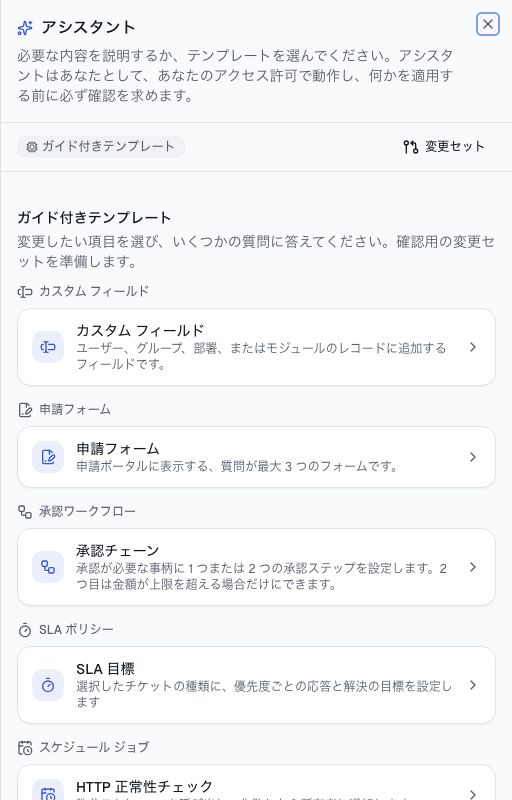
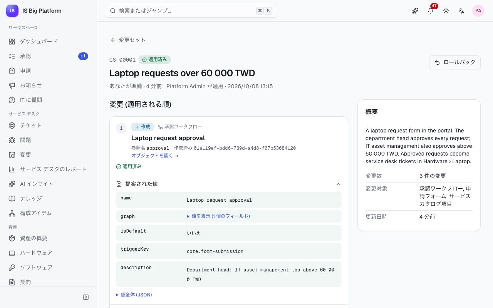
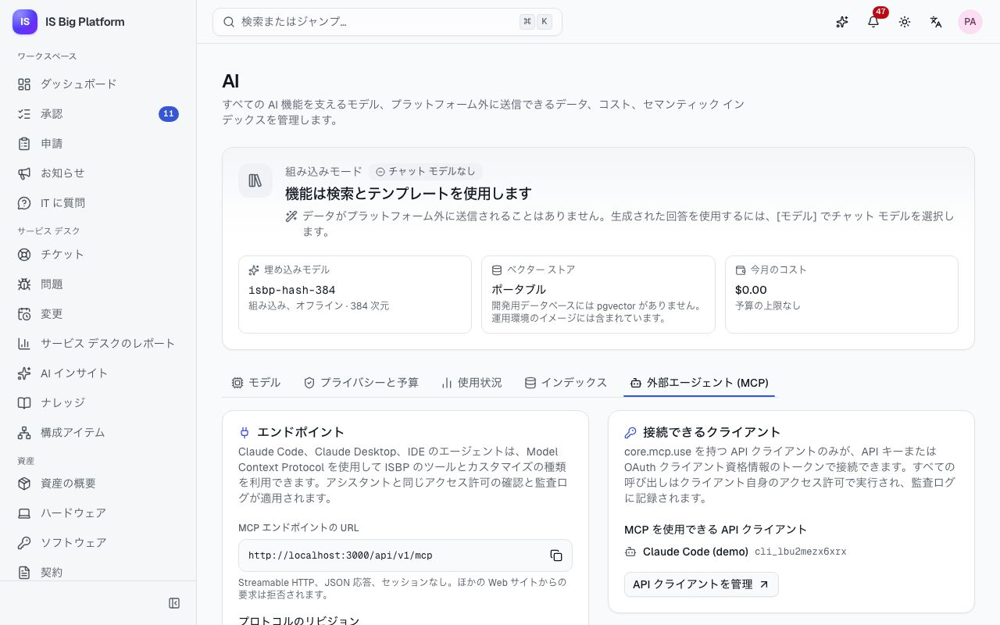

# アシスタントと AI ガイド

このガイドは、ISBP の AI 機能を使用するすべてのユーザーと、それを設定する管理者向けです。言語モデルがある場合とない場合に AI が何を行うか、データがどのように保護されるか、IT に質問でヘルプを得る方法、そしてアシスタントの使い方を説明します。アシスタントは組み込みの AI エージェントで、日常業務を代わりに行い、構成の変更を変更セットとして準備します。変更セットは、反映される前に確認できます。

## このガイドでできること

- [現在の AI のモード](#組み込みモードとモデル-モード)と、[プラットフォーム外に送信されるデータ](#データとプライバシー)を理解する
- [IT に質問](#it-に質問してヘルプを得る)で回答を得る、[チケットでヘルプデスク AI](#担当者向けのヘルプデスク-ai) を使用する
- どのページからでも[アシスタントを開き](#アシスタントを開く)、[日常業務を任せる](#アシスタントで日常業務を行う)
- [変更セットでプラットフォームの構成を変更する](#変更セットで構成を変更する)。モデルが構成されていない場合は[ガイド付きテンプレートを使用する](#ガイド付きテンプレートを使用する)
- 変更セットを[確認する](#変更セットを確認する)、[適用する](#変更セットを適用する)、[レビューを依頼する](#レビューを依頼する)、[ロールバックする](#変更セットをロールバックする)
- MCP 経由で [Claude Code などの外部エージェントを接続する](#mcp-で外部エージェントを接続する)

## ISBP での AI の仕組み

ISBP のすべての AI 機能は、管理者が**管理 → AI** で制御する 1 つのゲートウェイを経由します。AI プロバイダーと直接通信するモジュールはないため、同じプライバシー ルール、使用状況のログ、予算がすべての機能に適用されます。

### 組み込みモードとモデル モード

ISBP は言語モデルがなくても動作します。管理者がモデル (Anthropic Claude、または自社でホストするモデルを含む OpenAI 互換のモデル) を追加すると、生成された回答が有効になります。各機能には、どのモードで動作しているかが表示されます。

| 機能                       | 組み込みモード (チャット モデルなし)                   | チャット モデルあり                                                |
| -------------------------- | ------------------------------------------------------ | ------------------------------------------------------------------ |
| IT に質問                  | 最も一致するナレッジ記事を表示し、チケットの作成を提案 | ナレッジ ベースをもとに、参照元付きの回答を作成                    |
| 新しいチケットのトリアージ | 類似の解決済みチケットから提案                         | モデルが提案を精査し、その根拠を説明                               |
| 返信の下書き               | 最適な記事の手順を引用したテンプレート                 | 依頼者の言語で書かれた、番号付きの参照元を含む返信                 |
| チケットの要約             | チケットから抽出した問題、最新の更新、現在の状態       | モデルが作成した要約                                               |
| アシスタント               | 自由入力の代わりに**ガイド付きテンプレート**           | 自由入力の依頼。アシスタントはプラットフォームのツールを使って作業 |

組み込みモードでは、データがプラットフォーム外に送信されることはありません。**管理 → AI** の上部には**組み込みモード**または**生成 AI** と表示され、アシスタント パネルには**ガイド付きテンプレート**、または **AI モデル:** に続けてモデル名が表示されます。デモは組み込みモードで動作します。

### データとプライバシー

- **マスク:** プロンプトを外部のモデルに送信する前に、ISBP は個人データや機密データをプレースホルダーに置き換え、応答で実際の値に戻します。そのため、プロバイダーが実際の値を目にすることはありません。既定では、メール アドレス、電話番号、IP アドレス、カード番号、国民 ID (台湾の身分証番号、日本のマイナンバー、米国の SSN)、API キーなどのシークレットが対象です。管理者は、社員番号の形式などの独自のパターンを追加できます。
- **アクセス許可:** AI が見つけるのは、自分で開くことができるものだけです。検索結果と回答は自分のアクセス許可で絞り込まれ、アシスタントは自分のアクセス許可の範囲を超えて操作することはありません。
- **自社でホストするモデル:** 自社でホストするモデルを使用する場合、プロンプトは社内ネットワークの外に出ません。

### 使用状況と予算

AI の呼び出しはすべて、呼び出した機能、対象のユーザー、使用したトークン数、推定コストとともに記録されます。管理者は**管理 → AI → 使用状況**で確認できます。月間予算 (省略可能) を設定すると、予算を使い切った時点で AI の呼び出しが停止します。翌月までは、「今月の AI 予算を使い切りました。」というメッセージで AI の呼び出しが拒否されます。

## IT に質問してヘルプを得る

IT に質問は、全員が使えるバーチャル エージェントです。何かが動作しないときや IT に何かを依頼したいときは、チケットを作成する前に使用してください。

1. **ワークスペース → IT に質問**に移動するか、申請ポータルの **IT に質問**カードで**質問する**を選択します。
2. 問題を自分の言葉で入力します。どの言語でもかまいません。
3. 回答とリンクされた記事を読みます。**解決しました**または**まだ解決しません**を選択します。
4. 解決できない場合は、IT に質問がチケットを準備します。**チケットを確認**を選択して内容を確認し、**チケットを作成**を選択します。

**この後の流れ:** 確認するまで何も作成されません。チケットはサービス デスクに送られ、**自分の申請**で状況を確認できます。申請とチケットについては、[従業員ガイド](employees.md)を参照してください。

## 担当者向けのヘルプデスク AI

**AI アシスト担当者** (AI-assisted agent) ロールを持つサービス デスクの担当者には、各チケットに **AI アシスト**パネルが表示されます。パネルには、フィールドごとに適用できるトリアージの提案 (カテゴリ、グループ、優先度)、類似チケットとおすすめの記事、参照元付きで返信を作成する**返信を下書き**、**要約**、解決済みのチケットをレビュー用の記事の下書きにする**ナレッジ記事を下書き**があります。自動トリアージは既定でオフです。管理者がオンにすると、ヘルプデスク AI はまだ空のフィールドだけを入力します。キューでの使い方については、[サービス デスク ガイド](service-desk.md)を参照してください。

## アシスタントを開く

アシスタントは、プラットフォームに組み込まれた AI エージェントです。すべてのページのヘッダーにあるため、外部のツールは必要ありません。

1. 任意のページの右上にあるきらめきボタン (**アシスタント**) を選択します。
2. 右側にパネルが開きます (スマートフォンでは全幅)。パネルには、現在のモードと**変更セット**へのリンクが表示されます。
3. **アシスタントを閉じる**で閉じます。実行中の依頼は処理が続き、もう一度開くと、パネルは閉じたときの状態から再開します。

アシスタントは、表示中のページとそのページのレコード (開いているチケットなど) を認識します。メッセージ ボックスの上には、**ページ:** に続けて、アシスタントが認識している内容が表示されます。

ボタンが表示されない場合は、管理者に**アシスタント ユーザー** (Assistant user) ロールを依頼してください。AI モデルが構成されている場合、ロールで何らかの日常業務 (チケットの検索や更新など) が許可されていれば、すぐにアシスタントとその業務についてやり取りできます。構成の変更を準備するには、その構成の読み取りアクセスも必要です。モデルがない場合、アシスタントは読み取りできる構成のガイド付きテンプレートを提供します。そのため、読み取りできる構成が 1 つもない場合、パネルには「カスタマイズできる項目はまだありません」と表示されます。

## アシスタントでできること

アシスタントは、プラットフォームがすべての AI エージェントに提供するのと同じツールを使い、**あなたとして**動作します。画面上で自分ができることしか実行できず、アシスタントの操作はすべて監査ログに記録されます。

- **日常業務は直接実行:** チケット、ユーザー、グループ、資産、構成アイテム、アプリケーションの検索、チケットの作成、チケットへの返信または作業メモの追加、チケットのトリアージ、メンバーになっているプロジェクトでのタスクの作成やタスクの状態の変更、ナレッジ記事の下書きの作成、リリースの準備状況の確認。
- **確認が必要な操作:** 一部の操作は、アシスタントの判断だけでは実行されません。チケットの解決、ユーザーのオフボーディング、お知らせの公開、データベース アクセスの申請、スケジュール ジョブや ETL パイプラインの実行、変更セットの適用やロールバックです。アシスタントは確認カードを表示し、ユーザーの判断を待ちます。
- **構成は変更セットで変更:** ワークフロー、フォーム、フィールド、ロール、および下の表にあるその他の構成が直接変更されることはありません。アシスタントは変更を変更セットにまとめます。変更セットは自分またはレビュー担当者が 1 回の操作で適用でき、ロールバックすることもできます。

## アシスタントで日常業務を行う

自由入力で依頼するには、チャット モデルが必要です。作業に何度も検索が必要な場合や、表示中のページを離れずに何かを行いたい場合に、アシスタントを使用します。

1. レコード (デモの VPN インシデントなど) を開いてから、アシスタントを開きます。
2. **変更したい内容を入力してください…** (変更できる構成がない場合は**必要なことを入力してください…**) に依頼内容を入力します。例: 「このチケットに作業メモを追加して: ユーザーの VPN クライアントが 2 バージョン古い」。Enter キーで送信します (Shift+Enter で改行)。
3. **アシスタントが実行した操作**を確認します。検索や操作が実行されるたびに一覧に表示されます。
4. 確認が必要な操作をアシスタントが求めた場合は、カードを読んで**確認**または**拒否**を選択します。

**この後の流れ:** 変更は自分の名前でただちにレコードに反映されます。以前の会話は**最近の会話** (履歴ボタン) にあります。**新しい会話**を選択すると、新しい会話を始められます。

## 操作を確認または拒否する

人の確認が必要な操作をアシスタントが実行しようとすると、**実行前の確認**というタイトルのカードに、実行する内容が自分の言語で表示されます。

1. カードを読みます。正確な入力内容を確認するには、**送信される内容を表示**を選択します。
2. 変更セットの場合は、**確認する前に変更内容を確認する**を選択して、先に変更セットを開きます。
3. 自分のアクセス許可で実行するには**確認**を、実行しない場合は**拒否**を選択します。

**この後の流れ:** カードには**確認済み**、**拒否しました**、または理由とともに**失敗しました**と表示され、アシスタントは作業を続けます。別のメッセージを送信すると、カードは期限切れになります (「期限切れ: 会話が先に進みました」)。引き続き必要な場合は、もう一度依頼してください。変更セットを適用するには、変更対象に必要なすべてのアクセス許可が引き続き必要です。不足している場合は、代わりにレビューを依頼するようアシスタントに頼んでください。

## 変更セットで構成を変更する

「60 000 TWD を超えるノート PC の申請は部門長が承認し、次に IT 資産管理が承認する」のように、やりたいことを言葉で説明すると、アシスタントが管理者と同じ構成画面を使ってそれを作成します。誰かが変更セットを適用するまで、何も反映されません。

1. アシスタントを開き、変更内容を説明する (チャット モデルがある場合) か、[ガイド付きテンプレート](#ガイド付きテンプレートを使用する)を選択します。
2. アシスタントは現在の構成を読み取り、変更を提案して、変更セット全体のドライ ランを実行します。パネルには、変更の数と**適用可能**かどうかを示す**変更セット**カードが表示されます。
3. **確認して適用**を選択して、変更セットのページを開きます。
4. [変更セットを確認](#変更セットを確認する)し、アクセス許可がある場合は[適用](#変更セットを適用する)します。ない場合は[レビューを依頼](#レビューを依頼する)します。アシスタントに適用を依頼することもできます。その場合は、カードで確認します。

デモでは、**CS-00001 Laptop requests over 60 000 TWD** が適用済みの変更セットです。承認ワークフロー (すべての申請を部門長が承認し、60 000 TWD を超える場合は IT 資産管理も承認)、そのワークフローを使用するノート PC の申請フォーム、そのサービス カタログ項目が含まれます。

### アシスタントが変更できる構成

変更セットを通じて変更できる構成は 13 種類です。読み取りできるものであれば何でも変更を提案できますが、適用するには表に示すアクセス許可が必要です。

| 構成                  | 変更でできること                                                                                       | 適用に必要なロール (例)                                             |
| --------------------- | ------------------------------------------------------------------------------------------------------ | ------------------------------------------------------------------- |
| 承認ワークフロー      | 作成、更新、アーカイブ。適用すると、そのトリガーの新しいバージョンが公開されます                       | **ワークフロー管理者** (Workflow administrator)                     |
| 申請フォーム          | 作成、更新、アーカイブ。適用すると、フォームが保存されて公開されます                                   | **ワークフロー管理者**                                              |
| カスタム フィールド   | ユーザー、グループ、部署、モジュールのレコードへのフィールドの追加。キーと種類は作成後に変更できません | **ワークフロー管理者**または **ID 管理者** (Identity administrator) |
| ロール                | 作成、更新、削除。付与できるのは自分が保持しているアクセス許可だけです                                 | **プラットフォーム管理者** (Platform administrator)                 |
| 通知チャネル          | 既存のチャネルの名前、通知、言語の変更 (Webhook URL は変更できません)                                  | **ワークフロー管理者**                                              |
| モジュール設定        | モジュールの設定の変更 (シークレットと AI プロバイダーの設定を除く)                                    | **モジュール管理者** (Module administrator)                         |
| スケジュール ジョブ   | 作成、更新、無効化、削除                                                                               | **スケジュール ジョブ管理者** (Scheduled jobs administrator)        |
| ETL パイプライン      | 作成、更新、無効化、削除                                                                               | **データ API 開発者** (Data APIs developer)                         |
| データ API            | **下書き**の作成または更新のみ。テストと公開は、ユーザーがデータ API で行います                        | **データ API 開発者**                                               |
| 同期プロファイル      | 統合ハブのプロファイルの作成、更新、無効化、削除                                                       | **統合管理者** (Integrations administrator)                         |
| チケット カテゴリ     | 作成、更新、無効化                                                                                     | **サービス デスク管理者** (Service desk administrator)              |
| SLA ポリシー          | 作成、更新、無効化                                                                                     | **サービス デスク管理者**                                           |
| サービス カタログ項目 | 作成、更新、削除                                                                                       | **サービス デスク管理者**                                           |

## ガイド付きテンプレートを使用する

チャット モデルがない場合、アシスタントは自由入力の代わりにガイド付きテンプレートを提供します。いくつかの質問に答えると、その内容が変更セット内の変更になります。デモのように、組み込みモードで使用します。

1. アシスタントを開きます。パネルに**ガイド付きテンプレート**と表示されます。
2. テンプレートを選択します:
   - **承認チェーン**: 1 つまたは 2 つの承認ステップ。2 つ目は金額が上限を超える場合のみ (例: `data.amount` が 60 000 を超える場合)。
   - **申請フォーム**: 質問が最大 3 つで、承認ワークフロー付きの、申請ポータルのフォーム。
   - **カスタム フィールド**: ユーザー、グループ、部署、またはモジュールのレコードのフィールド。
   - **HTTP 正常性チェック**: 数分ごとに URL を呼び出し、失敗したら所有者に通知します。
   - **SLA 目標**: 選択したチケットの種類に対する、優先度ごとの応答と解決の目標。
3. 質問に答えて、**変更を準備**を選択します。

**この後の流れ:** パネルに「CS-… に追加しました。」と変更セットのカードが表示されます。**新しい変更セットを開始**を選択するまで、以降のテンプレートの変更は同じ変更セットに追加されます。**確認して適用**を選択すると、変更セットが開きます。表示されるのは、読み取りできる構成のテンプレートだけです。変更を準備できても適用できない場合は、テンプレートにその旨が表示されるので、レビューを依頼します。



## 変更セットを確認する

変更セットにはそれぞれ専用のページがあります。適用する前、またはレビューを承認する前に確認してください。

1. **管理 → 変更セット** (またはアシスタント パネルの**変更セット**) に移動し、変更セットを開きます。
2. ヘッダーを確認します。参照番号 (`CS-…`)、状態 (**下書き**、**レビュー中**、**適用済み**、**ロールバック済み**、**破棄済み**)、準備したユーザー、レビュー担当者向けの**概要**が表示されます。
3. **変更 (適用される順)** の各変更を確認します。各変更には、操作 (**作成**、**更新**、**アーカイブ**、**削除**)、ドライ ランの結果 (**ドライ ランに合格**、または失敗した理由)、および**差分: 現在 → 提案** (新しいオブジェクトの場合は**提案された値**) が表示されます。
4. 承認ワークフローと申請フォームの場合は、**プレビュー**を開きます。ワークフローの図 (**試してみる**を選択するとシミュレーターを実行できます)、またはユーザーに表示されるとおりのフォームが表示されます。
5. 何かが変更された後にドライ ランをもう一度実行するには、**再確認**を選択します。

ドライ ランでは、変更セット全体を 1 つのトランザクションで適用してからロールバックするため、適用したときの結果を正確に確認できます。「適用には、より多くのアクセス許可を持つユーザーが必要です」と表示された変更は、それ以外のチェックにはすべて合格しています。そのアクセス許可を持つユーザーであれば適用できます。

タイトルと概要を変更するには、**変更セットの名前を変更**を選択します。変更セットを編集できるのは下書きの間だけで、自分が準備した場合 (または**アシスタント管理者** (Assistant administrator) の場合) に限られます。



## 変更セットを適用する

変更セットに必要なすべてのアクセス許可を保持している場合は、自分で適用できます。すべての変更は 1 つのトランザクションで適用され、1 つでも失敗すると何も適用されません。

1. 変更セットを開いて**適用**を選択します。
2. 何かをアーカイブまたは削除する変更セットの場合は、オブジェクトがアーカイブまたは削除されることの確認をオンにします。
3. ダイアログで**適用**を選択します。

**この後の流れ:** 状態が**適用済み**になり、ページには自分の名前で「… が適用」と表示されます。変更が反映され、公開されたワークフローは新しい申請で使用され、フォームはポータルに表示されます。変更セットを準備したユーザーには通知が届きます。自分で適用できない場合は、ページに「この変更セットを自分で適用することはできません」と、不足しているアクセス許可が表示されます。

## レビューを依頼する

変更セットを自分で適用できない場合や、別の人にも確認してほしい場合は、レビューに回します。デモでは、サービス デスクが準備した **Record the affected site on tickets** が、管理者の承認待ちになっています。

1. 変更セットを開いて**レビューを依頼**を選択します。
2. **レビュー担当者へのメモ (省略可能)** を入力し、**レビューを依頼**を選択します。

**この後の流れ:** 状態が**レビュー中**になり、**変更セットのレビュー**承認ワークフローが開始されます。既定では、プラットフォーム管理者が 72 時間以内に承認し、24 時間後にリマインダーが送信されます。管理者は独自のワークフローを割り当てることもできます。レビュー担当者は**ワークスペース → 承認**でレビューを見つけ、変更セットを開いて確認し、承認の画面で**承認**または**却下**を選択します。**承認すると、承認者のアクセス許可で変更セットが適用されます。** 却下された場合や適用に失敗した場合は、理由とともに**下書き**に戻り、通知が届きます。

考えが変わった場合は、**その他の操作**を開いて**レビューを取り下げ**を選択します。変更セットは下書きに戻ります。

## 変更セットをロールバックする

適用済みの変更セットが問題を引き起こした場合は、ロールバックします。すべての変更が 1 つのトランザクションで逆の順序に元に戻されます。更新は以前の値に戻り、アーカイブされたオブジェクトは復元され、作成されたオブジェクトは削除されます。

1. 適用済みの変更セットを開いて**ロールバック**を選択します。
2. 必要に応じて**理由 (省略可能、監査ログに記録されます)** を入力し、**ロールバック**を選択します。

**この後の流れ:** 状態が**ロールバック済み**になります。何かを削除した変更セットは、自動ではロールバックできません。変更セットの適用後に誰かが対象のオブジェクトを変更した場合、ロールバックは拒否されます。ページにそのオブジェクトが表示されるので、手動で修正するか、新しい変更セットを準備してください。

不要になった下書きを取りやめるには、**その他の操作**を開いて**破棄**を選択します。構成は何も変更されません。

## 変更セットが古くなった場合

変更セットは、変更する各オブジェクトのバージョンを記録しています。変更セットが適用される前に誰かがそのオブジェクトを編集すると、適用は拒否され、「変更セットの作成後に、この構成が他のユーザーによって変更されました。」と表示されます。

1. 変更セットを開きます。変更されたオブジェクトには印が付き、現在のバージョンとの差分が表示されます。
2. 差分を確認してから、**更新**を選択します。変更セットは、現在のバージョンを基準として使用するようになります。
3. ドライ ランの結果を確認して、もう一度適用します。

## 効果的な依頼を書く

アシスタントは、何を、何に対して、いつ行うかを伝えると最もうまく動作します。例:

- 「60,000 TWD を超えるノート PC の申請には、IT 資産管理の承認も必要にする」
- 「ユーザーにコスト センターのフィールドを追加する」
- 「2 台目のモニターの申請フォームを作成し、申請者の上長が承認するようにする」
- 「チケットに、影響を受ける拠点の選択フィールドを追加する: 台北本社、新竹、東京」
- 「SLA 違反を IT Operations の Teams チャネルにも送信する」(チャネルが既に存在している必要があります)
- 「https://intranet.example.com を 5 分ごとにチェックし、失敗したら通知する」
- 「このチケットを要約し、次の手順を作業メモとして追加する」(チケットのページで)
- 「Network refresh 2026 に、新竹のコア スイッチを交換するタスクを来週の金曜日を期限として作成する」

> **ヒント:** 対象のユーザー、グループ、金額を具体的に指定してください。アシスタントは、何かを提案する前に実在するグループとロールを検索し、存在しないものがあればそのことを伝えます。

## MCP で外部エージェントを接続する

Claude Code などの外部の AI エージェントは、ISBP の MCP エンドポイントを通じて、アシスタントと同じツールを使用します。この設定は、管理者がエージェントごとに 1 回行います。

### 設定する (管理者)

1. **管理 → API クライアント**に移動し、**クライアントの作成**を選択します。
2. **名前** (例: 「Claude Code (Ryan)」) と**説明**を入力します。
3. **詳細設定: プラットフォームのアクセス許可、IP 範囲**を開きます。**プラットフォーム API のアクセス許可**に `core.mcp.use` と、エージェントがアクセスする対象のアクセス許可を追加します。通常は `assistant.agent.use` と、変更を提案できる構成の読み取りアクセス許可 (例: `core.workflows.read`、`core.forms.read`、`core.custom-fields.read`) です。付与できるのは、自分が保持しているアクセス許可だけです。必要に応じて、**許可する IP 範囲**で接続元を制限します。
4. **最初のシークレットの有効期限**を選択し、**クライアントの作成**を選択します。
5. **クライアント シークレット (API キー)** をコピーし、**シークレットを安全な場所に保存しました**をオンにして、**完了**を選択します。キーは 1 回だけ表示されます。

**管理 → AI → 外部エージェント (MCP)** には、エンドポイント、エンドポイントを使用できる API クライアント、Claude Code を接続するコマンドが表示されます。デモでは、API クライアント **Claude Code (demo)** が MCP を使用できます。そのキーは、シード処理の最後に 1 回だけ出力されます。

### Claude Code を接続する

ターミナルで次のコマンドを実行します。プレースホルダーは、自社のサーバーのアドレスと API キーに置き換えてください:

```bash
claude mcp add --transport http isbp https://isbp.example.com/api/v1/mcp --header "Authorization: Bearer <API key>"
```

**外部エージェント (MCP)** には、自社のアドレスが入力済みのコマンドが表示されます。**コマンドをコピー**を選択してください。他の MCP クライアントも同じエンドポイントの URL と `Authorization` ヘッダーを使用します。入力方法はクライアントによって異なります。実際のキーを共有のメモやチャットに貼り付けないでください。

### 外部エージェントにできること、できないこと

- API クライアントが使用できる、破壊的でないすべてのツールを利用できます。ISBP 内と同じアクセス許可の確認と監査ログが適用されます。また、クライアントが読み取れる構成を読み取ることができます。
- 変更を提案できます。その結果は変更セットになり、ユーザーが ISBP で確認して適用する下書きとなります。レビューを依頼して、承認者に適用してもらうこともできます。
- 変更セットの適用やロールバックはできません。また、人の確認が必要な操作 (チケットの解決やユーザーのオフボーディングなど) は提供されません。
- 「自分の申請」や「自分の通知」などの個人向けの機能は使用できません。API クライアントは人ではないためです。

外部エージェントが準備した変更セットは、**管理 → 変更セット**の**すべて**タブに、API クライアントからのものとして表示されます。**アシスタント管理者**ロールを持つユーザーはそこで確認でき、レビューの承認者は自分の承認の一覧で確認できます。



## よくある問題を解決する

| 表示される内容                                                           | 対処方法                                                                                                                                                    |
| ------------------------------------------------------------------------ | ----------------------------------------------------------------------------------------------------------------------------------------------------------- |
| パネルに**ガイド付きテンプレート**が表示され、メッセージ ボックスがない  | チャット モデルが構成されていません。テンプレートを使用するか、管理者にモデルの追加を依頼します                                                             |
| 「カスタマイズできる項目はまだありません」                               | モデルが構成されておらず、ガイド付きテンプレートで扱う構成を 1 つも読み取ることができません。必要な読み取りアクセス、またはモデルの追加を管理者に依頼します |
| 「アシスタントがお手伝いできることはまだありません」                     | ロールに、アシスタントが扱える操作が含まれていません。必要なアクセスを管理者に依頼します                                                                    |
| 「この変更セットを自分で適用することはできません」                       | **レビューを依頼**を選択します                                                                                                                              |
| 変更に「ドライ ランに失敗」と表示される                                  | 変更に表示された理由を読みます。アシスタントに修正を依頼するか、変更を削除します                                                                            |
| 「変更セットの作成後に、この構成が他のユーザーによって変更されました。」 | [変更セットが古くなった場合](#変更セットが古くなった場合)を参照します                                                                                       |
| 「今月の AI 予算を使い切りました。」                                     | 管理者が**管理 → AI → プライバシーと予算**で予算を引き上げることができます                                                                                  |

## 関連情報

- [管理者](administrators.md#ai-を構成する): モデル、マスク、予算、インデックス。アシスタントのロールを付与する相手。**変更セットのレビュー**ワークフロー。
- [従業員](employees.md): IT に質問、申請、承認。
- [サービス デスク ガイド](service-desk.md): チケットでのヘルプデスク AI、チケット カテゴリ、SLA ポリシー、サービス カタログ。
- [統合](integrations.md): アシスタントが準備できる同期プロファイル。
- [データと自動化](data-and-automation.md): スケジュール ジョブ、ETL パイプライン、データ API。
