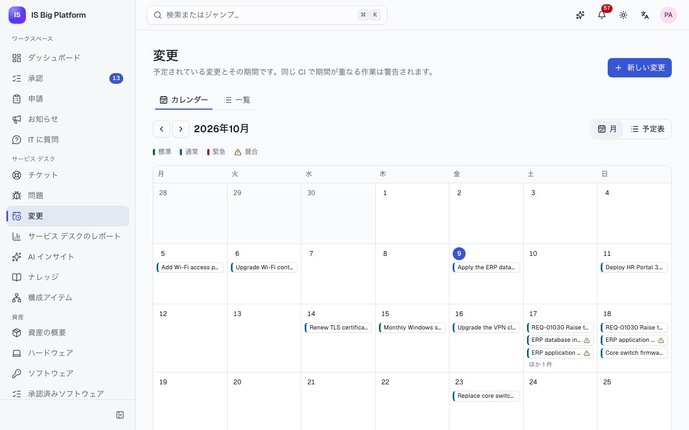
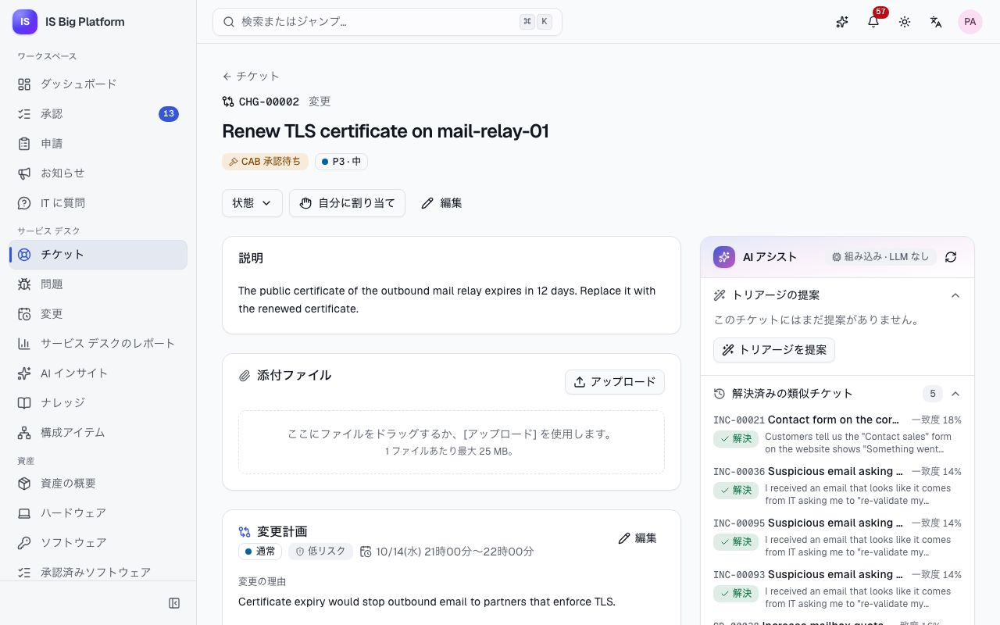
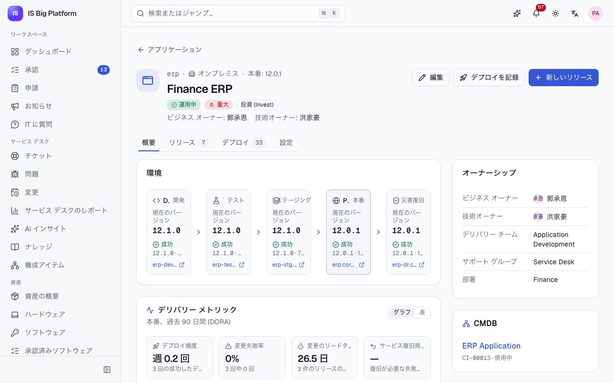
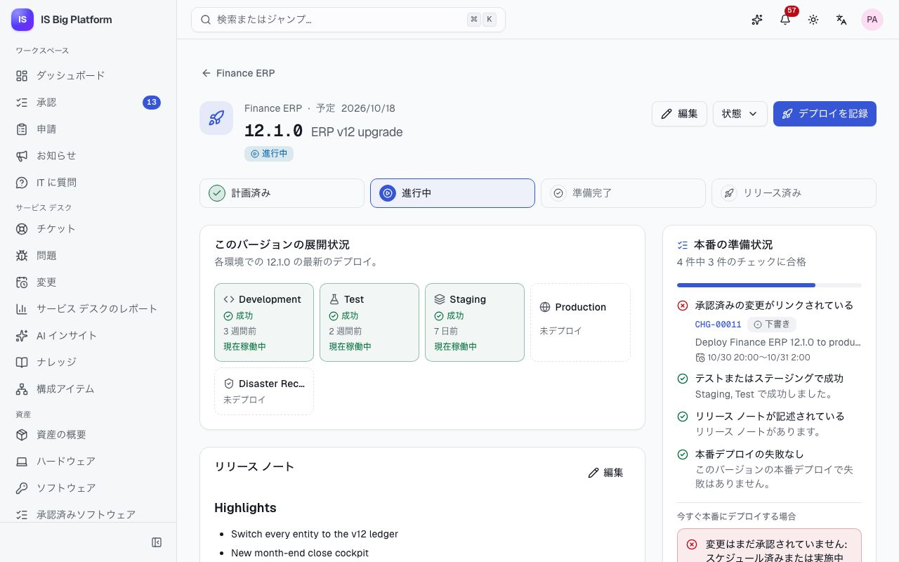

# 変更とリリース ガイド

このガイドは、変更マネージャー、変更諮問委員会 (CAB) のメンバー、アプリケーション オーナー向けです。変更の起票、計画、承認、実施の流れと、アプリケーション領域で各環境で動いているもの、準備ができているリリース、すべてのデプロイを追跡する方法を説明します。前提となるルールは、承認された変更なしには何も本番環境に到達しないことです。

## このガイドでできること

- [変更の種類を選択する](#変更の種類を選択する): 種類ごとの承認者を確認します
- [変更を起票する](#変更を起票する)、[他の変更を考慮して期間を計画する](#他の変更を考慮して期間を計画する)
- [CAB の承認を得る](#cab-の承認を得る)、または[承認者として変更を判断する](#承認者として変更を判断する)
- [変更を実施し、レビューする](#変更を実施しレビューする)
- [ServiceDesk Plus から来た変更](#servicedesk-plus-から来た変更を扱う)と[申請フォームで作成された変更](#申請フォームで作成された変更を扱う)を扱う
- [アプリケーションの記録を最新に保つ](#アプリケーションの記録を最新に保つ) (Git の状態を含む)
- [リリースを計画し、準備状況を確認する](#リリースを計画し準備状況を確認する)
- [デプロイを記録する](#デプロイを記録する): 手動で記録するか、[CI/CD パイプラインから記録します](#cicd-パイプラインからデプロイを記録する)
- [緊急時に変更ポリシーをオーバーライドする](#緊急時に変更ポリシーをオーバーライドする)
- [デリバリー メトリックを読む](#デリバリー-メトリックを読む)

## 変更の種類を選択する

すべての変更には種類とリスクがあります。これらと、変更の対象となる構成アイテム (CI) によって承認ルートが決まります。承認ルートは**変更の承認**という承認ワークフローで定義されており、無効にすることはできません。管理者は**管理 → ワークフロー**でステップを調整できます。

| 種類     | 用途                                                          | 承認者 (既定のワークフロー)                                                                                              |
| -------- | ------------------------------------------------------------- | ------------------------------------------------------------------------------------------------------------------------ |
| **標準** | 事前承認済みで低リスクの、繰り返し行う作業 (毎月のパッチ適用) | なし: 申請するとすぐにスケジュールされます                                                                               |
| **通常** | 計画された変更                                                | 変更マネージャー (24 時間以内)。リスクが高い場合や重要な CI が含まれる場合は、続いて CAB (72 時間以内)                   |
| **緊急** | 次回の CAB を待てない緊急の修正                               | 緊急 CAB: Change Advisory Board のメンバーのいずれか 1 人 (4 時間以内)。期限を過ぎると変更マネージャーにエスカレーション |

承認者の一覧は、**変更マネージャー** (Change manager) ロールと **Change Advisory Board** グループから取得されます。

## 変更を起票する

アップグレード、構成の変更、デプロイなど、本番環境を変更するものはすべて変更として起票します。**変更マネージャー**ロールが必要です。デモでは `admin` がこのロールを持っています。

1. **サービス デスク → 変更**に移動し、**新しい変更**を選択します。
2. **何を変更しますか?** と**詳細**を入力します。
3. 変更の対象となる**構成アイテム**を選択します。同じ CI に対する他の変更の検出と、承認のルーティングに使用されます。
4. **変更の種類**と**リスク**を選択し、**変更の理由**を入力します。
5. **予定期間** (**開始**と**終了**) を設定します。
6. **実施計画**、**切り戻し計画**、**テスト計画**を入力します。
7. 計画の下に表示される競合のメッセージを確認し、**変更を作成**を選択します。

**この後の流れ:** 変更は**下書き**として作成され (「CHG-… を下書きとして作成しました」)、そのページが開きます。申請するまでは、**変更計画**カードの**編集**で計画を変更できます。

> **ヒント:** アプリケーションのリリースで変更マネージャーが**変更を起票**を選択すると、このフォームが開きます。タイトルには「(アプリケーション) (バージョン) を本番にデプロイ」が入力され、リリースはすでにリンクされています。申請フォームで変更を作成することもできます。[申請フォームで作成された変更を扱う](#申請フォームで作成された変更を扱う)を参照してください。

## 他の変更を考慮して期間を計画する

同じ CI に対する 2 つの変更が同じ時間帯に行われると、障害の原因を追跡しにくくなります。ISBP は、計画の段階でこうした変更を警告します。

1. 変更の作成中や編集中、フォームには「この期間に同じ CI を対象とする別の変更はありません。」と表示されるか、該当する別の変更の件数と、共通の CI が表示されます。
2. 変更のページでは、**変更計画**カードに、期間が重なる変更がその状態とともに一覧表示されます。
3. 全体像を確認するには、**サービス デスク → 変更**に移動します。**カレンダー**タブには月 (または**予定表**) が表示され、期間が重なる変更には**競合**のマークが付きます。**前の月**、**次の月**、**今日**で表示を切り替えられます。**一覧**タブには、すべての変更が**予定期間**とともに表示されます。

競合として扱われるのは、**評価中**、**CAB 承認待ち**、**スケジュール済み**、**実施中**の変更だけです。下書きは対象外です。

デモでは、ERP データベースのインデックス再構築と ERP アプリケーション サーバーのパッチ適用が、同じ土曜日の夜に Finance ERP を対象としているため、両方に警告が表示されます。

## CAB の承認を得る

計画の準備ができたら、変更を承認ワークフローに回します。

1. 変更を開きます。**状態**で、**下書き**から**評価中**に移動します。
2. **承認を申請**を選択します。

予定期間のない変更は申請できません。また、期間の開始を過去にすることはできません (緊急変更を除く)。

**この後の流れ:**

- 状態が **CAB 承認待ち**になります。**変更計画**カードの **CAB 承認**セクションに、ワークフローの進行状況として、現在のステップ、**承認待ち:** に表示される承認者、承認ルートの図が表示されます。**自分の承認を開く**を選択すると、自分の承認一覧に移動します。
- 承認者に通知が届き、承認者は**承認**で判断します。
- **承認された場合:** 変更は**スケジュール済み**に移動し、依頼者、担当者、起票者に予定開始日時が通知されます。
- **却下された場合:** 変更は承認者のコメントとともに**却下**に移動します。**下書き**に戻し、計画を改善してから再度申請してください。
- 承認を待っている変更を中止するには、**状態**で**キャンセル**を選択します (理由が必要)。承認は取り下げられます。

> **重要:** **CAB 承認待ち**より先に変更を手動で進めることは、誰にもできません。**状態**メニューからも、API からも、統合からもできません。変更を進められるのは承認だけです。申請後は計画を編集できません。

デモでは、CHG-00002「Renew TLS certificate on mail-relay-01」は重要な CI である Email & Calendar を対象としているため、変更マネージャーの承認に続いて CAB の承認を待ちます。標準のパッチ適用の変更である CHG-00001 は、申請と同時にスケジュールされました。

## 承認者として変更を判断する

変更マネージャーまたは CAB のメンバーには、自分の承認を待っている変更ごとに通知が届きます。

1. サイドバーの**承認** (**自分の承認待ち**) に移動するか、通知を開きます。
2. 変更の承認を開きます。**申請内容**、**承認ルート**、**履歴**が表示されます。**申請を開く**を選択すると、計画、CI、競合を含む変更そのものが開きます。
3. **承認** (コメントは任意) または**却下** (理由が必要で、依頼者に表示されます) を選択します。同僚に任せるには、**委任**を選択します。

グループのステップでは、最初の回答で決まります。リマインダーとエスカレーションは、[変更の種類を選択する](#変更の種類を選択する)の期限に従います。承認一覧の詳細: [従業員](employees.md)。

## 変更を実施し、レビューする

1. 期間が始まったら、**状態**で**実施中**を選択します。
2. 作業の記録を変更の**作業メモ**として残します。変更でアプリケーションのバージョンをデプロイする場合は、アプリケーションでデプロイを記録します ([デプロイを記録する](#デプロイを記録する)を参照)。
3. 作業が完了したら、**実施後レビュー**を選択します。計画どおりに進んだ点と、そうでなかった点を記録します。変更の依頼者に確認が依頼されます。依頼者は変更で**変更を受け入れる**を選択するか、**問題を報告**を選択して問題点を説明します。**申請者の受け入れ**カードに回答が表示され、あなたにも通知が届きます。
4. **クローズ**を選択します。依頼者が変更を受け入れたかどうかは、タイムラインに記録されます。管理者が**変更を終了する前に申請者の受け入れを必須にする**をオンにしている場合、依頼者のいる変更は、依頼者が受け入れるまでクローズできません。

スケジュール済みの変更は、まだキャンセルできます (コードと理由が必要)。**実施中**になると、次はレビューに進むことしかできません。

変更のページの右側にある**リリースとデプロイ**カードには、変更にリンクされたリリースと、その変更によって承認されたデプロイが一覧表示されます。デモでは、CHG-00007「Upgrade Wi-Fi controller wlc-01 to 8.10」が実施後レビューの段階にあります。

## ServiceDesk Plus から来た変更を扱う

組織で社内 (オンプレミス) の ManageEngine ServiceDesk Plus でも変更を計画している場合は、統合ハブでそれらの変更を ISBP に取り込めます (デモでは、Contoso ServiceDesk Plus の **Changes → changes** プロファイル)。取り込まれた変更には**同期先**カードが表示され、同じライフサイクルに従います。

同期によって変更の内容を入力し、申請することはできますが、承認することはできません。外部から来た変更は、ここで起票した変更とまったく同じように、ISBP で CAB が承認するまで **CAB 承認待ち**で止まります。[統合](integrations.md)を参照してください。

## 申請フォームで作成された変更を扱う

申請フォームの中には、申請が承認されると変更を自動的に作成するものがあります。これにより、変更マネージャーでないユーザーも申請ポータルで変更を依頼できます。デモでは、**構成変更の申請**がこれを行います。申請者が構成アイテムを選択して変更内容を説明し、申請者の上長と構成アイテムのサポート グループが申請を承認すると、フォームの**変更を作成**アクションが変更を作成します。

- 変更の上部には**申請 REQ-… から · 構成変更の申請**と表示され、選択すると回答と承認を含む申請が開きます。申請を送信したユーザーが変更の依頼者になり、受付チャネルは**申請フォーム**になります。
- 変更はフォームで選択された構成アイテムにリンクされるため、競合のチェックと CAB のルートは他の変更と同じように機能し、構成アイテムの一覧にもその変更が表示されます。
- フォームが申請した変更は **CAB 承認待ち**になり、あなたが申請する変更とまったく同じように**変更の承認**を通ります。変更マネージャーが承認し、リスクが高い場合や重要な構成アイテムがかかわる場合は CAB も承認します (緊急変更の場合は緊急 CAB)。申請自体の承認がこれに代わることはなく、フォームが申請者の回答から事前承認済みの標準変更を作成することもできません。
- フォームが申請しなかった変更は**下書き**で待機します。申請の承認時に予定期間が既に始まっていた変更は**評価中**で待機します。計画を確認し、**編集**で期間を調整して、自分で**承認を申請**を選択してください。

フォームの予定日には時刻がないため、期間はその日の UTC 午前 0 時 (台北時間 08:00) に開始および終了します。デモでは、承認された申請「Raise the department share quota on fs-01」によってこのような変更が作成され、変更マネージャーの承認を待っています。このようなフォームの作成方法: [独自のプロセスを作成する](processes.md#アクションを追加する)。

## アプリケーションの記録を最新に保つ

**アプリケーション**は、社内で運用しているすべてのアプリケーションのインベントリです。オーナー、ライフサイクルの段階、各環境で動いているバージョン、デリバリーの状況を確認できます。

- **アプリケーション閲覧者** (Applications viewer) ロールでは、すべてを参照できます (デモでは、サービス デスク、ネットワーク、セキュリティ、DBA、CAB、アプリケーション オーナーの各グループが対象)。
- **ビジネス オーナー**、**技術オーナー**、**デリバリー チーム**のメンバーは、閲覧者のロールだけで自分のアプリケーションとそのリリースを編集できます。
- **アプリケーション マネージャー** (Applications manager) はすべてのアプリケーションを編集でき、**リリース マネージャー** (Release manager) はすべてのアプリケーションのリリースを計画できます。

1. **アプリケーション → アプリケーション**に移動します。タブ (**すべて**、**運用中**、**開発中**、**段階的廃止と廃止済み**、**自分の担当**)、検索ボックス (コードまたは名前)、フィルターを使用します。
2. アプリケーションを開きます。ヘッダーには、ステージ、重要度、本番で動いているバージョン (**本番: …**)、オーナーが表示されます。**概要**には、**環境** (各環境で動いているバージョンを**現在のバージョン**として表示)、**デリバリー メトリック**、**説明**、**リポジトリ**、**オーナーシップ**、**CMDB** の構成アイテム、**詳細**が表示されます。
3. **編集**を選択すると、名前、ステージ、重要度、**方針 (TIME)**、ホスティング、オーナー、**デリバリー チーム**、**サポート グループ**、構成アイテムなどの詳細を変更できます。**コード**は CI/CD パイプラインで使用されるため、変更できません。
4. **設定**タブでは、**環境** (パイプラインの順序。本番環境は変更ポリシーで保護されます)、**リポジトリ**、**ライフサイクル** (ステージ、TIME の方針、日付) を管理します。

**Git の状態:** 社内 (オンプレミス) の Azure DevOps Server にあるリポジトリは、統合ハブによって最新の状態に保たれます。各リポジトリには、既定のブランチ、最新のコミット、ブランチ (**ブランチを表示**)、アクティブなプル リクエスト、同期した日時 (**最終同期:**) が表示されます。デモでは、Finance ERP に `erp-core` と `erp-reports` のリポジトリがあります。

## リリースを計画し、準備状況を確認する

リリースとは、本番環境に向けて準備中のアプリケーションのバージョンです。リリースの準備チェックリストを見れば、自分も CAB も、リリースできるかどうかを判断できます。

1. アプリケーションで**新しいリリース**を選択します。**バージョン** (アプリケーション内で一意。例: `12.1.0`)、**名前**、**予定日**、**リリース ノート** (Markdown) を入力して保存します。
2. リリースのページで、ライフサイクル (**計画済み**、**進行中**、**準備完了**、**リリース済み**) に沿って進めます。状態は**状態 → 変更先**で移動します。
3. リリースをデプロイする変更をリンクします。準備状況のカードで**変更を起票**を選択する (変更マネージャーの場合) か、**関連レコード**の**レコードをリンク**で既存の変更をリンクします。
4. **本番の準備状況**を確認します。次の条件をすべて満たすと合格です:
   - **承認済みの変更がリンクされている** (CAB が承認済みで、スケジュール済みまたは実施中)
   - **テストまたはステージングで成功**: このバージョンがテスト環境またはステージング環境で成功している
   - **リリース ノートが記述されている**
   - **本番デプロイの失敗なし**: このバージョンの本番デプロイが失敗していない

**この後の流れ:** 変更をリンクすると、計画済みのリリースは**進行中**に移動します。すべてのチェックに合格すると、リリースの本番準備が整ったことがオーナーに通知されます。そのバージョンの本番デプロイが成功すると、リリースは**リリース済み**になります。

**アプリケーション → リリース カレンダー**には、今後数週間のすべてのアプリケーションのリリースが、変更の状態と準備状況とともに表示されます (**週ごと**または**月**)。**自分のアプリケーションのみ**を選択すると、自分のアプリケーションに絞り込めます。

デモでは、Finance ERP 12.1.0「ERP v12 upgrade」は Staging 環境まで到達していますが、その変更 (CHG-00011) がまだ下書きのため、チェックが 1 つ不合格です。HR Portal 3.4.0 は準備完了で、その変更 CHG-00009 はスケジュール済みです。

## デプロイを記録する

各環境で何が動いているかを誰もが確認でき、デリバリー メトリックが正確に保たれるように、すべてのデプロイを記録します。デプロイを記録するアクセス許可 (**リリース マネージャー**または**アプリケーション マネージャー**ロール) が必要です。

1. アプリケーションまたはリリースで**デプロイを記録**を選択します。
2. **環境**を選択し、**バージョン**を確認して、**結果** (**成功**、**失敗**、**進行中**、**ロールバック済み**) を選択します。
3. 本番環境の場合は、リリースに変更がリンクされていない限り、**変更 (省略可)** に CAB が承認した変更を指定します。
4. **変更ポリシー**を確認します。現時点でデプロイが許可されるかどうかと、許可されない場合はその理由が表示されます。
5. 必要に応じて**メモ**を追加し、**コミットとパイプライン**で**コミット**と**パイプラインの実行**のリンクを入力します。
6. **デプロイを記録**を選択します。

**変更ポリシー:** 本番環境へのデプロイには、**スケジュール済み**または**実施中**の変更が必要です。この変更は、フォームで指定するか、リリースにリンクします。その他の環境では変更は不要です。変更の予定期間外のデプロイは警告付き (**変更期間外**) で記録されます。ただし、管理者が**変更期間を強制する**をオンにしている場合は拒否されます。どちらの設定も**管理 → モジュール** (アプリケーション) にあります。

**この後の流れ:** 環境に新しいバージョンが表示されます。失敗またはロールバックの場合は、技術オーナーとデリバリー チームに通知されます。**デプロイ**タブには、すべての履歴が残ります。

## CI/CD パイプラインからデプロイを記録する

パイプラインが API を通じてデプロイを自動的に報告するため、誰も入力しなくても記録が漏れなく残ります。

- 管理者が**管理 → API クライアント**で、**CI/CD パイプライン** (CI/CD pipeline) ロールを持つ API クライアントを作成し、そのキーをパイプラインに渡します。
- パイプラインは、アプリケーションの**コード**、環境、バージョン、結果と、本番環境の場合は変更番号を送信します。
- 同じ変更ポリシーが適用されます。承認済みの変更がない場合、API はデプロイを拒否するため、パイプラインのステップは理由を示して失敗します。パイプラインがポリシーをオーバーライドすることはできません。

リクエストの形式: [API ガイド](../../api.md#recording-deployments-from-cicd-application-lifecycle)。

## 緊急時に変更ポリシーをオーバーライドする

変更が承認される前に、本番環境を修正しなければならない場合があります。このようなデプロイを記録できるのは、**アプリケーション管理者** (Applications administrator) ロールを持つユーザーだけです。

1. **デプロイを記録**で、ポリシーによってデプロイが拒否されたら、**理由を入力してオーバーライド**を選択します。
2. **承認済みの変更なしでデプロイする理由**を入力します (10 文字以上)。
3. **オーバーライドして記録**を選択します。

**この後の流れ:** オーバーライドはセキュリティ イベントとして監査ログに記録され、変更マネージャーに通知が届き (「変更ポリシーがオーバーライドされました: …」)、履歴でそのデプロイに**ポリシーをオーバーライド**のマークが付きます。CAB がレビューできるように、後から緊急変更を起票してください。

> **重要:** 緊急 CAB に連絡がつく場合は、必ず先に緊急変更を使用してください。緊急 CAB は数時間以内に判断します。

## デリバリー メトリックを読む

アプリケーションの**概要**にある**デリバリー メトリック**カードには、記録されたデプロイから算出した、過去 90 日間の本番環境における 4 つの DORA 指標が表示されます:

| 指標                   | 意味                                                               |
| ---------------------- | ------------------------------------------------------------------ |
| **デプロイ頻度**       | 1 週間あたりの本番デプロイの成功回数                               |
| **変更失敗率**         | 完了した本番デプロイのうち、失敗またはロールバックされたものの割合 |
| **変更のリードタイム** | リリースの作成から、その最初の本番デプロイの成功までの時間の中央値 |
| **サービス復旧時間**   | 本番デプロイの失敗から、同じ環境での次の成功までの時間の中央値     |

**グラフ**と**表**を切り替えると、週ごとの数値を確認できます。CAB のレビューや振り返りに活用してください。ただし、指標の精度はデプロイの記録次第です。これも、パイプラインからデプロイを記録すべき理由の 1 つです。

## 関連情報

- 変更で修正される**インシデントと問題**は、**修正を実施**でリンクされます: [サービス デスク](service-desk.md)。
- **構成アイテム**によって、競合と CAB のステップが決まります: [サービス デスク](service-desk.md#構成アイテムの影響範囲を確認する)。
- 変更を作成する**申請フォーム**と、選択された構成アイテムに応じてルートが決まる承認: [独自のプロセスを作成する](processes.md)。
- **プロジェクト**は、タスクを変更やリリースにリンクします: [プロジェクト](projects.md)。
- **ServiceDesk Plus** の変更と **Azure DevOps Server** のリポジトリは、統合ハブを通じて同期されます: [統合](integrations.md)。
- **承認ワークフロー**、モジュールの設定、API クライアントは管理者が設定します: [管理者](administrators.md)。
- CAB、標準変更、DORA などの用語: [用語集](glossary.md)。
