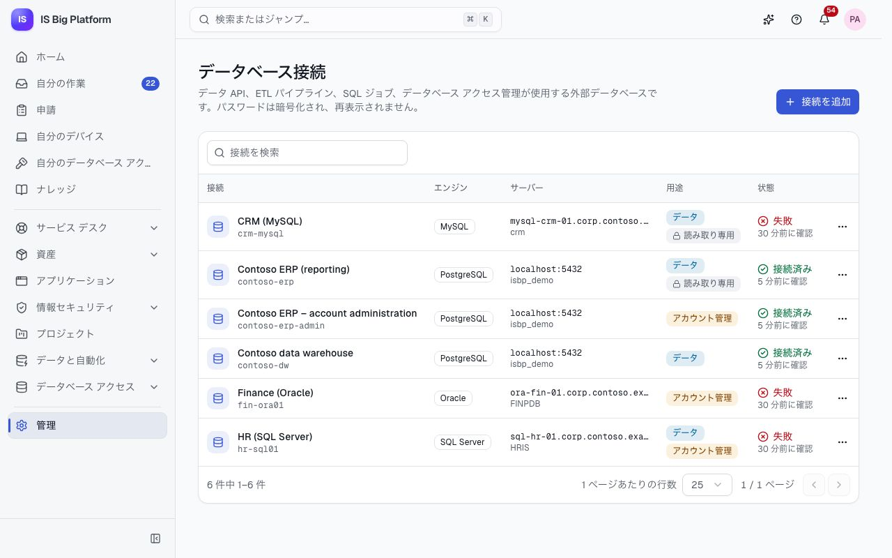
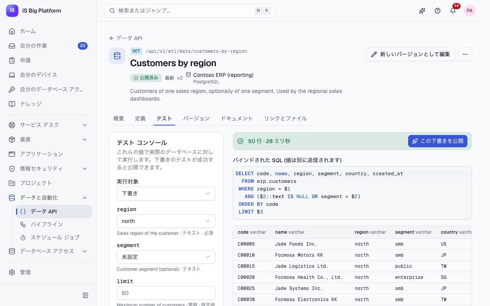
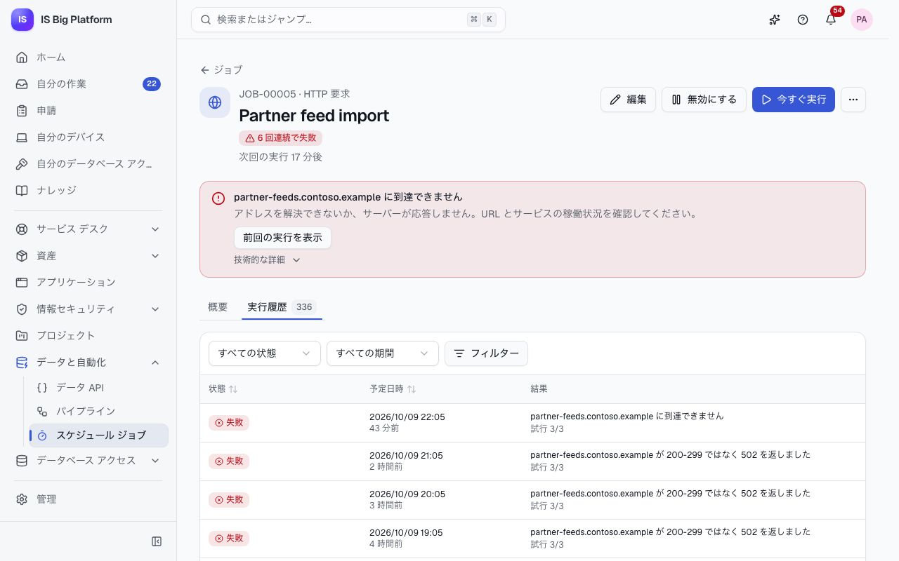

# データと自動化ガイド

このガイドは、データ エンジニア、プラットフォーム エンジニア、DBA を対象としています。ISBP で社内のデータベースや定期的な作業を扱う 4 つの機能について説明します。**データベース接続** (管理者が一度登録します)、**データ API** と**パイプライン** (SQL を基にした REST エンドポイントと、データベース間で行をコピーするパイプライン)、**スケジュール ジョブ** (HTTP 呼び出し、SQL、スクリプト、モジュールのタスクをスケジュールに従って実行)、**データベース アクセス** (ユーザーがデータベース ロールを申請し、承認、プロビジョニング、レビューを経て、期限どおりに削除されます) です。

## このガイドでできること

- [データベース接続を登録し](#データベース接続を登録する)、[そのカタログを参照する](#接続をテストしてカタログを参照する)
- [SQL またはストアド プロシージャからデータ API を作成し](#データ-api-を作成する)、[テストし](#データ-api-をテストする)、[バージョンを公開し](#バージョンを公開管理する)、[呼び出せるユーザーを制御する](#データ-api-を呼び出せるユーザーを制御する)
- [呼び出し元にドキュメントを提供し](#呼び出し元にドキュメントを提供し呼び出しを確認する)、呼び出しログですべての呼び出しを確認する
- [パイプラインでデータベース間で行をコピーする](#パイプラインでデータベース間で行をコピーする)
- [スケジュール ジョブを作成し](#スケジュール-ジョブを作成する)、[実行を確認し](#実行とリアルタイム-ログを確認する)、[すべてのジョブを監視する](#スケジュール-ジョブを監視する)
- (誰でも) [データベース ロールを申請し](#データベース-ロールを申請する)、[アクセスと 1 回限りのパスワードを使用する](#アクセスと-1-回限りのパスワードを使用する)
- (DBA として) [ロールを申請可能にし](#データベース-ロールを申請可能にする)、[申請のないアクセスに対処し](#申請のないアクセスと該当ユーザーのないアカウントに対処する)、[アクセス レビューを実施する](#アクセス-レビューを実施する)

## ロールごとにできること

ロールは**管理 → ロールとアクセス**で付与されます。

| 領域                      | ロール                                                                           | できること                                                                                                                                                 |
| ------------------------- | -------------------------------------------------------------------------------- | ---------------------------------------------------------------------------------------------------------------------------------------------------------- |
| データベース接続          | **データベース接続管理者**                                                       | 外部データベースとその資格情報、用途を登録します                                                                                                           |
| データ API とパイプライン | **データ API 閲覧者** (Data APIs viewer)                                         | データ API、バージョン、ドキュメント、呼び出しログ、パイプライン、実行履歴を表示します                                                                     |
|                           | **データ API 開発者** (Data APIs developer)                                      | データ API の作成、テスト、公開、呼び出しと、パイプラインの作成、実行、スケジュール設定を行います                                                          |
|                           | **データ API 利用者** (Data APIs consumer)                                       | サインインしているユーザーの呼び出しを許可している公開済みのデータ API を呼び出します (1 つのエンドポイントで付与すると、そのエンドポイントに限定されます) |
| スケジュール ジョブ       | **スケジュール ジョブ閲覧者** (Scheduled jobs viewer)                            | ジョブ、実行履歴、ログ、ダッシュボードを表示します                                                                                                         |
|                           | **スケジュール ジョブ オペレーター** (Scheduled jobs operator)                   | HTTP ジョブと、モジュールのタスクの種類のジョブを作成します。自分とチームのジョブを編集し、任意のジョブを実行またはキャンセルします                        |
|                           | **スケジュール ジョブ管理者** (Scheduled jobs administrator)                     | SQL ジョブとスクリプト ジョブを含むすべての操作を行います                                                                                                  |
| データベース アクセス     | **データベース アクセス申請者** (Database access requester)                      | 全員に付与されています。ロールを申請し、自分のアクセスを管理します                                                                                         |
|                           | **データベース アクセス管理者** (Database access administrator)                  | サーバー、申請可能なロール、インベントリ同期、すべてのアクセスを管理し、取り消し、ユーザーへの割り当て、再試行を行います                                   |
|                           | **データベース アクセス監査者** (Database access auditor)                        | すべてのアクセス、アカウント、ドリフト、レビューを表示します                                                                                               |
|                           | **データベース アクセス レビュー マネージャー** (Database access review manager) | アクセス レビューを実施します                                                                                                                              |

## データベース接続を登録する

各モジュールは、ここで登録された接続を通じてのみ外部データベースにアクセスします。そのため資格情報は暗号化されて 1 か所で管理され、すべての変更が監査されます。

1. **管理 → データベース接続**に移動し、**接続を追加**を選択します。
2. **名前** (例: 「財務データ ウェアハウス」) を入力します。**キー**は名前から自動入力されます。モジュールはキーで接続を参照するため、キーは後から変更できません。
3. **サーバー**で**エンジン** (**SQL Server**、**PostgreSQL**、**MySQL**、**Oracle**) を選び、**ホスト**、**ポート**、**データベース**を入力します (Oracle の場合は**サービス名**、SQL Server の名前付きインスタンスの場合は**インスタンス名**)。**暗号化**として、**オフ**、**暗号化する (証明書は検証しない)**、**暗号化して証明書を検証する** (必要に応じて **CA 証明書 (PEM)** も指定) のいずれかを選択します。
4. **サインイン**で**ユーザー名**と**パスワード**を入力します。サービス アカウントによる SQL Server の Windows 認証の場合は、**Windows ドメイン**も入力します。
5. **用途**で、接続の**用途**をオンにします。
   - **データ**: データ API、ETL パイプライン、SQL ジョブ。
   - **アカウント管理**: アカウントを作成し、ロールを付与します (データベース アクセス)。データ API からは使用できません。
6. レポート用の接続では**読み取り専用**をオンにします。書き込みは拒否され、エンジンが対応していれば、クエリは読み取り専用トランザクションで実行されます。
7. **制限**で、**プロセスあたりの接続数**、**ステートメントのタイムアウト (秒)**、**結果あたりの最大行数**を設定します。
8. **接続をテスト**を選択し、**接続を追加**を選択します。

> **重要:** 必要最小限のアクセス許可だけを持つ専用ログインを使用してください。データ API には読み取り専用、アカウント管理にはロール管理のみを付与します。SQL Server には読み取り専用トランザクションがないため、読み取り専用の接続を読み取り専用に保つのはログイン自体のアクセス許可です。

**この後の流れ:** パスワードは暗号化され、二度と表示されません (編集時に保存済みのパスワードを維持するには空欄のままにします)。リンクローカルやクラウド メタデータの範囲のアドレスは拒否されますが、プライベート ネットワークは許可されます。接続を削除すると、その接続を使用するデータ API、パイプライン、ジョブは、別の接続を指定するまで失敗します。

このページが表示されない場合は、管理者に**データベース接続管理者**ロールを依頼してください。

## 接続をテストしてカタログを参照する

1. **管理 → データベース接続**で、接続のメニュー (**… のその他の操作**) を開きます。
2. **テスト**を選択します。**状態**列に**接続済み**または**失敗**と、確認した日時が表示されます。フォームでテストした場合は、レイテンシとサーバーのバージョン、またはサーバーのエラー コードが表示されます。
3. **カタログを参照**を選択すると、ログインから参照できる**テーブルとビュー**と**プロシージャと関数**が、列やパラメーターとともに表示されます。スキーマを変更した後は**最新の情報に更新**を使用します。

データ API、パイプライン、データベース アクセスで選択肢として表示されるテーブル名、列、プロシージャは、すべてこのカタログから取得されます。デモでは、**Contoso ERP (reporting)** (PostgreSQL、読み取り専用) と **Contoso data warehouse** に接続できます。**HR (SQL Server)**、**Finance (Oracle)**、**CRM (MySQL)** は存在しないホストを指しているため、失敗時の表示を確認できます。

## データ API を作成する

データ API は、SQL クエリまたはストアド プロシージャを、ドキュメント付きの REST エンドポイントにします。これにより、レポート、ダッシュボード、ほかのシステムが、データベースのログインなしで社内のデータを読み取れます。

1. **データと自動化 → データ API** に移動し、**新しいデータ API** を選択します。
2. **名前**を入力し、**URL スラッグ**を確認します (呼び出し元は `/api/v1/etl/data/<slug>` を使用します。バージョンを公開した後は変更できません)。**メソッド** (GET または POST)、**種類** (**SQL クエリ**または**ストアド プロシージャまたは関数**)、**接続**を選択します。表示されるのは、データ用途が許可された接続だけです。**作成**を選択します。
3. **定義**タブで **SQL** を記述します。すべての値に `:name` を使用します (例: `WHERE category = :category`)。値はデータベース ドライバーによってバインドされ、SQL に直接埋め込まれることはありません。プロシージャの場合はカタログから選択します。その入力引数がパラメーターになります。
4. **SQL 内のパラメーター:** で**不足しているパラメーター … 件を追加**を選択します。各パラメーターの**型** (**テキスト**、**整数**、**10 進数**、**はい/いいえ**、**日付**、**日時**、**UUID**)、**必須**、**既定値**を設定し、**詳細**で制限、**パターン**、**許可する値**、**説明**、**例**を設定します。個人データには**機密 (ログではマスク)** を設定します。
5. **応答と制限**で、**応答** (**すべての行 (配列)** または**最初の行 (ない場合は 404)**)、**最大行数**、**タイムアウト (秒)**、**キャッシュ期間 (秒)** (0 にするとキャッシュはオフ) を選択します。
6. **下書きを保存**を選択します。

無効な入力に対しては、データベースを呼び出す前に、誤っている各パラメーターを示すエラーが返されます。接続のテーブルを読み取れない場合、エディターには **… のテーブルを読み取れません: オートコンプリートはオフです** と表示されます。SQL の記述とテストは引き続き行えます。

> **重要:** データやスキーマを変更する SQL (INSERT、UPDATE、DROP など) は、**書き込みを許可**をオンにするまで保存できません。また、読み取り専用の接続ではいずれにしても拒否されます。

## データ API をテストする

テストでは、実際のデータベースに対して下書きを実行します。テストに成功すると公開できるようになります。

1. データ API を開き、上部の**下書きをテスト**または**テスト**タブを選択します (データ API 開発者のみ)。
2. **実行対象**で、**下書き**または公開済みのバージョンを選択します。
3. パラメーターを入力し、**テストを実行**を選択します。
4. 結果を確認します。行と列、所要時間、**バインドされた SQL (値は別に送信されます)** が表示されます。データベースがステートメントを拒否した場合は、何が問題か (テーブルが存在しない、ログインにこの操作の権限がないなど) と確認すべき点がわかりやすく表示され、その下にデータベース自体のメッセージが表示されます (資格情報は表示されません)。

デモでは、**Customers by region** を開き、**region** に `north` を選択してテストを実行します。

## バージョンを公開・管理する

呼び出し元には変わらないエンドポイントが必要なため、公開するたびにバージョンが固定されます。

1. テストに成功したら、**この下書きを公開** (または上部の**公開**) を選択します。下書きをまだテストしていない場合、上部のボタンは**下書きをテスト**になり、公開する変更がない場合は**新しいバージョンとして編集**になります。
2. **変更メモ** (何をなぜ変更したか) を書き、**v… を公開**を選択します。

**この後の流れ:** バージョンは変更不可になります。バージョンを指定しない URL の呼び出し元には最新のバージョンが返されます。呼び出し元は `/api/v1/etl/data/<slug>/v<N>` でバージョンを固定できます。定義を再び編集しても、変わるのは下書きだけです (ページには**未公開の変更あり**と表示されます)。**バージョン**タブでは次の操作ができます。

- **比較**: 2 つのバージョン、またはバージョンと下書きを比較します。
- **非推奨にする**: バージョンは引き続き応答しますが、`Deprecation` ヘッダーと最新バージョンへのリンクが付きます。
- **廃止**: 呼び出しには `410 Gone` が返されます。**復元**で元に戻せます。
- **下書きに読み込む**: 古いバージョンを基に作業を始めます。

デモでは、**Customers by region** の v2 が公開済みで、v1 が非推奨になっています。

## データ API を呼び出せるユーザーを制御する

アクセス設定はすぐに適用され、新しいバージョンは必要ありません。

1. データ API の**定義**タブを開き、**アクセス**に移動します。
2. ユーザーに呼び出しを許可する場合は、**サインインしているユーザーが呼び出せる**をオンにします。ユーザーには、すべてのデータ API またはこのデータ API に対する**データ API 利用者**ロールも必要です。
3. **許可する API クライアント**で、呼び出しを許可する API クライアント (システム) をオンにします。API クライアントは、管理者が**管理 → API クライアント**で作成します。クライアントには、データ API を呼び出すアクセス許可があり、**かつ**この一覧に含まれている必要があります。
4. 呼び出し元ごとの **1 分あたりのレート制限**を設定します (空欄の場合は既定の 120)。制限を超えた呼び出し元には、`Retry-After` ヘッダー付きの `429` が返されます。
5. **下書きを保存**を選択します。

デモでは、公開済みのすべてのデータ API で **Contoso BI gateway** API クライアントが許可されています。

## 呼び出し元にドキュメントを提供し、呼び出しを確認する

1. 公開済みのデータ API の**ドキュメント**タブには、要求、各パラメーター、**要求の例** (`curl`)、応答、**応答の例**が表示されます。呼び出し元は `Accept: text/csv` を送信すると CSV を取得できます。
2. **OpenAPI をダウンロード** (またはデータ API の一覧の **OpenAPI**) を使用すると、データ API を呼び出す開発者向けに、公開済みのデータ API の OpenAPI ドキュメントを取得できます。
3. **概要**タブには、**24 時間**または **7 日間**の**呼び出し数**、**エラー率**、**応答時間 (95% の呼び出し)**、**キャッシュ ヒット**と、**呼び出しの推移**が表示されます。このデータ API の呼び出しを確認するには**呼び出しを表示** (またはエラー率) を選択します。
4. **データと自動化 → データ API** の**呼び出しログ**タブには、すべての呼び出し (誰がどのバージョンを呼び出したか、結果、時刻、行数) が一覧表示されます。データ API、結果、呼び出し元、期間で絞り込めます。呼び出しを選択すると、パラメーター (機密のものはマスク) と**要求 ID** が表示されます。呼び出しは 30 日間保持されます (モジュールの設定)。

データベース エラーが発生した API クライアントには、要求 ID を含む汎用的なエラーが返されます。データベース自体のメッセージは呼び出しログに記録されます。コードからデータ API を呼び出す方法については、[API ガイド](../../api.md#calling-a-data-api-data-apis--etl) を参照してください。

## パイプラインでデータベース間で行をコピーする

パイプラインは、あるクエリの結果を別のデータベースのテーブルに読み込みます (例: ERP の顧客をデータ ウェアハウスに読み込む)。1 回の実行は 1 つのトランザクションで行われます。

1. **データと自動化 → パイプライン**に移動し、**新しいパイプライン**を選択します。
2. **全般**で、**名前**、**説明**、**所有者** (実行が失敗すると、開始方法にかかわらず通知されます。スケジュール ジョブの場合は最後の試行の後で、ジョブ自体の通知が届く場合は 1 回だけです) を入力します。
3. **ソース**で**接続**を選び、SQL ステートメントを 1 つ記述します。ステートメントは読み取り専用で実行され、バッチでストリーミングされます。`:parameters` がある場合は、**パラメーターの値**で値を指定します。
4. 変更された行だけを読み込むには、**増分**をオンにします。SQL で `:watermark` を使用し、**ウォーターマーク列**と**初回実行の開始点**の値を選択します。以降の各実行では、前回成功した実行での最大値より後の行が読み取られます。
5. **ソースをプレビュー**を選択すると、列と**サンプル行**が表示されます。
6. **ターゲット**で、書き込み可能な接続、そのカタログの**テーブル**、**書き込みモード**、**キー列**、**バッチ サイズ**を選択します。
   - **挿入**: すべての行を追加します。
   - **更新または挿入**: 新しい行を挿入し、同じキーの行を更新します。
   - **置換**: テーブルのすべての行を削除してから挿入します (同じトランザクション内)。
7. **列マッピング**で**同じ名前を自動マッピング**または**列を追加**を選択し、列ごとに**変換** (**そのまま**、**前後の空白を削除**、**大文字**、**小文字**、**型を変換**、**空の場合の既定値**、**定数**) を選択します。カスタム コードは使用できません。
8. **パイプラインを作成**を選択し、**今すぐ実行**で試します。

**この後の流れ:** 実行ページ (**… の実行**) には、**読み取った行数**、**書き込んだ行数**、**拒否した行数**、**所要時間**、ウォーターマーク、リアルタイムの**ログ**が表示されます (長いログで問題を探すには、**表示する行**で**警告とエラー**または**エラーのみ**を選択します)。1 回の実行で書き込まれた内容はまとめてコミットされます。実行が失敗した場合や**実行をキャンセル** (**その他の操作**内) を選択した場合は、読み込み全体がロールバックされます。同じパイプラインは一度に 1 つしか実行されません。実行中にもう一度**今すぐ実行**を選択しても拒否されます。

実行が失敗すると、実行ページとパイプライン ページに、何が問題か (接続のサーバーに接続できない、値がターゲット テーブルに合わないなど) と確認すべき点がわかりやすく表示されます。**接続を開く** (接続の管理者に表示されます) を選択して接続を修正し、**再実行**を選択します。パイプライン ページでは、**前回の実行を表示**で失敗した実行を開けます。

定期的に実行するには**スケジュール**を選択します。パイプラインが入力された状態で、新しいジョブのフォームが開きます。ジョブがパイプラインを実行するようになると、パイプライン ページに**スケジュールで実行:** と表示され、**スケジュール ジョブを開く**と前回のスケジュール実行の時刻が示されます。ジョブが開始した実行には**スケジュール ジョブが開始**と表示されます。

デモでは、**Customer dimension** が ERP の顧客 400 件を `dw.customer_dim` に更新または挿入し、**Daily sales to warehouse** が `dw.sales_daily` を増分で読み込みます。

## スケジュール ジョブを作成する

誰かが覚えていなくても実行される必要がある作業には、スケジュール ジョブを使用します。たとえば、社内サイトのヘルス チェック、夜間のクリーンアップ ステートメント、スクリプト、ETL パイプライン、統合の同期などです。

1. **データと自動化 → スケジュール ジョブ**に移動し、**ジョブ**タブを開いて**新しいジョブ**を選択します。
2. **基本**で、**名前**、**所有者** (既定は自分)、**所有グループ**、**説明**を入力します。
3. **タスク**で**タスクの種類**を選択します。一覧には、作成が許可されている種類だけが表示されます。
   - **HTTP 要求**: URL、**メソッド**、**想定される状態** (例: `200-299` または `2xx`)、ヘッダー、**認証** (**Basic**、**ベアラー トークン**、**API キー ヘッダー**)、本文。プライベート ホストや内部ホストは、管理者の許可リスト (**HTTP ジョブが呼び出せるプライベート ホスト**) に含まれている必要があります。
   - **SQL ステートメント**: データ用の**データベース接続**、**モード** (**クエリ**は行数とプレビューを記録し、**実行**は影響を受けた行数を記録します)、`:name` の値を含む 1 つの**ステートメント**。各値には、**固定値**、**実行の予定日時**、**前回の成功した実行の終了日時**、**実行 ID** のいずれかを指定します。
   - **スクリプト**: **Python**、**Node.js**、**PowerShell**、**シェル**のいずれか、管理者の一覧にある**コンテナー イメージ**、スクリプト、環境変数、CPU、メモリ、**ネットワーク** (**ネットワークなし**または**送信を許可**)。
   - モジュールのタスク: **ETL パイプライン**、**データベース アクセス: インベントリ同期**、**統合の同期**。それぞれに専用の選択欄があります。
4. **トリガー**で、実行するタイミングを選択します。
   - **スケジュール**: **繰り返し** (**毎時**、**毎日**、**平日**、**毎週**、**毎月**、**四半期ごと**、**毎年**) を選び、該当する日と**時刻**、**タイム ゾーン**を指定します。**次回以降の実行**のプレビューがあります。**カスタム (cron)** では 5 つの cron フィールドを入力でき、**プリセット**も使用できます。
   - **間隔**: **実行の間隔 (分)**。
   - **他のジョブの後**: **後に実行**で選んだジョブが**すべて成功した**とき、または**いずれかが成功した**ときに実行します (ループは拒否されます)。
   - **手動**: 誰かが**今すぐ実行**を選択したときだけ実行します。
5. **アラート**で、**実行が失敗したら所有者と所有グループに通知する**をオンのままにし、必要に応じて**失敗を組織のチャネルにも投稿する** (Teams、Slack、Webhook) をオンにします。
6. ほとんどのジョブには既定値が適しています。変更する場合は**詳細設定**を開き、**タイムアウト (秒)**、**試行回数** (1 は再試行なし)、**バックオフ** (**固定**または**指数**)、**再試行の待機時間 (秒)**、**実行の重複** (**実行中ならスキップ**または**前回の実行の完了を待つ**)、**連続した失敗の後に無効化**を設定します。
7. **ジョブを作成**を選択します。

期間ごとに 1 回行う作業 (毎月の**フォームの割り当て**など) では、タスクで選んだ期間に合わせてスケジュールが設定されます。**今すぐ 1 回実行する** (既定でオン) を選ぶと、最初の予定された実行を待たずに今期の作業がすぐに開始されます。

シークレット (パスワード、トークン、シークレットのヘッダーと変数) は暗号化して保存され、**保存済み (非表示)** と表示されます。実行ログではマスクされます。

> **重要:** SQL ジョブには**スケジュール ジョブ管理者**ロールが必要です。スクリプト ジョブも同様です。スクリプトは、資格情報を持たず、ファイル システムが読み取り専用の分離されたコンテナー (Kubernetes または Docker) でのみ実行されます。スクリプト ランナーが構成されていない場合、スクリプト ジョブは有効にできません。開発用のランナーには、サンドボックス化されていないことを示すラベルが付きます。

**この後の流れ:** ジョブはトリガーに従って実行されます。自分または自分のグループが所有するジョブは、編集、実行、キャンセル、削除ができます。**今すぐ実行**と**無効にする** / **有効にする**はジョブ ページにあります。プラットフォームの停止中に実行されなかった実行は、遅れが 1 時間未満であれば 1 回実行され、それより古いものはスキップとして記録されます。

## 実行とリアルタイム ログを確認する

1. **データと自動化 → スケジュール ジョブ**の**ジョブ**タブ (**すべて**、**失敗中**、**実行中**、**無効**、**自分のジョブ**の各ビュー) からジョブを開きます。各行には前回の実行の結果がわかりやすく表示されます。ジョブの**概要**には、スケジュール、**次回の実行**、**前回の成功**、過去 7 日間の結果、タスク、このジョブの前に実行されるジョブとこのジョブが開始するジョブ、連続失敗回数が表示されます。**前回の実行を表示**で最新の実行を開けます。
2. ジョブの**実行履歴**タブを選択し、実行を選択します。
3. 実行が失敗した場合、実行ページの最初に、何が問題か (Web サービスがエラーの状態を返した、接続にテーブルが存在しないなど) と確認すべき点がわかりやすく表示されます。原因がデータベース接続の場合は**接続を開く**も表示されます。続いて**詳細**、試行の**タイムライン**、**メトリック** (HTTP の状態や影響を受けた行数など)、**ログ**が表示されます。ログは実行中にリアルタイムで流れます。**表示する行**で**警告とエラー**または**エラーのみ**に絞り込めるほか、**自動スクロール**、**コピー**、**ダウンロード**を使用できます。
4. 終了した実行は、**再実行**でもう一度実行できます。実行中のタスクを停止するには、**その他の操作**の**実行をキャンセル**を選択します (再試行は行われません)。

実行の状態は、**キュー登録済み**、**実行中**、**再試行中**、**成功**、**失敗**、**タイムアウト**、**キャンセル済み**、**スキップ**です。**スケジュール ジョブ**の**実行履歴**タブには、すべてのジョブのすべての実行が、フィルターと各実行の**結果**とともに一覧表示されます。

デモでは、**Partner feed import** (Asia/Taipei で毎時 5 分に実行される HTTP ジョブ) が何回か連続で失敗しています。そのシークレットの API キー ヘッダーは表示されません。

**失敗した後の流れ:** 最後の試行が失敗すると、所有者と所有グループにアプリ内とメールで通知 (「自分のジョブの実行が失敗したとき」) が届きます。再び正常に実行されると、回復の通知が届きます。連続した失敗の後に無効化するよう設定されたジョブは、自動的に無効になり、その旨が通知されます。実行とログは 90 日間保持されます (各ジョブの最新の実行は常に保持されます)。

## スケジュール ジョブを監視する

1. **データと自動化 → スケジュール ジョブ** (**概要**タブ) に移動します。
2. 最初に**失敗しているジョブ**が表示されます。前回の実行が失敗した各ジョブについて、理由と連続失敗回数が示され、**実行を表示**と**今すぐ実行**を使用できます。
3. 3 つの**主要な数値** (**実行回数 (24 時間)** と有効なジョブの数、**成功率 (24 時間)** と 7 日間の成功率、**実行中**と平均の実行時間) を確認します。
4. **1 時間あたりの実行回数** (数値を確認するには**表**に切り替え)、**今後の実行** (各ジョブの次回の時刻と 24 時間の実行回数)、**最も遅いジョブ**を確認します。

**ホーム**にも**失敗しているジョブ**カードが表示されます。デモでは、**CRM accounts to warehouse** は **Customer dimension refresh** の後に実行されますが、CRM サーバーに接続できないため失敗します。

## データベース ロールを申請する

レポート、分析、承認済みのデータ修正などのためにデータを直接読み取ったり変更したりする必要がある場合は、DBA にメールで依頼する代わりに、ここでロールを申請します。

1. **申請**に移動し、**何が必要ですか？** で**データベースへの直接アクセス**を選択します。
2. **アクセス**で、検索するか、**サーバー**、**リスク**、**データベース**で絞り込み、必要なロールをオンにして**続行**を選択します。各ロールには、最大期間と承認者が表示されます。
3. **詳細**で、ロールごとに**アクセス期限** (最大期間の範囲内) を設定し、**必要な理由**に回答します (プロジェクト、チケット、変更を記載します)。**確認**を選択します。
4. **確認**で**承認者**を確認します。ロールごとの各承認ステップと、依頼されるユーザーが表示されます (ロールに不要なステップは**不要**と表示されます)。**申請を送信**を選択します。

**この後の流れ:**

- ロールごとに個別の申請 (`DBR-00042`) が作成され、**自分の申請**と、**承認ルート**を含む専用のページに表示されます。承認待ちの間は**申請を取り下げる**を選択できます。
- **データベース アクセスの申請**承認は、上長、ロール所有者 (ユーザー、または所有グループの任意のメンバー)、高リスクのロールの場合は情報セキュリティの順に回されます。
- 承認されると、サーバー上のアカウントが自動的に作成または更新され、ロールが付与されて確認されます。アクセスの準備ができると通知が届きます。

デモでは、**Contoso ERP (PostgreSQL)** の **ERP レポート (読み取り専用)** は最長 180 日間の低リスクのロールで、DBA チームが所有しています。

## アクセスと 1 回限りのパスワードを使用する

1. **データベース アクセス → 自分のデータベース アクセス**に移動します。各ロールに**アカウント**、**データベース ロール**、**期限**が表示されます。
2. パスワードが生成されている場合は、**パスワードを表示**を選択し、確認画面でもう一度**パスワードを表示**を選択して、パスワード マネージャーにコピーします。
3. アクセスが終了する前に**延長を申請**を選択すると、新しい終了日で申請を送信できます。アクセスが不要になったら**返却**を選択します。

> **ヒント:** ロールの所有者 (本人、または所有グループのメンバー) である場合、**自分のデータベース アクセス**には**所有しているロールへのアクセス**も表示され、そのロールを持っているユーザーを確認できます。行を選択して**取り消し**を選択し、理由を入力すると、そのアクセスを早期に終了できます。

> **重要:** パスワードは、アカウントの作成から 7 日以内に 1 回だけ表示され、メールで送信されることはありません。紛失した場合は DBA がリセットできます。Windows またはディレクトリのサインインを使用するサーバーでは、パスワードは生成されません。

**この後の流れ:** アクセスは、選択した日の終わり (自分のタイム ゾーン) に終了し、自動的に取り消されます。3 日前にリマインダーが届きます。ユーザーが退職すると、そのユーザーのデータベース アクセスはすべて取り消され、アカウントは無効になります。

## データベース ロールを申請可能にする

ユーザーが申請できるロール、その承認者、期間は DBA が決めます。

1. 管理者がサーバーを**アカウント管理**用の接続として登録していることを確認します。
2. **データベース アクセス → サーバー**に移動します。**まだ管理していない管理用の接続**で**アカウントを管理**を選択します。**表示名**、**環境**、**アカウント名のパターン** (例: `{username}`)、**新しいアカウントのサインイン方法** (**生成されたパスワード**、**Windows / Active Directory**、**外部ディレクトリ**)、**DBA グループ** (プロビジョニングが失敗したときに通知されます)、**毎晩同期する**を設定し、**アカウントを管理**を選択します。
3. **今すぐ同期**を選択すると、サーバーのアカウント、ロール、メンバーシップが読み取られます。
4. サーバーを開き、**ロールを申請可能にする**を選択します。同期したインベントリから**サーバー上のロール**を選び、**表示名**を付けて**アクセスできる内容**を記述します。**所有者 (承認者)** (グループまたはユーザー)、**リスク**、**既定 (日)**、**最大 (日)** を選択し、**無期限のアクセスを許可**するかどうかと、申請に理由を必須とするかどうかを選択します。**申請可能にする**を選択します。

SQL Server、Oracle、PostgreSQL のアカウントは管理されますが、MySQL のアカウントは管理されません。アカウント名とロール名は同期したインベントリと照合されます。ステートメントは、バインドされた値からデータベース サーバー自身によって組み立てられ、SQL にテキストを直接埋め込むことはありません。

**この後の流れ:** プロビジョニングが失敗すると、合計で最大 3 回試行されます。それでも失敗した場合は付与が**失敗**と表示され、DBA グループに通知されます。**データベース アクセス → アクセス権の一覧**で付与を開き、**プロビジョニングを再試行**を選択するか、**取り消し**でアクセスを早期に削除します (理由が必要です)。

## 申請のないアクセスと該当ユーザーのないアカウントに対処する

プラットフォームの外で付与されたアクセスはドリフトです。インベントリ同期によって検出されます。

1. **データベース アクセス → アクセス権の一覧**に移動し、**申請なし**タブを開きます。申請可能なロールのメンバーシップのうち、どの申請にも該当しないものが一覧表示されます。アカウント名が誰かと一致する場合は、該当しそうなユーザーも表示されます。
2. **ユーザーに割り当て**を選択すると、適切な**ユーザー**と**アクセス期限**を指定して付与として記録できます。これにより、ほかのアクセスと同様に期限切れになり、レビューの対象になります。または、**取り消し**を選択してアカウントからロールを削除します (アカウント自体は残ります)。
3. **アカウント**タブで**該当ユーザーのないアカウントのみ**で絞り込むと、どのユーザーにも対応しないアカウントが表示されます。

**データベース アクセス → サーバー**では、申請のないアクセス、該当ユーザーのないアカウント、失敗した付与があるサーバーに、その件数が**要対応**として表示されます。**確認**を選択するとサーバーが開きます。

**毎晩同期する**がオンのサーバーでは、毎晩同期が実行されます。実行履歴とアラートを利用するために、スケジュール ジョブ (**データベース アクセス: インベントリ同期**) で同期をスケジュールすることもできます。デモには、サーバーごとに **Database inventory** ジョブがあります。デモでは、`demo_u_legacy_report` が申請のないアクセスで、`TMPLOAD` が該当ユーザーのないアカウントです。

## アクセス レビューを実施する

監査担当者は、ユーザーが引き続きデータベース アクセスを必要としているかを、定期的に誰かが確認することを求めています。

1. **データベース アクセス → アクセス レビュー**に移動し、**新しいアクセス レビュー**を選択します (レビュー マネージャーのみ)。
2. **名前**、**サーバー** (指定しない場合はすべてのサーバー)、**対象の付与** (リスク別)、**レビュー担当者** (**ロール所有者**または**本人の上長**)、**開始**と**期限**の日付、**期限時の扱い** (**未判断のアクセスを取り消す**または**未判断のアクセスを維持する**)、**繰り返し** (**1 回のみ**または**四半期ごと**) を入力します。**アクセス レビューを開始**を選択します。
3. レビュー担当者に通知が届き、レビューが**自分の作業**と**あなたのレビュー待ち**に表示されます。レビューは**未対応** (まだ判断していないアクセス) で開きます。各行には、ユーザー、ロール、申請時の理由、アクセスの終了日、最終サインイン (サーバーがサインインを報告していない場合は**サインイン履歴なし**) が表示されます。
4. 行ごとに**維持**または**取り消し**を選択するか (取り消しには理由が必要)、複数をオンにして **… 件を維持**または **… 件を取り消し**を選択します。判断したアクセスは**対応済み**に移り、**すべて**にはすべてのアクセスが表示されます。
5. レビュー マネージャーは進捗を確認し、監査担当者向けに**その他** (⋯) の **CSV をエクスポート**を選択し、完了したら**レビューを終了**を選択します。

**この後の流れ:** レビュー担当者には期限前にリマインダーが届きます。レビューが終了すると (手動で、または期限後に自動的に)、判断と、未判断のアクセスに対するルールが適用されて取り消しが始まり、レビューは読み取り専用になります。定期的なレビューでは、次のレビューがスケジュールされます。デモでは、**Q4 2026 database access review** が実施中です。

## 関連情報

- **統合**: 統合の同期は、スケジュール ジョブ (**統合の同期**) として実行できます ([統合ガイド](integrations.md))。
- **承認**: データベース アクセスの申請は**承認**の受信トレイで判断されます。管理者は**データベース アクセスの申請**ワークフローを調整できます ([申請を承認または却下する](employees.md#申請を承認または却下する)、[管理者ガイド](administrators.md))。
- **ユーザー**: DBA とユーザーの上長は、**管理 → ユーザー**のユーザー ページで、そのユーザーのデータベース アクセスを確認できます。
- **関連レコード**: データ API とパイプラインには**リンクとファイル**タブがあり、ジョブの**概要**には**関連レコード**と**添付ファイル**が表示されます。たとえば、データ API を、それを使用するアプリケーションにリンクできます ([変更とリリース ガイド](changes-and-releases.md))。
- **アシスタント**は、依頼して確認すればジョブやパイプラインを実行でき、データ API の一覧表示、自分のデータベース アクセスの表示、ロールの申請も代わりに行えます。また、スケジュール ジョブ、パイプライン、データ API の下書きを変更セットとして提案できます。データ API の下書きのテストと公開は、引き続き人が行います ([アシスタントと AI](assistant-and-ai.md))。
- ウォーターマーク、更新または挿入 (upsert)、申請のないアクセスなどの用語: [用語集](glossary.md)。
