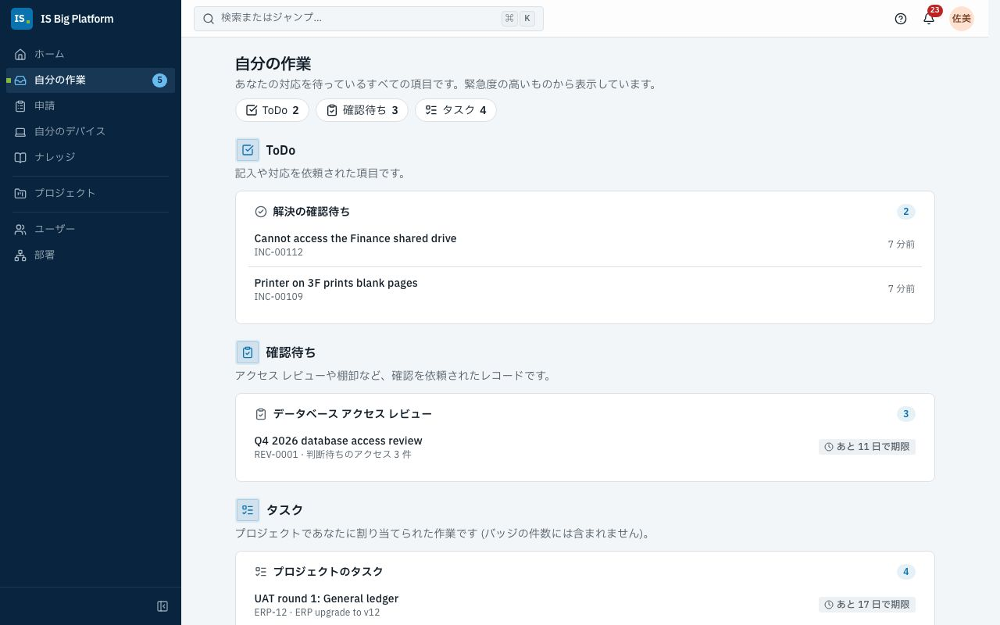

# 従業員、マネージャー、承認者向けガイド

このガイドは、IS とかかわるすべての人を対象としています。アクセス、機器、ソフトウェアの申請、何かが壊れたときのサポートの受け方、申請の状況の確認、そして承認者としてチームの申請を判断する方法を説明します。ここで説明する操作は、すべてサイドバーの**申請**と**自分の作業**から始まります。

## このガイドでできること

- **自分の作業**で[対応待ちの項目を確認する](#対応待ちの項目を確認する)
- [申請ページで必要なものを探す](#申請ページで必要なものを探す)
- [フォームで機器やソフトウェアを申請する](#フォームで機器やソフトウェアを申請する)
- [アプリケーションやロールへのアクセスを申請する](#アプリケーションやロールへのアクセスを申請する)
- [チケットを登録する前に IS に質問する](#チケットを登録する前に-is-に質問する)
- [問題を報告する](#問題を報告する)
- [申請の状況を確認する](#申請の状況を確認する)、[解決を確認する](#解決を確認してサービスを評価する)、[申請を取り下げる](#申請を取り下げる)
- [自分のデバイスを確認し、問題を報告する](#自分のデバイスを確認し問題を報告する)
- [データベース アクセスを申請する](#データベース-アクセスを申請する)
- 承認者向け: [申請を承認または却下する](#申請を承認または却下する)、[承認を他の人に委任する](#承認を他の人に委任する)、[不在設定をする](#休暇の前に不在設定をする)
- [受け取る通知を選択し](#受け取る通知を選択する)、[言語、タイム ゾーン、セッションを設定する](#言語タイム-ゾーンセッションを設定する)

## 対応待ちの項目を確認する

**自分の作業**には、依頼されたすべての作業が 1 か所にまとまっています: 申請の承認、フォームへの記入、レビューの自分の担当部分の確認、変更の受け入れ確認、解決の確認、共有アカウントのパスワード変更、プロジェクトのタスク。

1. サイドバーの**自分の作業**を選択します。横の数字は、対応を待っている件数です (プロジェクトのタスクは含まれません)。**ホーム**の**対応が必要**には、最も急ぎの項目が表示されます。
2. 項目は**判断待ち**、**ToDo**、**確認待ち**、**タスク**に分かれ、緊急度の高い順に表示されます。各項目には内容、番号または依頼者と、**あと 2 日で期限**や **3 日超過**などの期限のバッジが表示されます。
3. 項目を選択すると、その判断、フォーム、またはレビューの自分の担当部分が開きます。

**この後の流れ:** 対応が終わると項目は**自分の作業**から消え、件数が減ります。対応待ちの項目がない場合は、**自分の作業**に**対応待ちの項目はありません**と表示されます。同じ項目の通知からも同じ画面が開くので、どちらからでも作業できます。

## 申請ページで必要なものを探す

**申請**は IS への窓口です。IS に何かを依頼するときや、申請の状況を知りたいときに使います。

1. サイドバーの **申請** を選択します。
2. **自分の申請** が一番上にあるので、送信済みの申請を最初に確認できます。その下の **何が必要ですか？** では、カードがグループごとに並んでいます。

| グループ               | カード                                                                                                                                                                                           |
| ---------------------- | ------------------------------------------------------------------------------------------------------------------------------------------------------------------------------------------------ |
| **サポートを受ける**   | **問題を報告**（[詳細](#問題を報告する)）、**ナレッジを閲覧**、まず質問に答えてくれる **IS に質問**（[詳細](#チケットを登録する前に-is-に質問する)）                                             |
| **機器とソフトウェア** | **自分のデバイス**（[詳細](#自分のデバイスを確認し問題を報告する)）と、機器やソフトウェアの申請フォーム（デモでは **ノート PC の申請** など）（[詳細](#フォームで機器やソフトウェアを申請する)） |
| **アクセス**           | **アプリケーションへのアクセス**（[詳細](#アプリケーションやロールへのアクセスを申請する)）と **データベースへの直接アクセス**（[詳細](#データベース-アクセスを申請する)）                       |
| **その他**             | IS が提供するそのほかの項目                                                                                                                                                                      |

カードが 8 件を超えると、上に検索ボックスが表示されます。**ノート PC** のように名前の一部を入力すると絞り込めます。

> **ヒント:** 表示されるフォームは、あなた向けに用意されたものだけです。同僚が挙げたフォームが見つからない場合は、一部のグループだけに提供されている可能性があります。[フォームがポータルに表示されない](faq.md#フォームがポータルに表示されない)を参照してください。

## フォームで機器やソフトウェアを申請する

新しいノート PC、モニター、ソフトウェア ライセンス、その他 IS が提供するものが必要なときは、申請フォームを使用します。フォームは IS が知る必要のあることを過不足なく尋ね、必要な承認もフォームに設定されています。

1. **申請**に移動し、**何が必要ですか？** でフォームを選択するか、共有されたフォームのリンクを開きます。
2. フィールドに入力します。一部の質問は、該当する場合にのみ表示されます。たとえば、**PC・機器の申請**では、**品目**で**ノート PC** を選択して初めて **PC モデル**が表示されます。
3. フォームによっては、構成アイテムなど、ISBP で管理されているものを選択するよう求められます。**レコードを選択** (複数選択できる場合は**レコードを追加**) を選択し、**番号またはタイトルで検索…** に番号またはタイトルの一部を入力して選択します。表示されるのは表示権限のあるレコードだけです。また、本番のシステムだけなど、フォームによっては一部のレコードしか選択できない場合があります。
4. フォームに承認が必要な場合は、質問の下にある**この申請の承認者**を確認します。これまでの回答に基づいて、各承認ステップと依頼先のユーザーが表示されます。選択したシステムに追加の承認が必要な場合など、入力に合わせて更新されます。回答に当てはまらないステップは、**この申請ではスキップされます**と表示されるか、表示されません。
   承認者が、まだ回答していない質問によって決まる場合、そのステップには **「…」の回答によって決まります** と表示され、質問名が示されます。その質問に入力すると、承認者が表示されます。
5. **送信**を選択します。必須フィールドが空の場合は、その横に**この項目は必須です**と表示されます。フォームでは、終了日が開始日より前でないことなど、複数の回答をまとめて確認することもあります。その場合は、フォーム独自のメッセージが修正するフィールドに、またはフォームの上部の**フォームの内容を確認してください**に表示されます。

**この後の流れ:** 申請には `REQ-01042` のような参照番号が付き、**承認ルート**が表示された専用のページが開きます。フォームに承認が必要な場合 (ページに**この申請には承認が必要です。各ステップで通知が届きます。** と表示されます)、申請は最初の承認者に送られます。全員が承認すると、IS 部門が対応します。多くのフォームはサービス デスクのチケットになり、申請ページにはチケットの進捗 (**対応中**、続いて**完了**) とチケットへのリンク (**SR-… を開く**) が表示されます。フォームによっては、申請の送信後や承認後に、変更の作成やロールの付与などの作業を自動的に開始するものもあります。申請ページの**その後の処理**に、各ステップとその状態 (**待機中**、**実行中**、**完了**)、作成されたものへのリンクが表示されます。申請が承認または却下されると通知が届きます。

> **重要:** **この申請の承認者**に**このステップを承認できる人がいないため、申請は却下されます**と表示された場合は、回答に対してそのステップを承認できる人が設定されていません。送信せずに、まずサービス デスクに問い合わせてください。

> **ヒント:** デモでは、**ノート PC の申請**フォームで**見積額 (TWD)** の入力を求められます。部門長がすべてのノート PC の申請を承認し、金額が 60,000 TWD を超える場合は IS 資産管理も承認します。承認された申請は、**ハードウェア › ノート PC** カテゴリのサービス デスクのチケットになります。

## アプリケーションやロールへのアクセスを申請する

IS Big Platform のロール（例: **Announcement editor**）や、ISBP に登録された業務アプリケーションのロール（デモでは **Finance ERP**、**HR Portal**、**Expense Claims**）が必要なときは **アプリケーションへのアクセス** を使います。利用期間と理由を伝え、送信前に承認者を確認できます。

1. **申請** に進み、**アプリケーションへのアクセス** を選択します。
2. 必要なアクセスを選びます。ロールはアプリケーションごとにグループ分けされ、業務アプリケーションが先に、プラットフォーム自身のロールは下の **プラットフォームのロール** にまとめられています（開くまで閉じています）。**ロールとアプリケーションを検索…** にアプリケーション名を入力する（またはそのボタンを選ぶ）と、そのロールが先頭に表示されます。各ロールには、リスク（**低リスク**、**中リスク**、**高リスク**）、所有者、付与できる最長期間（例: **最長 90 日**）が表示されます。説明がまだないロールには **説明はまだありません** と表示され、確認先の所有者が示されます。すでに持っているロールは **利用可能** と表示され、申請済みのロールは **申請済み (REQ-…)** と表示されます。
3. **続行** を選択します。
4. **誰に必要ですか？** で **自分** または **他の人** を選びます。マネージャーは直属の部下の分を申請でき、アクセス管理者は誰の分でも申請できます。入社前の方は **入社前** と表示され、その方の分は初日から使えるように承認されます。
5. **利用期間は？** で **7 日**、**30 日**、**90 日**、**カスタム**（**日数** を入力）、またはロールが許可している場合は **終了日なし** を選びます。
6. **理由は？** に 10 文字以上入力します。承認者がこの内容を読むので、具体的に書いてください（例: 「前任者の休暇中、サービス デスク チームの経費精算を承認するため」）。
7. **確認** を選択します。**申請内容** と **誰が承認するか** を確認します。承認の各ステップ、承認を依頼される人が、現在の承認ワークフローと組織図に基づいて順番に表示されます。
8. **申請を送信** を選択します。

**この後の流れ:** 申請は **承認待ち** の状態で開き、状況欄に誰の対応待ちかが表示されます。既定では **上長の承認** に送られ、高リスクのロールでは **セキュリティ レビュー**、その後 **アクセス所有者の承認** に進みます。ロールによっては独自のワークフローを使います。確認ステップでは常に実際の経路が表示されます。最後の承認者が承認すると、ロールは自動的に付与され、申請には **アクセス権を付与しました — 終了日: …**（または **期限はありません**）と表示されます。期限付きのアクセスは終了時に自動で削除され、数日前に通知されます（**アクセスの期限が近づいています**）。

> **重要:** 確認ステップに **この手順を承認できる人がいないため、申請は却下されます** と表示された場合、この手順を承認する人が設定されていません。送信せず、先にサービス デスクまたはロールの所有者に確認してください。

## チケットを登録する前に IS に質問する

**IS に質問**は、ナレッジ ベースから IS に関する質問に回答するバーチャル エージェントです。いつでも、自分の言語で利用できます。ほとんどの質問 (VPN、パスワード、MFA、プリンター) には、チケットなしで数秒で回答します。解決できない場合はチケットを準備しますが、自分が確認するまで何も送信されません。

1. **ホーム**の **IS に質問**、または**申請**ページの**質問する**を選択します。ページ上部の**検索またはジャンプ…**に質問を入力して **IS に「…」について質問**を選択することもできます。質問が入力された状態で IS に質問が開きます。
2. 問題を自分の言葉で (どの言語でもかまいません) 入力するか、**質問の例** (例: **VPN に接続できません**) のいずれかを選択します。Enter キーを押すか、**送信**を選択します。
3. 回答を読みます。回答に使用された記事は、**参照元**にカードとして表示されます。詳しい手順は、記事を開いて確認してください。
4. **解決しましたか?** で、**はい、解決しました**または**いいえ、チケットを作成**を選択します。
5. **いいえ、チケットを作成**を選択すると、入力済みのチケットが回答のすぐ下に開きます。**タイトル**、**説明**、**どのくらい影響がありますか?** (**仕事ができない**、**仕事が遅れる**、**軽微**)、**種類** (**何かが故障している**または**何かが必要**) を確認して、**チケットを作成**を選択します。チャットを続ける場合は、代わりに**今はしない**を選択します。

**この後の流れ:** チャットに**チケット INC-… を作成しました。サービス デスクがチケットで対応します。** と表示され、**チケットを表示**が示されます。チケットは、自分で報告したチケットと同様に**自分の申請**に表示されます。過去の会話は**会話**に一覧表示され、**新しい会話**で新しい会話を開始できます。

> **ヒント:** ナレッジ記事を読んでも解決しない場合は、**この記事は役に立ちましたか?** で**いいえ**と回答してください。**解決しない場合:** に **IS に質問**と**問題を報告**が表示されます。

> **ヒント:** チャットの上部のラベルは、回答の作成方法を示しています。**ナレッジ ベースからの回答**は、AI 言語モデルが構成されておらず、回答がナレッジ ベースの検索とテンプレートから作成されていることを示します。**ナレッジ ベースに基づく AI の回答**は、個人データをマスクしたうえで、AI モデルがナレッジ ベースから回答を作成していることを示します。いずれの場合も回答が誤っていることがあるため、リンクされた記事を確認してください。[アシスタントと AI](assistant-and-ai.md)を参照してください。

## 問題を報告する

何かが壊れていて、サービス デスクの担当者に修正してほしいときは、問題を報告します。たとえば、VPN が何度も切れる、Outlook が同期しない、プリンターで紙詰まりが起きたといった場合です。

1. **申請**に移動し、**問題を報告**を選択します。
2. **何が起きていますか?** に、「自宅から VPN に接続できない」のように簡単に記述します。
3. **詳しく教えてください**に、何が起きたか、いつから始まったか、すでに試したこと、エラー メッセージを入力します。
4. **どのくらい影響がありますか?** で、**仕事ができない**、**仕事が遅れる**、**軽微**のいずれかを選択します。
5. 必要に応じて、**どのサービスですか?** で関連するシステムを選択します。
6. 入力中に、**役に立つかもしれない記事**にナレッジ記事が提案されます。記事で解決した場合は、報告を送信する必要はありません。
7. **サービス デスクに送信**を選択します。

**この後の流れ:** **INC-… を送信しました。対応を開始します。** と表示され、チケットが開きます。サービス デスクが受け付けたことが通知され、チケットが**受付済み**として**自分の申請**に表示されます。チケットのページには、進捗 (**受付済み**、**対応中**、**解決済み**、**クローズ**)、対応している担当者 (**担当**)、サービス デスクとの**会話**が表示されます。詳細を追加したり質問に回答したりするには、**サービス デスクにメッセージを送信**に入力して**送信**を選択します。スクリーンショットは**添付ファイル**に追加します。担当者が返信したときと、チケットが解決されたときに通知が届きます。サービス デスクの応答時間と解決時間は、SLA に照らして追跡されます。[サービス デスク](service-desk.md)を参照してください。

## 申請の状況を確認する

**自分の申請** は **申請** ページの一番上にあり、依頼したものすべてを表示します。アクセス申請、フォーム申請、報告したチケット、データベース アクセスの申請が含まれます。

1. **申請** に進みます。**自分の申請** が最初のセクションです。
2. **進行中**、**完了**、**すべて** から選びます。
3. 各行には、参照番号、最終更新日時、状態が表示されます。承認待ちの申請では、行に **〜の対応待ち** と表示され、誰の対応待ちか、どのステップかが分かります（例: **Mei Lin さんの対応待ち (上長の承認)**）。
4. 行を選ぶと申請が開きます。

| 表示される状態                                                   | 意味                                                                                                 |
| ---------------------------------------------------------------- | ---------------------------------------------------------------------------------------------------- |
| **受付済み**                                                     | 送信済みで、承認は不要です                                                                           |
| **承認待ち**                                                     | 承認者がまだ判断していません。申請ページに誰の対応待ちかが表示されます                               |
| **対応中**                                                       | 承認済みで、IS（またはフォームのステップ）が対応しています                                           |
| **承認済み** / **完了**                                          | 判断済み、または完了しました。アクセス申請は付与されると **アクセス権を付与しました** と表示されます |
| **却下**                                                         | 承認者が却下しました。理由は申請に表示されます                                                       |
| **取り下げ済み**                                                 | あなた（またはあなたの代わりに申請した人）が取り下げました                                           |
| **未完了**                                                       | 承認されましたが、ロールが存在しない、または担当者が在籍していません                                 |
| **保留中**、**解決 — 確認してください**、**終了**                | 報告したチケットです（[解決を確認する](#解決を確認してサービスを評価する)）                          |
| **準備中**、**アクセス権を付与しました**、**終了**、**削除済み** | データベース アクセス（[詳細](#データベース-アクセスを申請する)）                                    |

申請ページの最上部には状況欄があり、何が進行中か、誰の対応待ちか、期限、次に何が起こるかが表示されます（例: **次: 財務部の承認**）。その下の **誰が承認するか** には、承認の各ステップが順番に表示されます。完了したステップには、判断した人と日時とともに **承認済み** または **却下** と表示され、承認者のコメントがそのステップの下に表示されます。待機中のステップには **承認待ち**、依頼されている人、待ち始めた日時が表示されます。まだ始まっていないステップには **次** と、承認を依頼される人が表示されます。回答に当てはまらないステップには **不要** と表示されます。

アクセス申請のページには、ロール、**対象**（ほかの人がアクセスを受ける場合のみ表示）、**期間**、**理由** も表示されます。フォーム申請では、あなたの **回答** が表示されます（空欄の質問は表示されません）。フォームが独自に作業を始めている場合は **次に起こること** も表示され、各ステップの状態（**待機**、**実行中**、**完了**、**失敗**、**スキップ**）と、作成されたもの（例: **CHG-… を開く**）へのリンクが表示されます。**履歴** にはこれまでの出来事がすべて表示されます。ステップが失敗した場合、そのフォームを管理している人に通知され、再実行できます。

> **ヒント:** **ホーム** にも **進行中の申請** が表示され、**自分の作業** には自分の承認待ちの項目が表示されます。

### 解決を確認してサービスを評価する

サービス デスクがチケットを解決すると、確認を求められます。

1. 通知または**自分の申請**からチケットを開きます。チケットのページに**問題は解決しましたか?** と表示されます。
2. 問題がなければ**はい、クローズします**を選択し、必要に応じて**今回の対応はいかがでしたか? (省略可)** でサービスを評価してコメントを追加し、**チケットをクローズ**を選択します。
3. まだ直っていない場合は、**いいえ、まだ解決していません**を選択し、**まだ何が問題ですか?** に内容を入力して、**チケットを再オープン**を選択します。

**この後の流れ:** クローズしたチケットは、**自分の申請**の**完了**に移動します。再オープンしたチケットはサービス デスクに戻り、担当者に理由とともに通知が届きます。

### 申請を取り下げる

不要になったアクセスの申請やフォームの申請は、承認待ちの間であれば取り下げることができます。

1. **自分の申請**から申請を開きます。
2. **取り下げ**を選択し、**この申請を取り下げますか？** でもう一度**取り下げ**を選択します (取り下げをやめる場合は**残す**を選択します)。

**この後の流れ:** 申請に**取り下げ**と表示され、承認者には表示されなくなります。後で新しい申請を送信できます。

## 依頼されたフォームに記入する

毎月や四半期ごとなど、期限のある点検があります（サーバールームの点検、バックアップの確認、ファイアウォール ルールのレビューなど）。誰かがあなた（または所属するグループ）にこのようなフォームへの記入を依頼すると、**自分の作業** の **ToDo** に表示され（ホームの **対応が必要な項目** にも表示されます）、**ToDo: …** という通知が届きます。**申請** ページには未完了の ToDo の件数が表示され、**自分の作業** へのリンクがあります。

1. **自分の作業** を開きます。**ToDo** には未完了の ToDo が期限の近い順に並び、フォームと期限の表示（遅れている場合は **〜遅延**）が付いています。グループに割り当てられた ToDo は、グループの誰でも実施できます。
2. ToDo を選択します。フォームの上にその ToDo が表示されます。タイトル、期限、依頼した人のメモ（あれば）、記入できる人、そして **フォームを送信すると、この ToDo は完了します。** が表示されます。
3. フォームに記入し、**送信** を選択します。

**この後の流れ:** 申請ページに **完了 — ToDo「…」を完了しました。** と、**2026 年 10 月 の記録として保存されました。** が表示されます。**自分の作業に戻る** を選ぶと戻れます。ToDo は一覧から消えます（グループ宛ての場合は全員の一覧から消えます）。申請は通常の申請と同じく **自分の申請** に表示され、フォームに承認が必要なら、通常どおり承認に回ります。完了するまでは、期限の 2 日前から毎日、期限後も通知されます。期限を過ぎると、フォームを管理している人にも通知されます。デモでは、今月の **サーバールームの点検** が IS 管理者グループの対応を待っています。

## 自分のデバイスを確認し、問題を報告する

**自分のデバイス**には、IS 部門から自分に割り当てられたノート PC、スマートフォン、その他のハードウェアと、自分個人に割り当てられたソフトウェア ライセンスが一覧表示されます。資産タグや保証を確認したり、特定のデバイスの問題を報告したりするときに使用します。

1. サイドバー (または**ホーム**) の**自分のデバイス**を選択します。
2. 各デバイスには、**資産タグ**、**シリアル番号**、**割り当て日**、**保証**が表示されます。
3. デバイスの問題を報告するには、そのデバイスの**問題を報告**を選択します。

**この後の流れ:** デバイスがリンクされた状態で**問題を報告**が開くため、サービス デスクはどのデバイスのことかがわかります。一覧に**割り当てられたデバイスはありません**と表示されるのに会社のデバイスを持っている場合は、**サービス デスクに連絡**を選択して登録を依頼してください。デモでは、サービス デスクのリーダー (`helpdesk`) にノート PC とスマートフォンが割り当てられています。

## データベース アクセスを申請する

開発者、アナリスト、サポート スタッフは、一定期間データベースのロールが必要になることがあります。ISBP は、承認、アカウントの作成、パスワードの 1 回限りの提供、終了時のアクセスの削除まで、すべてのプロセスを処理します。

1. **申請**に移動し、**データベースへの直接アクセス**を選択します。
2. **アクセス**でロールを選び、**詳細**で期間と理由を入力し、**確認**で**承認者**を確認して**申請を送信**を選択します。
3. アクセスの準備ができたら (**アクセスの準備ができました**という通知が届きます)、その通知 (またはサイドバーの**自分のデータベース アクセス**) を選択して**自分のデータベース アクセス**を開き、**パスワードを表示**を選択します。パスワードは、アカウントの作成から 7 日間、1 回だけ表示されます。パスワード マネージャーに保存してください。

承認は、**上長の承認**、続いて**ロール所有者の承認**に送られ、高リスクのロールでは**情報セキュリティの承認**にも送られます。詳細: [データと自動化](data-and-automation.md)。

## 申請を承認または却下する

あなたがマネージャー、ロールやアプリケーションの所有者、CAB のメンバー、または承認グループのメンバーであれば、判断が必要な申請が届きます。承認ステップには期限があり、期限の前にはリマインドが届きます。流れによっては、期限を過ぎると別の人に申請がエスカレーションされるため、速やかに判断してください。

1. **自分の作業** を開きます。**決定待ち** には、あなたの判断を待つ申請が緊急度順に表示されます。通知の承認を選ぶと、その項目を開けます。**すべて表示** を選ぶと承認の受信箱が開き、**自分の承認待ち** に項目が並びます。各カードには、ステップ（例: **上長の承認**）、依頼内容、依頼者（**申請者: …**）、期限（例: **5 時間以内に期限**、**2 日遅延**）が表示されます。
2. 先に詳細を確認するには、カードを選択します。パネルには **申請内容**、**誰が承認するか**（各ステップ。あなたの番のステップには **あなたの承認待ち** と表示されます）、開閉できる **履歴**、**申請を開く** のリンクが表示されます。申請者がフォームで選んだ構成項目などのレコードは、開くことができるリンクになっています（閲覧権限がないものは件数だけ表示されます）。
3. **承認** または **却下** を選択します。スマートフォンでは、両方のボタンがカード上にあるため、一覧から判断できます。
4. ダイアログでコメントを入力します。承認時は任意（**コメント（任意）**）、却下時は必須（**却下の理由は？**）です。申請者にも表示されます。
5. 一部のステップでは、判断と一緒に項目の入力を求められます（**入力する項目** の下）。例: 評価結果、対応メモ、機器の消去日など。承認に必要な項目には \* が付いています。却下する場合は、ステップで別途指定されていない限り任意です。入力内容は判断と一緒に保存され、申請に表示されます。
6. ダイアログで **承認** または **却下** を選択します。

証跡（スクリーンショットや署名済みのフォームなど）を追加するには、申請を開き（**申請を開く**）、**添付ファイル** に追加します。関連するレコードのリンクもそこで追加できます。申請者と承認者は、申請が取り下げられるまで追加できます。

**この後の流れ:** カードが一覧から消え、通知に判断した申請が表示されます。申請は次のステップに進むか、完了します。申請者には通知が届き、あなたのコメントも表示されます。**自分が判断済み** には、あなたが判断したものが表示されます。ほかの人がすでに判断していた場合、パネルに **〜さんが判断済み** と日時が表示されます。

> **ヒント:** 受信箱は申請番号で検索できます（**申請を検索…**）。新しい承認はアプリ内に通知され、メールが設定されていればメールでも届きます（**自分の承認待ち**）。

ISBP のすべての承認は同じ受信箱に届きます。アクセス申請、フォーム申請、変更（CAB）、資産の処分、プロジェクトの提案、データベース アクセス、ナレッジ記事、アシスタントで準備された変更セットが対象です。ステップがエスカレーションされた場合は **あなたにエスカレーション済み**、同僚から回された場合は **〜から** と表示されます。

## 承認を他の人に委任する

同僚のほうが判断に適している場合 (そのシステムに詳しいなど) は、承認を委任します。

1. **承認**で申請を選択し、パネルを開きます。
2. **委任**を選択します。
3. **同僚**を選択し、必要に応じて**委任先へのメモ（任意）** を入力して、**委任する**を選択します。

**この後の流れ:** 承認は同僚の承認一覧に移動し、同僚に通知が届きます。申請者は自分の申請を承認できません。**委任**が表示されない場合、そのワークフロー ステップでは委任が許可されていません。

## 休暇の前に不在設定をする

休暇中に承認が止まらないように、不在設定を予約しておきます。この設定は承認を同僚に渡すため、承認を行う人にだけ表示されます。

1. ユーザー メニュー（右上のアバター）を開き、**プロフィールと設定** を選択します。
2. **不在設定** に進み、**予約** を選択します。
3. **承認の宛先** で同僚を選びます。**開始** と **終了**（または **期間** のクイック設定）を指定し、必要であれば **理由**（例: 「年次休暇」）を入力します。
4. **不在設定を予約** を選択します。

**この後の流れ:** 期間中、新しい承認タスクは代理人に送られます。すでにあなたの承認待ちになっているタスクはあなたのままです。期間は **予約済み** と表示され、始まると **現在有効** になります。早めに戻る場合は **今すぐ終了**、予定を取り消す場合は **削除** を選択します。デモでは、人事ビジネス パートナー（`hr.partner`）の年次休暇が予約されており、承認はサービス デスク リーダーに送られます。

## 受け取る通知を選択する

ISBP は、承認、自分の申請、チケットなどについて、アプリ内（ヘッダーのベル）とメールで通知します。

1. ユーザー メニューを開き、**プロフィールと設定** を選択してから **通知** を選択します。
2. 通知の種類は **承認**、**自分の申請**、**自分への割り当て**、**お知らせ**、**セキュリティ通知**、**その他** に分かれています。各グループには **すべてオン** と **すべてオフ** があります。種類ごとに設定するには **個別に設定** を開き、それぞれ **アプリ内** と **メール** をオンまたはオフにします。変更は自動で保存されます。
3. 画面には、あなたに関係する種類が先に表示されます。以前に設定した種類、受け取ったことがある種類、オフにできない種類です。残りは **すべての通知 (N 種類) を表示** で確認できます。
4. **既定値に戻す** で、元の設定に戻せます。

**この後の流れ:** 以後の通知は、あなたの選択どおりに届きます。**セキュリティ上必須** と表示された通知はオフにできません。このプラットフォームでメール通知が未設定の場合は **メール** 列が表示されず、管理者がメールを有効にするまではアプリ内の通知のみ届きます。

通知を確認するには、ベルを選択します。項目を選ぶと関連する内容が開き、**すべて既読にする** も選べます。**すべての通知を表示** を選ぶと、**すべて** と **未読** のタブがある一覧が開きます。

## 言語、タイム ゾーン、セッションを設定する

設定は、サインインするすべてのデバイスに引き継がれます。

1. ユーザー メニューを開き、**プロファイルと設定**を選択します。
2. **基本設定**で、**言語** (通知とメールにも使用されます)、テーマ、**タイム ゾーン** (日付と時刻はこのタイム ゾーンで表示されます) を選択します。**このデバイスのタイム ゾーンを使用**を選択すると、コンピューターのタイム ゾーンが設定されます。
3. **プロファイル**で、**表示名**を変更します。メール アドレス、ユーザー名、部署は組織によって管理されています。
4. ローカル アカウントでサインインしている場合は、**パスワード**でパスワードを変更します。組織のアカウントでサインインしている場合は、組織側で変更してください。
5. **セッション**で、自分のアカウントにサインインしているデバイスを確認します。心当たりのないデバイスの横にある**サインアウト**を選択するか、**他のセッションをサインアウト**を選択します。

### 自分のロールを確認する

**プロファイルと設定**の下部にある**自分のアクセス権**には、自分のロールと、その付与経路 (**直接割り当て**、グループによる **… 経由**、または**全員**) が、期限付きのロールの場合は終了日とともに一覧表示されます。必要なものが不足している場合は、[アクセスを申請](#アプリケーションやロールへのアクセスを申請する)してください。

## 関連情報

- 報告したチケットはサービス デスクが処理します: [サービス デスク](service-desk.md)。
- ノート PC などのデバイスは資産マネージャーが管理します: [資産](assets.md)。
- データベースのロール、アカウント、アクセス レビュー: [データと自動化](data-and-automation.md)。
- IS に質問とアシスタントが AI をどのように使い、データをどう扱うか: [アシスタントと AI](assistant-and-ai.md)。
- ここで使用するフォームと承認ワークフローは管理者が設計します: [管理者](administrators.md)、[独自のプロセスを作成する](processes.md)。
- 新入社員の最初の 1 週間など、一連の流れの例: [ISBP と業務のつながり](how-it-fits-our-work.md)。
- 説明どおりに動作しない場合: [よくある質問とトラブルシューティング](faq.md)。
