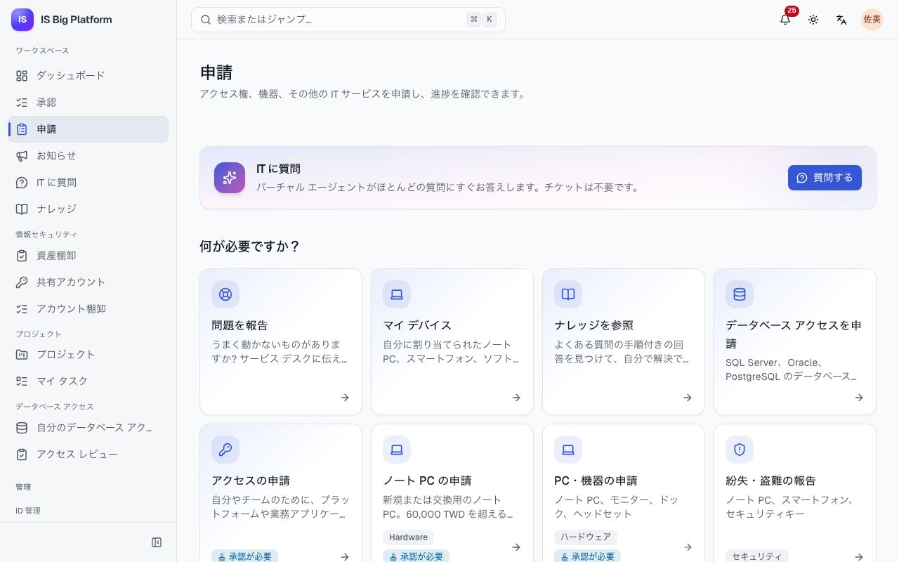
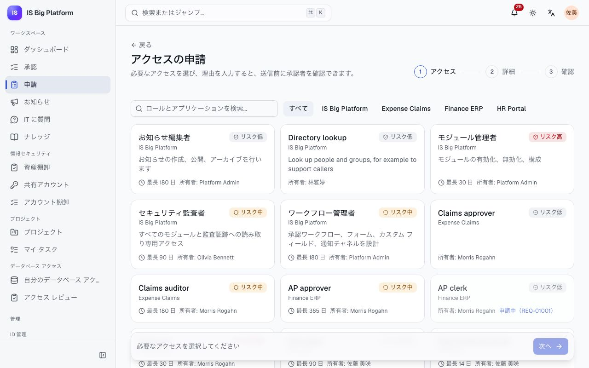
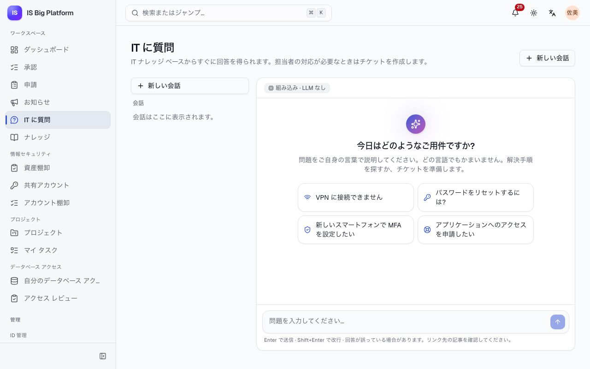
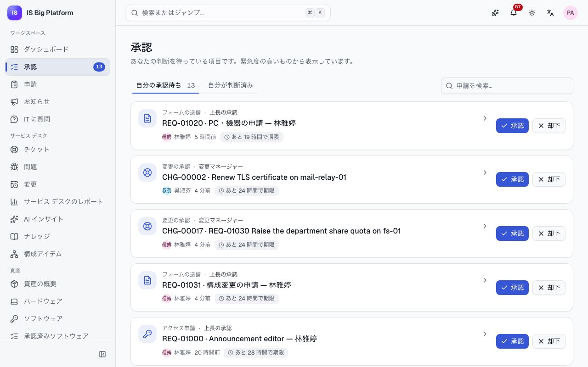

# 従業員、マネージャー、承認者向けガイド

このガイドは、IT とかかわるすべての人を対象としています。アクセス、機器、ソフトウェアの申請、何かが壊れたときのサポートの受け方、申請の状況の確認、そして承認者としてチームの申請を判断する方法を説明します。ここで説明する操作は、すべてサイドバーの**申請**ページと**承認**の一覧から始まります。

## このガイドでできること

- [申請ページで必要なものを探す](#申請ページで必要なものを探す)
- [フォームで機器やソフトウェアを申請する](#フォームで機器やソフトウェアを申請する)
- [アプリケーションやロールへのアクセスを申請する](#アプリケーションやロールへのアクセスを申請する)
- [チケットを登録する前に IT に質問する](#チケットを登録する前に-it-に質問する)
- [問題を報告する](#問題を報告する)
- [申請の状況を確認する](#申請の状況を確認する)、[解決を確認する](#解決を確認してサービスを評価する)、[申請を取り下げる](#申請を取り下げる)
- [自分のデバイスを確認し、問題を報告する](#自分のデバイスを確認し問題を報告する)
- [データベース アクセスを申請する](#データベース-アクセスを申請する)
- 承認者向け: [申請を承認または却下する](#申請を承認または却下する)、[承認を他の人に委任する](#承認を他の人に委任する)、[不在設定をする](#休暇の前に不在設定をする)
- [受け取る通知を選択し](#受け取る通知を選択する)、[言語、タイム ゾーン、セッションを設定する](#言語タイム-ゾーンセッションを設定する)

## 申請ページで必要なものを探す

**申請**は IT への入口です。IT に何かを依頼したいときや、申請の状況を知りたいときは、ここに移動します。

1. サイドバーの**申請**を選択します。
2. **何が必要ですか？** でカードを選択します。

| カード                          | 使用する場面                                                                                                                                               |
| ------------------------------- | ---------------------------------------------------------------------------------------------------------------------------------------------------------- |
| **問題を報告**                  | 何かが動作せず、サービス デスクに修正してほしい ([詳細](#問題を報告する))                                                                                  |
| **マイ デバイス**               | IT から支給されたノート PC、スマートフォン、ソフトウェアを確認したい、またはそのいずれかの問題を報告したい ([詳細](#自分のデバイスを確認し問題を報告する)) |
| **ナレッジを参照**              | 手順を追って説明した記事を見ながら、自分で解決したい                                                                                                       |
| **データベース アクセスを申請** | SQL Server、Oracle、PostgreSQL のデータベースのロールが一定期間必要 ([詳細](#データベース-アクセスを申請する))                                             |
| **アクセスの申請**              | プラットフォームまたは業務アプリケーションのロールが必要 ([詳細](#アプリケーションやロールへのアクセスを申請する))                                         |
| 申請フォーム                    | 機器、ソフトウェア、その他 IT が提供するものが必要 (デモでは**ノート PC の申請**など) ([詳細](#フォームで機器やソフトウェアを申請する))                    |

**承認が必要**と表示されたカードの申請は、IT が対応する前に承認者に送られます。申請フォームは、カテゴリ (**ハードウェア**、**ソフトウェア**、**セキュリティ**、**アクセス**、**変更**、**その他**) ごとにまとめられています。カードの上にある **IT に質問**では、質問にすぐに回答を得られます ([詳細](#チケットを登録する前に-it-に質問する))。

> **ヒント:** 表示されるのは、自分が対象になっているフォームだけです。同僚が話していたフォームが見つからない場合は、一部のグループにだけ提供されている可能性があります。[フォームがポータルに表示されない](faq.md#フォームがポータルに表示されない)を参照してください。

## フォームで機器やソフトウェアを申請する

新しいノート PC、モニター、ソフトウェア ライセンス、その他 IT が提供するものが必要なときは、申請フォームを使用します。フォームは IT が知る必要のあることを過不足なく尋ね、必要な承認もフォームに設定されています。

1. **申請**に移動し、**何が必要ですか？** でフォームを選択するか、共有されたフォームのリンクを開きます。
2. フィールドに入力します。一部の質問は、該当する場合にのみ表示されます。たとえば、**PC・機器の申請**では、**品目**で**ノート PC** を選択して初めて **PC モデル**が表示されます。
3. フォームによっては、構成アイテムなど、ISBP で管理されているものを選択するよう求められます。**レコードを選択** (複数選択できる場合は**レコードを追加**) を選択し、**番号またはタイトルで検索…** に番号またはタイトルの一部を入力して選択します。表示されるのは表示権限のあるレコードだけです。また、本番のシステムだけなど、フォームによっては一部のレコードしか選択できない場合があります。
4. フォームに承認が必要な場合は、質問の下にある**この申請の承認者**を確認します。これまでの回答に基づいて、各承認ステップと依頼先のユーザーが表示されます。選択したシステムに追加の承認が必要な場合など、入力に合わせて更新されます。回答に当てはまらないステップは、**この申請ではスキップされます**と表示されるか、表示されません。
5. **送信**を選択します。必須フィールドが空の場合は、その横に**この項目は必須です**と表示されます。フォームでは、終了日が開始日より前でないことなど、複数の回答をまとめて確認することもあります。その場合は、フォーム独自のメッセージが修正するフィールドに、またはフォームの上部の**フォームの内容を確認してください**に表示されます。

**この後の流れ:** 申請には `REQ-01042` のような参照番号が付き、**承認ルート**が表示された専用のページが開きます。フォームに承認が必要な場合 (ページに**この申請には承認が必要です。各ステップで通知が届きます。** と表示されます)、申請は最初の承認者に送られます。全員が承認すると、IT 部門が対応します。多くのフォームはサービス デスクのチケットになり、申請ページにはチケットの進捗 (**対応中**、続いて**完了**) とチケットへのリンク (**SR-… を開く**) が表示されます。フォームによっては、申請の送信後や承認後に、変更の作成やロールの付与などの作業を自動的に開始するものもあります。申請ページの**その後の処理**に、各ステップとその状態 (**待機中**、**実行中**、**完了**)、作成されたものへのリンクが表示されます。申請が承認または却下されると通知が届きます。

> **重要:** **この申請の承認者**に**このステップを承認できる人がいないため、申請は却下されます**と表示された場合は、回答に対してそのステップを承認できる人が設定されていません。送信せずに、まずサービス デスクに問い合わせてください。

> **ヒント:** デモでは、**ノート PC の申請**フォームで**見積額 (TWD)** の入力を求められます。部門長がすべてのノート PC の申請を承認し、金額が 60,000 TWD を超える場合は IT 資産管理も承認します。承認された申請は、**ハードウェア › ノート PC** カテゴリのサービス デスクのチケットになります。

## アプリケーションやロールへのアクセスを申請する

IS Big Platform のロール (例: **お知らせ編集者** (Announcement editor))、または ISBP に登録された業務アプリケーション (デモでは **Finance ERP**、**HR Portal**、**Expense Claims**) のロールが必要なときは、**アクセスの申請**を使用します。必要な期間と理由を入力し、送信前に誰が承認するかを確認できます。

1. **申請**に移動し、**アクセスの申請**を選択します。
2. 必要なアクセスを選択します。**ロールとアプリケーションを検索…** またはアプリケーションのボタンで一覧を絞り込みます。各ロールには、リスク (**リスク低**、**リスク中**、**リスク高**)、所有者、付与できる最長期間 (たとえば**最長 90 日**) が表示されます。既に持っているロールには**付与済み**、申請済みのロールには**申請中（REQ-…）** と表示されます。
3. **次へ**を選択します。
4. **誰が必要としていますか？** で**自分**または**他の人**を選択します。マネージャーは直属の部下について申請でき、アクセス管理者は誰についても申請できます。まだ入社していない新入社員には**事前登録**と表示されます。こうしたユーザーについて申請したアクセスは、入社初日に使えるようになります。
5. **期間**で、**7 日**、**30 日**、**90 日**、**カスタム** (**日数**を入力)、またはロールで許可されている場合は**期限なし**を選択します。
6. **必要な理由**に 10 文字以上入力します。承認者が読むため、具体的に記入してください。例: 「リーダーの不在中、サービス デスク チームの経費精算を承認します。」
7. **確認**を選択します。**申請内容**と**承認者**を確認します。承認者は、承認ワークフローと現時点の組織図に基づいて、ステップごとに表示されます。
8. **申請を送信**を選択します。

**この後の流れ:** 申請は**承認待ち**の状態で開きます。既定では、まず**上長の承認**、高リスクのロールでは続いて**セキュリティ審査**、最後に**アクセス所有者の承認**に送られます。独自のワークフローを使うロールもありますが、確認ステップには常に実際のルートが表示されます。最後の承認者が承認すると、ロールが自動的に付与され、申請に**アクセスが付与されました（… に終了）。** と表示されます (期限がない場合は**アクセスが付与されました（期限なし）。**)。期限付きのアクセスは終了時に自動的に削除され、その数日前にリマインダー (**まもなく終了するアクセス**) が届きます。

> **重要:** 確認ステップに**このステップを承認できる人がいないため、申請は却下されます**と表示される場合は、そのステップの承認者が設定されていません。送信せずに、まずサービス デスクまたはロールの所有者に相談してください。

## チケットを登録する前に IT に質問する

**IT に質問**は、ナレッジ ベースから IT に関する質問に回答するバーチャル エージェントです。いつでも、自分の言語で利用できます。ほとんどの質問 (VPN、パスワード、MFA、プリンター) には、チケットなしで数秒で回答します。解決できない場合はチケットを準備しますが、自分が確認するまで何も送信されません。

1. サイドバーの **IT に質問**、または**申請**ページの**質問する**を選択します。
2. 問題を自分の言葉で (どの言語でもかまいません) 入力するか、**質問の例** (例: **VPN に接続できません**) のいずれかを選択します。Enter キーを押すか、**送信**を選択します。
3. 回答を読みます。回答に使用された記事が**参照元**に一覧表示されます。詳しい手順は、記事を開いて確認してください。
4. **解決しましたか?** で、**解決しました**または**まだ解決しません**を選択します。
5. まだサポートが必要な場合は、チャットに**まだ解決しませんか? サービス デスク向けのチケットを準備しました。** と表示されます。**チケットを確認**を選択し、**タイトル**、**説明**、**緊急度**、**種類** (**何かが故障している**または**何かが必要**) を確認して、**チケットを作成**を選択します。チャットを続ける場合は、代わりに**今はしない**を選択します。

**この後の流れ:** チャットに**チケット INC-… を作成しました。サービス デスクがチケットで対応します。** と表示され、**チケットを表示**が示されます。チケットは、自分で報告したチケットと同様に**自分の申請**に表示されます。過去の会話は**会話**に一覧表示され、**新しい会話**で新しい会話を開始できます。

> **ヒント:** チャットの上部のラベルは、回答の作成方法を示しています。**組み込み · LLM なし**は、AI 言語モデルが構成されておらず、回答がナレッジ ベースの検索とテンプレートから作成されていることを示します。**言語モデル**は、個人データをマスクしたうえで、AI モデルがナレッジ ベースから回答を作成していることを示します。いずれの場合も回答が誤っていることがあるため、リンクされた記事を確認してください。[アシスタントと AI](assistant-and-ai.md)を参照してください。

## 問題を報告する

何かが壊れていて、サービス デスクの担当者に修正してほしいときは、問題を報告します。たとえば、VPN が何度も切れる、Outlook が同期しない、プリンターで紙詰まりが起きたといった場合です。

1. **申請**に移動し、**問題を報告**を選択します。
2. **何が起きていますか?** に、「自宅から VPN に接続できない」のように簡単に記述します。
3. **詳しく教えてください**に、何が起きたか、いつから始まったか、すでに試したこと、エラー メッセージを入力します。
4. **どのくらい影響がありますか?** で、**仕事ができない**、**仕事が遅れる**、**軽微**のいずれかを選択します。
5. 必要に応じて、**どのサービスですか?** で関連するシステムを選択します。
6. 入力中に、**役に立つかもしれない記事**にナレッジ記事が提案されます。記事で解決した場合は、報告を送信する必要はありません。
7. **サービス デスクに送信**を選択します。

**この後の流れ:** **INC-… を送信しました。対応を開始します。** と表示され、チケットが開きます。サービス デスクが受け付けたことが通知され、チケットが**自分の申請**に表示されます。チケットのページには、進捗 (**報告済み**、**対応中**、**解決済み**、**クローズ**)、対応している担当者 (**担当**)、サービス デスクとの**会話**が表示されます。詳細を追加したり質問に回答したりするには、返信ボックスに入力して**返信を送信**を選択します。スクリーンショットは**添付ファイル**に追加します。担当者が返信したときと、チケットが解決されたときに通知が届きます。サービス デスクの応答時間と解決時間は、SLA に照らして追跡されます。[サービス デスク](service-desk.md)を参照してください。

## 申請の状況を確認する

**申請**ページの下部にある**自分の申請**には、自分が依頼したすべてのもの (アクセスの申請、フォームの申請、報告したチケット、データベース アクセスの申請) が一覧表示されます。

1. **申請**に移動し、**自分の申請**までスクロールします。
2. **進行中**、**完了**、**すべて**のいずれかを選択します。
3. 各行には、参照番号、最終更新日時、状態が表示されます。申請が承認待ちの間は、行にステップ名と承認者の写真とともに **… の待ち**と表示されます。
4. 行を選択して申請を開きます。

| 表示される状態                                                       | 意味                                                                          |
| -------------------------------------------------------------------- | ----------------------------------------------------------------------------- |
| **承認待ち**                                                         | 承認者がまだ判断していません。申請ページに承認者が表示されます (**対応待ち**) |
| **承認済み** / **却下**                                              | 判断済みです。却下の場合は、**却下理由:** に承認者の理由が表示されます        |
| **取り下げ**                                                         | 自分 (または自分の代わりに申請した人) が取り下げました                        |
| **付与できませんでした**                                             | 承認されましたが、ロールが存在しないか、対象者が有効ではなくなっています      |
| **新規**、**対応中**、**保留**、**解決済み**、**完了**、**クローズ** | チケット、またはチケットを通じて処理されているフォームの申請                  |
| **設定中**、**アクセス付与済み**、**終了**、**削除済み**             | データベース アクセス ([詳細](#データベース-アクセスを申請する))              |
| **完了**                                                             | 承認され、フォーム自体のステップによって変更など目的のものが作成されました    |

申請ページには、**承認ルート** (各ステップ、判断した人とその日時) と**履歴**が表示されます。アクセスの申請ではロール、**対象者**、**期間**、**理由**も表示され、フォームの場合は自分の**回答** (選択したレコードはリンクとして表示されます) と、フォームが自動的に作業を開始した後は**その後の処理**が表示されます。**その後の処理**には、各ステップ、その状態 (**待機中**、**実行中**、**完了**、**失敗**、**スキップ**)、**CHG-… を開く**など作成されたものへのリンクが表示されます。ステップが失敗した場合は、フォームを管理するユーザーに通知され、再実行できます。

> **ヒント:** **ダッシュボード**にも**進行中の申請**が表示され、承認者の場合は**あなたの承認待ち**も表示されます。

### 解決を確認してサービスを評価する

サービス デスクがチケットを解決すると、確認を求められます。

1. 通知または**自分の申請**からチケットを開きます。チケットのページに**問題は解決しましたか?** と表示されます。
2. 問題がなければ**はい、クローズします**を選択し、必要に応じて**今回の対応はいかがでしたか? (省略可)** でサービスを評価してコメントを追加し、**チケットをクローズ**を選択します。
3. まだ直っていない場合は、**いいえ、まだ解決していません**を選択し、**まだ何が問題ですか?** に内容を入力して、**チケットを再オープン**を選択します。

**この後の流れ:** クローズしたチケットは、**自分の申請**の**完了**に移動します。再オープンしたチケットはサービス デスクに戻り、担当者に理由とともに通知が届きます。

### 申請を取り下げる

不要になったアクセスの申請やフォームの申請は、承認待ちの間であれば取り下げることができます。

1. **自分の申請**から申請を開きます。
2. **取り下げ**を選択し、**この申請を取り下げますか？** でもう一度**取り下げ**を選択します (取り下げをやめる場合は**残す**を選択します)。

**この後の流れ:** 申請に**取り下げ**と表示され、承認者には表示されなくなります。後で新しい申請を送信できます。

## 依頼されたフォームに記入する

サーバー室の点検、バックアップの確認、ファイアウォール ルールのレビューなど、期限までに行う必要があり、毎月や四半期ごとに繰り返されるチェックがあります。このようなフォームへの記入をあなた (またはあなたが所属するグループ) が依頼されると、**申請**ページの上部の **ToDo** と**ダッシュボード**に表示され、**ToDo: …** という通知が届きます。

1. **申請**に移動します。**ToDo** には未完了の ToDo が期限の近い順に、フォームと期限とともに表示されます。2 日以内に期限が来るものは**まもなく期限**、期限を過ぎたものは**期限切れ**と表示されます。グループ宛ての ToDo には **… 宛て**と表示され、グループのどのメンバーでも完了できます。
2. ToDo を選択します。フォームが開き、その上に ToDo (例: **Server room inspection 2026-10 — 期限 10月31日**)、依頼者のメモ、**フォームを送信すると、この ToDo が完了します。** が表示されます。
3. フォームに記入し、**送信**を選択します。

**この後の流れ:** 申請番号付きの**完了しました: …** が表示され、ToDo は一覧から消えます (グループ宛ての場合は全員の一覧から消えます)。申請は他の申請と同様に**自分の申請**に表示され、フォームに承認が必要な場合は通常どおり承認に進みます。完了するまで、期限の 2 日前から期限後まで 1 日 1 回リマインダーが届き、期限を過ぎるとフォームの管理者にも通知されます。デモでは、今月の **Server room inspection** が IT Administrators グループの記入を待っています。

## 自分のデバイスを確認し、問題を報告する

**マイ デバイス**には、IT 部門から自分に割り当てられたノート PC、スマートフォン、その他のハードウェアと、自分個人に割り当てられたソフトウェア ライセンスが一覧表示されます。資産タグや保証を確認したり、特定のデバイスの問題を報告したりするときに使用します。

1. **申請**に移動し、**マイ デバイス**を選択します。
2. 各デバイスには、**資産タグ**、**シリアル番号**、**割り当て日**、**保証**が表示されます。
3. デバイスの問題を報告するには、そのデバイスの**問題を報告**を選択します。

**この後の流れ:** デバイスがリンクされた状態で**問題を報告**が開くため、サービス デスクはどのデバイスのことかがわかります。一覧に**割り当てられたデバイスはありません**と表示されるのに会社のデバイスを持っている場合は、**サービス デスクに連絡**を選択して登録を依頼してください。デモでは、サービス デスクのリーダー (`helpdesk`) にノート PC とスマートフォンが割り当てられています。

## データベース アクセスを申請する

開発者、アナリスト、サポート スタッフは、一定期間データベースのロールが必要になることがあります。ISBP は、承認、アカウントの作成、パスワードの 1 回限りの提供、終了時のアクセスの削除まで、すべてのプロセスを処理します。

1. **申請**に移動し、**データベース アクセスを申請**を選択します。
2. **ロールを選択**、**期間と理由**、**確認して送信**の順に進みます。
3. アクセスの準備ができたら (**アクセスの準備ができました**という通知が届きます)、**データベース アクセス → 自分のデータベース アクセス**を開き、**パスワードを表示**を選択します。パスワードは、アカウントの作成から 7 日間、1 回だけ表示されます。パスワード マネージャーに保存してください。

承認は、**上長の承認**、続いて**ロール所有者の承認**に送られ、高リスクのロールでは**情報セキュリティの承認**にも送られます。詳細: [データと自動化](data-and-automation.md)。

## 申請を承認または却下する

マネージャー、ロールやアプリケーションの所有者、CAB のメンバー、または承認を担当するグループのメンバーには、判断を求める申請が届きます。すみやかに判断してください。承認ステップには期限があり、その前にリマインダーが届きます。また、ワークフローによっては、期限を過ぎると申請が他の人にエスカレーションされます。

1. サイドバーの**承認**を選択します。横の数字は、判断を待っている件数です。**自分の承認待ち**に、緊急度の高い順に一覧表示されます。各項目には、ワークフロー、ステップ、申請者と、**あと 5 時間で期限**や **2 日超過**などの期限のバッジが表示されます。
2. 先に詳細を確認するには、申請を選択します。パネルに**申請内容**、**承認ルート**、**履歴**、**申請を開く**リンクが表示されます。申請者がフォームで選択したレコード (構成アイテムなど) はリンクとして表示され、開くことができます (表示権限のないレコードは件数だけが表示されます)。
3. **承認**または**却下**を選択します。
4. ダイアログでコメントを追加します。承認する場合は任意 (**コメント（任意）**)、却下する場合は必須 (**却下の理由**) です。コメントは申請者に表示されます。
5. ステップによっては、決定とともに**入力項目**への入力が求められます (評価結果、処理メモ、デバイスのデータ消去日など)。\* の付いた項目は承認に必要です。却下する場合は、ステップで指定されていない限り省略できます。入力した内容は決定とともに保存され、申請に表示されます。
6. ダイアログで**承認**または**却下**を選択します。

スクリーンショットや署名済みのフォームなどの証跡を追加するには、申請を開き (**申請を開く**)、**添付ファイル**に追加します。関連レコードもそこでリンクできます。申請者と承認者は、申請が取り下げられるまで追加できます。

**この後の流れ:** 申請は次のステップに進むか、完了します。申請者に通知が届き、コメントが表示されます。**自分が判断済み**には、自分が判断した項目が一覧表示されます。他の人がすでに判断していた場合 (「最初の回答で決定」のステップ)、**この承認はすでに処理されています。** と表示されます。

> **ヒント:** 参照番号で一覧を検索できます (**申請を検索…**)。新しい承認は、アプリ内と、メールが設定されている場合はメール (**自分宛ての承認**) で届きます。

ISBP のあらゆる種類の承認を、この同じ一覧で処理します。アクセスの申請、フォームの申請、変更 (CAB)、資産の廃棄、プロジェクト提案、データベース アクセス、ナレッジ記事、アシスタントで準備した変更セットです。ステップがエスカレーションされた場合は**エスカレーション**、同僚から委任された場合は **… さんから委任**というバッジが表示されます。

## 承認を他の人に委任する

同僚のほうが判断に適している場合 (そのシステムに詳しいなど) は、承認を委任します。

1. **承認**で申請を選択し、パネルを開きます。
2. **委任**を選択します。
3. **同僚**を選択し、必要に応じて**委任先へのメモ（任意）** を入力して、**委任する**を選択します。

**この後の流れ:** 承認は同僚の承認一覧に移動し、同僚に通知が届きます。申請者は自分の申請を承認できません。**委任**が表示されない場合、そのワークフロー ステップでは委任が許可されていません。

## 休暇の前に不在設定をする

不在設定をスケジュールしておくと、不在中に承認が滞りません。

1. ユーザー メニュー (右上のアバター) を開き、**プロファイルと設定**を選択します。
2. **不在設定**に移動し、**スケジュール**を選択します。
3. **承認の代理人**で同僚を選択します。**開始**と**終了** (または簡易的に**期間**) を設定し、必要に応じて「年次休暇」などの**理由**を入力します。
4. **不在設定をスケジュール**を選択します。

**この後の流れ:** その期間中、新しい承認タスクは自分ではなく代理人に送られます。すでに自分を待っているタスクは自分に残ります。期間は**予定**、続いて**有効**として一覧表示されます。予定より早く戻る場合は**今すぐ終了**を、予定していた期間を取り消す場合は**削除**を選択します。デモでは、人事担当者 (`hr.partner`) の年次休暇がスケジュールされており、承認はサービス デスクのリーダーに送られます。

## 受け取る通知を選択する

ISBP は、承認、自分の申請、チケットなどについて、アプリ内 (ヘッダーのベル) とメールで通知します。

1. ユーザー メニューを開いて**プロファイルと設定**を選択し、**通知**を選択します。
2. **通知**の種類ごとに、**アプリ内**と**メール**のオンとオフを切り替えます。変更は自動的に保存されます。
3. **既定値に戻す**を選択すると、元の設定に戻ります。

**この後の流れ:** 新しい通知は、選択した設定に従って届きます。**セキュリティのため必須**と表示された種類はオフにできません。このプラットフォームではメール通知がまだ設定されていないことがページに表示される場合は、管理者がメールをオンにするまで、通知はアプリ内でのみ届きます。

通知を読むには、ベルを選択します。通知を選択すると、関連する項目が開きます。**すべて既読にする**も使用できます。**すべての通知を表示**を選択すると、**すべて**タブと**未読**タブがある一覧全体が開きます。

## 言語、タイム ゾーン、セッションを設定する

設定は、サインインするすべてのデバイスに引き継がれます。

1. ユーザー メニューを開き、**プロファイルと設定**を選択します。
2. **基本設定**で、**言語** (通知とメールにも使用されます)、テーマ、**タイム ゾーン** (日付と時刻はこのタイム ゾーンで表示されます) を選択します。**このデバイスのタイム ゾーンを使用**を選択すると、コンピューターのタイム ゾーンが設定されます。
3. **プロファイル**で、**表示名**を変更します。メール アドレス、ユーザー名、部署は組織によって管理されています。
4. ローカル アカウントでサインインしている場合は、**パスワード**でパスワードを変更します。組織のアカウントでサインインしている場合は、組織側で変更してください。
5. **セッション**で、自分のアカウントにサインインしているデバイスを確認します。心当たりのないデバイスの横にある**サインアウト**を選択するか、**他のセッションをサインアウト**を選択します。

### 自分のロールを確認する

**プロファイルと設定**の下部にある**自分のアクセス権**には、自分のロールと、その付与経路 (**直接割り当て**、グループによる **… 経由**、または**全員**) が、期限付きのロールの場合は終了日とともに一覧表示されます。必要なものが不足している場合は、[アクセスを申請](#アプリケーションやロールへのアクセスを申請する)してください。

## 関連情報

- 報告したチケットはサービス デスクが処理します: [サービス デスク](service-desk.md)。
- ノート PC などのデバイスは資産マネージャーが管理します: [資産](assets.md)。
- データベースのロール、アカウント、アクセス レビュー: [データと自動化](data-and-automation.md)。
- IT に質問とアシスタントが AI をどのように使い、データをどう扱うか: [アシスタントと AI](assistant-and-ai.md)。
- ここで使用するフォームと承認ワークフローは管理者が設計します: [管理者](administrators.md)、[独自のプロセスを作成する](processes.md)。
- 新入社員の最初の 1 週間など、一連の流れの例: [ISBP と業務のつながり](how-it-fits-our-work.md)。
- 説明どおりに動作しない場合: [よくある質問とトラブルシューティング](faq.md)。
