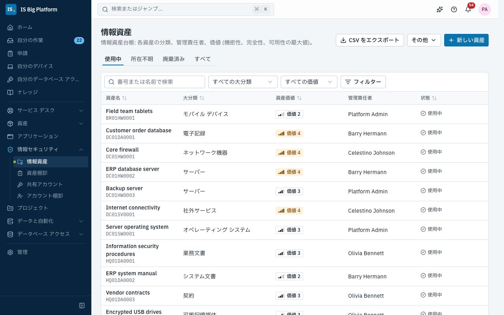
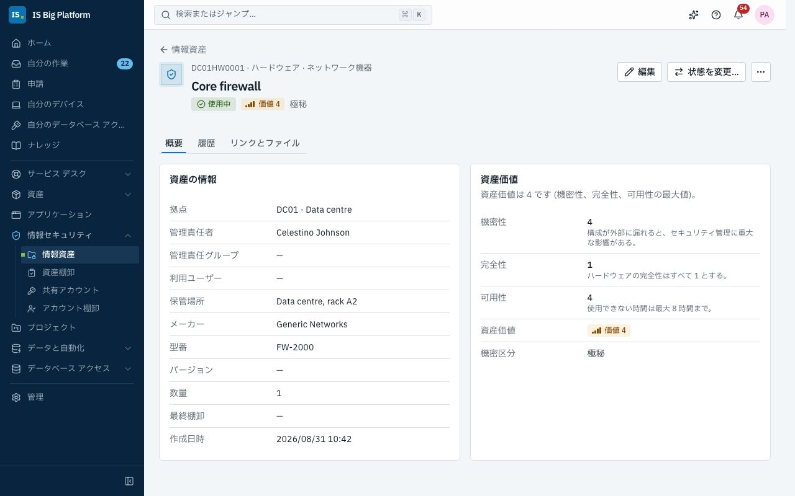
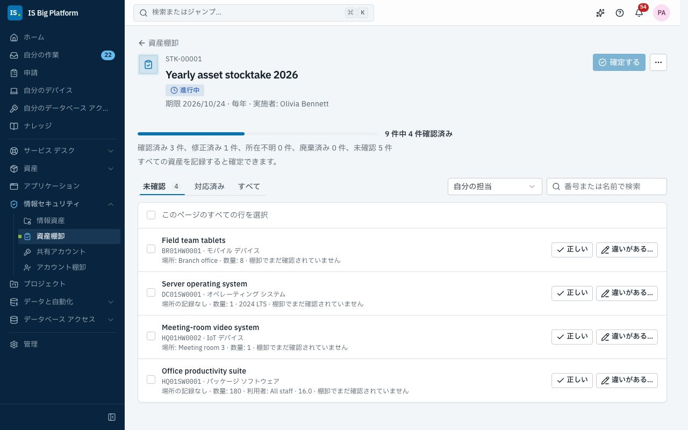
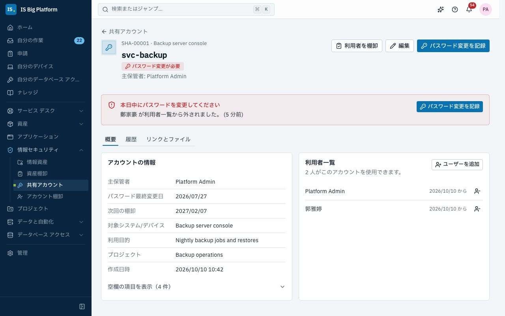
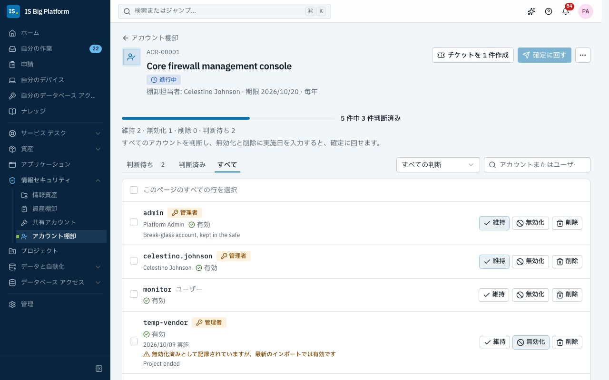

# 情報セキュリティ (ISMS) ガイド

このガイドは、情報セキュリティ マネジメント システム (ISMS) に携わるすべてのユーザーを対象としています。情報資産の管理者、情報セキュリティ責任者、共有アカウントの保管者、システムのアカウントを棚卸する担当者などです。**情報セキュリティ**では、ISO 27001 の監査で求められる記録を 1 か所で管理します。各資産の機密性・完全性・可用性を記録する情報資産台帳、台帳を正しく保つための棚卸、共有アカウントとその利用者、各システムのアカウント棚卸です。

## このガイドでできること

- [ロールごとにできること](#ロールごとにできること)と、[機密性・完全性・可用性の評価方法](#機密性完全性可用性を評価する)を理解する
- [情報資産を登録し](#情報資産を登録する)、[台帳で資産を探し](#台帳で資産を探す)、[資産のページ、履歴、リンク、ファイルを確認する](#資産のページを確認する)
- 台帳を CSV で[エクスポート、インポートする](#台帳をエクスポートインポートする)、または[他のレコードから資産を作成する](#他のレコードから資産を作成する)
- [資産棚卸を実施する](#資産棚卸を実施する): [開始し](#棚卸を開始またはスケジュールする)、[管理する資産を確認し](#管理する資産を確認する)、[確定する](#棚卸を確定する)
- [共有アカウントを登録し](#共有アカウントを登録する)、[利用者が一覧から外れたらパスワードを変更し](#利用者が一覧から外れたらパスワードを変更する)、[利用者を棚卸する](#共有アカウントの利用者を棚卸する)。[申請フォームから登録する](#申請フォームから共有アカウントを登録する)こともできます
- システムの[アカウント棚卸を実施する](#アカウント棚卸を実施する): [開始](#アカウント棚卸を開始する)から[確定](#アカウント棚卸を完了して確定する)まで
- [分類、拠点、機密区分を設定する](#分類拠点機密区分を設定する) (管理者)
- ISMS のプロセスに必要なフォームと定期チェックをまとめた [ISMS プロセス パックをインストールする](#isms-プロセス-パック)
- [よくある問題を解決する](#よくある問題を解決する)

## ロールごとにできること

以下のロールは**管理 → ロールとアクセス**で付与されます。参加するだけのユーザー (棚卸で自分が管理責任者の資産を確認する、システムのアカウントを棚卸する、共有アカウントを保管する) は、その作業を**自分の作業**と通知で確認します。サイドバーの**情報セキュリティ**のページは、ほかのロール向けです。必要なのに表示されない場合は、管理者に依頼してください。

| ロール                                                          | できること                                                                                                                                     |
| --------------------------------------------------------------- | ---------------------------------------------------------------------------------------------------------------------------------------------- |
| **情報セキュリティ参加者** (Information security participant)   | 全員に付与されています。管理責任者である資産の棚卸、割り当てられたアカウント棚卸の判定、自分が保管または使用する共有アカウントの表示ができます |
| **情報セキュリティ閲覧者** (Information security viewer)        | 台帳の閲覧とエクスポート、すべての棚卸、共有アカウント、アカウント棚卸の閲覧ができます                                                         |
| **情報資産管理者** (Information asset manager)                  | 台帳の管理 (登録、編集、削除、インポート、他のレコードからの作成) と、棚卸の開始、スケジュール、キャンセルができます                           |
| **情報セキュリティ責任者** (Information security officer)       | 棚卸とアカウント棚卸の承認、共有アカウントの登録と変更、アカウント棚卸の開始とキャンセル、台帳の閲覧ができます                                 |
| **情報セキュリティ管理者** (Information security administrator) | 分類、拠点、機密区分を含む、情報セキュリティのすべての操作ができます                                                                           |

デモでは、IT Administrators グループが**情報資産管理者**、Security Team が**情報セキュリティ責任者**、Network Team、DBA Team、Service Desk の各グループと `auditor` ユーザーが**情報セキュリティ閲覧者**のロールを持ち、`admin` が**情報セキュリティ管理者**です。

> **ヒント:** **自分の作業**には、ここで対応が必要な事項が表示されます。**棚卸の確認** (確認が必要な、管理責任者である資産)、割り当てられた**アカウント棚卸**、保管する共有アカウントの**変更が必要なパスワード**です。

## 機密性・完全性・可用性を評価する

すべての資産について、**機密性** (見るべきでない人に開示された場合の影響)、**完全性** (誤り、欠落、無断の変更があった場合の影響)、**可用性** (使用できない場合の影響) をそれぞれ 1 から 4 で評価します。**資産価値**は 3 つの最大値です。評価が 4、1、2 の資産の価値は 4 になります。資産価値は手入力しないため、うっかり過小評価することはありません。

各評価点の意味は資産の分類によって異なります。評価するときは、フォームの各評価点の横にその分類の評価基準が表示されます。価値を過小評価しないよう、当てはまる最も高い評価点を選びます。既定の分類は次のとおりです。

| 分類             | コード | 小分類                                                                                        | 評価の考え方                                                                                                   |
| ---------------- | ------ | --------------------------------------------------------------------------------------------- | -------------------------------------------------------------------------------------------------------------- |
| **人員**         | `PE`   | **社内の人員**、**社外の人員**                                                                | 機密性は扱う情報の最も高い機密度、完全性は常に 1、可用性は不在時に影響が及ぶ範囲で評価します                   |
| **ハードウェア** | `HW`   | **サーバー**、**ネットワーク機器**、**可搬記憶媒体**、**モバイル デバイス**、**IoT デバイス** | 機密性は設定情報が漏れた場合の影響、完全性は常に 1、可用性は許容できる停止時間 (4: 最大 8 時間) で評価します   |
| **ソフトウェア** | `SW`   | **オペレーティング システム**、**パッケージ ソフトウェア**                                    | 機密性はロジックが漏れた場合の影響、完全性は結果が誤っていた場合の影響、可用性は許容できる停止時間で評価します |
| **情報**         | `DA`   | **業務文書**、**システム文書**、**電子記録**、**契約**                                        | 機密性は社内 (1) から極秘 (4) まで、完全性と可用性は誤りや紛失で影響を受ける範囲で評価します                   |
| **サービス**     | `SV`   | **社内サービス**、**社外サービス**                                                            | 機密性は仕組みの情報が漏れた場合の影響、完全性は常に 1、可用性は許容できる停止時間で評価します                 |

各資産には、情報の取り扱い方を示す**機密区分**も設定できます。既定は**極秘**、**顧客機密**、**機密**、**社内限り**です。4 つの区分は機密性の評価に対応する (評価 4 が最も厳しい区分) ため、フォームは機密性の評価から区分を提案します。別の区分が必要な場合は変更してください。評価点はあらかじめ選択されません。3 つすべてを選ぶまで、資産価値は**未評価**と表示されます。分類、評価基準、機密区分は管理者が変更できます。[分類、拠点、機密区分を設定する](#分類拠点機密区分を設定する)を参照してください。

## 情報資産を登録する

組織が依存し始めた時点で資産を登録します。新しいサーバー、新しいシステムのデータベース、契約、外部サービス、チームなどです。**情報資産管理者**のロールが必要です。

1. **情報セキュリティ → 情報資産**に移動し、**新しい資産**を選択します。
2. **資産**で、**資産名** (機能を簡潔にわかりやすく記述します) を入力し、**大分類**、**小分類**、**拠点**を選択します。
3. **管理責任者**で、**管理責任者** (ユーザー) または**管理責任グループ**を選択します。棚卸ではこの人たちが確認します。
4. **機密性、完全性、可用性**で、各評価点の横の基準を読みながら、それぞれの評価を選択します。選択に応じて**資産価値**に結果が表示され、どの評価で決まったかも示されます (例: 「完全性で決定」)。続いて**機密区分**を確認します。機密性の評価から提案されています。
5. **利用者と保管場所**で、**利用ユーザー**を選択し、**保管場所**を入力します。
6. **その他の詳細** (ハードウェアとソフトウェアでは開いた状態です) で、ほかの利用者を**その他の利用者 (テキスト)** に記述し (例: 「経理部」)、必要に応じてメーカー、型番、バージョン、数量を入力し、**備考**を入力します。
7. 管理者が追加したその他のフィールドを入力し、**保存**を選択します。

**この後の流れ:** 資産に番号 (例: `HQ01HW0003`) が付けられてページが開き、履歴は「登録」から始まります。この資産を対象とする棚卸では、毎回、管理責任者または管理責任グループのメンバーが確認します。

資産を変更するには、資産を開いて**編集**を選択し、**変更を保存**を選択します。棚卸以外で所在不明や廃棄を記録するには、**状態を変更…** を選択し、**所在不明**、**廃棄済み**、**使用中**のいずれかを選んで、いつ、どのようにかを備考に入力し、**状態を変更**を選択します。備考は履歴に残ります。**その他 → 削除**を選択すると、資産はリンクと添付ファイルとともに台帳から削除されます (履歴は監査ログに残ります)。記録を残す場合は、代わりに廃棄済みにしてください。

### 資産番号の構成

資産番号は、拠点コード、分類コード、その拠点と分類の次の連番で構成されます。`HQ01HW0001` は本社 (`HQ01`) の最初のハードウェア資産です。拠点と分類ごとに連番があります。後で資産を別の拠点や分類に移しても番号は変わらないため、番号を記載したラベルや文書を直す必要はありません。

資産の**状態** (**使用中**、**所在不明**、**廃棄済み**) はフォームでは編集しません。資産ページの**状態を変更…**、棚卸の確定時、または CSV インポートの**状態**列で変わります。

## 台帳で資産を探す

1. **情報セキュリティ → 情報資産**に移動します。**使用中**、**所在不明**、**廃棄済み**、**すべて**の各タブで状態ごとに絞り込めます。
2. 番号または名前で検索し、**すべての大分類**と**すべての価値** (例: **価値 3 以上**) で一覧を絞り込みます。ほかの条件 (**機密区分**、**拠点**、**管理責任グループ**、**管理責任者**) は**フィルター**にあります (スマートフォンではすべての条件がここにあります)。適用中のフィルターはチップで表示され、1 つずつ、または**すべてクリア**でまとめて解除できます。
3. 列見出しで並べ替え、資産を選択して開きます。

一覧には、各資産の名前と番号、**大分類**、**資産価値** (ポインターを合わせると 3 つの評価が表示されます)、**管理責任者**、**機密区分**、**状態**が表示されます。資産価値は小さなゲージ付きの中立的なバッジで表示され、価値 4 だけが目立つ表示になります。フィルターはページのアドレスに保存されるため、絞り込んだ一覧をリンクで共有できます。

デモでは、**価値 4 以上**を選ぶと Core firewall、ERP database server、Customer order database、Internet connectivity が表示されます。

> **ヒント:** ヘッダーの検索でも情報資産と共有アカウントを検索できます。アシスタントも、ユーザーのアクセス許可の範囲で資産を探せます (「価値 4 のハードウェアは?」)。

## 資産のページを確認する

資産を開くと、3 つのタブですべての情報を確認できます。

- **概要**: **資産の情報** (拠点、管理責任者、管理責任グループ、利用者、保管場所、メーカー、型番、バージョン、数量、棚卸で記録される**最終棚卸**、他のレコードから作成した場合は**登録元**) と、**資産価値** カード (各評価、その評価点に対する分類の評価基準、**資産価値**、**機密区分**)。
- **履歴**: すべての変更と、その実行者と日時。**登録**、**更新**、**インポート**、**棚卸で更新**、**状態を変更**と、変更されたフィールドが表示されます。
- **リンクとファイル**: **関連レコード**と**添付ファイル**。**レコードをリンク**を選択すると、この資産に関係する構成アイテム、ハードウェア資産、アプリケーション、チケットをリンクできます。**アップロード**を選択すると、リスク アセスメントや署名済みの取り扱い契約などの文書を添付できます。

申請フォームでは、**レコード** フィールド (レコードの種類: **情報資産**) でユーザーに情報資産を選択してもらえます。承認のルートは、資産の**資産価値**、**機密性**、**完全性**、**可用性**、**機密区分**、**管理責任者**、**管理グループ**、**資産分類コード**、**拠点コード**、**資産の状態**で決められます。たとえば、価値 4 の資産では情報セキュリティ責任者の承認を追加できます。資産を選択するには、台帳を閲覧できるロールが必要です。[ユーザーがレコードを選択できるようにする](processes.md#ユーザーがレコードを選択できるようにする)を参照してください。

## 台帳をエクスポート、インポートする

監査担当者は台帳をスプレッドシートで求めることが多く、スプレッドシートから台帳を作り始める組織も多くあります。エクスポートとインポートは同じレイアウトを使うため、エクスポートして Excel で編集し、再びインポートできます。

**エクスポート。** **情報セキュリティ → 情報資産**で **CSV をエクスポート**を選択します。表示中のタブとフィルターに一致する資産が、ユーザーの言語の列見出しで出力されます。ファイルは BOM 付きの UTF-8 のため、Excel で中国語や日本語が正しく表示されます。

**インポート。** **情報資産管理者**のロールが必要です。

1. **その他**を選択し、**CSV からインポート**を選択します。
2. **CSV ファイル**でファイルを選択し、**ファイルを確認**を選択します。この時点では何も変更されません。ダイアログに結果 (「確認結果: 登録 … 件、更新 … 件、変更なし … 件。まだ何も変更されていません。」) が表示され、処理されない行が、行番号、列、問題とともに一覧表示されます。
3. 必要に応じてファイルを修正して再確認し、**インポート**を選択します。

**この後の流れ:** 有効な行がまとめて適用され、無効な行は処理されません。インポートした各資産の履歴には「インポート」と表示され、インポートは監査ログに記録されます。

### CSV のレイアウト

列は紙の台帳の順序に従います。**資産番号**、**資産名**、**大分類**、**小分類**、**資産管理者**、**資産利用者**、**保管場所**、**メーカー**、**型番**、**バージョン**、**数量**、**機密性**、**完全性**、**可用性**、**資産価値**、続いて**機密区分**、**拠点**、**状態**、**備考**です。

- 列の順序は任意で、見出しは英語、中国語、日本語のいずれでもかまいません。見出し行の上のタイトル行は無視されます。列の区切りはカンマ、セミコロン、タブのいずれかで、UTF-8、UTF-16、Big5 のファイルを読み込めます。
- **資産番号**が既存の行は、その資産を更新します。空欄は現在の値を保持します。
- その他の行は新しい資産として登録され、**資産名**、**大分類**、**拠点** (拠点が 1 つだけの場合は省略可)、3 つの評価が必要です。**資産番号**を空欄にすると自動で採番されます。紙の台帳の番号を引き継ぐ場合は、その拠点と分類で未使用の番号を指定できます。
- **大分類**、**小分類**、**拠点**、**機密区分**には、コードまたはいずれかの言語の名前を指定します。**資産管理者** (資産の管理責任者。列見出しは紙の台帳のまま) には、ユーザーのメール アドレス、ユーザー名、表示名、またはグループ名を指定します。**機密性**、**完全性**、**可用性**は 1 から 4 です。
- **資産価値**は常に評価から計算されます。1 つのファイルは最大 2,000 行です。

## 他のレコードから資産を作成する

台帳に載せるものの多くは、すでに ISBP にあります。CMDB のサーバー、資産のノート PC とライセンス、契約、アプリケーション、ナレッジの手順書などです。入力し直さずに、そこから登録します。

1. **情報セキュリティ → 情報資産**で**その他**を選択し、**他のレコードから作成**を選択します。
2. **レコードの種類**を選択します: **構成アイテム**、**ハードウェア資産**、**ソフトウェア ライセンス**、**契約**、**アプリケーション**、**ナレッジ記事** (表示できる種類だけが表示されます)。
3. レコードを検索してオンにします。台帳に登録済みのレコードには **… として登録済み**と表示され、再度選択することはできません。
4. **新しい資産の設定**で、すべての新しい資産に共通する**大分類**、**小分類**、**拠点**、**機密区分**、**管理責任者**、3 つの評価 (あらかじめ選択されません) を選択します。
5. **資産 … 件を登録**を選択します。

**この後の流れ:** 各レコードは、その名前の資産になり、元のレコードにリンクされます (資産ページの**登録元**と、双方の**関連レコード**)。評価や管理者が資産ごとに異なる場合は、後で個別に調整します。

## 資産棚卸を実施する

棚卸 (資産インベントリ) では、台帳が実態と一致しているかを確認します。各資産の管理責任者が確認、修正、または所在不明・廃棄を報告し、情報セキュリティ責任者が結果を確定します。四半期ごとまたは毎年の繰り返しを設定すると、次回の棚卸が自動でスケジュールされます。

デモでは、ハードウェアとソフトウェアの **Yearly asset stocktake** (`STK-00001`) が進行中です。Core firewall、ERP database server、Endpoint protection は確認済みで、Backup server はラック B4 に移動したため修正済みです。

### 棚卸を開始またはスケジュールする

**情報資産管理者**または**情報セキュリティ責任者**のロールが必要です。

1. **情報セキュリティ → 資産棚卸**に移動し、**新しい棚卸**を選択します。
2. **名前**、**開始日** (今日。スケジュールする場合は後の日付)、**期限**を入力します。
3. **その他の詳細**で、**繰り返し** (**1 回のみ**、**四半期ごと**、**毎年**) と対象を選択します。**大分類**と**拠点**で項目をオンにし、**管理責任者**で**管理責任者を追加**を使ってユーザーを追加し、**管理責任グループ**でグループをオンにします。一覧を空欄にするとすべてが対象になります。使用中と所在不明の資産が含まれます。
4. **開始**を選択します。後日開始する場合は**スケジュール**を選択します。

**この後の流れ:** 対象の各資産が、その管理責任者 (または管理責任グループのメンバー) の項目になり、期限とともに通知 (「棚卸 …: 確認する資産 … 件」) が届きます。スケジュールされた棚卸には「この棚卸は … に開始します。」と表示され、当日の朝に自動で開始します。期限の 1 週間前には、未確認の項目がある管理者にリマインダーが届きます。期限を過ぎると、管理者と棚卸を作成したユーザーに通知されます。すべての項目が記録されると、棚卸を作成したユーザーに確定できることが通知されます。管理責任者は**自分の作業** (**棚卸の確認**) でも自分の担当分を確認できます。

### 管理する資産を確認する

棚卸が開始されると、管理責任者である資産について通知が届きます。データ センター、棚、文書管理システムなど、資産がある場所で 1 つずつ確認します。

1. 通知または**自分の作業** (**棚卸の確認**) から棚卸を開きます。**未確認**タブが開き、自分の資産が最初に表示されます。各資産には台帳の内容 (場所、数量、利用者、メーカー、型番、バージョン、最終確認日) が表示されます。(**情報セキュリティ → 資産棚卸**の**対応が必要な項目**にも表示されます。)
2. 資産ごとに次のいずれかを選択します。
   - **正しい**: 1 回の操作で**確認済み**として記録されます。
   - **違いがある…**: ダイアログに台帳の内容が再度表示され、何が違うかを尋ねられます。**一部の内容が違う**を選んで**資産名**、**保管場所**、**利用者 (部署またはユーザー、テキスト)**、**メーカー**、**型番**、**バージョン**、**数量**を修正するか、**見つからない**を選んで探した場所を入力するか、**廃棄された**を選んでいつ、どのように廃棄したか (廃棄証明書の番号など) を入力します。**記録**を選択します。
3. 複数の資産をまとめて確認するには、オンにして**正しい (… 件)** を選択します。

**この後の流れ:** 資産は**未確認**から外れます。修正内容はすぐに台帳に反映され、資産の履歴に「棚卸で更新」と表示されます。所在不明と廃棄済みの資産の状態は、棚卸の確定時に変わります。自分の担当がなくなると、ページに「すべて完了しました」と表示されます。確定までは、**対応済み**タブで結果を変更できます。

### 棚卸を確定する

1. **情報セキュリティ → 資産棚卸**から棚卸を開きます。進捗バーとその下の説明に、確認済み、修正済み、所在不明、廃棄済み、未確認の資産の数が表示されます。**未確認**、**対応済み**、**すべて**の各タブで項目を絞り込め (**対応済み**では結果を選べます)、**自分の担当**／**すべての担当**で自分の項目とすべての項目を切り替えられます。
2. **未確認**で残りの項目を確認します。各項目に確認担当者が表示されます。棚卸の管理者は、どの項目も自分で記録できます。
3. すべての資産が記録されたら、情報セキュリティ責任者が**確定する**を選択し、**備考 (省略可)** を入力して**確定する**を選択します。

**この後の流れ:** 所在不明と報告された資産は**所在不明**、廃棄済みの資産は**廃棄済み**になり、その他の資産は**使用中**になって**最終棚卸**が今日に設定されます。棚卸には「… が確定」と表示されます。繰り返しを設定している場合は、同じ名前と対象で、3 か月後または 12 か月後に次回の棚卸がスケジュールされます。

**その他** (⋯) の**結果をエクスポート**で監査の証跡を取得できます。各資産、結果、修正内容、備考、記録者、記録日時を含む CSV が出力されます。不要になった棚卸は**棚卸をキャンセル**で中止できます。記録済みの結果は保持されますが、確定はできなくなります。

## 共有アカウントを登録する

共有アカウントは、複数のユーザーが使用するアカウントです。サービス アカウント、デバイスの管理者アカウント、メールボックスのログインなどがあります。当社の規定では、各共有アカウントは承認を受け、パスワードを保管する主保管者がいて、使用を許可されたユーザーが一覧になっている必要があります。利用者が一覧から外れたら、その日のうちにパスワードを変更します。

**情報セキュリティ責任者**のロールが必要です。

1. **情報セキュリティ → 共有アカウント**に移動し、**共有アカウントを登録**を選択します。
2. **アカウント名**と**対象システム/デバイス**を入力します。
3. **主保管者**を選択し、**ユーザーを追加**で**利用者一覧**にユーザーを追加します。
4. 必要に応じて、**その他の詳細**で**リンクするアプリケーションまたは構成アイテム**を選択し、**申請部署**、**プロジェクト**、**申請番号**、**パスワード最終変更日**、**次回の棚卸**、**利用目的**、**備考**を入力します。
5. **登録**を選択します。

**この後の流れ:** アカウントに `SHA-00003` のような番号が付けられます。主保管者と一覧のユーザーは、**共有アカウント** (**自分のもののみ**) で確認できます。**次回の棚卸**を設定しない場合は 12 か月後になります。

> **重要:** ISBP はパスワード自体を保存しません。主保管者がパスワードを暗号化して保管し、ここには変更した日付だけを記録します。備考にパスワードを書かないでください。

主保管者、利用者、その他の情報を変更するには、アカウントを開いて**編集**を選択します。**利用者一覧** カードの**ユーザーを追加**で、1 人を直接追加することもできます。ユーザーを一覧から外すと、パスワードの変更が必要になります。入力されていない項目は**空欄の項目を表示 (… 件)** にまとめられています。

## 利用者が一覧から外れたらパスワードを変更する

次の場合、共有アカウントのパスワード変更が必要になり、アカウントに**パスワード変更が必要**と表示されます。

- 一覧のユーザーが**管理 → ユーザー**で退職処理された場合: そのユーザーはすべての一覧から外されます (「… が退職しました」)。
- 一覧のユーザーが他の部署に異動した場合: 一覧には残るため、アカウントが不要になった場合は外してください (「… が他の部署に異動しました」)。
- 手動または年次棚卸で、ユーザーが一覧から外された場合。
- 主保管者が退職した場合: 情報セキュリティ責任者に、**編集**で新しい保管者を指定するよう通知されます。

主保管者には、「本日中に … のパスワードを変更してください」という通知が ISBP とメールで届きます。この通知はオフにできません。

1. 通知、**ホーム**のカード、または**情報セキュリティ → 共有アカウント**の**パスワード変更が必要**タブからアカウントを開きます。ページに**本日中にパスワードを変更してください**と理由が表示されます。
2. システム側でパスワードを変更します。
3. **パスワード変更を記録** (警告の中、またはページ上部) を選択し、**変更日**を確認して**備考 (省略可)** を入力し、**記録**を選択します。一覧の**パスワード変更が必要**タブでは、行の**変更を記録**で、アカウントを開かずに同じ操作ができます。

**この後の流れ:** 警告が消え、**パスワード最終変更日**にその日付が表示されます。履歴には「… にパスワードを変更」と表示され、変更は監査ログに記録されます。

自分でユーザーを一覧から外すには、アカウントの**概要**を開き、**利用者一覧**でユーザーの横のボタン (**… を一覧から外す**) を選択して、**除外**で確定します。

デモでは、`svc-backup` (`SHA-00001`、バックアップ サーバーのコンソール) の一覧からユーザーが外されたため、パスワード変更が必要です。`report_reader` (`SHA-00002`) には対応事項はありません。

## 共有アカウントの利用者を棚卸する

年に 1 回、主保管者は一覧の全員が引き続きアカウントを必要としているかを確認します。**次回の棚卸**の日になると、主保管者に通知 (「… の利用者を棚卸してください」) が届き、アカウントに年次棚卸の期限であることが表示され、**棚卸期限**タブに表示されます。

1. アカウントを開き、**利用者を棚卸**を選択します。
2. 引き続きアカウントが必要なユーザーにはチェックを残し、それ以外のユーザーのチェックを外します。外れるユーザーの人数がダイアログに表示されます。
3. **備考 (省略可)** を入力し、**棚卸を確定**を選択します。

**この後の流れ:** チェックを外したユーザーは一覧から外され、1 人でも外れた場合はパスワードの変更が必要になります。**前回の棚卸**は今日になり、**次回の棚卸**は 12 か月後になります。履歴には「利用者を確認。次回の棚卸 …」と表示されます。棚卸は主保管者または**情報セキュリティ責任者**が実施できます。12 か月という間隔は、管理者がモジュールの設定で変更できます。

## 申請フォームから共有アカウントを登録する

共有アカウントをフォームで申請している場合 (紙の申請書と同様に、利用者ごとに 1 行、保管者を指定)、承認後に申請からアカウントを登録できます。これにより、台帳への登録漏れがなくなります。

1. **管理 → フォーム**でフォームを開き、**アクション**タブで**アクションを追加**を選択します。
2. **共有アカウントを登録**を選択し、**実行のタイミング**を**承認後**にします。このアクションを追加するには**情報セキュリティ責任者**のロールが必要です。
3. 設定を入力します。**アカウント名**と**対象システム/デバイス** (テキスト、またはフォームの回答を使うテンプレート)、フォームにある場合は**アプリケーションまたは構成アイテムのフィールド**、**主保管者** (**申請者**またはユーザー フィールド)、**利用者** (ユーザー フィールド、または表のユーザー列)、**利用目的**、**プロジェクト**です。
4. **アクションを追加**を選択し、**保存**と**公開**を選択します。

**この後の流れ:** 申請が承認されると、申請番号を**申請番号**としてアカウントが登録され、申請からアカウントにリンクされます。同じシステムに同じ名前の有効なアカウントがすでにある場合は、代わりにそのアカウントに新しいユーザーが追加され、履歴に「申請から更新」と表示されます。承認までに退職したユーザーは追加されません。アクションの詳細: [アクションを追加する](processes.md#アクションを追加する)。

## アカウント棚卸を実施する

アカウント棚卸では、1 つのシステム (ファイアウォール、サーバー、データベース、アプリケーション) のすべてのアカウントを確認し、アカウントごとに維持、無効化、削除を判断します。結果は情報セキュリティ責任者が確定します。四半期ごとまたは毎年の繰り返しを設定すると、次回の棚卸が自動でスケジュールされます。

デモでは、**Core firewall management console** のアカウント棚卸 (`ACR-00001`) が進行中です。棚卸担当者はネットワーク エンジニアで、`admin` は緊急用アカウントとして維持、`temp-vendor` はプロジェクト終了のため無効化済みで、その他のアカウントは未判断です。

### アカウント棚卸を開始する

**情報セキュリティ責任者**のロールが必要です。

1. **情報セキュリティ → アカウント棚卸**に移動し、**新しいアカウント棚卸**を選択します。
2. **棚卸対象 (システム/デバイス/IP)** (例: 「コア ファイアウォール、10.0.0.1」) を入力します。
3. **棚卸担当者**、**開始日**、**期限**を選択します。
4. **その他の詳細**で、必要に応じて**リンクするアプリケーションまたは構成アイテム**と**繰り返し** (**1 回のみ**、**四半期ごと**、**毎年**) を選択します。**アカウント**で、**システムのアカウント一覧からインポート**を選択します。ISBP に登録されたアプリケーションの場合は **… のロール保持者**を選択でき、そのいずれかのロールを持つ全員から棚卸が始まります。
5. **開始**を選択します。後日開始する場合は**スケジュール**を選択します。

**この後の流れ:** 棚卸担当者に期限とともに通知 (「… のアカウントを棚卸してください」) が届き、期限の 1 週間前にリマインダーが届きます。期限を過ぎると、棚卸担当者と棚卸を作成したユーザーに通知されます。

### アカウントを入力する

棚卸担当者 (または情報セキュリティ責任者) は、棚卸ページの**その他** (⋯) からシステムのアカウントを入力します (アカウントがない棚卸では、ページ中央にも**アカウント一覧をインポート**が表示されます)。

- **アカウント一覧をインポート**: システムからアカウント一覧をエクスポートし、**CSV ファイル**でそのファイルを選択します。列の順序は任意で、見出しは英語、中国語、日本語のいずれでもかまいません。アカウント名 (必須)、ユーザー名、権限 (管理者またはユーザー)、現在の状態 (有効または無効)、任意で棚卸結果、実施日、備考です。**ファイルを確認**を選択してから**インポート**を選択します。既存のアカウントは更新され、それ以外は追加されます。ユーザーは、ユーザー名、メール アドレス、または一意の表示名で照合されます。
- **アカウントを追加**: 一覧に含まれていないアカウントを追加します。**アカウント名**、**ユーザー名**、**ユーザー**、**権限**、**現在の状態**を入力し、**追加**を選択します。

### 各アカウントを判定する

1. 通知または**自分の作業** (**アカウント棚卸**) から棚卸を開きます。**判断待ち**タブが開きます。**判断待ち**、**判断済み**、**すべて**の各タブでアカウントを絞り込め、**判断済み**と**すべて**では**維持**、**無効化**、**削除**、**管理者**を選べます。
2. 各アカウントで**維持**、**無効化**、**削除**のいずれかを選択します。**維持**はすぐに記録されます。**無効化**と**削除**では**実施日 (省略可)** (今実施した場合は**今日**を選択) と**備考**を尋ねられます。実施するまでは日付を空欄にします。
3. 複数のアカウントをまとめて判断するには、オンにして**… 件を維持**、**… 件を無効化**、**… 件を削除**を選択します。

実施日のない無効化または削除のアカウントには**未実施: 実施したら日付を入力してください**と表示され、**判断待ち**に残ります。無効化または削除として記録したのに、最新のインポートで有効のままのアカウントには警告 (「無効化済みとして記録されていますが、最新のインポートでは有効です」) が表示されます。システムを確認してください。

### アカウントを無効化、削除するチケットを作成する

システムの管理者がサービス デスクのチケットで作業している場合は、棚卸の上部にある**チケットを … 件作成**を選択します。確認ダイアログにアカウント (「temp-vendor を無効化」) が表示されます。**チケットを … 件作成**を選択すると、チケットのない無効化または削除の判断ごとに、ユーザーの名前でサービス要求が 1 件ずつ作成され、各アカウントにチケット番号が表示されます。チケットが完了したら**実施日**を入力します。ボタンには作成されるチケット数が表示され、すべての無効化と削除にチケットができると表示されなくなります。2 回選択してもチケットが重複して作成されることはありません。

### アカウント棚卸を完了して確定する

1. すべてのアカウントに判断が入力され、無効化と削除のすべてに実施日が入力されたら、棚卸担当者が**確定に回す**を選択します。棚卸は**確定待ち**になり、棚卸を作成したユーザーに通知されます。
2. 情報セキュリティ責任者が判断を確認して**確定する**を選択し、**備考 (省略可)** を入力して**確定する**を選択します。修正を求める場合は、代わりに**差し戻し**を選択します。棚卸は棚卸担当者に戻ります。

**この後の流れ:** 棚卸に「… が確定」と表示されます。繰り返しを設定している場合は、3 か月後または 12 か月後に次回の棚卸がスケジュールされます。次回は、今回削除しなかったアカウント、またはその時点のアプリケーションのロール保持者から始まります。

**その他** (⋯) の**CSV をエクスポート**で監査の証跡を取得できます。棚卸対象、棚卸日、番号に続いて、各アカウントのユーザー名、権限、現在の状態、棚卸結果、実施日、備考を含む CSV が出力されます。不要になった棚卸は**棚卸をキャンセル**で中止できます。記録済みの判断は保持されます。

## 分類、拠点、機密区分を設定する

既定値は一般的な ISO 27001 の資産台帳に沿っています。多くの資産をインポートまたは登録する前に調整してください。**情報セキュリティ管理者**のロールが必要です。

1. **管理 → 情報セキュリティ**に移動します。
2. **分類**で**新しい分類**を選択するか、分類の**編集**を選択します。**コード** (`HW` などの大文字 2 から 4 文字。資産番号に使われ、後から変更できません)、各言語の**名前**と**説明**、**順序**、**小分類** (**小分類を追加**で追加し、**キー**と**名前**を入力)、**評価基準** (**機密性**、**完全性**、**可用性**の各評価点 1 から 4 の意味。該当しない評価点は空欄) を入力します。**保存**を選択します。
3. **拠点**で**新しい拠点**を選択し、**コード** (`HQ01` など、すべての資産番号の先頭)、**名前**、**説明**を入力します。
4. **機密区分**で**新しい機密区分**を選択し、**キー**、**順位** (順位が高いほど機密性が高く、一覧では高い順に表示)、**名前**、**説明**を入力します。

ここでは何も削除されません。使わなくなった分類、拠点、機密区分は**アーカイブ**し、小分類は**使用中**をオフにします。アーカイブした項目は新しい資産の選択肢に表示されませんが、それを使っている資産はそのまま保持されます。**復元**で元に戻せます。

**管理 → モジュール**の**情報セキュリティ**の**設定**には、さらに 2 つの設定があります。**期限前のリマインダー日数** (既定値 7) と**共有アカウント棚卸の間隔 (月)** (既定値 12) です。資産に独自のフィールドを追加するには、**管理 → カスタム フィールド**で**情報資産**のカスタム フィールドを追加します。

> **ヒント:** 新しい資産分類 (小分類と評価基準を含む) をアシスタントに準備させることもできます。変更セットとして準備され、ユーザーが確認してから適用されます。[アシスタントと AI](assistant-and-ai.md) を参照してください。

## ISMS プロセス パック

台帳のほかにも、ISMS には多くの小さなプロセスがあります。アクセスの申請、ファイアウォール ルールの変更、定期点検、デバイスの貸出と返却、ソフトウェアの申請、ポリシーの例外の承認などです。**ISMS プロセス パック**は、**情報セキュリティ** モジュールに付属する組み込みパッケージで、これらのプロセスを 1 つの変更セットでまとめて設定します。動作するプロセス一式から始めて、組織に合わせて調整できます。

### ISMS プロセス パックをインストールする

1. **管理 → 変更セット**に移動し、**パッケージから作成**を選択します。
2. **組み込みパッケージ**で **ISMS プロセス パック**を探します。提供元のモジュール、変更数、変更対象が表示されます。
3. **インストール**を選択します。
4. 新しい下書きの変更セットと、その変更が適用できるかどうかを確認してから、適用するかレビューを依頼します。

**この後の流れ:** 変更セットを適用するまでは何も反映されません。適用すると、グループ、フォーム、スケジュール ジョブ、カテゴリは自分で作成したものと同じように扱えます。各グループのメンバーを確認し、ほかの構成と同様に承認者、テキスト、スケジュールを調整します。変更セット全体をロールバックすることもできます。同じパッケージを 2 回インストールすると 2 つ目の変更セットができますが、その変更は適用できません。その変更セットは破棄してください。モジュールやアクセス許可に関するメッセージを含む詳しい手順: [パッケージから始める](assistant-and-ai.md#パッケージから始める)。

### パッケージの内容

- **グループ**: ISMS の作業を承認、実施するユーザーのグループ。
- **申請フォーム**: それぞれに承認とその後のアクションがあります。アクセスの申請、ファイアウォール ルールの変更、点検、デバイスの貸出と返却、ソフトウェアの申請、ポリシーの例外です。
- **スケジュールされた ToDo**: 担当グループに定期チェックのフォームへの記入を依頼するスケジュール ジョブ。フォームは **ToDo** に表示されます ([期限までのフォーム記入を依頼する](administrators.md#期限までのフォーム記入を依頼する)、[依頼されたフォームに記入する](employees.md#依頼されたフォームに記入する) を参照)。
- **サービス デスクのカテゴリ**: サービス デスクが対応する申請用。

パッケージに含まれる申請フォーム:

| フォーム                                                        | 内容                                                                            |
| --------------------------------------------------------------- | ------------------------------------------------------------------------------- |
| **アカウント権限の申請・変更・停止**                            | アカウントと権限の追加・変更・削除。管理者権限はセキュリティ レビューを追加     |
| **アカウントの停止・削除延期の申請**                            | 調査や休職のため停止して残すアカウント。削除日の前にリマインダー                |
| **共有アカウントの申請**                                        | 承認後に共有アカウントへ登録                                                    |
| **ファイアウォール ルール変更の申請**                           | ルールを表で入力。有効期間は最長 1 年、終了前にリマインダー                     |
| **外部の方のネットワーク利用申請**                              | 外部の方のデバイスのネットワーク利用。終了時にアクセスを閉じるリマインダー      |
| **ネットワーク デバイスのポリシー・ルールとバックアップの点検** | 四半期ごとの構成バックアップと年次のファイアウォール ルール レビュー (**ToDo**) |
| **サーバー室の点検**                                            | 毎月の **ToDo**。異常があるとインシデントを起票                                 |
| **システムとバックアップの点検**                                | 毎月の **ToDo**。バックアップ失敗でインシデントを起票                           |
| **バックアップ計画**                                            | バックアップ項目を表で入力。毎年見直し (**ToDo**)                               |
| **バックアップのリストア テスト**                               | 年次の **ToDo**。失敗でインシデントを起票                                       |
| **年次の機器保守記録**                                          | デバイスごとの年次 To do                                                        |
| **重要なデバイスのパスワード変更確認**                          | デバイスごとの半年ごとの **ToDo**                                               |
| **修正プログラム適用の例外**                                    | 承認された例外。期限前にリマインダー                                            |
| **情報資産の変更作業申請**                                      | CI にリンクした変更を作成して CAB に送る                                        |
| **デバイスの貸与とセキュリティ誓約**                            | 誓約、IT の基準チェック、デバイスを割り当て                                     |
| **デバイスの返却**                                              | IT の受領チェックとデータ保持期限。データ消去を予定                             |
| **ソフトウェアのインストールと使用の申請**                      | セキュリティ レビュー。承認後にソフトウェアを**承認済みソフトウェア**に追加     |
| **リムーバブル メディアと機密データ持ち出しの例外申請**         | 機密データのリムーバブル メディア保存や暗号化していないメディアの持ち出し       |
| **インスタント メッセージングの例外使用申請**                   | 終了日まで部門の**承認済みソフトウェア**に追加                                  |
| **脅威インテリジェンス対応記録**                                | 対応を追跡するインシデントを起票                                                |
| **セキュリティ異常の報告**                                      | デバイスの紛失、不審なメール、アカウントの異常など: 優先度の高いインシデント    |

## よくある問題を解決する

| 表示される内容                                                         | 対処方法                                                                                                                                                                      |
| ---------------------------------------------------------------------- | ----------------------------------------------------------------------------------------------------------------------------------------------------------------------------- |
| サイドバーに**情報資産**が表示されない                                 | **情報セキュリティ閲覧者** (またはそれ以上) のロールを依頼してください。これらのロールがない場合、棚卸、アカウント棚卸、パスワードの変更は**自分の作業**に表示されます        |
| インポートで「次の列がありません: 資産名。」と表示される               | 見出し行に**資産名**の列が必要です (英語、中国語、日本語のいずれか)。台帳をエクスポートすると正しい見出しを取得できます                                                       |
| 行が処理されない: 「… は拠点コードと分類コードで始まっていません。」   | **資産番号**は、その行の拠点と分類のものである必要があります (`DC01` のハードウェア資産なら `DC01HW…`)。空欄にすると自動で採番されます                                        |
| 行が処理されない: 「… に一致するユーザーまたはグループがありません。」 | 管理責任者のメール アドレス、ユーザー名、正確な表示名、またはグループ名を指定してください                                                                                     |
| **確定する**を選択できない: 「すべての資産を記録すると確定できます。」 | **未確認**タブを開いて表示されている管理責任者に連絡するか、棚卸の管理者として自分で記録してください                                                                          |
| 棚卸の資産に管理責任者がいない                                         | 誰にも確認が依頼されないため、棚卸の管理者が記録します。次回の棚卸で担当者に届くよう、台帳で**管理責任者**または**管理責任グループ**を設定してください                        |
| アカウント棚卸で**確定に回す**を選択できない                           | すべてのアカウントに判断が、無効化と削除のすべてに実施日が必要です。**判断待ち**タブを使い、**未実施: 実施したら日付を入力してください**のアカウントを探してください          |
| **チケットを … 件作成**が表示されない                                  | 無効化または削除の判断のすべてにチケットがあるか、判断がまだないか、サービス デスクのチケットを作成できません                                                                 |
| **… のロール保持者**にアプリケーションが表示されない                   | ロール保持者を閲覧できるアプリケーション (たとえば自分が**アプリケーション アクセス管理者**のもの) からのみ棚卸を作成できます。代わりにアカウント一覧をインポートしてください |
| 共有アカウントの主保管者が退職した                                     | 情報セキュリティ責任者に通知されます。**編集**を選択して新しい**主保管者**を選び、パスワードを変更して**パスワード変更を記録**で記録してください                              |

## 関連情報

- **資産**では、多くの情報資産の登録元となるハードウェア、ライセンス、契約を管理します ([資産ガイド](assets.md))。
- アカウント棚卸から作成したチケットと、資産にリンクする構成アイテム: [サービス デスク ガイド](service-desk.md)。
- レコード フィールド、承認、**共有アカウントを登録**などのアクション: [独自のプロセスを作成する](processes.md)。
- 変更セット、パッケージ、アシスタント: [アシスタントと AI](assistant-and-ai.md)。
- ロール、退職処理、部署の異動、モジュールの設定、カスタム フィールド: [管理者ガイド](administrators.md)。
- 英語、繁體中文、日本語の用語: [用語集](glossary.md)。
