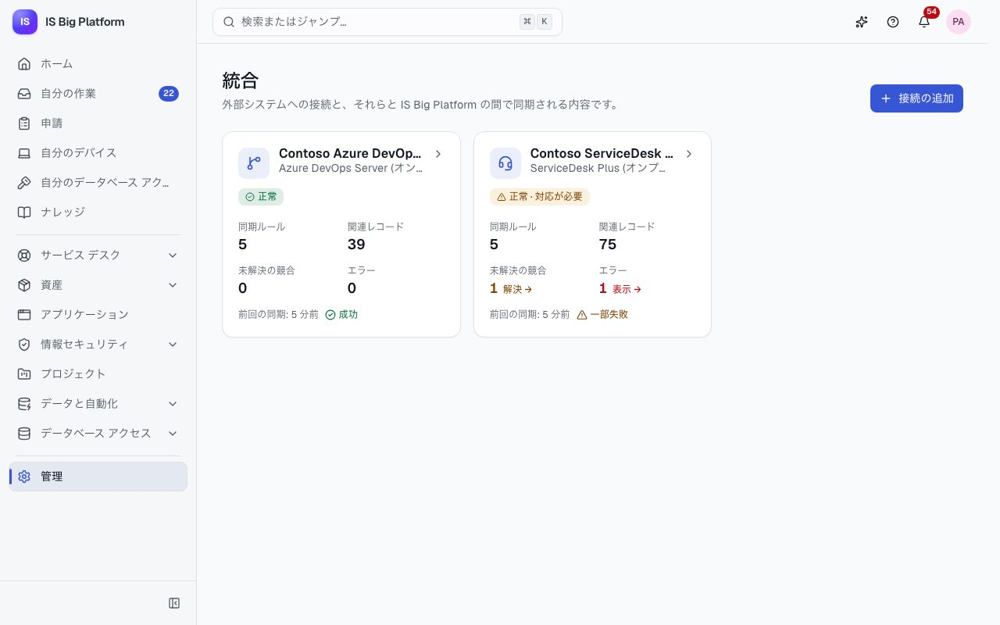
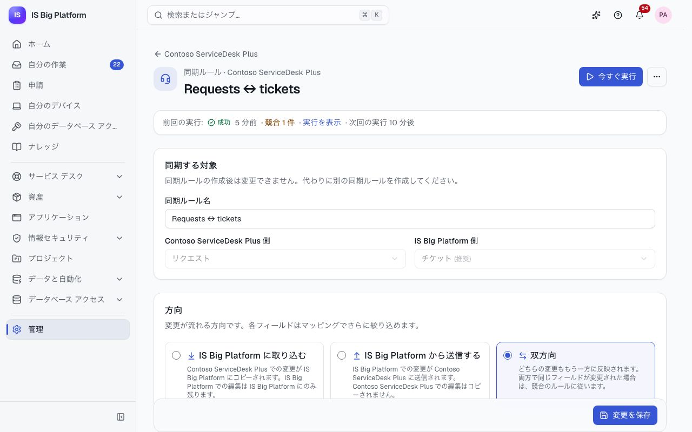
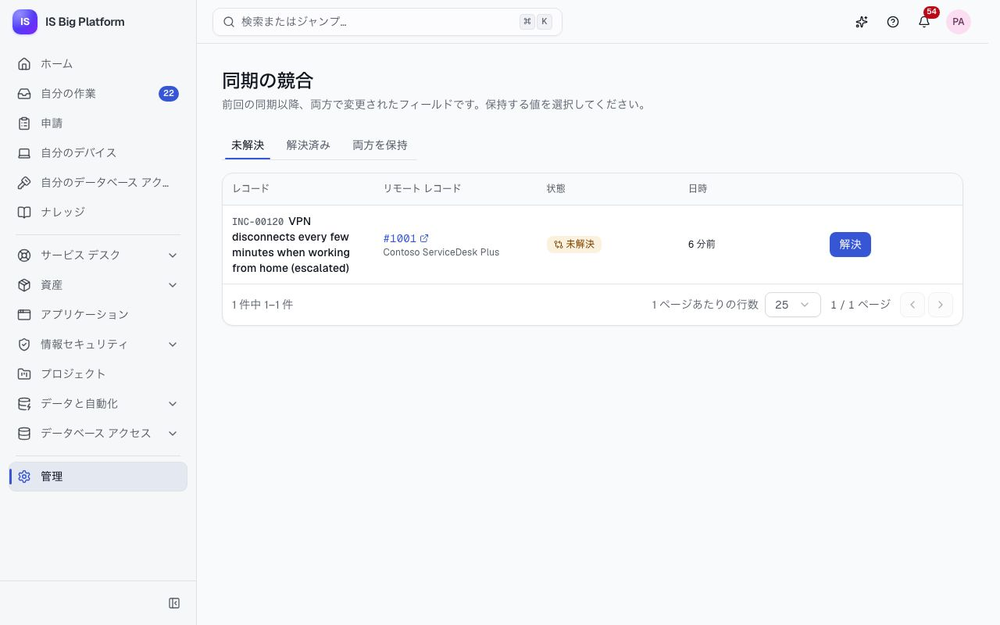

# 統合ガイド

このガイドは、ISBP と並行して運用しているシステムを ISBP に接続する統合管理者向けです。対象のシステムは ManageEngine ServiceDesk Plus と Azure DevOps Server で、どちらも社内 (オンプレミス) にインストールされています。また、サービス デスク担当者とプロジェクト チームに向けて、同期されたレコードに何が表示されるか、変更が上書きされないようにするにはどこで変更すればよいかも説明します。

## このガイドでできること

- [何と何が同期されるか](#何と何が同期されるか)と、[同期されたレコードをどこで編集するか](#同期されたレコードをどこで編集するか)を理解する
- ServiceDesk Plus サーバーまたは Azure DevOps Server コレクションへの[接続を追加する](#接続を追加する)
- [接続の状態を確認する](#接続の状態を確認する)、[Webhook を設定する](#webhook-を設定して同期を速くする)
- [同期ルールを作成し](#同期ルールを作成する)、[フィールドと値をマッピングして](#フィールドと値をマッピングする)、[プレビューする](#実行前に同期ルールをプレビューする)
- [同期を実行してログを読み](#同期を実行してログを読む)、[関連レコードを管理する](#関連レコードを管理する)
- レコードのページで[同期先を確認する](#レコードの同期先を確認する)
- [同期の競合を解決する](#同期の競合を解決する)
- [外部から承認を省略できない理由](#外部から承認を省略することはできない)と、[削除がコピーされない理由](#削除はコピーされない)を理解する

## 何と何が同期されるか

統合ハブは、相手のシステムのレコードの種類と、ISBP のレコードの種類をリンクします。2 つの種類の間のリンクがそれぞれ**同期ルール**で、各同期ルールには方向 (**IS Big Platform に取り込む**、**IS Big Platform から送信する**、**双方向**) があります。

| 外部システム        | 相手のレコード                     | ISBP のレコード                                    | 備考                                                                                         |
| ------------------- | ---------------------------------- | -------------------------------------------------- | -------------------------------------------------------------------------------------------- |
| ServiceDesk Plus    | リクエスト                         | チケット (インシデントとサービス要求)              | メモはチケットのコメントと同期されます。内部メモはどちらの側でも内部のままです               |
| ServiceDesk Plus    | 問題                               | チケット (種類: 問題)                              |                                                                                              |
| ServiceDesk Plus    | 変更                               | 変更                                               | 変更の状態はマッピングされません。CAB の承認は ISBP で行われます                             |
| ServiceDesk Plus    | 資産                               | ハードウェア資産                                   | シリアル番号で照合されます。ビルド 15100 以降が必要です                                      |
| ServiceDesk Plus    | ソリューション                     | ナレッジ記事                                       | ServiceDesk Plus の HTML は ISBP では Markdown になり、その逆も同様です                      |
| Azure DevOps Server | チーム プロジェクト                | プロジェクト                                       | ISBP への取り込みのみ。名前で照合されます                                                    |
| Azure DevOps Server | 作業項目 (チーム プロジェクトごと) | タスク (1 つの ISBP プロジェクト内)                | 親、状態、担当者、コメント。Agile、Scrum、Basic の各プロセスに対応                           |
| Azure DevOps Server | Git リポジトリ                     | リポジトリ (アプリケーションのページの Git の状態) | ISBP への取り込みのみ: 既定のブランチ、最新のコミット、ブランチ、アクティブなプル リクエスト |

ユーザーはメール アドレスで照合されます。相手のシステムのユーザーに、同じメール アドレスの ISBP アカウントがない場合、そのフィールドは空のままになり、実行ログに警告が表示されます。デモでは、ServiceDesk Plus の技術者 Kenji Mori と Dana Whitfield には ISBP アカウントがないため、この警告を確認できます。

## 同期されたレコードをどこで編集するか

一方向で同期されるレコードは、送信元のシステムが所有します。双方向で同期されるレコードはどちらの側でも変更できます。次の同期までに両方で同じフィールドが変更された場合の動作は、同期ルールの**競合のルール**で決まります。次の表に示す場所でレコードを編集すれば、変更が上書きされることはありません。

デモには、**Contoso ServiceDesk Plus** と **Contoso Azure DevOps Server** の 2 つの接続があります:

| デモの同期ルール                          | 方向                       | 両方でフィールドが変更された場合 | 編集する場所                                                                                                         |
| ----------------------------------------- | -------------------------- | -------------------------------- | -------------------------------------------------------------------------------------------------------------------- |
| Requests ↔ tickets                        | 双方向                     | 担当者が決定する                 | どちらのシステムでも可。競合を避けるため、各チケットは一方の場所で処理してください。競合は競合の一覧で待機します     |
| Problems → tickets                        | IS Big Platform に取り込む | ServiceDesk Plus を優先          | ServiceDesk Plus                                                                                                     |
| Changes → changes                         | IS Big Platform に取り込む | ServiceDesk Plus を優先          | 変更の詳細は ServiceDesk Plus、承認と状態は ISBP                                                                     |
| Assets ↔ assets                           | 双方向                     | ServiceDesk Plus を優先          | 資産台帳は ServiceDesk Plus で管理します。廃棄は ISBP の廃棄承認を通じてのみ行います                                 |
| Solutions → knowledge                     | IS Big Platform に取り込む | ServiceDesk Plus を優先          | ServiceDesk Plus                                                                                                     |
| Team projects → projects                  | IS Big Platform に取り込む | Azure DevOps を優先              | Azure DevOps Server (この同期ルールは既存のプロジェクトを名前でリンクするだけで、プロジェクトは作成しません)         |
| ERP work items ↔ tasks                    | 双方向                     | Azure DevOps を優先              | どちらのシステムでも可。チームは Azure DevOps で計画するため、両方で変更された場合は Azure DevOps の値が優先されます |
| Network work items → tasks                | IS Big Platform に取り込む | Azure DevOps を優先              | Azure DevOps Server                                                                                                  |
| ERP / Network repositories → applications | IS Big Platform に取り込む | Azure DevOps を優先              | Azure DevOps Server (Finance ERP と Remote Access VPN の Git の状態は、ISBP では読み取り専用です)                    |

一方向の **IS Big Platform に取り込む**同期ルールでは、ISBP で行った変更は ISBP にのみ残り、相手側には送信されません。相手のシステムで同じフィールドが変更されるとすぐに上書きされるため、恒久的な変更は送信元のシステムで行ってください。

> **ヒント:** レコードのページの**同期先**カードで、レコードがどのシステムにリンクされているかを確認できます。同期ルールの方向がわからない場合は、統合管理者に問い合わせるか、同期ルールを開いて確認してください (**統合閲覧者** (Integrations viewer) ロールがあれば参照できます)。

## ロールごとにできること

| ロール                                      | 許可される操作                                                                                 |
| ------------------------------------------- | ---------------------------------------------------------------------------------------------- |
| **統合閲覧者**                              | 接続、同期ルール、実行履歴、関連レコード、競合の表示 (資格情報は表示されません)                |
| **統合管理者** (Integrations administrator) | 接続の追加、編集、テスト、同期可能なすべてのレコードの同期ルールの設定、同期の実行、競合の解決 |

ページは**管理 → 接続**と**管理 → 同期の競合** (**統合**の下) です。表示されない場合は、管理者に上記のいずれかのロールを依頼してください。デモでは、IT 管理者が統合管理者で、サービス デスク、開発チーム、PMO が統合閲覧者です。

レコードの種類を書き込む同期ルールを作成または変更するには、そのレコードの同期のアクセス許可 (例: 「統合を通じてインシデント、サービス要求、問題を書き込む」) も必要です。**統合管理者**ロールには、これらがすべて含まれています。これにより、自分では書き込めないレコードを、統合ハブを使って書き込むことは誰にもできません。

統合ハブは、同期されたレコードを独自の ID (**Integrations Hub**) で書き込みます。この ID が使用できるのは、これらの同期のアクセス許可だけです。監査ログやレコードの履歴では、同期による変更に、その取得元の接続とリモート レコードが表示されます。

## 接続を追加する

同期を行うには、まず接続が必要です。この作業は、ServiceDesk Plus サーバーまたは Azure DevOps Server コレクションごとに 1 回行います。

始める前に、相手のシステムの管理者から資格情報を入手してください:

- **ServiceDesk Plus:** 同期する対象だけを表示および編集できるロールを持つ専用の技術者 (例: `svc-isbp`) と、その技術者の有効期限付きの API キー。ISBP による変更はすべて、この技術者として ServiceDesk Plus に記録されます。ビルド 15100 以降が必要です。
- **Azure DevOps Server:** サービス アカウントの個人用アクセス トークン。スコープとして、**作業項目: 読み取りと書き込み**、**コード: 読み取り**、**プロジェクトとチーム: 読み取り**が必要です。Windows サインイン (NTLM または Kerberos) はサポートされていません。

1. **管理 → 接続**に移動し、**接続の追加**を選択します。
2. **ServiceDesk Plus (オンプレミス)** または **Azure DevOps Server (オンプレミス)** を選択します。
3. **接続名**を入力します。接続名は、一覧、実行ログ、同期されたレコードに表示されます。
4. 接続の設定を入力します:
   - ServiceDesk Plus: **サーバー URL** (技術者が開くアドレス。例: `https://sdp.contoso.local:8443`)、**技術者の API キー**、およびサーバーで複数のサービス デスク インスタンスを運用している場合のみ**ポータル ID**。
   - Azure DevOps Server: **コレクション URL** (例: `https://ado.contoso.local/tfs/DefaultCollection`)、サーバーに対応する **REST API バージョン**、**個人用アクセス トークン**。
5. **接続のテスト**を選択します。「接続は正常です」というメッセージとサインインしたアカウント、または失敗した理由が表示されます。
6. **有効**をオンのままにして、**接続の追加**を選択します。

**この後の流れ:** 接続の **Webhook シークレット**が 1 回だけ表示されます。[Webhook を設定する](#webhook-を設定して同期を速くする)予定がある場合はコピーしてから、**コピーしました**を選択します。接続のページが開きます。[同期ルールを作成する](#同期ルールを作成する)までは、何も同期されません。資格情報は暗号化して保存され、再び表示されることはありません。接続を編集するときに資格情報を変更しない場合は、空欄のままにしてください。

> **重要:** `https://` のアドレスを使用してください。暗号化されていない HTTP でのみ応答するサーバー (ServiceDesk Plus の既定のポートは 8080) は、**セキュリティ**で**安全でない HTTP を許可する**をオンにしない限り拒否されます。オンにするときは ISBP で確認が求められ、変更はセキュリティ イベントとして監査ログに記録されます。オンの間は、接続に**暗号化なし**と表示されます。オンにすると、API キーまたはトークンと同期されるすべてのレコードが暗号化されずにネットワーク上を流れ、ネットワーク上の他者に読み取られたり改ざんされたりする可能性があります。できるだけサーバーで HTTPS を有効にしてください。どちらの製品も HTTPS をサポートしています。

サーバーの証明書が社内の証明機関によって発行されており、テストが証明書のエラーで失敗する場合は、ISBP の運用担当者にその証明機関を信頼するよう依頼してください (`docs/deployment.md` の §7e を参照)。

## 接続の状態を確認する

ISBP は、すべての接続を 15 分ごとと、同期のたびにテストします。同期されたレコードが更新されなくなったら、まずここを確認してください。

1. **管理 → 接続**に移動します。各カードには、接続の状態 (**正常**、対応待ちのレコードがある場合は**正常 · 対応が必要**、**エラー**、**未確認**)、同期ルール、関連レコード、未解決の競合、エラー、前回の同期が表示されます。未解決の競合の横の**解決**、またはエラーの横の**表示**を選択すると、直接そこに移動できます。
2. 接続を開きます。**概要**タブの最初に**対応が必要**が表示されます: 未解決の競合 (それぞれに**解決**)、同期されなかったレコード、前回の実行で問題があった同期ルール (**実行を表示**) です。続いて**状態**セクションに、接続の状態、前回のチェックのメッセージ、**サインイン中のアカウント**、**最終確認**、**前回の同期**が表示されます。
3. 今すぐ確認するには、**テスト**を選択します。

**この後の流れ:** 相手のシステムが資格情報を拒否した場合 (API キーやトークンの期限切れなど)、接続は**エラー**とマークされ、統合管理者に「接続 … でエラーが発生しています」という通知が届きます。相手のシステムでキーまたはトークンを更新し、接続の**編集**を選択して、新しい値を貼り付けて保存してください。

## Webhook を設定して同期を速くする

Webhook を使用しない場合、同期ルールはスケジュールに従って同期されます (既定では 15 分ごと)。Webhook を使用すると、相手のシステムが変更されたレコードを ISBP に通知し、ISBP が数秒以内にそのレコードを読み取ります。ポーリングも予備として引き続き実行されるため、届かなかった Webhook は次回のスケジュール同期で補完されます。

1. 接続を開きます。**概要**タブで**設定: 即時更新 (Webhook)** を開くと、**Webhook URL** が表示されます。**Webhook URL をコピー**を選択します。
2. 相手のシステムで、カスタム ヘッダー `X-ISBP-Webhook-Secret` に接続のシークレットを設定した Webhook を作成します:
   - ServiceDesk Plus: **Admin › Developer Space › Webhooks** で、モジュール (request、problem、change) ごとに 1 つの Webhook を作成し、レコードの作成時または編集時に **Admin › Automation › Custom Triggers** で実行されるようにします。資産とソリューションにはカスタム トリガーがないため、スケジュールで同期されます。
   - Azure DevOps Server: 各チーム プロジェクトで**プロジェクトの設定 → サービス フック → サブスクリプションの作成 → Web Hooks** を開き、作業項目と Git のイベントごとに 1 つのサブスクリプションを作成します。**送信するリソースの詳細**は**最小**に設定します。
3. 接続の設定フォームのヘルプ セクションに、システムごとの正確な手順とペイロードが表示されます。

**この後の流れ:** ISBP は呼び出しのたびにシークレットを確認し、シークレットのない呼び出しを拒否します。Webhook は変更されたレコードを知らせるだけで、ISBP はその後、相手のシステムの API を通じてレコードを読み取ります。そのため、偽装された Webhook によって ISBP にデータが入り込むことはありません。相手のシステムは社内ネットワークの内部から ISBP を呼び出すため、インターネットに何かを公開する必要はありません。

シークレットを紛失した場合は、同じセクションで**シークレットの更新**を選択します。新しいシークレットが 1 回だけ表示され、古いシークレットは無効になるため、すぐに相手のシステムの Webhook を更新してください。

## 同期ルールを作成する

同期ルールは、何と何を、どの方向に同期し、フィールドをどのようにマッピングするかを定義します。同期するレコードの種類ごとに 1 つ作成します。

1. 接続を開いて**同期ルール**タブを選択し、**新しい同期ルール**を選択します。
2. **同期する対象**で、**(接続名) 側**の相手のシステムのレコード、その**場所** (Azure DevOps の作業項目とリポジトリの場合はチーム プロジェクト)、**IS Big Platform 側**のレコード (タスクの場合はプロジェクト、リポジトリの場合はアプリケーション) を選択します。**同期ルール名**は自動的に入力されます。必要に応じて変更してください。これらの選択は、同期ルールの作成後は変更できません。
3. **方向**で、**IS Big Platform に取り込む**、**IS Big Platform から送信する**、**双方向**のいずれかを選択します。各オプションには、どの編集が相手側に反映されるかが説明されています。
4. **レコード**で、一方にのみ存在するレコードの扱いを決めます:
   - **IS Big Platform でレコードを作成する**: 相手のシステムの新しいレコードが ISBP で作成されます。
   - **(接続名) でレコードを作成する**: **作成するレコード**の条件を満たす新しい ISBP レコードが、相手のシステムで作成されます。条件 (例: 「状態がクローズではない」) を追加します。条件がない場合は、すべてのレコードが作成されます。
   - **既存のレコードを照合する**: ISBP のフィールドと相手のシステムのフィールドを選択します (例: 資産の場合はシリアル番号)。両方に既にあるレコードは、重複させずにリンクされます。
5. **スケジュール**で**同期の間隔 (分)** を設定します (0 にするとスケジュールされた同期はオフになりますが、Webhook、**今すぐ実行**、スケジュール ジョブは引き続き動作します)。**IS Big Platform から送信する**だけの同期ルールは、変更が発生するとすぐに送信します。
6. **競合とコメント**で**競合のルール**を選択します:
   - **担当者が決定する**: 両方の値はそのまま残り、競合は競合の一覧で待機します。他のフィールドは引き続き同期されます。
   - **(接続名) を優先**、**IS Big Platform を優先**、または**最新の変更を優先**。

   一方向の同期ルールでは、常に送信元が優先されます。**コメントを同期する**をオンにすると、新しいコメントが作成者とともに双方向に 1 回ずつコピーされます。

7. **フィールド マッピング**を確認し ([フィールドと値をマッピングする](#フィールドと値をマッピングする)を参照)、[**プレビュー**](#実行前に同期ルールをプレビューする)を選択します。
8. **同期ルールの作成**を選択します。

**この後の流れ:** 同期ルールはスケジュールに従って同期されます。最初の実行ではその種類のレコードをすべて読み取るため、時間がかかる場合があります。すぐに開始するには、**今すぐ実行**を選択します。

> **ヒント:** 最初は **IS Big Platform に取り込む**と**担当者が決定する**で始め、最初の数回の実行を確認してください。マッピングが正しいことを確認できたら、**双方向**に切り替えます。

## フィールドと値をマッピングする

**フィールド マッピング**では、ISBP のどのフィールドが相手のシステムのどのフィールドに対応するかを決めます。ISBP は組み合わせごとにマッピングを提案するため、ほとんどの場合は、自社の環境に固有のフィールドを追加するだけで済みます。

1. 同期ルールで**フィールド マッピング**に移動します。**推奨のマッピングを使用**を選択すると、コネクタの既定値から始められます。列の見出しは **IS Big Platform 側**、**方向**、**(接続名) 側**です。
2. フィールドを追加するには、**フィールドの追加**を選択し、**IS Big Platform のフィールド**と**リモートのフィールド**を選択します。各行には独自の方向 (**双方向**、**(接続名) からのみ取り込む**、**(接続名) へのみ送信**) があります。読み取り専用のフィールドは、一方向にのみ流れます。
3. 選択肢のフィールド (状態、優先度、カテゴリなど) では、**値**を選択して値のマッピングを開きます。各行は、相手のシステムの値がどの ISBP の値になるか、およびその逆を示します。両方で同じ値には行は不要です。**(接続名) の値 … 件を追加**を選択すると、相手のシステムにあるすべての値が一覧に追加されます。
4. 行の下にエディターが表示する問題を修正してから、保存します。

ISBP は値を自動的に変換します。HTML は ISBP では Markdown に、Markdown は相手のシステムでは HTML になります。ユーザーはメール アドレスで照合され、タグは `;` 区切りのテキストになり、親の作業項目は ISBP が既に持っているリンクを通じてマッピングされます。

**(接続名) からのみ取り込む**行を使うと、相手のシステムの複数の値を 1 つの ISBP の値にまとめられます。その ISBP の値を送信するときの値は、1 つの行で指定します。デモでは、ServiceDesk Plus の「Resolved」はインシデントでは _解決済み_ として取り込まれ、_完了_ になった ISBP のサービス要求は「Resolved」として送信されます。

> **重要:** カテゴリ、グループ、ベンダー、ナレッジのカテゴリは、ISBP 側の値が自社のレコードであるため、既定ではマッピングされません。必要な場合は、自分でマッピングを追加してください。Scrum プロセスまたは Basic プロセスを使用する Azure DevOps のプロジェクトでは、作業項目の種類と状態の値のマッピングを編集してください (例: _ユーザー ストーリー_ → Product Backlog Item、_完了_ → Done)。

## 実行前に同期ルールをプレビューする

プレビューは、次の変更に対するドライ ランです。何も書き込まれず、同期の位置も進みません。マッピングや競合のルールを変更した後に使用します。

1. 同期ルールを開き、**プレビュー**の下の**プレビュー**を選択します。
2. 一覧を確認します。各レコードには、実行された場合の動作 (**IS Big Platform で作成**、**既存のレコードにリンク**、**IS Big Platform で更新**、**(接続名) で更新**、**(接続名) で作成**、**競合**、**変更なし**、**一方で削除済み**) が、変更されるフィールドとその新しい値とともに表示されます。

**この後の流れ:** プレビューに「前回の同期以降、(接続名) に変更はありません。」と表示された場合は、前回の実行以降、何も変更されていません。変換できないフィールドは一覧に表示されるため、実際の実行の前に値のマッピングを修正できます。

## 同期を実行してログを読む

同期ルールを変更した後や、レコードが届かない理由を尋ねられたときは、手動で同期を実行します。

1. 接続を開いて**同期ルール**タブを選択します。各同期ルールには、方向、関連レコード、競合、エラー、前回の実行、スケジュールが表示されます。
2. 同期ルール (または同期ルールのページの上部) で**今すぐ実行**を選択します。実行のページが開き、ログがリアルタイムで表示されます。同期ルールのページには、エラーと競合の数、実行へのリンク、次回のスケジュール実行とともに**前回の実行:** が表示されます。
3. 相手のシステムでレコードを作成する同期ルールに既存の ISBP レコードを送信するには、同期ルールを開いて**既存のレコードを (接続名) に送信**を選択します。
4. 接続の**実行履歴**タブには、すべての実行が、トリガー (**スケジュール**、**手動**、**Webhook**、**IS Big Platform での変更**)、状態、件数とともに一覧表示されます。失敗した実行を見つけるには、状態で絞り込みます。

実行のページには、**件数** (**読み取り**、**こちらで作成**、**こちらで更新**、**送信**、**エラー**。発生した場合は**相手側で作成**、**リンク**、**競合**、**変更なし/スキップ**も)、**詳細**、**ログ**が表示されます。失敗したレコードがある場合は、問題の一覧に各レコードがわかりやすく示され、**リンクされたレコードで探す**を使用できます。実行全体が失敗した場合は、相手のシステムが保存された資格情報を拒否したなどの理由がわかりやすく表示され、**接続を開く**を使用できます。

| 実行の状態                | 意味                                                                                                   |
| ------------------------- | ------------------------------------------------------------------------------------------------------ |
| **成功**                  | すべてのレコードが処理されました                                                                       |
| **一部失敗**              | 一部のレコードが失敗しました。それぞれ関連レコードで**エラー**とマークされ、次回の実行で再試行されます |
| **失敗**                  | 資格情報が拒否されたなどの理由で、実行が停止しました                                                   |
| **一時停止 (レート制限)** | 相手のシステムが ISBP に速度を落とすよう求めました。実行は表示された時刻に再開されます                 |

1 つの同期ルールで同時に実行されるのは 1 回だけです。30 日を過ぎた実行は削除されます。

> **ヒント:** **スケジュール ジョブ**で**統合の同期**タスクの種類を使用して、同期ルールを実行することもできます。たとえば、ジョブの再試行と失敗時のアラートを利用して、毎晩決まった時刻に実行できます。[データと自動化](data-and-automation.md)を参照してください。

## 関連レコードを管理する

接続の**関連レコード**タブには、すべての ISBP レコードと、それにリンクされたリモート レコードが、同期ルールと前回の同期とともに一覧表示されます。エラーになっているレコードや、一方で削除されたレコードを見つけるのに使用します。

1. 接続を開いて**関連レコード**を選択します。
2. **すべて**、**同期済み**、**競合**、**エラー**、**一方で削除済み**のタブで絞り込むか、参照番号またはタイトルで検索します。リモートの参照番号を選択すると、相手のシステムでレコードが開きます。
3. **統合管理者**ロールがある場合は、行の操作メニューを開きます:
   - **今すぐ同期**: このレコードを再度読み取ってマージします。
   - **別のレコードにリンク**: ISBP レコードを別のリモート レコードにリンクします (表示用の参照番号ではなく、相手のシステムでの ID を入力します)。すぐに同期されます。
   - **リンクの解除**: リンクを削除します。両方のレコードは保持されます。次回の同期で再びリンクされる (照合がオンの場合) か、新しいレコードが作成される場合があります。

タイトルが表示されるのは、自分が読み取りを許可されている ISBP レコードだけです。それ以外のレコードは「表示するアクセス許可のないレコード」と表示されます。

## レコードの同期先を確認する

レコードが別のシステムにリンクされている場合、担当者とプロジェクト チームには、チケット、変更、資産、プロジェクト、タスク、アプリケーション、ナレッジ記事のページに**同期先**カードが表示されます。レコードを変更する前に、そのレコードが他のどこに存在するかを確認するのに使用します。

カードには、システム、リモートの参照番号 (選択するとそのシステムでレコードが開きます)、前回の同期日時、状態 (**同期済み**、**競合**、**エラー**、**一方で削除済み**) が表示されます。レコードの前回の同期が失敗した場合は、その理由がカードに表示されます。統合管理者には**今すぐ同期**も表示されます。

レコードを読み取れるユーザーには、誰にでもカードが表示されます。同期ルールが双方向で同期する場合、ISBP で行った変更はすぐに相手のシステムに反映されます。相手のシステムでの変更は、次の Webhook またはスケジュール同期で届きます。

## 同期の競合を解決する

競合は、同期ルールのルールが**担当者が決定する**で、前回の同期以降に同じフィールドが両方で異なる値に変更された場合に発生します。誰かが決定するまで両方の値はそのまま残り、レコードの他のフィールドは引き続き同期されます。

デモでは、1 件のチケットのタイトルが ISBP と ServiceDesk Plus の両方で変更されている (「Escalated: VPN drops for the whole finance floor」) ため、試すことができる未解決の競合が 1 件あります。

1. **管理 → 同期の競合** (すべての接続) に移動するか、接続の**競合**タブを開きます。
2. **未解決**タブで、競合の**解決**を選択します。
3. フィールドごとに、**前回同期した値**とこのプラットフォームの値、相手のシステムの値を比較します。それぞれの側に、誰がいつ変更したか (**… が変更**、**(接続名) で変更**) が表示されます。**このプラットフォームの値を使用**または **(接続名) の値を保持**を選択します。
4. **適用**を選択します。または、**今回の変更は同期しない**を選択すると、それぞれの側に独自の値が残ります。以降の変更は通常どおり同期されます。

**この後の流れ:** 選択した値が両方に書き込まれ、リンクは**同期済み**に戻ります。解決した競合は**解決済み**タブに、**今回の変更は同期しない**で閉じた競合は**両方を保持**タブに移動し、誰がいつ決定したかが記録されます。解決するには**統合管理者**ロールが必要です。統合管理者には、新しい競合の通知が届きます (同期ルールごとに 1 時間あたり最大 1 件)。

## 外部から承認を省略することはできない

同期では、ISBP の画面と同じルールでレコードが書き込まれ、ルールが緩められることはありません。ISBP で承認が必要なものは、別のシステムでレコードを編集しても承認されません:

- **変更**は、同期によって CAB の承認を越えて進むことはできません。そのため、変更の状態は既定でマッピングされません。変更は ISBP で承認されます ([変更とリリース](changes-and-releases.md)を参照)。
- **資産**が _廃棄済み_ になるのは、ISBP の廃棄承認を経た場合だけです。デモでは、ServiceDesk Plus で「Disposed」になっている資産が、資産は ISBP の廃棄承認を通じてのみ廃棄されるというメッセージとともに、関連レコードの**エラー**タブに表示されます。ISBP で廃棄を開始してください ([資産](assets.md)を参照)。承認されると、両方の状態が一致します。
- 同期によって作成された**プロジェクト**は _提案中_ から始まるため、プロジェクト提案の承認が引き続き適用されます。
- **チケット**と**タスク**は、ISBP で許可されている方法でのみ状態が遷移します。

拒否された変更はリンクと実行に記録され、次回の実行で再試行されます。

## 削除はコピーされない

一方のシステムでレコードが削除されても、ISBP がもう一方のシステムの対応するレコードを削除することはありません。リンクは**一方で削除済み**とマークされ、**関連レコード**タブに表示されます。別のシステムのデータを削除するかどうかは、人が判断することです。残っているレコードを確認し、不要であれば自分で削除またはクローズしてください。

同期ルールや接続を削除すると、そのリンク、実行、競合は削除されますが、ISBP と相手のシステムのレコードは削除されません。

## よくある問題を解決する

| 表示される内容                                     | 対処方法                                                                                                                   |
| -------------------------------------------------- | -------------------------------------------------------------------------------------------------------------------------- |
| 接続先のシステムが接続の資格情報を拒否しました     | API キーまたはトークンの期限が切れたか、取り消されています。新しいものを作成し、接続の設定に貼り付けます                   |
| この接続は暗号化されていない HTTP を使用しています | `https://` の URL を使用するか、信頼できるネットワーク上のサーバーの場合に限り**安全でない HTTP を許可する**をオンにします |
| 接続先のシステムがリクエストを制限しています       | 対処は不要です。実行は一時停止してから再開します。ServiceDesk Plus 14500 以降では、管理者が制限を引き上げることができます  |
| 接続先のシステムが変更を拒否しました               | 実行ログまたはリンクのエラーを確認します。通常は、相手のシステムが受け付けない値が原因です。値のマッピングを修正します     |
| このルールの同期はすでに実行中でした               | 現在の実行が完了するまで待ちます                                                                                           |
| ユーザーのフィールドが空のままです                 | そのユーザーには、同じメール アドレスの ISBP アカウントがありません。実行ログの警告を確認します                            |

## 関連情報

- [サービス デスク ガイド](service-desk.md): リクエスト、問題、変更、ソリューションと同期されるチケット、変更、ナレッジ ベース。
- [資産](assets.md): 資産台帳と廃棄承認。
- [プロジェクト](projects.md)と[変更とリリース](changes-and-releases.md): Azure DevOps の作業項目と同期されるタスク、およびアプリケーションの Git の状態。
- [データと自動化](data-and-automation.md): スケジュール ジョブからの同期の実行。
- [アシスタントと AI](assistant-and-ai.md#アシスタントが変更できる構成): アシスタントは、同期ルールの変更を変更セットとして準備できます。
- [管理者](administrators.md): ロール、監査ログ、通知の設定。
