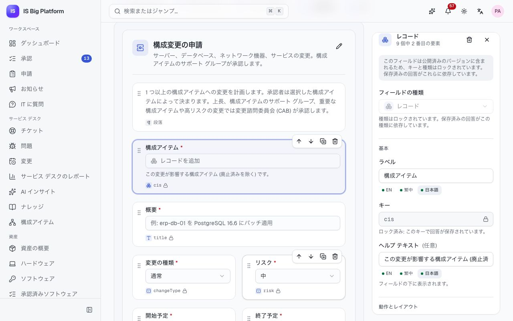
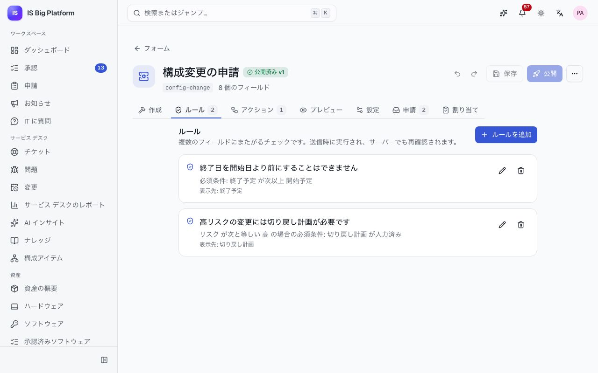
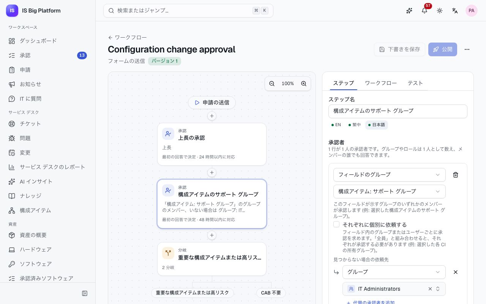
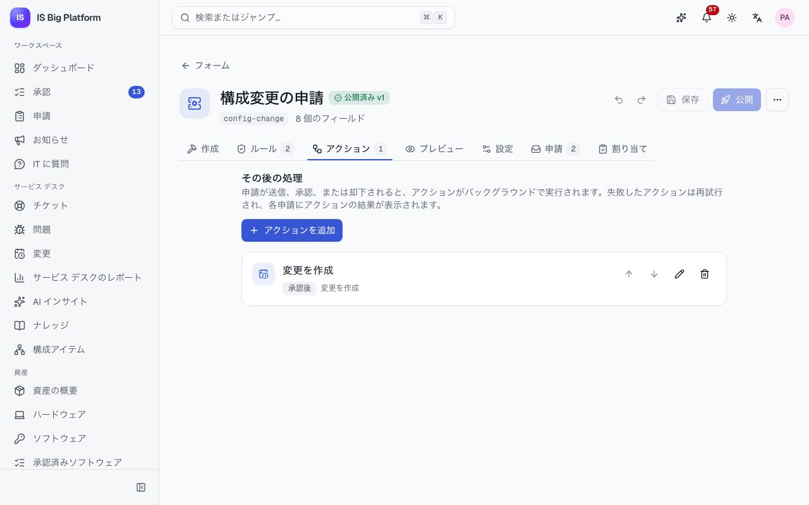
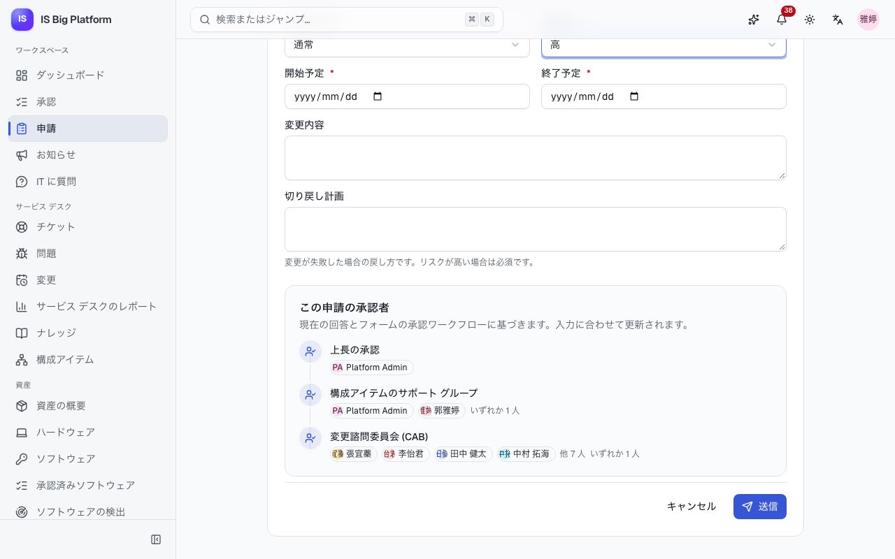

# 独自のプロセスを作成する

このガイドは、構成変更、ファイアウォール ルール、新しい仮想サーバー、ソフトウェアの購入などの IT 業務をセルフサービスのプロセスにする管理者とチーム リーダー向けです。ISBP では、このようなプロセスはすべて、申請フォーム、承認ワークフロー、判断の後に実行されるアクションの 3 つで構成されます。3 つの部分は管理ページで作成することも、アシスタントにプロセスを説明して作成することもできます。作成したら、フォームのリンクを共有します。

## このガイドでできること

- [プロセスの構成](#プロセスの構成)を理解し、[プロセスを計画する](#プロセスを計画する)
- [フォームを作成する](#フォームを作成する)。[構成アイテム、アプリケーション、資産を選択するフィールド](#ユーザーがレコードを選択できるようにする)や[フィールド間のルール](#フィールド間のルールを追加する)も使用できます
- [承認者を決める](#承認者を決める)。[選択されたレコードに応じたルート](#回答と選択されたレコードに応じてルートを決める)や、[レコードで指定されたグループによる承認](#レコードで指定されたグループに承認させる)も設定できます
- 変更、廃棄、プロジェクト提案の[組み込みの承認でカスタム フィールドを使用する](#組み込みの承認でカスタム-フィールドを使用する)
- 変更の作成、ロールの付与、ユーザーへの通知、他のシステムの呼び出しを行う[アクションを追加する](#アクションを追加する)
- [フォームを公開してリンクを共有する](#フォームを公開してリンクを共有する)
- 代わりに[アシスタントで作成する](#アシスタントで作成する)
- [申請者に表示される内容](#申請者に表示される内容)を把握し、[アクションの結果を確認する](#アクションの結果を確認する)
- [デモの構成変更の申請を順に確認する](#デモを順に確認する-構成変更の申請)
- [よくある問題を解決する](#よくある問題を解決する)

## プロセスの構成

どのプロセスも同じ 3 つの部分と、プロセスを開始するための 1 つのリンクで構成されます。

| 部分             | 役割                                                                                                                                           | 作成する場所                     |
| ---------------- | ---------------------------------------------------------------------------------------------------------------------------------------------- | -------------------------------- |
| フォーム         | 知る必要がある情報を尋ねます: テキスト、日付、選択肢、ユーザー、構成アイテムやアプリケーションなどのレコード。ルールで回答をまとめて確認します | **管理 → フォーム**              |
| 承認ワークフロー | 回答と選択されたレコードのデータから、誰がどの順序でいつまでに承認するかを決めます                                                             | **管理 → ワークフロー**          |
| アクション       | 申請の送信、承認、却下の後に作業を行います: 変更の作成、ロールの付与、ユーザーへの通知、他のシステムの呼び出し                                 | フォームの**アクション**タブ     |
| リンク           | `/requests/forms/<key>` でフォームが開きます。フォームは**申請 → 何が必要ですか？** にもカードとして表示されます                               | フォームの作成時に選んだ**キー** |

各申請は、開始時のフォームのバージョン (アクションを含む) とワークフローのバージョンを保持します。そのため、進行中の申請に影響を与えずにプロセスを改善できます。また、プロセスはプラットフォームのルールに従います。ユーザーは表示できるレコードしか選択できず、アクションは担当する領域で許可されていることしか行えず、変更の CAB など、他の領域が必要とする承認をアクションがスキップすることはありません。

フォームとワークフローを作成するには、**ワークフロー管理者** (Workflow administrator) ロールが必要です (**プラットフォーム管理者**はすべての操作を行えます)。アクションによっては、別のロールも必要です。[各アクションの内容](#各アクションの内容)を参照してください。

## プロセスを計画する

まず紙の上で計画します。それぞれの答えが、プロセスの各部分になります。

1. **申請者に何を伝えてもらう必要があるか?** 質問を書き出し、必須のものに印を付けます。これがフォームのフィールドになります。
2. **社内のどのレコードに関するものか?** 構成アイテム、アプリケーション、資産、チケットなど。これらはレコード フィールドになり、回答は誰かが入力した名前ではなく、実際のレコードになります。
3. **どの回答が整合している必要があるか?** たとえば、終了日を開始日より前にすることはできません。これがルールになります。
4. **誰がいつ承認するか?** 申請者の上長、そのシステムをサポートするチーム、重要なものがかかわる場合は CAB。これが承認ワークフローになります。
5. **承認後と却下後に何を行うか?** 最終的にどのレコードが存在し、誰に知らせるか。これがアクションになります。
6. **誰がフォームを使用できるか?** 全員か、一部のグループだけか。これがフォームの**対象ユーザー**になります。

デモでは、**構成変更の申請**が、構成アイテムの変更についてこれらの問いに答えています。[順を追った説明](#デモを順に確認する-構成変更の申請)を参照してください。

## フォームを作成する

最初に質問を作成します。承認とアクションは、後から同じフォームに追加します。

1. **管理 → フォーム**に移動し、**新しいフォーム**を選択します。**名前**、**キー**、**アイコン**、**カテゴリ**を入力し、**作成してビルダーを開く**を選択します。キーはフォームのリンク (`/requests/forms/<key>`) の末尾になり、後から変更できません。
2. **作成**で、**要素の追加**からフィールドをフォームにドラッグするか、クリックして追加します: **短いテキスト**、**長いテキスト**、**数値**、**チェック ボックス**、**日付**、**ドロップダウン**、**複数選択**、**メール**、**リンク**、**ユーザー**、**レコード**。
3. フィールドを選択して、**ラベル** (English、繁體中文、日本語)、**キー**、**ヘルプ テキスト**、**必須**、選択肢を設定します。特定の場合にだけ当てはまる質問には、**次の場合にのみこのフィールドを表示…** を使用します。
4. 必要に応じて[レコード フィールド](#ユーザーがレコードを選択できるようにする)と[ルール](#フィールド間のルールを追加する)を追加し、**プレビュー**でフォームを試します。
5. **保存**を選択します。

**この後の流れ:** 下書きが保存されます。[公開する](#フォームを公開してリンクを共有する)まで、誰にも表示されません。ビルダーのその他のタブについては、[申請フォームを作成する](administrators.md#申請フォームを作成する)を参照してください。

### ユーザーがレコードを選択できるようにする

申請が ISBP で管理しているものに関する場合は、**レコード** フィールドを使用します。たとえば、変更が影響する構成アイテム、アクセスが必要なアプリケーション、交換するノート PC などです。回答は実際のレコードにリンクされるため、承認者はそれを開くことができ、ワークフローはそのデータに応じてルートを決め、アクションはそれを使用できます (たとえば、選択された構成アイテムに変更をリンクします)。

1. **作成**で**レコード** フィールドを追加し、ラベルを付けます (例: 「構成アイテム」)。
2. フィールドを選択します。**レコード**で、ユーザーが選択できる**レコードの種類**をオンにします (例: **構成アイテム**)。
3. **複数選択を許可**をオンにすると、ユーザーは最大 20 件のレコードを選択できます。
4. 必要に応じて、**次の条件に一致するレコードのみ…** で、レコード自身のデータによって選択肢を絞り込みます (例: **環境** **が次と等しい** **本番**)。この条件はサーバーでも確認されます。

**誰が何を選択できるか。**

- ユーザーは、表示できるレコードしか選択できません。構成アイテムを選択するには **CMDB 閲覧者** (CMDB viewer) ロールが必要です (デモでは、サービス デスク、ネットワーク、セキュリティ、DBA の各チームが持っています)。アプリケーションには**アプリケーション閲覧者**、ハードウェア資産には**資産閲覧者**、チケットには**サービス デスク担当者**が必要です。公開済みのセルフサービスのナレッジ記事は全員が読み取れます。レコード フィールドは、そのレコードを表示できるユーザーにだけ提供してください。フォームの**設定**タブで**対象ユーザー**を設定します。
- 選択された各レコードは、申請の送信時に再度確認されます。ユーザーが表示できないレコードや、**次の条件に一致するレコードのみ…** に一致しないレコードは、「このフィールドで選択でき、表示権限のあるレコードを選んでください」というメッセージで拒否されます。
- 承認者には、選択されたレコードのうち表示できるものがリンクとして表示されます。それ以外のレコードは件数だけが表示され (「表示権限のないレコード 1 件」)、名前は表示されません。
- ビルダーでは、自分が表示できるレコードの種類しか提供できません。フィールドに既に設定されている種類は、他のユーザーがフォームを編集しても保持されます。

同じ**レコード**の種類は、**管理 → カスタム フィールド**のカスタム フィールドにも使用できます。たとえば、チケットの「影響を受けるアプリケーション」フィールドです。

**絞り込みとルートに使用できるデータ。** レコードの種類ごとに独自のデータがあります。このデータは、**次の条件に一致するレコードのみ…**、ワークフローの条件と承認者、アクションのテキストで使用します。

| レコードの種類              | データ                                                                                                                                                                                                                                |
| --------------------------- | ------------------------------------------------------------------------------------------------------------------------------------------------------------------------------------------------------------------------------------- |
| **構成アイテム**            | **クラス**、**環境**、**重要度**、**状態**、**所有者** (ユーザー)、**サポート グループ** (グループ)、**部署コード**、**ビジネス サービス (CI 番号)**、**タグ**                                                                        |
| **アプリケーション**        | **アプリケーション コード**、**ステージ**、**重要度**、**ホスティング**、**データ分類**、**方針 (TIME)**、**技術オーナー**と**ビジネス オーナー** (ユーザー)、**デリバリー チーム**と**サポート グループ** (グループ)、**部署コード** |
| **ハードウェア資産**        | **カテゴリ**、**状態**、**データを保存する**、**割り当て先** (ユーザー)、**部署コード**、**場所**、**保証終了日**                                                                                                                     |
| **ソフトウェア ライセンス** | **製品**、**発行元**、**ライセンスの種類**、**請求サイクル**、**コンプライアンス**、**ライセンス数**、**費用**、**終了日**                                                                                                            |
| **チケット**                | **チケットの種類**、**状態**、**優先度 (1 = 最高)**、**影響度 (1 = 高)**、**緊急度 (1 = 高)**、**重大インシデント**、**カテゴリ キー**、**割り当てグループ** (グループ)、**担当者**と**依頼者** (ユーザー)、**部署コード**            |
| **変更**                    | チケットのデータに加えて、**変更の種類**、**リスク**、**開始予定**、**終了予定**                                                                                                                                                      |
| **プロジェクト**            | **プロジェクト キー**、**状態**、**優先度**、**健全性**、**公開範囲**、**プロジェクト マネージャー** (ユーザー)、**部署コード**、**予定工数 (時間)**、**開始日**、**目標日**                                                          |
| **ナレッジ記事**            | **対象**、**カテゴリ キー**、**状態**、**言語**、**所有者** (ユーザー)、**タグ**                                                                                                                                                      |

**リリース**、**契約**、**タスク**、**データ API**、**ETL パイプライン**、**スケジュール ジョブ**も選択できますが、絞り込みやルートに使用できるデータはありません。

> **注:** レコードのデータには、そのレコードの閲覧者がレコードのページで表示できない内容は含まれません。承認では、申請の送信時点のデータが使用されます。後から構成アイテムのサポート グループが変わっても、送信済みの申請は元のグループを保持します。

### フィールド間のルールを追加する

フィールド自体のチェックは 1 つの回答だけを確認します。ルールは複数の回答を確認します。たとえば、終了日を開始日より前にすることはできない、高リスクの変更には切り戻し計画が必要、といったものです。ルールは、ユーザーが**送信**を選択したとき、回答を修正している間、さらにサーバーでも確認されるため、ルールに違反する申請は送信できません。

1. **ルール**タブを開き、**ルールを追加**を選択します。
2. 特定の場合にだけ適用するルールの場合は、**適用条件 (省略可)** に条件を追加します。空欄にすると常に確認されます。
3. **必須条件**に、満たす必要がある条件を追加します: **フィールド**、**演算子**、**値**を選択します。2 つの回答を比較するには、**別のフィールドと比較**を選択し、**比較するフィールド**を選択します。
4. ルールを満たさないときに表示される**メッセージ**を、各言語で入力します。
5. **メッセージの表示先**で、修正するフィールドをオンにします。どれもオンにしない場合、メッセージはフォームの上部に表示されます。
6. **ルールを追加**を選択してから、**保存**を選択します。

デモの**構成変更の申請**には、次の 2 つのルールがあります。

| メッセージ                                 | 適用条件 (省略可)                  | 必須条件                                                          | メッセージの表示先 |
| ------------------------------------------ | ---------------------------------- | ----------------------------------------------------------------- | ------------------ |
| 終了日を開始日より前にすることはできません | —                                  | **終了予定** **が次以上**、**別のフィールドと比較**: **開始予定** | **終了予定**       |
| 高リスクの変更には切り戻し計画が必要です   | **リスク** **が次と等しい** **高** | **切り戻し計画** **が入力済み**                                   | **切り戻し計画**   |

**この後の流れ:** ルールは下書きの一部になり、公開すると有効になります。ルールのメッセージは、フィールド自体のチェック (必須フィールドの入力、有効な日付) に合格した後にだけ表示されます。

> **ヒント:** 日付は日単位で比較されるため、**が次以上**では同じ日も許可されます。空の回答との比較は常に満たされません。どちらかの日付が省略可能な場合は、**適用条件**に「**開始予定** **が入力済み**」(終了日も同様) を追加して、両方の日付が入力されているときだけルールを確認するようにします。

> **ヒント:** 日付の条件では日数を加減できます。値の横の**日**ボックスに日数を入力します。たとえば、**終了予定** **が次以下** **開始予定** + `366` 日 (「最長 1 年」) です。フィールドの一覧には**今日**もあります。**開始予定** **が次以上** **今日** とすると、過去の開始日を拒否できます。

### 複数の行を表で集める

ファイアウォール ルールの各行、作成するアカウント、バックアップする項目など、一覧が必要なフォームもあります。決まった数の質問を並べる代わりに、**表** フィールドを追加します。

1. フィールドのパレットから**表**を追加します。
2. **表**で**列**を設定します。**列を追加**を選択し、列を開いてラベルと種類 (**テキスト**、**数値**、**日付**、**ドロップダウン**、**ユーザー**、**レコード**など) を指定します。矢印で順序を変更します。
3. 必要に応じて**最小行数**と**最大行数** (最大 50) を設定します。**必須**の場合は 1 行以上が必要です。
4. **保存**を選択します。

ユーザーは**行を追加**で行を追加し、各行の末尾のボタンで行を移動または削除します。スマートフォンでは、各行がカードとして表示されます。完全に空の行は無視されます。各セルは個別のフィールドと同様に確認され、メッセージはセルの下に表示されます。申請のページと印刷ビューでは、回答が表として表示されます。

条件では、すべての行のある列を読み取れます。いずれかの行のポートが 22 であれば、**ファイアウォール ルール › ポート** **が次と等しい** `22` が成立します。これは、**次の場合にのみこのフィールドを表示…**、ルール、承認ワークフロー、アクションの**次の条件を満たす場合のみ…** で使用できます。

## 承認者を決める

承認ワークフローは、各申請を誰が承認するかを決めます。ワークフローがフォームのフィールドを使用できるように、フィールドを作成してからワークフローを作成します。

1. **管理 → ワークフロー**に移動し、**新しいワークフロー**を選択します。**用途**で**フォームの送信**を選択し、**名前**を入力して、**作成して開く**を選択します。(フォームの**設定**タブにある**ワークフローを作成**からも、ここに移動できます。)
2. **ワークフロー**タブを開き、**フォームのフィールドを使用**でフォームを選択します。これで、条件と承認者に、そのフォームの回答と、フォームで選択されたレコードのデータを使用できます。フォームがワークフローを使用するようになると、自動的に選択されます。
3. **ここにステップを追加**でステップを追加します: **承認**、**分岐**、**並列**、**通知**。各ステップの承認者、条件、期限については、[承認ワークフローを設計する](administrators.md#承認ワークフローを設計する)を参照してください。
4. **テスト**で試し、**下書きを保存**を選択してから、**公開**を選択します。
5. フォームの**設定**タブに戻り、**承認**でワークフローを選択して、**保存**を選択します。

**この後の流れ:** フォームの新しい申請は、このワークフローを通ります。ワークフローはフォームより先に公開してください。ワークフローが公開されていないフォームは公開できません。

### 承認者にフィールドへの入力を求める

紙のフォームには、評価結果、処理メモ、完了日、デバイスのデータを消去した日など、「IT 記入欄」があることがよくあります。承認ステップでも、承認者に同じ内容の入力を求めることができます。

1. 承認ステップを選択し、**承認者の入力項目**に移動します。
2. **項目の追加**を選択し、種類を選んで、フォームと同様に設定します (ラベル、必須、選択肢、ステップの他のフィールドに基づく条件)。**項目の保存**を選択します。1 つのステップで最大 20 個のフィールドを求めることができます。
3. 必須のフィールドがある場合は、**必須項目の入力が必要なとき**で、**承認するとき**または**承認するときと却下するとき**を選択します。

**この後の流れ:** 承認者が承認または却下するときに、**入力項目**の下にフィールドが表示されます。必須のフィールドが有効になるまで承認できません。入力された値は、申請の**承認者による入力**と履歴に表示されます。後続のステップでもこれらの値を使用できます。後続のステップの条件では、フィールドは「ステップ: フィールド」として表示され (例: 「IT レビュー: 結果 が次と等しい CAB が必要」)、**テスト**で試すことができます。アクションのテキストの設定で値を使用するには、`{{steps.<step id>.<field key>}}` と入力します (ステップの ID とキーは各フィールドの下に表示されます)。

### 回答と選択されたレコードに応じてルートを決める

**フォームのフィールドを使用**でフォームを選択すると、条件 (**分岐**ステップ、または**特定の場合のみこのステップを実行**) の**フィールド**の一覧に、フォームの回答と選択されたレコードのデータが「フィールド: データ」という名前で表示されます (例: **構成アイテム: 重要度**、**構成アイテム: 環境**)。

- 複数のレコードを選択できるフィールドでは、**構成アイテム: 重要度** **が次と等しい** **重大** のような条件は、選択されたレコードのいずれかが重大であれば成立します。
- 「または」にするには、**一致条件:** **いずれかのルール**で条件を組み合わせます。たとえば、選択された構成アイテムが重大な場合、または**リスク**の回答が**高**の場合に CAB が承認します。
- **テスト**タブで、選択されたレコードのデータを含む**申請の値**の例を入力し、**テストを実行**を選択すると、どのステップが実行されるかを確認できます。

### レコードで指定されたグループに承認させる

適切な承認者は、多くの場合、申請の対象となるシステムを担当するチームです。構成アイテムのサポート グループや、アプリケーションのデリバリー チームなどです。**フィールドのグループ**は、選択されたレコードからそのグループを取得するため、1 つのワークフローですべての構成アイテムに対応できます。

1. キャンバスで承認ステップを選択し、**ステップ**タブで**承認者を追加**を選択します。
2. **承認者の種類**で**フィールドのグループ**を選択し、グループを保持するフィールドを選択します (例: **構成アイテム: サポート グループ**)。
3. レコードにグループがない場合の動作を決めます。**見つからない場合の依頼先**で代わりの依頼先を追加するか (デモでは **IT Administrators** グループ)、**オプション**で**承認者が見つからない場合**を**このステップをスキップ**に設定します。どちらも設定しないと、申請はそのステップで却下されます。

**この後の流れ:** キャンバスには、承認者が「「構成アイテム: サポート グループ」のグループのメンバー」と表示されます。グループのどのメンバーでも承認できます。複数の構成アイテムが選択された場合は、それらのすべてのサポート グループのメンバーに依頼され、いずれか 1 人の回答でそのステップが決まります。

レコードから取得できるグループは、構成アイテムの**サポート グループ**、アプリケーションの**デリバリー チーム**または**サポート グループ**、チケットの**割り当てグループ**です。**フィールドのユーザー**は、ユーザーについて同じように機能します。たとえば、構成アイテムの**所有者**、アプリケーションの**技術オーナー**または**ビジネス オーナー**、プロジェクトの**プロジェクト マネージャー**です。

> **ヒント:** **フィールドのグループ**に、グループを保持するフィールドがまだないと表示される場合は、先に**ワークフロー**タブの**フォームのフィールドを使用**で、レコード フィールドのあるフォームを選択してください。

### 組み込みの承認でカスタム フィールドを使用する

一部の承認は、フォームではなく ISBP の領域によって開始されます: **変更の承認** (CAB)、**資産の廃棄**、**プロジェクト提案**。これらのワークフローでも、承認対象のレコードのカスタム フィールドを使用できます。

1. **管理 → カスタム フィールド**で、**チケット** (変更用)、**ハードウェア資産** (廃棄用)、**プロジェクト** (提案用) にフィールドを追加します。たとえば、**アプリケーション**を選択する**レコード** フィールド「業務アプリケーション」です。
2. **管理 → ワークフロー**で、その承認のワークフローを開きます。**フィールド**の一覧にカスタム フィールドが表示されるようになります。レコード フィールドの場合は、選択されたレコードのデータ (例: **業務アプリケーション: 重要度**) も表示されます。
3. 上記と同様に、条件または承認者で使用し、公開します。

**この後の流れ:** 以降に提出された変更、廃棄、提案は、カスタム フィールドにも応じてルートが決まります。これらの承認は調整できますが、オフにすることはできません。

## アクションを追加する

アクションは、申請が送信または判断された後に作業を行います。そのため、誰かが回答を別の画面にコピーする必要はありません。変更を作成し、ロールを付与し、チームに知らせます。アクションはバックグラウンドで実行され、失敗した場合は再試行され、各申請にはアクションが行った内容が表示されます。

1. フォームの**アクション**タブを開き、**アクションを追加**を選択します。
2. **アクションの追加**で、フォームが行う処理を選択します。追加できるアクションだけが一覧表示されます。下の注記には、お持ちでないアクセス許可が必要なアクションの数が表示されます。
3. **実行のタイミング**で、**申請の送信時**、**承認後**、**却下後**のいずれかを選択します。
4. 必要に応じて**名前 (省略可能)** を入力します。アクション本来の名前の代わりに申請に表示されます。
5. **設定**を入力します。テキスト フィールドでは、**値の挿入**を使用して回答や申請の情報を追加します ([詳細](#値の挿入でテキストに値を入れる))。
6. **アクションを追加**を選択します。必要に応じてアクションをさらに追加し、**保存**と**公開**を選択します。

**この後の流れ:** アクションは、公開したフォームのバージョンの一部になります。それまでに送信された申請は、各自のバージョンのアクションを保持し、今後送信される申請では新しいアクションが実行されます。承認ワークフローのないフォームでは、申請が送信されるとすぐに**承認後**のアクションが実行され、**却下後**のアクションは実行されません。取り下げられた申請では何も実行されません。

### 各アクションの内容

| アクション                    | 内容                                                                                                                                                                                                                                                                                                                                                                                                                                   | 追加できるロール                     |
| ----------------------------- | -------------------------------------------------------------------------------------------------------------------------------------------------------------------------------------------------------------------------------------------------------------------------------------------------------------------------------------------------------------------------------------------------------------------------------------- | ------------------------------------ |
| **変更を作成**                | 指定した**タイトル**、**説明**、**変更の種類** (または**この回答を変更の種類として使用**)、**リスク** (または**この回答をリスクとして使用**)、**カテゴリ**、**割り当てグループ**、**切り戻し計画**で変更を作成し、構成アイテム フィールドの CI (**影響を受ける CI の取得元**) にリンクし、2 つの日付フィールド (**開始予定の取得元**、**終了予定の取得元**) を予定期間にします。**承認に提出**をオンにすると、CAB の承認が開始されます | **変更マネージャー**                 |
| **チケットを作成**            | 指定した**種類**、**優先度**、**タイトル**、**説明**、**カテゴリ**、**割り当てグループ**で、申請者のインシデントまたはサービス要求を作成します                                                                                                                                                                                                                                                                                         | **サービス デスク管理者**            |
| **構成アイテムを更新**        | 構成アイテム フィールド (**CI の取得元**) で選択された CI の**状態**、**環境**、**重要度**、**サポート グループ**、カスタム フィールドを設定します。たとえば、変更が承認されたら**メンテナンス中**にします                                                                                                                                                                                                                             | **CMDB マネージャー**                |
| **スケジュール ジョブを実行** | 誰かが**今すぐ実行**を選択したときと同じように、ジョブ自体の構成、再試行、アラートで、スケジュール ジョブを 1 つ今すぐ実行します。申請からその実行にリンクします                                                                                                                                                                                                                                                                       | **スケジュール ジョブ オペレーター** |
| **ロールを付与**              | 申請者、または**ユーザー** フィールドで選択されたユーザーに、プラットフォームまたは登録済みアプリケーション (VPN、Active Directory、サーバー アクセス) のロールを、**付与する日数** (空欄: 無期限) の間付与します                                                                                                                                                                                                                      | **ID 管理者**                        |
| **リマインダーを送信**        | 回答、承認者が入力するフィールド、または結果が出た日から取得した**日付**の**日付からの日数** (負の数: 前) に、申請者、**ユーザー** フィールドで指定されたユーザー、グループのメンバー、ロールを持つユーザーにリマインダーを送ります                                                                                                                                                                                                    | **ワークフロー管理者**               |
| **ユーザーに通知**            | 指定した**タイトル**と**メッセージ**を、申請者、**ユーザー** フィールドで指定されたユーザー、追加の 1 人のユーザー、グループのメンバーに送信します                                                                                                                                                                                                                                                                                     | **ワークフロー管理者**               |
| **Webhook を呼び出す**        | 申請に関する **JSON 本文**を HTTPS で他のシステムに送信します。シークレット ヘッダーを付けることもできます                                                                                                                                                                                                                                                                                                                             | **ワークフロー管理者**               |

変更を作成できる**サービス デスク管理者**や、すべての操作を行える**プラットフォーム管理者**など、より多くの権限を持つロールでも追加できます。

- **変更を作成**は、フォームの名前で変更を作成し、申請を送信したユーザーを変更の依頼者にします。変更には **申請 REQ-… から · <フォーム名>** と表示され、選択された構成アイテムの一覧にもその変更が表示されます。
- **この回答をリスクとして使用**と**この回答を変更の種類として使用**では、保存値が `low`、`medium`、`high`、および `normal`、`emergency` の**ドロップダウン**の回答を使用します (デモと同様)。それ以外の回答の場合は、設定した**リスク**と**変更の種類**が使用されます。申請者が事前承認済みの標準変更を申請することはできません。
- 変更を承認に提出するには、アクションに**開始予定の取得元**と**終了予定の取得元**が必要です。日付の回答には時刻がないため、予定期間は開始日の UTC 午前 0 時 (台北時間 08:00) から終了日の UTC 午前 0 時までになります。
- **ロールを付与**では、ユーザーが申請できるロール、または自分で割り当てられるロールだけが提供されます。自分では割り当てられない申請可能なロールの場合、日数はそのロールの最長付与期間以内にする必要があります。ユーザーが既にそのロールを持っている場合、付与は維持または延長され、短縮されることはありません。
- **ユーザーに通知**は、「フォームから送信されたメッセージ」という通知の種類を送信します。受信者がオフにしていない限り、アプリ内とメールで届きます。
- **ロールを付与**では、アプリケーションのロールが**アプリケーション · ロール**として一覧表示されます。申請可能なロールのほかに、アクセスを管理しているアプリケーションのロールも提供されます。申請からそのアプリケーションにリンクします。
- **リマインダーを送信**は、その日の申請者のタイム ゾーンの 9:00 に送信されます (たとえば、ルールの**有効期限**の 30 日前: **日付からの日数** `-30`)。**その日がまだ来ていない場合のみ**をオンにすると、既に過ぎた日付ではリマインダーは設定されません。グループとロールのメンバーは、リマインダーの送信時に確認されます。申請を取り下げるとリマインダーはキャンセルされます。申請のページでは、リマインダーが**リマインダー**に一覧表示されます。

### 特定の場合にだけアクションを実行する

アクションの設定の**次の条件を満たす場合のみ…** で、回答 (表の列を含む)、レコードのデータ、承認者が入力した内容、申請者の部署や役職、**今日**に関する条件を追加します。条件がない場合、アクションは常に実行されます。たとえば、「**アクセス** **が次と等しい** **VPN** **の場合のみ** VPN のロールを付与する」です。申請に対して条件が成立しない場合、アクションは**スキップ**として表示され、「この申請では不要です (条件を満たしていません)。」と表示されます。このアクションは再試行できません。

### アクションが実行されるタイミング

| 実行のタイミング | アクションの実行                                                            |
| ---------------- | --------------------------------------------------------------------------- |
| **申請の送信時** | 承認が必要かどうかにかかわらず、申請の送信直後                              |
| **承認後**       | ワークフローが申請を承認したとき (フォームにワークフローがない場合はすぐに) |
| **却下後**       | ワークフローが申請を却下したとき                                            |

アクションは、申請が送信または判断された少し後にバックグラウンドで実行され、**アクション**タブに表示された順に 1 つずつ実行されます。各アクションは、前のアクションが (再試行を含めて) 完了してから開始されます。1 つが失敗しても他のアクションは止まらず、次のアクションは実行されます。

### 「値の挿入」でテキストに値を入れる

変更の**タイトル**や通知の**メッセージ**などのテキストの設定には、申請の値を含めることができます。フィールドの横の**値の挿入**を選択し、値を選びます。

- **回答**: 保存されている各回答。ドロップダウン、選択肢、ユーザー、チェック ボックスには、ユーザーに表示されるテキストである「(表示テキスト)」もあります。
- **選択されたレコード**: レコード フィールドで選択されたレコードのデータ (例: **構成アイテム: 重要度**)。
- **申請**: **申請番号**、**申請へのリンク**、**フォーム名**、**申請者の名前**、**申請者のメール アドレス**、**承認者の名前**。

値は `{{request.reference}}` や `{{data.title}}` のようなプレースホルダーとして表示され、アクションの実行時に置き換えられます。申請にない値は空欄になります。プレースホルダーが入るのはテキストだけです。選択肢、ユーザー、数値、URL は設定したとおりに使用されます。

### アクションが他の承認をスキップすることはない

アクションは、担当する ISBP の領域で許可されていることしか行えず、誰かの代わりに何かを承認することはありません。**変更を作成**で作成された変更は、他の変更と同じように**変更の承認**を通ります。変更マネージャーと、リスクが高い場合や重要な構成アイテムにかかわる場合は CAB が承認します。フォームの承認は変更を作成するかどうかを決め、変更を実施するかどうかは引き続き CAB が決めます。(**変更の種類**の設定を**標準**にすると、変更は他の標準変更と同じように扱われ、既定のワークフローでは承認なしでスケジュールされます。作業が事前に承認されている場合を除き、**通常**のままにしてください。) **ロールを付与**はロールの制限に従い、**構成アイテムを更新**は CMDB 自体のルールに従います。

すべてのアクションは、フォーム (`form:<key>`) が行ったものとして、申請、申請者、承認者とともに監査ログに記録されます。

### Webhook のシークレットを安全に保つ

**Webhook を呼び出す**は他のシステムにデータを送信するため、送信先は制御されています。

- **URL** は HTTPS で、ホストが**フォームの Webhook ホスト**の設定 (**管理 → モジュール → コア プラットフォーム → 設定**、**モジュール管理者**が設定) に登録されている必要があります。一覧には社内のホストも含めることができます。一覧が空の場合、どのフォームも Webhook を呼び出せません。
- トークンは**ヘッダー値 (シークレット)** に、**ヘッダー名** (既定は `Authorization`) とともに入力します。値は暗号化して保存され、再表示されません。アクションを編集するときに空欄にすると、現在の値が保持されます。
- **JSON 本文**は有効な JSON である必要があります。挿入した値は自動的にエスケープされます。

## フォームを公開してリンクを共有する

フィールド、ルール、承認、アクションの準備ができたら、フォームを公開します。

1. ビルダーで**公開**を選択し、確認します。**公開**を選択できない場合は、ヒントにその理由が表示されます (例: 関連付けられたワークフローを先に公開する必要がある)。
2. **設定**で、**対象ユーザー** (**全員**または**特定のグループ**) と、**申請を受け付ける**がオンになっていることを確認します。
3. **その他の操作**を開き、**申請ポータルで開く**を選択します。ブラウザーからアドレスをコピーします。これは ISBP のアドレスの `/requests/forms/<key>` で、デモではたとえば `/requests/forms/config-change` です。
4. ナレッジ記事、お知らせ、チームのチャネル、メールでリンクを共有します。

**この後の流れ:** フォームは対象ユーザーの**申請 → 何が必要ですか？** に、カテゴリごとにまとめて表示されます。リンクを使うと、フォームが直接開きます。対象ユーザー以外には「このフォームは利用できません」と表示されます。フォームで行われた申請は、フォームの**申請**タブに表示されます。もう一度公開すると新しいバージョンが作成され、送信済みの申請は元のバージョンを保持します。

## アシスタントで作成する

各部分を手作業で作成する代わりに、アシスタントにプロセスを説明することもできます。アシスタントは、承認ワークフローと、レコード フィールド、ルール、アクションを含むフォームを、1 つの変更セットとして準備します。あなたがレビューして適用するまで、何も有効になりません。**アシスタント ユーザー**ロールが必要です。変更セットを適用するには、手作業で作成する場合と同じロール (各アクションに必要なロールを含む) も必要です。

1. アシスタント (ヘッダーのきらめきアイコンのボタン) を開きます。
2. プロセスを 1、2 文で説明します。たとえば、「構成変更の申請: 申請者は構成アイテムを選び、概要、リスク、予定期間を入力する。申請者の上長が承認し、次に構成アイテムのサポート グループが承認する。構成アイテムが重大な場合やリスクが高い場合は CAB も承認する。承認されたら、構成アイテムの変更を作成し、承認に提出する。」
3. アシスタントは、使用できるレコードの種類、グループ、アクションを調べ、ワークフローとフォームを提案して、ドライ ランを実行します。パネルに**変更セット**のカードが表示されたら、**確認して適用**を選択します。
4. 各変更を確認します。**プレビュー**には、ワークフローの図 (**試してみる**を選択すると実行できます) と、ユーザーに表示されるフォームが表示されます。
5. **適用**を選択するか、アシスタントに適用を依頼してカードで確認します。自分で適用できない場合は、**レビューを依頼**を選択します。

**この後の流れ:** 適用すると、ワークフローとフォームが公開されます。変更セットのページには**すぐに使えます**と、フォーム自体のリンクである**フォームを開く**が表示されるので、すぐに共有できます。アシスタントのカードから適用した場合や、レビュー担当者が適用した場合は、変更セットを準備した会話にもアシスタントがリンクを投稿します (**すぐに使えます:**)。変更セットの詳細: [アシスタントと AI](assistant-and-ai.md#変更セットで構成を変更する)。

**チャット モデルがない場合**は、**承認プロセス**のガイド付きテンプレートを使用します。テンプレートでは、**フォーム名**と**カテゴリ**、**申請者が選ぶレコード** (例: 構成アイテム) と最大 3 つの追加の質問、および承認者を尋ねられます: **最初に申請者の上長が承認する**、**次に、選択されたレコードの担当グループが承認する** (構成アイテムの場合はそのサポート グループ)、**次に、グループが承認する**。**申請が承認されたら変更を作成する**をオンにすると、選択された構成アイテムに対する**変更を作成**アクションが追加され、フォームで 2 つの日付を尋ねる場合は変更が承認に提出されます。フォームとそのワークフローは 1 つの変更セットにまとめられます。ルールや条件は、後からビルダーで追加します。[ガイド付きテンプレートを使用する](assistant-and-ai.md#ガイド付きテンプレートを使用する)を参照してください。

## 申請者に表示される内容

ユーザーは、**申請**から、または共有されたリンクからフォームに入力します。入力中に、プロセスの内容が次のように表示されます。

- **レコードの選択。** レコード フィールドを開くと検索 (**番号またはタイトルで検索…**) が表示され、ユーザーが表示でき、フォームで受け付けられるレコードだけが一覧表示されます。
- **この申請の承認者。** 承認があるフォームでは、質問の下に、これまでの回答に基づいて各承認ステップと依頼先のユーザーが表示されます。入力に合わせて更新され、たとえば重大な構成アイテムを選択すると CAB が追加されます。回答に当てはまらないステップは**この申請ではスキップされます**と表示されるか、表示されません。**このステップを承認できる人がいないため、申請は却下されます**と表示された場合は、送信を中止してサービス デスクに問い合わせる必要があります。
- **ルールのメッセージ。** **送信**を選択したときにルールが満たされていないと、そのメッセージが修正するフィールドに、またはフォームの上部の**フォームの内容を確認してください**に表示されます。
- **申請のページ。** 送信後、申請には**回答**、**承認ルート**、アクションの実行後は**その後の処理**が表示されます。

送信前にフォームのアクションが表示されることはなく、アクションのエラーが表示されることもありません。表示されるのは状態と結果だけです。申請者向けの詳細: [フォームで機器やソフトウェアを申請する](employees.md#フォームで機器やソフトウェアを申請する)。

## アクションの結果を確認する

アクションが開始されると、各申請のページに**その後の処理**カードが表示されます。誰かに尋ねなくても、「変更は作成されたか?」がわかります。

1. **自分の申請**、フォームの**申請**タブ、または通知から申請を開きます。
2. **その後の処理**で、各アクションの名前、実行のタイミング (**送信時**、**承認後**、**却下後**)、状態 (**待機中**、**実行中**、**完了**、**失敗**、**スキップ**) を確認します。**再試行中 (2 回目)** のような状態は、前の試行が失敗し、もう一度試すことを示します。
3. 完了したアクションには、**変更を作成し、承認に提出しました**など、行った内容と、それを開くボタン (**CHG-… を開く**) が表示されます。

**この後の流れ:** レコード (変更、チケット、ジョブの実行) を作成した最初のアクションが、申請の処理結果になります。**自分の申請**では申請の番号の横にその番号が表示され、申請のページには**完了**とそのリンクが表示されます。サービス デスクがサービス カタログを通じても処理するフォームの場合は、代わりにサービス デスクのチケットが表示されます。

**アクションが失敗した場合。** 一時的な問題 (タイムアウト、相手のシステムが利用できない) が発生したアクションは、間隔を少しずつ空けながら合計 3 回試行されます。拒否されたアクション (たとえば、予定期間の開始が過去になっている、Webhook のホストが許可されていない) は、すぐに失敗します。いずれの場合も、フォームを管理するユーザー (フォームを作成したユーザー、最後に編集したユーザー、そのバージョンを公開したユーザー) に「REQ-… のアクションが失敗しました: …」という通知が届きます。

1. 申請を開きます。**ワークフロー管理者**ロールがあると、アクションの下に**エラー:** が表示されます。
2. 原因を修正します。たとえば、ホストを**フォームの Webhook ホスト**に追加するか、ジョブを修正します。
3. **再試行**を選択します。アクションは、試行回数をリセットしてもう一度実行されます。

アクションを担当する ISBP の領域が**管理 → モジュール**でオフになっている場合、そのアクションは**スキップ**になります。モジュールがオンに戻ったら再試行してください。

## 申請を印刷する

監査の証跡として、申請のページで**印刷**を選択します。印刷ビューには、フォームとそのバージョン、申請者と日付、すべての回答 (表を含む)、各承認の判断 (承認者、時刻、コメント、入力内容)、アクションとその結果、リマインダー、添付ファイルが一覧表示されます。テーマにかかわらず常に明るい表示になります。**印刷**を選択すると、印刷するか PDF として保存できます。

## デモを順に確認する: 構成変更の申請

デモには、このガイドの各部分で作成した完全なプロセスが含まれています: **構成変更の申請**フォーム (キー `config-change`、カテゴリ**変更**)、その **Configuration change approval** ワークフロー、**変更を作成**アクションです。各部分がどのように組み合わさるかは、これらを並べて開くとわかります。

**フォーム** (**管理 → フォーム → 構成変更の申請**):

- **構成アイテム**は構成アイテム用の必須の**レコード** フィールドで、**複数選択を許可**がオンになっており、**次の条件に一致するレコードのみ…** で**状態** **が次と等しくない** **廃止**が設定されています。
- **概要**、**変更の種類** (**通常**または**緊急**)、**リスク** (**低**、**中**、**高**)、**開始予定**、**終了予定**、**変更内容**、**切り戻し計画**が、残りの質問です。
- 2 つのルール: 「終了日を開始日より前にすることはできません」(**終了予定**に表示) と「高リスクの変更には切り戻し計画が必要です」(**リスク**が**高**の場合に**切り戻し計画**に表示)。
- **対象ユーザー**は、構成アイテムを表示できるグループ (**IT Administrators**、**Service Desk**、**Network Team**、**Security Team**、**DBA Team**) に限定されているため、フォームが表示される全員が構成アイテムを選択できます。

**承認** (**管理 → ワークフロー → Configuration change approval**):

1. **上長の承認**: 申請者の上長。上長がいない場合はスキップされます。
2. **構成アイテムのサポート グループ**: **構成アイテム: サポート グループ**を使用する**フィールドのグループ**。構成アイテムにサポート グループがない場合は **IT Administrators** グループが承認します。
3. **重要な構成アイテムまたは高リスク?**: **分岐**ステップ。**構成アイテム: 重要度**が**重大**、または**リスク**が**高**の場合は、**変更諮問委員会 (CAB)** も承認します。それ以外の場合は **CAB 不要**です。

**アクション** (フォームの**アクション**タブ): **変更を作成** (**変更を作成**アクション) は**承認後**に実行されます。タイトルは `{{request.reference}} {{data.title}}` (申請番号と概要) で、説明と切り戻し計画は回答から取得され、変更の種類とリスクも回答から取得されます。変更は**構成アイテム**の構成アイテムにリンクされ、**承認に提出**がオンになっています。その後、変更は他の変更と同じように**変更の承認**を通ります。フォームの承認が CAB の代わりになることはありません。

**2 件のデモの申請**は、サービス デスクのリーダー (`helpdesk`、上長は `admin`) によるもので、プロセスの動作を確認できます。

- **Patch erp-db-01 to PostgreSQL 16.6** は、**上長の承認** (`admin`) を待っています。その後、`erp-db-01` のサポート グループとして **DBA Team** が承認し、`erp-db-01` が重大な構成アイテムであるため **Change Advisory Board** も承認します。
- **Raise the department share quota on fs-01** は、上長と、`fs-01` のサポート グループである **IT Administrators** が承認しました。重要度が中程度の構成アイテムで低リスクのため、CAB は不要でした。**その後の処理**には、**変更を作成**が**完了**として、**変更を作成し、承認に提出しました**と変更へのリンクとともに表示されます。変更には**申請 REQ-… から**と表示され、状態は **CAB 承認待ち**です。その**変更の承認**では、変更マネージャーに承認が依頼されています。

デモでは、このプロセスをアシスタントと同じ方法で作成しています。**管理 → 変更セット**にある適用済みの変更セット **Configuration change requests** にワークフローとフォームが含まれており、**すぐに使えます**に**フォームを開く**が表示されます。

試すには、`helpdesk` としてサインインし、`/requests/forms/config-change` を開きます。

1. **構成アイテム**で `erp-db-01` を選択します。**この申請の承認者**には、**構成アイテムのサポート グループ**に **DBA Team** のメンバーが表示され、**Change Advisory Board** が追加されます。
2. **リスク**を**高**にして**切り戻し計画**を空欄にするか、**終了予定**を**開始予定**より前にして、**送信**を選択します。修正するフィールドにルールのメッセージが表示されます。
3. 回答を修正し、もう一度**送信**を選択します。申請は**承認**で承認者を待ちます。全員が承認すると、**その後の処理**に変更が表示されます。

## よくある問題を解決する

| 表示される内容                                                                                                       | 対処方法                                                                                                                                                                                                                                                             |
| -------------------------------------------------------------------------------------------------------------------- | -------------------------------------------------------------------------------------------------------------------------------------------------------------------------------------------------------------------------------------------------------------------- |
| レコードの選択で何も見つからない (**一致するレコードはありません**)                                                  | ユーザーがその種類のレコードを表示できないか、**次の条件に一致するレコードのみ…** に一致するレコードがありません。対象ユーザーに閲覧者のロール (構成アイテムの場合は **CMDB 閲覧者**) を付与するか、フォームの**対象ユーザー**をそのロールを持つユーザーに限定します |
| 「このフィールドで選択でき、表示権限のあるレコードを選んでください」                                                 | 選択したレコードがユーザーに表示されなくなったか、フィルターに一致しなくなりました (たとえば、構成アイテムが廃止された)。別のレコードを選択します                                                                                                                    |
| **フィールドのグループ**に、グループを保持するフィールドがまだないと表示される                                       | ワークフローの**ワークフロー**タブの**フォームのフィールドを使用**で、レコード フィールドのあるフォームを選択します                                                                                                                                                  |
| **この申請の承認者**に「このステップを承認できる人がいないため、申請は却下されます」と表示される                     | 選択されたレコードに、そのステップのグループ (またはユーザー) がありません。**見つからない場合の依頼先**で代わりの依頼先を追加するか、**承認者が見つからない場合**を**このステップをスキップ**に設定します                                                           |
| ルールのメッセージが表示されない                                                                                     | ルールは、フィールド自体のチェックの後に確認されます。先に必須のフィールドに入力してください。ルールの**適用条件**と、**メッセージの表示先**で表示中のフィールドが指定されていることを確認します                                                                     |
| 必要なアクションが**アクションの追加**にない (「ほかに … 個のアクションには、お持ちでないアクセス許可が必要です。」) | [各アクションの内容](#各アクションの内容)に記載されたロールを申請するか、そのロールを持つユーザーにアクションの追加を依頼します                                                                                                                                      |
| **公開**を選択できない                                                                                               | ヒントに理由が表示されます。関連付けられたワークフローを先に公開する、フィールドを追加する、ビルダーに表示された問題を修正する、のいずれかを行います                                                                                                                 |
| **変更を作成**が失敗した: 「The planned window starts in the past」(予定期間の開始が過去になっている)                | 変更は作成されましたが、提出されていません。日付の回答には時刻がないため、既に始まっている開始日は過去になります。変更マネージャーに予定期間の計画と変更の提出を依頼します                                                                                           |
| **Webhook を呼び出す**が失敗した: 「… is not an allowed webhook host」(許可された Webhook ホストではない)            | コア プラットフォームの設定で、ホストを**フォームの Webhook ホスト**に追加してから、**再試行**を選択します                                                                                                                                                           |
| アクションが**スキップ**になっている                                                                                 | モジュールがオフになっているか、申請またはそのフォームのバージョンが存在しなくなっています。モジュールをオンに戻し、**再試行**を選択します                                                                                                                           |

## 関連情報

- フォーム ビルダー、ワークフロー ビルダー、カスタム フィールドの詳細: [管理者](administrators.md)。
- ユーザーがフォームに入力し、申請を追跡するときに表示される内容: [従業員](employees.md)。
- フォームで作成された変更と、CAB による判断: [変更とリリース](changes-and-releases.md)。
- 構成アイテム、そのサポート グループ、影響範囲: [サービス デスク](service-desk.md#構成アイテムの影響範囲を確認する)。
- 変更セット、レビュー、ガイド付きテンプレート: [アシスタントと AI](assistant-and-ai.md)。
- レコード フィールド、フォームのルール、プロセスのアクションなどの用語: [用語集](glossary.md)。
