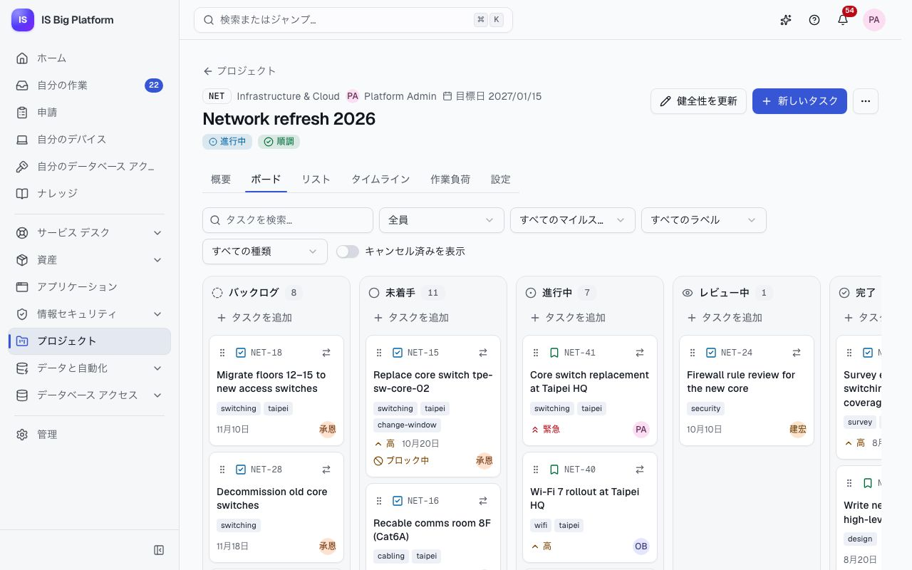
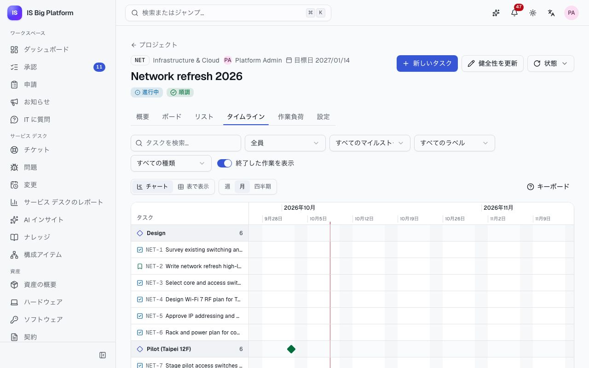
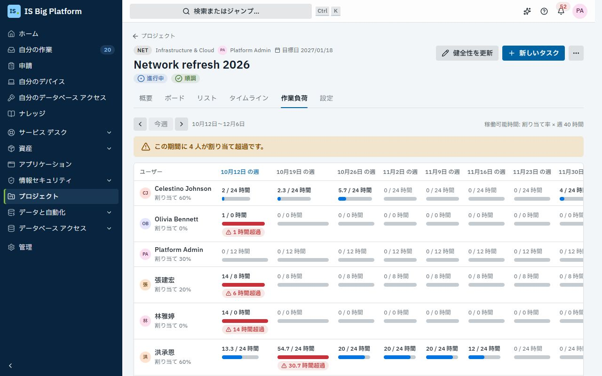

# プロジェクト ガイド

このガイドは、プロジェクト マネージャー、PMO、IS プロジェクトに携わるメンバーを対象としています。**プロジェクト**では、ネットワーク刷新、ERP のアップグレード、新オフィスの開設などの作業を計画・追跡します。誰がプロジェクトに参加し週のどれだけの時間を割り当てているか、マイルストーン、ボードとタイムライン上のタスク、メンバーが過負荷になっていないかを把握できます。タスクは、関連するチケット、変更、構成アイテム、リリースにリンクできます。

## このガイドでできること

- [プロジェクトを提案し](#プロジェクトを提案する)、**はじめに**のチェックリストに沿って[開始する](#プロジェクトを開始して提案の承認を得る) (大規模な提案には承認が必要)
- [メンバーとマイルストーンを追加する](#メンバーとマイルストーンを追加する)
- [プロジェクトの健全性を報告し](#健全性と状態を報告する)、状態を変更する
- 報告期間ごとに、下書きから[ステータス報告を提出する](#ステータス報告を提出する)
- [ステータス レポートを読み](#ステータス-レポートを読む)、遅延・リスクあり・順調のプロジェクトを確認する
- 組織全体の[ステータス報告を設定する](#ステータス報告を設定する) (PMO)
- マウス、キーボード、または**移動先**を使って[ボードで作業を計画・移動する](#ボードで作業する)
- [タイムラインで日付と依存関係を計画する](#タイムラインで計画する) (表形式でも確認可能)
- ユーザーと週ごとに、稼働可能時間に対する[作業負荷を確認する](#作業負荷を確認する)
- プロジェクトをまたいで[自分のタスクを確認する](#自分のタスクを確認する)
- [タスクをチケット、変更、CI、リリースにリンクする](#タスクをチケット変更ciリリースにリンクする)
- [Azure DevOps Server と同期されるタスク](#azure-devops-server-と同期されるタスク)の動作を理解する

## ロールごとにできること

変更できる内容は、プラットフォームでのロールと、各プロジェクトでのロールによって決まります。

| プラットフォームのロール                                 | できること                                                                                                                                                     |
| -------------------------------------------------------- | -------------------------------------------------------------------------------------------------------------------------------------------------------------- |
| **プロジェクト メンバー** (Project member)               | 全員に付与されています。社内向けのプロジェクトを表示し、参加しているプロジェクトで作業できます                                                                 |
| **プロジェクト マネージャー** (Project manager)          | プロジェクトの作成もできます (作成者がそのプロジェクトのマネージャーになります)                                                                                |
| **プロジェクト管理オフィス** (Project management office) | 非公開のものも含めてすべてのプロジェクトを表示し、プロジェクトを作成できます。責任者に上長がいない場合は、大規模な提案を承認します。ステータス報告を運用します |
| **プロジェクト管理者** (Projects administrator)          | すべてのプロジェクトを管理できます                                                                                                                             |

プロジェクト内では、**マネージャー**はプロジェクトと任意のタスクを編集でき、**メンバー**はタスクの作業ができ、**閲覧者**は閲覧とコメントができます。**社内**プロジェクトはプロジェクトを使用するすべてのユーザーに表示され、**非公開**プロジェクトはメンバー (と PMO) にだけ表示されます。**新しいプロジェクト**が表示されない場合は、**管理 → ロールとアクセス**で**プロジェクト マネージャー**ロールを付与するよう管理者に依頼してください。

## プロジェクトを提案する

新しい作業は提案として始まるため、誰かが時間を割り当てる前に計画を確認できます。

1. **プロジェクト**に移動し、**新しいプロジェクト**を選択します。
2. **名前** (例: 「Network refresh 2026」) と、2～10 文字の英数字の**キー**を入力します。タスクの参照番号はキーで始まります (例: `NET-12`)。プロジェクトにタスクができると、キーは変更できません。
3. **プロジェクト マネージャー** (プロジェクトのマネージャーにもなります)、**開始日**と**目標日**、**公開範囲**、**優先度**を選択します。
4. **その他の詳細**で**部署**を選択し、**予定工数 (時間)** を入力し (この値によって、提案に承認が必要かどうかが決まります)、**説明**にスコープを記述します (Markdown を使用できます)。
5. **プロジェクトを作成**を選択します。

**この後の流れ:** プロジェクトは**提案中**になります。**概要**の最初に**はじめに**のチェックリストが表示されます: **マイルストーンを計画** (**マイルストーンを追加**)、**最初のタスクを追加** (**新しいタスク**)、**チームを追加** (**メンバーを追加**)、最後に**プロジェクトを開始**または**提案の承認を申請**です。各ステップにはそれぞれのボタンがあり、完了するとチェックが付きます。すべて完了するとチェックリストは表示されなくなります。誰かが評価するまで、プロジェクトの健全性は**未評価**と表示されます。

## プロジェクトを開始して提案の承認を得る

1. プロジェクトを開きます。予定工数がしきい値以下の場合、上部のボタンは**プロジェクトを開始**、しきい値を超える場合は**承認を申請**です。
2. この後の流れ (すぐに開始されるか、先にプロジェクト マネージャーの上長が承認するか) がダイアログに表示されます。もう一度**プロジェクトを開始**または**承認を申請**を選択して確定します。

**この後の流れ:**

- 予定工数が 400 時間以下のプロジェクトは、すぐに**進行中**になります。
- それを超えるプロジェクトは**プロジェクト提案**の承認に送られます。プロジェクト マネージャーの上長 (上長がいない場合は PMO) が 72 時間以内に判断し、48 時間後にリマインダーが送られます。**概要**には**提案の承認**カードが表示され、状態 (**承認待ち**、**承認済み**、**却下**)、**承認者:** の後に承認者、送信日時と期限が示されます。**承認フローを表示**を選択すると、提案が通るすべてのステップと現在の位置が表示されます。承認者には**承認の受信トレイで判断する**が表示されます。
- 判断の結果は責任者に通知されます。承認されなかった場合、プロジェクトは**提案中**のままです。内容を調整してもう一度開始してください。

デモでは、**Kaohsiung office opening** (`KHH`) の予定工数は 800 時間なので、提案はプロジェクト マネージャーの上長の承認待ちになっています。このプロジェクトはポートフォリオの**提案中**タブに表示されます。

> **ヒント:** 400 時間のしきい値は承認ワークフローの一部です。管理者は**管理 → ワークフロー**でこの値を変更できます。その際は、モジュールの**提案の承認しきい値 (時間)** 設定も合わせて変更してください。この設定は画面上のヒントにのみ使用されます。

## メンバーとマイルストーンを追加する

メンバーとその割り当て率は作業負荷ビューに反映され、マイルストーンはタイムラインのグループになります。

マイルストーンをすばやく追加するには、**概要**の**マイルストーン**カードで**マイルストーンを追加**を選択し、**マイルストーン名**と**期限**を入力して保存します。両方の一覧を管理するには、次の手順に従います。

1. プロジェクトを開き、**設定**タブ (マネージャーにのみ表示されます) に移動するか、**概要**のカードで**管理**を選択します。
2. **メンバー**で、**ユーザー**、**ロール** (**マネージャー**、**メンバー**、**閲覧者**)、**割り当て率 %** (ユーザーの週のうち、このプロジェクトに予定する割合) を選び、**追加**を選択します。
3. **マイルストーン**で**マイルストーン名**と**期限**を入力し、**マイルストーンを追加**を選択します。矢印で並べ替え、マイルストーンを達成したら**完了にする**を選択します。

**この後の流れ:** 新しいメンバーに通知 (「プロジェクトへの追加」) が届きます。メンバーを削除すると、そのメンバーの未完了のタスクは未割り当てになります。**アーカイブまたは削除**の**プロジェクトをアーカイブ**を選択すると、終了したプロジェクトが読み取り専用になり、ポートフォリオから非表示になります。削除できるのはタスクのないプロジェクトだけです (管理者は任意のプロジェクトを削除できます)。

## 健全性と状態を報告する

マネージャーは、状況報告のメールの代わりに健全性の更新で関係者に情報を伝えます。

1. プロジェクトを開き、**健全性を更新**を選択します。
2. **順調**、**リスクあり**、**遅延**のいずれかを選び、**メモ** (何が変わり、次に何をするか) を書いて保存します。

**この後の流れ:** メンバーに通知が届き、メモはプロジェクトの**概要**とポートフォリオに表示されます。**状態**を使用して、**保留にする**、**再開**、**完了にする**、**プロジェクトをキャンセル**を実行します。未完了のタスクがあるプロジェクトを完了にするには、コメントを付けて**それでも完了にする**で確定する必要があります。

デモでは、**ERP upgrade to v12** は**リスクあり**、**Zero Trust rollout** は**遅延**で、それぞれにメモがあります。

**概要**タブには、**未完了のタスク**、**期限超過**、**今週完了**、**ブロック中**、**状態別のタスク**、マイルストーンとその進捗、メンバーとその割り当て率、プロジェクトの履歴も表示されます。まだ誰も評価していないプロジェクトには、健全性の代わりに**未評価**と表示されます。

## ステータス報告を提出する

PMO がステータス報告を依頼すると、進行中の各プロジェクトのマネージャー (と、PMO が指定したグループのうちそのプロジェクトに参加しているメンバー) は、報告期間ごとに 1 件の報告を提出します。期間は毎週、2 週間ごと、毎月のいずれかです。

1. **自分の作業**を開きます。報告は**ステータス報告**に期限付きで表示されます。または、プロジェクトの**ステータス報告**タブを開き、**報告を書く**を選択します。
2. **下書きを作成**を選択すると、今期のタスク、マイルストーン、会議から下書きが作成されるので、編集します。AI チャット モデルが設定されている場合は AI が下書きし (**AI による下書き**)、設定されていない場合は計画から作成されます (**計画からの下書き**)。すでに入力した内容がある場合は、先に**置き換え**を確認します。
3. **状態**で**順調**、**リスクあり**、**遅延**のいずれかを選びます。
4. **概要**を書き、必要に応じて**完了見込み日**、**進捗 (%)**、**今期の完了事項**、**次の作業**、**課題とリスク**、**必要な支援や判断**を入力します (Markdown: 行頭に - を付けるとリストになります)。
5. **報告を提出**を選択します。

**次に起こること:** 報告はプロジェクトの**ステータス報告**タブとステータス レポートに表示されます。プロジェクト マネージャーの報告は、プロジェクトの健全性にも反映されます。**リスクあり**または**遅延**と報告すると、プロジェクトのマネージャーに通知されます。報告期間が終わるまでは**自分の報告を編集**を選択できます。

期限の前と期限を過ぎたときにリマインダーが届き、プロジェクトのマネージャーには未提出の報告が通知されます。PMO がステータス報告をスケジュールしていない場合でも、プロジェクトに参加している人は**ステータス報告**タブから報告を投稿できます。

> **ヒント:** **完了見込み日**がプロジェクトの目標日より後の場合、どの状態を選んでも、レポートではプロジェクトが**遅延**と表示されます。

## ステータス レポートを読む

ステータス レポートは、ステータス報告と計画から、報告期間ごとに「どのプロジェクトが遅れていて、どれが順調か」を示します。

1. **プロジェクト → ステータス レポート**に移動します。
2. **前の期間**と**次の期間**で期間を切り替え、**テンプレート** (1 ページの**エグゼクティブ サマリー**、またはすべてを含む**詳細なステータス**) と**プロジェクト** (**すべて**、**自分**、または**部署**) を選びます。

各プロジェクトには状態が付きます。

| 状態           | 条件                                                                                             |
| -------------- | ------------------------------------------------------------------------------------------------ |
| **遅延**       | **遅延**と報告された、完了見込み日が目標日より後、目標日を過ぎた、またはマイルストーンが期限超過 |
| **リスクあり** | **リスクあり**と報告された、または多くのタスクが期限超過                                         |
| **順調**       | 順調と報告され、計画もそれと一致している                                                         |
| **報告なし**   | 今期の報告が誰からも提出されていない                                                             |
| **完了**       | プロジェクトが完了している                                                                       |

各プロジェクトには理由が表示されます。計画の実態が報告より悪い場合は、**計画の実態より良く報告**と表示されます。レポートには、**概況**の件数、受領した報告の件数、**サマリー** (報告から AI が作成、または**組み込みのサマリー (AI モデル未設定)**)、**課題とリスク**、**必要な支援と判断**、今後の**マイルストーン**、**未提出の報告**、プロジェクトの会議からの**会議での決定事項**も表示されます。表示されるのは、閲覧を許可されたプロジェクトだけです。

**Markdown としてコピー**または **Markdown をダウンロード**を選択すると、レポートをメールや Teams の投稿に貼り付けられます。

**プロジェクト → ステータス報告**では、期間ごとに誰が報告を提出し、誰がまだ提出していないかを確認できます。

## ステータス報告を設定する

PMO は組織全体で 1 つのスケジュールを設定します。**プロジェクト管理オフィス**ロールが必要です。

1. **管理 → プロジェクトのステータス報告**に移動します。
2. **報告スケジュール**で**ステータス報告を依頼する**をオンにし、**頻度**、**期限**、**報告者へのリマインダー**、**タイム ゾーン**を選びます。
3. **進行中の各プロジェクトの報告者**で、**プロジェクト マネージャー**、**グループのメンバー**、またはその両方を選びます。
4. **保存**を選択します。

**次に起こること:** 報告者の**自分の作業**に報告が表示され、リマインダーが届きます。オフにするとリマインダーが止まり、今期の未提出の報告が削除されます。提出済みの報告は残ります。

**レポート テンプレート**で**新しいテンプレート**を選択すると独自のレポートを作成でき、組み込みのテンプレートを**コピー**することもできます。テンプレートは上から順に並んだセクションの一覧で、セクションごとに表示するプロジェクトと詳細を決めます。**スケジュールで送信**を選択すると、**データと自動化 → スケジュール ジョブ**が**ステータス レポートを送る**タスクで開きます。このタスクは、選んだ人に今期のレポートができたことを知らせます。各自が開くと、閲覧を許可されたプロジェクトだけが表示されます。

## ボードで作業する

ボードは、チームが日々の作業を進める場所です。

1. プロジェクトを開き、**ボード**タブを選択します。列は**バックログ**、**未着手**、**進行中**、**レビュー中**、**完了**です。**キャンセル済みを表示**をオンにすると、キャンセルされたタスクの列が追加されます。
2. タスクをすばやく追加するには、列で**タスクを追加**を選択し、タイトルを入力して**追加**を選択します。すべての項目を指定するには、プロジェクト上部の**新しいタスク**を選択します。**タイトル**、**担当者**、**期限**、**マイルストーン**を入力し、**その他の詳細**を開いて**種類**、**優先度**、**開始日**、**見積もり (時間)**、**説明**を指定します。
3. カードを移動するには、ハンドルをドラッグするか、キーボードを使用します。
   1. Tab キーでカードのハンドル (**NET-12 を移動**) に移動し、Space キーまたは Enter キーを押して持ち上げます。
   2. 方向キーで列内または列間を移動します。
   3. Space キーまたは Enter キーを押して配置するか、Esc キーを押してキャンセルします。スクリーン リーダーは各位置を読み上げます。
4. または、カードのメニュー (**NET-12 を移動…**) を開き、**移動先**で列を選択します。
5. カードのタイトルを選択すると、サイド パネルで開きます。詳細の編集 (見積もり、残り作業、ラベルは**計画**の下にあります)、依存関係と親の追加ができ、**コメントとアクティビティ**でコメントできます (**コメントを追加**に入力して**コメントする**を選択)。**ページとして開く**を選択すると、専用のページで開きます。

ボードの上にあるフィルターで、テキスト、**担当者** (**自分**、**未割り当て**)、**マイルストーン**、ラベル、**種類** (**エピック**、**機能**、**ユーザー ストーリー**、**タスク**、**バグ**) で絞り込めます。

**この後の流れ:** 担当者には新しい割り当てとコメントが通知され、タスクの期限の前日にはリマインダーが届きます。**ブロック中**と表示されたカードは、まだ完了していない作業に依存しています。依存先が**完了**またはキャンセル済みになるまで、**進行中**には移動できません。

> **ヒント:** **リスト**タブには同じタスクが並べ替え可能な表で表示されるため、まとめて確認するときに便利です。

## タイムラインで計画する

タイムラインを使用して、日付を計画し、依存関係を確認し、早く開始しすぎているタスクを見つけます。

1. プロジェクトを開き、**タイムライン**タブを選択します。開始日または期限のあるタスクがマイルストーンごとにバーで表示され、各タスクから、それを待っているタスクへ矢印が引かれます。
2. ズーム (**週**、**月**、**四半期**) を選択します。
3. マウスで日付を変更するには、バーをドラッグして移動するか、バーの端をドラッグして開始日または期限を変更します。
4. キーボードでは、Tab キーでバー間を移動し、Enter キーでタスクを開き、Alt + ← / → でタスクを 1 日移動し、Alt + Shift + ← / → で期限だけを移動します。操作方法を確認するには**キーボード**を選択します。
5. 依存関係を追加するには、タスクを開き、**ブロック元**で**依存関係を追加**を選択します。
6. **表で表示**を選択すると、同じ計画が表 (**依存先**列を含む**日付と依存関係を含むタスク**) で表示され、進捗を示す**マイルストーン**表も表示されます。

依存先のタスクが終了する前に開始するタスクにはフラグが付き (「… の終了前に開始します。」)、その矢印は赤で表示されます。依存関係がループになる場合は拒否されます。日付のないタスクは、チャートの下に未スケジュールとして一覧表示されます。

デモでは、**Network refresh 2026** (`NET`) のタイムラインに、コア スイッチの交換作業と、マイルストーン **Rollout HQ** と **Rollout Hsinchu** があります。

## 作業負荷を確認する

日付を確約する前や、誰かを別のプロジェクトに追加する前に、作業負荷を確認します。

1. プロジェクトを開き、**作業負荷**タブを選択します。各行がメンバー、各列が週です。
2. 各セルには、その週の稼働可能時間に対する予定時間が表示されます。割り当て超過のセルには **… 時間超過**と表示され、概要には割り当て超過になっている人数が表示されます。
3. セルを選択すると、その内訳のタスクが表示されます。表示する期間は**前の週**、**今週**、**次の週**で移動します。

数値の算出方法:

- **予定時間**: 未完了の各タスクの残り時間 (またはその見積もり) を、開始日 (または今日) から期限までの稼働日に均等に配分したものです。期限または時間が設定されていないタスクは計画に含まれません。
- **稼働可能時間**: メンバーの割り当て率 × 週あたりの作業時間 (既定は 40 時間。モジュールの設定) です。
- **未割り当て**行には、まだ誰も担当していない予定作業が表示されます。

プロジェクト マネージャー、PMO、管理者は、**プロジェクト**の**チームの作業負荷** (**カード**と**表**の横にあるレイアウトの切り替え) も使用できます。自分が管理している稼働中のすべてのプロジェクト (PMO と管理者の場合は稼働中のすべてのプロジェクト) を対象に同じグリッドが表示され、各ユーザーの割り当て率が合算されます。

## 自分のタスクを確認する

1. **プロジェクト**に移動して**マイ タスク**タブを開くと、プロジェクトをまたいで自分に割り当てられた未完了のタスクが、**期限超過**、**今日**、**今週**、**それ以降**、**日付なし**に分けて表示されます。
2. その場でタスクの状態を変更するか、タスクを開きます。完了にしたタスクは一覧から消えます。間違えた場合は、メッセージの**元に戻す**を選択します。

未完了のタスクは**自分の作業**の**タスク**にも、期限の近い順に表示されます。

## タスクをチケット、変更、CI、リリースにリンクする

リンクを使用すると、作業を承認した変更、作業対象の CI、作業のきっかけになったインシデントなどのコンテキストを 1 か所にまとめられます。

1. タスクを開きます (サイド パネルまたはページ)。
2. **関連レコード**で**レコードをリンク**を選択します。
3. 必要に応じて**レコードの種類**で絞り込み、番号またはタイトルで検索して、レコードの横の**リンク**を選択します。

添付ファイルは、同じタスクの**添付ファイル**に追加します。表示されるのは閲覧を許可されている関連レコードだけで、それ以外は件数だけが表示されます (「アクセス権のない関連レコードが … 件あります」)。プロジェクトの**概要**にも同じ**関連レコード**パネルがあり、たとえばプロジェクトを、それによって変更されるアプリケーションにリンクできます。

デモでは、`NET` のタスク「Replace core switch tpe-sw-core-01」が変更「Core switch firmware upgrade tpe-sw-core-01」と CI `tpe-sw-core-01` にリンクされ、`ERP` のタスク「Cut over production to ERP v12」が Finance ERP 12.1.0 リリースにリンクされています。

## Azure DevOps Server と同期されるタスク

Azure DevOps Server (オンプレミス) で計画している開発チームは、統合ハブを通じて作業項目とプロジェクトのタスクを同期させることができます。設定はプロジェクトごとに統合管理者が行います。

- 作業項目はタスクとして取り込まれ、タスクの変更は作業項目に反映されます。種類、親、状態、担当者、日付、時間、および同期ルールに含まれている場合はコメントも同期されます。
- プロジェクトのルールは引き続き適用されます。依存先が完了していないタスクは開始できず、アーカイブされたプロジェクトは読み取り専用のままです。プロジェクトに参加していない担当者は、割り当て率 0% の**メンバー**としてプロジェクトに追加されます。
- チーム プロジェクトから作成されたプロジェクトは**提案中**から始まります。その提案の承認は[外部からスキップできません](integrations.md#外部から承認を省略することはできない)。
- タスクの関連レコードには**同期先**カードが表示され、接続、**前回の同期**の日時、**今すぐ同期**があります。同期によって作成されたアクティビティとコメントには、取得元 (「… 経由」) が表示されます。

デモでは、**ERP work items ↔ tasks** が `ERP` プロジェクトをデモ用の模擬サーバー **Contoso Azure DevOps Server** と双方向で同期し (両方の側で変更された場合は Azure DevOps の値が優先されます)、**Network work items → tasks** が作業項目を `NET` に一方向で取り込みます。接続と同期ルールの設定については、[統合ガイド](integrations.md) を参照してください。

## 関連情報

- **変更とリリース**: タスクを、作業を承認する変更や、作業によって提供するリリースにリンクします ([変更とリリース ガイド](changes-and-releases.md))。
- **サービス デスクと CMDB**: タスクをインシデント、問題、CI にリンクします ([サービス デスク ガイド](service-desk.md))。
- **承認**: 提案の判断は、ほかのすべての承認と同じように**承認**の受信トレイに届きます ([申請を承認または却下する](employees.md#申請を承認または却下する))。
- **Azure DevOps Server** との同期: [統合ガイド](integrations.md)。
- **アシスタント**は、ユーザーのアクセス許可の範囲で、自分のタスクの一覧表示、タスクの検索と作成、タスクの状態の変更、プロジェクトの状況報告、ステータス報告の提出ができます ([アシスタントと AI](assistant-and-ai.md))。
- **会議**: プロジェクトの会議のアクション アイテムはプロジェクトのタスクになり、会議の決定事項はステータス報告とステータス レポートに反映されます ([会議ガイド](meetings.md))。
- プロジェクトが IS の業務にどう組み込まれているか: [業務とのつながり](how-it-fits-our-work.md)。
