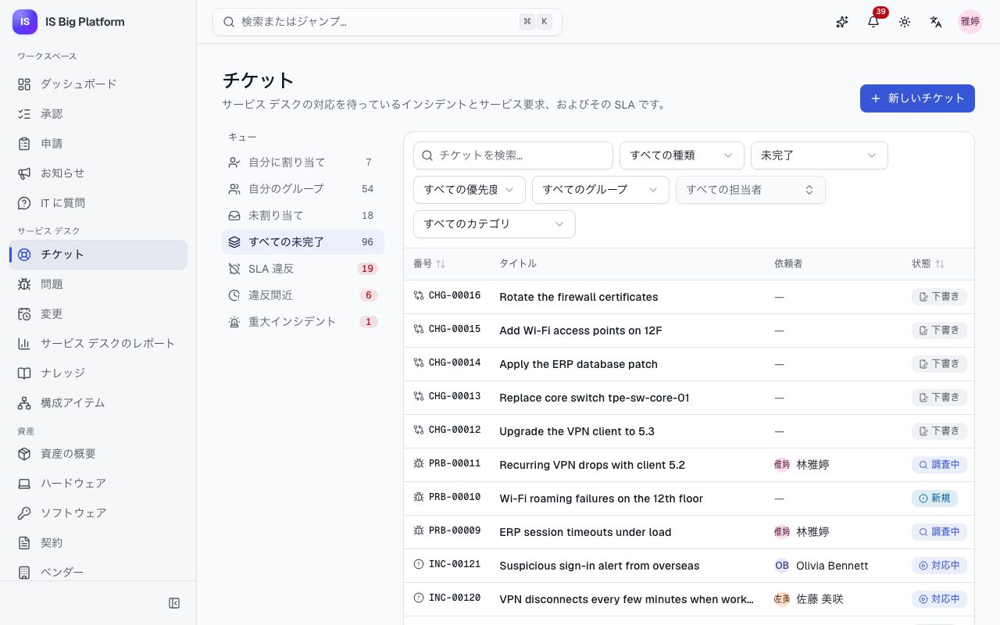
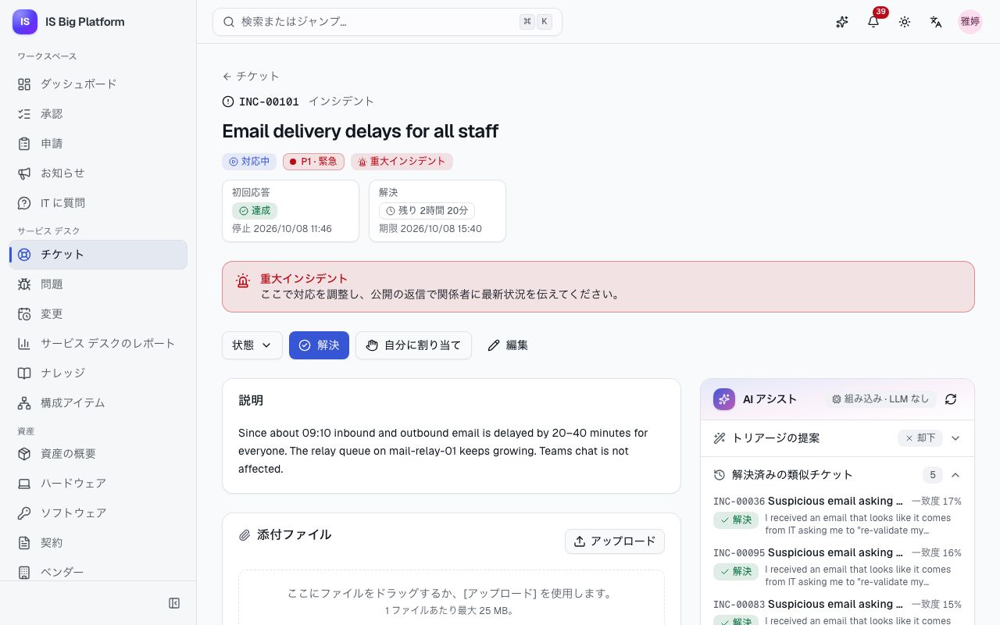
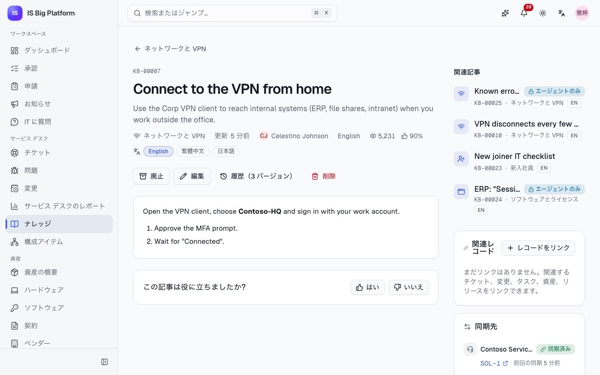
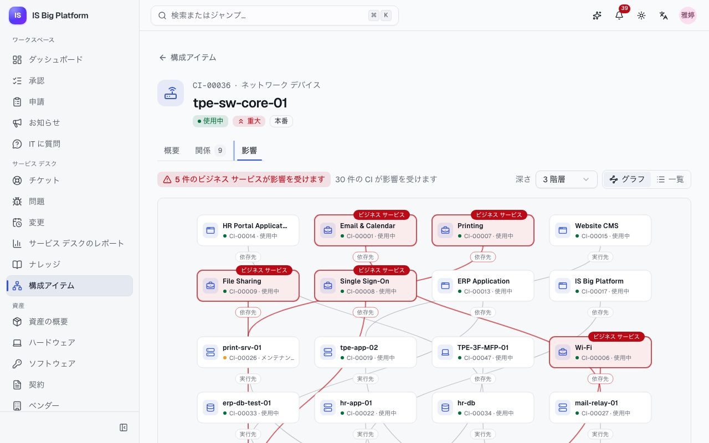

# サービス デスク ガイド

このガイドは、サービス デスクの担当者とリーダー向けです。キューの処理、SLA の順守、依頼者への返信、解決とクローズといったチケットの日常業務と、ヘルプデスク AI、ナレッジ ベース、CMDB、レポートなど、チケットにかかわるツールについて説明します。変更と CAB については別のガイドがあります: [変更とリリース](changes-and-releases.md)。

## このガイドでできること

- [キューを処理する](#キューを処理する): SLA 違反や違反間近のチケットから確認します
- [チケットの種類と状態を理解する](#チケットの種類と状態を理解する)
- 影響度と緊急度から[優先度を設定する](#優先度を設定する)、[SLA を順守する](#sla-を順守する)
- 電話や窓口で依頼を受けたときに[代理でチケットを登録する](#代理でチケットを登録する)
- [チケットを処理する](#チケットを処理する): 割り当て、返信、作業メモの追加、ファイルの添付、レコードのリンク
- [チケットを解決、再オープン、クローズする](#チケットを解決再オープンクローズする) (満足度の評価を含む)
- カタログのフォームから届いた[サービス要求を処理する](#サービス要求を処理する)
- [問題を調査し、既知のエラーを記録する](#問題を調査し既知のエラーを記録する)
- [重大インシデントに対応する](#重大インシデントに対応する)
- [チケットでヘルプデスク AI を使用する](#チケットでヘルプデスク-ai-を使用する): トリアージ、類似チケット、返信の下書き、要約
- [ナレッジ記事を検索、作成する](#ナレッジ記事を検索作成する)
- CMDB で[構成アイテムの影響範囲を確認する](#構成アイテムの影響範囲を確認する)
- [サービス デスクのレポートを読む](#サービス-デスクのレポートを読む)
- [ServiceDesk Plus と同期されたチケットを処理する](#servicedesk-plus-と同期されたチケットを処理する)

> **ヒント:** サイドバーに**サービス デスク → チケット**が表示されない場合は、管理者に**サービス デスク担当者** (Service desk agent) ロールを依頼してください。このロールはすべての部署を対象にすることも、一部の部署だけを対象にすることもでき、対象の部署のチケットが表示されます。デモでは、`helpdesk` ユーザーがサービス デスク担当者です。

## キューを処理する

シフトの開始時には、まずここを確認します。ワークスペースには、自分と自分のチームの対応を待っているチケットが SLA タイマーとともに表示されます。

1. **サービス デスク → チケット**に移動します。
2. 左側でキューを選択します。各キューの横の数字は、未完了のチケットの件数です。
   - **自分に割り当て**: 自分が担当しているチケット。
   - **自分のグループ**: 自分がメンバーになっているいずれかのグループに割り当てられた、未完了のチケット。
   - **未割り当て**: 自分のグループのチケットのうち、まだ誰も担当していないもの。
   - **すべての未完了**: 表示できるすべての未完了のチケット。
   - **SLA 違反**、**違反間近**、**重大インシデント**: 最初に対応が必要なチケット。件数が 0 でない場合は赤で表示されます。
3. 検索ボックス (タイトル、または `INC-00042` などの番号) とフィルターで一覧を絞り込みます。フィルターは**種類**、**状態** (既定は**未完了**。**完了**、**すべての状態**、または個別の状態も選択できます)、**優先度**、**割り当てグループ**、**担当者**、**カテゴリ**です。**フィルターをクリア**を選択するとリセットされます。
4. 行を選択してチケットを開きます。

**この後の流れ:** キューと一覧は 1 分ごとに更新されます。キューとフィルターはページのアドレスに含まれるため、ビューをブックマークしたり、同僚と共有したりできます。ホームのダッシュボードにある**サービス デスク**カードにも、同じキューと最も急を要するチケットが表示されます。

> **ヒント:** スマートフォンでは、キューは一覧の上のドロップダウンに表示されます。

## チケットの種類と状態を理解する

すべてのチケットには種類と番号があります。種類ごとにライフサイクルが異なり、チケットの**状態**メニューには、その種類で可能な遷移だけが表示されます。

| 種類         | 番号    | 使用する場面                                              | 状態                                                                  |
| ------------ | ------- | --------------------------------------------------------- | --------------------------------------------------------------------- |
| インシデント | `INC-…` | 何かが壊れている、または正常に動作していない              | 新規 → 対応中 ⇄ 保留 → 解決済み → クローズ、またはキャンセル          |
| サービス要求 | `SR-…`  | 誰かが何かを必要としている (多くはカタログのフォームから) | (承認待ち →) 新規 → 対応中 ⇄ 保留 → 完了 → クローズ、またはキャンセル |
| 問題         | `PRB-…` | インシデントの背後にある原因を調べる                      | 新規 → 調査中 → 既知のエラー → 解決済み → クローズ、またはキャンセル  |
| 変更         | `CHG-…` | 本番環境で何かを変更する                                  | [変更とリリース](changes-and-releases.md)を参照                       |

解決済みのインシデントや完了したサービス要求は、**対応中**に戻す (再オープン) か、**クローズ**に進めることができます。

## 優先度を設定する

優先度 (P1～P4) によって、適用される SLA の目標と、他のチケットと比べたときの並び順が決まります。優先度は、影響度と緊急度の ITIL マトリックスから決まります:

| 影響度 ↓ / 緊急度 → | 高  | 中  | 低  |
| ------------------- | --- | --- | --- |
| **高**              | P1  | P2  | P3  |
| **中**              | P2  | P3  | P4  |
| **低**              | P3  | P4  | P4  |

1. チケットを開き、右側の**詳細**カードを表示します。
2. **影響度** (**高 — 多くのユーザーまたは重要なサービス**、**中 — チームまたは部門**、**低 — 1 人**) と**緊急度** (**高 — 業務が止まっている**、**中 — 業務に支障がある**、**低 — 後でもよい**) を設定します。変更はすぐに保存されます。
3. **優先度**はマトリックスに従います (**影響度 × 緊急度から算出**)。手動で上書きするには、同じ一覧で **P1 · 緊急**～**P4 · 低**を選択します。マトリックスに戻すには、もう一度**影響度 × 緊急度から算出**を選択します。

**この後の流れ:** 上書きすると、次のように表示されます: **手動で変更されています。変更はアクティビティに記録されます。** 誰が何を変更したかはタイムラインに記録されます。実行中の SLA タイマーは、新しい優先度の目標に切り替わります。

## SLA を順守する

SLA ポリシーは、各チケットに**初回応答**と**解決**の 2 つの目標を設定します。目標は、営業時間と休日を定義したカレンダーに基づく営業時間で計測されます。そのため、24×7 で稼働するカレンダーでない限り、夜間、週末、祝日には時間が進みません。

- **適用されるポリシー:** チケットの作成時に条件が一致した、最初の有効なポリシー (サービス デスク管理者が設定した順序で判定) が適用されます。後から優先度を変更しても同じポリシーが使われ、新しい優先度の目標が適用されます。
- **表示される場所:** チケットのタイトルの下 (**初回応答**と**解決**、および**期限**または**停止**と時刻)、**SLA** カード (**順調**、**一時停止**、**達成**、**違反**)、一覧の **SLA** 列に表示されます。
- **初回応答**は、依頼者以外のユーザーによる最初の公開返信、チケットの**対応中**への移動、またはチケットの解決のいずれかで達成されます。
- **一時停止:** ポリシーで指定された状態 (通常は**保留**) の間は時間が止まります。解決済みのチケットを再オープンすると、解決の時間は停止した時点から再開され、解決済みだった間の時間は計測されません。
- **警告と違反:** 目標の一定の割合 (**警告のタイミング**) が経過すると、担当者 (担当者がいない場合はグループの全メンバー) に **SLA 期限間近**の通知が届き、チケットが**違反間近**に表示されます。期限を過ぎると **SLA 違反**の通知 (アプリ内とメール) が届き、タイムラインに記録されて、チケットは**SLA 違反**キューに移動します。

デモには、**Taipei office hours** (平日 09:00～18:00、台湾の祝日) と **24×7** の 2 つの営業カレンダーと、次の 3 つのポリシーがあります:

| ポリシー                  | 適用対象             | 目標                                                                            | 一時停止する状態 |
| ------------------------- | -------------------- | ------------------------------------------------------------------------------- | ---------------- |
| Critical incidents (24×7) | P1 のインシデント    | 応答 15 分、解決 4 時間、24 時間体制                                            | なし             |
| Incidents                 | その他のインシデント | P1 30 分 / 4 時間、P2 1 時間 / 8 時間、P3 4 時間 / 24 時間、P4 8 時間 / 40 時間 | 保留             |
| Service requests          | サービス要求         | 応答は 4 営業時間以内、完了は 3 営業日以内                                      | 保留、承認待ち   |

> **ヒント:** 依頼者や業者からの回答を待つ間はチケットを**保留**にし、その理由を返信で伝えてください。時間が止まるのは、ポリシーで**保留**が指定されている場合だけです。

ポリシーとカレンダーは、**サービス デスク管理者** (Service desk administrator) ロールを持つリーダーや管理者が、**管理 → サービス デスク** (**SLA ポリシー**タブと**カレンダー**タブ) で管理します。[管理者](administrators.md)を参照してください。

## 代理でチケットを登録する

電話、メール、または窓口で依頼を受けたら、本人に代わってチケットを登録します。本人は**自分の申請**でチケットの状況を確認できます。

1. **サービス デスク → チケット**に移動し、**新しいチケット**を選択します。
2. **チケットの種類**として、インシデントまたはサービス要求を選択します (**問題マネージャー** (Problem manager) ロールがある場合は問題も選択できます)。
3. **依頼者**で対象のユーザーを選択します。空欄のままにすると、自分の名前で登録されます。
4. **タイトル**と**説明** (Markdown を使用できます) を入力します。
5. **影響度**と**緊急度**を設定します。優先度はマトリックスに従って決まります。
6. **カテゴリ**を選択します。**割り当てグループ**を空欄にすると、チケットはカテゴリの既定のグループ、またはサービス デスクの既定のグループに割り当てられます。
7. 必要に応じて、**担当者**、**影響を受ける構成アイテム**、インシデントの場合は**重大インシデント**を設定します。
8. **チケットを作成**を選択します。

**この後の流れ:** 依頼者には「INC-… を受け付けました」という通知が届き、**自分の申請**にチケットが表示されます。担当者に通知が届き、SLA タイマーが開始されます。ヘルプデスク AI が有効な場合は、トリアージが提案されます。

## チケットを処理する

チケットのページでは、左側に説明、添付ファイル、**アクティビティ** (タイムラインと返信ボックス) が、右側に **AI アシスト**パネル、**詳細**、**影響を受ける CI**、**リンク**、**関連レコード**、**SLA** が表示されます。

**チケットを担当する:** アクション バーの**自分に割り当て**を選択するか、**詳細**で**割り当てグループ**と**担当者**を変更します。チケットを別のグループに移動すると、そのグループのメンバーでない担当者は外れます。新しい担当者には「割り当てられました」という通知が届きます。

**依頼者を訂正する:** チケットが別の人の名前で登録された場合は、**詳細**の**依頼者**で正しい人を選択します。チケットはその人の**自分の申請**に移り、以前の依頼者には (そのチケットがその人に関係するものでない限り) 表示されなくなります。チケットの部署と SLA 目標は変わりません。変更はタイムラインに記録されます。

**返信または作業メモを追加する:** **アクティビティ**の下で次の操作を行います。

1. 依頼者に表示されるメッセージには**依頼者に返信**を、担当者だけに表示される内容には**作業メモ**を選択します。
2. 内容を入力し (Markdown を使用できます)、**返信を送信**または**メモを追加**を選択するか、⌘/Ctrl + Enter キーを押します。

返信は依頼者に通知されます。依頼者が回答すると、担当者 (担当者がいない場合はグループ) に通知されます。

**タイトルや説明を編集する:** アクション バーの**編集**を使用します。

**ファイルを添付する:** **添付ファイル**で**アップロード**を選択するか、ファイルをドラッグします。ファイルは保存される前に、種類、サイズ、マルウェアがチェックされます。

**他のチケットをリンクする:** **リンク**で**リンク**を選択し、このチケットとの関係 (**関連**、**原因**、**重複元**、**親チケット**、**修正を実施**) を選択して、相手のチケットの番号を入力し、**リンク**を選択します。問題を原因として設定できるのはインシデントとサービス要求だけです。インシデントや問題の修正を実施できるのは変更だけです。親チケットと子チケットは同じ種類である必要があります。

**他のレコードをリンクする:** **関連レコード**で**レコードをリンク**を選択すると、チケットを資産、リリース、プロジェクトのタスク、ナレッジ記事などのレコードに関連付けることができます。自分が開けないリンクは件数だけが表示されます。

**影響を受ける CI を記録する:** **影響を受ける CI** で**編集**を選択し、構成アイテムを検索して**保存**を選択します。重要な CI には**重要**と表示されます。

## チケットを解決、再オープン、クローズする

作業が完了したら、依頼者が解決を確認できるようにチケットを解決します。

1. **解決** (インシデント) または**完了** (サービス要求) を選択します。
2. **解決コード**を選択します: **解決**、**回避策を提供**、**操作ミス／使い方**、**重複**、**異常なし**、**再現しない**。
3. **解決メモ**を入力します。このメモは依頼者に表示されます。
4. **解決**または**完了**を選択します。

**この後の流れ:**

- SLA タイマーが停止し、依頼者に通知が届いて**問題は解決しましたか?** と確認されます。
- 依頼者が**はい、クローズします**を選択すると、チケットがクローズされます。依頼者はサービスを星 1～5 で評価し、コメントを追加できます。評価は**解決**カードに**評価 …/5** として表示され、レポートの**満足度**に反映されます。
- 依頼者が**いいえ、まだ解決していません**を選択すると、理由の入力が求められ、チケットは**対応中**に戻り、自分に通知が届きます。
- 依頼者がどちらも選択しない場合、チケットは 5 日後に自動的にクローズされます (この日数は管理者が**管理 → モジュール**で変更できます)。
- 解決済みのチケットは、ヘルプデスク AI の類似チケットの検索に使用されます。

解決済みのチケットのクローズや再オープンは、**状態 → 変更先**から行うこともできます。チケットをキャンセルするには、そこで**キャンセル**を選択し、コード (**重複**、**依頼者によるキャンセル**、**操作ミス／使い方**、**異常なし**) と理由を入力します。依頼者には、チケットがキャンセルされたことが通知されます。

## サービス要求を処理する

ほとんどのサービス要求は、ポータルの申請フォームから届きます。公開されたフォームごとの処理方法は、サービス デスク管理者が**管理 → サービス デスク → サービス カタログ**で設定します。設定するのは、カテゴリ、**処理グループ**、優先度、およびチケットを**送信時**と**承認後**のどちらで作成するかです。

デモでは、**ノート PC の申請**フォームは依頼者の部門長に送られ、60,000 TWD を超える場合は IT 資産管理にも送られます。承認された申請は、Service Desk グループが担当するハードウェア › ノート PC のサービス要求になります。

1. キューからサービス要求を開きます。受付チャネルは**申請フォーム**です。
2. **申請内容** (フォームへの回答) を確認します。フォーム名が付いた**申請 REQ-… から**のチップを選択すると、元の申請が開きます。
3. 必要に応じて依頼者に返信しながら作業を行います。
4. **完了**を選択し、コードを選択してメモを入力し、**完了**を選択します。

**この後の流れ:** 依頼者は、承認から処理の完了まで、**自分の申請**で 1 つの参照番号 (`REQ-…`) を追跡できます。その状態はチケットに連動します。フォームの送信時に作成されたチケットは、承認が完了するまで**承認待ち**のまま待機し、申請が却下されるとキャンセルされます。依頼者に表示される内容については、[従業員](employees.md)を参照してください。

## 問題を調査し、既知のエラーを記録する

同じインシデントが繰り返し発生する場合は、問題を作成して原因を特定し、取り除きます。**問題マネージャー**ロールが必要です。

1. **サービス デスク → 問題**に移動します。タブには**未完了**、**既知のエラー**、**解決済み**、**すべて**があります。
2. **新しい問題**を選択するか既存の問題を開き、**状態**で**調査中**に移動します。
3. **問題**カードで**編集**を選択し、**根本原因**と**回避策**を入力して、**変更を保存**を選択します。
4. 原因と回避策を文書化したら、**既知のエラー**をオンにします。問題は**既知のエラー**に移動します。
5. この問題が原因となっているインシデントをリンクします。各インシデントの**リンク**で、**原因**と問題の番号を指定します。**問題**カードに、リンクされたインシデントが一覧表示されます。
6. 原因が取り除かれたら (多くの場合、この問題の**修正を実施**する変更によって取り除かれます)、コードとメモを入力して問題を解決し、クローズします。

デモでは、PRB-00001「VPN client 5.2 crashes on macOS 15」が、VPN のインシデントがリンクされた既知のエラーです。回避策は、エージェント専用の記事「Known error: VPN client 5.2 crashes on macOS 15」に記載されています。

> **ヒント:** 回避策を対象が**エージェントのみ**のナレッジ記事として作成すると、ヘルプデスク AI が新しいインシデントでその記事を提案します。続けて、**問題**カードの**ナレッジ記事**でその記事を選択すると、担当者は問題から記事を開けるようになります。

## 重大インシデントに対応する

障害が多くのユーザーや重要なサービスに影響し、一元的な対応が必要な場合は、重大インシデントを宣言します。

1. インシデントを開き、**詳細**で**重大インシデント**をオンにします (登録時にオンにすることもできます)。
2. このチケットを対応の唯一の窓口にします。赤い**重大インシデント**バナーが、ここで対応を調整し、公開の返信で関係者に最新状況を伝えるよう全員に促します。
3. 同じ障害について他のユーザーが登録したインシデントをリンクします。重大インシデントの**リンク**で、**親チケット**と相手のインシデントの番号を指定します。
4. 定期的に返信で最新情報を投稿し、サービスが復旧したら重大インシデントを解決します。

**この後の流れ:** チケットは**重大インシデント**キューに表示され、**サービス デスクのレポート**で未完了の重大インシデントとして集計されます。**重大インシデントをチャネルで告知する**がオンの場合 (既定でオン)、組織が登録している Teams、Slack、Webhook のチャネルに、チケットの番号とタイトルを含む「重大インシデント」メッセージが投稿されます。

> **重要:** 返信が届くのは、返信を書いたチケットの依頼者だけです。リンクされたインシデントの依頼者には、それぞれのチケットで連絡するか、重大インシデントが解決したらそれらのチケットを解決してください。

デモでは、INC-00101「Email delivery delays for all staff」が未完了の重大インシデントで、メールの遅延を報告したユーザーからの 3 件のインシデントがリンクされています。

## チケットでヘルプデスク AI を使用する

右側の列の上部にある **AI アシスト**パネルは、チケットのトリアージ、回答、記録を支援します。**AI アシスト担当者** (AI-assisted agent) ロールが必要です。

パネルのヘッダーにあるバッジに、どのモードで回答したかが表示されます:

| 機能                 | **組み込み · LLM なし** (モデル未構成)                         | **言語モデル**                                   |
| -------------------- | -------------------------------------------------------------- | ------------------------------------------------ |
| トリアージの提案     | 最も類似した解決済みチケットによる多数決と、その一致率         | 類似チケットをモデルが精査した結果と、その根拠   |
| 類似チケット、記事   | 解決済みチケットとナレッジ ベースの検索                        | 同じ                                             |
| 返信の下書き         | 最適な記事の手順を引用し、その記事へのリンクを含むテンプレート | ナレッジ記事に基づき、番号付きの参照元を含む返信 |
| 要約                 | チケットから抽出した問題、最新の更新、現在の状態               | 説明とタイムラインをもとに作成した要約           |
| ナレッジ記事の下書き | チケットのフィールドから作成した記事                           | 症状 / 原因 / 解決方法の形式の記事               |

1. **トリアージの提案**には、提案されたカテゴリ、グループ、優先度 (影響度と緊急度を含む) と**確度**メーターが表示されます。フィールドごとに**適用**を選択するか、**すべて適用**または**却下**を選択します。まだ提案がない場合は、**トリアージを提案**を選択します。
2. **解決済みの類似チケット**には、過去のチケットが一致率と解決方法とともに一覧表示されます。
3. **おすすめの記事**には、ナレッジ記事が一覧表示されます。**リンクを挿入**を選択すると、返信に記事へのリンクが追加されます。
4. **返信を下書き**を選択すると、依頼者の言語で返信が作成されます。内容を確認して**返信に挿入**を選択し、返信ボックスで編集してから、自分で送信します。
5. **要約** → **要約**を選択すると、問題、最新の更新、現在の状態が表示されます。チケットを引き継ぐときに便利です。
6. 解決済み、完了、またはクローズのチケットでは、**ナレッジ記事** → **ナレッジ記事を下書き**を選択すると、編集者がレビューするための記事の下書き (症状、原因、解決方法、対象) が作成されます。記事を作成するアクセス許可が必要です。

**この後の流れ:** 自分が操作しない限り、何も送信や公開はされません。生成されたテキストには、**組み込みテンプレート — 送信前に確認してください**、またはモデル名 (「… が作成 — 送信前に確認してください」) が表示されます。言語モデルを使用する場合、テキストがプラットフォーム外に送信される前に個人データがマスクされます。管理者が**確度の高い提案を自動的に適用する**をオンにすると、ヘルプデスク AI はまだ空のフィールドだけを入力し、そのことがタイムラインに記録されます。

**ヘルプデスク AI 管理者** (Helpdesk AI administrator) ロールを持つリーダーは、**サービス デスク → AI インサイト**で、トリアージの採用率、IT に質問によるチケットの回避、AI のコストを確認できます。AI のモードとプライバシーの詳細: [アシスタントと AI](assistant-and-ai.md)。

## ナレッジ記事を検索、作成する

ナレッジ ベースには、全員向けのセルフサービスの回答と、担当者向けのトラブルシューティング ガイドが収められています。IT に質問、ヘルプデスク AI、**問題を報告**ページはいずれもナレッジ ベースを検索するため、良い記事はチケットの削減につながります。

**回答を検索する:** **ナレッジ**に移動し、**どのようなことでお困りですか?** に入力します。検索は言語をまたいで機能し、英語の質問で中国語や日本語の記事も見つかります。**トピックから探す**から参照することもできます。**ナレッジ担当者** (Knowledge agent) ロールがあると、対象が**エージェントのみ**の記事も表示されます。記事には、他の言語版が**他の言語**に、関連する記事が**関連記事**に表示されます。ナレッジ担当者と編集者には**関連レコード**も表示され、ServiceDesk Plus と同期している記事では**同期先**カードも表示されます。

**記事を作成して公開する:** 記事の作成には**ナレッジ担当者**ロールが、公開には**ナレッジ編集者** (Knowledge editor) ロールが必要です。

1. **ナレッジ → 記事の管理**に移動し、**新しい記事**を選択します。
2. **タイトル**、**概要** (検索結果に表示されます)、**本文** (Markdown。**プレビュー**で確認できます) を入力します。**カテゴリ**、**タグ**、**対象** (**全員**または**エージェントのみ**)、**言語**を選択し、必要に応じて**レビュー期限**の日付を設定します。
3. 後で続ける場合は**下書きを保存**を、準備ができたら**保存して提出**を選択します。
4. 編集者が記事を開き (**記事の管理 → レビュー中**)、**公開**を選択します。レビュー中に内容を変更するには、**レビューを取り下げ**を選択します。

**この後の流れ:** 公開するたびにバージョンとして保存されます (**履歴**)。管理者が**ナレッジ記事の公開**の承認を有効にしている場合、提出した記事は承認に回され、承認されると公開されます。どちらの場合も通知が届きます。承認が適用されない場合、編集者自身が提出した記事はすぐに公開されます。公開中の記事を変更するには、編集者が**編集**を選択し、**更新を公開**を選択します。これにより新しいバージョンが作成されます。**廃止**を選択すると記事は検索に表示されなくなり、**下書きに復元**を選択すると元に戻せます。

**記事を翻訳する:** 記事で**翻訳**を選択します。新しい記事は翻訳としてリンクされるため、読者は言語を切り替えられます。言語ごとに独自の番号があり、それぞれ個別にレビューされます。

**フィードバックとレビュー期限に対応する:** 読者は**この記事は役に立ちましたか?** に回答します。「いいえ」の回答 (任意でコメント付き) は所有者に通知されます。公開済みの記事にはそれぞれレビュー日があります (既定では最初の公開から 180 日後)。期限が来ると、所有者に毎週リマインダーが送られ、記事にバナーが表示され、**記事の管理 → レビュー期限**に一覧表示されます。内容を確認してから**編集**を選択し、新しい**レビュー期限**の日付を設定してください。

デモでは、「vpn keeps dropping」と検索してみてください。**記事の管理**には、レビュー中の記事 (Microsoft Teams) と、レビュー期限が来た記事 (「Clear a stuck print queue」) が表示されます。

## 構成アイテムの影響範囲を確認する

CMDB には、IT が運用するサービス、アプリケーション、サーバー、データベース、ネットワーク デバイスと、それらの依存関係が記録されています。システムのサポート担当や、障害時に何が停止するかを確認するために使用します。参照には **CMDB 閲覧者** (CMDB viewer) ロールが、CI、関係、クラスの作成と編集には **CMDB マネージャー** (CMDB manager) ロールが必要です。

1. **構成アイテム**に移動します。タブ (**すべて**、**ビジネス サービス**、**アプリケーション**、**インフラストラクチャ**)、検索ボックス (名前、または `CI-00042` などの番号)、フィルターを使用します。
2. CI を開きます。**概要**には、詳細、所有者、**サポート グループ**、**障害が発生した場合**の概要、**関連する作業**が表示されます。**関連する作業**には、この CI に影響している未完了のチケット (**すべて表示**で全件を表示) と、この CI が属するアプリケーションが表示されます。
3. **関係**には、他の CI との関係 (**依存先**、**実行先**、**接続先**、**格納対象**、**バックアップ対象**とその逆方向) が一覧表示されます。CMDB マネージャーは**関係を追加**を選択できます。
4. **影響**には、**障害時に影響を受けるもの** (上側) と**依存先** (下側) が、選択した**深さ**まで、**グラフ**または**一覧**で表示されます。影響を受けるビジネス サービスの数も表示されます。

影響分析では**依存先**、**実行先**、**格納対象**の関係をたどります。**接続先**と**バックアップ対象**は情報提供のみを目的としています。

**CI をチケットにリンクする:** 各チケットに、影響を受ける CI を記録します ([チケットを処理する](#チケットを処理する)を参照)。記録した CI は CI のページに表示され、障害時に関連するインシデントを見つけるのに役立ちます。変更では、競合チェックと CAB へのルーティングに使用されます。

デモでは、`tpe-sw-core-01` (CI-00036) を開いてみてください。コア スイッチが停止すると、ほとんどのビジネス サービスに影響が出ます。

## サービス デスクのレポートを読む

リーダーは、日次のスタンドアップや月次のサービス レビューでレポートを使用します。

1. **サービス デスク → サービス デスクのレポート**に移動します。
2. 期間を選択します: **過去 7 日間**、**過去 30 日間**、**過去 90 日間**。
3. 上部の数値を確認します: **未完了のチケット** (未完了の重大インシデントを含む)、**SLA 違反** (応答と解決)、**平均解決時間**、**満足度**、**SLA 達成率**。
4. その下には、**作成と解決**、**優先度別の未完了**、**滞留期間**、**上位のカテゴリ**、**優先度別の解決時間**が表示されます。各グラフは、**表示形式**で表に切り替えることができます。

**サービス デスク担当者**ロール (またはサービス デスクのレポートを含む別のロール) が必要です。

## ServiceDesk Plus と同期されたチケットを処理する

一部のチケットは、統合ハブによって、社内 (オンプレミス) の ManageEngine ServiceDesk Plus のリクエストと同期されています。これらのチケットも ISBP で通常どおり処理でき、変更は統合ハブによって双方向にコピーされます。

- **同期先カード:** 右側の**同期先**カードには、接続 (デモでは **Contoso ServiceDesk Plus**)、リクエスト番号 (選択すると ServiceDesk Plus でリクエストが開きます)、状態 (**同期済み**、**競合**、**エラー**、**一方で削除済み**)、**前回の同期**が表示されます。**統合管理者** (Integrations administrator) ロールを持つユーザーには、**今すぐ同期**も表示されます。
- **タイムラインのエントリ:** 同期によって書き込まれたエントリには、「(Contoso ServiceDesk Plus #1234 経由)」のように取得元が表示されます。同期によって作成されたチケットの受付チャネルは**システム連携**です。
- **作業内容は相手側にも送られます:** 編集、状態の変更、返信と作業メモ (プロファイルでコメントを同期する場合) は ServiceDesk Plus に送信され、ServiceDesk Plus での変更は ISBP に反映されます。状態は引き続きチケットのライフサイクルに従い、SLA と通知は他のチケットと同様に機能します。
- **競合:** 同じフィールドが両方で変更された場合、カードに**競合**と表示され、統合管理者がどちらの値を残すかを決定します。

接続、プロファイル、競合の仕組み: [統合](integrations.md)。

## 関連情報

- **従業員**は問題を報告し、**自分の申請**で状況を確認して、解決を確認し、サービスを評価します: [従業員](employees.md)。
- 問題を修正する**変更**は CAB の承認を経ます: [変更とリリース](changes-and-releases.md)。
- **資産**: デバイスで「問題を報告」を選択すると、そのデバイスにリンクされたチケットが作成されます: [資産](assets.md)。
- **IT に質問とヘルプデスク AI** はナレッジ ベースから回答し、本人が確認した場合にのみチケットを作成します: [アシスタントと AI](assistant-and-ai.md)。
- **ServiceDesk Plus** のチケットとソリューションは、統合ハブを通じて同期されます: [統合](integrations.md)。
- **カテゴリ、SLA ポリシー、カレンダー、サービス カタログ、承認ワークフロー**は管理者が設定します: [管理者](administrators.md)。
- インシデント、問題、既知のエラー、SLA などの用語: [用語集](glossary.md)。
