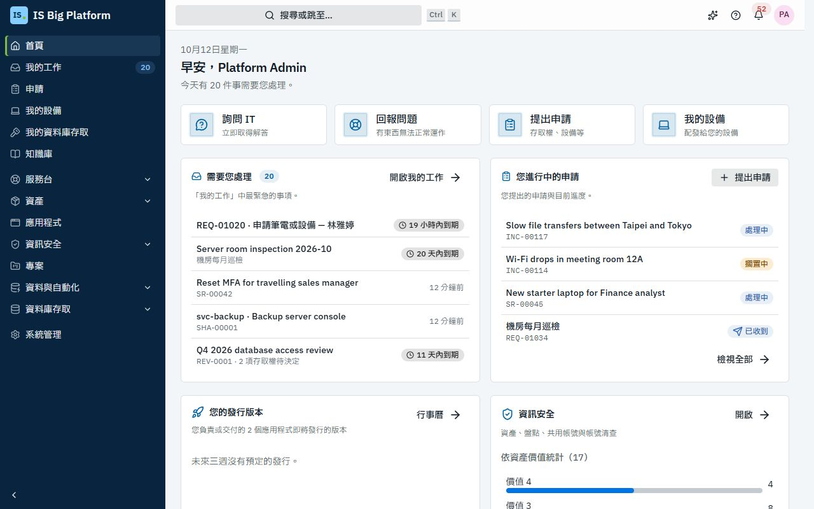
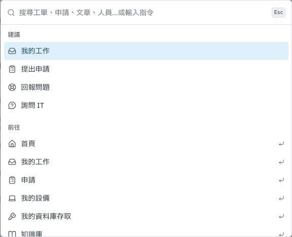

# 從這裡開始

IS Big Platform（ISBP）是我們進行 IS 工作的地方：您在這裡向 IS 申請各項服務、回報問題、核准申請，而 IS 也在同一個平台上處理服務台、變更、資產、專案、資料介接與自動化作業。本頁說明如何登入、如何熟悉畫面，以及您的角色應該閱讀哪份指南。

## 您可以在這裡做什麼

- 使用公司帳號或本機帳號[登入](#登入)
- [熟悉畫面](#熟悉畫面)：側邊欄、首頁、我的工作、搜尋與通知
- 在任何頁面[向助理尋求協助](#向助理尋求協助)
- [選擇適合您角色的指南](#選擇適合您角色的指南)
- [遇到困難時尋求協助](#遇到困難時尋求協助)
- 先看一遍[產品導覽](/tour)：以真實畫面與動畫走過十二個功能區域、系統架構與端到端情境

## ISBP 在我們 IS 工作中的用途

ISBP 中的每一項申請、工單、簽核與設定變更都遵循相同的規則：

- **單一入口。** 員工前往**申請**頁面申請權限、設備或軟體、回報問題、查看自己的設備，並追蹤自己提出的所有事項。
- **單一權限模型。** 您看得到什麼取決於您的角色。您沒有權限的頁面與按鈕會隱藏起來，您擁有的每個角色都會列在**個人資料與偏好設定 → 我的存取權**中。
- **內建簽核。** 權限申請、採購表單、變更、資產報廢與專案提案都會經過簽核流程，簽核者在同一個收件匣中做決定。管理員可以將任何 IS 流程轉為表單，並設定其專屬的簽核與後續動作。
- **一切都有紀錄。** 所有變更都會寫入稽核日誌，IS 隨時都能說明誰在何時做了什麼。
- **三種語言。** 整個平台、平台寄出的電子郵件與本指南都提供 English、繁體中文與日本語版本。

[ISBP 如何融入我們的工作](how-it-fits-our-work.md)說明我們的 IS 實務與平台各區域的對應關係。

## 登入

在某部裝置上第一次以瀏覽器開啟 ISBP，或在登出之後，您都需要登入。

1. 開啟 IS 部門提供給您的 ISBP 網址。
2. 如果看到**使用 … 登入**按鈕（例如**使用 Microsoft Entra ID 登入**），請選擇該按鈕並以公司帳號登入（單一登入）。
3. 否則，請輸入**電子郵件或使用者名稱**與**密碼**。如果看到**帳號類型**，請選擇公司的目錄；若 IS 是直接在 ISBP 中為您建立帳號，請選擇**本機帳號**。
4. 只有在僅供您自己使用的裝置上，才選擇**在此裝置上保持登入**。
5. 選擇**登入**。

**後續流程：** 您會進入**首頁**，或進入您原本要開啟的頁面（例如電子郵件中的連結）。您的語言、佈景主題與時區設定會跟著您到每一部裝置。

如果 IS 給了您一組密碼（新的本機帳號，或他們為您設定的密碼），ISBP 會先開啟**個人資料與偏好設定**並顯示**請設定新密碼**。請在**目前的密碼**中輸入您拿到的密碼，再輸入兩次**新密碼**，然後選擇**變更密碼**。接著就會前往您原本要開啟的頁面。

> **提示：** 如果看到**您的帳號尚未在此平台上建立。** 表示您的公司帳號可以使用，但 ISBP 還沒有您的資料。請服務台將您加入。

> **重要：** **嘗試失敗次數過多，請過幾分鐘後再試。** 表示您的帳號暫時遭到鎖定。若您使用本機帳號且忘記密碼，請洽服務台；若使用單一登入，請照常透過公司帳號變更密碼。

## 熟悉畫面

**側邊欄**位於左側，列出您可以使用的頁面，分為三個部分：

| 部分         | 內容                                                                                                                                                                                                                                                                       |
| ------------ | -------------------------------------------------------------------------------------------------------------------------------------------------------------------------------------------------------------------------------------------------------------------------- |
| **您的頁面** | 所有人都有：**首頁**、**我的工作**、**申請**、**我的設備**與**知識庫**。若您擁有資料庫存取權，還有**我的資料庫存取**；若您是某個專案的成員，還有**專案**                                                                                                                   |
| **各區域**   | 視您的角色而定，每個區域一列：**服務台**、**資產**、**應用程式**、**資訊安全**、**專案**、**資料與自動化**與**資料庫存取**。選擇區域即可展開或收合其頁面（例如**服務台** › **工單**、**問題**、**變更**、**報表**）。您所在的區域會自動展開，ISBP 也會記住您保持展開的區域 |
| **系統管理** | 若您負責管理某些項目：會有一列**系統管理**，開啟後可看到您可以變更的所有設定，分為**人員與存取權**、**申請與自動化**、**模組設定**、**整合**與**平台**。若您只有一兩個管理頁面（例如**人員**與**部門**），則會直接顯示在側邊欄中                                           |

**我的工作**旁的數字表示有多少事項在等待您處理：簽核、待填寫的表單與審查。在小螢幕上，請以**開啟導覽選單**（左上角的選單按鈕；按鈕上的圓點表示有事項在等待您）開啟側邊欄。在大螢幕上，側邊欄底部的**切換側邊欄**可以將側邊欄收窄，此時每個區域會變成一個圖示，選擇後會開啟該區域頁面的選單。

**首頁**是您的起始頁面，顯示需要您處理的事項（**需要您處理**）、**您進行中的申請**、常用的按鈕（**詢問 IS**、**回報問題**、**提出申請**、**我的設備**），以及 IS 的**最新消息**。負責某個區域的人員也會在這裡看到該區域的卡片，例如服務台的佇列。沒有任何待處理事項時，會顯示**都處理完了：目前沒有等待您處理的事項。**

**我的工作**將所有等待您處理的事項集中在一處，最緊急的排在最前面：**待您決定**（簽核）、**待辦事項**（待填寫的表單、待您驗收的變更、待您確認的解決結果、待變更的密碼）、**待您檢查**（存取權審查與資產盤點檢查）與**工作項目**（您的專案工作）。選擇任一列即可開啟該事項。請參閱[等待您處理的事項](employees.md#查看等待您處理的事項)。

**頁首**位於頂端，由左至右依序為：

- **搜尋或跳至…**：開啟命令選擇區（也可以在 Mac 上按 **⌘ K**，在 Windows 上按 **Ctrl K**；在手機上請選擇放大鏡圖示）。輸入頁面名稱即可前往該頁；輸入 `REQ-01020` 或 `INC-00042` 這類編號，或輸入至少兩個字元，即可搜尋申請、工單、知識文章、資產、人員，以及其他您有權查看的紀錄。結果會依類型分組。找不到時，請選擇**在知識庫搜尋「…」**或**詢問 IS：「…」**（會以您輸入的文字作為問題開啟詢問 IS）。
- **助理**（閃光圖示按鈕）：開啟[助理](#向助理尋求協助)（若您有權使用）。
- **此頁面的說明**（問號圖示）：開啟您所在區域的指南。
- **通知**（鈴鐺圖示）：顯示給您的最新通知，並提供**全部標示為已讀**與**檢視所有通知**。選擇某則通知即可開啟相關的紀錄；簽核通知會直接開啟該項決定。
- **您的頭像**（使用者選單）：您的姓名與電子郵件、**個人資料與偏好設定**、**說明**、**佈景主題**（**淺色**、**深色**或**跟隨系統**）、**語言**（**English**、**繁體中文（台灣）** 或**日本語**）與**登出**。通知與電子郵件也會使用您選擇的語言。管理 API 用戶端的人員還會看到 **API 文件**。

您可以在**個人資料與偏好設定**中設定時區與通知、排定不在辦公室、登出其他裝置，以及查看自己的角色：請參閱[個人設定](employees.md#設定語言時區與工作階段)。

儲存確認與錯誤訊息會顯示在開啟的對話方塊或側邊面板上方。您不必關閉表單即可關閉訊息；按 **F6** 可將鍵盤焦點移至通知控制項。

## 向助理尋求協助

助理是內建的 AI 代理程式，以面板形式出現在每個頁面上。它知道您目前所在的頁面與紀錄、以您的權限運作，並在變更任何內容之前先徵求您的同意。服務台人員用它處理日常工作，例如更新工單；管理員則用它變更設定，例如新增簽核步驟——這類變更會以變更集呈現，經過他人審核，也可以回復。

1. 選擇頁首中的**助理**。
2. 描述您想做的事；若貴組織尚未設定 AI 對話模型，請從**引導式範本**中選擇一個。

如果看不到**助理**按鈕，表示您沒有**助理使用者**（Assistant user）角色。若是 IS 服務使用上的問題，請改用**詢問 IS**：所有人都可以使用。請參閱[助理與 AI](assistant-and-ai.md)。

## 選擇適合您角色的指南

| 如果您…                                                | 請閱讀                                             |
| ------------------------------------------------------ | -------------------------------------------------- |
| 想先用動畫與真實畫面看過全貌                           | [產品導覽](/tour)                                  |
| 想了解全貌：哪個區域負責哪項 IS 實務                   | [ISBP 如何融入我們的工作](how-it-fits-our-work.md) |
| 是員工、主管或簽核者                                   | [員工、主管與簽核者](employees.md)                 |
| 在服務台工作（工單、SLA、知識庫、CMDB）                | [服務台](service-desk.md)                          |
| 管理變更、擔任 CAB 成員或負責應用程式                  | [變更與發行](changes-and-releases.md)              |
| 管理硬體、授權、合約與廠商                             | [資產](assets.md)                                  |
| 維護資訊資產清冊、盤點、共用帳號與帳號清查             | [資訊安全](information-security.md)                |
| 主持或參與專案                                         | [專案](projects.md)                                |
| 召集或參加會議，並追蹤會議的待辦事項                   | [會議](meetings.md)                                |
| 建置資料介接、排程作業，或維護資料庫                   | [資料與自動化](data-and-automation.md)             |
| 將 ISBP 連接到 ServiceDesk Plus 或 Azure DevOps Server | [整合](integrations.md)                            |
| 想了解 AI 會做什麼，或想透過代理程式自訂平台           | [助理與 AI](assistant-and-ai.md)                   |
| 管理人員、存取權、登入、簽核流程、表單或模組           | [管理員](administrators.md)                        |
| 將 IS 流程轉為含簽核與動作的申請表單                   | [建立您自己的流程](processes.md)                   |
| 需要查詢某個詞彙在 English、繁體中文或日本語中的說法   | [詞彙表](glossary.md)                              |
| 遇到問題，或有簡短的疑問                               | [常見問題與疑難排解](faq.md)                       |

## 遇到困難時尋求協助

- **此頁面的說明。** 選擇頁首中的問號圖示，即可開啟您所在區域的指南；也可以選擇右上角的頭像，再選擇**說明**。指南之間的連結會直接開啟另一份指南的對應章節。
- **本指南也收錄在知識庫中。** 每份指南也是知識庫分類**使用 IS Big Platform** 中的一篇文章，並以您的語言呈現。請開啟側邊欄中的**知識庫**並搜尋，或從頁首搜尋。
- **詢問 IS。** 選擇**首頁**上的**詢問 IS**（或**申請**頁面上的**提出問題**），用自己的話描述問題。它會依據知識庫（包括本指南）回答；若無法解決，會為您準備一張工單，待您確認。請參閱[詢問 IS](employees.md#建立工單前先詢問-is)。
- **產品導覽。** 選擇頭像選單中的**產品導覽**，會開啟一份動畫導覽：十二個功能區域的真實畫面、系統架構、AI 閘道、安全模型，以及五段橫跨多個區域的情境。
- **看不到某個頁面？** 您可能沒有對應的角色。**個人資料與偏好設定 → 我的存取權**會顯示您擁有的角色；請參閱[常見問題](faq.md#我看不到某個頁面或按鈕)。
- **找專人協助。** 在**申請**頁面上選擇**回報問題**，服務台就會接手處理。

## 與其他工作的關聯

- 下一步：[ISBP 如何融入我們的工作](how-it-fits-our-work.md)，接著閱讀您角色的指南。
- 本指南使用的詞彙：[詞彙表](glossary.md)。
