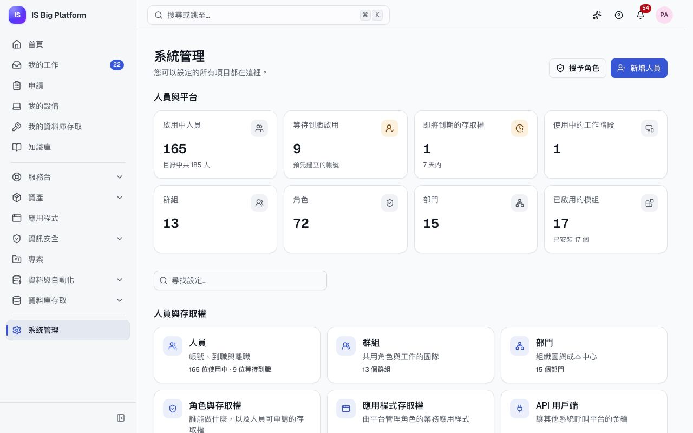
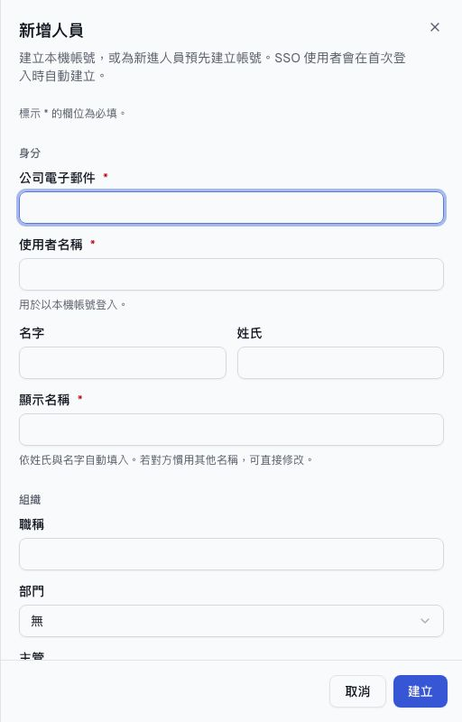
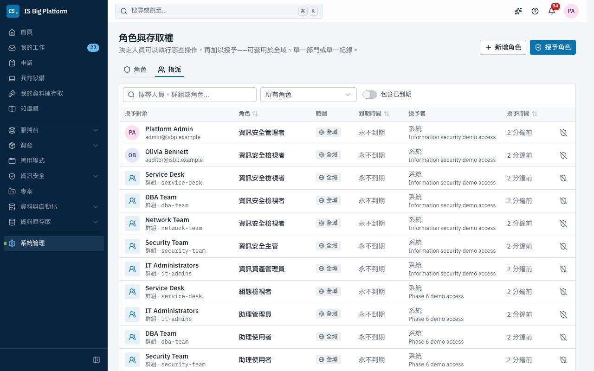
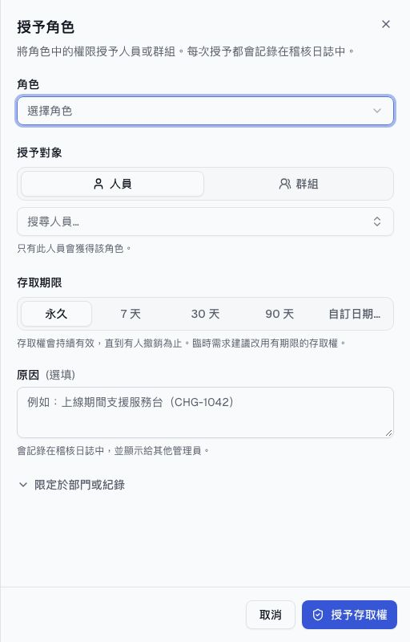
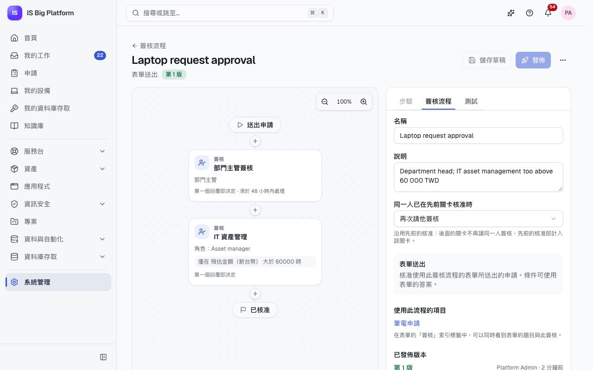

# 管理員指南

本指南適用於 IT 與平台管理員。內容涵蓋誰可以做什麼（人員、群組、部門、角色與權限申請）、人員如何登入、每項申請背後的簽核流程與表單、通知、模組、AI 設定與稽核日誌。其中許多變更也可以由助理準備成變更集；最後的[常見的管理工作](#常見的管理工作)會列出兩種做法。若要將整個 IT 流程轉為含簽核與後續動作的表單，請參閱[建立您自己的流程](processes.md)。

## 您可以在這裡做什麼

- 管理[人員及其生命週期](#新增人員並辦理到職啟用)、[部門調動](#調動人員的部門)、[群組](#以群組管理人員)與[部門](#建立部門樹狀結構)
- [建立角色](#建立角色)、[授予具範圍與結束日期的角色](#授予具範圍與結束日期的角色)，並[讓人員申請權限](#讓人員申請角色)
- 註冊[應用程式及其角色](#管理業務應用程式及其角色)，並透過 [API 用戶端與角色查詢 API](#以-api-用戶端授予其他系統存取權) 授予其他系統存取權
- [連接登入提供者](#連接登入提供者)（OIDC、SAML 或 LDAP）
- [設計](#設計簽核流程)與[發佈](#測試並發佈簽核流程)簽核流程，並[建立申請表單](#建立申請表單)（含紀錄欄位、規則與動作）與[自訂欄位](#新增自訂欄位)
- [將通知傳送到電子郵件、Teams、Slack 或 Webhook](#設定通知通道與電子郵件)
- [開啟或關閉模組](#管理模組及其設定)、[設定 AI](#設定-ai)，以及[查看稽核日誌](#查看稽核日誌)
- [管理助理](#管理助理)及其變更集

## 認識系統管理區

選擇側邊欄底部的**系統管理**。系統管理頁面會為您有權限的每個頁面顯示一張卡片，分為**人員與存取權**、**申請與自動化**、**模組設定**、**整合**與**平台**；在**尋找設定…** 中輸入文字即可篩選。若您有權讀取人員資料，頂端會顯示**人員與平台**（**啟用中人員**、**等待到職啟用**、**即將到期的存取權**…）；若您可以讀取稽核日誌，底部還會顯示**平台活動**與**近期活動**。右上角有**新增人員**與**授予角色**。若您只有一兩個管理頁面，這些頁面會直接顯示在側邊欄中，而不會出現**系統管理**。

下列系統角色是分派管理工作的常見方式；**平台管理員**（Platform administrator）可以執行所有操作。

| 頁面（系統管理 → …）                           | 用途                                    | 負責管理的角色                                                       |
| ---------------------------------------------- | --------------------------------------- | -------------------------------------------------------------------- |
| **人員**、**群組**、**部門**                   | 帳號、成員資格與組織樹狀結構            | **身分識別管理員**（Identity administrator）                         |
| **角色與存取權**                               | 角色、權限與擁有者                      | **平台管理員**（建立角色）；**身分識別管理員**（授予）               |
| **應用程式存取權**、**API 用戶端**             | 業務應用程式、其角色，以及服務帳號      | **應用程式存取管理員**（Application access manager）；**平台管理員** |
| **簽核流程**、**表單**、**自訂欄位**、**通知** | 簽核、申請表單、額外欄位與通知傳送      | **簽核流程管理員**（Workflow administrator）                         |
| **AI**                                         | 模型、隱私、預算、索引與外部代理程式    | **平台管理員**                                                       |
| **稽核日誌**                                   | 每項變更與登入                          | **安全性稽核員**（Security auditor，全平台唯讀）                     |
| **模組**                                       | 開啟或關閉模組，並變更其設定            | **模組管理員**（Module administrator）                               |
| **資料庫連線**                                 | 外部資料庫                              | **資料庫連線管理員**（Database connection administrator）            |
| **登入提供者**                                 | SSO 與目錄同步                          | **平台管理員**                                                       |
| **連線**、**同步衝突**                         | ServiceDesk Plus 與 Azure DevOps Server | **整合管理員**（Integrations administrator）                         |
| **變更集**                                     | 透過助理準備的設定變更                  | **助理管理員**（Assistant administrator）                            |

模組也會在**模組設定**下加入自己的設定，例如**服務台設定**（工單類別、SLA 原則、行事曆與服務目錄）、**資產設定**與**資訊安全設定**。這些頁面在各領域的指南中說明。**流程範本套件**（位於**申請與自動化**）可將現成的流程以變更集的形式安裝。

## 新增人員並辦理到職啟用

以 SSO 登入的人員會在首次登入時自動建立（若提供者允許）。若要建立本機帳號，或在新進人員報到前預先建立帳號，請手動新增人員。

1. 前往**系統管理 → 人員**，選擇**新增人員**。標示**必填**的欄位必須填寫。
2. 在**身分**下輸入**公司電子郵件**（**使用者名稱**會依此自動填入），再輸入**名字**與**姓氏**。**顯示名稱**會依姓名自動填入；若對方慣用其他名稱，可直接修改。
3. 在**組織**下輸入**職稱**並選擇**部門**。**主管**會自動填入該部門的主管（「建議：… 的主管。」）；需要時可改選其他人。
4. 在**群組**下選擇**加入群組**，搜尋並勾選所屬團隊的群組。群組決定此人員的存取權：授予群組的角色會套用到群組成員。
5. 在**初始狀態**下，選擇**立即啟用**（可立即登入）或**預先建立**（帳號已存在，但在完成到職啟用前無法登入）。
6. 若是本機帳號，請展開**語言、時區與密碼**並設定**初始密碼**（對方首次登入後，ISBP 會立即要求設定新密碼）。僅使用 SSO 的帳號請留空。選擇**建立**。

**後續流程：** 系統會開啟該人員的頁面，並顯示「…已建立完成，接下來呢？」卡片，列出常見的後續步驟，例如**授予角色**（用於群組未提供的存取權），以及在啟用資產管理時，從庫存中**指派裝置**。預先建立的人員到職當天，請選擇**到職啟用**。人員的**存取權**分頁會列出其角色及取得每個角色的原因（直接指派、透過群組，或透過「所有人」）；選擇**顯示權限**即可查看角色背後的權限。

## 調動人員的部門

調動人員時，除了部門之外，通常還會變更主管、職稱，以及新舊團隊所使用的群組。請一次完成。

1. 在**系統管理 → 人員**中開啟該人員，選擇**更多動作**，再選擇**調動部門**。
2. 選擇**新部門**。**主管**會設為該部門的主管；需要時可變更，並更新**職稱**。
3. 在**要離開的群組**下，系統已勾選目前部門多數成員都在、新部門則多數不在的群組。在**要加入的群組**下，已加入新部門多數成員都在的群組。請視需要調整。由登入提供者目錄同步維護的成員資格無法在此變更。
4. 在**需檢查的部門範圍角色**下，勾選只適用於原工作的角色（**屬於原部門**）即可將其移除。
5. 選擇**調動**。

**後續流程：** 變更會立即儲存，該人員的**活動**中只會出現一筆「調動部門」紀錄，列出所有變更。原主管與新主管都會收到通知（**人員調入或調出我的部門**），其中列出該人員仍擁有的角色；以原部門為範圍的角色會列為待檢查。

## 停權、重新啟用人員或辦理離職停用

在調查期間或長期休假時將人員停權；人員離職時，則為其辦理離職停用。

1. 在**系統管理 → 人員**中開啟該人員，選擇**更多動作**。
2. 選擇**停權**並填寫**原因**。對方會立即被登出，其存取權則會保留供日後使用。若要取消停權，請選擇**重新啟用**。
3. 若要辦理離職停用，請選擇**離職停用**。選擇是否要**移除所有群組成員資格**、**移除所有直接指派的角色**，以及**將直屬部屬移交給**某人，然後選擇**離職停用**。

**後續流程：** 離職停用會停用登入並結束所有工作階段。系統會通知各模組，讓它們移除自己管理的存取權（例如資料庫帳號），並提醒資產管理員收回該人員的設備。所有動作都會記錄在稽核日誌中。**更多動作**中還有**從所有裝置登出**與**設定密碼**。若勾選**下次登入時要求變更密碼**，對方登入後會立即被帶到**個人資料與偏好設定**中的**請設定新密碼**，在變更密碼之前，即使重新載入頁面也無法略過。

## 以群組管理人員

請將角色授予群組，而不是逐一授予人員：加入群組的人都會取得該角色，離開群組的人則會失去該角色。

1. 前往**系統管理 → 群組**，選擇**新增群組**。輸入**名稱**與**代碼**（供整合與目錄同步使用，之後無法變更），然後選擇**建立**。
2. 開啟群組。在**成員**中選擇**新增成員**，找到人員後確認。
3. 在**角色**中選擇**授予角色**，即可將角色授予每位成員。

由目錄同步填入成員的群組會註明這一點；在這類群組中手動所做的變更，可能會在下次同步時被覆寫。**所有人**群組包含每位啟用中的人員，並提供基本存取權。

當仍有項目需要該群組時，系統會拒絕**刪除群組**：例如動作會通知該群組且仍在簽核中的申請、仍在進行中或會詢問該群組的簽核或簽核流程、指派給該群組的未完成待辦事項、該群組佇列中的工單，或指名該群組的已發佈表單與排程工作。訊息會以連結列出這些項目（**仍在使用中的項目**）：請先完成、重新指派或封存它們，再刪除群組。授予該群組的角色會隨群組一併移除。

您也可以從人員著手：其頁面的**群組**分頁會列出所屬群組。選擇**加入群組**可一次加入多個群組；在某一列選擇**從群組移除**即可移除（通知訊息提供**復原**）。由目錄同步維護的成員資格會顯示「由 LDAP 維護」（或其他登入類型），請在目錄中變更。

## 建立部門樹狀結構

部門用來將人員分組，也可以限制管理員能管理的範圍。在示範資料中，人資夥伴（`hr.partner`）只能管理 Sales 部門及其子部門中的人員。

1. 前往**系統管理 → 部門**，選擇**新增部門**；或開啟某個部門，選擇**新增子部門**。
2. 輸入**名稱**、簡短的**代碼**、**上層部門**與**主管**（簽核流程可以請其簽核的部門主管）。選擇**建立**。

移動部門時，其下的所有內容都會一起移動。部門仍有子部門時無法刪除；刪除部門時，會撤銷以該部門為範圍的角色。

若要調動人員的部門，請使用[調動部門](#調動人員的部門)。若改以**編輯個人資料**變更部門，主管同樣會收到通知，但不會提供群組與角色的調整。

## 建立角色

角色是一組權限的集合。權限的命名格式為 `module.resource.action`（例如 `core.users.read`），`*` 則涵蓋整個模組或資源。

1. 前往**系統管理 → 角色與存取權**，選擇**新增角色**。
2. 輸入**名稱**、**代碼**與**描述**。
3. 在**權限**下勾選個別權限，或選取整個模組或資源，以萬用字元授予（日後新增的權限也會涵蓋在內）。選擇**建立角色**。

**角色**分頁會依領域將角色分組：先列出**自訂角色**，再列出**平台管理**與各模組。選擇某個領域即可展開，或選擇**全部展開**。可依名稱搜尋，並依**類型**（**系統**、**自訂**）與**申請**（**開放申請**、**不開放申請**）篩選。角色頁面會以其允許的操作顯示權限；選擇**顯示權限代碼**即可查看代碼（例如 `core.users.read`）與角色代碼。

系統角色來自各模組，無法編輯：開啟系統角色並選擇**建立複本**，即可建立可編輯的複本。系統角色的名稱與描述會以每位人員的語言顯示；您建立的角色則會保留您取的名稱。您只能將自己擁有的權限放入角色中，ISBP 會拒絕其餘權限。在示範資料中，**HR partner**、**Directory lookup**（可讀取人員與群組）與 **Group manager** 是自訂角色。

## 授予具範圍與結束日期的角色

您可以將角色授予人員或群組，範圍可以是全域、單一部門或單一紀錄，也可以設定只到某個日期為止。臨時需求請優先使用有期限的存取權。

1. 前往**系統管理 → 角色與存取權**，選擇**授予角色**（或在人員頁面上選擇**管理存取權**）。
2. 選擇**角色**，然後在**授予對象**下選擇**人員**或**群組**。
3. 在**存取期限**下，選擇**永久**、**7 天**、**30 天**、**90 天**或**自訂日期…**（指定日期）。
4. 若要縮小範圍，請開啟**限定於部門或紀錄**並選擇**範圍**：部門（包含其子部門），或單一紀錄（例如某個群組）。
5. 輸入**原因**，然後選擇**授予存取權**。

**後續流程：** 授予會立即生效。有期限的授予會自動結束。到期前三天，系統會寄送「即將到期的權限」提醒給被授予的人員；若授予對象是群組，則提醒會因此失去該角色的群組成員（透過其他期限更長的授予仍保有該角色的成員不會收到）。**指派**分頁會列出每一筆授予及其範圍、結束日期與授予者；選擇**撤銷**即可結束授予。

在示範資料中，`helpdesk` 只能管理 VPN Users 群組的成員（紀錄範圍）；一位約聘人員則為了模組上線，取得為期三天的**模組管理員**角色。

## 讓人員申請角色

與其由您逐一授予每個角色，不如讓人員在申請入口網站中提出申請。申請會經過簽核流程，核准後，系統會依核准的期限自動授予角色。

1. 在**系統管理 → 角色與存取權**中開啟角色。
2. 在**自助申請**中，開啟**人員可以申請此角色**。
3. 選擇**風險等級**（簽核流程可將風險較高的申請交給更多簽核者）、**角色擁有者**（當簽核流程包含角色擁有者簽核步驟時，由此人簽核）、**最長授予期限**，並視需要指定**簽核流程**。選擇**儲存變更**。

**後續流程：** 該角色會出現在申請入口網站的**申請權限**中（請參閱[員工](employees.md)）。除非您選擇了其他流程，否則申請會使用預設的**權限申請**流程。在示範資料中，**模組管理員**最長可申請 30 天，並經過 **Privileged access** 流程簽核。

## 管理業務應用程式及其角色

註冊業務應用程式（例如示範資料中的 Finance ERP），讓它的存取權也能像平台存取權一樣授予、申請、核准、到期與稽核。應用程式會透過角色查詢 API 詢問誰可以做什麼。

1. 前往**系統管理 → 應用程式存取權**，選擇**註冊應用程式**。輸入**名稱**、**代碼**（應用程式呼叫 API 時使用，之後無法變更）與**負責人**，然後選擇**註冊**。
2. 在**權限**中，加入應用程式會檢查的動作，例如 `invoices.approve`。
3. 在**角色**中選擇**新增角色**，挑選其權限，並在**自助申請**下決定是否開放人員申請。
4. 在**擁有存取權的人員**中選擇**授予存取權**，將角色授予人員或群組。
5. 在**角色查詢**中選擇一位人員，即可查看應用程式確切會取得哪些結果，或檢查單一權限。

平台本身的角色在**角色與存取權**中管理，而非在此處。**應用程式存取權**管理的是誰可以在應用程式中做什麼；應用程式清單及其發行版本與部署，則是側邊欄中的**應用程式**（請參閱[變更與發行](changes-and-releases.md)）。

## 以 API 用戶端授予其他系統存取權

API 用戶端是供其他系統使用的服務帳號：查詢角色查詢 API 的應用程式、呼叫平台 API 的指令碼，或外部 AI 代理程式。在示範資料中，**Finance ERP role sync** 可以查詢 Finance ERP。

1. 前往**系統管理 → API 用戶端**，選擇**建立用戶端**。
2. 輸入**名稱**與**描述**，然後選擇**可查詢的應用程式**（或**所有應用程式**）。
3. 若需要使用其他平台 API，請開啟**進階：平台權限、IP 範圍**，加入**平台 API 權限**（例如 `core.users.read`），並視需要加入**允許的 IP 範圍**。
4. 設定**第一個密鑰的到期時間**，然後選擇**建立用戶端**。
5. 複製**用戶端密鑰（API 金鑰）**，勾選**我已將密鑰妥善保存**，然後選擇**完成**。

**後續流程：** 該系統會將金鑰作為持有人權杖（bearer token）傳送，或以用戶端 ID 與密鑰交換有效期一小時的 OAuth 權杖。若要在不中斷服務的情況下輪替，請開啟用戶端並選擇**新增密鑰**，部署新的密鑰後，再**撤銷**舊的密鑰。**撤銷用戶端**會完全停用該用戶端。API 用戶端絕不能使用「我的申請」等個人功能。端點說明請參閱 [API 指南](../../api.md)。

## 連接登入提供者

讓人員使用我們的身分識別提供者或目錄登入。本機帳號仍可同時使用。

1. 前往**系統管理 → 登入提供者**，選擇**新增提供者**。
2. 選擇 **Microsoft Entra ID**、**通用 OpenID Connect**、**SAML 2.0** 或 **LDAP / Active Directory**，並填寫表單（Entra ID 需要租用戶 ID、應用程式（用戶端）ID 與用戶端密碼）。
3. 在**佈建**下，決定是否要**首次登入時建立人員**、**預設部門**，以及**群組對應**（提供者中的群組 → 平台群組）。若是 LDAP，請開啟**依排程同步**，以根據目錄建立、更新與停權人員。
4. 選擇**新增提供者**。在身分識別提供者中註冊畫面上顯示的值（例如**重新導向 URI** 或**判斷提示取用者服務（ACS）URL**）。
5. 選擇**測試連線**，然後使用提供者卡片上的開關將其開啟。

**後續流程：** 提供者會出現在登入頁面上。新提供者預設為停用，因此在您開啟之前，沒有人會看到它們。在示範資料中，**Microsoft Entra ID** 與 **Corporate Active Directory** 是保持停用的範例。

## 設計簽核流程

簽核流程決定由誰簽核權限申請、表單申請，以及各模組的工作，例如變更（**變更授權**）、資產報廢、專案提案、資料庫存取、發佈與變更集審核。申請表單的簽核最容易在表單本身的**簽核**分頁中建立（請參閱[建立申請表單](#建立申請表單)），使用的是同一個畫布。

1. 前往**系統管理 → 簽核流程**。**表單的簽核流程**會列出每張表單的簽核與使用它的表單；**內建簽核**則依領域列出其他簽核。**必要**標示永遠無法關閉的簽核，**關閉**標示設定後才會執行的簽核。
2. 選擇**新增簽核流程**（或在尚未設定的內建簽核下選擇**設定簽核**），在**用於**中選擇用途、輸入**名稱**，並決定是否要從複本開始（**起點**），然後選擇**建立並開啟**。
3. 在畫布上選擇**在此新增步驟**，然後選擇步驟：
   - **簽核**：請人員核准或駁回。
   - **判斷**：依申請內容走不同路徑（例如表單上的金額）。
   - **平行處理**：同時進行多個簽核。
   - **通知**：通知相關人員，不需要做決定。
4. 選取步驟，並在**步驟**分頁上設定。新的簽核步驟會依其簽核者命名（「主管簽核」），也可以自行重新命名。
   - **簽核者**：**指定人員**、**群組**、**角色持有者**、**主管**、**部門主管**、**欄位中的人員**、**欄位中的群組**或**申請人**，每一種都可以設定備援對象（**若找不到人，改請**）。**欄位中的人員**與**欄位中的群組**會從申請中取得簽核者，例如表單上所選組態項目的支援群組。有多位簽核者時，請選擇**需要多少人核准**：**第一個回覆即決定**、**所有簽核者**或**指定人數**。**找不到簽核者時**可選擇駁回申請或略過此步驟。
   - 其他設定位於需要時再展開的區段，每個區段都會以一行說明其內容：**簽核人員需填寫的欄位**、**期限**（**須在此時間內處理**、**提醒時間**，以及**超過期限時**：通知、轉呈、自動核准或自動駁回）、**選項**（轉交、自行核准（預設為關閉），以及**給簽核者的說明**）與**條件**（**僅在特定情況執行此步驟**；沒有條件時顯示「一律執行」）。
5. 在**簽核流程**分頁上，於**使用表單欄位**中選擇一份表單，讓條件可以判斷其答案，以及表單所選紀錄的資料，這些資料會列為「欄位：資料」（例如**組態項目：重要性**）。若欄位可以選取多筆紀錄，只要其中任一筆符合，條件就成立。已有表單使用的簽核流程會直接使用該表單的欄位。在同一分頁的**同一人已在先前關卡核准時**中，選擇**再次請他簽核**（預設）或**沿用先前的核准**：選擇後者時，先前關卡已核准的人員不會在後面的關卡再被要求簽核，該關卡會記錄此筆先前的核准已計入。
6. 選擇**儲存草稿**。

在示範資料中，**Laptop request approval** 會先請部門主管簽核；當預估金額超過新台幣 60,000 元時，再請具有**資產管理員**（Asset manager）角色的人員簽核。**Configuration change approval** 會先請申請人的主管簽核，再請所選組態項目的支援群組簽核（**欄位中的群組**），當組態項目為關鍵或風險高時，再請變更諮詢委員會簽核。

由模組自行啟動的簽核（**變更授權**、**資產報廢**與**專案提案**）也可以使用其所簽核之工單、硬體資產或專案的[自訂欄位](#新增自訂欄位)：條件可以判斷自訂欄位，或紀錄自訂欄位中所選紀錄的資料。請參閱[在內建簽核中使用自訂欄位](processes.md#在內建簽核中使用自訂欄位)。

## 測試並發佈簽核流程

在人員開始仰賴簽核流程之前先測試，然後再發佈。

1. 在編輯器中開啟**測試**分頁。在**以此身分試用**下選擇一位人員以帶入其部門與職稱，輸入範例的**申請內容**與**決定**，然後選擇**執行測試**。畫布會顯示哪些步驟會執行、被略過或等待中。不會儲存或寄送任何內容。
2. 選擇**發佈**。系統會顯示「已發佈第 … 版，新的申請會立即使用」以確認。
3. 若是內建簽核，請開啟**更多動作**並選擇**用於新的申請**，讓它成為使用中的流程。表單則是在其**簽核**分頁上指定自己的簽核，表單的**發佈**也會一併發佈簽核。

**後續流程：** 進行中的申請會沿用它們開始時的版本。您可以在**進行中與歷史紀錄**分頁上追蹤所有進行中的簽核。**停止使用（不需簽核）** 會關閉選用觸發條件的簽核，**封存**則會在您確認後讓簽核流程停用。**簽核流程**分頁會列出簽核的版本；若您可以讀取稽核日誌，也會列出其**活動**。

## 建立申請表單

申請表單是人員在申請入口網站中填寫的表單：設備、軟體，以及任何 IT 提供的項目。

1. 前往**系統管理 → 表單**，選擇**新增表單**。輸入**名稱**與**代碼**；在**更多詳細資料**下選擇**圖示**與**類別**。然後選擇**建立並開啟編輯器**。
2. 在**題目**中，將欄位從**新增元素**拖曳到表單上，或按一下欄位即可加入。選取欄位以設定其**標籤**（English、繁體中文與日本語）、**代碼**、**說明文字**、**必填**、選項，以及條件式欄位的**僅在以下情況顯示此欄位…**。**紀錄**欄位可讓人員選取組態項目、應用程式、資產、工單，以及其他他們有權限檢視的紀錄；請設定其**紀錄類型**、**允許多選**與**只限符合以下條件的紀錄…**。當仍在簽核中（或仍有動作待執行）的申請指名某筆紀錄時，該紀錄無法刪除：訊息會列出該申請。
3. 在**規則**中加入跨欄位的檢查，例如結束日期不能早於開始日期（**新增規則**）。
4. 在**簽核**中選擇**設定簽核**（預設由申請人的主管簽核），並在畫布上調整；或在**使用的簽核**下選擇現有的簽核。請參閱[選擇由誰簽核](processes.md#選擇由誰簽核)。
5. 在**動作**中加入申請送出、核准或駁回後要執行的作業，例如**建立變更**、**授予角色**或**通知人員**（**新增動作**）。每個動作都需要其本身的權限。
6. 在**預覽**中，以每種語言試填表單：**誰會簽核這筆申請？** 會依範例答案顯示簽核者（可在**預覽身分**下選擇其他申請人），**接下來會發生什麼**則列出動作。
7. 在**設定**中，於**適用對象**下選擇誰可以看到表單（**所有人**或**特定群組**），以及是否**接受申請**。
8. 選擇**儲存**，然後選擇**發佈**。**發佈前請確認**會提醒可能讓表單無法供適用對象使用的情況；簽核會與表單一起發佈。

**後續流程：** 表單會出現在申請入口網站中。頁首下方的提示列會顯示其連結（`/requests/forms/<key>`），並提供**複製連結**與**在入口網站開啟**。透過表單提出的申請會列在其**申請**分頁上；每個申請頁面都會在**後續動作**下顯示動作的執行結果。再次發佈會建立新版本；已送出的申請會保留原本的版本，以及該版本的動作。若要讓服務台處理已核准的申請，請將表單加入服務目錄（請參閱[服務台指南](service-desk.md)）。紀錄欄位、規則與動作的逐步說明：[建立您自己的流程](processes.md)。

## 請人員在期限前填寫表單

週期性的檢查（每月機房巡檢、每季防火牆規則審查、年度權限審查）就是一份必須在期限前填寫的已發佈表單。您可以手動指派，或讓排程作業在每個週期自動指派。

1. 前往**系統管理 → 表單**，開啟表單並選擇**指派**分頁。
2. 若只指派一次，請選擇**指派**。在**指派此表單**中選擇**指派給**（**人員**或**群組**：群組中任何人都可以完成），確認**標題**，選擇**期限**，並可選填**週期（選填）**（例如 `2026-10`）與**備註（選填）**。選擇**指派**。
3. 若要每個週期指派，請選擇**排程週期性指派**。排程作業會開啟已選好**指派表單**的**新增作業**：選擇**指派給**、**週期**（**每日**、**每週**、**每月**、**每季**或**每年**）、**期限**（**週期結束時**或**執行後的天數**）與**標題**（`{{period}}` 會換成週期，例如 `2026-10` 或 `2026-Q4`）。請將作業排程在每個週期的開始，例如每月 1 日 09:00，然後選擇**建立作業**。

**後續流程：** 該人員（或群組的每位成員）會收到通知，並在**待辦事項**中看到該表單。作業每次執行只會為所屬週期建立一筆指派，因此同一個月內再次執行不會有任何變更。**指派**分頁會列出每筆指派的狀態（**待處理**、**已逾期**、**已完成**、**逾期完成**、**已取消**）、指派對象、期限，以及完成它的申請；可依狀態與週期篩選。**各週期的執行情形**會依週期顯示**如期**、**逾期完成**、**已逾期**、**待處理**與**已取消**的數量。若要取消尚未完成的指派，請選擇其**取消指派**按鈕。指派逾期時，您（以及表單的其他編輯者）會收到通知。指派需要**簽核流程管理員**角色（`core.forms.manage`）。在示範資料中，**Monthly server room inspection** 作業會將**機房每月巡檢**指派給 IT Administrators。

## 新增自訂欄位

為人員、群組、部門與模組紀錄（工單、硬體資產、合約、組態項目、專案、工作項目與應用程式）加入組織需要的欄位，例如成本中心或辦公室。

1. 前往**系統管理 → 自訂欄位**，選擇紀錄類型。
2. 選擇**新增欄位**。選擇**欄位類型**，輸入**標籤**與**代碼**，並如同表單一樣設定**必填**、選項與條件。**紀錄**欄位會連結到另一筆紀錄，例如工單所涉及的業務應用程式。
3. 選擇**新增**。

**後續流程：** 欄位會出現在紀錄表單與頁面的**其他資訊**區段，以及篩選條件中。欄位建立後，代碼與類型就無法變更。**封存**會隱藏欄位，但保留其值。工單、硬體資產與專案的自訂欄位，也可以用來決定**變更授權**、**資產報廢**與**專案提案**簽核的路徑。

## 設定通知通道與電子郵件

人員會在應用程式中收到通知，若他們願意，也可以透過電子郵件收到。通道還會將選定的通知發佈到團隊通道或其他系統，例如將呈報轉送到 IT 值班通道。

1. 前往**系統管理 → 通知**。
2. 在**電子郵件**中，開啟**寄送通知郵件**，輸入 **SMTP 伺服器**、**連接埠**、**加密方式**、登入資訊與**寄件者**，然後選擇**儲存變更**。選擇**寄送測試郵件**即可檢查設定。
3. 在**通道**中選擇**新增通道**。選擇**類型**（**Microsoft Teams**、**Slack** 或 **Webhook**）、**名稱**、**Webhook 網址**（表單會說明取得方式），並在**通知**下選擇要接收的類型（整個模組或單一類型）。**訊息語言**位於**更多詳細資料**下。選擇**新增通道**。
4. 在通道上選擇**傳送測試**，即可發佈一則測試訊息。

**後續流程：** Webhook 網址會加密儲存，且不會再次顯示。一般 Webhook 會取得一個簽章密鑰（只顯示一次），讓接收端系統可以驗證每個要求。**傳送紀錄**會顯示每封電子郵件與每則通道訊息及其狀態；傳送失敗時會重試數次。Webhook 網址必須是公開的 `https://` 位址。在示範資料中，**IT Operations (Microsoft Teams)** 與 **#it-approvals (Slack)** 是已關閉的範例通道。

## 管理模組及其設定

每項功能都是一個模組，模組可以在執行期間關閉，而不會遺失資料。

1. 前往**系統管理 → 模組**。每張卡片都會顯示模組的用途、是否已開啟，以及有幾項設定。
2. 使用卡片上的開關開啟或關閉模組。其他模組所依賴的模組必須保持開啟，直到那些模組關閉為止；ISBP 會告訴您是哪些模組。
3. 開啟模組。在**設定**中變更其設定，然後選擇**儲存變更**。**概觀**會顯示它依賴哪些模組，以及哪些模組依賴它。**技術細節**列出它為開發人員與支援人員宣告的內容：版本、權限、事件、AI 工具、背景作業，以及其背景 AI 工作所使用的身分。

例如，服務台 AI 的設定可以為分派開啟**自動套用高信心度的建議**，核心平台的設定則包括附件大小上限與封鎖的檔案類型。

## 設定 AI

AI 功能不需要模型也能運作（內建模式）。新增模型即可啟用生成式回答，以及向助理提出自由文字需求。人員會看到哪些變化，請參閱[助理與 AI](assistant-and-ai.md)。

1. 前往**系統管理 → AI**。頁面頂端會顯示模式（已啟用生成式回答，或是資料不會離開平台的內建模式）與本月花費。**技術細節**會顯示嵌入向量模型與向量儲存區。
2. 在**模型**的**對話模型**下，選擇**供應商**：**無**、**Anthropic（Claude）** 或 **OpenAI 相容**（OpenAI、Azure OpenAI、Ollama、vLLM 等）。輸入 API 金鑰與模型；若需要成本估算，也請輸入價格。若是 OpenAI 相容模型，請選擇伺服器支援的 **API**：**Chat Completions**（幾乎所有伺服器）或 **Responses**（OpenAI 較新的 API）。選擇**儲存變更**，然後選擇**測試連線**。
3. 在**嵌入向量**下，保留**內建**（離線、不需金鑰），或選擇 OpenAI 相容模型。變更後，系統會在背景重新嵌入索引。
4. 如果模型位於閘道之後或您的內部網路中，請在其卡片上開啟**連線選項**（Anthropic 位於**進階**之下）：
   - 為閘道需要的每個標頭選擇**新增標頭**，例如租用戶或路由標頭。值會加密儲存，只會顯示為**已儲存值**；若要變更，請選擇**取代**。
   - 只有在伺服器位於您的內部網路且使用自我簽署憑證時，才選擇**略過 TLS 憑證檢查**。此時任何能攔截連線的人都能讀取提示與回覆，因此建議改用伺服器信任的憑證。此變更會以**安全性**事件記錄在稽核日誌中。
5. 在**隱私與預算**中，保持開啟**資料離開平台前先行遮罩**，選擇**要遮罩的資料**，視需要加入**自訂規則**，並設定每月**預算**（0 表示不限）。選擇**儲存變更**。
6. 在**使用量**中，依功能與模型查看呼叫次數、Token、成本與已遮罩的值。在**索引**中，查看語意搜尋可以引用的內容，並在變更模型後選擇**立即重新嵌入**。
7. 在**外部代理程式（MCP）** 中，查看 MCP 端點、可使用它的 API 用戶端、代理程式可使用的內容，以及連接 Claude Code 的命令（請參閱[連接外部代理程式](assistant-and-ai.md#透過-mcp-連接外部代理程式)）。通訊協定修訂版本與傳輸方式位於**技術細節**中。

金鑰會加密儲存，且不會再次顯示。

## 查看稽核日誌

稽核日誌會記錄每項變更、登入與存取決策。它無法編輯，而且每筆紀錄都會以雜湊值與前一筆串連，因此任何竄改都會留下痕跡。

1. 前往**系統管理 → 稽核日誌**。
2. 依人員、紀錄或動作搜尋：搜尋也會比對**動作**欄中顯示的動作名稱，例如「更新角色」或「登入」。選擇**變更對象**（**人員**、**角色**、**角色授予**、**群組**、**表單與自訂欄位**、**簽核流程**、**設定變更**…）與**時間**（**今天**、**過去 7 天**、**過去 30 天**或**選擇日期…**）。在**篩選**中，可依**類別**（**資料**、**安全性**、**系統**）、**結果**與**模組**縮小範圍。
3. 開啟一筆紀錄，即可依欄位名稱查看變更（「風險：低 → 中」、「負責人：— → Platform Admin」）、詳細資料與情境。選擇**驗證雜湊**，即可在伺服器上檢查該紀錄是否完整。
4. 選擇**匯出 CSV**，即可下載此頁的資料列。

人員、群組與角色本身的歷程位於其頁面的**活動**中：角色的活動包含其變更，以及誰被授予或失去此角色。選擇**在稽核日誌中開啟**，即可搭配所有篩選條件查看相同的紀錄。

由變更集套用的變更會註明該變更集；由同步所做的變更會註明連線與遠端紀錄；為整合開啟**允許不安全的 HTTP** 屬於**安全性**事件。

## 資料庫連線與整合

- **系統管理 → 資料庫連線**用於註冊 SQL Server、PostgreSQL、MySQL 與 Oracle 資料庫，供資料 API、管線、SQL 作業與資料庫存取使用。請參閱[資料與自動化](data-and-automation.md)。
- **系統管理 → 連線**用於連接 ServiceDesk Plus 與 Azure DevOps Server。請參閱[整合](integrations.md)。

## 管理助理

只有您授予的人員才能使用助理。

- **助理使用者**（Assistant user）可以使用助理，並為自己能讀取的設定準備變更集。
- **助理管理員**可以看到所有變更集，並可編輯、捨棄或撤回任何人的變更集。
- **組態檢視者**（Configuration viewer，系統角色）可以讀取簽核流程、表單、自訂欄位、角色與模組設定，因此能對這些項目提出變更，再由其他人套用。

在示範資料中，IT 群組是助理使用者，IT 管理員是助理管理員，服務台則具有**組態檢視者**角色，因此服務台會準備變更並要求審核。

**審核**：送交審核的變更集會執行**變更集審核**簽核流程。預設由一位平台管理員核准。若要改用不同的簽核路徑（例如將角色變更交給身分識別管理員），請在**系統管理 → 簽核流程**中為**變更集審核**建立簽核流程，加入依變更集內容（設定類型、模組、變更數量，以及是否會封存或刪除項目）判斷的**判斷**步驟，發佈後選擇**用於新的申請**。核准即會以簽核者的權限套用變更集。

**變更集**：**系統管理 → 變更集**會顯示您自己的變更集；**全部**分頁則供助理管理員查看所有人的變更集，包括外部代理程式準備的變更集。助理模組設定中的**每次回答的工具呼叫回合數**，可限制助理每次回答所做的工作量。

## 常見的管理工作

大多數設定都可以在管理頁面上變更，或由助理準備成變更集（自由文字需要對話模型；引導式範本則不需要）。有些工作只能在管理頁面上進行。

| 工作                                     | 在管理頁面上                                                                                         | 請助理處理                                                                                             |
| ---------------------------------------- | ---------------------------------------------------------------------------------------------------- | ------------------------------------------------------------------------------------------------------ |
| 為超過新台幣 60,000 元的筆電新增簽核步驟 | **簽核流程** → 筆電申請的簽核流程 → **在此新增步驟** → 設有金額條件的**簽核** → **發佈**             | 「超過 60,000 元新台幣的筆電申請，也需要 IT 資產管理的簽核」，或使用**簽核鏈**範本                     |
| 為資產新增成本中心欄位                   | **自訂欄位** → **硬體資產** → **新增欄位**                                                           | 「為硬體資產新增成本中心欄位」，或使用**自訂欄位**範本                                                 |
| 將重大事件傳送到 Teams 通道              | **通知** → **通道** → **新增通道**（**Microsoft Teams**），並選擇**重大事件（通知通道）**            | 僅限既有通道：「也將重大事件傳送到 IT Operations (Microsoft Teams)」。新通道及其網址需在管理頁面上新增 |
| 建立第二台螢幕的申請表單                 | **表單** → **新增表單** → **發佈**                                                                   | 「建立第二台螢幕的申請表單」，或使用**申請表單**範本                                                   |
| 建立組態變更流程                         | **表單**（紀錄欄位、規則、**建立變更**動作）與**簽核流程**（請參閱[建立您自己的流程](processes.md)） | 在一次需求中描述表單、簽核者與動作，或使用**申請與簽核流程**範本                                       |
| 要求知識文章在發佈前先經審核             | **簽核流程** → 為**發佈知識庫文章**建立新簽核流程 → **用於新的申請**                                 | 「知識文章發佈前須經服務台審核」（示範資料中的草稿變更集就是做這件事）                                 |
| 為唯讀的資產稽核人員建立角色             | **角色與存取權** → **新增角色**                                                                      | 「建立可以讀取資產與授權的角色」（您只能授予自己擁有的權限）                                           |
| 變更事件的 SLA 目標                      | **服務台** → **SLA 原則**                                                                            | 使用 **SLA 目標**範本，或描述目標                                                                      |
| 每 5 分鐘檢查一次內部網站                | **排程作業**（請參閱[資料與自動化](data-and-automation.md)）                                         | 使用 **HTTP 健康檢查**範本                                                                             |
| 開啟自動分派                             | **模組** → **服務台 AI** → **設定**                                                                  | 「為新工單開啟自動分派」                                                                               |
| 給予約聘人員 30 天的模組存取權           | **角色與存取權** → **授予角色** → **30 天**                                                          | 只能在管理頁面上進行（或由當事人在申請入口網站中申請）                                                 |
| 為人員辦理離職停用                       | **人員** → 該人員 → **更多動作** → **離職停用**                                                      | 使用對話模型時說「為 … 辦理離職停用」；執行前，您需在卡片上確認                                        |

## 與其他工作的關聯

- [建立您自己的流程](processes.md)：含紀錄欄位、規則與動作的表單，以及其背後的簽核流程。
- [員工](employees.md)：人員申請權限、填寫表單與簽核時看到的畫面。
- [助理與 AI](assistant-and-ai.md)：變更集、審核與外部代理程式。
- [服務台指南](service-desk.md)：類別、SLA 原則與服務目錄。
- [整合](integrations.md)與[資料與自動化](data-and-automation.md)：與其他系統的連線。
- [詞彙表](glossary.md)與[常見問題](faq.md)。
