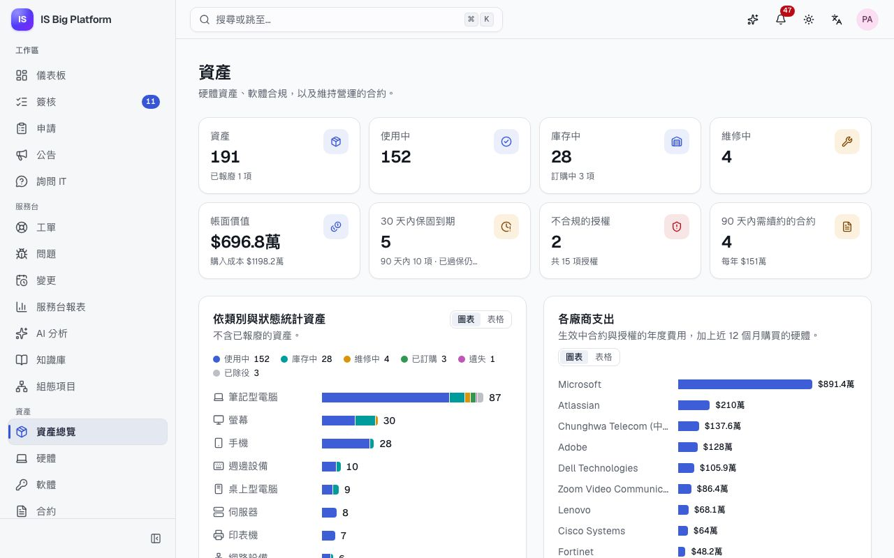
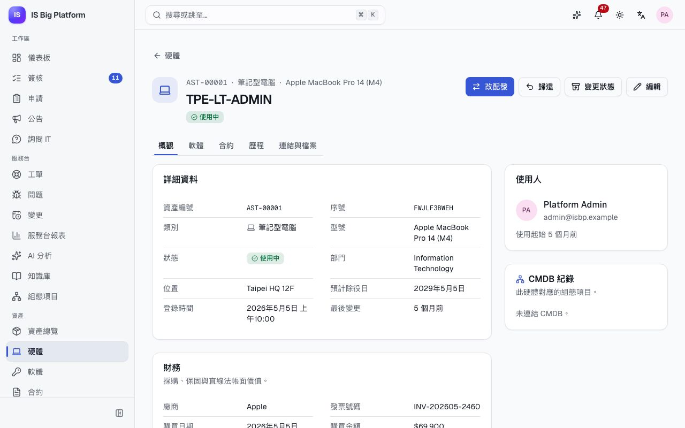
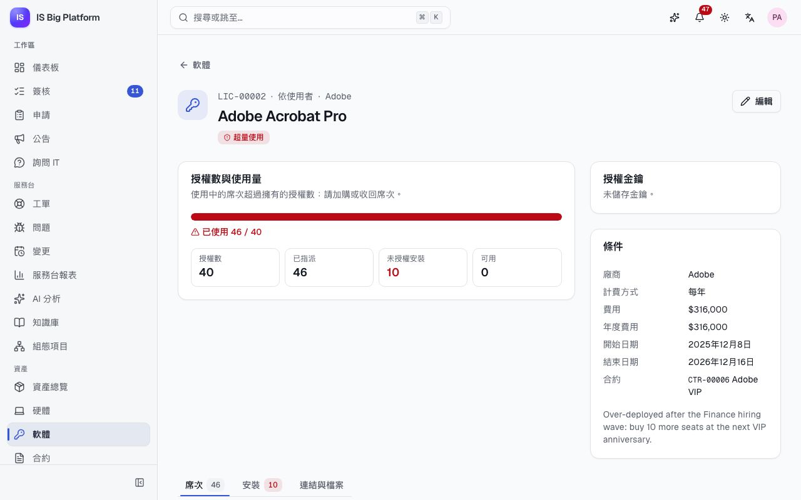
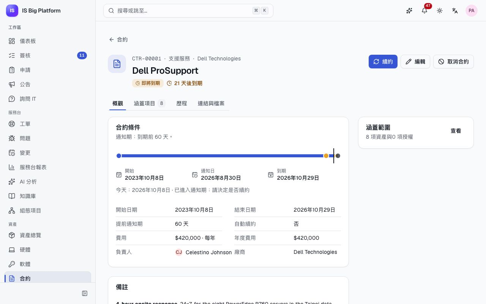

# 資產指南

本指南適用於資產管理員與合約管理員，也說明員工可以看到哪些自己設備的資訊。**資產**將公司的硬體、軟體授權、合約與廠商集中在同一處：誰在使用哪台筆電、設備目前還值多少、我們使用的授權是否超過擁有的數量，以及哪些合約即將需要決定是否續約。

## 您可以在這裡做什麼

- 在資產總覽中[掌握資產整體狀況](#掌握資產整體狀況)
- [登錄設備](#登錄設備)、[將設備配發給人員](#配發設備與收回設備)，並[依生命週期變更設備狀態](#依生命週期變更設備狀態)
- [查看設備的帳面價值](#查看設備的帳面價值)
- 經必要的簽核後[報廢已除役的設備](#報廢已除役的設備)
- [向離職人員收回設備](#向離職人員收回設備)
- [管理軟體授權](#管理軟體授權)並[確保授權合規](#檢查授權合規)，包括盤點工具發現的安裝
- [掌握合約與續約進度](#掌握合約與續約進度)，並附上已簽署的文件
- [追蹤廠商與支出](#追蹤廠商與支出)，並[維護型號目錄](#維護型號目錄)
- 了解員工在**我的設備**中[看得到什麼](#員工看到的內容我的設備)
- [將資產連結到工單與組態項目](#將資產連結到工單組態項目與其他紀錄)，並了解[與 ServiceDesk Plus 同步的資產](#與-servicedesk-plus-同步的資產)如何運作

## 誰可以做什麼

下列角色在**系統管理 → 角色與存取權**中授予。如果側邊欄沒有**資產**，請向管理員申請其中一個角色。

| 角色                                      | 允許的操作                                             |
| ----------------------------------------- | ------------------------------------------------------ |
| **我的設備**（My devices）                | 所有人都有：檢視配發給您的設備與軟體                   |
| **資產檢視者**（Asset viewer）            | 瀏覽硬體、軟體授權與合約                               |
| **資產管理員**（Asset manager）           | 管理硬體與授權、顯示授權金鑰、維護型號與廠商；核准報廢 |
| **合約管理員**（Contract manager）        | 管理合約、續約與廠商；檢視合約涵蓋的硬體與軟體         |
| **資產模組管理員**（Asset administrator） | 資產管理的所有功能                                     |

檢視硬體的權限可以限定在某個部門及其人員，讓各據點的 IT 聯絡人只看到自己據點的設備。

## 掌握資產整體狀況

每天早上，或在預算、稽核會議之前，先從這裡查看需要處理的事項。

1. 前往**資產 → 資產總覽**。
2. 查看頂端的數據：**資產**、**使用中**、**庫存中**（含訂購中的數量）、**維修中**、**帳面價值**、**30 天內保固到期**、**不合規的授權**與 **90 天內需續約的合約**。選取任一數據即可開啟對應的篩選清單。
3. 查看圖表：**依類別與狀態統計資產**、**依狀態統計資產**與**各廠商支出**（生效中合約與授權的年度費用，加上近 12 個月購買的硬體）。使用**檢視方式** → **表格**可改以表格查看數字，例如要複製到報告中。
4. 逐一處理**需要處理**中的項目：**保固即將到期**、**即將續約的合約**與**不合規的授權**，每一項都有**查看全部**。

在示範資料中，**Adobe Acrobat Pro** 列在**不合規的授權**中，**Dell Technologies** 則在**各廠商支出**中居首。

> **提示：** 資產管理員在**儀表板**上還會看到**資產待辦**卡片，列出不合規的授權、30 天內需續約的合約，以及 30 天內保固到期的設備。

## 登錄設備

在訂購或到貨時就登錄設備，從第一天起即可追蹤。

1. 前往**資產 → 硬體**，選取**新增資產**。
2. 在**識別資訊**下，輸入**名稱**（例如 `TPE-LT-0042`）、**類別**、**型號**，以及設備上標示的**序號**。每個序號只能登錄一次。
3. 選擇**狀態**：**庫存中**或**已訂購**。已訂購的設備到貨後會轉為庫存。
4. 如要直接交給某人，可選擇**配發給（選填）**。
5. 在**位置**下，輸入位置與部門。伺服器與網路設備請選擇此設備對應的 **CMDB 組態項目**。
6. 在**採購與保固**下，輸入廠商、購買日期、購買金額、幣別、發票號碼與**保固到期日**。
7. 儲存。

**後續流程：** 設備會取得 `AST-00042` 之類的資產編號，歷程從「已登錄」開始。狀態變更與配發請使用資產頁面上的對應動作。如要規劃汰換日期，之後可選取**編輯**並設定**預計除役日**；若留空，則以購買日期加上型號的使用年限計算。

## 配發設備與收回設備

當您要把筆電交給新進人員、更換故障的手機，或收回借用設備時，請使用這項功能。

1. 從**資產 → 硬體**開啟設備（**庫存中**頁籤列出可以配發的設備）。
2. 選取**配發**（若已有人使用，則選取**改配發**）。
3. 選擇**人員**，視需要填寫**備註（選填）**，然後選取**配發**。

**後續流程：** 設備會變成**使用中**，系統會通知該人員（「配發給我的設備」），對方可在**我的設備**中找到它。**歷程**頁籤會記錄「配發給 …」。

如要收回，請選取**歸還**，選擇**歸還至**（**庫存中**或**維修中**），註明設備狀況（例如缺少的配件），然後選取**歸還**。歷程會記錄「… 已歸還」。

## 依生命週期變更設備狀態

每台設備都遵循相同的生命週期，總覽上的數字才可信。

1. 開啟設備，選取**變更狀態**。
2. 選擇**新狀態**，加上備註，然後選取**變更狀態**。

| 目前狀態 | 可變更為                             |
| -------- | ------------------------------------ |
| 已訂購   | 庫存中、遺失                         |
| 庫存中   | 使用中、維修中、已除役、遺失         |
| 使用中   | 庫存中、維修中、遺失                 |
| 維修中   | 庫存中、使用中、已除役               |
| 已除役   | 庫存中，或已報廢（只能透過報廢簽核） |
| 遺失     | 庫存中                               |
| 已報廢   | 無：這是最終狀態                     |

設備只有在**使用中**、**維修中**或**遺失**時才會保留使用人。若改為其他狀態，對話方塊會提醒您該人員將不再是此設備的使用人。

資產頁面有五個頁籤：**概觀**、**軟體**（已安裝的軟體與授權席次）、**合約**（涵蓋此設備的支援與維護合約）、**歷程**（每個步驟，以及由誰在何時執行）與**連結與檔案**。

## 查看設備的帳面價值

財務與稽核人員常會問硬體目前還值多少。資產模組會自動計算，不需要人工輸入。

1. 開啟設備。**財務**卡片會顯示**購買金額**、**保固到期日**與**帳面價值**。
2. **直線法折舊**長條會顯示設備已走完多少使用年限，以及折舊完畢的日期（**將於 … 折舊完畢**）。

帳面價值會在型號的使用年限內，從購買金額以直線方式遞減至零。若型號未設定使用年限，則套用類別預設值：筆記型電腦、平板電腦與週邊設備為 36 個月，桌上型電腦為 48 個月，手機為 24 個月，螢幕、伺服器、網路設備、儲存設備與印表機則為 60 個月。總覽上的**帳面價值**是以預設幣別（除非管理員變更，否則為 TWD）加總所有設備。

## 報廢已除役的設備

要永久離開公司的設備必須先經過核准；可儲存公司資料、且仍有帳面價值或使用未滿五年的設備，還需要資訊安全團隊簽核，確認儲存媒體已抹除或銷毀。

1. 確認設備為**已除役**（使用**變更狀態**）。
2. 選取**申請報廢**。
3. 填寫**預計如何處置？**，例如「抹除 SSD 後交由合格回收商處理」。若是仍有帳面價值或使用未滿五年的筆記型電腦、桌上型電腦、伺服器、儲存設備、手機或平板電腦，對話方塊會提醒您資訊安全團隊也需要簽核。
4. 選取**申請報廢**。

**後續流程：**

- 資產頁面會顯示「報廢申請等待簽核中。」，申請會進入**資產報廢**簽核。
- 首先由資產管理員核准（期限為 72 小時，48 小時後會發出提醒）。
- 若是仍有帳面價值或使用未滿五年的資料儲存設備，接著由資安團隊簽核。簽核說明會要求他們確認儲存媒體已安全抹除（NIST 800-88）或已實體銷毀。
- 核准後，設備即變為**已報廢**。若有人駁回，設備會維持**已除役**，歷程會記錄「報廢申請遭駁回」。

核准者會在自己的**簽核**收件匣中做決定，請參閱[核准或駁回申請](employees.md#核准或駁回申請)。在示範資料中，一台螢幕破裂的已除役 ThinkPad 正在等待報廢：它是使用未滿五年的筆電，所以資安團隊也要簽核。您可以在**資產 → 硬體**的**已除役與報廢**頁籤中找到它。

> **重要：** 無法透過**變更狀態**設定**已報廢**，其他系統也不行：報廢只能經由這個簽核進行。

## 向離職人員收回設備

當某人在**系統管理 → 人員**中辦理離職停用時，資產模組會自動處理：

- 收回其授權席次（每一筆都會記錄在稽核日誌中）；
- 其仍持有的每台設備都會新增一筆歷程「要求歸還：… 已離職」；
- 通知資產管理員（「需向離職人員收回的設備」），並附上資產編號。

設備會維持**使用中**，直到您收回為止。收回時，請逐一開啟設備並選取**歸還**。

## 管理軟體授權

記錄公司擁有的授權，才能與實際使用情形比較。

1. 前往**資產 → 軟體**，選取**新增授權**。
2. 輸入**產品**（盤點工具回報的安裝會依此名稱比對）、發行商與廠商、**授權類型**（**依使用者**、**依裝置**、**同時使用**、**全站授權**或**訂閱**），以及**授權數**（無上限或全站授權請留空）。
3. 輸入費用、**計費方式**、開始與結束日期（永久授權請將**結束日期**留空），以及購買時依據的**合約**。
4. 可選擇儲存**授權金鑰**，金鑰會加密儲存。
5. 儲存。接著開啟該授權，在**席次**頁籤中使用**指派給人員**或**指派給裝置**（依授權類型而定），然後選取**指派**。

如要查看已儲存的金鑰，請開啟授權並選取**顯示**。只有具顯示金鑰權限的人員（**資產管理員**與**資產模組管理員**角色）才看得到這個按鈕，而且每次顯示都會記錄在稽核日誌中。

## 檢查授權合規

在授權數量校正（true-up）、續約或軟體發行商稽核之前，先確認使用量是否符合授權數。

1. 前往**資產 → 軟體**。**全部**、**需要處理**、**即將到期**與**使用率偏低**頁籤可篩選清單；**使用量**欄位會顯示使用中的席次與授權數的對照。
2. 開啟授權。**授權數與使用量**會顯示**授權數**、**已指派**、**未授權安裝**與**可用**，並以一句話說明合規狀態。
3. 開啟**安裝**頁籤並開啟**僅顯示未授權**，即可看到安裝了產品但沒有席次的設備。在某一列選取**指派授權**，即可為該設備（依裝置授權）或其使用人指派席次。

| 合規狀態       | 意義                                                        |
| -------------- | ----------------------------------------------------------- |
| **合規**       | 使用量在授權範圍內                                          |
| **超量使用**   | 使用中的席次超過擁有的數量：請加購或收回席次                |
| **使用率偏低** | 授權數 10 以上、使用率低於 60% 的授權（門檻可在設定中調整） |
| **即將到期**   | 授權將在 60 天內到期                                        |
| **已到期**     | 授權已到期                                                  |

依裝置授權時，安裝了產品但沒有席次的設備也會計入使用量。

**後續流程：** 每次變更都會重新計算合規狀態，每晚也會再計算一次。當授權變成**超量使用**或**已到期**時，系統會通知資產管理員（「不合規的授權」）。

在示範資料中，**Adobe Acrobat Pro**（`LIC-00002`）有 40 個授權數，但財務部門大量招募後，使用中的席次超過了授權數，因此為**超量使用**。

**盤點工具發現的安裝。** 軟體盤點工具會透過 API（`POST /api/v1/itam/discovery/software`，請參閱 [API 指南](../../api.md)）回報每台設備完整的軟體清單。在後續回報中消失的產品會視為已解除安裝；您手動記錄的安裝則會保留。在設備的**軟體**頁籤中，每個已安裝的產品都會標示為**已授權**、**未授權**或**未納管**（該產品沒有授權紀錄）。

## 掌握合約與續約進度

支援、維護、租賃與訂閱合約會在固定日期續約或失效。資產模組會及時提醒您，並將已簽署的文件與合約保存在一起。

1. 前往**資產 → 合約**，選取**新增合約**。
2. 輸入標題、廠商、**種類**、開始與結束日期、**提前通知期**（到期前幾天寄送提醒）、是否**自動續約**、費用與計費方式，以及會收到續約提醒的**負責人**。若合約尚未簽署，請選擇**儲存為草稿（啟用前不會寄送提醒）**，之後再選取**啟用**。
3. 開啟合約的**涵蓋項目**頁籤，選取**編輯項目**，然後使用**加入資產**與**加入授權**。
4. 開啟**連結與檔案**，在**附件**下上傳已簽署的 PDF（將檔案拖曳進來，或選取**上傳**）。

**後續流程：**

- 合約上的**續約時程**會顯示開始日、**通知日**、到期日，以及今天所在的位置。
- 進入通知期時，合約會變為**即將到期**，負責人與合約管理員會收到「續約提醒」。到期前一週還會寄送最後提醒。
- 超過結束日期後，合約會變為**已到期**。設定自動續約的合約會自行延續到下一期。
- 如要手動續約，請選取**續約**，輸入**新期間開始**、**新期間結束**與費用，然後選取**續約**。歷程會保留原本的期間。
- **取消合約**會停止提醒與自動續約；合約及其歷程會保留。

**合約**清單有**生效中**、**即將續約**（90 天內到期）、**已到期**與**全部**頁籤。在示範資料中，**Dell ProSupport**（`CTR-00001`）涵蓋台北資料中心的 PowerEdge 伺服器，目前處於通知期，並附有 `Dell-ProSupport-Plus-signed.pdf`。

## 追蹤廠商與支出

1. 前往**資產 → 廠商**，查看每個廠商的聯絡人、與其往來的合約、授權與資產數量，以及**年度支出**。
2. 選取廠商，即可查看其合約、授權，以及近 12 個月向其購買的硬體。
3. 資產管理員與合約管理員可以使用**新增廠商**新增廠商。聯絡資訊會顯示在合約與續約提醒中。

## 維護型號目錄

型號決定以該型號購入之設備的折舊年限，因此請確保型號資料正確。

1. 前往**系統管理 → 資產**，在**型號**頁籤選取**新增型號**。
2. 輸入**製造商**、**型號名稱**、**類別**、**料號**與**使用年限（月）**（留空則使用類別預設值）。不再採購的型號，請關閉**可用於新資產**。
3. **一般**頁籤會顯示**預設幣別**、**保固提醒期間**（預設 30 天）與**使用率偏低門檻**。這些設定由平台管理員在**系統管理 → 模組**中變更。

您需要**資產管理員**、**合約管理員**或**資產模組管理員**角色才能看到此頁面。

## 員工看到的內容：我的設備

每位員工都可以查看 IT 配發給自己的設備與個人軟體授權，只要點幾下就能回報設備問題。當有人問「我用的是哪台筆電？」時，請引導他們到這裡。

1. 前往**申請**，在 **您需要什麼？** 下選取**我的設備**。
2. 每台設備會顯示**資產編號**、**序號**、**使用起始**與**保固**。個人軟體授權列在下方。
3. 如要回報設備問題，請在該設備上選取**回報問題**。

**後續流程：** 系統會開啟**回報問題**頁面，並已連結該設備。員工描述問題後選取**送交服務台**。新工單會附上該資產的連結，服務台人員不必詢問就能看到型號、保固與歷程。如果某人名下沒有任何設備，**通知服務台**會開啟回報，讓 IT 登錄設備。員工端的回報方式，請參閱[員工指南](employees.md#查看您的設備並回報設備問題)。

## 將資產連結到工單、組態項目與其他紀錄

連結可以呈現完整的來龍去脈：電池耗電過快的事件就在發生問題的筆電旁，伺服器旁就是它的 CMDB 紀錄。

- **CMDB。** 伺服器與網路設備請在登錄或編輯設備時設定 **CMDB 組態項目**。資產頁面會在 **CMDB 紀錄**下顯示該項目，而 CMDB 中的組態項目頁面會顯示**資產紀錄**卡片，包含序號、保固、使用人與帳面價值。
- **其他任何紀錄。** 開啟資產、授權或合約，前往**連結與檔案**，選取**連結紀錄**，依編號或標題搜尋工單、變更、工作項目或其他紀錄，然後選取**連結**。
- **人員。** 在**系統管理 → 人員**中，人員頁面會顯示**資產與軟體**：配發給該人員的設備與授權。

在示範資料中，事件「Laptop battery drains in two hours」連結到回報者自己的筆電。您只會看到自己有權限檢視的連結的紀錄；其他紀錄只會計數，不會顯示名稱。

## 與 ServiceDesk Plus 同步的資產

如果貴組織仍在 ManageEngine ServiceDesk Plus（地端部署）中維護資產清冊，整合管理員可以透過整合中樞讓硬體資料與其保持一致。

- 資產依序號比對。任一端所做的配發、歸還與狀態變更都會同步。
- 在資產的**連結與檔案**頁籤中，**同步對象**卡片會顯示連線、**上次同步**時間與**立即同步**。由同步產生的歷程會註明來源，例如「經由 Contoso ServiceDesk Plus …」。
- 生命週期規則依然適用。在 ServiceDesk Plus 中標示為已報廢的設備，在 ISBP 中**不會**被報廢：同步會拒絕這項變更並回報錯誤。請在這裡使用**申請報廢**，讓簽核得以進行（請參閱[無法從外部略過簽核](integrations.md#無法從外部略過簽核)）。

在示範資料中，**Assets ↔ assets** 同步設定檔會將硬體與模擬的 **Contoso ServiceDesk Plus** 雙向同步；若兩端變更了同一欄位，以 ServiceDesk Plus 的值為準。連線、對應與衝突規則的設定方式，請參閱[整合指南](integrations.md)。

## 與其他功能的關聯

- **員工**在**我的設備**中查看自己的設備，並從那裡回報問題：[員工指南](employees.md)。
- **服務台**人員可以在工單上看到連結的設備，以及伺服器背後的 CMDB 紀錄：[服務台指南](service-desk.md)。
- 報廢的**簽核**與其他所有簽核使用同一個收件匣；管理員可以調整**資產報廢**簽核流程（但不能移除）：[管理員指南](administrators.md)。
- **ServiceDesk Plus** 同步：[整合指南](integrations.md)。
- **助理**可以依您的權限回答「我用的是哪台筆電？」、尋找資產、檢查授權合規，以及列出即將到期的合約：[助理與 AI](assistant-and-ai.md)。
- 帳面價值、授權數等術語：[詞彙表](glossary.md)。
