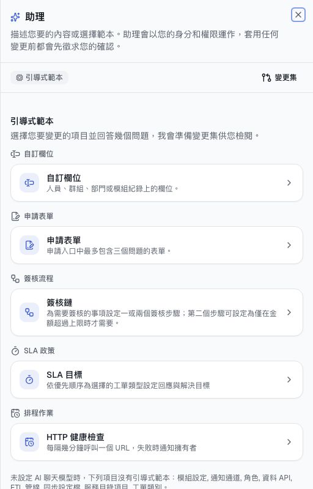
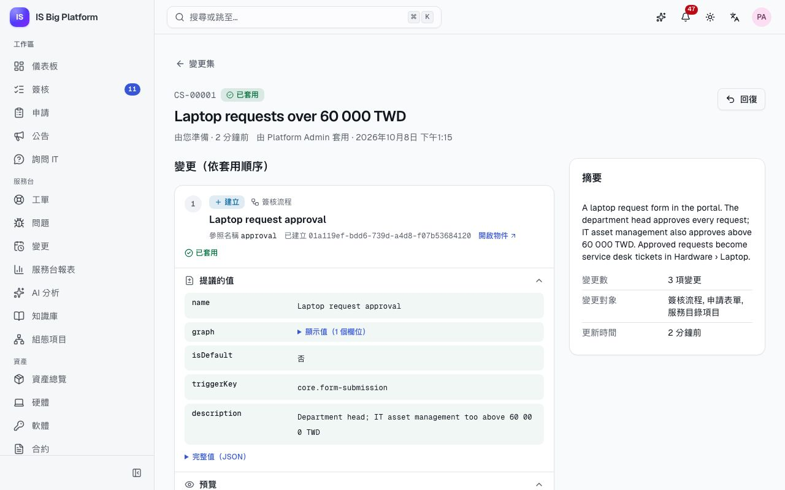
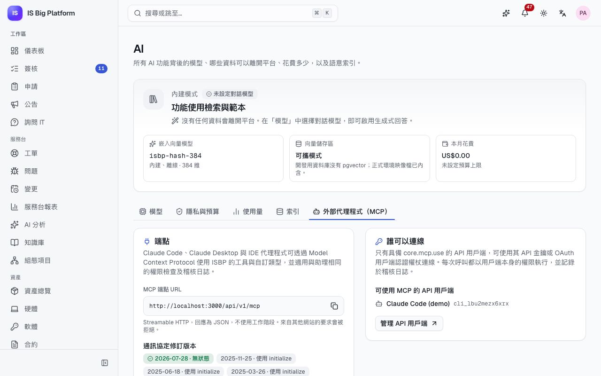

# 助理與 AI 指南

本指南適用於所有使用 ISBP AI 功能的人員，以及負責設定這些功能的管理員。內容說明 AI 在有無語言模型時各會做些什麼、您的資料如何受到保護、如何透過詢問 IT 取得協助，以及如何使用助理：這個內建的代理程式會替您處理日常工作，並將設定變更準備成變更集，經過檢閱後才會生效。

## 您可以在這裡做什麼

- 了解[您目前處於哪種 AI 模式](#內建模式與模型模式)，以及[哪些資料會離開平台](#您的資料與隱私)
- 從[詢問 IT](#透過詢問-it-取得協助) 取得解答，並[在工單上使用服務台 AI](#供服務台人員使用的服務台-ai)
- 在任何頁面[開啟助理](#開啟助理)，並[用它處理日常工作](#使用助理處理日常工作)
- [以變更集變更平台設定](#以變更集變更設定)，或在未設定模型時[使用引導式範本](#使用引導式範本)
- [檢閱](#檢閱變更集)、[套用](#套用變更集)、[要求審核](#要求審核)及[回復](#回復變更集)變更集
- 透過 MCP [連接 Claude Code 等外部代理程式](#透過-mcp-連接外部代理程式)

## ISBP 中的 AI 如何運作

ISBP 的每項 AI 功能都會經過同一個閘道，由管理員在**系統管理 → AI** 中控管。沒有任何模組會自行連線到 AI 供應商，因此各處都適用相同的隱私規則、使用量紀錄與預算。

### 內建模式與模型模式

ISBP 不需要語言模型也能運作。管理員可以新增模型（Anthropic Claude，或任何 OpenAI 相容模型，包括我們自行架設的模型）來啟用生成式回答。每項功能都會標示目前處於哪種模式。

| 功能             | 內建模式（無對話模型）                   | 使用對話模型                             |
| ---------------- | ---------------------------------------- | ---------------------------------------- |
| 詢問 IT          | 顯示最相符的知識文章，並提供建立工單選項 | 根據知識庫撰寫回答，並附上來源           |
| 新工單的分派建議 | 依相似的已解決工單提出建議               | 由模型進一步調整建議，並說明理由         |
| 回覆草稿         | 引用最佳文章步驟的範本                   | 以申請人的語言撰寫、附上編號來源的回覆   |
| 工單摘要         | 從工單擷取問題、最新進度與目前狀態       | 由模型撰寫的摘要                         |
| 助理             | 以**引導式範本**取代自由文字             | 接受自由文字需求；助理透過平台的工具處理 |

在內建模式下，沒有任何資料會離開平台。**系統管理 → AI** 頁面頂端會顯示**內建模式**或**生成式 AI**；助理面板則會顯示**引導式範本**，或 **AI 模型：** 加上模型名稱。示範環境以內建模式執行。

### 您的資料與隱私

- **遮罩**：提示傳送到外部模型之前，ISBP 會將個人資料與機密資料替換成預留位置，並在回覆中放回實際的值，因此供應商永遠看不到這些資料。預設涵蓋電子郵件地址、電話號碼、IP 位址、信用卡號、身分證號（台灣身分證字號、日本個人編號、美國社會安全號碼），以及 API 金鑰等機密。管理員可以加入自己的規則，例如員工編號的格式。
- **權限**：AI 只會找到您自己能開啟的內容。搜尋結果與回答都會依您的權限篩選，助理也只會以您的權限執行動作，絕不會超出。
- **自行架設的模型**：使用我們自行架設的模型時，提示會留在我們的網路內。

### 使用量與預算

每次 AI 呼叫都會記錄發出呼叫的功能、為誰呼叫、使用的 Token 數與估計成本。管理員可以在**系統管理 → AI → 使用量**中查看。若設定了每月預算（選用），預算用完後 AI 呼叫就會停止：直到下個月之前，AI 呼叫都會被拒絕，並顯示「本月的 AI 預算已用完。」

## 透過詢問 IT 取得協助

詢問 IT 是供所有人使用的虛擬客服。當某項功能無法運作，或您需要 IT 提供某樣東西時，請在提出工單之前先使用它。

1. 前往**工作區 → 詢問 IT**，或在申請入口網站的**詢問 IT** 卡片上選擇**提出問題**。
2. 以您自己的話描述問題，任何語言都可以。
3. 閱讀回答與連結的文章，然後選擇**已解決**或**仍需要協助**。
4. 如果詢問 IT 無法解決，它會為您準備一張工單。選擇**檢視工單**，確認詳細資料後，再選擇**建立工單**。

**後續流程：** 在您確認之前，不會建立任何內容。工單會送到服務台，您可以在**我的申請**中追蹤。申請與工單的說明請參閱[員工指南](employees.md)。

## 供服務台人員使用的服務台 AI

具有 **AI 輔助專員**（AI-assisted agent）角色的服務台人員，會在每張工單上看到 **AI 輔助**面板：可逐欄套用的分派建議（類別、群組、優先順序）、相似工單與建議文章、附上來源的**撰寫回覆草稿**、**摘要**，以及可將已解決工單轉成文章草稿供審閱的**建立知識文章草稿**。自動分派預設為關閉；管理員開啟後，服務台 AI 只會填入仍為空白的欄位。如何在佇列中使用這些功能，請參閱[服務台指南](service-desk.md)。

## 開啟助理

助理是平台本身的 AI 代理程式。它位於每個頁面的頁首，因此您不需要任何外部工具。

1. 選擇任何頁面右上角的閃光按鈕**助理**。
2. 面板會在右側開啟（在手機上為全寬），並顯示目前的模式與**變更集**連結。
3. 選擇**關閉助理**即可關閉面板。執行中的需求會繼續進行，再次開啟時，面板會回到先前的狀態。

助理知道您所在的頁面與頁面上的紀錄（例如您開啟的工單）。訊息框上方會顯示**頁面：**，後接助理看到的內容。

如果您看不到這個按鈕，請向管理員申請**助理使用者**（Assistant user）角色。設定 AI 模型後，只要您的角色允許您處理任何日常工作（例如查詢或更新工單），就能與助理討論這些工作；若要準備設定變更，還需要該設定的讀取權限。沒有模型時，助理會針對您可讀取的設定提供引導式範本，因此如果您無法讀取任何設定，面板會顯示「目前沒有您可以自訂的項目」。

## 助理可以做什麼

助理透過平台提供給每個 AI 代理程式的相同工具運作，並且**以您的身分**執行：它只能做您在畫面上能做的事，所做的一切都會記錄在稽核日誌中。

- **日常工作，直接執行**：查詢工單、人員、群組、資產、組態項目與應用程式；提出工單；在工單上新增公開回覆或內部備註；分派工單；在您所屬的專案中建立工作項目，或將工作項目移到其他狀態；撰寫知識文章草稿；檢查發行版本的就緒狀態。
- **需要您確認的動作**：有些動作絕不會只憑助理的判斷就執行：解決工單、為人員辦理離職停用、發佈公告、申請資料庫存取、執行排程作業或 ETL 管線，以及套用或回復變更集。助理會顯示確認卡片，並等待您決定。
- **設定，以變更集處理**：工作流程、表單、欄位、角色及下方列出的其他項目，絕不會被直接變更。助理會將變更收集到變更集中，由您或審核者一次套用，而且之後可以回復。

## 使用助理處理日常工作

自由文字需求需要對話模型。當一項工作需要多次查詢，或您想在不離開目前頁面的情況下完成某件事時，請使用助理。

1. 開啟一筆紀錄（例如示範資料中的 VPN 事件），然後開啟助理。
2. 在**描述您要的變更…**（若您無法變更任何設定，則為**描述您需要什麼…**）中輸入您要做的事，例如「在這張工單新增內部備註：使用者的 VPN 用戶端落後兩個版本。」按 Enter 傳送（Shift+Enter 換行）。
3. 查看**助理執行的動作**：每項查詢與動作都會在執行時列出。
4. 如果助理要求執行需要確認的動作，請閱讀卡片，然後選擇**確認**或**拒絕**。

**後續流程：** 變更會立即以您的名義出現在紀錄上。先前的對話位於**最近的對話**（歷程按鈕）；選擇**新對話**即可開始新的對話。

## 確認或拒絕動作

當助理想執行需要人員確認的動作時，會顯示標題為**執行前請確認**的卡片，並以您的語言說明它將執行的內容。

1. 閱讀卡片。選擇**顯示將傳送的內容**即可查看確切的輸入。
2. 若是變更集，請選擇**確認前先檢閱變更**，先開啟變更集。
3. 選擇**確認**以您的權限執行，或選擇**拒絕**。

**後續流程：** 卡片會顯示**已確認**、**已拒絕**或**失敗**及原因，助理接著繼續處理。當您傳送下一則訊息時，卡片就會過期（「已過期：對話已繼續進行」）；如果仍需要，請再詢問一次。套用變更集仍需要其涉及的每項權限；若您缺少其中任何一項，請改請助理要求審核。

## 以變更集變更設定

人員可以描述他們想要的結果，例如「超過新台幣 60,000 元的筆電申請要送交部門主管，再送交 IT 資產管理」，助理就會使用管理員所用的相同設定畫面來建立。在有人套用變更集之前，一切都不會生效。

1. 開啟助理並描述變更（需要對話模型），或選擇[引導式範本](#使用引導式範本)。
2. 助理會讀取目前的設定、提出變更，並對整個變更集進行試行。面板會顯示**變更集**卡片，以及變更數量與是否**可套用**。
3. 選擇**檢閱並套用**，開啟變更集頁面。
4. [檢閱變更集](#檢閱變更集)，若您具備權限，接著[套用](#套用變更集)；否則請[要求審核](#要求審核)。您也可以請助理套用，再於卡片上確認。

在示範資料中，**CS-00001 Laptop requests over 60 000 TWD** 是已套用的變更集，內容包括：一個簽核流程（每份申請都需部門主管核准；超過新台幣 60,000 元時，IT 資產管理也須核准）、使用此流程的筆電申請表單，以及對應的服務目錄項目。

### 助理可以變更的項目

共有十三種設定項目可以透過變更集變更。您可以對任何您能讀取的項目提出變更；套用則需要下表所列的權限。

| 項目         | 變更可以做什麼                                                     | 套用所需（舉例）                                                 |
| ------------ | ------------------------------------------------------------------ | ---------------------------------------------------------------- |
| 簽核流程     | 建立、更新或封存；套用時會為其觸發條件發佈新版本                   | **工作流程管理員**（Workflow administrator）                     |
| 申請表單     | 建立、更新或封存；套用時會儲存並發布表單                           | **工作流程管理員**                                               |
| 自訂欄位     | 為人員、群組、部門或模組紀錄新增欄位；建立後，代碼與類型就無法變更 | **工作流程管理員**或**身分識別管理員**（Identity administrator） |
| 角色         | 建立、更新或刪除；您只能授予自己擁有的權限                         | **平台管理員**（Platform administrator）                         |
| 通知通道     | 變更既有通道的名稱、通知與語言（絕不包括其 Webhook 網址）          | **工作流程管理員**                                               |
| 模組設定     | 變更模組的設定（不包括機密或 AI 供應商設定）                       | **模組管理員**（Module administrator）                           |
| 排程作業     | 建立、更新、停用或刪除                                             | **排程作業管理員**（Scheduled jobs administrator）               |
| ETL 管線     | 建立、更新、停用或刪除                                             | **資料 API 開發人員**（Data APIs developer）                     |
| 資料 API     | 只能建立或更新**草稿**；由人員在資料 API 中測試並發佈              | **資料 API 開發人員**                                            |
| 同步設定檔   | 建立、更新、停用或刪除整合中樞的設定檔                             | **整合管理員**（Integrations administrator）                     |
| 工單類別     | 建立、更新或停用                                                   | **服務台管理員**（Service desk administrator）                   |
| SLA 政策     | 建立、更新或停用                                                   | **服務台管理員**                                                 |
| 服務目錄項目 | 建立、更新或刪除                                                   | **服務台管理員**                                                 |

## 使用引導式範本

沒有對話模型時，助理會以引導式範本取代自由文字：回答幾個問題，就會成為變更集中的一項變更。請在內建模式下使用，例如示範環境。

1. 開啟助理。面板會顯示**引導式範本**。
2. 選擇範本：
   - **簽核鏈**：一或兩個簽核步驟，第二個步驟只在金額超過上限時執行（例如 `data.amount` 超過 60,000）。
   - **申請表單**：申請入口網站中的表單，最多包含三個問題與一個簽核流程。
   - **自訂欄位**：人員、群組、部門或模組紀錄上的欄位。
   - **HTTP 健康檢查**：每隔幾分鐘呼叫一個網址，失敗時通知負責人。
   - **SLA 目標**：針對您選擇的工單類型，依優先順序設定回應與解決目標。
3. 回答問題，然後選擇**準備變更**。

**後續流程：** 面板會顯示「已加入 CS-…。」與變更集卡片。在您選擇**建立新的變更集**之前，之後使用的範本都會加入同一個變更集。選擇**檢閱並套用**即可開啟變更集。您只會看到您能讀取之項目的範本；如果您可以準備變更但無法套用，範本會告知您，此時請要求審核。



## 檢閱變更集

每個變更集都有自己的頁面。請在套用變更集或核准其審核之前先檢閱。

1. 前往**系統管理 → 變更集**（或助理面板中的**變更集**），開啟變更集。
2. 閱讀頁首：編號（`CS-…`）、狀態（**草稿**、**審核中**、**已套用**、**已回復**或**已捨棄**）、準備者，以及給審核者的**摘要**。
3. 閱讀**變更（依套用順序）** 下的每項變更。每項變更都會顯示它的動作（**建立**、**更新**、**封存**或**刪除**）、試行結果（**試行通過**，或失敗的原因），以及**差異：目前 → 提議**；若是新物件，則顯示**提議的值**。
4. 若是簽核流程與申請表單，請開啟**預覽**：會顯示流程圖（選擇**試用**可執行模擬器），或人員實際看到的表單。
5. 有任何變動後，選擇**重新檢查**即可再次試行。

試行會在一個交易中套用整個變更集，然後回復該交易，因此您可以確切看到套用後會發生什麼事。標示為「需要權限更高的人員套用」的變更已通過其他所有檢查：具備該權限的人員就可以套用。

若要變更標題與摘要，請選擇**重新命名變更集**。只要變更集仍是草稿，且由您準備（或您具有**助理管理員**（Assistant administrator）角色），您就可以編輯它。



## 套用變更集

當您具備變更集所需的每項權限時，即可套用。所有變更都在單一交易中套用：只要有一項變更失敗，就不會套用任何變更。

1. 開啟變更集，選擇**套用**。
2. 如果變更集會封存或刪除項目，請勾選確認您了解將封存或刪除物件的選項。
3. 在對話方塊中選擇**套用**。

**後續流程：** 狀態會變為**已套用**，頁面也會顯示套用者是您（**由 … 套用**）。變更隨即生效：已發佈的工作流程會用於新的申請，表單會出現在入口網站中。準備變更集的人會收到通知。如果您無法套用，頁面會顯示「您無法自行套用此變更集」，以及缺少哪些權限。

## 要求審核

當您無法自行套用變更集，或希望有人再確認一次時，請送交審核。在示範資料中，服務台準備了 **Record the affected site on tickets**，目前正在管理員的簽核中等待處理。

1. 開啟變更集，選擇**要求審核**。
2. 填寫**給審核者的備註（選填）**，然後選擇**要求審核**。

**後續流程：** 狀態會變為**審核中**，並啟動**變更集審核**簽核流程。預設由一位平台管理員在 72 小時內核准，並在 24 小時後發送提醒；管理員也可以綁定自己的工作流程。審核者會在**工作區 → 簽核**中找到這項審核，開啟變更集檢閱後，在簽核中選擇**核准**或**駁回**。**核准即會以簽核者的權限套用變更集**。若遭駁回或套用失敗，變更集會連同原因退回**草稿**，您也會收到通知。

若要改變主意，請開啟**更多動作**並選擇**撤回審核**：變更集會回到草稿。

## 回復變更集

如果已套用的變更集造成問題，請回復它。所有變更都會在單一交易中依相反順序復原：更新會改回先前的值，已封存的物件會還原，已建立的物件會移除。

1. 開啟已套用的變更集，選擇**回復**。
2. 視需要填寫**原因（選填，會記錄於稽核日誌）**，然後選擇**回復**。

**後續流程：** 狀態會變為**已回復**。刪除了項目的變更集無法自動回復。如果在變更集套用後有人變更了其中任一物件，回復就會被拒絕；頁面會列出這些物件，您可以手動修正，或準備新的變更集。

若要捨棄不再需要的草稿，請開啟**更多動作**並選擇**捨棄**。設定不會有任何變更。

## 變更集過時時

變更集會記住它所變更之每個物件的版本。如果有人在變更集套用前編輯了該物件，套用就會被拒絕：「變更集準備完成後，有人修改了此設定。」

1. 開啟變更集。已變更的物件會被標示出來，並顯示與其目前版本之間的差異。
2. 檢閱差異，然後選擇**重新整理**。變更集現在會以目前的版本為基準。
3. 檢查試行結果，然後再次套用。

## 撰寫有效的需求

當您說明應該發生什麼、對象是什麼以及何時發生時，助理的效果最好。以下是一些範例：

- 「超過 60,000 元新台幣的筆電申請，也需要 IT 資產管理的簽核。」
- 「為人員新增成本中心欄位。」
- 「建立第二台螢幕的申請表單，由申請人的主管簽核。」
- 「在工單上新增受影響據點的選擇欄位：台北總部、新竹、東京。」
- 「SLA 違反也要傳送到 IT Operations 的 Teams 通道。」（該通道必須已存在。）
- 「每 5 分鐘檢查一次 https://intranet.example.com，失敗時通知我。」
- 「摘要這張工單，並新增一則列出後續步驟的內部備註。」（在工單頁面上）
- 「在 Network refresh 2026 中建立工作項目：更換新竹的核心交換器，期限為下週五。」

> **提示：** 請具體說出您指的人員、群組與金額。助理在提出任何變更之前，都會先查詢實際存在的群組與角色，並在某個項目不存在時告訴您。

## 透過 MCP 連接外部代理程式

Claude Code 等外部 AI 代理程式，會透過 ISBP 的 MCP 端點使用與助理相同的工具。管理員需要為每個代理程式設定一次。

### 設定（管理員）

1. 前往**系統管理 → API 用戶端**，選擇**建立用戶端**。
2. 輸入**名稱**（例如「Claude Code (Ryan)」）與**描述**。
3. 開啟**進階：平台權限、IP 範圍**。在**平台 API 權限**下加入 `core.mcp.use`，以及代理程式應能存取的權限：通常是 `assistant.agent.use`，以及它可以提出變更之項目的讀取權限（例如 `core.workflows.read`、`core.forms.read`、`core.custom-fields.read`）。您只能授予自己擁有的權限。可視需要限制**允許的 IP 範圍**。
4. 設定**第一個密鑰的到期時間**，然後選擇**建立用戶端**。
5. 複製**用戶端密鑰（API 金鑰）**，勾選**我已將密鑰妥善保存**，然後選擇**完成**。金鑰只會顯示一次。

**系統管理 → AI → 外部代理程式（MCP）** 會顯示端點、可使用該端點的 API 用戶端，以及連接 Claude Code 的命令。在示範資料中，API 用戶端 **Claude Code (demo)** 可以使用 MCP；其金鑰只會在 seed 結束時列印一次。

### 連線 Claude Code

在終端機中執行下列命令，並將預留位置替換為您伺服器的位址與 API 金鑰：

```bash
claude mcp add --transport http isbp https://isbp.example.com/api/v1/mcp --header "Authorization: Bearer <API key>"
```

**外部代理程式（MCP）** 會顯示已填入我們位址的命令；選擇**複製命令**即可。其他 MCP 用戶端使用相同的端點 URL 與 `Authorization` 標頭，輸入方式則依用戶端而異。切勿將實際的金鑰貼到共用筆記或聊天中。

### 外部代理程式可以與不能做的事

- 它們可以使用 API 用戶端獲准使用的所有非破壞性工具，權限檢查與稽核日誌都和在 ISBP 內相同；也能讀取該用戶端可讀取的設定項目。
- 它們可以提出變更：結果是一個變更集，也就是由人員在 ISBP 中檢閱並套用的草稿。它們也可以要求審核，由簽核者套用。
- 它們無法套用或回復變更集，也不會取得任何需要人員確認的動作（例如解決工單或為某人辦理離職停用）。
- 它們無法使用「我的申請」或「我的通知」等個人功能：API 用戶端不是人員。

由外部代理程式準備的變更集，會列在**系統管理 → 變更集**的**全部**分頁中，並標示為來自 API 用戶端。具有**助理管理員**角色的人員會在那裡看到它；其審核的簽核者則會在自己的簽核中看到它。



## 排除常見問題

| 您看到的訊息或狀況                     | 處理方式                                                                                                   |
| -------------------------------------- | ---------------------------------------------------------------------------------------------------------- |
| 面板顯示**引導式範本**，且沒有訊息框   | 尚未設定對話模型。請使用範本，或請管理員新增模型                                                           |
| 「目前沒有您可以自訂的項目」           | 尚未設定模型，且您無法讀取引導式範本所處理的任何設定。請向管理員申請所需項目的讀取權限，或請管理員新增模型 |
| 「助理目前還無法為您做任何事」         | 您的角色不包含助理可處理的任何項目。請向管理員申請所需的存取權                                             |
| 「您無法自行套用此變更集」             | 選擇**要求審核**                                                                                           |
| 變更顯示「試行失敗」                   | 閱讀變更上的原因；請助理修正，或移除該變更                                                                 |
| 「變更集準備完成後，有人修改了此設定」 | 請參閱[變更集過時時](#變更集過時時)                                                                        |
| 「本月的 AI 預算已用完。」             | 管理員可以在**系統管理 → AI → 隱私與預算**中提高預算                                                       |

## 與其他工作的關聯

- [管理員](administrators.md#設定-ai)：模型、遮罩、預算與索引；誰可以取得助理角色；**變更集審核**工作流程。
- [員工](employees.md)：詢問 IT、申請與簽核。
- [服務台指南](service-desk.md)：工單上的服務台 AI、工單類別、SLA 政策與服務目錄。
- [整合](integrations.md)：助理可以準備的同步設定檔。
- [資料與自動化](data-and-automation.md)：排程作業、ETL 管線與資料 API。
