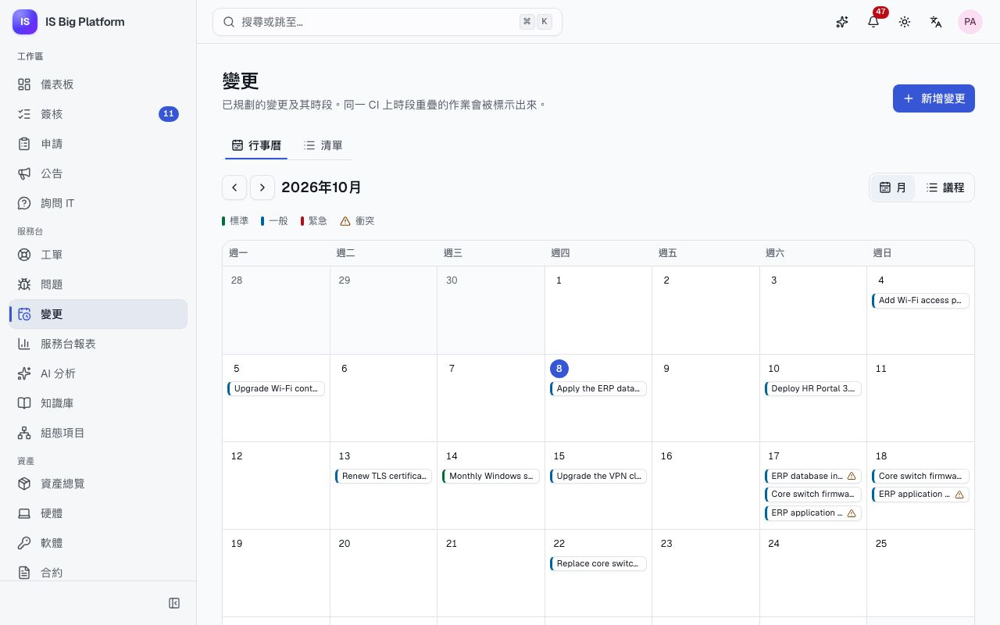
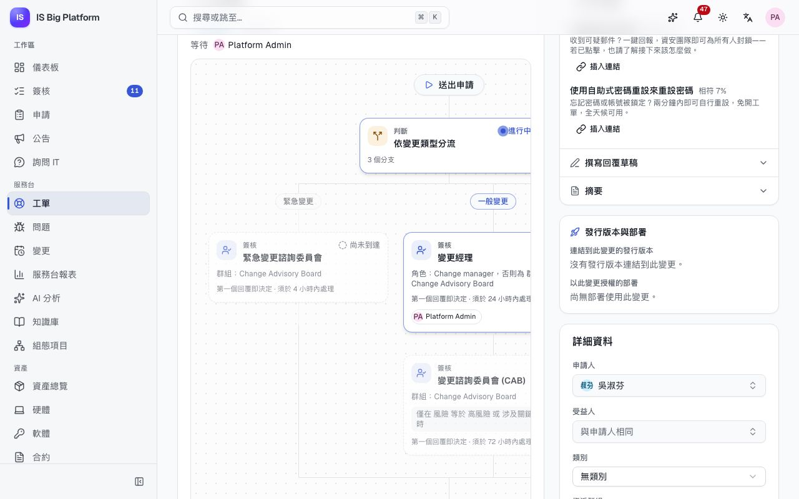
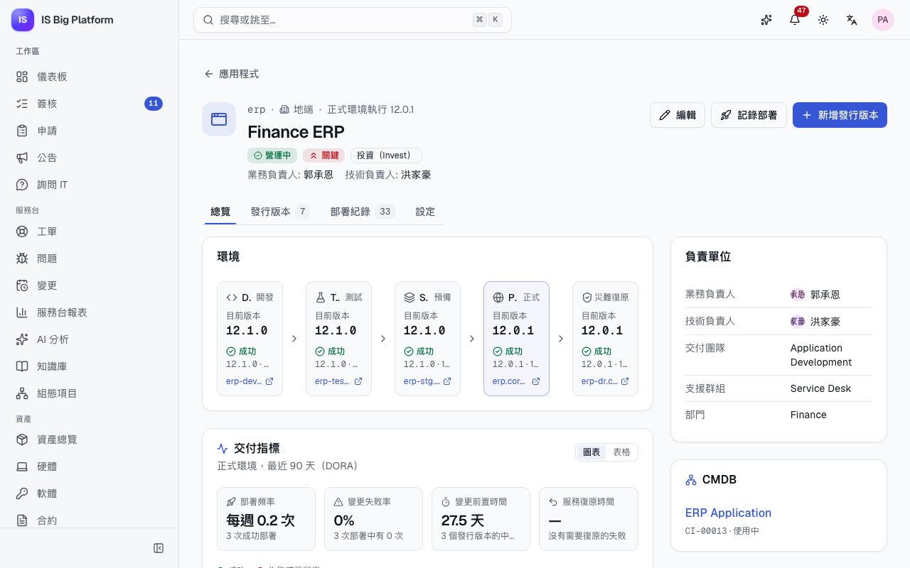
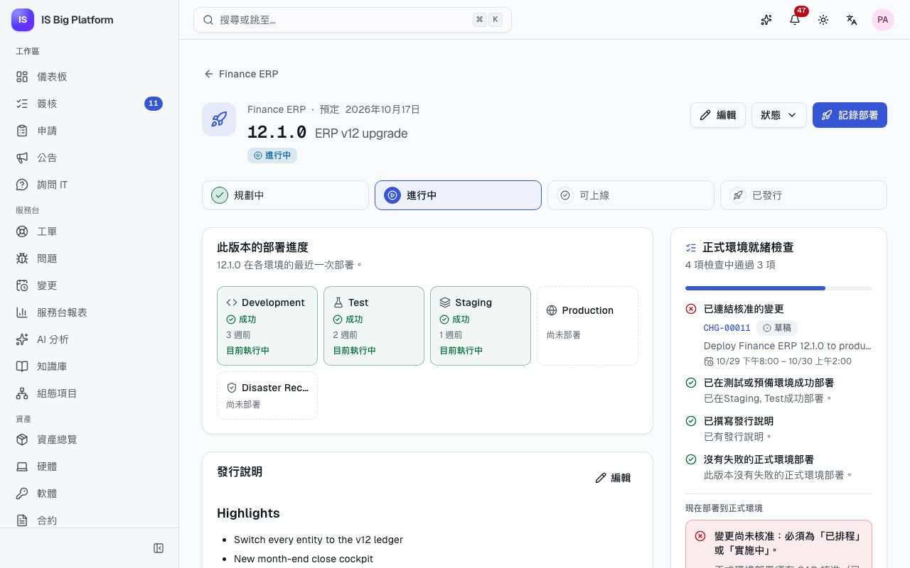

# 變更與發行指南

本指南適用於變更經理、變更諮詢委員會（CAB）成員與應用程式負責人。內容說明變更如何提出、規劃、簽核與實施，以及「應用程式」區域如何追蹤各環境執行的版本、哪些發行版本已就緒，以及每一次部署——並遵守一項原則：沒有核准的變更，任何內容都不得進入正式環境。

## 您可以在這裡做什麼

- [選擇變更類型](#選擇變更類型)，並了解各類變更由誰簽核
- [提出變更](#提出變更)，並[依其他變更規劃時段](#依其他變更規劃時段)
- [取得 CAB 簽核](#取得-cab-簽核)，或[以簽核者身分決定變更](#以簽核者身分決定變更)
- [實施與檢討變更](#實施與檢討變更)
- [處理來自 ServiceDesk Plus 的變更](#處理來自-servicedesk-plus-的變更)
- [維護應用程式的資料](#維護應用程式的資料)，包括其 Git 狀態
- [規劃發行版本並檢查就緒狀態](#規劃發行版本並檢查就緒狀態)
- [記錄部署](#記錄部署)：手動記錄，或[從 CI/CD 管線記錄](#從-cicd-管線記錄部署)
- [緊急時略過變更政策](#緊急時略過變更政策)
- [閱讀交付指標](#閱讀交付指標)

## 選擇變更類型

每項變更都有類型與風險。這兩者加上變更涉及的組態項目（CI），共同決定簽核流程。此流程就是**變更授權**簽核流程，無法關閉；管理員可在**系統管理 → 工作流程**中調整其步驟。

| 類型     | 適用於                                       | 簽核者（預設工作流程）                                                      |
| -------- | -------------------------------------------- | --------------------------------------------------------------------------- |
| **標準** | 已預先核准、低風險、可重複的作業（每月修補） | 不需簽核：送出後即排程                                                      |
| **一般** | 已規劃的變更                                 | 變更經理（24 小時內）；若風險高或涉及關鍵 CI，再由 CAB 簽核（72 小時內）    |
| **緊急** | 無法等到下次 CAB 會議的緊急修正              | 緊急 CAB：變更諮詢委員會的任一成員，須於 4 小時內決定，逾時則呈報給變更經理 |

簽核者名單來自**變更經理**（Change manager）角色與 **Change Advisory Board** 群組。

## 提出變更

凡是會更動正式環境的作業，例如升級、組態變更或部署，都要提出變更。您需要**變更經理**角色；在示範資料中，`admin` 具有此角色。

1. 前往**服務台 → 變更**，選擇**新增變更**。
2. 填寫 **要變更什麼？** 與**詳細內容**。
3. 選擇變更涉及的**組態項目**。系統會用這些項目找出同一批 CI 上的其他變更，並決定簽核路線。
4. 選擇**變更類型**與**風險**，並填寫**變更原因**。
5. 設定**預計時段**（**開始**與**結束**）。
6. 撰寫**實施計畫**、**回復計畫**與**測試計畫**。
7. 查看計畫下方的衝突訊息，然後選擇**建立變更**。

**後續流程：** 變更會以**草稿**狀態建立（「已建立 CHG-…（草稿）」）並開啟。送出之前，您都可以透過**變更計畫**卡片上的**編輯**修改計畫。

> **提示：** 在「應用程式」的發行版本上，變更經理可以選擇**提出變更**開啟此表單，標題會預先填入「將（應用程式）（版本）部署到正式環境」，且已連結該發行版本。

## 依其他變更規劃時段

同一個 CI 在同一時間有兩項變更，出問題時就很難追查原因。ISBP 會在您規劃時標示出這類情況。

1. 建立或編輯變更時，表單會顯示「此時段內沒有其他變更涉及這些 CI」，或顯示有幾項其他變更涉及，以及共同涉及的 CI。
2. 在變更頁面上，**變更計畫**卡片會列出時段重疊的變更及其狀態。
3. 若要掌握全貌，請前往**服務台 → 變更**。**行事曆**分頁會顯示整個月（或切換為**議程**），將時段重疊的變更標示為**衝突**，並提供**上個月**、**下個月**與**今天**。**清單**分頁則會列出每項變更及其**預計時段**。

只有處於**評估中**、**等待 CAB 簽核**、**已排程**或**實施中**的變更才會計為衝突；草稿不計入。

在示範資料中，ERP 資料庫索引重建與 ERP 應用程式伺服器修補都涉及 Finance ERP，又排在同一個星期六晚上，因此兩者都被標示出來。

## 取得 CAB 簽核

計畫準備好後，將變更送入簽核流程。

1. 開啟變更。透過**狀態**將其從**草稿**移至**評估中**。
2. 選擇**送出簽核**。

沒有預計時段的變更無法送出，且時段不得早於現在（緊急變更除外）。

**後續流程：**

- 狀態會變為**等待 CAB 簽核**。**變更計畫**卡片中的 **CAB 簽核**區段會顯示工作流程的進度：目前步驟、正在**等待**誰，以及以圖表呈現的簽核流程。**開啟我的簽核**會前往您自己的簽核收件匣。
- 簽核者會收到通知，並在**簽核**中做出決定。
- **已核准**：變更會移至**已排程**，申請人、處理人員與提出變更的人都會收到附有預計開始時間的通知。
- **已駁回**：變更會移至**已駁回**，並附上簽核者的意見。請將變更移回**草稿**，改善計畫後再次送出。
- 若要停止正在等待的變更，請在**狀態**中選擇**已取消**（並填寫原因）；簽核會隨之撤回。

> **重要：** 任何人都無法手動將變更推進到**等待 CAB 簽核**之後——無論是透過**狀態**選單、API 或整合都不行，只有簽核才能推進。送出後，計畫就無法再編輯。

在示範資料中，CHG-00002「Renew TLS certificate on mail-relay-01」會先等待變更經理簽核，再交由 CAB 簽核，因為它涉及關鍵 CI「Email & Calendar」。CHG-00001 是標準修補變更，一送出就已排程。

## 以簽核者身分決定變更

身為變更經理或 CAB 成員，每項等待您決定的變更都會通知您。

1. 前往側邊欄的**簽核**（**待我簽核**），或開啟通知。
2. 開啟該變更的簽核。其中會顯示**申請內容**、**簽核流程**與**歷程**；**開啟申請**會帶您前往變更本身，查看其計畫、CI 與衝突。
3. 選擇**核准**（可附上意見）或**駁回**（必須填寫原因，申請人會看到）。若要交給同事處理，請選擇**轉交**。

若是群組步驟，以第一個回應為準。提醒與呈報依循[選擇變更類型](#選擇變更類型)中的期限。簽核收件匣的詳細說明：[員工](employees.md)。

## 實施與檢討變更

1. 時段開始時，在**狀態**中選擇**實施中**。
2. 在變更上以**工作備註**記錄作業內容；若變更會部署應用程式版本，也請在「應用程式」中記錄部署（請參閱[記錄部署](#記錄部署)）。
3. 作業完成後，選擇**實施後檢討**，記下哪些按計畫進行、哪些沒有。
4. 選擇**已結案**。

已排程的變更仍可取消（需填寫代碼與原因）。一旦進入**實施中**，就只能繼續進入檢討。

在變更頁面右側，**發行版本與部署**卡片會列出連結到此變更的發行版本，以及由此變更授權的部署。在示範資料中，CHG-00007「Upgrade Wi-Fi controller wlc-01 to 8.10」正處於實施後檢討。

## 處理來自 ServiceDesk Plus 的變更

若您的組織也在地端的 ManageEngine ServiceDesk Plus 中規劃變更，整合中樞可以將這些變更帶入 ISBP（在示範資料中，是 Contoso ServiceDesk Plus 的 **Changes → changes** 設定檔）。這些變更會顯示**同步對象**卡片，並遵循相同的生命週期。

同步可以填寫變更內容並送出，但無法核准：來自外部的變更會停在**等待 CAB 簽核**，直到 CAB 在 ISBP 中核准為止，與在這裡提出的變更完全相同。請參閱[整合](integrations.md)。

## 維護應用程式的資料

**應用程式**是公司營運的所有應用程式清冊：負責人是誰、處於生命週期的哪個階段、各環境執行哪個版本，以及交付狀況如何。

- **應用程式檢視者**（Applications viewer）可以瀏覽所有內容（在示範資料中，服務台、網路、資安、DBA、CAB 與應用程式負責人等群組都有此角色）。
- **業務負責人**、**技術負責人**與**交付團隊**成員只要有這個角色，就能編輯自己的應用程式及其發行版本。
- **應用程式管理員**（Applications manager）可以編輯任何應用程式；**發行經理**（Release manager）可以規劃任何應用程式的發行版本。

1. 前往**應用程式 → 應用程式**。使用分頁（**全部**、**營運中**、**開發中**、**逐步淘汰與已退役**、**我負責的**）、搜尋方塊（代碼或名稱）與篩選條件。
2. 開啟應用程式。標題列會顯示其階段、重要性、**正式環境執行**的版本與負責人。**總覽**會顯示**環境**與各環境的**目前版本**、**交付指標**、**說明**、**程式碼儲存庫**、**負責單位**、**CMDB** 組態項目與**詳細資料**。
3. 選擇**編輯**可變更名稱、階段、重要性、**處置策略（TIME）**、架設方式、負責人、**交付團隊**、**支援群組**、組態項目與其他詳細資料。**代碼**無法變更：CI/CD 管線會使用它。
4. 使用**設定**分頁維護**環境**（依流水線順序排列；正式環境受變更政策保護）、**程式碼儲存庫**與**生命週期**（階段、TIME 處置策略與日期）。

**Git 狀態**：整合中樞會持續更新我們地端 Azure DevOps Server 上的程式碼儲存庫：每個儲存庫會顯示其預設分支、最新認可、分支（**顯示分支**）、進行中的提取要求，以及**同步於**何時。在示範資料中，Finance ERP 有 `erp-core` 與 `erp-reports` 兩個程式碼儲存庫。

## 規劃發行版本並檢查就緒狀態

發行版本是應用程式即將上線到正式環境的某個版本。它的就緒檢查清單會告訴您與 CAB 是否可以上線。

1. 在應用程式上選擇**新增發行版本**。輸入**版本**（在同一應用程式中不可重複，例如 `12.1.0`）、**名稱**、**預定日期**與**發行說明**（Markdown），然後儲存。
2. 在發行版本頁面上追蹤其生命週期（**規劃中**、**進行中**、**可上線**、**已發行**）；透過**狀態 → 變更為**移動其狀態。
3. 連結負責部署它的變更：在就緒卡片中選擇**提出變更**（限變更經理），或在**連結的紀錄**中以**連結紀錄**連結既有的變更。
4. 查看**正式環境就緒檢查**。符合下列條件時即通過：
   - **已連結核准的變更**（已由 CAB 核准：已排程或實施中）；
   - 此版本**已在測試或預備環境成功部署**；
   - **已撰寫發行說明**；
   - 此版本**沒有失敗的正式環境部署**。

**後續流程：** 連結變更後，規劃中的發行版本會移至**進行中**。所有檢查都通過時，負責人會收到發行版本已可部署到正式環境的通知。此版本成功部署到正式環境後，發行版本會標示為**已發行**。

**應用程式 → 發行行事曆**會顯示所有應用程式未來幾週的發行版本（**依週**或**月**），以及其變更狀態與就緒狀態；**只看我的應用程式**可將範圍縮小到您的應用程式。

在示範資料中，Finance ERP 12.1.0「ERP v12 upgrade」已部署到 Staging，但其變更（CHG-00011）仍是草稿，因此有一項檢查未通過。HR Portal 3.4.0 則已就緒：其變更 CHG-00009 已排程。

## 記錄部署

請記錄每一次部署，讓所有人都能看到各環境執行的版本，交付指標也才會正確。您需要記錄部署的權限（**發行經理**或**應用程式管理員**角色）。

1. 在應用程式或發行版本上選擇**記錄部署**。
2. 選擇**環境**、確認**版本**，並選擇**結果**（**成功**、**失敗**、**進行中**或**已回復**）。
3. 若是正式環境，請在 **變更（選填）** 中指定經 CAB 核准的變更；若發行版本已連結變更則可省略。
4. 閱讀**變更政策**：它會說明現在是否允許部署，若不允許則說明原因。
5. 視需要加入**備註**，並在 **Commit 與管線**下填寫 **Commit** 與**管線執行**連結。
6. 選擇**記錄部署**。

**變更政策**：部署到正式環境時，需要一項處於**已排程**或**實施中**的變更，並在表單中指定，或已連結到發行版本。其他環境不需要變更。在變更的預計時段之外部署時，部署會附帶警告記錄下來（**不在變更時段內**）；若管理員已開啟**強制遵守變更時段**，則會拒絕部署。這兩項設定都位於**系統管理 → 模組**（應用程式）。

**後續流程：** 環境會顯示新版本。部署失敗或回復時，會通知技術負責人與交付團隊。**部署紀錄**分頁會保留完整的歷程。

## 從 CI/CD 管線記錄部署

管線會透過 API 自行回報部署，無需任何人手動輸入，紀錄也能保持完整。

- 管理員在**系統管理 → API 用戶端**中建立具有 **CI/CD 管線**（CI/CD pipeline）角色的 API 用戶端，並將其金鑰交給管線。
- 管線會送出應用程式**代碼**、環境、版本、結果；若是正式環境，還會送出變更編號。
- 適用相同的變更政策。沒有核准的變更時，API 會拒絕該部署，因此管線步驟會失敗並說明原因。管線無法略過政策。

請求格式：[API 指南](../../api.md#recording-deployments-from-cicd-application-lifecycle)。

## 緊急時略過變更政策

有時必須在變更獲得核准之前就修復正式環境。只有具備**應用程式模組管理員**（Applications administrator）角色的人員，才能記錄這類部署。

1. 在**記錄部署**中，當政策拒絕部署時，選擇**填寫理由並略過**。
2. 說明**為何必須在沒有核准變更的情況下部署？**（至少 10 個字元）。
3. 選擇**略過政策並記錄**。

**後續流程：** 這次略過會以資安事件列入稽核，變更經理會收到通知（「已略過變更政策：…」），部署紀錄中的該筆部署也會標示為**已略過政策**。事後請補提緊急變更，讓 CAB 能夠審查。

> **重要：** 只要聯繫得到緊急 CAB，請優先使用緊急變更；緊急 CAB 會在數小時內做出決定。

## 閱讀交付指標

應用程式**總覽**上的**交付指標**卡片，會顯示正式環境最近 90 天的四項 DORA 指標，依據已記錄的部署計算：

| 指標             | 意義                                                   |
| ---------------- | ------------------------------------------------------ |
| **部署頻率**     | 每週成功部署到正式環境的次數                           |
| **變更失敗率**   | 已完成的正式環境部署中，失敗或回復的比例               |
| **變更前置時間** | 從建立發行版本到首次成功部署到正式環境的時間中位數     |
| **服務復原時間** | 從正式環境部署失敗，到該環境下一次成功部署的時間中位數 |

在**圖表**與**表格**之間切換，即可查看每週數據。您可以在 CAB 檢討與回顧會議中使用這些數據；數據的品質取決於部署紀錄，這也是應從管線記錄部署的另一個理由。

## 與其他工作的關聯

- 變更所修正的**事件與問題**會以**實施修正**連結：[服務台](service-desk.md)。
- **組態項目**決定衝突與 CAB 步驟：[服務台](service-desk.md#查看組態項目的影響範圍)。
- **專案**會將其工作項目連結到變更與發行版本：[專案](projects.md)。
- **ServiceDesk Plus** 的變更與 **Azure DevOps Server** 的程式碼儲存庫會透過整合中樞同步：[整合](integrations.md)。
- **簽核流程**、模組設定與 API 用戶端由管理員設定：[管理員](administrators.md)。
- CAB、標準變更、DORA 等詞彙：[詞彙表](glossary.md)。
