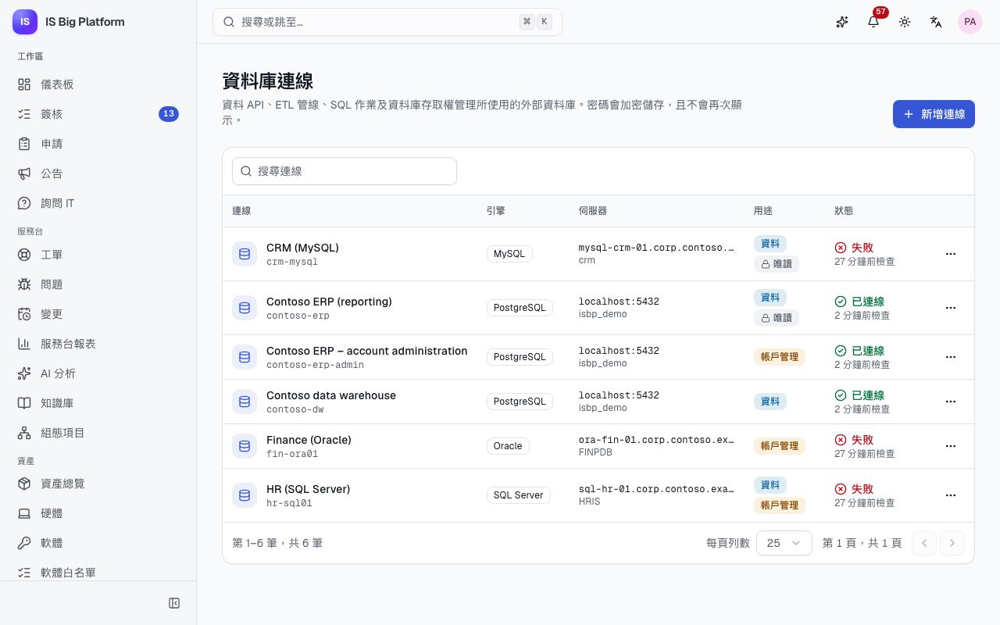
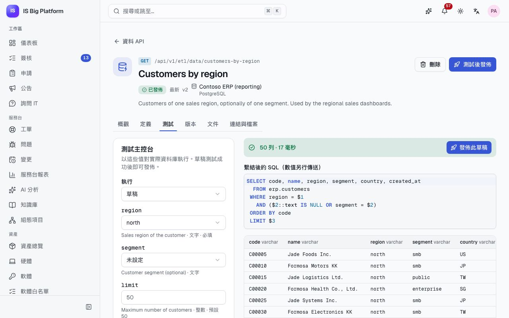
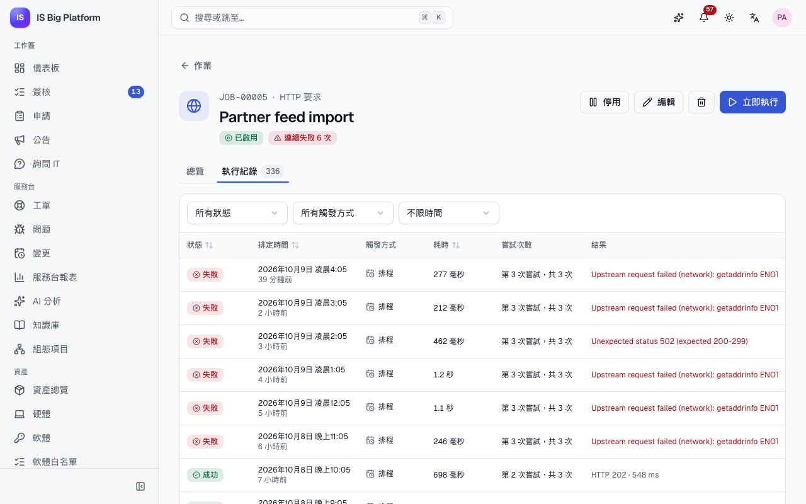
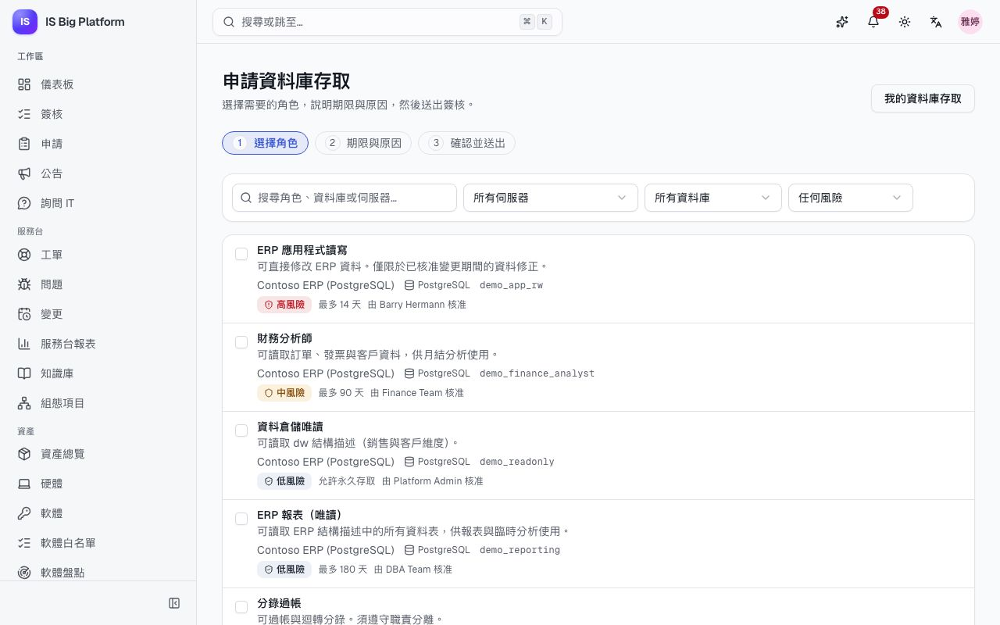

# 資料與自動化指南

本指南適用於資料工程師、平台工程師與 DBA。內容涵蓋 ISBP 處理公司資料庫與週期性工作的四個地方：**資料庫連線**（由管理員登錄一次）、**資料 API 與 ETL**（以 SQL 建立的 REST 端點，以及在資料庫之間複製資料列的管線）、**排程作業**（依排程執行的 HTTP 呼叫、SQL、指令碼與模組工作），以及**資料庫存取**（人員申請資料庫角色，經核准、佈建與審查，並如期移除）。

## 您可以在這裡做什麼

- [登錄資料庫連線](#登錄資料庫連線)並[瀏覽其目錄](#測試連線並瀏覽其目錄)
- [以 SQL 或預存程序建立資料 API](#建立資料-api)、[測試](#測試資料-api)、[發佈版本](#發佈與管理版本)，並[控管誰可以呼叫](#控管誰可以呼叫資料-api)
- [提供呼叫者文件](#提供呼叫者文件並追蹤呼叫)，並在呼叫紀錄中追蹤每一次呼叫
- [使用管線在資料庫之間複製資料列](#使用管線在資料庫之間複製資料列)
- [建立排程作業](#建立排程作業)、[追蹤其執行](#追蹤執行與即時紀錄)，並[監控所有作業](#監控排程作業)
- 任何人都可以[申請資料庫角色](#申請資料庫角色)，並[使用存取權與一次性密碼](#使用您的存取權與一次性密碼)
- DBA 可以[將角色設為可申請](#將資料庫角色設為可申請)、[處理未受管理的存取](#處理未受管理的存取與孤立帳戶)，以及[執行存取審查](#執行存取審查)

## 誰可以做什麼

角色在**系統管理 → 角色與存取權**中授予。

| 領域            | 角色                                                       | 允許的操作                                                                   |
| --------------- | ---------------------------------------------------------- | ---------------------------------------------------------------------------- |
| 資料庫連線      | **資料庫連線管理員**                                       | 登錄外部資料庫，以及其認證資訊與用途                                         |
| 資料 API 與 ETL | **資料 API 檢視者**（Data APIs viewer）                    | 檢視資料 API、版本、文件、呼叫紀錄、管線與執行                               |
|                 | **資料 API 開發人員**（Data APIs developer）               | 建立、測試、發佈與呼叫資料 API；建立、執行與排程管線                         |
|                 | **資料 API 取用者**（Data APIs consumer）                  | 呼叫允許已登入人員使用的已發佈資料 API（可針對單一端點授予以限制範圍）       |
| 排程作業        | **排程作業檢視者**（Scheduled jobs viewer）                | 檢視作業、執行紀錄、日誌與儀表板                                             |
|                 | **排程作業操作員**（Scheduled jobs operator）              | 建立 HTTP 作業與模組工作類型的作業；編輯自己與團隊的作業；執行或取消任何作業 |
|                 | **排程作業管理員**（Scheduled jobs administrator）         | 所有功能，包括 SQL 與指令碼作業                                              |
| 資料庫存取      | **資料庫存取申請者**（Database access requester）          | 所有人都有：申請角色並管理自己的存取權                                       |
|                 | **資料庫存取管理員**（Database access administrator）      | 伺服器、可申請的角色、盤點同步、所有存取、撤銷、納管、重試                   |
|                 | **資料庫存取稽核員**（Database access auditor）            | 檢視所有存取、帳戶、偏差與審查                                               |
|                 | **資料庫存取審查管理員**（Database access review manager） | 執行存取審查活動                                                             |

## 登錄資料庫連線

每個模組都只能透過在這裡登錄的連線存取外部資料庫，因此認證資訊集中在一處並加密保存，而且每次變更都會留下稽核紀錄。

1. 前往**系統管理 → 資料庫連線**，選取**新增連線**。
2. 輸入**名稱**（例如「財務資料倉儲」）。**代碼**會依名稱自動填入；模組以代碼參照連線，且之後無法變更。
3. 在**伺服器**下，選擇**引擎**（**SQL Server**、**PostgreSQL**、**MySQL** 或 **Oracle**），並輸入**主機**、**連接埠**與**資料庫**（Oracle 請輸入**服務名稱**；SQL Server 具名執行個體請輸入**執行個體名稱**）。選擇**加密**：**關閉**、**加密，但不驗證憑證**或**加密並驗證憑證**（可選擇提供 **CA 憑證（PEM）**）。
4. 在**登入**下，輸入**使用者名稱**與**密碼**。若是以服務帳戶進行 SQL Server Windows 驗證，請加上 **Windows 網域**。
5. 在**用途**區段中，勾選連線的**用途**：
   - **資料**：資料 API、ETL 管線與 SQL 作業；
   - **帳戶管理**：建立帳戶並授予角色（資料庫存取）。資料 API 永遠無法使用此用途。
6. 報表用的連線請開啟**唯讀**。之後寫入會被拒絕，且在引擎支援時，查詢會在唯讀交易中執行。
7. 在**限制**下，設定**每個處理程序的連線數**、**陳述式逾時（秒）** 與**每次結果的最大列數**。
8. 選取**測試連線**，然後選取**新增連線**。

> **重要：** 請使用只具備必要權限的專用登入帳戶：資料 API 只給唯讀權限，帳戶管理只給角色管理權限。SQL Server 沒有唯讀交易，因此在 SQL Server 上，唯讀連線能否維持唯讀，取決於登入帳戶本身的權限。

**後續流程：** 密碼會加密儲存，且不會再次顯示（編輯時將密碼留白即可保留）。位於鏈路本地（link-local）與雲端中繼資料範圍內的位址會被拒絕；私人網路則允許。刪除連線後，使用它的資料 API、管線與作業都會失敗，直到改用其他連線為止。

如果您看不到此頁面，請向管理員申請**資料庫連線管理員**角色。

## 測試連線並瀏覽其目錄

1. 在**系統管理 → 資料庫連線**中，開啟連線的選單（**… 的其他動作**）。
2. 選取**測試**。**狀態**欄會顯示**已連線**或**失敗**，以及檢查的時間；在表單中測試則會回報延遲時間與伺服器版本，或伺服器的錯誤代碼。
3. 選取**瀏覽目錄**，即可查看登入帳戶看得到的**資料表與檢視**與**預存程序與函式**，以及其欄位與參數。結構描述變更後，請使用**重新整理**。

資料 API、管線與資料庫存取提供給您選擇的資料表名稱、欄位與預存程序，全都來自這個目錄。在示範資料中，**Contoso ERP (reporting)**（PostgreSQL，唯讀）與 **Contoso data warehouse** 可以連線；**HR (SQL Server)**、**Finance (Oracle)** 與 **CRM (MySQL)** 則指向不存在的主機，讓您看看失敗時的樣子。

## 建立資料 API

資料 API 會將 SQL 查詢或預存程序轉成附有文件的 REST 端點，讓報表、儀表板或其他系統不需要資料庫登入帳戶，也能讀取公司資料。

1. 前往**資料 API 與 ETL → 資料 API**，選取**新增資料 API**。
2. 輸入**名稱**，確認 **URL 代稱**（呼叫者使用 `/api/v1/etl/data/<slug>`；發佈版本後即無法變更），選擇**方法**（GET 或 POST）、**類型**（**SQL 查詢**或**預存程序或函式**）與**連線**。清單只會列出允許作為資料用途的連線。選取**建立**。
3. 在**定義**頁籤中撰寫 **SQL**。每個值都請使用 `:name`，例如 `WHERE category = :category`。值由資料庫驅動程式繫結，絕不會貼入 SQL。
   若是預存程序，請從目錄中選取；其輸入引數會成為參數。
4. 在 **SQL 中的參數：** 下，選取**新增 … 個缺少的參數**，並設定每個參數的**型別**（**文字**、**整數**、**十進位數**、**是/否**、**日期**、**日期時間**、**UUID**）、**必填**、**預設值**，以及**更多**下的限制、**格式（規則運算式）**、**允許的值**、**描述**與**範例**。個人資料請標示為**敏感（紀錄中遮罩）**。
5. 在**回應與限制**下，選擇**回應**（**所有資料列（陣列）** 或**第一列（無資料時回傳 404）**）、**最多列數**、**逾時（秒）** 與**快取時間（秒）**（設為 0 即關閉快取）。
6. 選取**儲存草稿**。

無效的輸入會在呼叫資料庫之前就收到錯誤回應，並指出每個有誤的參數。

> **重要：** 會變更資料或結構描述的 SQL（INSERT、UPDATE、DROP …）必須先開啟**允許寫入**才能儲存，而且唯讀連線無論如何都會拒絕執行。

## 測試資料 API

測試會以草稿對實際資料庫執行，而測試成功後才能發佈。

1. 開啟資料 API，選取**測試**頁籤（僅限資料 API 開發人員）。
2. 在**執行**下，選擇**草稿**或已發佈的版本。
3. 填入參數，然後選取**執行測試**。
4. 查看結果：資料列與欄位、耗時，以及**繫結後的 SQL（數值另行傳送）**。如果資料庫拒絕執行陳述式，畫面會顯示其錯誤代碼與訊息（絕不顯示認證資訊）。

在示範資料中，開啟 **Customers by region**，將 **region** 設為 `north` 並執行測試。

## 發佈與管理版本

呼叫者需要一個不會突然改變的端點，因此每次發佈都會凍結一個版本。

1. 測試成功後，選取**發佈此草稿**（或頂端的**發佈**）。
2. 撰寫**變更說明**（變更了什麼、為什麼），然後選取**發佈 v…**。

**後續流程：** 版本發佈後就無法再變更。呼叫一般 URL 的呼叫者會取得最新版本；呼叫者也可以使用 `/api/v1/etl/data/<slug>/v<N>` 指定版本。再次編輯定義只會變更草稿（頁面會顯示**有未發佈的變更**）。在**版本**頁籤中，您可以：

- **比較**兩個版本，或比較某個版本與草稿；
- **淘汰**版本：版本仍會回應，並附上 `Deprecation` 標頭與最新版本的連結；
- **停用**版本：呼叫會收到 `410 Gone`。**還原**可讓它恢復；
- **載入草稿**：以舊版本為起點進行修改。

在示範資料中，**Customers by region** 已發佈 v2，v1 則已淘汰。

## 控管誰可以呼叫資料 API

存取設定會立即生效，不需要新版本。

1. 開啟資料 API 的**定義**頁籤，前往**存取**。
2. 若要讓人員呼叫，請開啟**已登入的人員可呼叫**。他們還需要**資料 API 取用者**角色（適用於所有資料 API，或只限這一個）。
3. 在**允許的 API 用戶端**下，勾選可以呼叫的 API 用戶端（系統）。API 用戶端由管理員在**系統管理 → API 用戶端**中建立；用戶端必須具備呼叫資料 API 的權限，**而且**必須在這份清單中。
4. 設定每位呼叫者的**每分鐘速率限制**（留空即使用預設值 120）。超過限制的呼叫者會收到 `429` 與 `Retry-After` 標頭。
5. 選取**儲存草稿**。

在示範資料中，所有已發佈的資料 API 都允許 **Contoso BI gateway** API 用戶端呼叫。

## 提供呼叫者文件並追蹤呼叫

1. 已發佈資料 API 的**文件**頁籤會顯示要求、每個參數、**要求範例**（`curl`）、回應與**回應範例**。呼叫者可以傳送 `Accept: text/csv` 取得 CSV。
2. **下載 OpenAPI**（或資料 API 清單上的 **OpenAPI**）會提供已發佈資料 API 的 OpenAPI 文件，供呼叫它們的開發人員使用。
3. **概觀**頁籤會顯示 **24 小時**或 **7 天**內的**呼叫次數**、**錯誤率**、**p95 延遲**與**快取命中**，以及**呼叫趨勢**。選取**檢視呼叫紀錄**可查看此資料 API 的呼叫。
4. **資料 API 與 ETL → 呼叫紀錄**會列出每一次呼叫：誰呼叫了哪個版本、結果、耗時與列數。您可以依資料 API、結果、呼叫者與期間篩選；選取某次呼叫可查看其參數（敏感參數會遮罩）與**要求識別碼**。呼叫紀錄保留 30 天（為模組設定）。

遇到資料庫錯誤的 API 用戶端會收到附有要求識別碼的一般錯誤；資料庫本身的訊息則記錄在呼叫紀錄中。如何從程式碼呼叫資料 API，請參閱 [API 指南](../../api.md#calling-a-data-api-data-apis--etl)。

## 使用管線在資料庫之間複製資料列

管線會將某個查詢的結果載入另一個資料庫的資料表，例如將 ERP 客戶載入資料倉儲，每次執行都在單一交易中完成。

1. 前往**資料 API 與 ETL → 管線**，選取**新增管線**。
2. 在**一般**下，輸入**名稱**、**描述**與**負責人**（不論以何種方式啟動，執行失敗時都會通知此人；排程作業則在最後一次嘗試失敗後通知，若作業本身的警示已通知此人，則只通知一次）。
3. 在**來源**下，選擇**連線**並撰寫一個 SQL 陳述式。陳述式會以唯讀方式執行，並分批串流讀取。若有 `:parameters`，請在**參數值**下提供值。
4. 若只要載入有變更的資料，請開啟**增量**：在 SQL 中使用 `:watermark`，選擇**水位欄位**，並設定**首次執行起點**的值。之後每次執行都會讀取上次成功執行的最大值之後的資料列。
5. 選取**預覽來源**，查看欄位與**範例資料列**。
6. 在**目標**下，選擇可寫入的連線、其目錄中的**資料表**、**寫入模式**、**鍵值欄位**與**批次大小**：
   - **新增**：新增每一列；
   - **更新或新增**：新增新的資料列，並更新相同鍵值的資料列；
   - **取代**：刪除資料表的所有資料列後再新增（在同一個交易中）。
7. 在**欄位對應**下，選取**自動對應同名欄位**或**新增欄位**，並為每個欄位選擇**轉換**：**保持原樣**、**去除前後空白**、**轉大寫**、**轉小寫**、**轉換型別**、**空白時使用預設值**或**常數**。不提供自訂程式碼。
8. 選取**建立管線**，然後選取**立即執行**試跑。

**後續流程：** 執行頁面（**… 的執行**）會顯示**已讀取列數**、**已寫入列數**、**已拒絕列數**、耗時、水位，以及即時的**紀錄**。一次執行所寫入的資料會一起認可（commit）；若執行失敗或您選取**取消執行**，整次載入都會回復。同一條管線一次只會有一個執行。若要定期執行，請選取**排程**：系統會開啟新增作業表單，並已填入此管線。

在示範資料中，**Customer dimension** 會將 400 筆 ERP 客戶以更新或新增的方式寫入 `dw.customer_dim`，**Daily sales to warehouse** 則以增量方式載入 `dw.sales_daily`。

## 建立排程作業

任何必須在沒人記得時也照常執行的工作，都適合使用排程作業：內部網站的健康檢查、每晚執行的清理陳述式、指令碼、ETL 管線或整合同步。

1. 前往**排程作業 → 作業**，選取**新增作業**。
2. 在**基本資訊**下，輸入**名稱**、**擁有者**（預設為您）、**擁有群組**與**描述**。
3. 在**工作**下，選擇**工作類型**。清單只會顯示您有權建立的類型：
   - **HTTP 要求**：URL、**方法**、**預期狀態**（例如 `200-299` 或 `2xx`）、標頭、**驗證**（**基本（使用者名稱與密碼）**、**持有人權杖**或 **API 金鑰標頭**）與本文。私人與內部主機必須列在管理員的允許清單中（**HTTP 作業可呼叫的私人主機**）。
   - **SQL 陳述式**：資料用途的**資料庫連線**、**模式**（**查詢**會記錄資料列數與預覽；**執行**會記錄受影響的資料列），以及一個使用 `:name` 值的**陳述式**。每個值可以是**固定值**、**執行的排定時間**、**上次成功執行的結束時間**或**執行識別碼**。
   - **指令碼**：**Python**、**Node.js**、**PowerShell** 或 **Shell**、管理員清單中的**容器映像**、指令碼、環境變數、CPU、記憶體與**網路**（**無網路**或**允許對外連線**）。
   - 模組工作：**ETL 管線**、**資料庫存取：盤點同步**與**整合同步**，各有其專屬的選擇器。
4. 在**觸發條件**下，選擇執行時機：
   - **Cron**：在指定的**時區**中設定五個欄位，可使用**常用設定**，並預覽**接下來的執行時間**；
   - **間隔**：**執行間隔（分鐘）**；
   - **接續其他作業**：在選定的作業**全部成功**或**任一成功**時，**接續於**其後執行（會造成循環的設定會被拒絕）；
   - **手動**：只有在有人選取**立即執行**時才執行。
5. 在**執行設定**下，設定**逾時（秒）**、**嘗試次數**（1 表示不重試）、**退避方式**（**固定**或**指數**）、**重試延遲（秒）** 與**重疊執行**（**前次仍在執行時略過**或**等待前次執行完成**）。
6. 在**警示**下，保留**執行失敗時通知擁有者及擁有群組**，視需要開啟**同時將失敗張貼至組織的通道**（Teams、Slack 或 Webhook），並設定**連續失敗後停用**。
7. 選取**建立作業**。

機密（密碼、權杖、機密標頭與變數）會加密儲存並顯示為**已儲存（隱藏）**；在執行的紀錄中也會被遮罩。

> **重要：** SQL 作業需要**排程作業管理員**角色，指令碼作業也是。指令碼只會在隔離的容器（Kubernetes 或 Docker）中執行，沒有任何認證資訊，檔案系統也是唯讀的。若未設定指令碼執行器，就無法啟用指令碼作業；開發用執行器會標示為未使用沙箱。

**後續流程：** 作業會依其觸發條件執行。您可以編輯、執行、取消與刪除您或您的群組擁有的作業；**立即執行**與**停用**／**啟用**位於作業頁面上。平台停止期間錯過的執行，若延遲不到一小時會補執行一次；更早的則記錄為已略過。

## 追蹤執行與即時紀錄

1. 從**排程作業 → 作業**開啟作業（頁籤有**全部**、**失敗中**、**執行中**、**已停用**、**我的**）。**總覽**會顯示排程、**下次執行**、**上次成功**、過去 7 天的狀況、工作內容、此作業接續的作業與它會啟動的作業，以及連續失敗次數。
2. 選取**執行紀錄**頁籤，再選取某次執行。
3. 執行頁面會顯示狀態、各次嘗試的**時間軸**、**指標**（例如 HTTP 狀態或受影響的資料列）、**失敗原因**，以及**記錄檔**；執行進行中時，記錄檔會即時串流顯示。您可以使用**自動捲動**、**複製**或**下載**。
4. 選取**取消執行**可停止執行中的工作（之後不會重試）；已結束的執行則可選取**再次執行**。

執行狀態有**已排入佇列**、**執行中**、**重試中**、**成功**、**失敗**、**逾時**、**已取消**與**已略過**。**排程作業 → 執行紀錄**會列出所有作業的每一次執行，並提供篩選條件。

在示範資料中，**Partner feed import**（每小時第 :05 分執行的 HTTP 作業，時區為 Asia/Taipei）已連續失敗多次；其機密的 API 金鑰標頭永遠不會顯示。

**失敗後的後續流程：** 在最後一次嘗試後，擁有者與擁有群組會收到應用程式內通知與電子郵件（「我的作業執行失敗」）；作業恢復正常執行時會另行通知。設定為連續失敗後停用的作業會自行停用，並發出通知。執行與其紀錄保留 90 天（每個作業最新一次的執行一律保留）。

## 監控排程作業

1. 前往**排程作業 → 總覽**。
2. 查看**關鍵數據**：**執行次數（24 小時）**、**成功率（24 小時）**、**成功率（7 天）**、**失敗中的作業**、**執行中**與**平均耗時（24 小時）**。
3. 查看**每小時執行次數**（切換到**表格**可查看數字）、**即將執行**、**失敗中的作業**與**最慢的作業**。

**儀表板**也會顯示**失敗中的作業**卡片。在示範資料中，**CRM accounts to warehouse** 會接續 **Customer dimension refresh** 執行，但因為無法連線到 CRM 伺服器而失敗。

## 申請資料庫角色

需要直接讀取或變更資料的人（例如為了報表、分析或已核准的資料修正），都可以在這裡申請角色，不必再寄電子郵件給 DBA。

1. 前往**申請**，在 **您需要什麼？** 下選取**申請資料庫存取**。
2. 在**選擇角色**中，搜尋或依**伺服器**、**風險**與**資料庫**篩選，勾選需要的角色，然後選取**繼續**。每個角色都會顯示其最長期限與核准者。
3. 在**期限與原因**中，為每個角色設定**存取期限**（不得超過其上限），並回答**為什麼需要？**（請註明相關的專案、工單或變更）。選取**確認**。
4. 檢查**由誰核准**，然後選取**送出申請**。

**後續流程：**

- 每個角色都會成為獨立的申請（`DBR-00042`），顯示在**我的申請**中，並有自己的頁面顯示**簽核路徑**。等待期間，您可以**撤回申請**。
- **資料庫存取申請**簽核會先送交您的主管，再送交角色擁有者（某位人員，或擁有群組的任一成員）；高風險角色最後還需經資訊安全簽核。
- 核准後，系統會自動在伺服器上建立或更新您的帳戶、授予角色並加以驗證，然後通知您存取已就緒。

在示範資料中，**Contoso ERP (PostgreSQL)** 上的 **ERP 報表（唯讀）** 是低風險角色，最長 180 天，由 DBA 團隊擁有。

## 使用您的存取權與一次性密碼

1. 前往**資料庫存取 → 我的資料庫存取**。每個角色都會顯示**帳戶**、**資料庫角色**與**期限**。
2. 如果系統為您產生了密碼，請選取**顯示密碼**，再選取對話方塊中的**顯示密碼**，然後將密碼複製到您的密碼管理工具。
3. 存取到期前，選取**申請延長**即可送出新結束日期的申請；不再需要時，請選取**交還**。

> **提示：** 如果您是某個角色的擁有者（本人或透過擁有該角色的群組），**我的資料庫存取**還會顯示**您擁有的角色的存取**，列出持有您角色的人員。選取一列，再選取**撤銷**並提供原因，即可提前結束該存取。

> **重要：** 密碼只會顯示一次，且僅限帳戶建立後 7 天內，也絕不會以電子郵件寄送。如果遺失，可以請 DBA 重設。使用 Windows 或目錄服務登入的伺服器不會產生密碼。

**後續流程：** 存取會在您所在時區的所選日期結束時到期，並自動撤銷；系統會在 3 天前提醒您。當有人離職時，其所有資料庫存取都會被撤銷，帳戶也會被停用。

## 將資料庫角色設為可申請

由 DBA 決定人員可以申請哪些角色、由誰核准，以及可以使用多久。

1. 確認管理員已將伺服器登錄為**帳戶管理**用途的連線。
2. 前往**資料庫存取 → 伺服器**。在**尚未管理的管理用途連線**下，選取**管理帳戶**。設定**顯示名稱**、**環境**、**帳戶名稱格式**（例如 `{username}`）、**新帳戶的登入方式**（**產生的密碼**、**Windows / Active Directory** 或**外部目錄**）、**DBA 群組**（佈建失敗時會收到通知）與**每晚自動同步**。選取**管理帳戶**。
3. 選取**立即同步**，讀取伺服器的帳戶、角色與成員資格。
4. 開啟伺服器，選取**將角色設為可申請**。從已同步的盤點中選擇**伺服器上的角色**，設定**顯示名稱**並說明**可存取的內容**，選擇**擁有者（核准者）**（群組或人員）、**風險**、**預設（天）** 與**上限（天）**，以及是否**允許永久存取**與是否要求說明原因。選取**設為可申請**。

SQL Server、Oracle 與 PostgreSQL 的帳戶由平台管理；MySQL 帳戶則不受管理。帳戶與角色名稱會與已同步的盤點比對，陳述式由資料庫伺服器本身依繫結的值建立，絕不會把文字直接貼進 SQL。

**後續流程：** 若佈建失敗，系統最多會嘗試 3 次；之後授權會顯示**失敗**，並通知 DBA 群組。請在**資料庫存取 → 存取**中開啟該授權，選取**重試佈建**，或選取**撤銷**提前移除任何存取（需填寫原因）。

## 處理未受管理的存取與孤立帳戶

在平台之外授予的存取就是偏差，盤點同步會把它們找出來。

1. 前往**資料庫存取 → 存取**，開啟**未受管理的存取**頁籤。這裡會列出沒有任何授權可以說明的可申請角色成員資格。
2. 選取**納管**，將其記錄為正確**人員**的授權並設定**存取期限**，讓它像其他存取一樣到期並接受審查；或選取**撤銷**，從帳戶移除該角色。
3. 在**帳戶**頁籤中，依**僅孤立帳戶**篩選，即可找出沒有對應任何人員的帳戶。

已開啟**每晚自動同步**的伺服器會每晚同步。您也可以在排程作業中排程同步（**資料庫存取：盤點同步**），以取得執行紀錄與警示；示範資料中每台伺服器都有一個 **Database inventory** 作業。在示範資料中，`demo_u_legacy_report` 是未受管理的存取，`TMPLOAD` 則是孤立帳戶。

## 執行存取審查

稽核人員會要求定期有人確認，人員仍然需要他們的資料庫存取。

1. 前往**資料庫存取 → 存取審查**，選取**新增審查活動**（僅限審查管理員）。
2. 輸入**名稱**、**伺服器**（未選擇即為所有伺服器）、**納入的授權**（依風險）、**審查者**（**角色擁有者**或**該人員的主管**）、**開始**與**期限**日期、**到期時**的處理方式（**撤銷未決定的存取**或**保留未決定的存取**），以及**重複**（**僅一次**或**每季**）。選取**建立審查活動**。
3. 審查者會收到通知，並在**等待您審查**下找到待審項目。他們在審查活動中針對每筆授權選取**保留**或**撤銷**（撤銷需要填寫原因），或勾選多筆後使用**保留所選項目**／**撤銷所選項目**。
4. 審查管理員可以追蹤進度、選取**匯出 CSV** 提供給稽核人員，並在完成後選取**結束審查活動**。

**後續流程：** 審查者會在期限前收到提醒。審查活動結束時（手動結束，或期限過後自動結束），系統會套用各項決定與未決定存取的處理政策並開始撤銷，審查活動也會變為唯讀。週期性的審查活動會自動排定下一次。在示範資料中，**Q4 2026 database access review** 正在進行中。

## 與其他功能的關聯

- **整合**：整合同步可以作為排程作業執行（**整合同步**）：[整合指南](integrations.md)。
- **簽核**：資料庫存取申請在**簽核**收件匣中決定；管理員可以調整**資料庫存取申請**簽核流程：[核准或駁回申請](employees.md#核准或駁回申請)與[管理員指南](administrators.md)。
- **人員**：在**系統管理 → 人員**中，人員頁面會向 DBA 與該人員的主管顯示其資料庫存取。
- **連結的紀錄**：資料 API 與管線有**連結與檔案**頁籤，作業則在其**總覽**中顯示**連結的紀錄**與**附件**，例如可將資料 API 連結到使用它的應用程式：[變更與發行指南](changes-and-releases.md)。
- **助理**可以在您要求並確認後執行作業或管線、列出資料 API、顯示您的資料庫存取，以及代您申請角色。它也可以將排程作業、管線與資料 API 草稿提議為變更集；資料 API 草稿仍需由人員測試與發佈：[助理與 AI](assistant-and-ai.md)。
- 水位、更新或新增（upsert）、未受管理的存取等術語：[詞彙表](glossary.md)。
