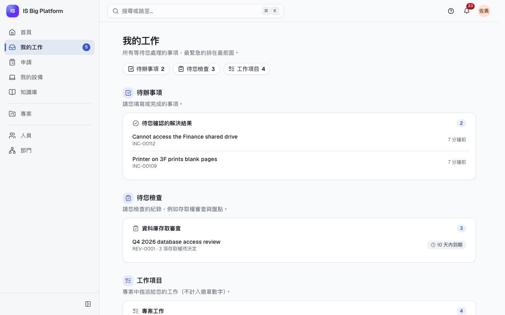
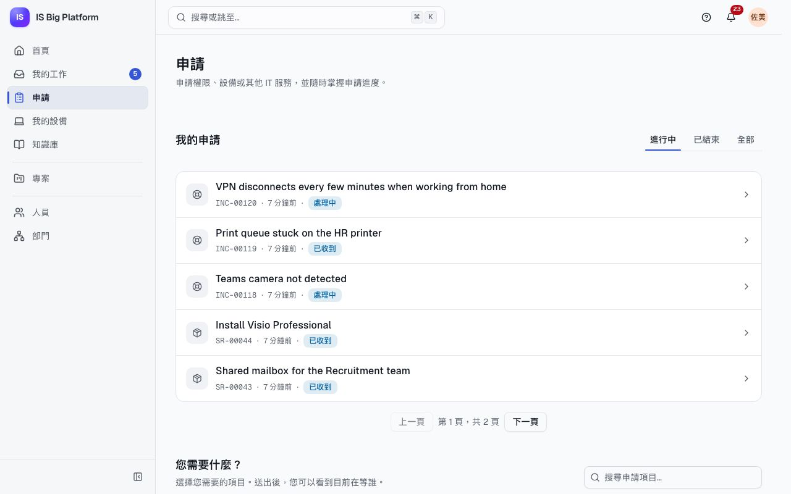
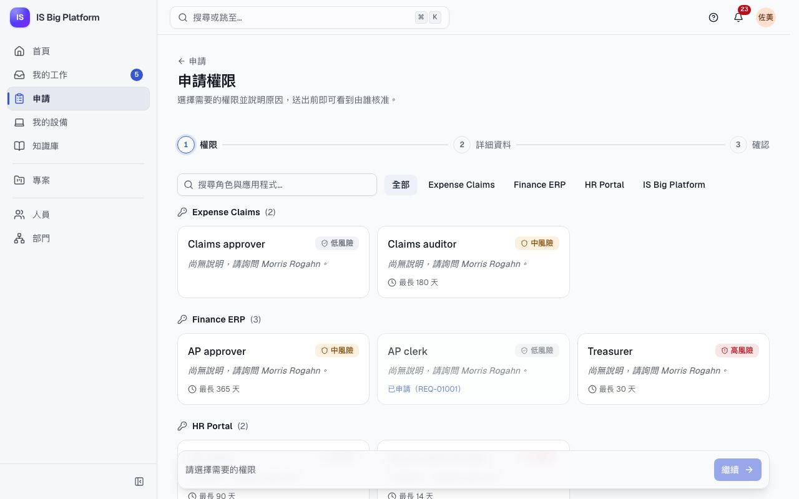
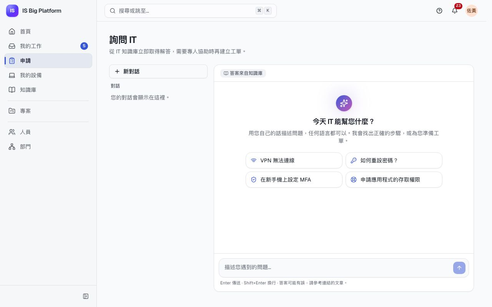
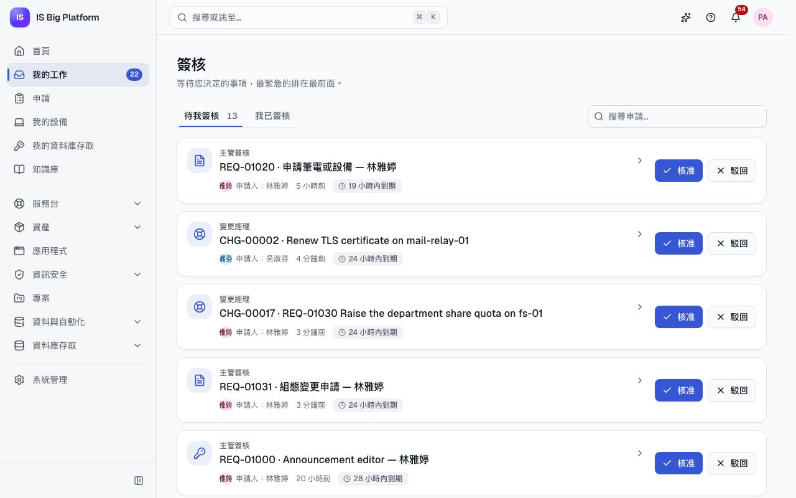

# 員工、主管與簽核者指南

本指南適用於所有與 IT 往來的人：申請存取權、設備或軟體，在系統故障時取得協助，追蹤您提出的申請，以及在您擔任簽核者時決定團隊的申請。這裡的一切都從側邊欄中的**申請**與**我的工作**開始。

## 您可以在這裡做什麼

- 在**我的工作**中[查看等待您處理的事項](#查看等待您處理的事項)
- [在申請頁面找到您需要的項目](#在申請頁面找到您需要的項目)
- [使用表單申請設備或軟體](#使用表單申請設備或軟體)
- [申請應用程式或角色的權限](#申請應用程式或角色的權限)
- [建立工單前先詢問 IT](#建立工單前先詢問-it)
- [回報問題](#回報問題)
- [追蹤您的申請](#追蹤您的申請)、[確認問題已解決](#確認問題已解決並為服務評分)或[撤回申請](#撤回申請)
- [查看您的設備並回報設備問題](#查看您的設備並回報設備問題)
- [申請資料庫存取](#申請資料庫存取)
- 簽核者適用：[核准或駁回申請](#核准或駁回申請)、[將簽核轉交給其他人](#將簽核轉交給其他人)，以及[設定不在辦公室](#休假前設定不在辦公室)
- [選擇要接收哪些通知](#選擇要接收哪些通知)，並[設定語言、時區與工作階段](#設定語言時區與工作階段)

## 查看等待您處理的事項

**我的工作**集中了所有請您處理的事項：核准申請、填寫表單、檢查審查中由您負責的部分、驗收變更、確認問題已解決、變更共用帳號的密碼，或處理專案工作。

1. 選擇側邊欄中的**我的工作**。旁邊的數字表示有多少事項在等待您（專案工作不計入）。**首頁**上的**需要您處理**會顯示最緊急的幾項。
2. 事項會分為**待您決定**、**待辦事項**、**待您檢查**與**工作項目**，最緊急的排在最前面。每一項都會顯示內容、編號或提出者，以及期限標記，例如 **2 天內到期**或**已逾期 3 天**。
3. 選擇事項即可開啟：簽核決定、表單，或審查中由您負責的部分。

**後續流程：** 完成後，該事項會從**我的工作**中移除，數字也會減少。沒有任何事項時，**我的工作**會顯示**目前沒有等待您處理的事項**。相同事項的通知也會開啟同一個項目，因此您可以從任一處開始處理。

## 在申請頁面找到您需要的項目

**申請**是 IT 的單一入口。每當您需要 IT 提供某項服務，或想知道申請的進度時，就到這裡。

1. 選擇側邊欄中的**申請**。
2. **我的申請**在最上方，您已送出的項目會最先看到。其下的**您需要什麼？** 依群組排列卡片：

| 群組           | 卡片                                                                                                                                                   |
| -------------- | ------------------------------------------------------------------------------------------------------------------------------------------------------ |
| **取得協助**   | **回報問題**（[詳細說明](#回報問題)）、**瀏覽知識庫**，以及先回答您問題的**詢問 IT**（[詳細說明](#建立工單前先詢問-it)）                               |
| **設備與軟體** | **我的設備**（[詳細說明](#查看您的設備並回報設備問題)），以及設備與軟體的申請表單，例如示範資料中的**筆電申請**（[詳細說明](#使用表單申請設備或軟體)） |
| **存取權限**   | **應用程式存取權限**（[詳細說明](#申請應用程式或角色的權限)）與**直接存取資料庫**（[詳細說明](#申請資料庫存取)）                                       |
| **其他**       | IT 提供的其他項目                                                                                                                                      |

卡片超過八張時，上方會出現搜尋框：輸入名稱的一部分，例如**筆電**，即可縮小範圍。

> **提示：** 您只會看到開放給您的表單。如果同事提到某份表單而您找不到，可能是該表單只開放給部分群組：請參閱[申請入口網站中沒有某份表單](faq.md#申請入口網站中沒有某份表單)。

## 使用表單申請設備或軟體

當您需要新筆電、螢幕、軟體授權或 IT 提供的其他項目時，請使用申請表單。表單會詢問 IT 需要知道的資訊，所需的簽核也已設定在表單上。

1. 前往**申請**，在**您需要什麼？** 下選擇表單，或開啟別人提供給您的表單連結。
2. 填寫欄位。有些問題只在適用時才會出現：例如在**申請筆電或設備**中，必須先將**品項**選為**筆記型電腦**，才會出現**筆電型號**。
3. 有些表單會請您選取 ISBP 已知的項目，例如變更涉及的組態項目。選擇**選擇紀錄**（可選取多筆時為**新增紀錄**），在**依編號或標題搜尋…** 下輸入其編號或標題的一部分，然後選取。您只會看到自己有權限檢視的紀錄，而表單也可能只提供其中一部分，例如只限正式環境的系統。
4. 如果表單需要簽核，請查看問題下方的**誰會核准此申請？**：它會依您目前的答案，列出每個簽核步驟及其會請求簽核的人員。內容會隨著您填寫表單而更新，例如您選取的系統需要額外的簽核時。不適用於您答案的步驟會標示為**此申請會略過此步驟**或不顯示。
   若某步驟的簽核人取決於您尚未回答的問題，該步驟會顯示**取決於「…」的答案**並註明問題名稱；填寫該問題後，就會出現簽核人。
5. 選擇**送出**。如果有必填欄位未填，表單會在該欄位旁顯示**此欄位為必填**。表單也可以同時檢查多個答案，例如結束日期不能早於開始日期：此時表單本身的訊息會顯示在需要修正的欄位上，或顯示在表單上方的**請檢查表單**下。

**後續流程：** 申請會取得 `REQ-01042` 這類編號，並在自己的頁面上開啟，顯示其**簽核路徑**。如果表單需要簽核（頁面會顯示**此申請需經過簽核，每個步驟都會通知您。**），申請會送交第一位簽核者。所有人都核准後，IT 就會處理：許多表單會成為服務台工單，申請頁面會顯示工單的進度（**處理中**，接著是**已完成**）及工單的連結（**開啟 SR-…**）。有些表單也會在申請送出或核准後自行開始作業，例如建立變更或授予角色：申請頁面會在**後續動作**下列出每個步驟及其狀態（**等待中**、**執行中**、**已完成**），以及它所建立項目的連結。申請核准或遭駁回時，您都會收到通知。

> **重要：** 如果**誰會核准此申請？** 顯示**此步驟沒有人能核准，申請將遭駁回**，表示目前沒有人能依您的答案核准該步驟。請不要送出：先洽服務台。

> **提示：** 在示範資料中，**筆電申請**表單會詢問**預估金額（新台幣）**。部門主管會簽核每一份筆電申請；金額超過新台幣 60,000 元時，還需經 IT 資產管理簽核。核准後的申請會成為**硬體 › 筆電**類別中的服務台工單。

## 申請應用程式或角色的權限

當您需要 IS Big Platform 中的角色（例如**公告編輯者**），或 ISBP 中登錄的業務應用程式角色（示範資料中為 **Finance ERP**、**HR Portal** 與 **Expense Claims**）時，請使用**應用程式存取權限**。您可以說明需要多久與原因，並在送出前看到由誰簽核。

1. 選擇**申請**，再選擇**應用程式存取權限**。
2. 選擇您需要的權限。角色依應用程式分組：業務應用程式在前，平台本身的角色則收合在最下方的**平台角色**中，展開才看得到。在**搜尋角色與應用程式…** 中輸入應用程式名稱（或選擇它的按鈕），該應用程式的角色會排在最前面。每個角色會顯示風險（**低風險**、**中風險**、**高風險**）、負責人，以及最長可授予的期間（例如**最多 90 天**）。尚未填寫說明的角色會顯示**尚無說明**，並附上可詢問的負責人。您已擁有的角色會顯示**您已擁有**；您已申請過的角色會顯示**已申請（REQ-…）**。
3. 選擇**繼續**。
4. 在**誰需要這項權限？** 下，選擇**我**或**其他人**。主管可以為直屬部屬申請；權限管理員可以為任何人申請。尚未報到的新人會標示**預先報到**：為他們申請的權限會在第一天就能使用。
5. 在**需要多久？** 下，選擇**7 天**、**30 天**、**90 天**、**自訂**（輸入**天數**），或在角色允許時選擇**無到期日**。
6. 在**為什麼需要？** 下至少輸入 10 個字。簽核者會看到這段說明，請寫具體一點，例如「我在前任主管休假期間，代為核准服務台團隊的報銷單。」
7. 選擇**檢閱**。確認**您的申請**與**由誰簽核**：依簽核流程與目前的組織圖，列出每個步驟與會被詢問的人。
8. 選擇**送出申請**。

**接下來會發生什麼：** 申請會以**等待簽核**的狀態開啟，狀態列會寫出它在等誰。預設先送交**主管簽核**，高風險角色再送**安全性審查**，最後是**權限負責人簽核**。部分角色使用自己的流程；檢閱步驟一定會顯示實際路徑。最後一位簽核者同意後，系統會自動授予角色，申請顯示**已授予權限 — 到期日為 …**（或**不會到期**）。有期限的權限到期時會自動移除，到期前幾天會提醒您（**權限即將到期**）。

> **重要：** 如果檢閱步驟顯示**沒有人可以簽核此步驟，申請將被駁回**，代表沒有人被設定為您這一步的簽核者。請不要送出，先詢問服務台或角色負責人。

## 建立工單前先詢問 IT

**詢問 IT** 是一個虛擬客服，隨時以您的語言依據知識庫回答 IT 問題。大多數問題（VPN、密碼、MFA、印表機）都能在幾秒內得到解答，不需要工單。若它無法解決，會為您準備一張工單，在您確認之前不會送出任何內容。

1. 選擇**首頁**上的**詢問 IT**，或**申請**頁面上的**提出問題**。也可以在頁面頂端的**搜尋或跳至…**中輸入問題，再選擇**詢問 IT：「…」**：詢問 IT 開啟時，您的問題已在輸入框中。
2. 用自己的話以任何語言描述問題，或從**建議的問題**中選擇一個（例如 **VPN 無法連線**）。按 Enter 或選擇**傳送**。
3. 閱讀回答。回答所參考的文章會以卡片列在**參考來源**下；開啟文章即可查看完整步驟。
4. 在**是否已解決？**下選擇**是，謝謝**或**否，建立工單**。
5. 選擇**否，建立工單**時，工單會直接在回答下方展開並預先填好內容。檢查**標題**、**說明**、**對您的影響有多大？**（**我無法工作**、**拖慢了我的工作**或**影響不大**）與**類型**（**有東西故障了**或**我需要某項服務**），然後選擇**建立工單**。若想繼續對話，請選擇**暫時不要**。

**後續流程：** 詢問 IT 會顯示**已建立工單 INC-…，服務台會在工單中與您聯繫。** 並提供**檢視工單**。這張工單會和您回報的其他工單一樣，出現在**我的申請**下。您先前的對話會列在**對話**下；選擇**新對話**即可開始新的對話。

> **提示：** 讀完知識文章仍無法解決？在**這篇文章有幫助嗎？**下回答**沒有**：**還是無法解決？**會提供**詢問 IT**與**回報問題**。

> **提示：** 對話頂端的標記說明回答是如何產生的。**答案來自知識庫**表示尚未設定 AI 語言模型：回答來自知識庫搜尋與範本。**AI 依據知識庫回答**表示由 AI 模型依據知識庫撰寫回答，並會先遮罩個人資料。無論哪一種，回答都可能有誤：請查看連結的文章。請參閱[助理與 AI](assistant-and-ai.md)。

## 回報問題

當某項功能故障，而您希望服務台人員修正時，請回報問題：例如 VPN 一直斷線、Outlook 無法同步、印表機卡紙。

1. 前往**申請**，選擇**回報問題**。
2. 在**發生了什麼問題？** 下用幾個字描述，例如「在家無法連上 VPN」。
3. 在**補充說明**下，說明發生了什麼事、從何時開始、您已嘗試過什麼，以及任何錯誤訊息。
4. 在**對您的影響有多大？** 下選擇**我無法工作**、**拖慢了我的工作**或**影響不大**。
5. 您也可以在**哪個服務？** 下選擇相關的系統（選填）。
6. 在您輸入時，**這些文章或許有幫助**會建議知識文章。如果其中一篇解決了問題，就不需要送出回報。
7. 選擇**送交服務台**。

**後續流程：** 畫面會顯示**已送出 INC-…，我們會盡快處理。** 並開啟工單。您會收到服務台已受理的通知，工單也會以**已收到**狀態出現在**我的申請**下。工單頁面會顯示其進度（**已收到**、**處理中**、**已解決**、**已結案**）、由誰處理（**處理單位**），以及與服務台的**對話**。若要補充細節或回答問題，請在**傳訊息給服務台**中輸入並選擇**傳送**；螢幕截圖請加入**附件**。處理人員回覆或工單解決時，您會收到通知。服務台的回應與解決時間會依 SLA 追蹤；請參閱[服務台](service-desk.md)。

## 追蹤您的申請

**我的申請**在**申請**頁面最上方，列出您提出過的所有項目：權限申請、表單申請、您回報的工單，以及資料庫存取申請。

1. 前往**申請**，**我的申請**是第一個區塊。
2. 選擇**進行中**、**已結束**或**全部**。
3. 每一列會顯示編號、最後變動的時間與狀態。申請等待簽核時，該列會顯示**等候 …**，寫出在等誰以及目前的步驟，例如**等候 Mei Lin（主管簽核）**。
4. 選擇一列即可開啟申請。

| 您看到的狀態                                       | 意思                                                                |
| -------------------------------------------------- | ------------------------------------------------------------------- |
| **已收到**                                         | 已送出，不需要簽核                                                  |
| **等待簽核**                                       | 簽核者尚未決定；申請頁面會寫出在等誰                                |
| **處理中**                                         | 已核准，IT（或表單自己的步驟）正在處理                              |
| **已核准** / **已完成**                            | 已決定或已完成。權限申請會在授予後顯示**已授予權限**                |
| **已駁回**                                         | 簽核者不同意；理由會顯示在申請上                                    |
| **已撤回**                                         | 您（或為您提出申請的人）撤回了申請                                  |
| **未完成**                                         | 已核准，但角色已不存在或人員已不在職                                |
| **暫停中**、**已解決 — 請確認**、**已結束**        | 您回報的工單（請參閱[確認問題已解決](#確認問題已解決並為服務評分)） |
| **準備中**、**已授予權限**、**已到期**、**已移除** | 資料庫存取（[詳細說明](#申請資料庫存取)）                           |

申請頁面頂端是狀態列：目前進行到哪裡、在等誰、何時到期、接下來會發生什麼（**下一步：財務簽核**）。其下的**由誰簽核**依序列出每個簽核步驟。已完成的步驟會顯示**已核准**或**已駁回**，以及決定者與時間，簽核者的意見會顯示在該步驟下方。正在等待的步驟會顯示**等待簽核**，以及被詢問的人與開始等待的時間。尚未開始的步驟顯示**下一步**與會被詢問的人；不適用於您的答案的步驟顯示**不需要**。

權限申請頁面也會顯示權限、**對象**（只有替他人取得權限時才顯示）、**期間**與**理由**。表單申請則顯示您的**答案**（未填寫的問題不會列出），而當表單開始自行處理時，還會顯示**接下來會發生什麼**：每個步驟、狀態（**等待**、**執行中**、**完成**、**失敗**或**略過**），以及它建立的項目的連結，例如**開啟 CHG-…**。**歷程**列出所有發生過的事件。如果某個步驟失敗，維護該表單的人會收到通知，並可以重新執行。

> **提示：** **首頁**也會顯示**您進行中的申請**，**我的工作**則列出等待您處理的簽核。

### 確認問題已解決並為服務評分

服務台解決您的工單後，會請您確認。

1. 從通知或**我的申請**開啟工單。工單頁面會顯示**問題解決了嗎？**
2. 如果已恢復正常，請選擇**是，可以結案**，並可在**對這次的服務滿意嗎？（選填）** 下為服務評分及留下意見，然後選擇**結案**。
3. 如果仍有問題，請選擇**不，還是有問題**，在**還有哪裡不對？** 中說明，然後選擇**重新開啟工單**。

**後續流程：** 結案的工單在**我的申請**中會變為**已結案**。重新開啟的工單會回到服務台，處理人員也會收到附有您原因的通知。

### 撤回申請

權限申請或表單申請只要仍在等待簽核，您就可以撤回不再需要的申請。

1. 從**我的申請**開啟申請。
2. 選擇**撤回**，然後在**要撤回此申請嗎？** 中再次選擇**撤回**（若改變主意，請選擇**保留**）。

**後續流程：** 申請會顯示**已撤回**，簽核者也不會再看到它。之後您可以重新送出申請。

## 填寫指派給您的表單

有些檢查必須在期限前完成，通常是每月或每季一次：機房巡檢、備份檢查、防火牆規則審查。當有人請您（或您所在的群組）填寫這類表單時，它會出現在**我的工作**的**待辦事項**中（也會出現在首頁的**需要您處理**），您會收到一則**待辦事項：…** 的通知。**申請**頁面會告訴您有幾件待辦事項，並連結到**我的工作**。

1. 開啟**我的工作**。**待辦事項**會依期限由近到遠列出您未完成的待辦，每一項都有表單與期限標記（逾期時顯示**逾期 …**）。指派給群組的待辦，群組中的任何人都可以完成。
2. 選擇一項待辦。表單會在上方顯示這項待辦：標題、期限、提出者的備註（如果有）、誰可以填寫，以及**送出表單即完成此待辦事項。**
3. 填寫表單並選擇**送出**。

**接下來會發生什麼：** 申請頁面會顯示**已完成。這已完成您的待辦事項「…」**，以及**已記錄於 2026 年 10 月。**。選擇**回到我的工作**即可返回。待辦會從您的清單中移除（若指派給群組，則會從所有成員的清單中移除）。申請會和其他申請一樣出現在**我的申請**中；如果表單需要簽核，仍會照常送簽。在您完成之前，系統會在期限前兩天起及逾期後每天提醒一次；逾期後，維護該表單的人會收到通知。在示範資料中，本月的**機房巡檢**正在等待 IT 管理員群組處理。

## 查看您的設備並回報設備問題

**我的設備**會列出 IT 配發給您的筆電、手機與其他硬體，以及個人配發給您的軟體授權。您可以用它查看資產編號或保固，或回報特定設備的問題。

1. 選擇側邊欄（或**首頁**）中的**我的設備**。
2. 每台設備都會顯示其**資產編號**、**序號**、**使用起始**與**保固**。
3. 若要回報某台設備的問題，請在該設備上選擇**回報問題**。

**後續流程：** **回報問題**頁面會開啟，並已連結該設備，讓服務台知道是哪一台。如果清單顯示**目前沒有配發給您的設備**，但您有公司設備，請選擇**通知服務台**，讓他們登錄設備。在示範資料中，服務台組長（`helpdesk`）有一台筆電與一支手機。

## 申請資料庫存取

開發人員、分析師與支援人員有時需要在一段有限的時間內取得資料庫上的角色。ISBP 會處理整個流程：簽核、建立帳號、讓您查看一次密碼，以及在到期時移除存取權。

1. 前往**申請**，選擇**直接存取資料庫**。
2. 在**權限**中選擇角色，在**詳細資料**中設定期限與原因，然後在**確認**中查看**簽核者**並選擇**送出申請**。
3. 存取權就緒時（**您的存取已就緒**通知），選擇該通知（或側邊欄中的**我的資料庫存取**）開啟**我的資料庫存取**，並選擇**顯示密碼**。密碼只會顯示一次，且僅在帳號建立後 7 天內可以顯示：請將密碼存入密碼管理工具。

簽核會先送交您的**主管簽核**，接著是**角色擁有者簽核**，高風險角色還需經過**資訊安全簽核**。詳細說明：[資料與自動化](data-and-automation.md)。

## 核准或駁回申請

如果您是主管、角色或應用程式負責人、變更審查委員會成員，或屬於某個簽核群組，申請會送到您這裡等待決定。請盡快處理：簽核步驟有期限，期限前會提醒，部分流程在期限過後會把申請升級給其他人。

1. 開啟**我的工作**：**待我決定**會列出等您決定的申請，最緊急的排在最前面。選擇一筆，或選擇簽核通知，即可開啟。選擇**查看全部**會開啟**簽核**收件匣，**待我簽核**會列出這些項目。每張卡片會顯示步驟（例如**主管簽核**）、申請內容、提出人（**申請人：…**），以及期限標記（例如**5 小時內到期**或**逾期 2 天**）。
2. 若要先看詳細資料，請選擇該卡片。面板會顯示**申請內容**、**由誰簽核**（每個步驟，您目前所在的步驟會標示**等候您簽核**）、可展開的**歷程**，以及**開啟申請**的連結。申請人在表單中選取的記錄（例如組態項目）是可以開啟的連結；您無權查看的記錄只會計數。
3. 選擇**核准**或**駁回**。在手機上，兩個按鈕都在卡片上，您可以直接在清單中決定。
4. 在對話框中可以加上意見：核准時可填（**備註（選填）**），駁回時必須填寫（**駁回原因為何？**）。申請人會看到這段意見。
5. 部分步驟要求您在決定時填寫欄位，位於**待填寫**下，例如評估結果、處理備註，或設備清除的日期。標示 \* 的欄位核准時必填；駁回時除非該步驟另有規定，否則為選填。您填寫的內容會與決定一併保存，並顯示在申請上。
6. 在對話框中選擇**核准**或**駁回**。

若要新增佐證，例如截圖或簽署的表單，請開啟申請（**開啟申請**），並在**附件**中新增；您也可以在那裡連結相關記錄。申請人與簽核者都可以新增，直到申請被撤回為止。

**接下來會發生什麼：** 卡片會離開清單，提示訊息會寫出您決定的是哪一筆申請。申請會進入下一個步驟，或完成。申請人會收到通知並看到您的意見。**我已簽核**列出您做過的決定。如果其他人已經先決定，面板會顯示**已由 … 決定**以及時間。

> **提示：** 您可以用編號搜尋收件匣（**搜尋申請…**）。新的簽核會在應用程式中通知您；若已設定電子郵件，也會寄送郵件（**待我簽核**）。

ISBP 中所有簽核都會進入同一個收件匣：權限申請、表單申請、變更（CAB）、資產報廢、專案提案、資料庫存取、知識庫文章，以及用助理準備的變更集。當某個步驟被升級時，會顯示**已升級給您**；當同事把簽核交給您時，會顯示**來自 …**。

## 將簽核轉交給其他人

當同事更適合做決定時（例如他們更熟悉該系統），請轉交簽核。

1. 在**簽核**中選擇該申請，開啟其面板。
2. 選擇**轉交**。
3. 選擇**同事**，視需要填寫**給對方的備註（選填）**，然後選擇**轉交**。

**後續流程：** 簽核會移到對方的收件匣，對方也會收到通知。申請人無法決定自己的申請。如果沒有**轉交**，表示該簽核流程步驟不允許轉交。

## 休假前設定不在辦公室

休假前先設定不在辦公室，讓簽核不必等您回來。這個設定只會出現在會簽核事項的人身上，因為它會把簽核交給同事。

1. 開啟使用者選單（右上角的頭像），選擇**個人資料與偏好設定**。
2. 前往**不在辦公室**，選擇**排程**。
3. 在**將我的簽核交給**下選擇同事。設定**開始**與**結束**（或快速選擇**期間**），並可選填**原因**，例如「年假」。
4. 選擇**排定不在辦公室**。

**接下來會發生什麼：** 在該期間內，新的簽核任務會交給您的代理人而不是您；已經在等您的任務仍由您處理。該期間會先顯示為**已排程**，開始後顯示為**目前生效**。選擇**立即結束**可提前回來，或選擇**移除**取消預定的期間。在示範資料中，人力資源業務夥伴（`hr.partner`）已排定年假，簽核會交給服務台主管。

## 選擇要接收哪些通知

ISBP 會通知您簽核、您的申請、工單等事項：在應用程式中（標題列的鈴鐺），以及電子郵件。

1. 開啟使用者選單，選擇**個人資料與偏好設定**，再選擇**通知**。
2. 通知類型依內容分為**簽核**、**我的申請**、**指派給我**、**公告**、**安全性通知**與**其他**。每一組都有**全部開啟**與**全部關閉**。若要個別設定，請展開**自訂**，再為每一種通知開啟或關閉**應用程式內**與**電子郵件**。變更會自動儲存。
3. 頁面會先顯示與您相關的類型：您先前設定過的、已經收到過的，以及無法關閉的。選擇**顯示全部 N 種通知**即可看到其餘類型。
4. **恢復預設值**會還原原始設定。

**接下來會發生什麼：** 之後的通知會依您的選擇送出。標示**安全性必要**的通知無法關閉。若頁面顯示此平台尚未設定電子郵件通知，則會隱藏**電子郵件**欄，您只會在應用程式中收到通知，直到管理員啟用電子郵件。

若要查看通知，請選擇鈴鐺：選擇一則即可開啟相關內容，或選擇**全部標示為已讀**。**查看全部通知**會開啟完整清單，包含**全部**與**未讀**分頁。

## 設定語言、時區與工作階段

您的偏好設定會跟著您到每一部登入的裝置。

1. 開啟使用者選單，選擇**個人資料與偏好設定**。
2. 在**偏好設定**下，選擇**語言**（也用於通知與電子郵件）、佈景主題，以及您的**時區**（日期與時間會以此時區顯示）。**使用此裝置的時區**會依您的電腦設定時區。
3. 在**個人資料**下變更您的**顯示名稱**。電子郵件、使用者名稱與部門由貴組織管理。
4. 若您以本機帳號登入，可以在**密碼**下變更密碼。若您透過貴組織登入，請在該處變更。
5. 在**工作階段**下，檢查已登入您帳號的裝置。在不認得的裝置旁選擇**登出**，或選擇**登出其他工作階段**。

### 查看您擁有哪些角色

**個人資料與偏好設定**底部的**我的存取權**會列出您的角色及其取得方式（**直接指派給您**、**透過群組**加上群組名稱，或**所有人**），有期限的角色也會顯示到期日。如果缺少您需要的權限，請[申請權限](#申請應用程式或角色的權限)。

## 與其他工作的關聯

- 您回報的工單由服務台處理：[服務台](service-desk.md)。
- 筆電與其他設備由資產管理員管理：[資產](assets.md)。
- 資料庫角色、帳號與存取審查：[資料與自動化](data-and-automation.md)。
- 詢問 IT 與助理如何使用 AI，以及如何處理您的資料：[助理與 AI](assistant-and-ai.md)。
- 您在這裡看到的表單與簽核流程由管理員設計：[管理員](administrators.md)與[建立您自己的流程](processes.md)。
- 端對端範例，例如新進人員的第一週：[ISBP 如何融入我們的工作](how-it-fits-our-work.md)。
- 有功能與說明不符？請參閱[常見問題與疑難排解](faq.md)。
