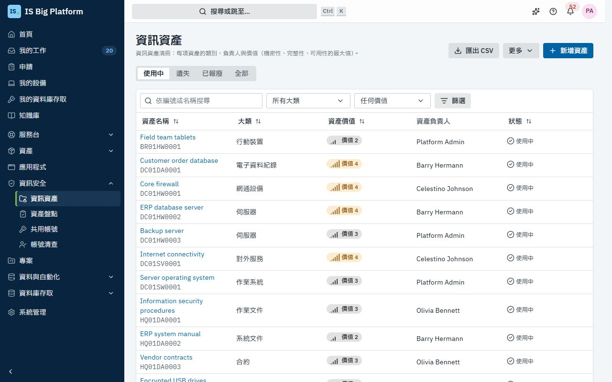
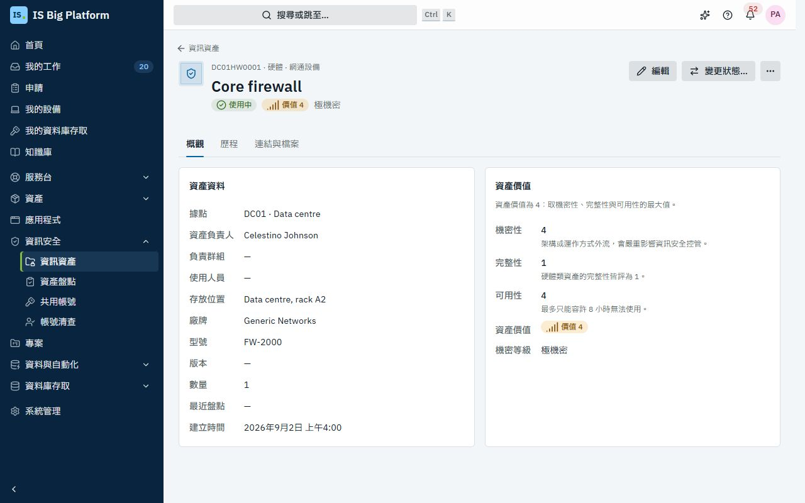
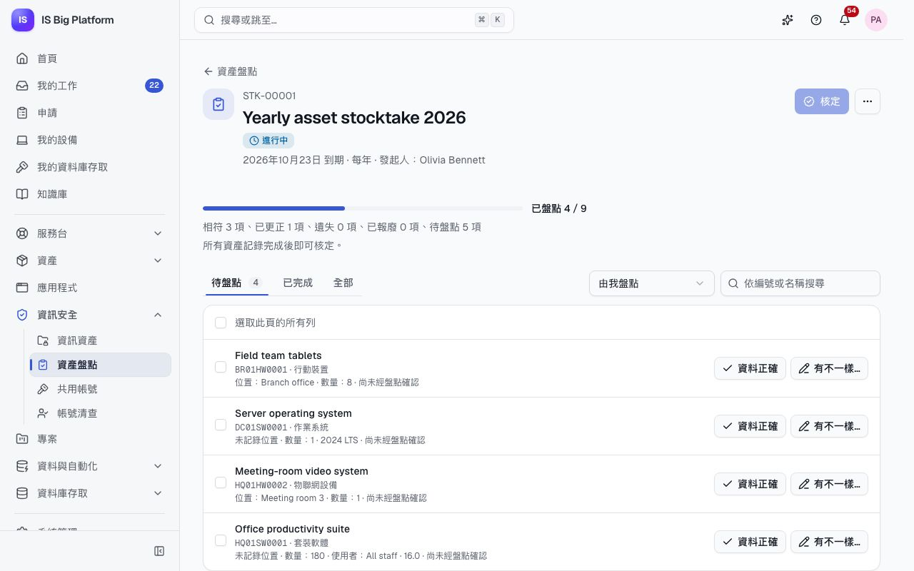
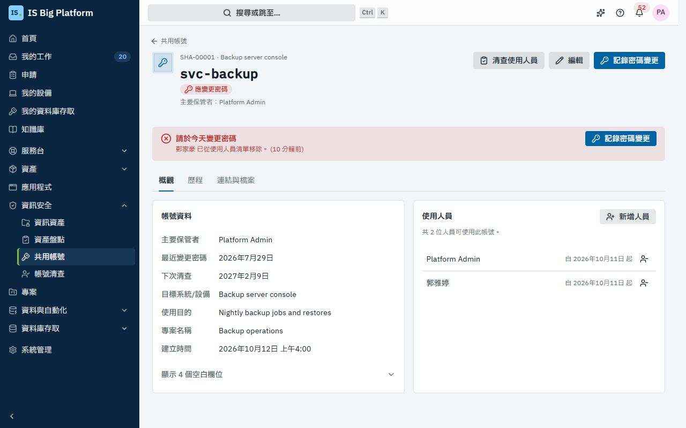
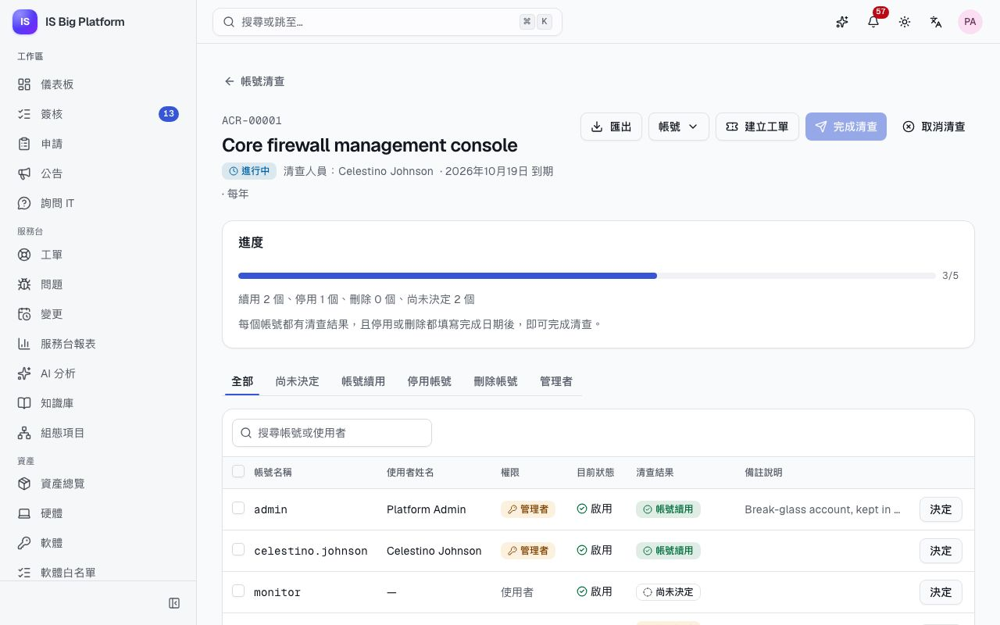

# 資訊安全（ISMS）指南

本指南適用於所有參與資訊安全管理系統（ISMS）的人員：資訊資產管理員、資訊安全主管、共用帳號的保管者，以及負責清查系統帳號的人員。**資訊安全**將 ISO 27001 稽核所需的紀錄集中在同一處：記錄每項資產機密性、完整性與可用性的資訊資產清冊、確保清冊正確的盤點、共用帳號及其使用人員，以及各系統的帳號清查。

## 您可以在這裡做什麼

- 了解[誰可以做什麼](#誰可以做什麼)，以及如何[評估機密性、完整性與可用性](#評估機密性完整性與可用性)
- [登錄資訊資產](#登錄資訊資產)、[在清冊中尋找資產](#在清冊中尋找資產)，並[查看資產頁面、歷程、連結與附件](#查看資產頁面)
- 以 CSV [匯出與匯入資產清冊](#匯出與匯入資產清冊)，或[從其他紀錄建立資產](#從其他紀錄建立資產)
- [執行資產盤點](#執行資產盤點)：[開始盤點](#開始或排程盤點)、[盤點您管理的資產](#盤點您管理的資產)，並[核定盤點](#核定盤點)
- [登錄共用帳號](#登錄共用帳號)、[有人離開清單時變更密碼](#有人離開清單時變更密碼)、[清查使用人員](#清查共用帳號的使用人員)，或[從申請表單登錄](#從申請表單登錄共用帳號)
- [執行系統的帳號清查](#執行帳號清查)，從[開始清查](#開始帳號清查)到[核定](#完成並核定帳號清查)
- [設定類別、據點與機密等級](#設定類別據點與機密等級)（管理員）
- [安裝 ISMS 流程範本套件](#isms-流程範本套件)，取得 ISMS 流程所需的表單與定期檢查
- [排解常見問題](#排解常見問題)

## 誰可以做什麼

下列角色在**系統管理 → 角色與存取權**中授予。只是參與其中的人員（在盤點中確認自己負責的資產、清查某個系統的帳號、保管共用帳號）會在**我的工作**與通知中看到這些工作；側邊欄中的**資訊安全**頁面是給下表其他角色使用的。如果需要卻看不到這些頁面，請向管理員申請。

| 角色                                                     | 允許的操作                                                                               |
| -------------------------------------------------------- | ---------------------------------------------------------------------------------------- |
| **資訊安全參與者**（Information security participant）   | 所有人都有：盤點自己負責的資產、處理指派給自己的帳號清查，並查看自己保管或使用的共用帳號 |
| **資訊安全檢視者**（Information security viewer）        | 檢視與匯出資產清冊，並檢視所有盤點、共用帳號與帳號清查                                   |
| **資訊資產管理員**（Information asset manager）          | 維護資產清冊（登錄、編輯、刪除、匯入、從其他紀錄建立），並開始、排程與取消盤點           |
| **資訊安全主管**（Information security officer）         | 核定盤點與帳號清查、登錄與變更共用帳號、開始與取消帳號清查，並檢視資產清冊               |
| **資訊安全管理者**（Information security administrator） | 資訊安全的所有功能，包含類別、據點與機密等級                                             |

在示範資料中，IS Administrators 群組擁有**資訊資產管理員**角色，Security Team 擁有**資訊安全主管**角色，Network Team、DBA Team、Service Desk 群組與 `auditor` 使用者擁有**資訊安全檢視者**角色，`admin` 則是**資訊安全管理者**。

> **提示：** **我的工作**會列出這裡需要您處理的事項：**資產盤點檢查**（您負責且需要盤點的資產）、指派給您的**帳號清查**，以及您保管的共用帳號中**待變更的密碼**。

## 評估機密性、完整性與可用性

每項資產都要為**機密性**（資訊遭不當存取或洩漏時的影響）、**完整性**（內容錯誤、不完整或遭竄改時的影響）與**可用性**（無法使用時的影響）各評一個 1 到 4 的分數。**資產價值**取三者的最大值：評分為 4、1、2 的資產，價值為 4。資產價值不需要人工填寫，因此不會因疏忽而低估。

每個評分的意義取決於資產的類別。評分時，表單會在每個評分旁顯示該類別的評分說明；只要符合其中一項評估條件，就選用該評分。預設類別如下：

| 類別     | 代碼 | 小類                                                                       | 評分方式                                                                                 |
| -------- | ---- | -------------------------------------------------------------------------- | ---------------------------------------------------------------------------------------- |
| **人員** | `PE` | **內部人員**、**外部人員**                                                 | 機密性依其經手資訊的最高機密程度；完整性一律為 1；可用性依其缺席時受影響的範圍           |
| **硬體** | `HW` | **伺服器**、**網通設備**、**可攜式儲存媒體**、**行動裝置**、**物聯網設備** | 機密性依其設定資料外洩的影響；完整性一律為 1；可用性依可容許的停機時間（4：最多 8 小時） |
| **軟體** | `SW` | **作業系統**、**套裝軟體**                                                 | 機密性依其程式邏輯外洩的影響；完整性依結果錯誤的影響；可用性依可容許的停機時間           |
| **資訊** | `DA` | **作業文件**、**系統文件**、**電子資料紀錄**、**合約**                     | 機密性從內部（1）到極機密（4）；完整性與可用性依內容錯誤或遺失時受影響的對象             |
| **服務** | `SV` | **對內服務**、**對外服務**                                                 | 機密性依其運作方式外洩的影響；完整性一律為 1；可用性依可容許的停機時間                   |

每項資產還可以標示**機密等級**，說明其資訊應如何處理，預設為**極機密**、**客戶機密**、**機密**與**限內部使用**。這四個等級對應機密性評分（評分 4 為最嚴格的等級），因此表單會依機密性評分建議機密等級；若此資產需要其他等級，請自行變更。評分不會預先選好：三項都選擇之前，資產價值會顯示**尚未評分**。管理員可以變更類別、評分說明與機密等級，請參閱[設定類別、據點與機密等級](#設定類別據點與機密等級)。

## 登錄資訊資產

當組織開始依賴某項資產時就登錄它：新的伺服器、新系統的資料庫、合約、外部服務或團隊。您需要**資訊資產管理員**角色。

1. 前往**資訊安全 → 資訊資產**，選擇**新增資產**。
2. 在**資產**下輸入**資產名稱**（以功能面敘述為原則，簡單清楚），並選擇**大類**、**小類**與**據點**。
3. 在**負責人**下，選擇**資產負責人**（人員）或**負責群組**：盤點時由他們確認。
4. 在**機密性、完整性與可用性**下，參考各評分旁的說明，分別選擇評分。**資產價值**會隨您的選擇即時顯示結果，並說明取決於哪一項評分（例如「取決於完整性」）。接著確認**機密等級**：它會依機密性評分建議。
5. 在**使用者與存放位置**下，選擇**使用人員**並輸入**存放位置**。
6. 在**更多詳細資料**下（硬體與軟體會預設展開），可在**其他使用者（文字）**中描述其他使用者（例如「財務部」），視需要輸入廠牌、型號、版本與數量，並填寫**備註**。
7. 填寫管理員加入的其他欄位，然後選擇**儲存**。

**後續流程：** 資產會取得編號（例如 `HQ01HW0003`），並開啟其頁面，歷程從「已登錄」開始。每次納入此資產的盤點，都會由資產負責人或負責群組的成員確認。

如要變更資產，請開啟它並選擇**編輯**，然後選擇**儲存變更**。若要在盤點以外記錄資產遺失或已報廢，請選擇**變更狀態…**，選擇**遺失**、**已報廢**或**使用中**，在備註中說明時間與方式，再選擇**變更狀態**：歷程會保留備註。**更多 → 刪除**會將資產與其連結及附件從清冊移除（稽核日誌仍保留其歷程）；若要保留紀錄，請改為標記已報廢。

### 資產編號的組成方式

資產編號由據點代碼、類別代碼與該據點及類別的下一個流水號組成：`HQ01HW0001` 是總部（`HQ01`）的第一項硬體資產。每個據點與類別各有自己的流水號。編號永遠不變，即使之後將資產移到其他據點或類別也一樣，因此貼有編號的標籤與文件都不需要修改。

資產的**狀態**（**使用中**、**遺失**或**已報廢**）不在表單中編輯：可在資產頁面以**變更狀態…**變更，也會在盤點核定時變更，或透過 CSV 匯入的**狀態**欄變更。

## 在清冊中尋找資產

1. 前往**資訊安全 → 資訊資產**。**使用中**、**遺失**、**已報廢**與**全部**頁籤依狀態篩選。
2. 依編號或名稱搜尋，並使用**所有大類**與**任何價值**（例如**價值 3 以上**）縮小清單。其他篩選條件在**篩選**中：**機密等級**、**據點**、**負責群組**與**資產負責人**（手機上所有篩選條件都在這裡）。已套用的篩選會顯示為可個別移除的標籤，也可以選擇**全部清除**。
3. 選擇欄位標題排序，選擇資產即可開啟。

清單會顯示每項資產的名稱與編號、**大類**、**資產價值**（將指標移到上面可看到三項評分）、**資產負責人**、**機密等級**與**狀態**。資產價值以中性的標籤與小量表顯示，只有價值 4 會特別標示。篩選條件會保存在頁面網址中，因此可以用連結分享篩選後的清單。

在示範資料中，**價值 4 以上**會列出 Core firewall、ERP database server、Customer order database 與 Internet connectivity。

> **提示：** 頁首的搜尋也能找到資訊資產與共用帳號，助理也可以依您的權限替您尋找資產（「哪些硬體的價值是 4？」）。

## 查看資產頁面

開啟資產後，可在三個頁籤中查看它的所有資訊：

- **概觀**：**資產資料**（據點、資產負責人、負責群組、使用者、存放位置、廠牌、型號、版本、數量、盤點時更新的**最近盤點**，以及從其他紀錄建立時的**登錄來源**），以及**資產價值**卡片，顯示每項評分、該類別對此評分的說明、**資產價值**與**機密等級**。
- **歷程**：每項變更及其執行者與時間：**已登錄**、**已更新**、**已匯入**、**盤點時更新**與**狀態已變更**，並列出變更的欄位。
- **連結與檔案**：**連結的紀錄**與**附件**。選擇**連結紀錄**可連結此資產相關的組態項目、硬體資產、應用系統或工單；選擇**上傳**可附加文件，例如風險評鑑或已簽署的資訊處理協議。

申請表單可以用**紀錄**欄位（紀錄類型**資訊資產**）讓人員選取資訊資產；簽核可以依資產的**資產價值**、**機密性**、**完整性**、**可用性**、**機密等級**、**資產負責人**、**管理群組**、**資產類別代碼**、**據點代碼**或**資產狀態**決定路徑，例如價值為 4 的資產另需資訊安全主管簽核。選取資產需要可以檢視資產清冊的角色。請參閱[讓人員選取紀錄](processes.md#讓人員選取紀錄)。

## 匯出與匯入資產清冊

稽核人員常需要試算表形式的清冊，許多組織也是從試算表開始建立清冊。匯出與匯入使用相同的格式，因此您可以匯出、在 Excel 中編輯後再匯入。

**匯出。** 在**資訊安全 → 資訊資產**中選擇**匯出 CSV**。您會取得目前頁籤與篩選條件下的資產，欄位名稱使用您的語言。檔案為含 BOM 的 UTF-8，因此 Excel 能正確顯示中文與日文。

**匯入。** 您需要**資訊資產管理員**角色。

1. 選擇**更多**，再選擇**從 CSV 匯入**。
2. 在**CSV 檔案**中選擇檔案，然後選擇**檢查檔案**。此時不會變更任何資料：對話方塊會說明匯入後的結果（「檢查結果：登錄 … 項、更新 … 項、… 項無變更。目前尚未變更任何資料。」），並列出每一筆將不處理的資料列，包含列號、欄位與問題。
3. 視需要修正檔案並重新檢查，然後選擇**匯入**。

**後續流程：** 有效的資料列會一次套用，無效的資料列則不處理。每項匯入資產的歷程都會顯示「已匯入」，匯入作業也會記錄在稽核日誌中。

### CSV 格式

欄位依紙本清冊的順序排列：**資產編號**、**資產名稱**、**大類**、**小類**、**資產管理者**、**資產使用者**、**存放位置**、**廠牌**、**型號**、**版本**、**數量**、**機密性**、**完整性**、**可用性**、**資產價值**，接著是**機密等級**、**據點**、**狀態**與**備註**。

- 欄位順序不拘，欄位名稱可用英文、中文或日文。欄位名稱列上方的標題列會被略過。欄位可用逗號、分號或 Tab 分隔；可讀取 UTF-8、UTF-16 與 Big5 檔案。
- **資產編號**已存在的資料列會更新該資產；空白儲存格保留原值。
- 其他資料列會登錄為新資產，必須有**資產名稱**、**大類**、**據點**（只有一個據點時可省略）與三項評分。**資產編號**留白即自動編號，也可以填入該據點與類別尚未使用的編號（以沿用紙本清冊的編號）。
- **大類**、**小類**、**據點**與**機密等級**可填代碼或任一語言的名稱。**資產管理者**（即資產負責人，欄位名稱沿用紙本清冊）可填人員的電子郵件、使用者名稱或顯示名稱，或群組名稱。**機密性**、**完整性**與**可用性**為 1 到 4。
- **資產價值**一律依評分自動計算。每個檔案最多 2,000 列。

## 從其他紀錄建立資產

清冊中的許多項目早已存在於 ISBP：CMDB 中的伺服器、資產中的筆電與授權、合約、應用系統，以及知識庫中的作業程序。請直接從那裡登錄，不必重新輸入。

1. 在**資訊安全 → 資訊資產**中選擇**更多**，再選擇**從其他紀錄建立**。
2. 選擇**紀錄類型**：**組態項目**、**硬體資產**、**軟體授權**、**合約**、**應用系統**或**知識文章**（只會列出您可以檢視的類型）。
3. 搜尋並勾選紀錄。已在清冊中的紀錄會顯示**已登錄為 …**，無法再次勾選。
4. 在**新資產的設定**下，選擇所有新資產共用的**大類**、**小類**、**據點**、**機密等級**、**資產負責人**與三項評分（不會預先選好評分）。
5. 選擇**登錄 … 項資產**。

**後續流程：** 每筆紀錄都會成為以其名稱命名的資產，並與原紀錄連結（資產頁面上的**登錄來源**，以及雙方的**連結的紀錄**）。如果個別資產的評分或負責人不同，之後再個別調整。

## 執行資產盤點

盤點用來確認清冊仍與實際相符：每項資產的負責人確認、更正，或回報遺失或報廢，再由資訊安全主管核定結果。將盤點設為每季或每年重複，下一次盤點就會自動排程。

在示範資料中，硬體與軟體的 **Yearly asset stocktake**（`STK-00001`）正在進行：Core firewall、ERP database server 與 Endpoint protection 已確認相符，Backup server 則因移到 B4 機櫃而已更正。

### 開始或排程盤點

您需要**資訊資產管理員**或**資訊安全主管**角色。

1. 前往**資訊安全 → 資產盤點**，選擇**新增盤點**。
2. 輸入**名稱**、**開始日期**（今天；若要排程則填之後的日期）與**到期日**。
3. 在**更多詳細資料**下選擇**重複**（**一次**、**每季**或**每年**）與範圍：在**大類**與**據點**下勾選項目，在**資產負責人**下以**新增負責人**加入人員，並在**負責群組**下勾選群組。清單留白表示全部納入。包含使用中與遺失的資產。
4. 選擇**開始**；若之後才開始，則選擇**排程**。

**後續流程：** 範圍內的每項資產都會成為其資產負責人（或負責群組成員）的盤點項目，他們會收到附有到期日的通知（「盤點 …：… 項資產待盤點」）。已排程的盤點會顯示「此盤點將於 … 開始。」，並在當天早上自動開始。到期日前一週，仍有待盤點項目的管理者會收到提醒；逾期後，他們與建立盤點的人員都會收到通知。所有項目都記錄完成後，建立盤點的人員會收到可以核定的通知。負責人也會在**我的工作**（**資產盤點檢查**）中看到自己的部分。

### 盤點您管理的資產

盤點開始時，您會收到自己負責之資產的通知。請到資產所在處逐一確認：機房、儲物架或文件系統。

1. 從通知或**我的工作**（**資產盤點檢查**）開啟盤點。盤點會開在**待盤點**，並先列出您的資產。每項資產都會顯示清冊目前的資料：位置、數量、使用者、廠牌、型號與版本，以及上次確認的時間。（**資訊安全 → 資產盤點**的**等待您處理**也會列出它們。）
2. 對每項資產：
   - **資料正確**：按一下即記錄為**相符**。
   - **有不一樣…**：對話方塊會再次顯示清冊的資料，並詢問哪裡不一樣。選擇**部分資料不一樣**並更正**資產名稱**、**存放位置**、**使用者（部門或人員，文字）**、**廠牌**、**型號**、**版本**或**數量**；選擇**找不到**並說明您找過哪些地方；或選擇**已報廢**並說明報廢的時間與方式（例如報廢證明的編號）。選擇**記錄**。
3. 如要一次確認多項，請勾選後選擇**資料正確（…）**。

**後續流程：** 資產會離開**待盤點**。更正內容會立即套用到清冊，資產的歷程會顯示「盤點時更新」。遺失與已報廢的資產要到盤點核定時才會變更狀態。沒有其他需要您處理的資產時，頁面會顯示「全部完成」。核定之前，您都可以在**已完成**頁籤中修改結果。

### 核定盤點

1. 從**資訊安全 → 資產盤點**開啟盤點。進度列與其下方的說明會顯示相符、已更正、遺失、已報廢與待盤點的資產數。**待盤點**、**已完成**與**全部**頁籤可篩選項目（在**已完成**中可選擇結果），**由我盤點**／**所有人**可切換只看自己的項目或全部項目。
2. 在**待盤點**追蹤剩下的項目：每個項目都會顯示由誰盤點。盤點管理人員也可以自行記錄任何項目。
3. 所有資產都記錄完成後，由資訊安全主管選擇**核定**，填寫**備註（選填）**，再選擇**核定**。

**後續流程：** 回報遺失的資產會變成**遺失**，已報廢的會變成**已報廢**，其餘資產則為**使用中**，且**最近盤點**設為今天。盤點會顯示「由 … 核定」。若設為重複，系統會以相同名稱與範圍，在三個月或十二個月後排程下一次盤點。

在**更多**（⋯）中，**匯出盤點結果**可取得稽核佐證：包含每項資產、盤點結果、更正內容、備註、記錄人員與記錄時間的 CSV 檔。不再需要的盤點可選擇**取消盤點**；已記錄的結果會保留，但無法核定。

## 登錄共用帳號

共用帳號是由多人使用的帳號：服務帳號、設備的管理者帳號、信箱登入帳號等。依我們的規定，每個共用帳號都必須經過核准、有一位保管密碼的主要保管者，並列出允許使用的人員。有人離開清單時，必須於當天變更密碼。

您需要**資訊安全主管**角色。

1. 前往**資訊安全 → 共用帳號**，選擇**登錄共用帳號**。
2. 輸入**帳號名稱**與**目標系統/設備**。
3. 選擇**主要保管者**，並以**新增人員**加入**使用人員**。
4. 視需要在**更多詳細資料**下選擇**連結的應用系統或組態項目**，並填寫**申請部門**、**專案名稱**、**申請單號**、**最近變更密碼**、**下次清查**、**使用目的**與**備註**。
5. 選擇**登錄**。

**後續流程：** 帳號會取得 `SHA-00003` 之類的編號。主要保管者與清單中的人員可以在**共用帳號**中看到它，需要變更密碼時也會出現在**我的工作**中。若未設定，**下次清查**為 12 個月後。

> **重要：** ISBP 不會儲存密碼本身。密碼由主要保管者以加密方式保管，此處只記錄變更密碼的日期。請勿在備註中填寫密碼。

如要變更主要保管者、使用人員或其他資料，請開啟帳號並選擇**編輯**；**使用人員**卡片上的**新增人員**可直接加入一位人員。將人員從清單移除後，就必須變更密碼。沒有填寫的欄位收在**顯示 … 個空白欄位**中。

## 有人離開清單時變更密碼

發生下列情況時，共用帳號的密碼就必須變更，帳號會顯示**應變更密碼**：

- 清單中的人員在**系統管理 → 人員**中辦理離職：該人員會從所有清單中移除（「… 已離職」）；
- 清單中的人員調到其他部門：該人員仍保留在清單中，若已不需要此帳號，請將其移除（「… 已調至其他部門」）；
- 有人以手動或在年度清查中從清單移除；
- 主要保管者離職：系統會通知資訊安全主管以**編輯**指定新的保管者。

主要保管者會在 ISBP 中與透過電子郵件收到「請於今天變更 … 的密碼」通知，此通知無法關閉。

1. 從通知、**首頁**卡片，或**資訊安全 → 共用帳號**的**應變更密碼**頁籤開啟帳號。頁面會顯示**請於今天變更密碼**及原因。
2. 在系統本身變更密碼。
3. 選擇**記錄密碼變更**（在警示中，或頁面頂端），確認**變更日期**，填寫**備註（選填）**，然後選擇**記錄**。在清單的**應變更密碼**頁籤中，該列的**記錄變更**也可以完成相同操作，不必開啟帳號。

**後續流程：** 警示會消失，**最近變更密碼**會顯示該日期。歷程會顯示「已於 … 變更密碼」，這項變更也會記錄在稽核日誌中。同一次變更即使記錄兩次，也只會記錄一次。

如要自行將人員從清單移除，請開啟帳號的**概觀**，選擇**使用人員**下該人員旁的按鈕（**將 … 從清單移除**），再選擇**移除**確認。

在示範資料中，有人已從 `svc-backup`（`SHA-00001`，備份伺服器主控台）的清單中移除，因此該帳號應變更密碼；`report_reader`（`SHA-00002`）則沒有待辦事項。

## 清查共用帳號的使用人員

每年一次，由主要保管者確認清單中的每個人都仍需要此帳號。到了**下次清查**日期，主要保管者會收到通知（「請清查 … 的使用人員」），帳號會顯示年度清查已到期，並列在**應清查**頁籤中。

1. 開啟帳號，選擇**清查使用人員**。
2. 保留勾選仍需要此帳號的人員，取消勾選其他人員。對話方塊會顯示將移除幾位人員。
3. 填寫**備註（選填）**，然後選擇**確認清查**。

**後續流程：** 取消勾選的人員會從清單移除；只要有人被移除，就必須變更密碼。**最近清查**為今天，**下次清查**延後 12 個月；歷程會顯示「已確認使用人員；下次清查 …」。主要保管者或**資訊安全主管**都可以執行清查，管理員可以在模組設定中變更 12 個月的間隔。

## 從申請表單登錄共用帳號

如果共用帳號是以表單申請（如同紙本表單，每位使用者一列，並指定保管者），申請在核准後即可自動登錄帳號，清冊就不會遺漏。

1. 在**系統管理 → 表單**中開啟表單，前往**動作**分頁，選擇**新增動作**。
2. 選擇**登錄共用帳號**，並將**執行時機**設為**核准後**。您需要**資訊安全主管**角色才能加入此動作。
3. 填寫設定：**帳號名稱**與**目標系統/設備**（文字，或取用表單答案的範本）、表單中若有則填**應用系統或組態項目欄位**、**主要保管者**（**申請人**或人員欄位）、**使用人員**（人員欄位，或表格中的人員欄），以及**使用目的**與**專案名稱**。
4. 選擇**新增動作**，然後選擇**儲存**與**發佈**。

**後續流程：** 申請核准後，帳號會以申請編號作為**申請單號**登錄，申請也會連結到該帳號。若同一系統上已有同名的啟用中帳號，則改為將新的人員加入該帳號，其歷程會顯示「已依申請單更新」。在核准前已離職的人員不會被加入。動作的詳細說明：[加入動作](processes.md#加入動作)。

## 執行帳號清查

帳號清查會逐一檢查某個系統（防火牆、伺服器、資料庫、應用系統）的所有帳號，並為每個帳號決定保留、停用或刪除，再由資訊安全主管核定結果。將清查設為每季或每年重複，下一次清查就會自動排程。

在示範資料中，**Core firewall management console** 的帳號清查（`ACR-00001`）正在進行：清查人員是一位網路工程師，`admin` 作為緊急備用帳號而保留，`temp-vendor` 因專案結束已停用，其他帳號尚未決定。

### 開始帳號清查

您需要**資訊安全主管**角色。

1. 前往**資訊安全 → 帳號清查**，選擇**新增帳號清查**。
2. 輸入**清查標的（系統/設備名稱/IP）**（例如「核心防火牆、10.0.0.1」）。
3. 選擇**清查人員**、**開始日期**與**到期日**。
4. 在**更多詳細資料**下，可選擇**連結的應用系統或組態項目**與是否**重複**（**一次**、**每季**或**每年**）。在**帳號來源**下，選擇**從系統匯出的帳號清單匯入**；若是在 ISBP 中登錄的應用系統，則可選擇 **… 的角色持有人**，清查會從持有其任一角色的所有人員開始。
5. 選擇**開始**；若之後才開始，則選擇**排程**。

**後續流程：** 清查人員會收到附有到期日的通知（「請清查 … 的帳號」），並在到期日前一週收到提醒。逾期後，清查人員與建立清查的人員都會收到通知。

### 填入帳號

清查人員（或資訊安全主管）可以從清查頁面上的**更多**（⋯）填入系統的帳號（沒有帳號的清查，頁面中央也會提供**匯入帳號清單**）：

- **匯入帳號清單**：從系統匯出帳號清單，並在**CSV 檔案**中選擇該檔案。欄位順序不拘，欄位名稱可用英文、中文或日文：帳號名稱（必填）、使用者姓名、權限（管理者或使用者）、目前狀態（啟用或停用），以及選填的清查結果、完成日期與備註說明。選擇**檢查檔案**，再選擇**匯入**。已列出的帳號會更新，其他帳號會新增，並依使用者名稱、電子郵件或唯一的顯示名稱比對人員。
- **新增帳號**：用於清單中缺少的帳號。輸入**帳號名稱**、**使用者姓名**、**人員**、**權限**與**目前狀態**，然後選擇**新增**。

### 決定每個帳號的清查結果

1. 從通知或**我的工作**（**帳號清查**）開啟清查，清查會開在**待決定**。**待決定**、**已決定**與**全部**頁籤可篩選帳號；在**已決定**與**全部**中可選擇**保留**、**停用**、**刪除**或**管理者**。
2. 在每個帳號上選擇**保留**、**停用**或**刪除**。**保留**會立即記錄。**停用**與**刪除**會詢問**完成日期（選填）**（若現在已完成可選擇**今天**）與**備註**；尚未完成時請留空。
3. 如要一次決定多個帳號，請勾選後選擇**保留 … 個**、**停用 … 個**或**刪除 … 個**。

尚未填寫日期的停用或刪除帳號會顯示**尚未完成：完成後請填寫日期**，並留在**待決定**中。已標記停用或刪除、但最新匯入仍為啟用的帳號會被標示（「已標記停用，但最新匯入仍為啟用」）：請檢查系統。

### 建立停用或刪除帳號的工單

如果系統管理人員是依服務台工單作業，請選擇清查頂端的**建立 … 張工單**。確認對話方塊會列出帳號（「停用 temp-vendor」）；選擇**建立 … 張工單**，ISBP 就會以您的名義，為每個尚未有工單的停用或刪除結果各建立一張服務請求，並在帳號上顯示工單編號。工單完成後，請填入**完成日期**。按鈕會顯示將建立的工單數，所有停用與刪除都有工單後就會消失；重複選擇也不會重複建立工單。

### 完成並核定帳號清查

1. 每個帳號都有清查結果，且每個停用與刪除都填寫完成日期後，清查人員選擇**送出核定**。清查會變成**待核定**，建立清查的人員會收到通知。
2. 資訊安全主管檢查清查結果後選擇**核定**，填寫**備註（選填）**，再選擇**核定**。如需修改，請改選**退回**：清查會退回給清查人員。

**後續流程：** 清查會顯示「由 … 核定」。若設為重複，系統會在三個月或十二個月後排程下一次清查：從本次未刪除的帳號開始，若是應用系統則從當時的角色持有人開始。

在**更多**（⋯）中選擇**匯出 CSV** 即可取得稽核佐證：CSV 檔會先列出清查標的、清查日期與編號，再列出每個帳號的使用者姓名、權限、目前狀態、清查結果、完成日期與備註說明。不再需要的清查可選擇**取消清查**；已記錄的清查結果會保留。

## 設定類別、據點與機密等級

預設值依照常見的 ISO 27001 資產清冊設計。請在匯入或登錄大量資產之前調整。您需要**資訊安全管理者**角色。

1. 前往**系統管理 → 資訊安全**。
2. 在**類別**中選擇**新增類別**，或選擇類別上的**編輯**。輸入**代碼**（2 到 4 個大寫英文字母，例如 `HW`，用於資產編號，建立後無法變更）、各語言的**名稱**與**描述**、**順序**、**小類**（以**新增小類**加入，含**代碼**與**名稱**），以及**評分說明**：**機密性**、**完整性**與**可用性**的 1 到 4 分各代表什麼（不適用的評分請留白）。選擇**儲存**。
3. 在**據點**中選擇**新增據點**，輸入**代碼**（每項資產編號的開頭，例如 `HQ01`）、**名稱**與**描述**。
4. 在**機密等級**中選擇**新增機密等級**，輸入**代碼**、**等級順位**（順位越高越機密，清單由最高者開始顯示）、**名稱**與**描述**。

這裡的項目都不會刪除：不再使用的類別、據點或機密等級請選擇**封存**，小類則關閉**使用中**。封存的項目不會出現在新資產的選項中，已使用它們的資產則維持不變。選擇**還原**即可重新啟用。

另有兩項設定位於**系統管理 → 模組**中**資訊安全**的**設定**：**到期前提醒天數**（預設 7）與**共用帳號清查間隔（月）**（預設 12）。如要為資產加入自己的欄位，請在**系統管理 → 自訂欄位**中為**資訊資產**新增自訂欄位。

> **提示：** 您也可以請助理準備新的資產類別（含小類與評分說明），作為變更集，經人員審核後才套用。請參閱[助理與 AI](assistant-and-ai.md)。

## ISMS 流程範本套件

除了資產清冊之外，ISMS 還需要許多小流程：權限申請、防火牆規則變更、定期巡檢、設備借用與歸還、軟體申請，以及政策例外的核准。**ISMS 流程範本套件**是**資訊安全**模組提供的範本套件，可以用一個變更集一次建立這些流程，讓您從一套可運作的流程開始，再依組織需求調整。

### 安裝 ISMS 流程範本套件

1. 前往**系統管理 → 變更集**，選擇**從套件建立**。
2. 在**範本套件**中找到 **ISMS 流程範本套件**。它會顯示提供它的模組、變更數，以及變更的對象。
3. 選擇**安裝**。
4. 檢閱新的草稿變更集，以及其中的變更是否可套用，然後套用或要求審核。

**後續流程：** 變更集套用前不會有任何內容生效。套用後，群組、表單、排程作業與類別就和您自己建立的一樣：請確認每個群組的成員，再像調整其他項目一樣調整簽核者、文字與排程。整個變更集可以回復。同一個套件安裝兩次，會得到第二個變更集，其中的變更無法套用：請將它捨棄。完整流程（包括模組與權限相關的訊息）：[從套件開始](assistant-and-ai.md#從套件開始)。

### 套件包含的內容

- **群組**：負責簽核與執行 ISMS 工作的人員。
- **申請表單**，各有其簽核流程與後續動作：權限申請、防火牆規則變更、巡檢、設備借用與歸還、軟體申請，以及政策例外。
- **排程待辦事項**：排程作業會請負責的群組填寫定期檢查表單，表單會出現在**待辦事項**中（請參閱[請人員在期限前填寫表單](administrators.md#請人員在期限前填寫表單)與[填寫指派給您的表單](employees.md#填寫指派給您的表單)）。
- **服務台類別**：供服務台處理的申請使用。

套件中的申請表單：

| 表單                                 | 用途                                                           |
| ------------------------------------ | -------------------------------------------------------------- |
| **帳號權限申請／異動／停用**         | 帳號與權限的新增、異動或刪除；申請管理者權限時加入資訊安全複審 |
| **系統帳號停用／延遲刪除申請**       | 因調查或留職停薪保留並停用的帳號，刪除日前提醒                 |
| **共用帳號申請暨授權管理**           | 核准後自動登錄到共用帳號                                       |
| **防火牆規則異動申請**               | 規則以表格填寫，期間最長一年，到期前提醒                       |
| **外部人員網路使用申請**             | 外部人員設備使用網路，到期提醒關閉存取                         |
| **網路設備政策規則及備份檢核**       | 每季設定檔備份與每年防火牆規則審查（待辦事項）                 |
| **機房巡檢紀錄**                     | 每月待辦事項；異常時自動開立事件                               |
| **系統及備份巡檢紀錄**               | 每月待辦事項；備份失敗時自動開立事件                           |
| **備份計畫**                         | 備份項目以表格填寫；每年檢視（待辦事項）                       |
| **備份資料回存測試紀錄**             | 每年待辦事項；測試失敗時開立事件                               |
| **年度設備保養維護紀錄**             | 每年待辦事項，逐設備記錄                                       |
| **重要設備密碼變更確認**             | 每半年待辦事項，逐設備記錄                                     |
| **修補程式例外核備**                 | 核備的例外，期限前提醒                                         |
| **資訊資產變更作業申請**             | 建立連結組態項目的變更並送 CAB                                 |
| **資訊資產領用暨安全保密切結**       | 切結同意、資訊部門組態檢查，自動指派設備                       |
| **資訊資產歸還申請**                 | 資訊部門點收檢查與資料保存期限；排定資料抹除                   |
| **軟體安裝與使用申請**               | 資訊安全複審；核准後加入軟體白名單                             |
| **可攜式媒體與機敏資料攜出例外申請** | 機敏資料存放於可攜式媒體或攜出未加密媒體                       |
| **即時通訊軟體例外使用申請**         | 在期限內加入該部門的軟體白名單                                 |
| **威脅情資處理紀錄**                 | 開立事件追蹤處理                                               |
| **資安異常通報**                     | 設備遺失、可疑郵件、帳號異常等：開立高優先事件                 |

## 排解常見問題

| 您看到的情況                                       | 處理方式                                                                                                                 |
| -------------------------------------------------- | ------------------------------------------------------------------------------------------------------------------------ |
| 側邊欄中沒有**資訊資產**                           | 請申請**資訊安全檢視者**角色（或更高的角色）。沒有這些角色時，您的盤點、帳號清查與密碼變更會出現在**我的工作**中         |
| 匯入時顯示「檔案缺少以下欄位：資產名稱。」         | 欄位名稱列必須有**資產名稱**欄，可用英文、中文或日文。匯出清冊即可取得正確的欄位名稱                                     |
| 資料列未處理：「… 開頭不是據點代碼與類別代碼。」   | **資產編號**必須屬於該列的據點與類別（例如 `DC01` 的硬體資產為 `DC01HW…`）。留白即可自動編號                             |
| 資料列未處理：「… 找不到相符的人員或群組。」       | 請填寫資產負責人的電子郵件、使用者名稱或完整的顯示名稱，或群組名稱                                                       |
| 無法選擇**核定**：「所有資產記錄完成後即可核定。」 | 開啟**待盤點**頁籤並提醒其中列出的負責人，或以盤點管理人員身分自行記錄                                                   |
| 盤點中的資產沒有負責人                             | 沒有人會收到盤點通知：由盤點管理人員記錄。請在清冊中為它指定**資產負責人**或**負責群組**，讓下次盤點有人負責             |
| 帳號清查無法選擇**送出核定**                       | 每個帳號都需要清查結果，且每個停用與刪除都需要完成日期。請使用**待決定**頁籤，並找出**尚未完成：完成後請填寫日期**的帳號 |
| 沒有顯示**建立 … 張工單**                          | 每個停用或刪除結果都已有工單、還沒有這類結果，或您無法建立服務台工單                                                     |
| **… 的角色持有人**沒有列出某個應用系統             | 只能從您可以檢視其角色持有人的應用系統建立清查，例如您是其**應用程式存取管理員**。請改為匯入帳號清單                     |
| 共用帳號的主要保管者已離職                         | 資訊安全主管會收到通知。請選擇**編輯**並選擇新的**主要保管者**，然後變更密碼，再以**記錄密碼變更**記錄                   |

## 與其他工作的關聯

- **資產**管理許多資訊資產的來源：硬體、授權與合約：[資產指南](assets.md)。
- 從帳號清查建立的工單，以及資產連結的組態項目：[服務台指南](service-desk.md)。
- 紀錄欄位、簽核，以及**登錄共用帳號**等動作：[建立您自己的流程](processes.md)。
- 變更集、套件與助理：[助理與 AI](assistant-and-ai.md)。
- 角色、離職、部門異動、模組設定與自訂欄位：[管理員指南](administrators.md)。
- 英文、繁體中文與日文的術語對照：[詞彙表](glossary.md)。
