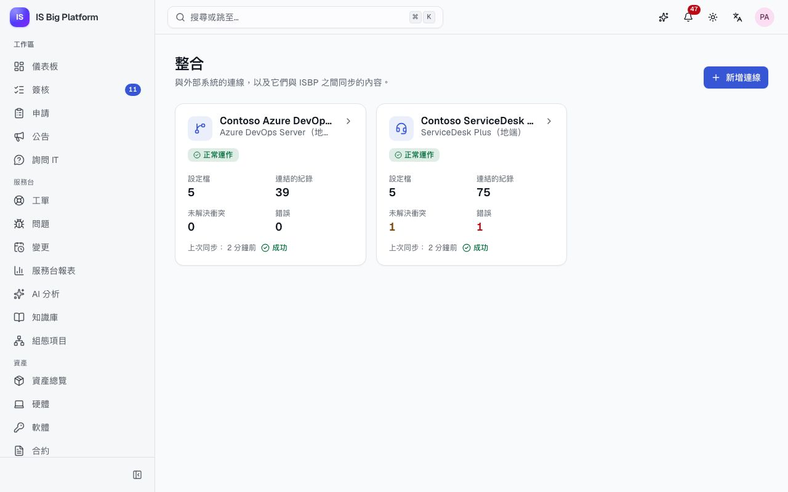
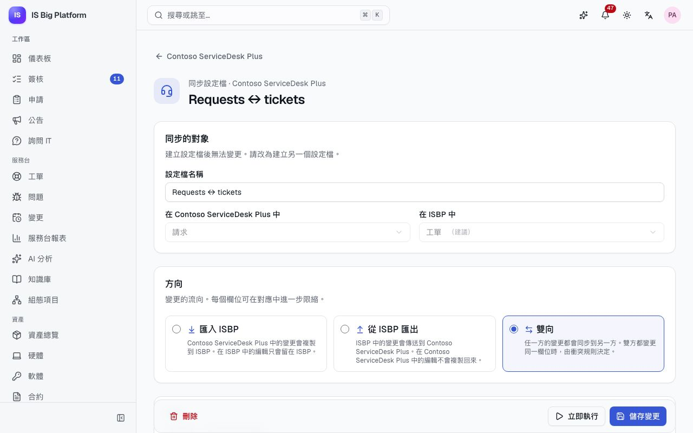
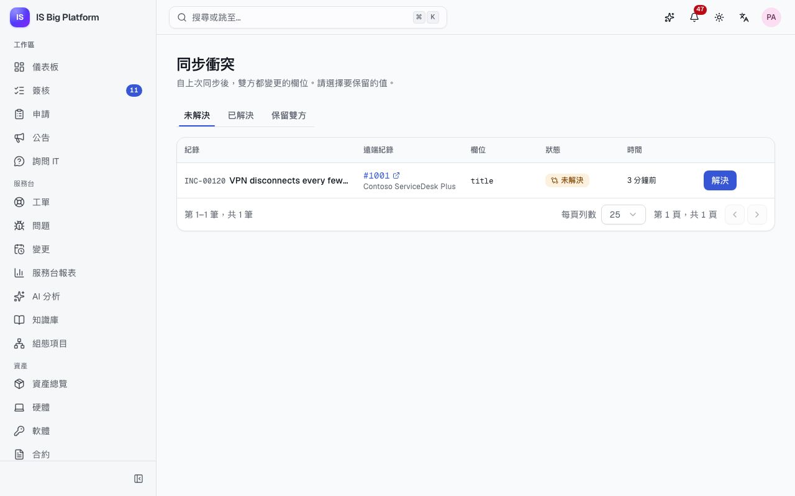

# 整合指南

本指南適用於整合管理員，說明如何將 ISBP 連接到我們同時使用的其他系統：ManageEngine ServiceDesk Plus 與 Azure DevOps Server，兩者都安裝在地端。本指南也會告訴服務台人員與專案團隊，在已同步的紀錄上會看到什麼，以及該在哪裡修改，變更才不會被覆寫。

## 您可以在這裡做什麼

- 了解[哪些紀錄會同步](#哪些紀錄會同步)，以及[在哪裡編輯已同步的紀錄](#在哪裡編輯已同步的紀錄)
- [新增連線](#新增連線)到 ServiceDesk Plus 伺服器或 Azure DevOps Server 集合
- [檢查連線狀態](#檢查連線狀態)並[設定 Webhook](#設定-webhook-以加快同步)
- [建立同步設定檔](#建立同步設定檔)、[對應欄位與值](#對應欄位與值)，並[預覽設定檔](#在執行前預覽設定檔)
- [執行同步並查看日誌](#執行同步並查看日誌)，以及[管理連結的紀錄](#管理連結的紀錄)
- 在紀錄頁面上[查看紀錄的同步對象](#查看紀錄的同步對象)
- [解決同步衝突](#解決同步衝突)
- 了解[為何無法從外部略過簽核](#無法從外部略過簽核)，以及[為何刪除永遠不會被複製](#刪除永遠不會被複製)

## 哪些紀錄會同步

整合中樞會將其他系統中的某種紀錄，與 ISBP 中的某種紀錄連結起來。兩種紀錄之間的每一組連結就是一個**同步設定檔**，每個設定檔都有方向：**匯入 ISBP**、**從 ISBP 匯出**或**雙向**。

| 外部系統            | 對方的紀錄               | ISBP 紀錄                                 | 附註                                                            |
| ------------------- | ------------------------ | ----------------------------------------- | --------------------------------------------------------------- |
| ServiceDesk Plus    | 請求                     | 工單（事件與服務請求）                    | 備註與工單留言同步；內部備註在雙方都維持為內部                  |
| ServiceDesk Plus    | 問題                     | 工單（問題類型）                          |                                                                 |
| ServiceDesk Plus    | 變更                     | 變更                                      | 變更狀態不會對應：CAB 簽核在 ISBP 中進行                        |
| ServiceDesk Plus    | 資產                     | 硬體資產                                  | 依序號比對；需要組建 15100 或更新版本                           |
| ServiceDesk Plus    | 解決方案                 | 知識文章                                  | ServiceDesk Plus 中的 HTML 在 ISBP 中會轉為 Markdown，反之亦然  |
| Azure DevOps Server | 小組專案                 | 專案                                      | 僅匯入 ISBP，依名稱比對                                         |
| Azure DevOps Server | 工作項目（每個小組專案） | 工作項目（屬於單一 ISBP 專案）            | 上層項目、狀態、指派對象與留言；支援 Agile、Scrum 與 Basic 流程 |
| Azure DevOps Server | Git 存放庫               | 程式碼儲存庫（應用程式頁面上的 Git 狀態） | 僅匯入 ISBP：預設分支、最新認可、分支與進行中的提取要求         |

人員依電子郵件地址比對。若其他系統中的某人在 ISBP 中沒有使用該電子郵件的帳戶，該欄位會留空，執行日誌也會顯示警告。在示範資料中，ServiceDesk Plus 技術人員 Kenji Mori 與 Dana Whitfield 沒有 ISBP 帳戶，因此您可以看到這類警告。

## 在哪裡編輯已同步的紀錄

紀錄以單向同步時，由來源系統擁有。以雙向同步時，任一方都可以變更；若雙方在下次同步前變更了同一欄位，則由設定檔的**衝突規則**決定如何處理。請依下表在指定的位置編輯紀錄，您的變更就不會被覆寫。

在示範資料中，兩個連線分別是 **Contoso ServiceDesk Plus** 與 **Contoso Azure DevOps Server**：

| 示範資料中的設定檔                        | 方向      | 雙方都變更同一欄位時     | 在哪裡編輯                                                                            |
| ----------------------------------------- | --------- | ------------------------ | ------------------------------------------------------------------------------------- |
| Requests ↔ tickets                        | 雙向      | 交由人員決定             | 任一系統皆可。每張工單請只在一處處理，以避免衝突；衝突會在衝突清單中等待處理          |
| Problems → tickets                        | 匯入 ISBP | 以 ServiceDesk Plus 為準 | ServiceDesk Plus                                                                      |
| Changes → changes                         | 匯入 ISBP | 以 ServiceDesk Plus 為準 | 變更內容在 ServiceDesk Plus 中編輯；簽核與狀態在 ISBP 中處理                          |
| Assets ↔ assets                           | 雙向      | 以 ServiceDesk Plus 為準 | ServiceDesk Plus 負責維護資產清冊；報廢只能透過 ISBP 的報廢簽核                       |
| Solutions → knowledge                     | 匯入 ISBP | 以 ServiceDesk Plus 為準 | ServiceDesk Plus                                                                      |
| Team projects → projects                  | 匯入 ISBP | 以 Azure DevOps 為準     | Azure DevOps Server（此設定檔依名稱連結既有專案，不會建立專案）                       |
| ERP work items ↔ tasks                    | 雙向      | 以 Azure DevOps 為準     | 任一系統皆可；團隊在 Azure DevOps 中規劃，因此雙方都變更時以其值為準                  |
| Network work items → tasks                | 匯入 ISBP | 以 Azure DevOps 為準     | Azure DevOps Server                                                                   |
| ERP / Network repositories → applications | 匯入 ISBP | 以 Azure DevOps 為準     | Azure DevOps Server（Finance ERP 與 Remote Access VPN 上的 Git 狀態在 ISBP 中為唯讀） |

設定檔為單向的**匯入 ISBP** 時，您在 ISBP 中所做的變更只會留在 ISBP，不會傳回對方系統。只要對方系統變更了同一欄位，這些變更就會被覆寫，因此需要長期保留的變更請在來源系統中進行。

> **提示：** 紀錄頁面上的**同步對象**卡片會告訴您紀錄連結到哪個系統。如果您不確定設定檔的方向，請詢問整合管理員，或開啟該設定檔查看（具有**整合檢視者**（Integrations viewer）角色即可讀取）。

## 誰可以做什麼

| 角色                                         | 允許的操作                                                                 |
| -------------------------------------------- | -------------------------------------------------------------------------- |
| **整合檢視者**                               | 查看連線、同步設定檔、執行紀錄、連結的紀錄與衝突（絕不會看到認證資訊）     |
| **整合管理員**（Integrations administrator） | 新增、編輯與測試連線，為每種可同步的紀錄設定同步設定檔，執行同步並解決衝突 |

相關頁面為**系統管理 → 整合**與**系統管理 → 同步衝突**。如果您看不到這些頁面，請向管理員申請上述其中一個角色。在示範資料中，IT 管理員是整合管理員，服務台、開發團隊與 PMO 則是整合檢視者。

建立或變更會寫入某種紀錄的設定檔時，還需要該種紀錄的同步權限（例如「透過整合寫入事件、服務請求與問題」）。**整合管理員**角色包含所有這些權限。如此一來，就沒有人能利用整合中樞寫入自己原本無權寫入的紀錄。

整合中樞會以自己的身分 **Integrations Hub** 寫入已同步的紀錄，而此身分只能使用這些同步權限。在稽核日誌與紀錄的歷程中，已同步的變更會顯示其來源連線與遠端紀錄。

## 新增連線

必須先建立連線，才能同步任何內容。每台 ServiceDesk Plus 伺服器或每個 Azure DevOps Server 集合只需設定一次。

開始之前，請向對方系統的管理員取得認證資訊：

- **ServiceDesk Plus**：一個專用的技術人員帳戶（例如 `svc-isbp`），其角色只能檢視與編輯您要同步的內容，以及該技術人員設有到期日的 API 金鑰。ISBP 所做的每項變更，在 ServiceDesk Plus 中都會以此技術人員的名義顯示。需要組建 15100 或更新版本。
- **Azure DevOps Server**：服務帳戶的個人存取權杖，範圍需包含**工作項目：讀取與寫入**（Work Items: Read & write）、**程式碼：讀取**（Code: Read）與**專案與小組：讀取**（Project and Team: Read）。不支援 Windows 登入（NTLM 或 Kerberos）。

1. 前往**系統管理 → 整合**，選擇**新增連線**。
2. 選擇 **ServiceDesk Plus（地端）** 或 **Azure DevOps Server（地端）**。
3. 輸入**連線名稱**。此名稱會顯示在清單、執行紀錄與已同步的紀錄上。
4. 填寫連線設定：
   - ServiceDesk Plus：**伺服器 URL**（技術人員開啟的網址，例如 `https://sdp.contoso.local:8443`）、**技術人員 API 金鑰**，以及**入口網站 ID**（僅在伺服器執行多個服務台執行個體時才需填寫）。
   - Azure DevOps Server：**集合 URL**（例如 `https://ado.contoso.local/tfs/DefaultCollection`）、與您的伺服器相符的 **REST API 版本**，以及**個人存取權杖**。
5. 選擇**測試連線**。您會看到「連線正常」以及登入的帳戶，或是失敗的原因。
6. 保持**啟用**開啟，然後選擇**新增連線**。

**後續流程：** ISBP 只會顯示一次連線的 **Webhook 密鑰**。若您打算[設定 Webhook](#設定-webhook-以加快同步)，請先複製，然後選擇**我已複製**。接著會開啟連線頁面。在您[建立同步設定檔](#建立同步設定檔)之前，不會同步任何內容。認證資訊會加密儲存，且不會再次顯示；編輯連線時，認證資訊欄位留空即可保留原值。

> **重要：** 請使用 `https://` 網址。只提供未加密 HTTP 的伺服器（ServiceDesk Plus 預設監聽 8080 埠）會被拒絕，除非您在**安全性**下開啟**允許不安全的 HTTP**。ISBP 會要求您確認，將此變更以資安事件記錄到稽核日誌中，並在開啟期間於連線上顯示**未加密**。開啟後，API 金鑰或權杖以及每一筆同步的紀錄，都會以未加密的方式在網路上傳輸，網路上的其他人可以讀取或竄改。建議優先在伺服器上啟用 HTTPS；這兩項產品都支援 HTTPS。

若伺服器憑證由我們的內部憑證授權單位簽發，且測試因憑證錯誤而失敗，請要求 ISBP 維運人員信任該憑證授權單位（請參閱 `docs/deployment.md` §7e）。

## 檢查連線狀態

ISBP 每 15 分鐘以及每次同步時都會測試每個連線。當已同步的紀錄停止更新時，請先檢查這裡。

1. 前往**系統管理 → 整合**。每張卡片會顯示連線的狀態（**正常運作**、**發生錯誤**或**尚未檢查**）、其設定檔、連結的紀錄、未解決衝突、錯誤與上次同步。
2. 開啟連線。**概觀**分頁的**狀態**區塊會顯示：目前狀態、上次檢查的訊息、**登入身分**、**上次檢查**與**上次同步**。
3. 選擇**測試**即可立即檢查。

**後續流程：** 當對方系統拒絕認證資訊時（API 金鑰或權杖已過期），連線會標示為**發生錯誤**，整合管理員會收到「連線 … 發生錯誤」通知。請在對方系統中更新金鑰或權杖，然後在連線上選擇**編輯**，貼上新值並儲存。

## 設定 Webhook 以加快同步

沒有 Webhook 時，設定檔會依排程同步（預設每 15 分鐘一次）。設定 Webhook 後，對方系統會通知 ISBP 哪一筆紀錄有變更，ISBP 會在數秒內讀取。輪詢會繼續執行作為安全網，因此漏掉的 Webhook 會在下一次排程同步時補上。

1. 開啟連線。在**概觀**分頁上，**Webhook** 卡片會顯示 **Webhook URL**。選擇**複製 Webhook URL**。
2. 在對方系統中建立 Webhook，並將自訂標頭 `X-ISBP-Webhook-Secret` 設為連線的密鑰：
   - ServiceDesk Plus：在 **Admin › Developer Space › Webhooks** 中為每個模組（request、problem 或 change）各建立一個 Webhook，並透過 **Admin › Automation › Custom Triggers** 在紀錄建立或編輯時執行。資產與解決方案沒有自訂觸發程序，因此會依排程同步。
   - Azure DevOps Server：在每個小組專案中，前往**專案設定 → 服務攔截 → 建立訂閱 → Web Hooks**（Project settings → Service hooks → Create subscription → Web Hooks），為每個工作項目事件與 Git 事件各建立一個訂閱，並將**要傳送的資源詳細資料**（Resource details to send）設為**最少**（Minimal）。
3. 連線設定表單的說明區段會列出各系統的確切步驟與承載內容。

**後續流程：** ISBP 每次呼叫都會檢查密鑰，並拒絕沒有密鑰的呼叫。Webhook 只會告知哪一筆紀錄有變更；ISBP 接著會透過對方系統的 API 讀取該紀錄，因此偽造的 Webhook 無法將資料寫入 ISBP。對方系統是從我們的內部網路呼叫 ISBP，因此不需要對網際網路公開任何服務。

若遺失密鑰，請在 **Webhook** 卡片上選擇**更換密鑰**。新密鑰只會顯示一次，舊密鑰會立即失效，因此請馬上更新對方系統中的 Webhook。

## 建立同步設定檔

同步設定檔說明哪些紀錄要同步、往哪個方向，以及欄位如何對應。請為每一種要同步的紀錄各建立一個設定檔。

1. 開啟連線，選擇**同步設定檔**分頁，再選擇**新增同步設定檔**。
2. 在**同步的對象**下，選擇**在 … 中**（對方系統）的紀錄類型、其所在**位置**（Azure DevOps 工作項目與 Git 存放庫為小組專案），以及**在 ISBP 中**的紀錄類型（工作項目為 ISBP 專案；程式碼儲存庫為應用程式）。設定檔名稱會自動填入，您也可以修改。設定檔建立後，這些選項就無法變更。
3. 在**方向**下，選擇**匯入 ISBP**、**從 ISBP 匯出**或**雙向**。每個選項都會以文字說明哪些編輯會同步過去。
4. 在**紀錄**下，決定只存在於一方的紀錄如何處理：
   - **在 ISBP 建立紀錄**：對方系統中的新紀錄會在 ISBP 中建立。
   - **在 … 建立紀錄**（對方系統）：符合**要建立的紀錄**條件的新 ISBP 紀錄，會在對方系統中建立。您可以加入條件（例如「狀態不等於已結案」）；沒有條件時，所有紀錄都會建立。
   - **比對既有紀錄**：選擇 ISBP 中的一個欄位與對方系統中的一個欄位（例如資產的序號）。雙方都已有的紀錄會被連結，而不會重複建立。
5. 在**排程**下設定**同步間隔（分鐘）**（0 會關閉排程同步；Webhook、**立即執行**與排程作業仍可運作）。只**從 ISBP 匯出**的設定檔，會在變更發生時立即推送。
6. 在**衝突與留言**下選擇**衝突規則**：
   - **交由人員決定**：雙方的值都保持不變，衝突會留在衝突清單中等待處理。其他欄位仍會繼續同步。
   - **以 … 為準**（對方系統）、**以 ISBP 為準**或**以最新變更為準**。

   單向設定檔一律以來源為準。開啟**同步留言**，即可將新留言雙向各複製一次，並保留作者。

7. 檢查**欄位對應**（請參閱[對應欄位與值](#對應欄位與值)），然後選擇[**預覽**](#在執行前預覽設定檔)。
8. 選擇**建立設定檔**。

**後續流程：** 設定檔會依排程同步。第一次執行會讀取該類型的所有紀錄，因此可能需要一些時間。若要立即開始，請選擇**立即執行**。

> **提示：** 建議先從**匯入 ISBP**與**交由人員決定**開始，確認前幾次執行的結果，等對應都正確後再切換為**雙向**。

## 對應欄位與值

**欄位對應**決定 ISBP 的哪個欄位對應到對方系統的哪個欄位。ISBP 會為每一組紀錄建議對應；大多數情況下，您只需要加入我們環境特有的欄位。

1. 在設定檔中前往**欄位對應**。選擇**使用建議的對應**，從連接器的預設值開始。
2. 若要加入欄位，請選擇**新增欄位**，然後選擇 **ISBP 欄位**與**遠端欄位**。每一列都有自己的方向：**雙向**、**僅匯入 ISBP**或**僅從 ISBP 匯出**。唯讀欄位只能單向同步。
3. 選項欄位（狀態、優先順序、類別…）請選擇**值**開啟值對應表。每一列說明對方系統的某個值會成為 ISBP 的哪個值，以及反向的對應。雙方相同的值不需要建立對應列。選擇**加入 … 的 # 個值**（… 為對方系統），即可列出對方系統所有的值。
4. 修正編輯器在各列下方顯示的問題，然後儲存。

ISBP 會為您轉換值：HTML 在 ISBP 中會轉為 Markdown，Markdown 在對方系統中會轉為 HTML；人員依電子郵件比對；標籤會轉為以 `;` 分隔的文字；上層工作項目則會透過 ISBP 既有的連結對應。

透過**僅匯入 ISBP**的列，對方系統中的多個值可以對應到同一個 ISBP 值，再以一列說明該 ISBP 值匯出時會成為什麼。在示範資料中，ServiceDesk Plus 的「Resolved」匯入事件時會成為 _已解決_，而狀態為 _已完成_ 的 ISBP 服務請求，匯出時則會成為「Resolved」。

> **重要：** 類別、群組、廠商與知識庫分類預設不會對應，因為它們在 ISBP 中的值是我們自己的紀錄。如有需要，請自行加入這些對應。若 Azure DevOps 專案使用 Scrum 或 Basic 流程，請編輯工作項目類型與狀態的值對應表（例如 _使用者故事_ → Product Backlog Item、_已完成_ → Done）。

## 在執行前預覽設定檔

預覽是針對接下來變更的試執行：不會寫入任何內容，同步位置也不會移動。變更對應或衝突規則後，請使用預覽。

1. 開啟設定檔，在**預覽**下選擇**預覽**。
2. 閱讀清單。每筆紀錄都會顯示將會發生的動作：**在 ISBP 建立**、**連結既有紀錄**、**在 ISBP 更新**、**在 … 更新**（對方系統）、**在 … 建立**（對方系統）、**衝突**、**無變更**或**一方已刪除**，以及將會變更的欄位與其新值。

**後續流程：** 若預覽顯示「自上次同步以來，… 沒有變更」，表示自上次執行後沒有任何變更。無法轉換的欄位會列出來，讓您在正式執行前修正值對應表。

## 執行同步並查看日誌

變更設定檔後，或有人詢問某筆紀錄為何尚未同步過來時，請手動執行同步。

1. 開啟連線，選擇**同步設定檔**分頁。每個設定檔會顯示其方向、連結的紀錄、衝突、錯誤、上次執行與排程。
2. 在設定檔上選擇**立即執行**。執行頁面會開啟，日誌會即時更新。
3. 若要將既有的 ISBP 紀錄傳送給會在對方系統建立紀錄的設定檔，請開啟該設定檔並選擇**將既有紀錄推送到 …**（對方系統）。
4. 連線的**執行紀錄**分頁會列出每次執行的觸發方式（**排程**、**手動**、**Webhook** 或 **ISBP 中的變更**）、狀態與數量。依狀態篩選即可找出失敗的執行。

執行頁面會顯示**統計**（已讀取、在 ISBP 建立與更新、已推送、在遠端建立、已連結、衝突、已略過、錯誤）、**詳細資料**與**日誌**。

| 執行狀態               | 意義                                                                     |
| ---------------------- | ------------------------------------------------------------------------ |
| **成功**               | 所有紀錄都已處理                                                         |
| **部分失敗**           | 部分紀錄失敗；每一筆都會在連結的紀錄中標示為**錯誤**，並在下次執行時重試 |
| **失敗**               | 執行中止，例如因為認證資訊遭拒                                           |
| **已暫停（速率限制）** | 對方系統要求 ISBP 放慢速度；執行會在顯示的時間繼續                       |

每個設定檔一次只會有一個執行。超過 30 天的執行紀錄會被移除。

> **提示：** 您也可以在**排程作業**中使用**整合同步**工作類型執行設定檔，例如每晚固定時間執行，並套用作業的重試與失敗警示。請參閱[資料與自動化](data-and-automation.md)。

## 管理連結的紀錄

連線的**連結的紀錄**分頁會列出每一筆 ISBP 紀錄及其連結的遠端紀錄，以及所屬設定檔與上次同步時間。您可以用它找出發生錯誤或已在一方刪除的紀錄。

1. 開啟連線，選擇**連結的紀錄**。
2. 使用分頁**全部**、**已同步**、**衝突**、**錯誤**與**一方已刪除**篩選，或依參考編號或標題搜尋。選擇遠端參考編號即可在對方系統中開啟該紀錄。
3. 具有**整合管理員**角色時，可以開啟某一列的動作選單：
   - **立即同步**：重新讀取並合併這筆紀錄。
   - **連結至其他紀錄**：將 ISBP 紀錄連結到另一筆遠端紀錄（請輸入其在對方系統中的 ID，而非顯示用的參考編號）。連結後會立即同步。
   - **取消連結**：移除連結。兩筆紀錄都會保留；下次同步時可能會重新連結（若已開啟比對），或建立一筆新紀錄。

您只會看到自己有權讀取的 ISBP 紀錄標題；其他紀錄會顯示為「您無法檢視的紀錄」。

## 查看紀錄的同步對象

當紀錄連結到其他系統時，服務台人員與專案團隊會在工單、變更、資產、專案、工作項目、應用程式與知識文章頁面上看到**同步對象**卡片。變更紀錄之前，可以先用它了解這筆紀錄還存在於哪裡。

卡片會顯示系統、遠端參考編號（選擇即可在對方系統中開啟該紀錄）、上次同步時間與狀態：**已同步**、**衝突**、**錯誤**或**一方已刪除**。若這筆紀錄的上次同步失敗，卡片會說明原因。整合管理員還會看到**立即同步**。

任何可以讀取該紀錄的人都會看到這張卡片。設定檔為雙向同步時，您在 ISBP 中所做的變更會在片刻內同步到對方系統；在對方系統所做的變更，則會在下一次 Webhook 或排程同步時同步過來。

## 解決同步衝突

當設定檔的規則為**交由人員決定**，且自上次同步後，雙方都將同一欄位變更為不同的值時，就會發生衝突。在有人做出決定之前，雙方的值都會保持不變；該紀錄的其他欄位則會繼續同步。

在示範資料中，有一張工單同時在 ISBP 與 ServiceDesk Plus 中被改了標題（「Escalated: VPN drops for the whole finance floor」），因此有一個未解決的衝突可供練習。

1. 前往**系統管理 → 同步衝突**（所有連線），或開啟連線的**衝突**分頁。
2. 在**未解決**分頁上，於該衝突選擇**解決**。
3. 針對每個欄位，比較**上次同步的值**與 ISBP 的值及對方系統的值，然後選擇**保留 ISBP 的值**或**保留 … 的值**（對方系統）。
4. 選擇**套用**。或者選擇**保持雙方現狀**，讓雙方各自保留自己的值。

**後續流程：** 選定的值會寫入雙方，連結也會回到**已同步**。已解決的衝突會移至**已解決**分頁；以**保持雙方現狀**結束的衝突則會移至**保留雙方**，並記錄由誰、在何時做出決定。解決衝突需要**整合管理員**角色；整合管理員會收到新衝突的通知（每個設定檔每小時最多一則）。

## 無法從外部略過簽核

同步寫入紀錄時，適用與 ISBP 畫面相同的規則，絕不會更寬鬆。凡是在 ISBP 中需要簽核的事項，都無法藉由在其他系統中編輯紀錄來核准：

- **變更**無法透過同步推進到 CAB 授權之後。這就是變更狀態預設不對應的原因：變更要在 ISBP 中核准（請參閱[變更與發行](changes-and-releases.md)）。
- **資產**只能透過 ISBP 的報廢簽核變為 _已報廢_。在示範資料中，ServiceDesk Plus 中為「Disposed」的資產，會出現在連結的紀錄的**錯誤**分頁上，並顯示訊息說明資產只能透過 ISBP 的報廢簽核報廢。請在 ISBP 中啟動報廢（請參閱[資產](assets.md)）；核准後，雙方就會一致。
- 由同步建立的**專案**會以 _提案中_ 狀態開始，因此仍須經過專案提案簽核。
- **工單**與**工作項目**只能依 ISBP 允許的方式在狀態之間移動。

遭拒絕的修改會記錄在連結與執行紀錄上，並在下次執行時重試。

## 刪除永遠不會被複製

當某筆紀錄在一個系統中被刪除時，ISBP 絕不會刪除另一個系統中與之對應的紀錄。該連結會標示為**一方已刪除**，並顯示在**連結的紀錄**分頁上。刪除其他系統中的資料應由人員決定：請查看剩下的那筆紀錄，若應移除，請自行刪除或結案。

刪除同步設定檔或連線時，會移除其連結、執行紀錄與衝突，但不會刪除 ISBP 或對方系統中的任何紀錄。

## 排除常見問題

| 您看到的訊息或狀況               | 處理方式                                                                                        |
| -------------------------------- | ----------------------------------------------------------------------------------------------- |
| 連接的系統拒絕了此連線的認證資訊 | API 金鑰或權杖已過期或遭撤銷。請建立新的金鑰或權杖，並貼到連線設定中                            |
| 此連線使用未加密的 HTTP          | 請改用 `https://` 網址，或僅對位於受信任網路的伺服器開啟**允許不安全的 HTTP**                   |
| 連接的系統正在限制要求數量       | 不需處理：執行會暫停後再繼續。若是 ServiceDesk Plus 組建 14500 或更新版本，其管理員可以提高限制 |
| 連接的系統拒絕了此變更           | 開啟執行日誌或連結的錯誤訊息：通常是對方系統不接受某個值。請修正值對應表                        |
| 此設定檔的同步正在執行中         | 等待目前的執行完成                                                                              |
| 人員欄位一直是空白               | 此人沒有使用相同電子郵件的 ISBP 帳戶。請查看執行日誌中的警告                                    |

## 與其他工作的關聯

- [服務台指南](service-desk.md)：與請求、問題、變更及解決方案同步的工單、變更與知識庫。
- [資產](assets.md)：資產清冊與報廢簽核。
- [專案](projects.md)與[變更與發行](changes-and-releases.md)：與 Azure DevOps 工作項目同步的工作項目，以及應用程式上的 Git 狀態。
- [資料與自動化](data-and-automation.md)：從排程作業執行同步。
- [助理與 AI](assistant-and-ai.md#助理可以變更的項目)：助理可以將同步設定檔的變更準備成變更集。
- [管理員](administrators.md)：角色、稽核日誌與通知設定。
