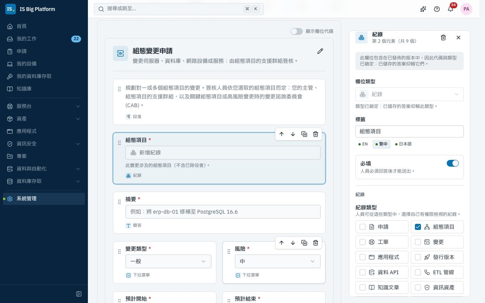
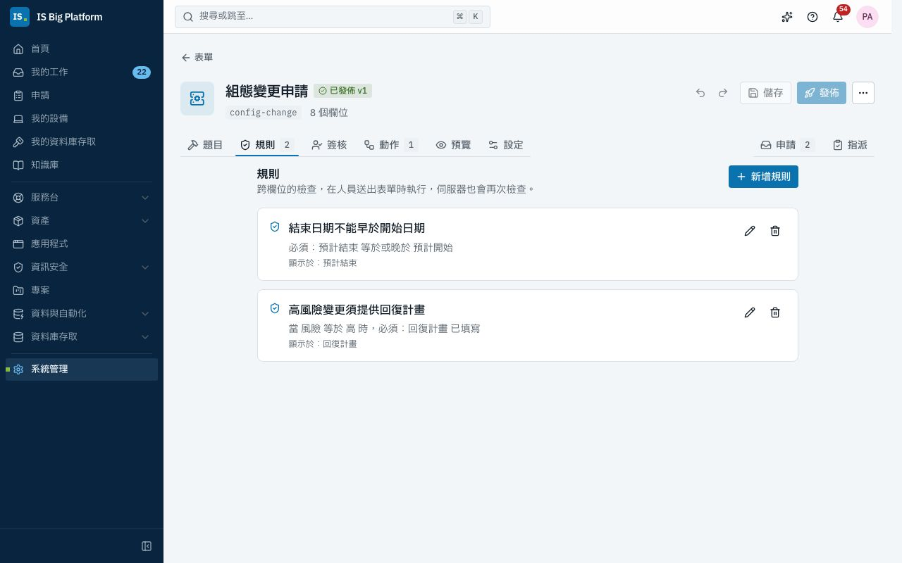
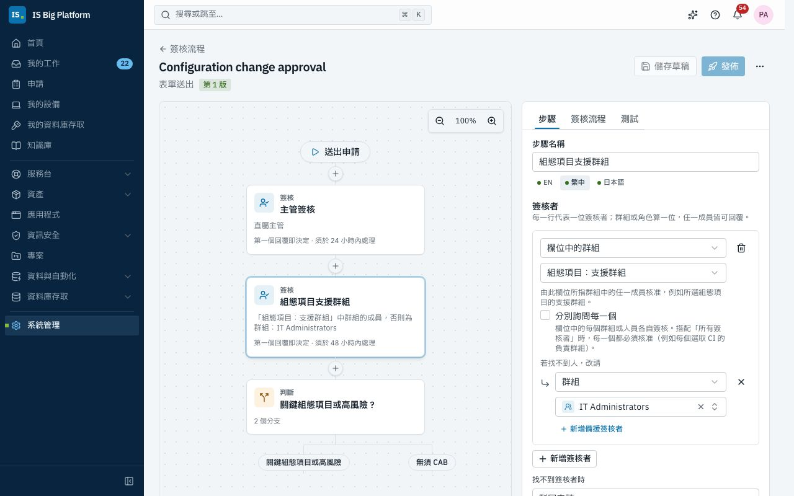
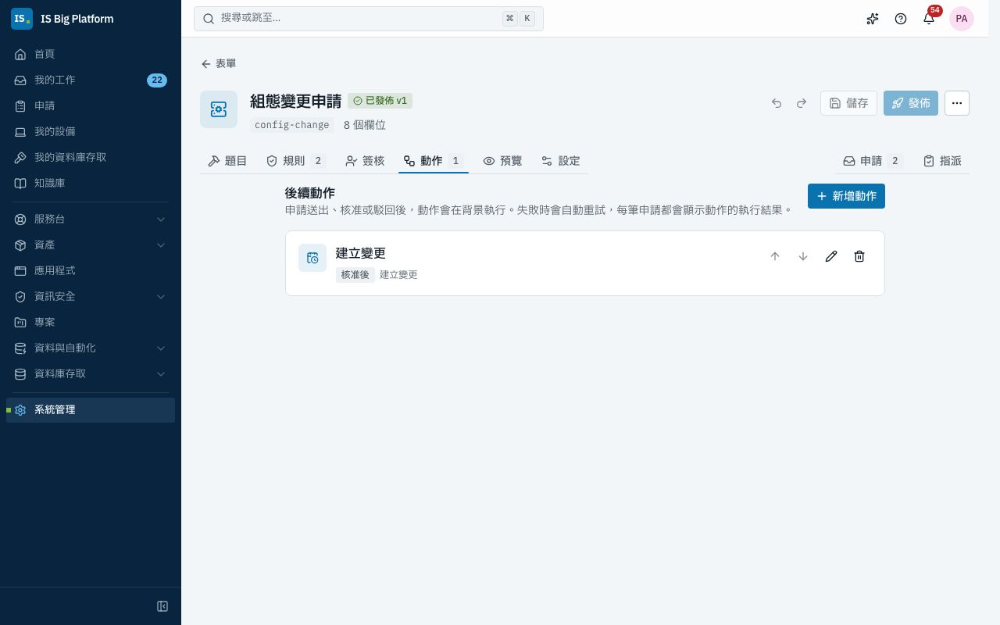
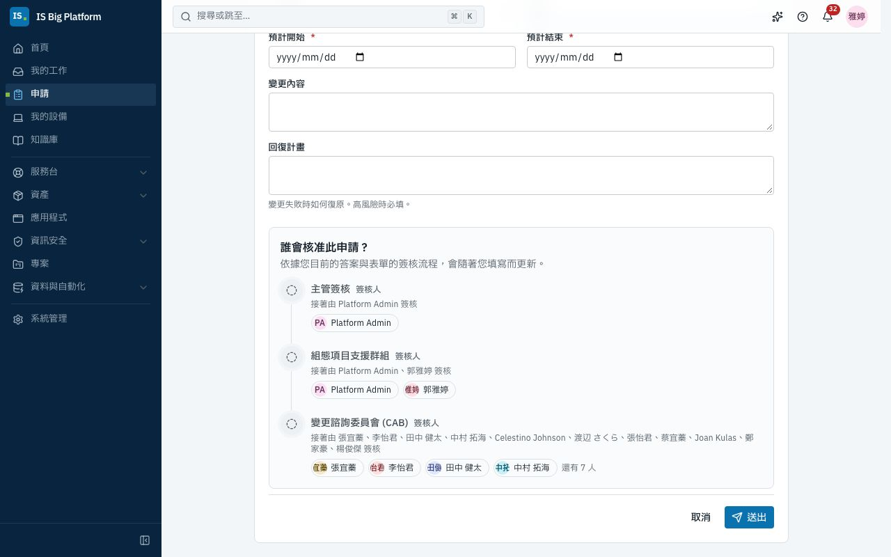

# 建立您自己的流程

本指南適用於要把 IT 作業轉為自助流程的管理員與組長，例如組態變更、防火牆規則、新虛擬伺服器或軟體採購。在 ISBP 中，這類流程都由三個部分組成：申請表單、簽核流程，以及在決定後執行的動作。您可以在同一個地方（表單設計工具）建立這三個部分，或向助理描述流程，然後分享表單的連結。

## 您可以在這裡做什麼

- 了解[流程的組成方式](#流程的組成方式)，並[規劃您的流程](#規劃流程)
- 了解[哪些可以自行建立、哪些需要開發](#自行建立的部分與需要開發的部分)
- [建立表單](#建立表單)，包括[選取組態項目、應用程式或資產的欄位](#讓人員選取紀錄)與[跨欄位的規則](#加入跨欄位規則)
- [選擇由誰簽核](#選擇由誰簽核)、[依選取的紀錄決定路徑](#依答案與選取的紀錄決定路徑)，以及[讓紀錄中指定的群組簽核](#讓紀錄中指定的群組簽核)
- 在變更、報廢與專案提案的[內建簽核中使用自訂欄位](#在內建簽核中使用自訂欄位)
- [加入動作](#加入動作)，以建立變更、授予角色、通知人員或呼叫其他系統
- [發佈表單並分享連結](#發佈表單並分享連結)
- 改為[透過助理建立](#透過助理建立)
- 了解[申請人會看到什麼](#申請人會看到什麼)，並[追蹤動作的執行結果](#追蹤動作的執行結果)
- [逐步查看示範資料中的組態變更申請](#示範逐步說明組態變更申請)
- [排解常見問題](#排解常見問題)

## 流程的組成方式

每個流程都有相同的三個部分，以及一個讓人員啟動流程的連結。

| 部分     | 作用                                                                                           | 建立位置                     |
| -------- | ---------------------------------------------------------------------------------------------- | ---------------------------- |
| 表單     | 詢問您需要知道的資訊：文字、日期、選項、人員，以及組態項目或應用程式等紀錄。規則會一併檢查答案 | **系統管理 → 表單**          |
| 簽核流程 | 依答案與選取紀錄的資料，決定由誰簽核、依什麼順序、在何時之前                                   | 表單的**簽核**分頁           |
| 動作     | 在申請送出、核准或駁回後執行工作：建立變更、授予角色、通知人員、呼叫其他系統                   | 表單的**動作**分頁           |
| 連結     | `/requests/forms/<key>` 會開啟表單；表單也會以卡片形式出現在**申請 → 您需要什麼？** 下         | 建立表單時選擇的表單**代碼** |

每筆申請都會保留它開始時所用的表單版本（含其動作）與簽核流程版本，因此您可以改善流程，而不影響已在進行中的申請。流程也會遵守平台的規則：人員只能選取自己有權限檢視的紀錄、動作只能做其所屬領域允許的事，而且動作絕不會略過其他領域要求的簽核，例如變更的 CAB 簽核。

若要建立表單與簽核流程，您需要**簽核流程管理員**（Workflow administrator）角色（**平台管理員**可以執行所有操作）。有些動作還需要其他角色：請參閱[各動作的作用](#各動作的作用)。

### 自行建立的部分與需要開發的部分

流程屬於**設定**：您在系統管理頁面或透過助理建立，不需要任何人撰寫程式碼。流程由 ISBP 既有的**基本組件**組成：也就是本指南介紹的欄位類型、規則、簽核選項、動作與提醒，以及依排程指派的表單（請參閱[請人員在期限前填寫表單](administrators.md#請人員在期限前填寫表單)）。大多數 IT 流程不需要其他東西。

| 詞彙         | 說明                                                                                                | 由誰建立                                                                      |
| ------------ | --------------------------------------------------------------------------------------------------- | ----------------------------------------------------------------------------- |
| 流程         | 表單、其簽核流程與動作。定期執行的工作還會有一個指派表單的排程作業                                  | 簽核流程管理員，在系統管理頁面或透過助理                                      |
| 流程範本套件 | 多個流程及其所需的項目（群組、類別、排程），以一個變更集一起安裝                                    | 隨模組提供（例如 ISMS 流程範本套件）或為套件檔案；從**系統管理 → 變更集**安裝 |
| 基本組件     | 所有流程都能使用的功能：欄位類型、規則、簽核選項、動作                                              | 平台團隊，以程式碼開發                                                        |
| 紀錄類型     | 我們長期保存與維護的一類事物，有自己的頁面、狀態與規則：工單、資產、帳號清查                        | 平台團隊，以模組開發                                                          |
| 連接器       | ISBP 連線到其他系統的方式，例如 ServiceDesk Plus 或 Azure DevOps Server                             | 平台團隊，以模組開發                                                          |
| 平台外控制   | 由其他系統執行的控制措施，例如防火牆規則或磁碟加密。ISBP 保存提出需求的申請，以及確認其已落實的檢查 | 負責該系統的團隊                                                              |

當流程無法建立時，缺少的會是基本組件、紀錄類型或連接器其中之一。請向平台團隊提出這一項需求，而不是整個流程：他們會以所有流程都能使用的方式加入，流程則仍由您以設定的方式自行建立。

## 規劃流程

先在紙上規劃：每個答案都會成為流程的一部分。

1. **申請人必須告訴您什麼？** 列出問題，並標示哪些為必填。這些就是表單的欄位。
2. **申請與我們的哪些紀錄有關？** 組態項目、應用程式、資產、工單…這些會成為紀錄欄位，答案就是實際的紀錄，而不是某人輸入的名稱。
3. **哪些答案必須相符？** 例如結束日期不能早於開始日期。這些就是規則。
4. **由誰簽核、何時簽核？** 申請人的主管、支援該系統的團隊，以及涉及關鍵項目時的 CAB。這就是簽核流程。
5. **核准後與駁回後要做什麼？** 最後應該產生哪一筆紀錄、要通知誰？這些就是動作。
6. **誰可以使用此表單？** 所有人，或只有部分群組。這就是表單的**適用對象**。

在示範資料中，**組態變更申請**針對我們組態項目的變更回答了這些問題：請參閱[逐步說明](#示範逐步說明組態變更申請)。

## 建立表單

先從問題開始；之後再在同一份表單中加入簽核與動作。

1. 前往**系統管理 → 表單**，選擇**新增表單**。輸入**名稱**與**代碼**。在**更多詳細資料**下選擇**圖示**與**類別**（或輸入新的類別並選擇**新增類別「…」**），然後選擇**建立並開啟表單設計工具**。代碼是表單連結（`/requests/forms/<key>`）的結尾，之後無法變更。
2. 在**題目**中，將欄位從**新增元素**拖曳到表單上，或按一下欄位即可加入：**簡答**、**詳答**、**數字**、**核取方塊**、**日期**、**下拉選單**、**多選**、**電子郵件**、**連結**、**人員**與**紀錄**。
3. 選取欄位以設定其**標籤**（English、繁體中文與日本語）、**必填**及其本身的選項（選項、紀錄類型）。其餘設定（例如說明文字、寬度、答案的**格式**，以及只在部分情況適用之問題的**僅在以下情況顯示此欄位…**）位於**更多選項**下。欄位的**代碼**會依英文標籤產生，只有 Webhook 與匯出才需要，位於**進階**下。**顯示欄位代碼**會在畫布上顯示代碼。
4. 視需要加入[紀錄欄位](#讓人員選取紀錄)與[規則](#加入跨欄位規則)，並在**預覽**中試填表單。
5. 選擇**儲存**。

**後續流程：** 草稿已儲存；在您[發佈](#發佈表單並分享連結)之前，沒有人會看到它。編輯器的其他分頁說明請參閱[建立申請表單](administrators.md#建立申請表單)。

### 讓人員選取紀錄

當申請涉及 ISBP 已知的項目時，請使用**紀錄**欄位：例如變更涉及的組態項目、某人需要存取的應用程式，或要更換的筆電。答案會連結到實際的紀錄，因此簽核者可以開啟它，簽核流程可以依其資料決定路徑，動作也可以使用它，例如將變更連結到選取的組態項目。

1. 在**題目**中加入**紀錄**欄位並設定標籤，例如「組態項目」。
2. 選取該欄位。在**紀錄**下，勾選人員可以選取的**紀錄類型**，例如**組態項目**。
3. 開啟**允許多選**，讓人員最多可以選取 20 筆紀錄。
4. 您也可以在**只限符合以下條件的紀錄…** 下，依紀錄本身的資料縮小可選範圍，例如**環境** **等於** **正式環境**。伺服器也會檢查此條件。

**誰可以選取什麼。**

- 人員只能選取自己有權限檢視的紀錄。選取組態項目需要 **CMDB 檢視者**（CMDB viewer）角色（在示範資料中，服務台、網路、資安與 DBA 團隊都有此角色），應用程式需要**應用程式檢視者**，硬體資產需要**資產檢視者**，工單則需要**服務台專員**。已發佈的自助知識文章所有人都能讀取。請只將紀錄欄位提供給能看到這些紀錄的人：在表單的**設定**分頁中設定其**適用對象**。
- 送出申請時，系統會再次檢查每一筆選取的紀錄。若該人員無權檢視某筆紀錄，或紀錄不符合**只限符合以下條件的紀錄…**，系統會以「請選擇此欄位接受、且您有權限檢視的紀錄」拒絕。
- 簽核者會以連結形式看到自己有權限檢視的選取紀錄；其他紀錄只會顯示數量（「1 筆您無權檢視的紀錄」），絕不會顯示名稱。
- 在編輯器中，您只能提供自己看得到的紀錄類型。欄位上已有的類型，在其他人編輯表單時仍會保留。

同樣的**紀錄**類型也可用於**系統管理 → 自訂欄位**中的自訂欄位，例如工單上的「受影響的應用程式」欄位。

**可用來篩選與決定路徑的資料。** 每種紀錄類型都有自己的資料。您可以在**只限符合以下條件的紀錄…**、簽核流程的條件與簽核者，以及動作的文字中使用這些資料。

| 紀錄類型     | 資料                                                                                                                                                                                               |
| ------------ | -------------------------------------------------------------------------------------------------------------------------------------------------------------------------------------------------- |
| **組態項目** | **類別**、**環境**、**重要性**、**狀態**、**負責人**（人員）、**支援群組**（群組）、**部門代碼**、**業務服務（CI 編號）**、**標籤**                                                                |
| **應用程式** | **應用程式代碼**、**階段**、**重要性**、**架設方式**、**資料分級**、**處置策略（TIME）**、**技術負責人**與**業務負責人**（人員）、**交付團隊**與**支援群組**（群組）、**部門代碼**                 |
| **硬體資產** | **類別**、**狀態**、**存有資料**、**使用人**（人員）、**部門代碼**、**位置**、**保固到期日**                                                                                                       |
| **軟體授權** | **產品**、**發行商**、**授權類型**、**計費方式**、**合規狀態**、**授權數**、**費用**、**結束日期**                                                                                                 |
| **工單**     | **工單類型**、**狀態**、**優先順序（1 = 最高）**、**影響範圍（1 = 高）**、**緊急程度（1 = 高）**、**重大事件**、**類別代碼**、**指派群組**（群組）、**處理人員**與**申請人**（人員）、**部門代碼** |
| **變更**     | 工單的所有資料，再加上**變更類型**、**風險**、**預計開始**與**預計結束**                                                                                                                           |
| **專案**     | **專案代碼**、**狀態**、**優先順序**、**健康狀態**、**可見性**、**專案經理**（人員）、**部門代碼**、**預估投入（小時）**、**開始日**、**目標完成日**                                               |
| **知識文章** | **對象**、**分類代碼**、**狀態**、**語言**、**擁有者**（人員）、**標籤**                                                                                                                           |

**發行版本**、**合約**、**工作項目**、**資料 API**、**ETL 管線**與**排程作業**也可以選取，但沒有可用來篩選或決定路徑的資料。

> **注意：** 紀錄的資料絕不會包含紀錄本身的讀者在其頁面上看不到的內容。簽核會使用申請送出當時的資料：如果組態項目的支援群組之後有所變更，已送出的申請仍會保留原本的群組。

### 加入跨欄位規則

欄位本身的檢查只看一個答案；規則則會同時看多個答案：例如結束日期不能早於開始日期、高風險變更需要回復計畫。人員選擇**送出**時、修正答案的過程中，以及在伺服器上都會再檢查一次規則，因此違反規則的申請無法送出。

1. 開啟**規則**分頁，選擇**新增規則**。
2. 若規則只在部分情況適用，請在**當（選填）** 下選擇**新增條件**；留空則一律檢查。
3. 在**必須**下選擇**新增條件**，加入必須成立的條件：選擇**欄位**、**運算子**與**值**。若要比較兩個答案，請選擇**與其他欄位比較**，再選擇**其他欄位**；日期欄位可使用**今天**，與申請送出的日期比較。**必須**不完整的規則無法儲存。
4. 以每種語言撰寫不符合規則時人員會看到的**訊息**。
5. 在**訊息顯示於**下，勾選需要修正的欄位。若都不勾選，訊息會顯示在表單上方。
6. 選擇**新增規則**，然後選擇**儲存**。

示範資料中的**組態變更申請**有兩條規則：

| 訊息                     | 當（選填）               | 必須                                                          | 訊息顯示於   |
| ------------------------ | ------------------------ | ------------------------------------------------------------- | ------------ |
| 結束日期不能早於開始日期 | —                        | **預計結束** **等於或晚於**，**與其他欄位比較**：**預計開始** | **預計結束** |
| 高風險變更須提供回復計畫 | **風險** **等於** **高** | **回復計畫** **已填寫**                                       | **回復計畫** |

**後續流程：** 規則屬於草稿的一部分，在您發佈後生效。只有在欄位本身的檢查都通過（必填欄位已填寫、日期有效）之後，人員才會看到規則的訊息。

> **提示：** 日期以「天」為單位比較，因此**等於或晚於**允許同一天。與空白答案比較時，條件永遠不成立：如果其中一個日期是選填，請加入**當**「**預計開始** **已填寫**」（結束日期也一樣），讓規則只在兩個日期都有填寫時才檢查。

> **提示：** 日期條件可以加減天數：在值旁邊的**天**方塊中輸入天數，例如**預計結束** **等於或早於** **預計開始** + `366` 天（「最多一年」）。使用值旁邊的**今天**，**預計開始** **等於或晚於** **今天** 可拒絕過去的開始日期。

### 以表格收集多列資料

有些表單需要一份清單：防火牆規則的各條規則、要建立的帳號、要備份的項目。請加入**表格**欄位，而不是固定數量的問題。

1. 從欄位面板加入**表格**。
2. 在**表格**下設定**欄**：選擇**新增欄**，然後開啟欄位設定其標籤與類型（**文字**、**數字**、**日期**、**下拉選單**、**人員**、**紀錄**等）。使用箭頭調整順序。
3. 您也可以設定**最少列數**與**最多列數**（最多 50 列）。**必填**表示至少要有一列。
4. 選擇**儲存**。

人員以**新增一列**加入資料列，並以每列最後的按鈕移動或移除資料列；在手機上，每一列會顯示為一張卡片。完全空白的資料列會被忽略。每個儲存格都會像獨立欄位一樣檢查，訊息會顯示在儲存格下方。申請頁面與列印檢視會以表格顯示答案。

條件可以讀取所有資料列中的某一欄：只要任一列的連接埠是 22，**防火牆規則 › 連接埠** **等於** `22` 就成立。這可用於**僅在以下情況顯示此欄位…**、規則、簽核流程，以及動作的**僅在以下條件成立時…**。

## 選擇由誰簽核

簽核流程決定每筆申請由誰簽核。您可以在表單本身的**簽核**分頁建立它，與題目並列，因此可以直接使用答案與選取紀錄的資料。

1. 在表單設計工具中開啟**簽核**分頁，選擇**設定簽核**。系統已備妥第一個步驟：**主管簽核**，由申請人的主管簽核；沒有主管時改由其部門主管簽核。
2. 在畫布上以**在此新增步驟**變更或加入步驟：**簽核**、**判斷**、**平行處理**或**通知**。選取步驟後，在**步驟**中設定：由誰簽核，以及收合區段中的**簽核人員需填寫的欄位**、**期限**、**選項**與**條件**。新的簽核步驟會依其簽核者命名（「主管簽核」、「應用程式：業務負責人簽核」），也可以自行重新命名。各選項的說明請參閱[設計簽核流程](administrators.md#設計簽核流程)。
3. 在**測試**中試用：在**以此身分試用**下選擇一位人員，系統會帶入其部門與職稱；輸入範例答案，選擇每個簽核的結果，然後選擇**執行測試**。
4. 選擇**儲存**保存進度；整個流程準備好後選擇**發佈**：一次**發佈**就會讓簽核與表單一起上線。

若要使用現有的簽核，請在**使用的簽核**下選擇；選擇**不需簽核**則申請送出後立即生效。**在簽核流程設計工具中開啟**會在獨立頁面開啟同一個簽核，並顯示其版本與使用它的表單。若其他表單也使用同一個簽核，分頁上會提示：您的變更也會套用到該表單。

**後續流程：** 發佈後，此表單的新申請會經過該簽核。**系統管理 → 簽核流程**會將它列在**表單的簽核流程**下，並顯示使用它的表單；權限、變更等領域的內建簽核則列在**內建簽核**下。

### 請簽核者填寫欄位

紙本表單通常有一個「由 IT 填寫」的區塊：評估結果、處理說明、完成日期、設備的資料清除日期。簽核步驟也可以請簽核者填寫這些內容。

1. 選取簽核步驟，前往**簽核人員需填寫的欄位**。
2. 選擇**新增欄位**，選擇其類型，並像在表單中一樣設定（標籤、必填、選項，以及依步驟其他欄位而定的條件）。選擇**儲存欄位**。一個步驟最多可以要求 20 個欄位。
3. 如果有必填欄位，請在**必填欄位需在何時填寫**下選擇時機：**核准時**，或**核准及駁回時**。

**後續流程：** 簽核者核准或駁回時，會在**需填寫的欄位**下看到這些欄位；在必填欄位有效之前無法核准。填寫的值會顯示在申請的**簽核人員填寫的內容**下與其歷程中。後續步驟也可以使用這些值：在後續步驟的條件中，這些欄位會顯示為「步驟：欄位」（例如「IT 審查：結果 等於 需要 CAB」），您也可以在**測試**中試用。在動作的文字設定中，輸入 `{{steps.<step id>.<field key>}}` 即可使用某個值（步驟 ID 與代碼會顯示在每個欄位下方）。

### 依答案與選取的紀錄決定路徑

在表單的**簽核**分頁中，條件（**判斷**步驟，或**條件**下的**僅在特定情況執行此步驟**）中的**欄位**清單會包含表單的答案與選取紀錄的資料，並以「欄位：資料」命名，例如**組態項目：重要性**或**組態項目：環境**。

- 若欄位可以選取多筆紀錄，當任一筆選取的紀錄為關鍵時，**組態項目：重要性** **等於** **關鍵** 這類條件就成立。
- 以**符合** **任一條件**組合條件，即可表示「或」：當選取的組態項目為關鍵，或**風險**答案為**高**時，由 CAB 簽核。
- 在**測試**分頁中輸入範例**申請內容**（包括選取紀錄的資料），然後選擇**執行測試**，即可查看哪些步驟會執行。表單的**預覽**分頁會以實際人員顯示相同結果：回答題目後，查看**誰會簽核這筆申請？**。

### 讓紀錄中指定的群組簽核

適當的簽核者通常是負責該系統的團隊：組態項目的支援群組、應用程式的交付團隊。**欄位中的群組**會從選取的紀錄中取得該群組，因此一個簽核流程就能用於所有組態項目。

1. 在表單的**簽核**分頁中，於畫布上選取簽核步驟，然後在**步驟**分頁上選擇**新增簽核者**。
2. 在**簽核者類型**下選擇**欄位中的群組**，再選擇存放群組的欄位，例如**組態項目：支援群組**。
3. 決定紀錄沒有群組時的處理方式：以**若找不到人，改請**加入備援對象（在示範資料中為 **IT Administrators** 群組），或將**找不到簽核者時**設為**略過此步驟**。否則，申請會在該步驟遭駁回，**發佈前請確認**也會提醒您。

**後續流程：** 畫布會將簽核者顯示為「「組態項目：支援群組」中群組的成員」。群組的任何成員都可以簽核。選取多個組態項目時，系統會請所有支援群組的成員簽核，其中任何一人的回覆即決定該步驟。

可以從紀錄取得的群組有：組態項目的**支援群組**、應用程式的**交付團隊**或**支援群組**，以及工單的**指派群組**。**欄位中的人員**對人員的作用方式相同，例如組態項目的**負責人**、應用程式的**技術負責人**或**業務負責人**，或專案的**專案經理**。

> **提示：** 如果**欄位中的群組**顯示目前沒有紀錄群組的欄位，請先在表單中加入紀錄欄位（例如組態項目，其支援群組就是群組）。在簽核流程設計工具中，請在**簽核流程**分頁的**使用表單欄位**下選擇表單。

### 在內建簽核中使用自訂欄位

有些簽核是由 ISBP 的某個領域啟動，而不是由表單啟動：**變更授權**（CAB）、**資產報廢**與**專案提案**。這些簽核流程也可以使用其所簽核紀錄的自訂欄位。

1. 在**系統管理 → 自訂欄位**中，將欄位加入**工單**（用於變更）、**硬體資產**（用於報廢）或**專案**（用於提案），例如一個選取**應用程式**的**紀錄**欄位「業務應用程式」。
2. 在**系統管理 → 簽核流程**中開啟該簽核的簽核流程。**欄位**清單現在會包含該自訂欄位；若是紀錄欄位，還會包含選取紀錄的資料，例如**業務應用程式：重要性**。
3. 如上所述，在條件或簽核者中使用它，然後發佈。

**後續流程：** 從此之後送出的變更、報廢與提案，也會依該自訂欄位決定路徑。這些簽核可以調整，但永遠無法關閉。

## 加入動作

動作會在申請送出或決定後執行工作，所以沒有人需要把答案複製到另一個畫面：建立變更、授予角色、通知團隊。動作在背景執行，失敗時會重試，每筆申請都會顯示動作做了什麼。

1. 開啟表單的**動作**分頁，選擇**新增動作**。
2. 在**新增動作**中選擇表單要執行的動作。清單只會列出您可以加入的動作；下方的提示會說明還有幾個動作需要您沒有的權限。
3. 在**執行時機**下，選擇**申請送出時**、**核准後**或**駁回後**。
4. 您也可以輸入**名稱（選填）**：申請上會顯示此名稱，取代動作本身的名稱。
5. 填寫**設定**。在文字欄位中，使用**插入值**加入答案與申請資訊（[詳細說明](#以插入值填入文字)）。
6. 選擇**新增動作**。視需要加入更多動作，然後選擇**儲存**與**發佈**。

**後續流程：** 動作屬於您發佈的表單版本。先前送出的申請會保留其版本的動作；從現在起送出的申請則會執行新的動作。沒有簽核流程的表單，會在申請送出時立即執行**核准後**的動作，且永遠不會執行**駁回後**的動作。已撤回的申請不會執行任何動作。

### 各動作的作用

| 動作             | 作用                                                                                                                                                                                                                                                                                                             | 可加入的角色       |
| ---------------- | ---------------------------------------------------------------------------------------------------------------------------------------------------------------------------------------------------------------------------------------------------------------------------------------------------------------- | ------------------ |
| **建立變更**     | 依您設定的**標題**、**說明**、**變更類型**（或**以此答案作為變更類型**）、**風險**（或**以此答案作為風險**）、**類別**、**指派群組**與**回復計畫**建立變更，連結到組態項目欄位中的 CI（**受影響的 CI 來自**），並以兩個日期欄位作為時段（**預計開始來自**、**預計結束來自**）。**送出簽核**會啟動變更的 CAB 簽核 | **變更經理**       |
| **建立工單**     | 以您設定的**類型**、**優先順序**、**標題**、**說明**、**類別**與**指派群組**，為申請人建立事件或服務請求                                                                                                                                                                                                         | **服務台管理員**   |
| **更新組態項目** | 設定組態項目欄位中選取之 CI（**CI 來自**）的**狀態**、**環境**、**重要性**、**支援群組**或自訂欄位，例如在變更核准後設為**維護中**                                                                                                                                                                               | **CMDB 管理員**    |
| **執行排程作業** | 立即執行一個排程作業，如同有人選擇了**立即執行**，並使用作業本身的設定、重試與警示；申請會連結到該次執行                                                                                                                                                                                                         | **排程作業操作員** |
| **授予角色**     | 將平台或已註冊應用程式（VPN、Active Directory、伺服器存取）的角色，授予申請人或**人員**欄位中選取的人員，期限為**授予天數**（留空：永久）                                                                                                                                                                        | **身分識別管理員** |
| **傳送提醒**     | 在取自答案、簽核者填寫的欄位或結果產生當天的**日期**，加上**日期之後的天數**（負數表示之前）時，提醒申請人、**人員**欄位中指定的人員、群組成員或具有特定角色的人員                                                                                                                                               | **簽核流程管理員** |
| **通知人員**     | 將您的**標題**與**內容**傳送給申請人、**人員**欄位中指定的人員、另一位人員，或群組的成員                                                                                                                                                                                                                         | **簽核流程管理員** |
| **呼叫 Webhook** | 透過 HTTPS 將與申請相關的 **JSON 內容**傳送到其他系統，可附加機密標頭                                                                                                                                                                                                                                            | **簽核流程管理員** |

具有更多權限的角色也可以加入這些動作，例如可建立變更的**服務台管理員**，或可執行所有操作的**平台管理員**。

- **建立變更**會以表單的名義建立變更，並以送出申請的人作為變更的申請人。變更會顯示**來自申請 REQ-… · <表單名稱>**，選取的組態項目也會列出這項變更。
- **以此答案作為風險**與**以此答案作為變更類型**會使用**下拉選單**的答案，其儲存值須為 `low`、`medium` 或 `high`，以及 `normal` 或 `emergency`，如示範資料所示。其他答案會改用您設定的**風險**與**變更類型**：申請人永遠無法申請預先核准的標準變更。
- 若要送出變更簽核，動作需要**預計開始來自**與**預計結束來自**。日期答案沒有時間，因此時段從開始日的 UTC 午夜（台北時間 08:00）開始，到結束日的 UTC 午夜為止。
- **授予角色**只會提供人員可以申請的角色，或您自己可以指派的角色。對於您無法自行指派的可申請角色，天數必須在該角色的最長授予期限內。若該人員已擁有該角色，授予會維持或延長，絕不會縮短。
- **通知人員**會傳送「表單發送的訊息」通知類型，除非收件者已關閉，否則會在應用程式內並以電子郵件傳送。
- **授予角色**會將應用程式的角色列為**應用程式 · 角色**。除了可申請的角色之外，也會提供您有權管理存取權之應用程式的角色。申請會連結到該應用程式。
- **傳送提醒**會在當天申請人時區的 9:00 送出（例如在規則的**截止日**前 30 天：**日期之後的天數** `-30`）。若開啟**僅在該日尚未到來時**，已經過去的日期就不會設定提醒。群組與角色的成員會在提醒送出時才查詢。撤回申請會取消其提醒；申請頁面會將提醒列在**提醒**下。

### 只在特定情況執行動作

在動作設定的**僅在以下條件成立時…** 下，加入與答案（包括表格欄）、紀錄的資料、簽核者填寫的內容、申請人的部門或職稱，或**今天**有關的條件。沒有條件時（「沒有條件：每筆申請都會執行。」），動作一律執行。例如「**僅在** **存取** **等於** **VPN** 時授予 VPN 角色」。條件對某筆申請不成立時，該動作會顯示為**已略過**，並附上「此申請不需要：條件不成立。」；此動作無法重試。

### 動作的執行時機

| 執行時機       | 動作的執行時間                                       |
| -------------- | ---------------------------------------------------- |
| **申請送出時** | 申請送出後立即執行，不論是否需要簽核                 |
| **核准後**     | 簽核流程核准申請時（若表單沒有簽核流程，則立即執行） |
| **駁回後**     | 簽核流程駁回申請時                                   |

動作會在申請送出或決定後片刻於背景執行，並依**動作**分頁上列出的順序逐一執行：每個動作都會在前一個動作（包括其重試）完成後才開始。某個動作失敗不會停止其他動作；下一個動作仍會執行。

### 以「插入值」填入文字

文字設定（例如變更的**標題**或通知的**內容**）可以包含申請中的值。選擇欄位旁的**插入值**，然後選擇其中一項：

- **答案**：人員看到的每個答案：選項的標籤、人員的姓名、所選紀錄的名稱。
- **選取的紀錄**：紀錄欄位中所選紀錄的名稱與資料，例如**應用程式：名稱**或**組態項目：重要性**。
- **申請**：**申請編號**、**申請連結**、**表單名稱**、**申請人姓名**、**申請人電子郵件**與**核准者姓名**。

插入的值會以標籤的形式顯示，設定下方的範例會顯示文字的樣子，例如「例如：REQ-01042 Buy Figma」。這些值會在動作執行時填入；申請中沒有的值會保留空白。值只會填入文字：選項、人員、數字與 URL 會完全依您的設定使用。

### 動作絕不會略過其他簽核

動作只能做其所屬 ISBP 領域允許的事，而且絕不會代替任何人核准任何事項。由**建立變更**建立的變更，會和其他變更一樣經過**變更授權**：變更經理，以及在風險高或涉及關鍵組態項目時的 CAB。表單的簽核決定是否建立變更；是否實施變更仍由 CAB 決定。（若**變更類型**設定為**標準**，變更會和其他標準變更一樣處理：預設的簽核流程會直接排程，不需簽核。除非作業已預先核准，否則請保留**一般**。）**授予角色**會遵守角色的限制，**更新組態項目**則遵循 CMDB 本身的規則。

每個動作都會以表單（`form:<key>`）的名義記錄在稽核日誌中，並附上申請、申請人與核准者。

### 保護 Webhook 機密

**呼叫 Webhook** 會將資料傳送到其他系統，因此其目標受到控管：

- **URL** 必須是 HTTPS，且主機須列在**表單的 Webhook 主機**設定中（**系統管理 → 模組 → 核心平台 → 設定**，需**模組管理員**角色）。清單可以包含內部主機。清單為空時，任何表單都無法呼叫 Webhook。
- 將權杖放入**標頭值（機密）**，並設定其**標頭名稱**（預設為 `Authorization`）。此值會加密儲存，且不會再次顯示；編輯動作時保留空白即可沿用原值。
- **JSON 內容**必須是有效的 JSON；您插入的值會自動跳脫。

## 發佈表單並分享連結

題目、規則、簽核與動作都準備好後，就可以發佈流程。

1. 在**設定**中，確認**適用對象**（**所有人**或**特定群組**），並確認已開啟**接受申請**。
2. 選擇**發佈**。如果**發佈**無法使用，其提示會說明原因，例如某個題目或簽核步驟仍有問題。
3. 閱讀**發佈前請確認**。它會提醒可能讓流程無法順利運作的情況，並在每項提醒旁提供修正方式：
   - 部分適用對象看不到紀錄欄位中的紀錄，因此找不到可選的項目（**限制適用對象**或**選擇其他紀錄類型**）；
   - 簽核者取自某個欄位，卻沒有備援，欄位空白時每筆申請都會被駁回（**新增備援簽核者**或**改為略過此步驟**）；
   - 簽核群組沒有啟用中的成員，或沒有人擁有簽核角色。
4. 選擇**發佈**（或**仍要發佈**）。系統會先發佈簽核，再發佈表單。
5. 在出現的提示列中選擇**複製連結**或**在入口網站開啟**。連結是我們 ISBP 位址上的 `/requests/forms/<key>`，在示範資料中例如 `/requests/forms/config-change`。請在知識文章、公告、團隊頻道或電子郵件中分享此連結。

**後續流程：** 表單會依其類別分組，出現在適用對象的**申請 → 您需要什麼？** 下，連結則會直接開啟表單。不在適用對象中的人員會看到「此表單目前無法使用」。透過此表單提出的申請會列在其**申請**分頁上。再次發佈會建立新版本；已送出的申請會保留原本的版本。

## 透過助理建立

您也可以不必逐一手動建立各個部分，而是向助理描述流程。助理會將簽核流程與表單（含紀錄欄位、規則與動作）準備成一個變更集，由您檢閱並套用：在此之前，沒有任何內容會生效。您需要**助理使用者**角色；若要套用變更集，還需要手動建立時所需的角色（包括每個動作本身所需的角色）。

1. 開啟助理（頁首中的閃光圖示按鈕）。
2. 用一兩句話描述流程，例如：「組態變更申請：申請人選取組態項目，並填寫摘要、風險與預計時段。由申請人的主管簽核，再由組態項目的支援群組簽核；若組態項目為關鍵或風險高，還需經 CAB 簽核。核准後，為這些組態項目建立變更並送出簽核。」
3. 助理會查詢可以使用的紀錄類型、群組與動作，提出簽核流程與表單，並確認它們可以套用（**可套用**）。面板會顯示**變更集**卡片；選擇**檢閱並套用**。
4. 檢閱變更集：每個流程為一組，並以一句話說明它會建立什麼（題目、由誰簽核，以及之後的處理）。預覽會顯示簽核流程圖（選擇**試用**即可執行），以及人員將看到的表單。
5. 選擇**套用**，或請助理套用並在其卡片上確認。若您無法自行套用，請選擇**要求審核**。

**後續流程：** 套用後，簽核流程與表單就會發佈。變更集頁面接著會顯示**已可使用**，以及表單本身的連結**開啟表單**，讓您可以立即分享。當您從助理的卡片套用，或由審核者套用時，助理也會在準備此變更集的對話中張貼連結（**已可使用：**）。變更集的詳細說明：[助理與 AI](assistant-and-ai.md#以變更集變更設定)。

**沒有對話模型時**，請使用**申請流程**引導式範本。它會詢問**表單名稱**、**類別**、**可使用表單的人員**、**申請人選取的紀錄**（例如應用程式），以及最多三個其他問題，並依序詢問由誰簽核：**先由申請人的主管簽核**、**再由所選紀錄中的負責人簽核**（例如應用程式的業務負責人）、**再由負責所選紀錄的群組簽核**、**再由一個群組簽核**。在**申請核准後**下，可選擇**建立變更**、**建立工單**或**通知群組**。選擇**準備檢閱**：表單與其簽核流程會放入同一個變更集；之後再到表單設計工具中加入規則或更多動作。請參閱[使用引導式範本](assistant-and-ai.md#使用引導式範本)。

## 申請人會看到什麼

人員從**申請**，或從您分享的連結填寫表單。填寫過程中，流程會逐步呈現：

- **紀錄選取器。** 紀錄欄位會開啟搜尋（**依編號或標題搜尋…**），只列出他們有權限檢視且表單接受的紀錄。
- **誰會核准此申請？** 在問題下方，需要簽核的表單會依目前的答案，顯示每個簽核步驟及其會請求簽核的人員。內容會隨著輸入更新：例如選取關鍵組態項目時，會加入 CAB。不適用於這些答案的步驟會標示為**此申請會略過此步驟**或不顯示；若顯示**此步驟沒有人能核准，申請將遭駁回**，表示他們應該停下來，先洽詢服務台。
- **規則訊息。** 選擇**送出**時若有規則不符合，其訊息會顯示在需要修正的欄位上，或顯示在表單上方的**請檢查表單**下。
- **申請頁面。** 送出後，申請會顯示其**填寫內容**、**簽核路徑**，以及在動作執行後的**後續動作**。

人員在送出前永遠看不到表單的動作，也永遠看不到動作的錯誤：只會看到其狀態與結果。更多申請人須知：[使用表單申請設備或軟體](employees.md#使用表單申請設備或軟體)。

## 追蹤動作的執行結果

動作開始執行後，每個申請頁面都會有**後續動作**卡片。您可以用它回答「變更建立了嗎？」，不需要詢問任何人。

1. 從**我的申請**、表單的**申請**分頁或通知開啟申請。
2. 在**後續動作**下查看每個動作：名稱、執行時機（**送出時**、**核准後**或**駁回後**）與狀態：**等待中**、**執行中**、**已完成**、**失敗**或**已略過**。**重試中（第 2 次）** 這類狀態表示先前的嘗試失敗，系統會再試一次。
3. 已完成的動作會顯示它做了什麼，例如**已建立變更並送出簽核**，以及開啟結果的按鈕（**開啟 CHG-…**）。

**後續流程：** 第一個產生紀錄（變更、工單、作業執行）的動作會成為申請的處理結果：**我的申請**會在申請編號旁顯示其編號，申請頁面則會顯示**已完成**及其連結。若表單也由服務台透過服務目錄處理，則會改為顯示服務台工單。

**動作失敗時。** 遇到暫時性問題（逾時、對方系統無法使用）的動作總共會嘗試三次，每次間隔會稍長一些。遭拒絕的動作（例如預計時段的開始時間已過，或 Webhook 主機不在允許清單中）會立即失敗。無論哪一種情況，維護表單的人員（建立表單、最後編輯表單或發佈該版本的人）都會收到「REQ-… 的動作失敗：…」通知。

1. 開啟申請。具有**簽核流程管理員**角色時，您會在動作下方看到**錯誤：**。
2. 修正原因，例如將主機加入**表單的 Webhook 主機**，或修正作業。
3. 選擇**重試**。動作會以全新的嘗試次數再次執行。

若動作所屬的 ISBP 領域已在**系統管理 → 模組**中關閉，動作會顯示為**已略過**；模組重新開啟後再重試即可。

## 列印申請

若需要稽核佐證，請在申請頁面上選擇**列印**。列印檢視會列出表單及其版本、申請人與日期、每個答案（包括表格）、每項簽核決定（含簽核者、時間、意見與其填寫的內容）、動作及其結果、提醒與附件。無論您使用哪種佈景主題，列印檢視一律為淺色；選擇**列印**即可列印或另存為 PDF。

## 示範逐步說明：組態變更申請

示範資料包含一個以本指南各部分建立的完整流程：**組態變更申請**表單（代碼 `config-change`，類別**變更**）、其 **Configuration change approval** 簽核流程，以及一個**建立變更**動作。將它們並排開啟，即可了解各部分如何組合。

**表單**（**系統管理 → 表單 → 組態變更申請**）：

- **組態項目**是組態項目的必填**紀錄**欄位，已開啟**允許多選**，並設定**只限符合以下條件的紀錄…** **狀態** **不等於** **已除役**。
- **摘要**、**變更類型**（**一般**或**緊急**）、**風險**（**低**、**中**或**高**）、**預計開始**、**預計結束**、**變更內容**與**回復計畫**構成其餘的問題。
- 兩條規則：「結束日期不能早於開始日期」（顯示於**預計結束**）與「高風險變更須提供回復計畫」（當**風險**為**高**時，顯示於**回復計畫**）。
- 其**適用對象**限於可以檢視組態項目的群組（**IT Administrators**、**Service Desk**、**Network Team**、**Security Team** 與 **DBA Team**），因此看得到此表單的每個人都能選取組態項目。

**簽核**（表單的**簽核**分頁，也列在**系統管理 → 簽核流程**中）：

1. **主管簽核**：申請人的主管；申請人沒有主管時略過。
2. **組態項目支援群組**：使用**組態項目：支援群組**的**欄位中的群組**；組態項目沒有支援群組時，改由 **IT Administrators** 群組簽核。
3. **關鍵組態項目或高風險？**：**判斷**步驟。當**組態項目：重要性**為**關鍵**或**風險**為**高**時，**變更諮詢委員會 (CAB)** 也要簽核；否則為**無須 CAB**。

**動作**（表單的**動作**分頁）：**建立變更**（一個**建立變更**動作）會在**核准後**執行。其標題為 `{{request.reference}} {{data.title}}`（申請編號與摘要），說明與回復計畫取自答案，變更類型與風險也取自答案；變更會連結到**組態項目**中的組態項目，並已開啟**送出簽核**。變更接著會和其他變更一樣經過**變更授權**：表單的簽核絕不會取代 CAB。

**兩筆示範申請**由服務台組長（`helpdesk`，其主管為 `admin`）提出，展示流程的實際運作：

- **Patch erp-db-01 to PostgreSQL 16.6** 正在等待**主管簽核**（`admin`）。接著由 **DBA Team**（`erp-db-01` 的支援群組）簽核，然後是 **Change Advisory Board**，因為 `erp-db-01` 是關鍵組態項目。
- **Raise the department share quota on fs-01** 已由主管與 **IT Administrators**（`fs-01` 的支援群組）核准；中重要性的組態項目在低風險下不需要 CAB。其**後續動作**將**建立變更**顯示為**已完成**，並附上**已建立變更並送出簽核**與變更的連結。該變更顯示**來自申請 REQ-…**，狀態為**等待 CAB 簽核**：其**變更授權**正在等待變更經理簽核。

示範資料以助理的方式建立此流程：**系統管理 → 變更集**中已套用的變更集 **Configuration change requests** 包含簽核流程與表單，並在**已可使用**下顯示**開啟表單**。

若要試用，請以 `helpdesk` 登入並開啟 `/requests/forms/config-change`：

1. 在**組態項目**下選取 `erp-db-01`。**誰會核准此申請？** 會在**組態項目支援群組**下列出 **DBA Team** 的成員，並加入 **Change Advisory Board**。
2. 將**風險**設為**高**並將**回復計畫**留空，或將**預計結束**設在**預計開始**之前，然後選擇**送出**：規則的訊息會顯示在需要修正的欄位上。
3. 修正答案後再次選擇**送出**。申請會在**簽核**中等待其簽核者；所有人都核准後，**後續動作**就會顯示變更。

## 排解常見問題

| 您看到的情況                                                                           | 處理方式                                                                                                                                                                    |
| -------------------------------------------------------------------------------------- | --------------------------------------------------------------------------------------------------------------------------------------------------------------------------- |
| 紀錄選取器找不到任何項目（**找不到符合的紀錄**）                                       | 該人員無法檢視該類型的紀錄，或沒有紀錄符合**只限符合以下條件的紀錄…**。請將檢視者角色授予適用對象（組態項目為 **CMDB 檢視者**），或將表單的**適用對象**限於擁有此角色的人員 |
| 「請選擇此欄位接受、且您有權限檢視的紀錄」                                             | 選取的某筆紀錄已不再對該人員顯示，或已不符合篩選條件（例如組態項目已除役）。請選取其他紀錄                                                                                  |
| **欄位中的群組**顯示目前沒有紀錄群組的欄位                                             | 先在表單中加入紀錄欄位；在簽核流程設計工具中，於**簽核流程**分頁的**使用表單欄位**下選擇表單                                                                                |
| **誰會核准此申請？** 顯示「此步驟沒有人能核准，申請將遭駁回」                          | 選取的紀錄沒有該步驟的群組（或人員）。請以**若找不到人，改請**加入備援對象，或將**找不到簽核者時**設為**略過此步驟**                                                        |
| 規則的訊息沒有出現                                                                     | 規則會在欄位本身的檢查之後才檢查。請先填寫必填欄位；並確認規則的**當**條件，以及**訊息顯示於**指定的是可見的欄位                                                            |
| **新增動作**中沒有您需要的動作（「另有 … 個動作需要您沒有的權限。」）                  | 請申請[各動作的作用](#各動作的作用)中列出的角色，或請擁有該角色的人加入此動作                                                                                               |
| **發佈**無法使用                                                                       | 其提示會說明原因：加入欄位，或修正編輯器在**題目**、**規則**、**簽核**或**動作**中列出的問題                                                                                |
| **建立變更**失敗：「The planned window starts in the past」（預計時段的開始時間已過）  | 變更已建立但未送出。日期答案沒有時間，因此已開始的開始日期就已經是過去的時間。請變更經理規劃時段並送出變更                                                                  |
| **呼叫 Webhook** 失敗：「… is not an allowed webhook host」（不是允許的 Webhook 主機） | 在核心平台的設定中，將主機加入**表單的 Webhook 主機**，然後選擇**重試**                                                                                                     |
| 動作顯示為**已略過**                                                                   | 其模組已關閉，或申請或其表單版本已不存在。請重新開啟模組，然後選擇**重試**                                                                                                  |

## 與其他工作的關聯

- 表單設計工具、簽核流程設計工具與自訂欄位的詳細說明：[管理員](administrators.md)。
- 人員填寫表單與追蹤申請時看到的畫面：[員工](employees.md)。
- 由表單建立的變更，以及 CAB 如何決定這些變更：[變更與發行](changes-and-releases.md)。
- 組態項目、其支援群組與影響範圍：[服務台](service-desk.md#查看組態項目的影響範圍)。
- 變更集、審核與引導式範本：[助理與 AI](assistant-and-ai.md)。
- 紀錄欄位、表單規則與流程動作等詞彙：[詞彙表](glossary.md)。
