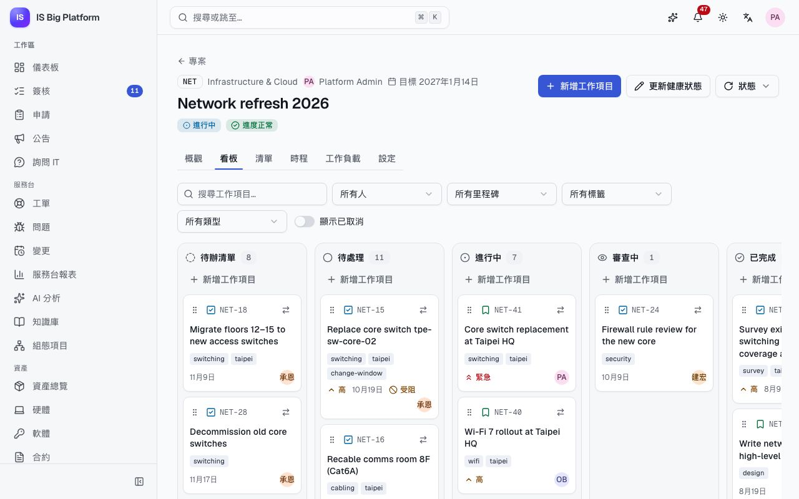
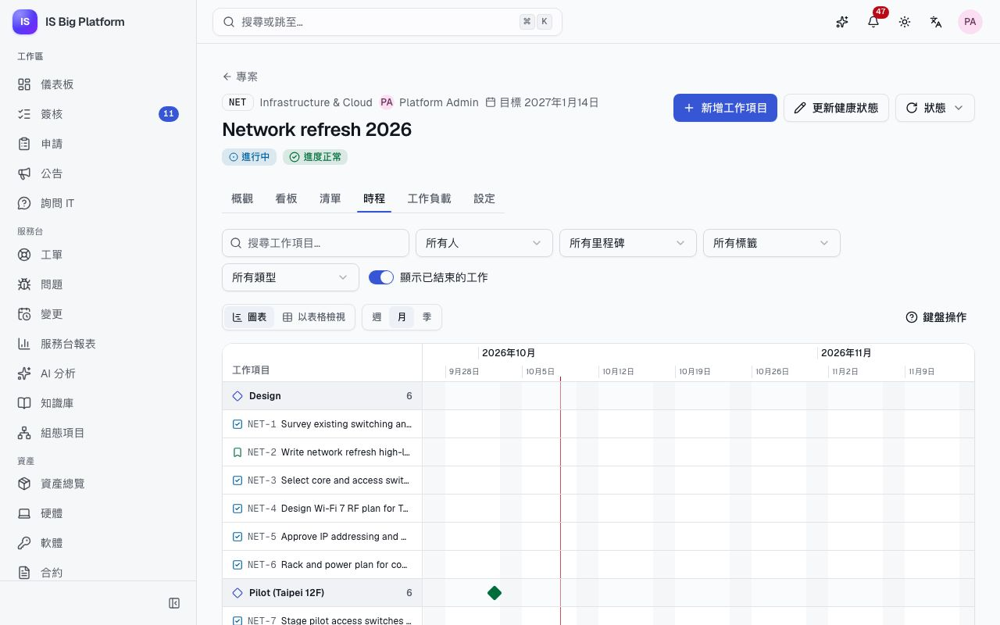
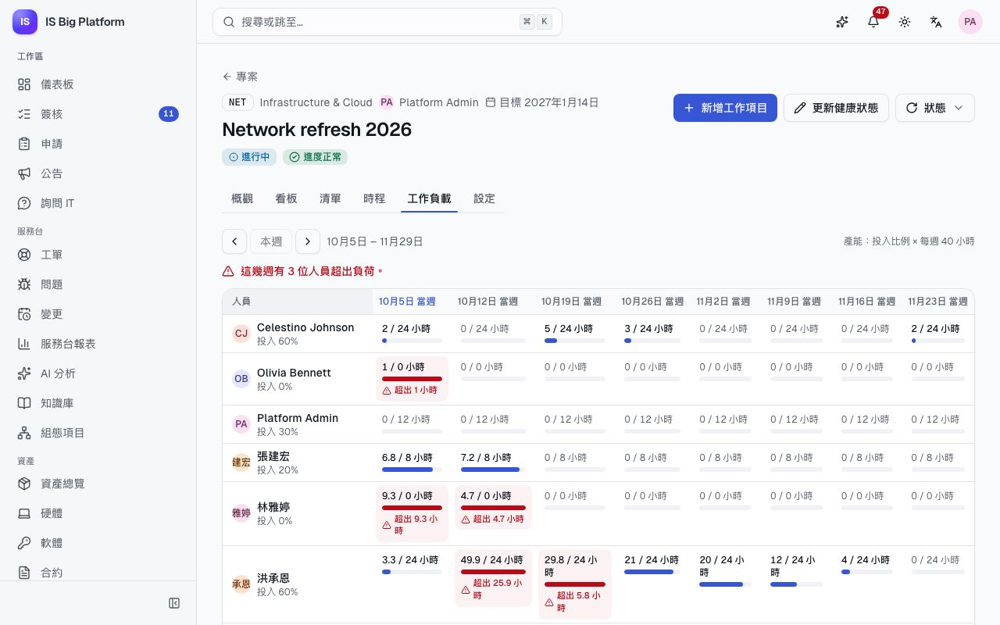

# 專案指南

本指南適用於專案經理、PMO，以及參與 IT 專案的人員。**專案**用來規劃與追蹤網路汰換、ERP 升級或新辦公室設立等工作：哪些人參與專案、每週投入多少時間、里程碑、看板與時程上的工作項目，以及人員是否超出負荷。工作項目可以連結到相關的工單、變更、組態項目與發行版本。

## 您可以在這裡做什麼

- [提出專案](#提出專案)並[啟動專案](#啟動專案並取得提案核准)，大型提案需經簽核
- [新增成員與里程碑](#新增成員與里程碑)
- [回報專案的健康狀態](#回報健康狀態與專案狀態)並變更專案狀態
- 使用滑鼠、鍵盤或**移至…**，[在看板上規劃與移動工作](#在看板上工作)
- [在時程上規劃日期與相依性](#在時程上規劃)，或以表格檢視
- 依每人每週[檢查工作負載](#檢查工作負載)與產能的對照
- 跨專案[追蹤自己的工作項目](#追蹤自己的工作項目)
- [將工作項目連結到工單、變更、組態項目與發行版本](#將工作項目連結到工單變更組態項目與發行版本)
- 了解[與 Azure DevOps Server 同步的工作項目](#與-azure-devops-server-同步的工作項目)

## 誰可以做什麼

您能變更的內容，取決於您在平台上的角色，以及您在各專案中的角色。

| 平台角色                                        | 允許的操作                                                             |
| ----------------------------------------------- | ---------------------------------------------------------------------- |
| **專案成員**（Project member）                  | 所有人都有：檢視內部專案，並處理您所屬專案的工作                       |
| **專案經理**（Project manager）                 | 另可建立專案（建立者會成為專案經理）                                   |
| **專案管理辦公室**（Project management office） | 檢視所有專案（包含私人專案）；建立專案；在負責人沒有主管時核准大型提案 |
| **專案模組管理員**（Projects administrator）    | 管理任何專案                                                           |

在專案內，**專案經理**可以編輯專案與所有工作項目，**成員**處理工作項目，**檢視者**可以閱讀與留言。**內部**專案所有使用專案模組的人都看得到；**私人**專案只有其成員（與 PMO）看得到。如果您沒有看到**新增專案**，請向管理員申請**系統管理 → 角色與存取權**中的**專案經理**角色。

## 提出專案

新工作會先以提案的形式開始，讓計畫在任何人投入時間之前先接受審視。

1. 前往**專案 → 專案**，選取**新增專案**。
2. 輸入**名稱**（例如「Network refresh 2026」）與由 2–10 個英文字母或數字組成的**代碼**。工作項目編號以代碼開頭，例如 `NET-12`。專案有工作項目後，代碼就無法變更。
3. 選擇**專案經理**（此人同時也是專案的管理者）、**部門**、**開始日**與**目標完成日**、**可見性**與**優先順序**。
4. 輸入**預估投入（小時）**。這個數字決定提案是否需要簽核。
5. 在**說明**中描述範圍（支援 Markdown），然後選取**建立專案**。

**後續流程：** 專案狀態為**提案中**。規劃期間可以新增成員、里程碑與工作項目，準備好後再啟動專案。

## 啟動專案並取得提案核准

1. 開啟專案，選取**啟動專案**。
2. 對話方塊會告訴您是否需要簽核，接著再次選取**啟動專案**。

**後續流程：**

- 預估投入不超過 400 小時的專案會立即變為**進行中**。
- 較大的專案會進入**專案提案**簽核：由負責人的主管決定（負責人沒有主管時由 PMO 決定），期限為 72 小時，48 小時後會發出提醒。**概觀**會顯示**提案簽核**卡片，列出**等待**與核准者；核准者會看到**前往待簽核事項決定**。
- 負責人會收到決定結果的通知。若未獲核准，專案會維持**提案中**：請調整後再次啟動。

在示範資料中，**Kaohsiung office opening**（`KHH`）規劃了 800 小時，因此其提案正在等待負責人的主管決定。它會顯示在專案總覽的**提案中**頁籤。

> **提示：** 400 小時的門檻是簽核流程的一部分。管理員可以在**系統管理 → 工作流程**中變更，並一併調整模組的 **提案簽核門檻（小時）** 設定；該設定只影響畫面上的提示。

## 新增成員與里程碑

成員及其投入比例會影響工作負載檢視；里程碑則用來為時程分組。

1. 開啟專案，前往**設定**頁籤（只有專案經理看得到）。
2. 在**成員**下，選擇**人員**、**角色**（**專案經理**、**成員**或**檢視者**）與**投入比例 %**（此人每週規劃於本專案的時間比例），然後選取**新增**。
3. 在**里程碑**下，輸入**里程碑名稱**與**到期日**，然後選取**新增里程碑**。使用箭頭調整順序，達成里程碑時選取**完成**。

**後續流程：** 新成員會收到通知（「被加入專案」）。移除成員後，其未完成的工作項目會變成未指派。在**封存或刪除**下，**封存專案**會將已結束的專案設為唯讀，並從專案總覽中隱藏；只有沒有工作項目的專案可以刪除（管理員可刪除任何專案）。

## 回報健康狀態與專案狀態

專案經理以健康狀態更新取代狀態報告郵件，讓利害關係人隨時掌握進度。

1. 開啟專案，選取**更新健康狀態**。
2. 選擇**進度正常**、**有風險**或**偏離軌道**，撰寫**備註**（有什麼變化、接下來會怎麼做），然後儲存。

**後續流程：** 系統會通知成員，備註會顯示在專案的**概觀**與專案總覽中。使用**狀態**可以**暫停**、**恢復進行**、**完成專案**或**取消專案**。若在仍有未完成工作項目時完成專案，系統會要求您選取**仍要完成**並填寫說明。

在示範資料中，**ERP upgrade to v12** 為**有風險**，**Zero Trust rollout** 為**偏離軌道**，兩者都附有備註。

**概觀**頁籤也會顯示**未完成工作項目**、**已逾期**、**本週完成**與**受阻**、**依狀態統計工作項目**、里程碑及其進度、成員及其投入比例，以及專案的歷程。

## 在看板上工作

看板是團隊日常推進工作的地方。

1. 開啟專案，選取**看板**頁籤。欄位依序為**待辦清單**、**待處理**、**進行中**、**審查中**與**已完成**；開啟**顯示已取消**可多一欄顯示已取消的工作項目。
2. 如要快速新增工作項目，請在欄位中選取**新增工作項目**，輸入標題後選取**新增**。如要建立完整的工作項目（類型、負責人、里程碑、日期、工時），請選取專案頂端的**新增工作項目**。
3. 如要移動卡片，可以拖曳卡片的握把，或使用鍵盤：
   1. 按 Tab 移到卡片的握把（**移動 NET-12**），按空白鍵或 Enter 拿起卡片。
   2. 使用方向鍵在欄位內或欄位間移動。
   3. 按空白鍵或 Enter 放下，或按 Esc 取消。螢幕閱讀程式會報讀每個位置。
4. 也可以開啟卡片的選單（**將 NET-12 移至…**），在**移至**下選擇欄位。
5. 選取卡片標題，即可在側邊面板中開啟：編輯詳細資料、新增相依性與上層項目，並在**留言與活動**下留言（選取**新增留言**，再選取**留言**）。**以完整頁面開啟**會讓它在獨立頁面中開啟。

使用看板上方的篩選條件，可依文字、**負責人**（**我**、**未指派**）、**里程碑**、標籤與**類型**（**史詩 (Epic)**、**功能**、**使用者故事**、**工作項目**、**錯誤**）縮小範圍。

**後續流程：** 負責人會收到新指派與新留言的通知，並在工作項目到期前一天收到提醒。標示為**受阻**的卡片相依於尚未完成的工作：在其相依項目變成**已完成**或已取消之前，它無法移到**進行中**。

> **提示：** **清單**頁籤以可排序的表格顯示相同的工作項目，方便大量檢閱。

## 在時程上規劃

使用時程來規劃日期、查看相依關係，並找出開始得太早的工作項目。

1. 開啟專案，選取**時程**頁籤。有開始日或到期日的工作項目會以長條顯示並依里程碑分組，箭頭則從每個工作項目指向等待它完成的工作項目。
2. 選擇縮放：**週**、**月**或**季**。
3. 如要用滑鼠變更日期，拖曳長條即可移動，拖曳兩端可變更開始日或到期日。
4. 使用鍵盤時：Tab 在長條間移動，Enter 開啟工作項目，Alt + ← / → 將工作項目移動一天，Alt + Shift + ← / → 只移動到期日。選取**鍵盤操作**可查看操作提示。
5. 如要新增相依性，請開啟工作項目，在**受阻於**下選取**新增相依性**。
6. 選取**以表格檢視**，即可以表格查看相同的計畫（**含日期與相依性的工作項目**，附**相依於**欄），以及含進度的**里程碑**表格。

若工作項目在它所相依的工作項目結束前就開始，會被標示出來（「在 … 結束前就開始。」），其箭頭也會以紅色顯示。會造成循環的相依性會被拒絕。沒有日期的工作項目會以未排程項目列在圖表下方。

在示範資料中，**Network refresh 2026**（`NET`）的時程包含核心交換器的更換工作，以及 **Rollout HQ** 與 **Rollout Hsinchu** 兩個里程碑。

## 檢查工作負載

在承諾日期或把某人加入其他專案之前，先檢查工作負載。

1. 開啟專案，選取**工作負載**頁籤。每一列是一位成員，每一欄是一週。
2. 每個儲存格會顯示該週的預計工時與產能。超出負荷的儲存格會顯示**超出 … 小時**，摘要則會統計有多少人超出負荷。
3. 選取儲存格可查看背後的工作項目。使用**前幾週**、**本週**與**後幾週**切換週次。

數字的計算方式：

- **預計工時**：每個未完成工作項目的剩餘工時（或預估工時），平均分配到從開始日（或今天）到到期日之間的工作天。沒有到期日或工時的工作項目不會列入規劃。
- **產能**：成員的投入比例 × 每週工時（預設 40 小時，為模組設定）。
- **未指派**列會顯示尚無人負責的已規劃工作。

專案經理、PMO 與管理員也可以在**專案 → 專案**中使用**團隊工作負載**（位於**卡片**與**表格**旁的版面切換）。它會以相同的格狀檢視顯示您管理的所有進行中專案（PMO 與管理員則看到所有進行中專案），並加總每個人的投入比例。

## 追蹤自己的工作項目

1. 前往**專案 → 我的工作**，查看各專案中指派給您的未完成工作項目，依**已逾期**、**今天**、**本週**、**之後**與**未設定日期**分組。
2. 可以直接在這裡變更工作項目的狀態，或開啟工作項目。

**儀表板**也有**我的工作**卡片，顯示已逾期與本週到期的工作。

## 將工作項目連結到工單、變更、組態項目與發行版本

連結讓相關脈絡集中在一處：核准這項工作的變更、它影響的組態項目，以及引發這項工作的事件。

1. 開啟工作項目（在側邊面板或完整頁面中）。
2. 在**連結的紀錄**下，選取**連結紀錄**。
3. 可視需要依**紀錄類型**篩選，依編號或標題搜尋，然後選取紀錄旁的**連結**。

附件放在同一個工作項目的**附件**下。您只會看到自己有權限檢視的連結的紀錄；其他紀錄只會計數（「另有 … 筆您沒有權限檢視的連結的紀錄」）。專案的**概觀**也有相同的**連結的紀錄**面板，例如可將專案連結到它所變更的應用程式。

在示範資料中，`NET` 的工作項目「Replace core switch tpe-sw-core-01」連結到變更「Core switch firmware upgrade tpe-sw-core-01」及組態項目 `tpe-sw-core-01`；`ERP` 的「Cut over production to ERP v12」則連結到 Finance ERP 12.1.0 發行版本。

## 與 Azure DevOps Server 同步的工作項目

在 Azure DevOps Server（地端部署）中規劃工作的開發團隊，可以透過整合中樞，讓 Azure DevOps 的工作項目（work item）與專案的工作項目保持一致。整合管理員會逐一為各專案設定。

- Azure DevOps 工作項目會同步為專案的工作項目，反之亦然，內容包括類型、上層項目、狀態、負責人、日期、工時，以及（若設定檔有包含）留言。
- 專案的規則依然適用：相依項目未完成前，工作項目無法開始；已封存的專案維持唯讀；不在專案中的負責人會以 0% 投入比例加入專案，成為**成員**。
- 從小組專案（team project）建立的專案一開始為**提案中**：其提案簽核[無法從外部略過](integrations.md#無法從外部略過簽核)。
- 在工作項目的連結的紀錄中，**同步對象**卡片會顯示連線、**上次同步**時間與**立即同步**。由同步產生的活動與留言會註明來源（「經由 …」）。

在示範資料中，**ERP work items ↔ tasks** 會將 `ERP` 專案與模擬的 **Contoso Azure DevOps Server** 雙向同步（若兩端都有變更，以 Azure DevOps 的值為準），**Network work items → tasks** 則將工作項目單向匯入 `NET`。連線與設定檔的設定方式，請參閱[整合指南](integrations.md)。

## 與其他功能的關聯

- **變更與發行版本**：將工作項目連結到核准它們的變更，以及它們所交付的發行版本：[變更與發行指南](changes-and-releases.md)。
- **服務台與 CMDB**：將工作項目連結到事件、問題與組態項目：[服務台指南](service-desk.md)。
- **簽核**：提案的決定與其他所有簽核一樣，會出現在**簽核**收件匣中：[核准或駁回申請](employees.md#核准或駁回申請)。
- **Azure DevOps Server** 同步：[整合指南](integrations.md)。
- **助理**可以依您的權限列出您的工作項目、尋找工作項目、建立工作項目、變更工作項目的狀態，以及提供專案的狀態報告：[助理與 AI](assistant-and-ai.md)。
- 專案如何融入我們的 IT 實務：[ISBP 如何融入我們的工作](how-it-fits-our-work.md)。
