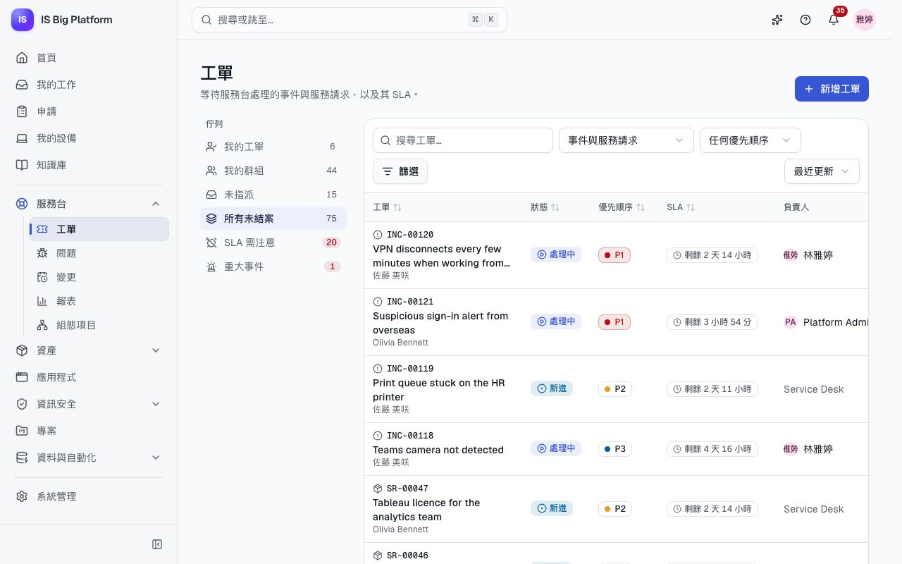
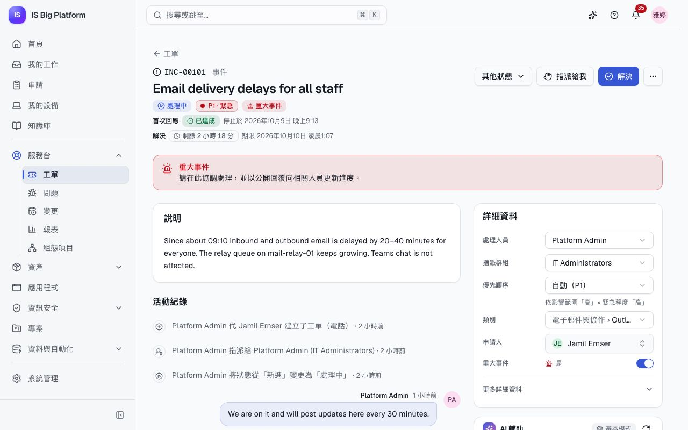
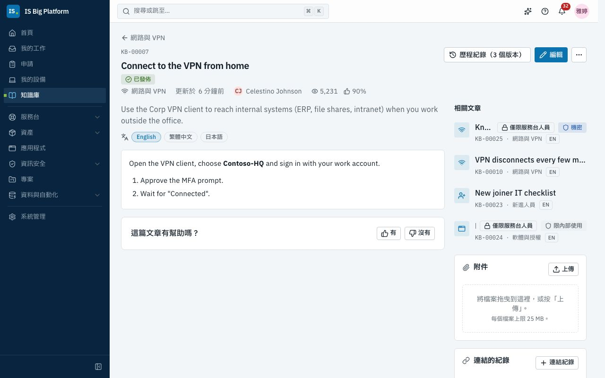
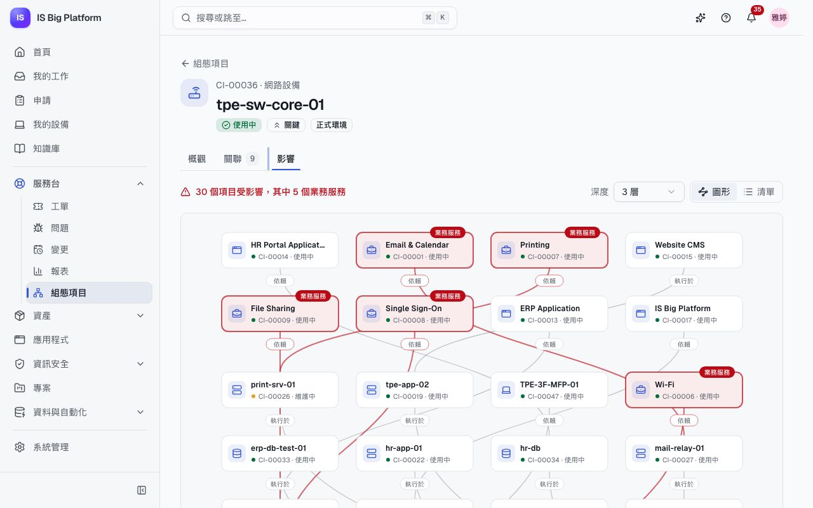

# 服務台指南

本指南適用於服務台人員與組長，涵蓋工單的日常作業：接手您的佇列、遵守 SLA、回覆申請人、解決與結案，以及工單周邊的工具——服務台 AI、知識庫、CMDB 與報表。變更與 CAB 另有專屬指南：[變更與發行](changes-and-releases.md)。

## 您可以在這裡做什麼

- [處理您的佇列](#處理您的佇列)，優先查看 SLA 需注意的工單
- [認識工單類型與狀態](#認識工單類型與狀態)
- 依影響範圍與緊急程度[設定優先順序](#設定優先順序)，並[達成 SLA](#達成-sla)
- [設定類別與 SLA 目標](#設定類別與-sla-目標)（服務台管理員）
- 為來電或親臨服務台的人員[代為登錄工單](#代人登錄工單)
- [處理工單](#處理工單)：接手、回覆、新增工作備註、附加檔案、連結相關項目
- [解決、重新開啟與結案工單](#解決重新開啟與結案工單)，並取得滿意度評分
- [完成服務請求](#完成服務請求)：處理透過服務目錄表單送入的請求
- [調查問題並記錄已知錯誤](#調查問題並記錄已知錯誤)
- [處理重大事件](#處理重大事件)
- [在工單上使用服務台 AI](#在工單上使用服務台-ai)，取得分派建議、相似工單、回覆草稿與摘要
- [搜尋與撰寫知識文章](#搜尋與撰寫知識文章)
- 在 CMDB 中[查看組態項目的影響範圍](#查看組態項目的影響範圍)
- [閱讀服務台報表](#閱讀服務台報表)
- [處理與 ServiceDesk Plus 同步的工單](#處理與-servicedesk-plus-同步的工單)

> **提示：** 如果側邊欄中沒有**服務台 → 工單**，請向管理員申請**服務台專員**（Service desk agent）角色。此角色可涵蓋所有部門，也可以只涵蓋部分部門；您會看到該角色所涵蓋部門的工單。在示範資料中，`helpdesk` 使用者就是服務台專員。

## 處理您的佇列

每個班次都從這裡開始：工作區會列出等待您與您的團隊處理的工單，以及各自的 SLA 計時。

1. 前往**服務台 → 工單**。
2. 在左側選擇佇列。每個佇列旁的數字是其中未結案的事件與服務請求數（問題與變更有各自的頁面，草稿不計入）。
   - **我的工單**：由您負責的工單，SLA 最緊急的排在最前面。
   - **我的群組**：指派給您所屬任一群組的未結案工單。
   - **未指派**：您的群組中尚無人接手的工單，最新建立的排在最前面。
   - **所有未結案**：您看得到的所有未結案工單。
   - **SLA 需注意**：已違反或即將違反 SLA 的工單，最緊急的排在最前面。
   - **重大事件**：未結案的重大事件。
     **SLA 需注意**與**重大事件**的數字不為零時會顯示為紅色。
3. 使用搜尋方塊（輸入標題，或 `INC-00042` 這類編號）、**類型**（預設為**事件與服務請求**，也可以選擇**所有類型**或單一類型）與**優先順序**縮小清單範圍。**篩選**中還有**狀態**（預設為**未結案**，也可以選擇**已完成**、**任何狀態**或單一狀態）、**指派群組**、**處理人員**與**類別**；已套用的篩選條件會顯示為可移除的標籤，**全部清除**可重設所有篩選條件。**排序**可依**最新建立**、**最早建立**、**SLA 最緊急**或**最近更新**排列佇列。
4. 選取一列即可開啟工單。每一列會顯示編號、標題與申請人，接著是狀態、優先順序、SLA 與負責人（處理人員，或在無人接手時顯示群組）。

**後續流程：** 佇列與清單每分鐘重新整理一次，數字會跳動到新的值。佇列與篩選條件都會反映在頁面網址中，因此您可以將檢視加入書籤，或分享給同事；工單上的返回連結會帶您回到離開時的清單。有工作等待您時，**首頁**上的**服務台**卡片會顯示您的佇列與最緊急的工單。

> **提示：** 在手機上，佇列會顯示在清單上方的下拉式選單中，篩選條件從**篩選**開啟，每張工單會以卡片顯示其狀態、優先順序與 SLA。

## 認識工單類型與狀態

每張工單都有類型與編號。每種類型有各自的生命週期。工單頁面會以主要按鈕顯示下一步（例如**解決**、**開始調查**或**送出簽核**）；**其他狀態**則提供該類型允許的其他變更，例如**擱置中**或**已取消**。

| 類型     | 編號    | 適用情況                                 | 狀態                                                           |
| -------- | ------- | ---------------------------------------- | -------------------------------------------------------------- |
| 事件     | `INC-…` | 某項功能故障或運作不正常                 | 新進 → 處理中 ⇄ 擱置中 → 已解決 → 已結案，或已取消             |
| 服務請求 | `SR-…`  | 有人需要某樣東西（通常來自服務目錄表單） | （待簽核 →）新進 → 處理中 ⇄ 擱置中 → 已完成 → 已結案，或已取消 |
| 問題     | `PRB-…` | 您正在找出事件背後的原因                 | 新進 → 調查中 → 已知錯誤 → 已解決 → 已結案，或已取消           |
| 變更     | `CHG-…` | 將在正式環境中進行變更                   | 請參閱[變更與發行](changes-and-releases.md)                    |

已解決的事件或已完成的請求可以用**重新開啟**回到**處理中**，或進入**已結案**。已完成的工單只會顯示詳細資料而無法編輯，請先重新開啟再變更。

## 設定優先順序

優先順序（P1 到 P4）決定適用哪些 SLA 目標，以及工單相對於其他工單的排序。它依據 ITIL 的影響範圍與緊急程度矩陣計算：

| 影響範圍 ↓ / 緊急程度 → | 高  | 中  | 低  |
| ----------------------- | --- | --- | --- |
| **高**                  | P1  | P2  | P3  |
| **中**                  | P2  | P3  | P4  |
| **低**                  | P3  | P4  | P4  |

1. 開啟工單，找到右欄最上方的**詳細資料**卡片。
2. 展開**更多詳細資料**，設定**影響範圍**（**高 — 影響許多人員或關鍵服務**、**中 — 影響一個團隊或部門**、**低 — 影響一位人員**）與**緊急程度**（**高 — 工作無法進行**、**中 — 工作受到影響**、**低 — 可以稍後處理**）。每次變更都會立即儲存。
3. **優先順序**會依矩陣計算（**自動（P3）**，下方會顯示「依影響範圍「…」× 緊急程度「…」」）。若要手動覆寫，請選擇 **P1 · 緊急**到 **P4 · 低**；若要改回依矩陣計算，再次選擇**自動**即可。

**後續流程：** 手動覆寫後，欄位下方會顯示**已手動調整，變更記錄在活動紀錄中**，活動紀錄也會記下誰變更了什麼。您檢視時有欄位被變更（您自己的編輯、您套用的 AI 建議或同事的變更），該欄位會短暫閃爍。執行中的 SLA 計時會改用新優先順序的目標。

## 達成 SLA

SLA 原則會為每張工單設定兩個目標：**首次回應**與**解決**。兩者都依行事曆上的營業時間計算（含工作時間與假日），因此除非行事曆設為 24×7 全天候開放，否則夜間、週末與國定假日都不會計時。

- **適用哪個原則**：工單建立時，第一個條件相符的啟用中原則（依服務台管理員設定的順序）。之後即使變更優先順序，仍會沿用該原則，但改用新優先順序的目標。
- **在哪裡查看**：工單標題下方（**首次回應**與**解決**，各自顯示目前狀態——剩餘時間、**已暫停**、**已達成**或已逾期多久——以及**期限**或**停止於**及時間；指向它即可看到所依據的原則），以及清單中的 **SLA** 欄。
- **首次回應**的達成條件：申請人以外的人第一次公開回覆、將工單移至**處理中**，或解決工單。
- **暫停計時**：計時會在原則指定的狀態下停止，通常是**擱置中**。重新開啟已解決的工單時，解決計時會從先前停止處繼續；工單處於已解決狀態的時間不計入。
- **警示與違反**：當目標時間經過一定比例（**提醒門檻**）時，處理人員（若無人指派，則為群組的每位成員）會收到 **SLA 即將逾期**通知，工單也會出現在 **SLA 需注意**佇列中。到達期限時，他們會收到 **SLA 已逾期**通知（應用程式內與電子郵件），活動紀錄會記下此事；工單會留在 **SLA 需注意**佇列的最上方。

示範資料中有兩個營業行事曆：**Taipei office hours**（平日 09:00–18:00，依台灣假日）與 **24×7**，以及三個原則：

| 原則                      | 適用對象 | 目標                                                                          | 暫停狀態       |
| ------------------------- | -------- | ----------------------------------------------------------------------------- | -------------- |
| Critical incidents (24×7) | P1 事件  | 回應 15 分鐘、解決 4 小時，全天候計算                                         | 不暫停         |
| Incidents                 | 其他事件 | P1 30 分鐘／4 小時、P2 1 小時／8 小時、P3 4 小時／24 小時、P4 8 小時／40 小時 | 擱置中         |
| Service requests          | 服務請求 | 4 個營業小時內回應、3 個營業日內完成                                          | 擱置中、待簽核 |

> **提示：** 等待申請人或供應商回覆時，請將工單設為**擱置中**，並在回覆中說明原因。只有在原則指定了**擱置中**狀態時，才會停止計時。

原則與行事曆由服務台管理員維護：請參閱[設定類別與 SLA 目標](#設定類別與-sla-目標)。

## 設定類別與 SLA 目標

服務台管理員（**服務台管理員**（Service desk administrator）角色）可在**系統管理 → 服務台設定**維護工單類別、SLA 原則、營業行事曆與服務目錄，分別位於**類別**、**SLA 原則**、**行事曆**與**服務目錄**分頁。

**為類別設定專屬的 SLA 目標**

1. 在**類別**分頁選擇**新增類別**，或選擇類別名稱進行編輯。
2. 以使用者會用到的每種語言填寫**名稱**，並設定**上層類別**與**工單類型**。選擇**預設群組**：此類別的新工單會轉給這個群組，清單會先列出**服務台群組**。SLA 規則與整合使用的**代碼**位於**進階**中。
3. 在 **SLA** 下保留**使用標準目標時間**，或選擇**為此類別設定目標時間**，並以上班時間輸入每個目標，例如 `4h`、`30m` 或 `1h 30m`。**所有優先順序相同**會為所有優先順序設定同一個目標。
4. 選擇**儲存**。

**後續流程：** 從下一張工單起，這些目標時間會套用到此類別及其子類別。系統會將它們保存為一個 SLA 原則，並排在一般原則之前檢查（表單會說明，例如「會在「Incidents」之前檢查…」）；類別列會顯示 **SLA：…**，而不是**標準 SLA**。

**維持 SLA 原則的順序**：在 **SLA 原則**分頁中，原則會由上而下檢查，第一個符合工單的原則決定其目標時間。使用原則的上移與下移箭頭調整順序。若某個原則永遠會被上方的原則搶先符合，會顯示**此原則不會生效：…**；選擇**優先檢查此原則**即可將它往上移。新原則會排在原本會接手其所有工單的原則之前。在原則中，**僅在以下情況**的規則（例如**類別（含子類別）**）決定適用的工單；**更多選項**包含說明、**提醒門檻**與暫停計時的狀態。

## 代人登錄工單

有人來電、寄電子郵件或親臨服務台時，請代為登錄工單，讓對方可以在**我的申請**中追蹤。

1. 前往**服務台 → 工單**，選擇**新增工單**。
2. 選擇**工單類型**：事件或服務請求（若您有**問題經理**（Problem manager）角色，也可以選擇問題）。
3. 在**申請人**中選擇人員。留空則以您自己的名義登錄。
4. 填寫**標題**與**說明**（支援 Markdown）。
5. 設定**影響範圍**與**緊急程度**；優先順序會依矩陣計算。
6. 選擇**類別**。若**指派群組**留空，工單會指派給該類別的預設群組，或服務台的預設群組。
7. 視需要選擇**處理人員**、**受影響的組態項目**；若是事件，也可以開啟**重大事件**。
8. 選擇**建立工單**。

**後續流程：** 申請人會收到「已收到 INC-…」通知，並可在**我的申請**中看到這張工單。處理人員會收到通知，SLA 開始計時；若已啟用服務台 AI，系統也會提供分派建議。

## 處理工單

工單頁面右上方會顯示下一步（事件為**解決**，服務請求為**完成**），旁邊是**指派給我**、**其他狀態**與**更多動作**（**編輯**；事件另有**建立問題**）。需要您處理的事項——自己工單上的「問題解決了嗎？」、要驗收的變更、CAB 簽核——會顯示在標題正下方。左欄是說明與**活動紀錄**（時間軸與回覆框）；右欄是**詳細資料**、**AI 輔助**面板、**相關項目**與**附件**。

**接手工單**：選擇**指派給我**，或在**詳細資料**中變更**處理人員**與**指派群組**。將工單移至其他群組時，若原處理人員不是該群組的成員，就會被移除。新的處理人員會收到「指派給您」通知。

**更正申請人**：如果工單登錄成錯誤的人員，請在**詳細資料**的**申請人**中選擇正確的人員。工單會移到對方的**我的申請**中，原申請人將無法再看到這張工單（除非工單本來就與對方有關），工單的部門與 SLA 目標則維持不變。時間軸會記錄這項變更。

**回覆或新增工作備註**：在**活動紀錄**下方：

1. 選擇**回覆申請人**撰寫申請人看得到的訊息，或選擇**工作備註**撰寫只有處理人員看得到的內容。
2. 撰寫內容（支援 Markdown），然後選擇**送出回覆**或**新增備註**，或按 ⌘/Ctrl + Enter。

申請人會收到回覆通知。申請人回覆時，處理人員會收到通知（若無人指派，則通知群組）。新的項目會滑入時間軸；連續三則以上非人員手動寫入的更新（同步、規則、AI）會收合成一行，例如「3 則系統更新」，可展開查看。

**修改標題或說明**：使用**更多動作 → 編輯**。

**附加檔案**：在**附件**中選擇**上傳**，或將檔案拖曳進來。檔案儲存前會先檢查類型、大小與惡意程式。

**連結相關項目**：**相關項目**卡片集中了與工單有關的一切：**受影響的 CI**（並顯示每個 CI 影響的業務服務）、**工單**、**其他紀錄**，以及與其他系統同步的工單會有的**同步對象**。選擇**新增**，再選擇：

- **受影響的組態項目**：搜尋組態項目後選擇**儲存**。關鍵 CI 會標示為**關鍵**。
- **相關工單**：選擇關係，再以編號或標題尋找工單（可選取多張），然後選擇**關聯 2 張工單**（數字為您選取的張數）。關係以此工單的角度描述：**相關**、**肇因於**、**造成**、**重複於**、**有重複工單**、**母工單**、**子工單**、**實施修正**與**由變更修正**。只有事件與服務請求可以「肇因於」問題；只有變更可以對事件或問題「實施修正」；母子工單必須是相同類型。
- **其他紀錄（資產、文章…）**：資產、發行版本、專案工作項目、知識文章或其他任何紀錄。您無法開啟的連結只會顯示數量。

使用該列的 ✕ 即可移除連結。

## 解決、重新開啟與結案工單

工作完成後，請解決工單，讓申請人確認問題已排除。最快的方式是從回覆框：寫好回覆後，選擇**送出並解決**（服務請求為**送出並完成**）而不是**送出回覆**——申請人只會收到一則訊息，而不是一則回覆加一則解決通知。

1. 選擇回覆下方的**送出並解決**，或頁面上方的**解決**（事件）／**完成**（服務請求）。
2. 選擇**解決代碼**：**已解決**（預設）、**提供暫時解法**、**使用者操作問題／說明**、**重複**、**未發現異常**或**無法重現**。
3. 確認**解決說明**：使用**送出並解決**時，說明就是您的回覆。申請人會看到這段說明。
4. 如果是某篇知識文章解決了問題，請在**使用的知識文章（選填）**中選擇它。從 **AI 輔助**面板插入的文章會自動帶入。
5. 選擇**解決**或**完成**。

**後續流程：**

- SLA 計時停止，申請人會收到通知，並被詢問**問題解決了嗎？**
- 申請人選擇**是，可以結案**即會結案。申請人可以給予 1 到 5 顆星的服務評分並留下意見；您會在**解決方式**卡片上看到**評分 …／5**，此評分也會計入報表中的**滿意度**。
- 申請人選擇**不，還是有問題**時，系統會詢問原因，將工單改回**處理中**，並通知您。
- 若申請人兩者都沒有選，工單會在 5 天後自動結案（管理員可在**系統管理 → 模組**中變更天數）。
- 已解決的工單會納入服務台 AI 的相似工單搜尋。使用的文章會連結到工單（顯示在**相關項目**中，並在時間軸中以**使用的文章：**標示），讓知識庫知道哪些文章真正解決了問題。

有些解決需要先經過簽核：若管理員設定了**解決方案簽核**簽核流程（例如「設備異常」類別需經主管簽核），解決這類工單時會改為送交簽核。工單會顯示**等待簽核**，解決內容則會保留在卡片上等待；簽核者核准後工單才會解決，若未核准，工單會附上簽核者的原因回到**處理中**。在此之前，您可以從**其他狀態**選擇**撤回解決方案**。

已解決的工單會以**重新開啟**作為主要按鈕；**其他狀態**可將其結案。若要取消工單，請在**其他狀態**中選擇**已取消**，並提供代碼（**重複**、**申請人取消**、**使用者操作問題／說明**或**未發現異常**）與原因；系統會通知申請人工單已取消。

## 完成服務請求

大多數服務請求來自申請入口網站的申請表單。服務台管理員會針對每份已發佈的表單決定處理方式（**系統管理 → 服務台 → 服務目錄**）：類別、**處理群組**、優先順序，以及工單要在**送出時**還是**核准後**建立。

在示範資料中，**筆電申請**表單會送交申請人的部門主管簽核，金額超過新台幣 60,000 元時，還需經 IT 資產管理簽核。核准後的申請會成為「硬體 › 筆電」類別中、指派給 Service Desk 群組的服務請求。

1. 從佇列開啟服務請求。其來源通道為**申請表單**。
2. 閱讀**申請內容**（表單上的回答）。顯示表單名稱的**來自申請 REQ-…** 標籤可開啟原始申請。
3. 進行作業，並視需要回覆申請人。
4. 選擇**完成**，選擇代碼並撰寫說明，再選擇**完成**。

**後續流程：** 申請人在**我的申請**中只需追蹤一個編號（`REQ-…`），從簽核到完成都在其中；其狀態會隨您的工單更新。若工單是在表單送出時建立，會停留在**待簽核**，直到簽核完成；若申請遭駁回，工單就會被取消。申請人看到的內容請參閱[員工](employees.md)。

有些表單會以**建立工單**或**建立變更**動作自行建立工單或變更，而不經過服務目錄。這些工單同樣會顯示**來自申請 REQ-…** 與來源通道**申請表單**，申請頁面也會將它們列在**後續動作**下。請參閱[建立您自己的流程](processes.md#加入動作)。

## 調查問題並記錄已知錯誤

同一事件反覆發生時，請建立問題來找出並消除原因。您需要**問題經理**角色。

1. 從其中一個事件開始：**更多動作 → 建立問題**。標題、說明、類別與 CI 會從事件帶入，該事件也已列在**此問題造成的事件**中。在同一欄以編號或標題加入其他事件，再選擇**建立問題**。（您也可以在**服務台 → 問題**選擇**新增問題**；分頁包括**未結案**、**已知錯誤**、**已解決**與**全部**。）
2. 在問題上選擇**開始調查**。
3. 在**問題**卡片中選擇**編輯**，填寫**根本原因**與**暫時解法**，再選擇**儲存變更**。
4. 記錄好原因與暫時解法後，選擇**標示為已知錯誤**。新進的問題也可以直接標示。
5. 選擇**問題**卡片中的**撰寫已知錯誤文章**：知識庫會開啟一篇僅限服務台人員閱讀的草稿，已用您的語言預先填好症狀、根本原因與暫時解法，並已設為此問題的**知識文章**。檢查後選擇**發佈**（或**送出審查**）；文章會顯示**依據 PRB-… 撰寫**。
6. 之後又發現更多事件？請在問題上使用**相關項目 → 新增 → 相關工單**，關係選擇**造成**；**問題**卡片會列出已關聯的事件。
7. 原因排除後（通常是透過對此問題**實施修正**的變更），請以代碼與說明解決問題，然後結案。

在示範資料中，PRB-00001「VPN client 5.2 crashes on macOS 15」是已知錯誤，並已關聯數個 VPN 事件；僅限處理人員閱讀的文章「Known error: VPN client 5.2 crashes on macOS 15」則提供了暫時解法。

> **提示：** 已知錯誤文章的對象為**僅限服務台人員**，服務台 AI 就會在新事件上建議這篇文章。您也可以在**問題**卡片的**知識文章**中改選既有的文章。

## 處理重大事件

當服務中斷影響許多人或關鍵服務，需要統一協調處理時，請宣告重大事件。

1. 開啟事件，在**詳細資料**中開啟**重大事件**（也可以在登錄時開啟）。
2. 將這張工單作為處理的唯一窗口：紅色的**重大事件**橫幅會提醒大家在此協調，並以公開回覆向相關人員更新進度。
3. 連結其他人針對同一起中斷提出的事件：在重大事件上選擇**相關項目 → 新增 → 相關工單**，選擇**母工單**，再以編號或標題選取其他事件。
4. 定期以回覆發佈最新進度，並在服務恢復後解決重大事件。

**後續流程：** 工單會出現在**重大事件**佇列中，**服務台報表**也會計入未結案的重大事件。若已開啟**在團隊通道公告重大事件**（預設為開啟），平台會將包含工單編號與標題的「重大事件」訊息，發佈到組織已訂閱的 Teams、Slack 與 Webhook 通道。

> **重要：** 回覆只會送達您所回覆那張工單的申請人。請在各關聯事件的工單上分別通知相關人員，或在重大事件修復後解決那些工單。

在示範資料中，INC-00101「Email delivery delays for all staff」是一個未結案的重大事件，並關聯了三個由郵件延遲的同仁提出的事件。

## 在工單上使用服務台 AI

**詳細資料**下方的 **AI 輔助**面板可協助您分派、回覆及記錄工單。您需要 **AI 輔助專員**（AI-assisted agent）角色。各區段預設為收合，讓面板保持精簡；只有等待處理的分派建議會自動展開。

面板標題列的標記會顯示是由哪種模式回答（指向它可查看說明）：

| 功能           | **基本模式**（未設定模型）                   | **語言模型**                         |
| -------------- | -------------------------------------------- | ------------------------------------ |
| 分派建議       | 由最相似的已解決工單投票決定，並顯示一致程度 | 由模型進一步判斷相似工單，並附上理由 |
| 相似工單、文章 | 搜尋已解決的工單與知識庫                     | 相同                                 |
| 回覆草稿       | 引用最佳文章步驟並附上連結的範本             | 以知識文章為依據、附上編號來源的回覆 |
| 摘要           | 從工單擷取問題、最新進度與目前狀態           | 根據說明與活動紀錄撰寫的摘要         |
| 知識文章草稿   | 依工單欄位填入內容的文章                     | 包含症狀／原因／解決方法的文章       |

1. **分派建議**會顯示建議的類別、群組與優先順序（含影響範圍與緊急程度）、**信賴度**及其理由（以您的語言顯示）。您可以針對單一欄位選擇**套用**、選擇**全部套用**，或選擇**略過**；套用的欄位會在**詳細資料**中閃爍。信賴度低於 40% 時，**全部套用**會改為一般按鈕，面板也會提示**信賴度低，套用前請確認**。若尚無建議，請選擇**提供分派建議**。已完成的工單、問題與變更不會顯示分派建議。
2. **相似的已解決工單**最多列出三張先前的工單（相符 25% 以上）及其解決方式；**顯示更多**可列出其餘工單。在問題上，**相似的事件**會優先列出未結案的事件，每個事件都有**連結至此問題**（連結後顯示**已連結**）。
3. **建議文章**最多列出三篇知識文章；**插入連結**可將文章連結加入回覆，並在您以**送出並解決**結案時自動設為**使用的知識文章**。
4. **撰寫回覆草稿**會以申請人的語言撰寫回覆。請先閱讀內容，選擇**插入回覆**，在回覆框中編輯後，再由您親自送出。
5. **摘要** → **產生摘要**會整理出問題、最新進度與目前狀態，方便您接手工單。變更上只有這個區段。
6. 在已解決、已完成或已結案的工單上，**知識文章** → **建立知識文章草稿**會建立一篇文章草稿（症狀、原因、解決方法、適用範圍），供編輯者審閱。您需要撰寫文章的權限。

**後續流程：** 未經您確認，任何內容都不會送出或發佈。產生的文字會標示**基本範本 — 傳送前請先檢查**，或標示模型名稱（「由 … 撰寫 — 傳送前請先檢查」）。使用語言模型時，個人資料會在文字離開平台前先經過遮罩。若管理員開啟了**自動套用高信賴度的建議**，服務台 AI 只會填入尚未設定的欄位，並在活動紀錄中註明。

組長可在**服務台 → 報表 → AI 分析**中查看分派建議的採用率、**免開單解決率**（詢問 IT 直接解決的問題）與 AI 成本（具有服務台報表權限即可唯讀檢視；**等待服務人員處理的建議**中的**檢視工單**會列出建議尚未被套用的未結案工單）。AI 模式與隱私的詳細說明：[助理與 AI](assistant-and-ai.md)。

## 搜尋與撰寫知識文章

知識庫收錄了供所有人使用的自助解答，以及供處理人員使用的疑難排解指南。詢問 IT、服務台 AI 與**回報問題**頁面都會搜尋知識庫，因此一篇好文章就能減少工單。

**尋找解答**：前往**知識庫**，在搜尋框（**需要什麼協助？**）中輸入問題。搜尋支援跨語言：以英文提問也能找到中文與日文文章。您也可以**依主題瀏覽**。具有**知識庫專員**（Knowledge agent）角色時，您還會看到對象為**僅限服務台人員**的文章。文章會在**其他語言**中列出其他語言版本，並顯示**相關文章**。知識庫專員與編輯者還會看到**連結的紀錄**；與 ServiceDesk Plus 同步的文章也會顯示**同步對象**卡片。

**撰寫並發佈文章**：撰寫文章需要**知識庫專員**角色；發佈則需要**知識庫編輯者**（Knowledge editor）角色。

1. 前往**知識庫**，選擇**新增文章**（編輯者也可在**管理**分頁找到）。
2. 填寫**標題**、**摘要**（顯示在搜尋結果中）與**文章內容**（Markdown：上方的按鈕可加入**標題**、**粗體**文字、清單與**連結**，**預覽**可查看結果）。選擇**分類**與**對象**（**所有人**或**僅限服務台人員**）。**更多設定**中有**語言**（預設為您的語言）、**翻譯自**、**標籤**、**機密等級**與**審閱期限**。
3. 選擇**儲存草稿**以便稍後繼續。準備好時，主要按鈕會說明接下來會發生什麼：**發佈**（「按下後會立即發佈給所選對象。」）或**送出審查**（「編輯者審查後才會發佈。」）。
4. 編輯者開啟文章（**管理 → 審查中**）並選擇**發佈**。文章審查期間，您可以選擇**撤回審查**以進行修改。

**後續流程：** 每次發佈都會保留為一個版本（**歷程紀錄**）。若管理員已開啟**發佈知識庫文章**簽核，送出後文章會改為送交簽核，並在核准後上線；無論哪種情況，您都會收到通知。若沒有適用的簽核，編輯者自己送出的文章會直接發佈。若要修改已上線的文章，編輯者可選擇**編輯**再選擇**發佈更新**，這會建立新版本。**下架**（位於文章的 **⋯** 選單，與**刪除**並列）會讓文章不再出現在搜尋結果中；**還原為草稿**可將其恢復。

**為文章分級並附加文件**：在編輯器中選擇**機密等級**（預設為**極機密**、**客戶機密**、**機密**或**限內部使用**；清單由管理員在**系統管理 → 模組**中設定）。讀者會在文章上看到等級標籤與橫幅，清單與搜尋結果中也會顯示，**管理**分頁也可依此篩選。機密等級不會改變誰可以閱讀文章：這由**對象**決定。文章儲存後，編輯者可在文章的**附件**面板中附加圖表與受控文件（例如網路架構圖、機櫃配置圖）；所有能閱讀文章的人都可以下載。文章發布後，附件內的文字（PDF、Word、PowerPoint、Excel 與文字檔；若管理員已設定文件擷取服務，也包括掃描檔與圖片）同樣可以被搜尋：以這種方式找到的搜尋結果會標示**在 runbook.pdf 第 2 頁**，Ask IT 也能據此回答。只有能閱讀該文章的人才找得到。已解決工單的附件在建議相似工單時也是如此。

**翻譯文章**：在文章上選擇**翻譯**。新文章會以翻譯版本的形式連結，讓讀者可以切換語言；每種語言都有自己的編號，並各自經過審查。

**處理意見回饋與審閱日期**：讀者會回答**這篇文章有幫助嗎？**，若回答**沒有**（可附上意見），系統會通知文章負責人。每篇已發佈的文章都有審閱日期（預設為首次發佈後 180 天）。到期時，系統會每週提醒負責人，文章會顯示橫幅，並列在**管理 → 到期需審閱**中。請檢查內容，然後**編輯**文章並設定新的**審閱期限**。

在示範資料中，試著搜尋「vpn keeps dropping」。**管理**分頁中有一篇審查中的文章（Microsoft Teams），以及一篇到期需審閱的文章（「Clear a stuck print queue」）。

## 查看組態項目的影響範圍

CMDB 記錄 IT 營運的服務、應用程式、伺服器、資料庫與網路設備，以及它們之間的相依關係。您可以用它查看由誰支援某個系統，以及系統故障時會影響哪些項目。瀏覽需要 **CMDB 檢視者**（CMDB viewer）角色；建立與編輯 CI、關聯及類別則需要 **CMDB 管理員**（CMDB manager）角色。

1. 前往**組態項目**。使用分頁（**全部**、**業務服務**、**應用程式**、**基礎架構**）、搜尋方塊（名稱，或 `CI-00042` 這類編號）與狀態；類別、重要性、環境、支援群組與負責人位於**篩選條件**中。
2. 開啟 CI。最先顯示的是**若此項目故障**，以一句話說明影響範圍，例如「8 個項目受影響，其中 7 個業務服務」，並列出會中斷的業務服務。**概觀**還會顯示其詳細資料、負責人與**支援群組**，以及**相關工作**：影響它的未結案工單（含**查看全部**）及其所屬的應用程式。
3. **關聯**會列出它與其他 CI 的關係（**依賴**、**執行於**、**連線至**、**包含**、**備份**及其反向關係）。CMDB 管理員可以選擇**新增關聯**。
4. **影響**會以**圖形**或**清單**顯示**故障時受影響**的項目（上方）以及它的**依賴項目**（下方），範圍可達您選擇的**深度**。將游標移到圖形中的 CI 上，即可醒目顯示它與此 CI 之間的路徑。

影響分析會依循**依賴**、**執行於**與**包含**關係；**連線至**與**備份**僅供參考。

**將 CI 連結到工單**：在每張工單上記錄受影響的 CI（請參閱[處理工單](#處理工單)）。這些 CI 會顯示在 CI 頁面上，協助您在服務中斷時找出相關事件；在變更上，它們則決定衝突檢查以及是否送交 CAB。

**維持正確的支援群組與重要性**：申請表單可以讓人員選取組態項目，其簽核也可以依組態項目的資料決定路徑：示範資料中的**組態變更申請**會請所選組態項目的**支援群組**簽核，並在組態項目為關鍵時請 CAB 簽核。沒有支援群組或支援群組錯誤的組態項目，會讓簽核送到錯誤的人手上。請參閱[建立您自己的流程](processes.md#讓紀錄中指定的群組簽核)。

在示範資料中，開啟 `tpe-sw-core-01`（CI-00036）：核心交換器一旦故障，大多數業務服務都會受到影響。

## 閱讀服務台報表

組長會在每日站立會議與每月服務檢討中使用這些報表。

1. 前往**服務台 → 報表**。啟用服務台 AI 時，**服務台**與 **AI 分析**分頁可在此報表與 AI 數據之間切換。
2. 選擇期間：**最近 7 天**、**最近 30 天**或**最近 90 天**。
3. 查看頂端的數據：**未結案工單**（含未結案的重大事件）、**期間內 SLA 違反次數**（回應與解決）、**平均解決時間**、**滿意度**與 **SLA 達成率**。**未結案工單**會開啟未結案的工單，**期間內 SLA 違反次數**則開啟 **SLA 需注意**佇列。
4. 下方依序是：**新建與解決**、**未結案（依優先順序）**、**待處理時間**、**熱門類別**與**各優先順序的解決時間**。點選優先順序或類別名稱即可開啟對應的工單。每張圖表都可以透過**顯示為**改以表格呈現。

您需要**服務台專員**角色（或其他具有服務台報表權限的角色）。

## 處理與 ServiceDesk Plus 同步的工單

部分工單會由整合中樞與我們地端的 ManageEngine ServiceDesk Plus 請求保持同步。您照常在 ISBP 中處理這些工單，整合中樞會雙向複製變更。

- **同步對象**：**相關項目**卡片底部的**同步對象**會顯示連線（在示範資料中為 **Contoso ServiceDesk Plus**）、請求編號（點選即可在 ServiceDesk Plus 中開啟該請求）、狀態（**已同步**、**衝突**、**錯誤**或**一方已刪除**）以及**上次同步**。具有**整合管理員**（Integrations administrator）角色的人員還會看到**立即同步**。
- **活動紀錄項目**：由同步寫入的活動紀錄會註明來源，例如「經由 Contoso ServiceDesk Plus #1234」。由同步建立的工單，來源通道會顯示為**系統整合**。
- **您的處理會同步過去**：編輯、狀態變更，以及回覆與工作備註（同步規則有同步留言時）都會傳送到 ServiceDesk Plus；在那裡所做的變更也會同步回來。狀態仍會遵循工單的生命週期，SLA 與通知的運作方式也與其他工單相同。
- **衝突**：若雙方都變更了同一欄位，**同步對象**會顯示**衝突**，由整合管理員決定要保留哪個值。

連線、同步規則與衝突的運作方式：[整合](integrations.md)。

## 與其他工作的關聯

- **員工**會回報問題、在**我的申請**中追蹤、確認問題已排除並為服務評分：[員工](employees.md)。
- 修正問題的**變更**需經 CAB 簽核：[變更與發行](changes-and-releases.md)。
- 會建立工單與變更、並依組態項目決定簽核路徑的**申請表單**：[建立您自己的流程](processes.md)。
- **資產**：在設備上選擇**回報問題**，會開啟一張已連結該設備的工單：[資產](assets.md)。
- **詢問 IT 與服務台 AI** 依據知識庫回答，只有在當事人確認後才會建立工單：[助理與 AI](assistant-and-ai.md)。
- **ServiceDesk Plus** 的工單與解決方案會透過整合中樞同步：[整合](integrations.md)。
- **類別、SLA 原則、行事曆、服務目錄與簽核流程**由管理員設定：[管理員](administrators.md)。
- 事件、問題、已知錯誤、SLA 等詞彙：[詞彙表](glossary.md)。
